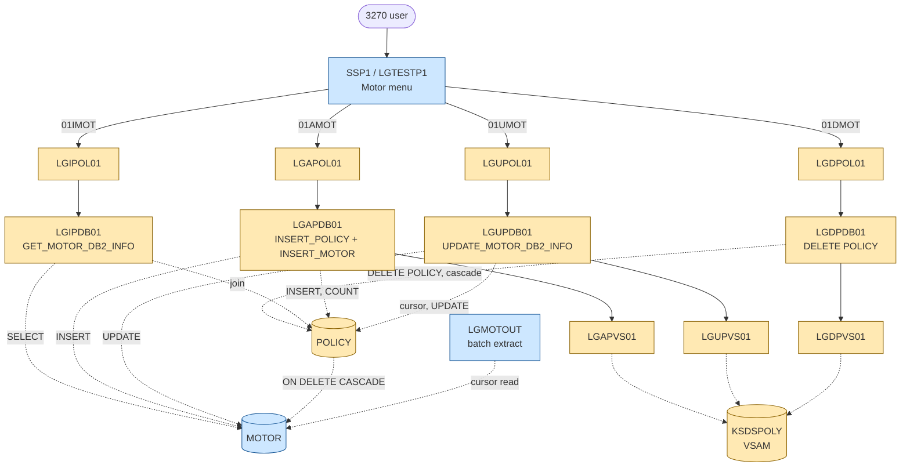
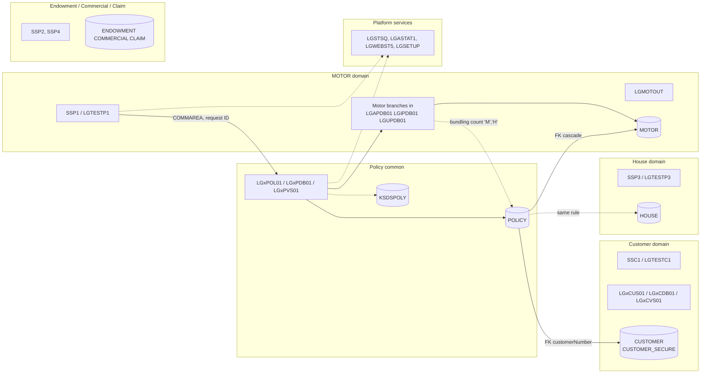

# MOTOR Domain – Architecture Documentation

**Application:** GenApp (General Insurance Application), Enterprise PL/I, CICS, Db2, VSAM
**Scope:** Motor insurance policy domain
**Method:** Local scanner DB (call, SQL and transaction relationships) cross-checked against source in `pli/`, `plinc/`, `jcl/` and `Resources/`. Where the scanner was incomplete, source search is the reference (see section 9).

---

## 1. Summary

The application has these domains: **Customer**, **Policy (common)**, and the policy-type domains **Endowment (life)**, **House**, **Motor** and **Commercial** (plus **Claim**). Each policy-type domain follows the same layered pattern. The MOTOR domain has **no programs of its own at the orchestrator or backend layer**. Its logic lives inside shared programs, which are selected by a **request ID** in the COMMAREA (`01IMOT`, `01AMOT`, `01UMOT`, `01DMOT`).

| Domain element | Motor-specific | Shared with other domains |
|---|---|---|
| Db2 tables | `MOTOR` | `POLICY` (parent), `CUSTOMER` (indirect) |
| Transactions | `SSP1` | `LGPF`, `LGST`, `SSST`, `LGSE`, `SSC1` (indirect) |
| Programs | `LGTESTP1`, `LGMOTOUT` | `LGxPOL01`, `LGxPDB01`, `LGxPVS01`, `LGSTSQ`, `LGASTAT1`, `LGWEBST5`, `LGSETUP` |
| Includes | none (motor fields are a branch inside shared structures) | `LGCMAREA`, `LGPOLICY`, `SSMAP` |
| VSAM | none | `KSDSPOLY` (shared policy cross-reference file) |

**Key architectural finding:** `MOTOR` is a *policy-type extension table*. The domain boundary is enforced by **request ID**, not by program separation. This is the single biggest source of cross-domain coupling.

---

## 2. Motor Domain Components

### 2.1 Db2 tables

| Table | Role | Owner of data | Evidence |
|---|---|---|---|
| **`GENASA1.MOTOR`** | Motor-specific policy attributes: `policyNumber` (PK/FK), `make`, `model`, `value`, `regNumber`, `colour`, `cc`, `yearOfManufacture`, `premium`, `accidents` | **Motor** | `jcl/GenAppDDL.jcl` lines 292-307; tablespace `GENATS05` |

Relationship: `MOTOR.policyNumber` → `POLICY.policyNumber` with **`ON DELETE CASCADE`**. A motor row cannot exist without its policy row.

### 2.2 Motor-specific programs

| Program | Type | Purpose | Motor-only? |
|---|---|---|---|
| [`LGTESTP1`](../pli/LGTESTP1.pli) | CICS 3270 menu, transaction `SSP1` | "Solution Motor Policy Menu". Options: 1 inquire, 2 add, 3 delete, 4 update. Maps `CA_M_*` fields to/from map `SSMAPP1`. | **Yes** |
| [`LGMOTOUT`](../pli/LGMOTOUT.pli) | Batch, Db2 | Reads all rows of `GENASA1.MOTOR` through cursor `MOTOR_CSR` and writes a 132-byte record to `MOTOROUT`. | **Yes** (no JCL in repo) |

### 2.3 Motor-specific code sections inside shared programs

These programs contain a motor branch, but also serve other domains.

| Program | Motor-specific procedure / branch | Request ID | Operation on `MOTOR` |
|---|---|---|---|
| [`LGAPDB01`](../pli/LGAPDB01.pli) | `INSERT_MOTOR` (lines 520-570) and `WHEN('01AMOT')` (lines 177, 223) | `01AMOT` | **INSERT**. Also applies accident loading to `CA_M_PREMIUM` (x1.00 / 1.20 / 1.50 / 3.00 by accident count). |
| [`LGIPDB01`](../pli/LGIPDB01.pli) | `GET_MOTOR_DB2_INFO` (lines 558-656), `WHEN('01IMOT')` line 294 | `01IMOT` | **SELECT** (join `POLICY`, `MOTOR`) |
| [`LGUPDB01`](../pli/LGUPDB01.pli) | `UPDATE_MOTOR_DB2_INFO` (lines 405-437), `WHEN('01UMOT')` line 229 | `01UMOT` | **UPDATE** |
| [`LGUPOL01`](../pli/LGUPOL01.pli) | `WHEN('01UMOT')` line 120: COMMAREA length check with `WS_FULL_MOTOR_LEN` | `01UMOT` | none |
| [`LGDPDB01`](../pli/LGDPDB01.pli), [`LGDPOL01`](../pli/LGDPOL01.pli) | Request ID `01DMOT` in `WHEN` list | `01DMOT` | **No direct SQL**. `DELETE FROM POLICY`; the `MOTOR` row goes by FK cascade. |
| [`LGAPVS01`](../pli/LGAPVS01.pli), [`LGUPVS01`](../pli/LGUPVS01.pli) | `WHEN('M')` branch writing `WF_M_MAKE/MODEL/VALUE/REGNUMBER` | request ID char 4 = `M` | VSAM `KSDSPOLY` write / rewrite |
| [`LGDPVS01`](../pli/LGDPVS01.pli) | Generic key delete, no motor branch | any | VSAM delete |

### 2.4 Transactions

| Transaction | Program | Motor domain? | Notes |
|---|---|---|---|
| **`SSP1`** | `LGTESTP1` | **Yes, motor-only** | Pseudo-conversational (`RETURN TRANSID('SSP1')`). CSD: `Resources/GenApp.CSD`, `jcl/CreateCSDDefs.jcl`. |

All other transactions are not motor-specific (see section 4).

### 2.5 Shared structures with a motor section

| Include | Motor part | Size / note |
|---|---|---|
| [`LGCMAREA.inc`](../plinc/LGCMAREA.inc) | `CA_MOTOR` (lines 71-81): 9 fields = 77 bytes + `CA_M_FILLER CHAR(32323)` | Branch of `CA_POLICY_SPECIFIC UNION` over `CA_POLICY_RAW CHAR(32400)` |
| [`LGPOLICY.inc`](../plinc/LGPOLICY.inc) | `DB2_MOTOR` (lines 73-84), `WS_MOTOR_LEN`=65, `WS_FULL_MOTOR_LEN`=137 | Duplicate declarations of the two length constants in `LGUPOL01` and `LGUCUS01` |
| [`SSMAP.inc`](../plinc/SSMAP.inc) | Map `SSMAPP1`, fields `ENP1CMK`, `ENP1CMO`, `ENP1VAL`, `ENP1REG`, `ENP1COL`, `ENP1CC`, `ENP1MAN`, `ENP1PRE`, `ENP1ACC` | Mapset `SSMAP` is **shared** by `LGTESTC1`, `LGTESTP1-4`. BMS source is not in the repo. |

### 2.6 Statistics counters (motor-specific names)

Named counters in pool `GENA`, created by `LGSETUP` (`CNT_300` to `CNT_699`) and read by `LGWEBST5`:

`GENA01IMOT00`, `GENA01IMOT99`, `GENA01AMOT00`, `GENA01AMOT99`, `GENA01DMOT00`, `GENA01DMOT99`, `GENA01UMOT00`, `GENA01UMOT99`.

Pattern: `GENA` + request ID (6 chars) + return code (`00` ok, `99` any error).

---

## 3. Motor Call Flows

Blue = motor-specific. Amber = shared with other domains.

### 3.1 Add motor policy (`01AMOT`)

1. `LGTESTP1` (option 2) fills `CA_M_*`, `CA_PAYMENT=0`, `CA_BROKERID=0`, and `LINK`s `LGAPOL01` (`LENGTH(32500)`).
2. `LGAPOL01` checks the COMMAREA length. The business-rules call to `LGAPBR01` is applicable only to `01AEND` and is switched off by default. It then `LINK`s `LGAPDB01`.
3. `LGAPDB01`:
   1. Validates length with `WS_FULL_MOTOR_LEN` (137) and sets `DB2_POLICYTYPE='M'`.
   2. `INSERT_POLICY`: runs `BUNDLING_DISCOUNT` and `CALCULATE_COMMISSION`, then `INSERT INTO POLICY` with identity `DEFAULT`, and gets the number with `IDENTITY_VAL_LOCAL()`.
   3. `INSERT_MOTOR`: applies accident loading to the premium and does `INSERT INTO MOTOR`.
   4. `LINK LGAPVS01` writes the `KSDSPOLY` cross-reference record (64 bytes, key 21 bytes: type, customer, policy).
4. Any non-zero SQLCODE sets return code `90`, writes an error message and **`ABEND LGSQ`**, which backs out the policy insert.

### 3.2 Inquire (`01IMOT`)

`LGTESTP1` → `LGIPOL01` → `LGIPDB01.GET_MOTOR_DB2_INFO`: single `SELECT` on the join `POLICY, MOTOR` by customer and policy number. Result is copied to the COMMAREA with `SUBSTR(CA_POLICY_RAW,1,WS_MOTOR_LEN) = DB2_MOTOR_TEXT`. `premium` and `accidents` are moved separately. Return code `01` means not found, `90` means Db2 error, `98` means COMMAREA too short.

### 3.3 Update (`01UMOT`)

`LGTESTP1` (option 4) first inquires, then updates: `LGUPOL01` → `LGUPDB01`.
`LGUPDB01` opens `POLICY_CURSOR` (select for update), compares `LASTCHANGED` with the COMMAREA timestamp (optimistic locking, return code `02` on mismatch), runs `UPDATE MOTOR` for all columns, then `UPDATE POLICY ... WHERE CURRENT OF`, then `LINK LGUPVS01` (`LENGTH(225)`).

### 3.4 Delete (`01DMOT`)

`LGTESTP1` (option 3) → `LGDPOL01` → `LGDPDB01` does `DELETE FROM POLICY`. **There is no `DELETE FROM MOTOR`**; the row is removed by the Db2 referential constraint. `LGDPVS01` then deletes the `KSDSPOLY` record.

### 3.5 Unit of work

All programs are connected by local `LINK` within one task, so the Db2 and VSAM changes of one motor request form **one unit of work**. It is committed when the top-level program returns. `LGTESTP1` issues `SYNCPOINT ROLLBACK` when it gets a non-zero return code for add and delete. Whether VSAM `KSDSPOLY` writes are backed out depends on the file's recovery attribute in the CSD (not checked here).

---

## 4. Cross-Domain (Shared) Functionality

"Cross-domain" means: used by Motor and at least one other domain. Motor must not change these without regard to the others.

### 4.1 Shared programs

| Program | Used by | Shared mechanism | Motor-specific content |
|---|---|---|---|
| `LGAPOL01`, `LGIPOL01`, `LGUPOL01`, `LGDPOL01` | Endowment, House, Motor, Commercial (Claim) | Generic orchestrator; only the request ID differs | Only `LGUPOL01` has a motor `WHEN` (length check) |
| `LGAPDB01` | All policy types | Inserts `POLICY` for every type; type-specific `INSERT_xxx` per branch | `INSERT_MOTOR`, accident loading |
| `LGIPDB01` | All policy types | `SELECT` per type | `GET_MOTOR_DB2_INFO` |
| `LGUPDB01` | Endowment, House, Motor | Updates `POLICY` for every type | `UPDATE_MOTOR_DB2_INFO` |
| `LGDPDB01` | All policy types | `DELETE POLICY`, cascade | request ID only |
| `LGAPVS01`, `LGUPVS01`, `LGDPVS01` | All policy types | `KSDSPOLY` access with type in key | `WHEN('M')` branch |
| `LGIPVS01` (`LGPF`) | All policy types | Generic GTEQ browse of `KSDSPOLY` | none |
| `LGSTSQ` | The whole application | Error messages to TS/TD queue | none |
| `LGASTAT1` (`LGST`) | The whole application | Event-processing target; increments counter `GENA<request><rc>` | none (generic) |
| `LGWEBST5` (`SSST`) | The whole application | Reads all counters, including the 8 motor counters | motor counter names in tables |
| `LGSETUP` (`LGSE`) | The whole application | Creates counters and queues | motor counter names |

### 4.2 Shared Db2 tables

| Table | Shared with | What Motor does with it |
|---|---|---|
| **`POLICY`** | Endowment, House, Commercial, Claim, Customer | Every motor request reads or writes it. `POLICYTYPE='M'` identifies motor rows. It is the **parent** of `MOTOR` (FK + cascade). |
| `CUSTOMER` | Customer domain | Not accessed by motor programs directly. `POLICY.customerNumber` FK ties motor policies to customers, and `LGACUS01` inserts a policy row. |

### 4.3 Shared includes / data structures

| Include | Impact on Motor |
|---|---|
| `LGCMAREA` | `CA_MOTOR` is one member of the shared COMMAREA union. A layout change anywhere in the COMMAREA affects Motor. Included by about 21 programs. |
| `LGPOLICY` | Shared `DB2_xxx` host structures and `WS_xxx_LEN` constants. |
| `SSMAP` | Mapset shared by all menu programs; `SSMAPP1` is the motor screen. |

### 4.4 Cross-domain business logic (hidden coupling)

| Rule | Location | Coupling |
|---|---|---|
| **Bundling discount**: 15% off `payment` when the customer has more than 2 active policies of type `'M'` or `'H'` | `LGAPDB01.BUNDLING_DISCOUNT` (lines 344-369) | **Motor ↔ House** (counts both types in `POLICY`). A new motor policy changes the price of house policies and the reverse. |
| **Broker commission** on number of active policies of the broker | `LGAPDB01.CALCULATE_COMMISSION` (lines 374-406) | Motor ↔ all domains (count of `POLICY` by `BROKERID`, any type) |
| Accident loading on `CA_M_PREMIUM` | `LGAPDB01.INSERT_MOTOR` | Motor only, but executed in a shared program |
| Policy number allocation | `POLICY.policyNumber` identity (start 1000001) | All policy types share one number range |
| Optimistic-lock timestamp `POLICY.LASTCHANGED` | `LGUPDB01` | All updatable policy types |

### 4.5 Shared transactions

| Transaction | Program | Relation to Motor |
|---|---|---|
| `LGPF` | `LGIPVS01` | Browse of `KSDSPOLY` for all policy types |
| `LGST` | `LGASTAT1` | Generic statistics counters (event-processing target) |
| `SSST` | `LGWEBST5` | Statistics display, includes motor counters |
| `LGSE` | `LGSETUP` | Initial setup |
| `LGCF` | `LGICVS01` | Customer file (customer domain, no motor relation) |
| `SSC1` | `LGTESTC1` | Customer menu. Not motor, but the entry point for the customer a motor policy belongs to. |

---

## 5. Domain Boundaries

### 5.1 Boundary to Policy (common) domain

| Aspect | Rule |
|---|---|
| Direction | Motor **depends on** Policy. Policy does not depend on Motor semantically; it only dispatches by request ID. |
| Data | Motor never inserts, updates or reads `POLICY` itself outside shared programs. The `POLICY` row is always created first. |
| Interface | COMMAREA (`LGCMAREA`), request ID `01xMOT`, return codes `00/01/02/70/90/98/99`. |
| Risk | Changes to the common header (18 bytes + `CA_POLICY_COMMON`) affect Motor. |

### 5.2 Boundary to Customer domain

| Aspect | Rule |
|---|---|
| Link | `POLICY.customerNumber` FK to `CUSTOMER`. Motor has no direct access to `CUSTOMER`, `CUSTOMER_SECURE` or the customer programs. |
| Behaviour | A motor add for a non-existing customer fails with SQLCODE -530 → return code `70` → "Customer does not exist" in `LGTESTP1`. |
| Delete | Deleting a customer cascades to `POLICY`, then to `MOTOR` (two-level cascade, from the DDL). No customer-delete program was found in this repo. |

### 5.3 Boundary to House domain

| Aspect | Rule |
|---|---|
| Table | No shared table, other than the `POLICY` parent. |
| Programs | Separate menu (`SSP3`/`LGTESTP3`) and separate `INSERT_HOUSE`, `GET_HOUSE_DB2_INFO`, `UPDATE_HOUSE_DB2_INFO`. |
| **Coupling** | **Bundling discount** in `LGAPDB01` counts `'M'` and `'H'` together. This is the one business rule that crosses the Motor/House boundary. |

### 5.4 Boundary to Endowment, Commercial and Claim domains

No functional coupling other than the shared programs, `POLICY`, `KSDSPOLY`, COMMAREA and the commission rule. These domains have their own tables (`ENDOWMENT`, `COMMERCIAL`, `CLAIM`) and menus (`SSP2`, `SSP4`).

### 5.5 Boundary to platform services

| Service | Interface |
|---|---|
| Error logging | `LINK LGSTSQ` with an `ERROR_MSG` structure from `WRITE_ERROR_MESSAGE` in each program |
| Statistics | Named counters `GENA<request><rc>` from pool `GENA`; `LGASTAT1` is an event-processing adapter target |
| Terminal | BMS mapset `SSMAP`, map `SSMAPP1` |

### 5.6 External boundary (not in repo)

| Item | Status |
|---|---|
| `LGAPBR01` (business rules) | In CSD, source not in repo; relevant only for `01AEND`, off by default |
| BMS source of `SSMAP` | Not in repo; only `SSMAP.inc` |
| JCL and consumers of `MOTOROUT` | Not in repo |
| Callers of `LGxPOL01` outside this repo | Unknown |

---

## 6. Data Ownership Matrix

| Data | Create | Read | Update | Delete |
|---|---|---|---|---|
| `MOTOR` | `LGAPDB01` | `LGIPDB01`, `LGMOTOUT` | `LGUPDB01` | FK cascade (via `LGDPDB01`) |
| `POLICY` (motor rows) | `LGAPDB01` (also `LGACUS01` for customer + policy) | `LGIPDB01`, `LGUPDB01`, `LGAPDB01` (counts) | `LGUPDB01` | `LGDPDB01` |
| `KSDSPOLY` (type `M`) | `LGAPVS01` | `LGIPVS01`, `LGUPVS01` | `LGUPVS01` | `LGDPVS01` |
| `GENA01xMOTnn` counters | CICS `GET COUNTER` (`LGASTAT1`), created by `LGSETUP` | `LGWEBST5` | - | - |

---

## 7. Classification Summary

| Item | Type | Classification |
|---|---|---|
| `MOTOR` | Db2 table | **Motor** |
| `POLICY` | Db2 table | **Cross-domain** (Policy common) |
| `SSP1` | Transaction | **Motor** |
| `LGTESTP1` | Program | **Motor** |
| `LGMOTOUT` | Program | **Motor** |
| `LGAPOL01`, `LGIPOL01`, `LGUPOL01`, `LGDPOL01` | Programs | **Cross-domain** |
| `LGAPDB01`, `LGIPDB01`, `LGUPDB01`, `LGDPDB01` | Programs | **Cross-domain**, with motor sections |
| `LGAPVS01`, `LGUPVS01`, `LGDPVS01`, `LGIPVS01` | Programs | **Cross-domain** |
| `LGSTSQ`, `LGASTAT1`, `LGWEBST5`, `LGSETUP` | Programs | **Cross-domain** (platform) |
| `LGCMAREA`, `LGPOLICY`, `SSMAP` | Includes | **Cross-domain** with motor section |
| `KSDSPOLY` | VSAM | **Cross-domain** |
| `LGTESTC1`, `LGACUS01` and the other customer programs | Programs | **Customer** domain, not Motor |
| `LGBATCH`, `LGBATDB2`, `LGBATCHF` | Programs | **Customer** domain (they read `CUSTOMER`) |

---

## 8. Observations and Risks at the Boundary

| # | Observation | Risk |
|---|---|---|
| 1 | No motor-owned orchestrator or backend; the domain is a set of branches in shared programs. | A motor change forces recompile and retest of shared programs for all domains. |
| 2 | `WS_MOTOR_LEN`=65 covers `make` to `manufactured`, but `CA_MOTOR` is 77 bytes and `DB2_MOTOR_TEXT` is `CHAR(77)`. `premium` and `accidents` are moved separately in `LGIPDB01`. | New motor fields placed after `accidents` are not copied by the bulk move. |
| 3 | `WS_FULL_MOTOR_LEN` and `WS_MOTOR_LEN` are declared in three places (`LGPOLICY.inc`, `LGUPOL01`, `LGUCUS01`). In `LGUCUS01` the constants are declared but the scan found no motor use there. | Drift between copies gives return code `98` or an undersized COMMAREA being accepted. |
| 4 | `LGDPDB01` relies on FK cascade for `MOTOR`. | Any change to the FK definition silently changes delete behaviour. |
| 5 | The bundling discount counts `'M'` and `'H'` in `POLICY`. | Motor and House domains cannot be separated without moving or copying this rule. |
| 6 | `KSDSPOLY` stores only `make, model, value, regNumber` for motor; Db2 holds 5 more columns. | Two stores with different content for the same policy. |
| 7 | `LGUPDB01` links `LGUPVS01` with a fixed `LENGTH(225)`. | Fragile if the VSAM layout changes. |
| 8 | `LGMOTOUT` has its own host variables and a fixed output layout, with no JCL or documented consumer in the repo. | Unknown downstream dependency on the `MOTOR` table layout. |
| 9 | Menu `LGTESTP1` clears only some fields after delete (not premium or accidents). | Cosmetic, motor-only. |

---

## 9. Method Notes and Verification Gaps

- **Scanner vs source.** The scanner SQL-table result returned `MOTOR` for `LGAPDB01`, `LGIPDB01` and `LGMOTOUT`, but **not** `LGUPDB01`. The `UPDATE MOTOR` was found by source search (`LGUPDB01.pli` lines 413-425). Scanner line numbers refer to expanded source and differ from `pli/`.
- **`LGDPDB01`** shows `POLICY` only, consistent with the cascade design.
- **Includes.** The scanner returned no include rows for PL/I `%INCLUDE` members; the usage of `LGCMAREA`, `LGPOLICY` and `SSMAP` is taken from source search.
- **Transactions.** The scanner returned only `SSC1`, `SSP1-4`, `SSST` from `EXEC CICS` references. `LGPF`, `LGST`, `LGSE`, `LGCF` come from `Resources/GenApp.CSD`.
- **Call chain.** The scanner shows `LGxPOL01` → `LGxPDB01`, and the VSAM links (`LGAPVS01`, `LGUPVS01`, `LGDPVS01`) are not in the scanner result for the DB programs; they were confirmed in source (`LGAPDB01` line 241, `LGUPDB01` line 155, `LGDPDB01` line 125).
- **CICS behaviour** (single unit of work across local `LINK`, rollback semantics) is stated from general CICS knowledge. The IBM documentation lookup returned no result for CICS Transaction Server, so this was not checked against the manual. Confirm VSAM recovery attributes in the CSD before relying on file backout.
- `LGAPBR01`, the `SSMAP` BMS source and `MOTOROUT` consumers are outside the repository.
- No data dictionary (`DD.json`) exists in this workspace; none was created for this analysis.

## 10. Related Documents

- Impact analysis for a Motor column change: [`.bobz/impact-analysis/motor-add-nullable-column-20261023-112357/IMPACT-ANALYSIS.md`](../.bobz/impact-analysis/motor-add-nullable-column-20261023-112357/IMPACT-ANALYSIS.md)
