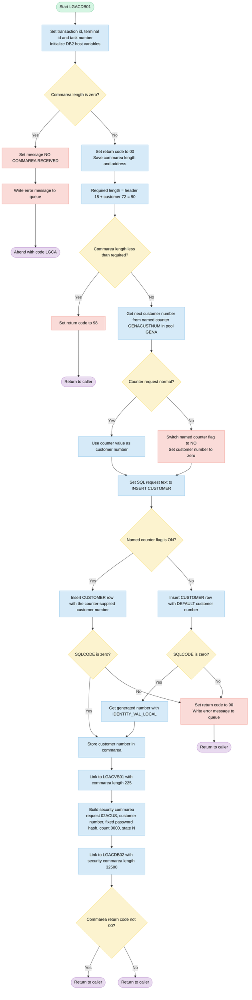
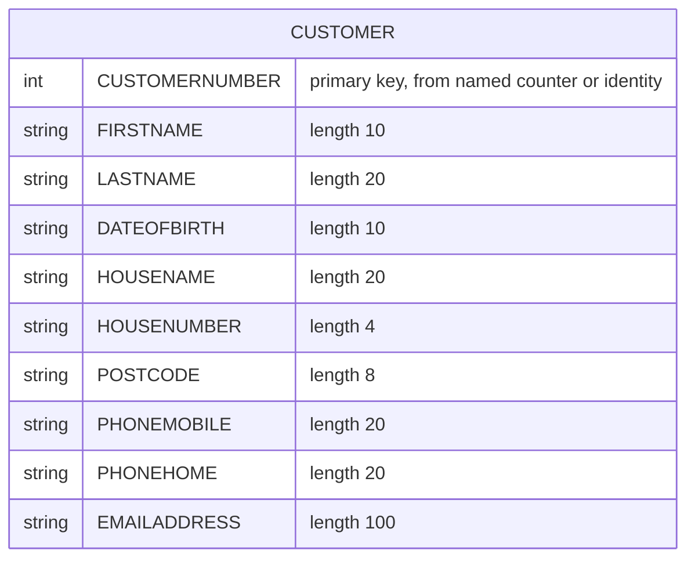

## Table of Contents

- [1. Purpose](#1-purpose)
- [2. Inputs](#2-inputs)
- [3. Outputs](#3-outputs)
- [4. Processing Logic](#4-processing-logic)
  - [4.1 Mermaid Flow Diagram](#41-mermaid-flow-diagram)
  - [4.2 Processing Logic Description](#42-processing-logic-description)
  - [4.3 Database Tables](#43-database-tables)
- [5. Paragraphs](#5-paragraphs)
- [6. Dependencies](#6-dependencies)
- [7. Constraints](#7-constraints)
  - [7.1 Communication Area and Data Validation Constraints](#71-communication-area-and-data-validation-constraints)
  - [7.2 Operational and Sequencing Constraints](#72-operational-and-sequencing-constraints)
  - [7.3 Security and Integration Parameter Constraints](#73-security-and-integration-parameter-constraints)
  - [7.4 Error Logging and Queue Formatting Constraints](#74-error-logging-and-queue-formatting-constraints)
- [8. Error Handling](#8-error-handling)
  - [8.1 COMMAREA Validation](#81-commarea-validation)
  - [8.2 CICS Named Counter Failure Handling](#82-cics-named-counter-failure-handling)
  - [8.3 Db2 SQL Error Handling](#83-db2-sql-error-handling)
  - [8.4 Downstream Program Return Code Check](#84-downstream-program-return-code-check)
  - [8.5 Error Logging and Notification](#85-error-logging-and-notification)
- [9. Examples](#9-examples)
  - [9.1 Example 1: Successful Customer Creation via Named Counter](#91-example-1-successful-customer-creation-via-named-counter)
  - [9.2 Example 2: Invalid COMMAREA Length](#92-example-2-invalid-commarea-length)
  - [9.3 Example 3: Fallback Customer Number Allocation via Db2 Identity Column](#93-example-3-fallback-customer-number-allocation-via-db2-identity-column)

## 1. Purpose

LGACDB01 is a CICS transaction program that adds a new customer to the insurance application's DB2 customer table. It takes the customer's name, date of birth, address, phone numbers and email address from the communication area passed in by the caller. It checks that the caller supplied a communication area of sufficient length, and returns an error code if not. It assigns a unique customer number, normally from a CICS named counter. If the counter is unavailable, it lets DB2 generate the number instead. It then inserts the customer record and returns the new customer number to the caller. After the insert, it links to a customer-related program (LGACVS01) and to a security program (LGACDB02). The security program registers the new customer's initial credentials, with a default password and a "new" state. If a failure occurs, it sets an error return code. It also writes a timestamped diagnostic message, including the SQL code and an excerpt of the communication area, to a logging queue for later troubleshooting.

## 2. Inputs

- **Program parameter**
  - COMM_AREA_PTR: A pointer to the CICS communication area passed in by the calling program. It is the program's only declared parameter. The based COMM_AREA structure is overlaid on it, so every request field comes from the caller through this area.

- **Communication area (request header)**
  - EIBCALEN: The length of the communication area the caller supplied. A value of 0 causes an ABEND with code LGCA. A value below the required 90 bytes (18-byte header plus 72-byte customer section) sets the return code to '98' and returns.
  - CA_REQUEST_ID: The request identifier from the caller. It sits in the header of the communication area.
  - CA_CUSTOMER_NUM: The customer number field in the communication area. The program does not read it as input. It overwrites the field with the newly assigned customer number.

- **Communication area (customer details to be added)**
  - CA_FIRST_NAME: The customer's first name, inserted into the FIRSTNAME column of the CUSTOMER table.
  - CA_LAST_NAME: The customer's last name, inserted into the LASTNAME column.
  - CA_DOB: The customer's date of birth, inserted into the DATEOFBIRTH column.
  - CA_HOUSE_NAME: The house or property name, inserted into the HOUSENAME column.
  - CA_HOUSE_NUM: The house number, inserted into the HOUSENUMBER column.
  - CA_POSTCODE: The postcode, inserted into the POSTCODE column.
  - CA_PHONE_MOBILE: The mobile phone number, inserted into the PHONEMOBILE column.
  - CA_PHONE_HOME: The home phone number, inserted into the PHONEHOME column.
  - CA_EMAIL_ADDRESS: The email address, inserted into the EMAILADDRESS column.

- **CICS execution environment**
  - EIBTRNID: The transaction ID, saved to WS_TRANSID for run-time information.
  - EIBTRMID: The terminal ID, saved to WS_TERMID for run-time information.
  - EIBTASKN: The task number, saved to WS_TASKNUM for run-time information.
  - EIBCALEN: Also used when writing error messages, to decide how much of the communication area (up to 90 bytes) is copied into the error record.

- **External data sources and services**
  - CICS named counter server
    - GENACOUNT ('GENACUSTNUM') and GENAPOOL ('GENA'): The counter name and pool. A CICS GET COUNTER call reads them to get the next customer number into LASTCUSTNUM and then DB2_CUSTOMERNUM_INT.
    - WS_RESP: The response from the counter call. Any response other than NORMAL turns off named-counter use (LGAC_NCS set to 'NO'). The program then relies on the DB2 identity column.
  - DB2 CUSTOMER table
    - It receives the new customer row.
    - When the named counter is not in use, the DB2 identity column supplies the customer number (DB2_CUSTOMERNUM_INT) through IDENTITY_VAL_LOCAL.
    - SQLCODE from each statement determines whether the program continues or sets return code '90'.
  - Linked CICS programs
    - LGACVS01 is linked with the original communication area.
    - LGACDB02 is linked with the customer security area CDB2AREA. It receives D2_CUSTOMER_NUM, D2_REQUEST_ID, D2_CUSTSECR_PASS, D2_CUSTSECR_COUNT and D2_CUSTSECR_STATE.
    - LGSTSQ is linked to write error messages to the queue.
  - CICS time services: ASKTIME and FORMATTIME supply the current date and time (WS_ABSTIME, WS_DATE, WS_TIME) for error messages.

- **Hard-coded values passed to the security program**
  - D2_CUSTSECR_PASS: The initial password value, hard-coded as '5732fec825535eeafb8fac50fee3a8aa'.
  - D2_CUSTSECR_STATE: The initial state, hard-coded as 'N'.
  - D2_CUSTSECR_COUNT: The initial count, hard-coded as '0000'.
  - D2_REQUEST_ID: The request ID, hard-coded as '02ACUS'.

## 3. Outputs

- **Commarea returned to caller (COMM_AREA, addressed by COMM_AREA_PTR)**
  - Return status
    - CA_RETURN_CODE is the status code the caller receives.
      - '00' means success. It is set after the commarea is received.
      - '98' means the commarea is shorter than the required length (18 + 72 bytes). The program returns immediately.
      - '90' means the DB2 INSERT into CUSTOMER failed (SQLCODE not 0). The program writes an error message and returns.
      - Any non-'00' value set by a linked program is only tested after the LGACDB02 link. The program returns either way.
  - Customer identifier
    - CA_CUSTOMER_NUM receives the new customer number (from DB2_CUSTOMERNUM_INT) after a successful insert.
      - The number comes from the CICS named counter when it is available.
      - Otherwise it comes from the DB2 identity value.
  - Customer data
    - The customer fields are not modified by this program. They are the source for the DB2 insert and are passed on in the commarea to LGACVS01.
      - CA_FIRST_NAME, CA_LAST_NAME, CA_DOB
      - CA_HOUSE_NAME, CA_HOUSE_NUM, CA_POSTCODE
      - CA_PHONE_MOBILE, CA_PHONE_HOME, CA_EMAIL_ADDRESS

- **Database writes (DB2 CUSTOMER table)**
  - A new row is inserted with these columns: CUSTOMERNUMBER, FIRSTNAME, LASTNAME, DATEOFBIRTH, HOUSENAME, HOUSENUMBER, POSTCODE, PHONEMOBILE, PHONEHOME, EMAILADDRESS.
    - If the named counter was obtained (LGAC_NCS = 'ON'), CUSTOMERNUMBER is set explicitly from DB2_CUSTOMERNUM_INT.
    - If the counter failed (LGAC_NCS = 'NO'), CUSTOMERNUMBER is set to DEFAULT and DB2 generates the number. DB2_CUSTOMERNUM_INT is then set from IDENTITY_VAL_LOCAL().
  - The remaining columns come from the CA_* commarea fields.

- **Named counter interaction (CICS)**
  - EXEC CICS GET COUNTER (GENACUSTNUM in pool GENA) returns the next value in LASTCUSTNUM.
    - On success, LASTCUSTNUM is copied to DB2_CUSTOMERNUM_INT.
    - On failure (RESP not NORMAL), the program sets LGAC_NCS to 'NO' and DB2_CUSTOMERNUM_INT to 0. This switches the insert to identity generation.

- **Linked program calls (side effects)**
  - LGACVS01 is linked with COMM_AREA (length 225). It is expected to store the customer record in the VSAM customer file. The results of the link are not checked.
  - LGACDB02 is linked with CDB2AREA (length 32500). It adds the customer security record to the security table.
    - D2_CUSTOMER_NUM is set from DB2_CUSTOMERNUM_INT.
    - D2_REQUEST_ID is set to '02ACUS'.
    - D2_CUSTSECR_PASS is set to the fixed hashed initial password '5732fec825535eeafb8fac50fee3a8aa'.
    - D2_CUSTSECR_COUNT is set to '0000'.
    - D2_CUSTSECR_STATE is set to 'N' (new).

- **Error and diagnostic messages (TD/TS queue via LGSTSQ)**
  - Triggers: no commarea received, or a DB2 insert failure.
  - Error message record (ERROR_MSG)
    - EM_DATE and EM_TIME are the date (MMDDYYYY) and time from ASKTIME/FORMATTIME.
    - The program name 'LGACDB01' is part of the record.
    - EM_MSG_TEXT is ' NO COMMAREA RECEIVED' when no commarea arrives.
    - EM_SQLREQ is ' INSERT CUSTOMER'.
    - EM_SQLRC holds the SQLCODE.
    - Customer number and policy number fields are in the layout but are not populated by this program.
  - Commarea dump record (CA_ERROR_MSG)
    - The prefix is 'COMMAREA='.
    - CA_DATA holds the first 90 bytes of the commarea, or all of it if EIBCALEN is under 91. It is written when EIBCALEN is greater than 0.

- **Transaction termination outcomes**
  - ABEND 'LGCA' (NODUMP) is raised when no commarea is received (EIBCALEN = 0), after the error message is written.
  - EXEC CICS RETURN occurs in these cases:
    - The commarea is too short ('98').
    - The DB2 insert fails ('90').
    - Normal completion, after both links.

## 4. Processing Logic

### 4.1 Mermaid Flow Diagram

---

### 4.2 Processing Logic Description

#### 4.2.1 High-level Summary
LGACDB01 is a CICS PL/I program that adds a new customer. It receives a communication area (commarea) with the customer's name, date of birth, address and contact details. It validates the commarea and obtains a new customer number. The number comes from a CICS named counter, or from a DB2 identity column if the counter is unavailable. The program inserts the customer into the DB2 `CUSTOMER` table and returns the new customer number in the commarea. It then links to two other programs: LGACVS01 and LGACDB02. LGACDB02 creates the customer's security record with a default password hash. Any failure is reported through a return code, and error details are written to a queue.

#### 4.2.2 Execution Flow
1. **Initialization**
   - The program copies the CICS transaction ID, terminal ID and task number into working storage for diagnostics.
   - It resets the DB2 integer host variable to 0.
2. **Commarea presence check**
   - If the commarea length (`EIBCALEN`) is 0, the program sets the message " NO COMMAREA RECEIVED" and calls `WRITE_ERROR_MESSAGE`.
   - It then abends with code `LGCA` (NODUMP), so the program does not continue.
3. **Commarea setup and length validation**
   - The return code `CA_RETURN_CODE` is set to `00`. The commarea length and address are saved.
   - The required length is the 18-byte header plus the 72-byte customer section, which is 90 bytes.
   - If the received length is less than 90, the return code is set to `98` and the program returns to the caller. No error message is written.
4. **Obtain customer number (`OBTAIN_CUSTOMER_NUMBER`)**
   - The program issues `EXEC CICS GET COUNTER('GENACUSTNUM') POOL('GENA')`.
   - If the response is normal, the counter value goes into `DB2_CUSTOMERNUM_INT`.
   - If the response is not normal, the flag `LGAC_NCS` changes from `ON` to `NO` and the customer number is set to 0. The program then relies on DB2 to generate the number.
5. **Insert customer (`INSERT_CUSTOMER`)**
   - The SQL request text is set to " INSERT CUSTOMER".
   - **If `LGAC_NCS` is `ON`:** the program inserts a row into `CUSTOMER` with the counter-supplied customer number. The other columns come from the commarea: first name, last name, date of birth, house name, house number, postcode, mobile phone, home phone and email.
   - **If `LGAC_NCS` is `NO`:** the program inserts the same data but uses `DEFAULT` for `CUSTOMERNUMBER`. DB2 generates the value. The program then runs `SET :DB2_CUSTOMERNUM_INT = IDENTITY_VAL_LOCAL()` to retrieve the generated number.
   - **Error handling:** if `SQLCODE` is not 0 after an insert, the return code is set to `90`. `WRITE_ERROR_MESSAGE` is called and the program issues `EXEC CICS RETURN`.
   - On success, the customer number is moved into `CA_CUSTOMER_NUM` in the commarea.
6. **Link to LGACVS01**
   - The program links to LGACVS01 and passes the whole commarea with a length of 225. No response check follows this link.
7. **Link to LGACDB02 (customer security)**
   - The program builds the security commarea `CDB2AREA`:
     - `D2_CUSTOMER_NUM` is the new customer number.
     - `D2_REQUEST_ID` is `02ACUS`.
     - `D2_CUSTSECR_PASS` is a fixed 32-character hash, `5732fec825535eeafb8fac50fee3a8aa`.
     - `D2_CUSTSECR_COUNT` is `0000`.
     - `D2_CUSTSECR_STATE` is `N`.
   - It links to LGACDB02 with a length of 32500.
8. **Final return**
   - The program checks `CA_RETURN_CODE`. Whether it is `00` or not, the program issues `EXEC CICS RETURN`, so both outcomes end the same way. `CA_RETURN_CODE` is not updated from the security commarea.

**`WRITE_ERROR_MESSAGE` (error logging)**
- It stores the SQLCODE in the message and gets the current time with `ASKTIME` and `FORMATTIME` (MMDDYYYY format and time).
- It builds a message with date, time, program name "LGACDB01", the customer and policy number labels, the SQL request and the SQLCODE.
- It links to `LGSTSQ` to write the message to the queue.
- If the commarea length is greater than 0, it also writes up to 90 bytes of the commarea. If the length is under 91 bytes, it writes the commarea as received. Otherwise it writes the first 90 bytes. This is also done through `LGSTSQ`.

**Business rules**
- The minimum commarea length is 90 bytes.
- Return code `00` means success, `90` means a DB2 insert failure, and `98` means the commarea is too short.
- The named counter is preferred. DB2 identity generation is the fallback.
- A new customer's security record starts with state `N`, count `0000` and a fixed default password hash.

#### 4.2.3 External Interactions
- **CICS named counter server:** `GET COUNTER` on `GENACUSTNUM` in pool `GENA` supplies unique customer numbers.
- **DB2:** the program inserts a row into the `CUSTOMER` table. It uses `IDENTITY_VAL_LOCAL()` to read the generated key when the counter is unavailable.
- **CICS LINK to LGACVS01:** this is a called program that receives the commarea (225 bytes). Its purpose is not shown in this source.
- **CICS LINK to LGACDB02:** this program adds the customer security record, using the new customer number and default credentials.
- **CICS LINK to LGSTSQ:** this program writes error messages to the queue.
- **CICS ASKTIME and FORMATTIME:** these provide the timestamp for error messages.
- **CICS ABEND and RETURN:** these end the transaction.

#### 4.2.4 Plain Language Summary
The program registers a new customer. It checks that it has been given enough information. It then gets a unique customer number from a central counter. If the counter is unavailable, the database assigns the number. It saves the customer's details in the customer database and hands the number back to the caller. It then asks two other programs to do further work, one of which creates a login record with a default starting password. If something goes wrong, it sets a code to show what failed (90 for a database problem, 98 for incomplete input data). It also writes a log message with the time, the problem and some of the input data. If no data arrives at all, it logs the problem and ends abnormally.

---

### 4.3 Database Tables

## 5. Paragraphs

- **LGACDB01 (main procedure, `Options(Main)`)**
  - Purpose: CICS program that adds a new customer (name, address, date of birth, contact details) to the DB2 CUSTOMER table. It takes the communication area through `COMM_AREA_PTR`.
  - Operations:
    - Copies `EIBTRNID`, `EIBTRMID` and `EIBTASKN` into `WS_TRANSID`, `WS_TERMID` and `WS_TASKNUM`.
    - Zeroes the DB2 host variable group `DB2_OUT_INTEGERS`.
    - Sets `CA_RETURN_CODE` to '00' and saves `EIBCALEN` and the commarea address in `WS_CALEN` and `WS_ADDR_DFHCOMMAREA`.
    - Computes the required commarea length as header length 18 plus customer length 72.
    - Calls `OBTAIN_CUSTOMER_NUMBER`, then `INSERT_CUSTOMER`.
    - Links to `LGACVS01` with the full commarea and a length of 225.
    - Loads the `CDB2AREA` fields: `D2_CUSTOMER_NUM` from `DB2_CUSTOMERNUM_INT`, request ID '02ACUS', a fixed password string, count '0000' and state 'N'.
    - Links to `LGACDB02` with `CDB2AREA` and a length of 32500 to add the customer security record.
  - Control flow:
    - If `EIBCALEN = 0`, it sets `EM_MSG_TEXT` to ' NO COMMAREA RECEIVED', calls `WRITE_ERROR_MESSAGE` and abends with code 'LGCA' and no dump.
    - If `EIBCALEN` is less than the required length, it sets `CA_RETURN_CODE` to '98' and issues `EXEC CICS RETURN`.
    - After the `LGACDB02` link, a non-'00' `CA_RETURN_CODE` leads to `EXEC CICS RETURN`.
    - Otherwise it also ends with `EXEC CICS RETURN`. The final `RETURN;` is not reached.
  - External interactions:
    - CICS ABEND and RETURN.
    - CICS LINK to `LGACVS01` and `LGACDB02`.
    - The DB2 work is done in the called procedures.
  - The `LGACDB02` return code is not copied back into `CA_RETURN_CODE`. The test after the `LGACDB02` link therefore checks a value this program set earlier.

- **OBTAIN_CUSTOMER_NUMBER**
  - Purpose: gets the next customer number from the CICS named counter.
  - Operations:
    - Issues `EXEC CICS GET COUNTER(GENACOUNT) POOL(GENAPOOL) VALUE(LASTCUSTNUM) RESP(WS_RESP)`. The counter is 'GENACUSTNUM' in pool 'GENA'.
    - On success, moves `LASTCUSTNUM` to `DB2_CUSTOMERNUM_INT`.
  - Control flow:
    - If `WS_RESP` is not `DFHRESP(NORMAL)`, it sets the flag `LGAC_NCS` to 'NO' and `DB2_CUSTOMERNUM_INT` to 0. This tells `INSERT_CUSTOMER` to let DB2 generate the number.
    - Otherwise it uses the counter value.
  - External interactions: CICS named counter server.

- **INSERT_CUSTOMER**
  - Purpose: inserts the new customer row into the DB2 CUSTOMER table and records the resulting customer number.
  - Operations:
    - Sets `EM_SQLREQ` to ' INSERT CUSTOMER' for error reporting.
    - Inserts these values: `CA_FIRST_NAME`, `CA_LAST_NAME`, `CA_DOB`, `CA_HOUSE_NAME`, `CA_HOUSE_NUM`, `CA_POSTCODE`, `CA_PHONE_MOBILE`, `CA_PHONE_HOME` and `CA_EMAIL_ADDRESS`.
    - Moves the final `DB2_CUSTOMERNUM_INT` to `CA_CUSTOMER_NUM` so the caller gets the new number.
  - Control flow:
    - If `LGAC_NCS = 'ON'` (counter obtained), it inserts with the explicit `CUSTOMERNUMBER` from `DB2_CUSTOMERNUM_INT`.
    - Otherwise it inserts with `DEFAULT` for `CUSTOMERNUMBER`, so DB2 generates the identity value. It then runs `SET :DB2_CUSTOMERNUM_INT = IDENTITY_VAL_LOCAL()` to read back the generated number.
    - In both branches, a non-zero `SQLCODE` sets `CA_RETURN_CODE` to '90', calls `WRITE_ERROR_MESSAGE` and issues `EXEC CICS RETURN`.
  - External interactions: DB2 INSERT into CUSTOMER and the DB2 `IDENTITY_VAL_LOCAL` function.

- **WRITE_ERROR_MESSAGE**
  - Purpose: formats an error message with date, time, program name, SQL request and SQLCODE, and writes it to the logging queues.
  - Operations:
    - Moves `SQLCODE` to `EM_SQLRC`.
    - Issues `EXEC CICS ASKTIME` into `WS_ABSTIME`.
    - Issues `EXEC CICS FORMATTIME` (MMDDYYYY and time) into `WS_DATE` and `WS_TIME`, then moves them to `EM_DATE` and `EM_TIME`.
    - Links to `LGSTSQ` with `ERROR_MSG`, using `STG(ERROR_MSG)` as the length.
    - Copies the start of the commarea into `CA_DATA` using `LEFT(COMM_AREA_RAW, …)`.
    - Links to `LGSTSQ` again with `CA_ERROR_MSG`.
  - Control flow:
    - The commarea dump happens only if `EIBCALEN > 0`.
    - If `EIBCALEN < 91`, it copies `EIBCALEN` bytes.
    - Otherwise it copies the first 90 bytes.
    - It ends with `RETURN`.
  - External interactions: CICS ASKTIME and FORMATTIME, and CICS LINK to `LGSTSQ`, which writes to the TD/TS queues.

## 6. Dependencies

- **Invoking transaction and caller**
  - CICS caller (menu or orchestrator such as `LGACUS01`)
    - LGACDB01 runs as a CICS main program and is started by a CICS LINK from an orchestrator.
    - The caller must supply the COMMAREA through `COMM_AREA_PTR`.
  - CICS Execute Interface Block fields
    - `EIBTRNID`, `EIBTRMID` and `EIBTASKN` fill the transaction, terminal and task diagnostic fields.
    - `EIBCALEN` is the COMMAREA length. A value of 0 triggers an abend. A value below the required length gives return code `98`.

- **Input parameters and data contract**
  - COMMAREA `COMM_AREA`, based on `COMM_AREA_PTR`
    - This is the only data contract with the caller. It is 32,500 bytes.
    - Header fields: `CA_REQUEST_ID`, `CA_RETURN_CODE` and `CA_CUSTOMER_NUM`.
      - `CA_RETURN_CODE` is set to `00`, `90` or `98` and returned to the caller.
      - `CA_CUSTOMER_NUM` receives the newly assigned customer number.
    - Customer request fields used for the insert: `CA_FIRST_NAME`, `CA_LAST_NAME`, `CA_DOB`, `CA_HOUSE_NAME`, `CA_HOUSE_NUM`, `CA_POSTCODE`, `CA_PHONE_MOBILE`, `CA_PHONE_HOME` and `CA_EMAIL_ADDRESS`.
    - The caller must supply at least 90 bytes. This is the 18-byte header plus the 72-byte customer area.
  - Include source `LGCMAREA` (`plinc/LGCMAREA.inc`)
    - It defines the COMMAREA layout, which is expanded inline in this source.
    - Changes to it need an impact build or full build of all programs that include it.

- **Database dependencies (Db2 for z/OS)**
  - Db2 table `CUSTOMER`
    - The program inserts one row with `CUSTOMERNUMBER`, `FIRSTNAME`, `LASTNAME`, `DATEOFBIRTH`, `HOUSENAME`, `HOUSENUMBER`, `POSTCODE`, `PHONEMOBILE`, `PHONEHOME` and `EMAILADDRESS`.
    - Primary insert path (named counter available): `DB2_CUSTOMERNUM_INT` supplies the customer number.
    - Fallback insert path (named counter unavailable): `DEFAULT` lets Db2 generate the number from an identity column.
    - After a fallback insert, `IDENTITY_VAL_LOCAL()` retrieves the generated number into `DB2_CUSTOMERNUM_INT`.
    - The Db2 CHAR host variables must match the column lengths.
  - Db2 SQL communications area `SQLCA`
    - Included with `EXEC SQL INCLUDE SQLCA`.
    - `SQLCODE` is checked after each insert. A nonzero value sets return code `90`, writes an error message and returns.
    - `SQLCODE` is also copied into `EM_SQLRC` for the error message.
  - Db2 plan, package and bind
    - The program needs the Db2 precompile or coprocessor step, a bind of its package, and a CICS Db2 connection (RDO definitions in `Resources/` and the bind jobs in `jcl/`).

- **CICS named counter server**
  - Named counter `GENACUSTNUM` (`GENACOUNT`) in pool `GENA` (`GENAPOOL`)
    - `EXEC CICS GET COUNTER` returns the next customer number into `LASTCUSTNUM`, which is copied to `DB2_CUSTOMERNUM_INT`.
    - The counter pool and server must be defined and available.
    - If the call fails (`RESP` is not NORMAL), `LGAC_NCS` is set to `NO`, the customer number is set to 0, and the Db2 identity-column path is used. No error is reported.

- **External programs invoked (CICS LINK)**
  - `LGACVS01`
    - Linked with the COMMAREA, length 225.
    - Adds the customer to the VSAM backend.
    - It runs after the Db2 insert and uses the updated COMMAREA.
  - `LGACDB02`
    - Customer security add program. Linked with `CDB2AREA`, length 32,500.
    - Fields passed:
      - `D2_REQUEST_ID` = `02ACUS`
      - `D2_CUSTOMER_NUM`, from `DB2_CUSTOMERNUM_INT`
      - `D2_CUSTSECR_PASS`, a hard-coded 32-character hash value
      - `D2_CUSTSECR_COUNT` = `0000`
      - `D2_CUSTSECR_STATE` = `N`
    - It writes to the Db2 table `CUSTOMER_SECURE`.
  - `LGSTSQ`
    - Error logging program. Linked in `WRITE_ERROR_MESSAGE`.
    - Each call passes either `ERROR_MSG` or `CA_ERROR_MSG`. The latter holds up to 90 bytes of the COMMAREA.
    - It writes to the CICS queues, a temporary storage queue and a transient data queue.
    - Neither the program nor the queues are part of this source.
  - All four programs, `LGACVS01`, `LGACDB02` and `LGSTSQ` (and the VSAM resources `LGACVS01` uses), must be defined as CICS PROGRAM resources (see `Resources/` CSD definitions).

- **CICS services**
  - Time and date services
    - `EXEC CICS ASKTIME` and `FORMATTIME` (MMDDYYYY, TIME) build the date and time stamp for error messages.
  - Task control
    - `EXEC CICS RETURN` ends the task or returns to the caller.
    - `EXEC CICS ABEND ABCODE('LGCA') NODUMP` handles a missing COMMAREA.
  - Response handling
    - `DFHRESP(NORMAL)` is used to test the counter call's response.

- **Configuration values and hard-coded constants**
  - Counter and pool names: `GENACUSTNUM` and `GENA`.
  - Linked program names: `LGACDB02`, `LGACVS01` and `LGSTSQ`.
  - Initial security data: password hash, state `N` and count `0000`.
  - COMMAREA length constants: header length 18 and customer length 72.
  - Link lengths: 225 for `LGACVS01` and 32,500 for `LGACDB02`.
  - Abend code `LGCA`.
  - Return codes: `00` OK, `90` Db2 error, `98` COMMAREA too short.
  - The switch `LGAC_NCS` (`ON` or `NO`) selects the customer number source.

- **Build and runtime environment**
  - Compiler and preprocessing
    - Enterprise PL/I for z/OS with the CICS and Db2 preprocessors (zAppBuild options such as `SYSTEM(CICS)` and `PP(MACRO,CICS)`).
    - Includes are resolved from `plinc/*.inc`.
  - Deployment
    - Link-edited as a CICS load module.
    - Runs in a CICS region with Db2 attachment and named counter access.

## 7. Constraints

### 7.1 Communication Area and Data Validation Constraints
- Presence of Communication Area:
  - The program requires a non-zero length communication area (`EIBCALEN > 0`).
  - If `EIBCALEN` equals `0`, the program logs an error message (`' NO COMMAREA RECEIVED'`), issues a CICS ABEND with abend code `'LGCA'` (`NODUMP`), and halts execution.
- Minimum Communication Area Length:
  - The incoming communication area must be at least 90 bytes long (`WS_REQUIRED_CA_LEN` calculated as `WS_CA_HEADER_LEN` of 18 + `WS_CUSTOMER_LEN` of 72).
  - If `EIBCALEN < 90`, the program sets `CA_RETURN_CODE = '98'` and terminates execution using `EXEC CICS RETURN`.
- Fixed Field Lengths and Data Types:
  - Customer input fields within `CA_CUSTOMER_REQUEST` are constrained by fixed character lengths and types:
    - First Name (`CA_FIRST_NAME`): 10 characters
    - Last Name (`CA_LAST_NAME`): 20 characters
    - Date of Birth (`CA_DOB`): 10 characters
    - House Name (`CA_HOUSE_NAME`): 20 characters
    - House Number (`CA_HOUSE_NUM`): 4 characters
    - Postcode (`CA_POSTCODE`): 8 characters
    - Mobile Phone (`CA_PHONE_MOBILE`): 20 characters
    - Home Phone (`CA_PHONE_HOME`): 20 characters
    - Email Address (`CA_EMAIL_ADDRESS`): 100 characters

### 7.2 Operational and Sequencing Constraints
- Customer Number Generation Precedence:
  - Customer numbers must be obtained before executing the database insertion.
  - The program attempts to retrieve the next sequence number from the CICS named counter pool `GENA` with counter name `GENACUSTNUM`.
  - If `EXEC CICS GET COUNTER` returns `NORMAL`, the generated counter value (`LASTCUSTNUM`) is explicitly assigned as the customer number (`DB2_CUSTOMERNUM_INT`) and passed into the `INSERT` statement.
  - If the named counter request fails (response is not `NORMAL`), the program falls back to DB2 identity column generation: it sets `LGAC_NCS = 'NO'`, inserts `DEFAULT` into the `CUSTOMERNUMBER` column, and retrieves the generated ID via `IDENTITY_VAL_LOCAL()`.
- Multi-Program Call Sequence:
  - Customer creation follows a strict sequence:
    - Step 1: Database customer row insertion (`INSERT INTO CUSTOMER`).
    - Step 2: CICS program link to `LGACVS01` passing `COMM_AREA` with a length of 225 bytes.
    - Step 3: CICS program link to `LGACDB02` passing security parameter area `CDB2AREA` with a length of 32,500 bytes.
- Program Flow Interruption on Database Failure:
  - If the DB2 `INSERT` operation fails (`SQLCODE <> 0`), the sequence is terminated immediately: `CA_RETURN_CODE` is set to `'90'`, `WRITE_ERROR_MESSAGE` is called, and execution returns to the caller without linking to downstream programs (`LGACVS01` and `LGACDB02`).

### 7.3 Security and Integration Parameter Constraints
- Hardcoded Security Credentials:
  - When invoking `LGACDB02` to create security credentials:
    - Request ID (`D2_REQUEST_ID`) must be set to `'02ACUS'`.
    - Customer password (`D2_CUSTSECR_PASS`) is hardcoded to `'5732fec825535eeafb8fac50fee3a8aa'`.
    - Counter (`D2_CUSTSECR_COUNT`) is initialized to `'0000'`.
    - State (`D2_CUSTSECR_STATE`) is initialized to `'N'`.
    - Customer Number (`D2_CUSTOMER_NUM`) is populated with `DB2_CUSTOMERNUM_INT`.
- Payload Length Constraints:
  - Communication area length for `LGACVS01` link is constrained to exactly 225 bytes.
  - Communication area length for `LGACDB02` link is constrained to exactly 32,500 bytes.

### 7.4 Error Logging and Queue Formatting Constraints
- Error Message Structure:
  - Error logs sent via `LGSTSQ` format the time and date using `EXEC CICS FORMATTIME` into `MMDDYYYY` (10 characters) and `TIME` (8 characters).
  - The SQL error message logs the SQL return code formatted into `EM_SQLRC` as `+(5)9`.
- Diagnostic Commarea Payload Capture Limit:
  - Commarea logging to queue program `LGSTSQ` captures a maximum of 90 bytes of `COMM_AREA_RAW`.
  - If `EIBCALEN` is between 1 and 90 bytes, only `EIBCALEN` bytes are copied using `LEFT(COMM_AREA_RAW, EIBCALEN)`.
  - If `EIBCALEN` exceeds 90 bytes, it is truncated to the first 90 bytes using `LEFT(COMM_AREA_RAW, 90)`.

## 8. Error Handling

### 8.1 COMMAREA Validation

- **Zero-length COMMAREA check:** At program entry, `EIBCALEN` is tested against zero. If no COMMAREA was passed by the caller, an error message is written via `WRITE_ERROR_MESSAGE` and a CICS ABEND with code `LGCA` (NODUMP) is issued immediately, terminating the task.
- **Minimum COMMAREA length check:** The program calculates a minimum required length by summing the header length constant (`WS_CA_HEADER_LEN`, 18 bytes) and the customer data length constant (`WS_CUSTOMER_LEN`, 72 bytes). If `EIBCALEN` is less than this combined value, `CA_RETURN_CODE` is set to `'98'` and the program returns to the caller without performing any database operations.

### 8.2 CICS Named Counter Failure Handling

- **Named counter unavailability — silent fallback:** After issuing `EXEC CICS GET COUNTER` for the `GENACUSTNUM` counter in pool `GENA`, the `RESP` value is captured in `WS_RESP`. If the response is not `DFHRESP(NORMAL)`, the flag `LGAC_NCS` is set to `'NO'` and `DB2_CUSTOMERNUM_INT` is forced to zero. No error message is written and no return code is set; the program silently falls back to allowing Db2 to assign a customer number via an identity column (`DEFAULT`) in the subsequent INSERT.

### 8.3 Db2 SQL Error Handling

- **INSERT failure with named counter value:** Inside `INSERT_CUSTOMER`, when the named counter was available (`LGAC_NCS = 'ON'`), an INSERT INTO CUSTOMER is attempted using the counter-derived customer number. After the INSERT, `SQLCODE` is tested; a non-zero value triggers `CA_RETURN_CODE` being set to `'90'`, a call to `WRITE_ERROR_MESSAGE`, and an immediate `EXEC CICS RETURN` to abort further processing.
- **INSERT failure with identity column DEFAULT:** When the named counter was unavailable, an INSERT using `DEFAULT` for the customer number is attempted. The same SQLCODE check follows; a non-zero `SQLCODE` again sets `CA_RETURN_CODE` to `'90'`, logs the error via `WRITE_ERROR_MESSAGE`, and returns to the caller. If the INSERT succeeds, a `SET :DB2_CUSTOMERNUM_INT = IDENTITY_VAL_LOCAL()` call retrieves the Db2-assigned customer number.

### 8.4 Downstream Program Return Code Check

- **LGACDB02 return code check:** After linking to `LGACDB02` (customer security add), the program tests `CA_RETURN_CODE`. If it is not `'00'`, the program performs an immediate `EXEC CICS RETURN` without further processing, propagating the error condition back to the caller.

### 8.5 Error Logging and Notification

- **`WRITE_ERROR_MESSAGE` procedure:** A centralised error reporting routine that:
  - Captures the current `SQLCODE` into the `EM_SQLRC` field of the `ERROR_MSG` structure.
  - Obtains the current timestamp using `EXEC CICS ASKTIME` and `EXEC CICS FORMATTIME`, formatting it into date and time fields within `ERROR_MSG`.
  - Calls `LGSTSQ` via `EXEC CICS LINK` to write the formatted error message (including program name, date, time, customer number, policy number, and SQLCODE) to a CICS transient data queue (TDQ).
  - Additionally writes up to 90 bytes of the raw COMMAREA content to the same TDQ, truncating to the actual `EIBCALEN` value if the COMMAREA is shorter than 91 bytes. This provides diagnostic context alongside the error message.
- **`WS_EYECATCHER` field:** The working storage header is initialised with the literal `'LGACDB01------WS'`, which serves as a dump identification marker for post-failure analysis in memory or transaction dumps.

## 9. Examples

### 9.1 Example 1: Successful Customer Creation via Named Counter

#### 9.1.1 Input COMMAREA
* `CA_REQUEST_ID`: `'01ACUS'`
* `CA_RETURN_CODE`: `'00'`
* `CA_CUSTOMER_NUM`: `0000000000`
* `CA_FIRST_NAME`: `'John      '`
* `CA_LAST_NAME`: `'Smith               '`
* `CA_DOB`: `'1985-05-15'`
* `CA_HOUSE_NAME`: `'Rose Cottage        '`
* `CA_HOUSE_NUM`: `'12  '`
* `CA_POSTCODE`: `'AB12 3CD'`
* `CA_PHONE_MOBILE`: `'+447700900123       '`
* `CA_PHONE_HOME`: `'+441632960123       '`
* `CA_EMAIL_ADDRESS`: `'john.smith@example.com                                                                     '`
* Named Counter `GENACUSTNUM` (Pool `GENA`): Returns next counter value `1000001` with `DFHRESP(NORMAL)`.

#### 9.1.2 Output COMMAREA
* `CA_REQUEST_ID`: `'01ACUS'`
* `CA_RETURN_CODE`: `'00'`
* `CA_CUSTOMER_NUM`: `0001000001`
* `CA_FIRST_NAME`: `'John      '`
* `CA_LAST_NAME`: `'Smith               '`
* `CA_DOB`: `'1985-05-15'`
* `CA_HOUSE_NAME`: `'Rose Cottage        '`
* `CA_HOUSE_NUM`: `'12  '`
* `CA_POSTCODE`: `'AB12 3CD'`
* `CA_PHONE_MOBILE`: `'+447700900123       '`
* `CA_PHONE_HOME`: `'+441632960123       '`
* `CA_EMAIL_ADDRESS`: `'john.smith@example.com                                                                     '`

#### 9.1.3 Explanation
1. The program validates `EIBCALEN` against `WS_REQUIRED_CA_LEN` (90 bytes: 18 header bytes + 72 customer data bytes).
2. `OBTAIN_CUSTOMER_NUMBER` queries the CICS Named Counter `GENACUSTNUM` in pool `GENA`. It receives counter value `1000001` with `DFHRESP(NORMAL)` and keeps `LGAC_NCS` as `'ON'`.
3. `INSERT_CUSTOMER` executes `EXEC SQL INSERT INTO CUSTOMER` inserting the specified customer details along with `CUSTOMERNUMBER = 1000001`.
4. `CA_CUSTOMER_NUM` is updated to `0001000001`.
5. The program links to `LGACVS01` to mirror customer data to VSAM, constructs `CDB2AREA` with initial password and security parameters, links to `LGACDB02` for customer security setup, and returns with `CA_RETURN_CODE = '00'`.

---

### 9.2 Example 2: Invalid COMMAREA Length

#### 9.2.1 Input COMMAREA
* `EIBCALEN`: `50` (Less than required 90 bytes)
* COMMAREA Content: Partial customer data

#### 9.2.2 Output COMMAREA
* `CA_RETURN_CODE`: `'98'`
* `CA_CUSTOMER_NUM`: `0000000000` (Unchanged)

#### 9.2.3 Explanation
1. `EIBCALEN` is checked against `WS_REQUIRED_CA_LEN` (90 bytes).
2. Because the supplied length (`50`) is less than `90`, the program bypasses customer number allocation and database insertion.
3. `CA_RETURN_CODE` is set to `'98'` and control returns immediately to the caller via `EXEC CICS RETURN`.

---

### 9.3 Example 3: Fallback Customer Number Allocation via Db2 Identity Column

#### 9.3.1 Input COMMAREA
* `CA_REQUEST_ID`: `'01ACUS'`
* `CA_RETURN_CODE`: `'00'`
* `CA_CUSTOMER_NUM`: `0000000000`
* `CA_FIRST_NAME`: `'Jane      '`
* `CA_LAST_NAME`: `'Doe                 '`
* `CA_DOB`: `'1990-10-20'`
* `CA_HOUSE_NAME`: `'                    '`
* `CA_HOUSE_NUM`: `'45B '`
* `CA_POSTCODE`: `'W1A 1AA '`
* `CA_PHONE_MOBILE`: `'+447700900456       '`
* `CA_PHONE_HOME`: `'                    '`
* `CA_EMAIL_ADDRESS`: `'jane.doe@example.com                                                                       '`
* Named Counter `GENACUSTNUM` (Pool `GENA`): Returns non-normal response (e.g., counter pool unavailable).

#### 9.3.2 Output COMMAREA
* `CA_REQUEST_ID`: `'01ACUS'`
* `CA_RETURN_CODE`: `'00'`
* `CA_CUSTOMER_NUM`: `0002000055`
* Customer fields retain input values.

#### 9.3.3 Explanation
1. `OBTAIN_CUSTOMER_NUMBER` attempts to retrieve a customer number from named counter `GENACUSTNUM`. The command returns `WS_RESP <> DFHRESP(NORMAL)`, which sets `LGAC_NCS = 'NO'` and resets `DB2_CUSTOMERNUM_INT = 0`.
2. `INSERT_CUSTOMER` executes `EXEC SQL INSERT INTO CUSTOMER` using the Db2 `DEFAULT` value for `CUSTOMERNUMBER`.
3. The program issues `SET :DB2_CUSTOMERNUM_INT = IDENTITY_VAL_LOCAL()` to retrieve the Db2-assigned identity value (`2000055`) and stores it into `CA_CUSTOMER_NUM`.
4. Downstream calls to `LGACVS01` and `LGACDB02` complete, and the program returns with `CA_RETURN_CODE = '00'`.

---

Generated by IBM Bob Premium Package for Z
