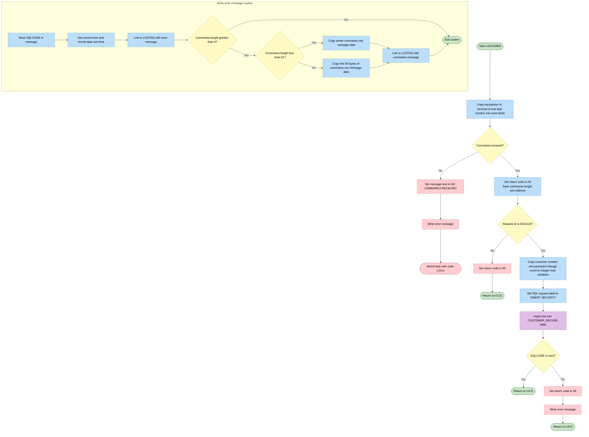
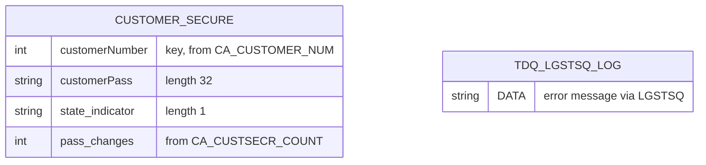

## Table of Contents

- [1. Purpose](#1-purpose)
- [2. Inputs](#2-inputs)
  - [2.1 CICS Communication Area (COMMAREA)](#21-cics-communication-area-commarea)
  - [2.2 CICS System Fields (Execute Interface Block - EIB)](#22-cics-system-fields-execute-interface-block---eib)
- [3. Outputs](#3-outputs)
- [4. Processing Logic](#4-processing-logic)
  - [4.1 Mermaid Flow Diagram](#41-mermaid-flow-diagram)
  - [4.2 Processing Logic Description](#42-processing-logic-description)
  - [4.3 Database Tables](#43-database-tables)
- [5. Paragraphs](#5-paragraphs)
- [6. Dependencies](#6-dependencies)
- [7. Constraints](#7-constraints)
- [8. Error Handling](#8-error-handling)
- [9. Examples](#9-examples)
  - [9.1 Example 1 — Successful Customer Security Record Insert](#91-example-1--successful-customer-security-record-insert)
  - [9.2 Example 2 — Invalid Request ID (Rejected with Return Code 99)](#92-example-2--invalid-request-id-rejected-with-return-code-99)
  - [9.3 Example 3 — DB2 Insert Failure (Return Code 98)](#93-example-3--db2-insert-failure-return-code-98)

## 1. Purpose

I have analyzed the `LGACDB02.pli` source file and its comments. 

Here is the breakdown of the program:
- It is a CICS Db2 program named `LGACDB02` (as part of the GenApp application).
- Its main entry point takes `COMM_AREA_PTR`.
- It processes requests with a `CA_REQUEST_ID` of `'02ACUS'` (Add customer security details / new customer add).
- It extracts the customer number (`CA_CUSTOMER_NUM`), customer security password (`CA_CUSTSECR_PASS`), password changes count (`CA_CUSTSECR_COUNT`), and state indicator (`CA_CUSTSECR_STATE`) from the incoming CICS communication area (COMMAREA).
- It inserts these values into the `CUSTOMER_SECURE` Db2 table to register or assign a security password/profile for a newly added customer (the default is often an MD5 checksum).
- It includes error-handling logic to write issues to a transient data queue via `LGSTSQ` in case of failure (such as Db2 errors or missing communication area).

I will now write a single paragraph that describes the overall purpose of the program without discussing how it works or using transition phrases, starting directly with the section body content.

## 2. Inputs

### 2.1 CICS Communication Area (COMMAREA)
- `COMM_AREA_PTR`: Pointer to the caller-supplied communication area passed via `DFHCOMMAREA` during CICS program linkage.
- Request Control:
  - `CA_REQUEST_ID`: A 6-character field identifying the requested operation. The program verifies this matches `'02ACUS'` (Add Customer Security) before proceeding.
- Customer Identification:
  - `CA_CUSTOMER_NUM`: A 10-digit numeric customer identifier used as the primary key when inserting the security record into the database.
- Customer Security Information (`CA_CUSTSECR_REQUEST`):
  - `CA_CUSTSECR_PASS`: A 32-character string holding the customer password (or MD5 checksum hash) to be stored in the database.
  - `CA_CUSTSECR_STATE`: A 1-character status indicator representing the state of the customer password record (for example, `'N'` for new).
  - `CA_CUSTSECR_COUNT`: A 4-character field specifying the count of password changes for the customer, converted to an integer host variable before insertion.

### 2.2 CICS System Fields (Execute Interface Block - EIB)
- `EIBCALEN`: The length of the incoming COMMAREA; used to determine if valid communication area data was supplied to the program.
- `EIBTRNID`: The CICS transaction identifier invoking the program.
- `EIBTRMID`: The CICS terminal identifier associated with the executing task.
- `EIBTASKN`: The CICS task number assigned to the current execution instance.

## 3. Outputs

- **Return status to caller (via the communication area)**
  - CA_RETURN_CODE
    - Initialised to '00' once a communication area is received.
    - Set to '99' when CA_REQUEST_ID is anything other than '02ACUS'. The program then returns without doing any work.
    - Set to '98' when the insert into the customer security table fails (SQLCODE not 0).
    - The caller uses it to see whether the request succeeded, was unsupported, or hit a database error.
  - CA_REQUEST_ID
    - The only value that triggers processing is '02ACUS'.
    - It is read and not changed, so it decides whether the database write happens.

- **Data written to the database**
  - CUSTOMER_SECURE table, one new row per successful '02ACUS' request:
    - customerNumber comes from CA_CUSTOMER_NUM, through the integer host variable DB2_CUSTOMERNUM_INT.
    - customerPass comes from CA_CUSTSECR_PASS, the 32-character password value (an MD5 checksum by default).
    - state_indicator comes from CA_CUSTSECR_STATE, for example 'N' for a new password.
    - pass_changes comes from CA_CUSTSECR_COUNT, converted to the integer host variable DB2_CUSTOMERCNT_INT.
  - This insert is the program's main business result. It registers the customer's security credentials.
  - SQLCODE from the insert determines whether the program continues normally or reports an error.

- **Error messages written to the CICS queue (through the LGSTSQ program)**
  - Written when the insert fails or when no communication area is received.
  - Error message record (ERROR_MSG):
    - Contents: current date (EM_DATE) and time (EM_TIME), the program name, and a message text (EM_MSG_TEXT).
    - EM_MSG_TEXT carries ' NO COMMAREA RECEIVED' when no communication area is present.
    - For a database failure, the record carries the customer number (EM_CUSNUM), policy number (EM_POLNUM), the SQL request label (EM_SQLREQ, ' INSERT SECURITY') and the SQLCODE (EM_SQLRC).
  - Communication area dump message (CA_ERROR_MSG):
    - Contains 'COMMAREA=' followed by up to the first 90 bytes of the communication area (CA_DATA).
    - It is written after the error message to give the caller's input as context for diagnosis.
    - If the communication area is shorter than 91 bytes, the whole area is written. Otherwise the first 90 bytes are written.

- **Abnormal termination**
  - If no communication area is received (EIBCALEN = 0), the program writes the error message and abends the task with code 'LGCA' and no dump.
  - This signals an invalid invocation to the CICS region and the calling transaction.

- **Control returned to the caller**
  - The program ends with EXEC CICS RETURN on all paths except the abend:
    - Successful insert.
    - Unsupported request ('99').
    - Database error ('98').
  - The communication area, with the updated CA_RETURN_CODE, goes back to the caller.

- **Communication area fields that are inputs and not changed**
  - Customer security request data: CA_CUSTOMER_NUM, CA_CUSTSECR_PASS, CA_CUSTSECR_STATE, CA_CUSTSECR_COUNT. These feed the database row.
  - Other fields in the shared layout are left as received: CA_POLICY_NUM, CA_FIRST_NAME, CA_LAST_NAME, CA_DOB, CA_EMAIL_ADDRESS, CA_NUM_POLICIES, CA_BROKERID, CA_PAYMENT, CA_ISSUE_DATE, CA_EXPIRY_DATE. They are not used for output.

## 4. Processing Logic

### 4.1 Mermaid Flow Diagram

### 4.2 Processing Logic Description

**High-level Summary**

LGACDB02 is a CICS PL/I program, called by other programs, that adds a customer's security record (password data) to the DB2 table CUSTOMER_SECURE. It receives a communication area (commarea) with the request id, customer number, password, state indicator and password change count. If the request id is `02ACUS`, it inserts one row. It reports the outcome to the caller in the commarea return code. It logs failures to a CICS queue through the helper program LGSTSQ.

**Execution Flow**

1. **Initialisation.** The program copies the CICS transaction id (EIBTRNID), terminal id (EIBTRMID) and task number (EIBTASKN) into the work header. These values are used for diagnostics.
2. **Commarea check.** If the commarea length (EIBCALEN) is 0, the program sets the message text to " NO COMMAREA RECEIVED" and calls the error routine. It then abends the task with code `LGCA` and no dump. Without a commarea there is nothing to process and no way to return a code to the caller.
3. **Setup.** The program sets `CA_RETURN_CODE` to `00`, which means success. It saves the commarea length and address in the work header.
4. **Request routing.** The program checks `CA_REQUEST_ID`.
   - If it is `02ACUS` (add new customer security), it copies the customer number (`CA_CUSTOMER_NUM`) into an integer host variable. It also converts the password change count (`CA_CUSTSECR_COUNT`, a 4-character field) into an integer host variable. Then it performs the insert.
   - For any other value, it sets the return code to `99` (unsupported request) and returns to CICS immediately.
5. **Insert.** The program sets the SQL request label to " INSERT SECURITY". It then inserts a row into CUSTOMER_SECURE with these values:
   - customerNumber, from the integer copy of the customer number
   - customerPass, from `CA_CUSTSECR_PASS` (32 characters, by default an MD5 checksum)
   - state_indicator, from `CA_CUSTSECR_STATE` (for example `N` for a new password)
   - pass_changes, from the integer copy of the change count
6. **Insert result.**
   - If SQLCODE is 0, control returns to the main line and the program issues `EXEC CICS RETURN`. The return code stays `00`.
   - If SQLCODE is not 0, the program sets the return code to `98`, calls the error routine and returns to CICS.
7. **Error routine (WRITE_ERROR_MESSAGE).**
   - It places SQLCODE in the message and obtains the current time with ASKTIME.
   - It formats the date as MMDDYYYY and the time with FORMATTIME, and stores both in the message.
   - It links to program LGSTSQ with the error message structure, which holds the date, time, program name, and customer number, policy number, SQL request text and SQLCODE. LGSTSQ writes this to the logging queue.
   - If the commarea length is greater than 0, it copies the commarea content into a 90-byte data area. It copies the whole commarea if the length is under 91, or the first 90 bytes otherwise. It then links to LGSTSQ a second time with this "COMMAREA=" message.

**Business rules and return codes**

| Code | Meaning |
|------|---------|
| 00 | Success |
| 98 | DB2 insert failed |
| 99 | Request id not recognised |
| Abend LGCA | No commarea supplied |

The defaults `WS_CS_PASSWORD` ('NewPass'), `WS_CS_STATE` ('N') and `WS_CA_COUNT` are declared but not used in the logic. The password, state and count values come from the caller's commarea.

**External Interactions**

- **DB2.** The program inserts a row into table CUSTOMER_SECURE.
- **CICS services.** It uses ABEND, RETURN, ASKTIME and FORMATTIME.
- **LGSTSQ.** The program links to this subprogram to write error and commarea messages to the logging queue.
- **Caller.** The caller communicates through the commarea. The program writes the return code back into it.

**Plain Language Summary**

Another program asks this one to save a new customer's password record. The program first checks that it was given the data. If not, it stops and logs the problem. It then checks that the request is the "add customer security" type. If the request is a different type, it sends back code 99. If the request is the right type, it saves the customer number, password, state and change count in the security table. If the save works, the caller gets code 00. If the save fails, the program writes a log entry with the date, time, customer number and error code, then sends back code 98.

### 4.3 Database Tables

## 5. Paragraphs

- **LGACDB02 (main procedure, lines 21–244)**: Entry point of the program (`Options(Main)`). It is a CICS/DB2 program that adds a customer's password record to the customer security table. It receives the pointer `COMM_AREA_PTR` to the communication area.
  - Declarations
    - Declares the working-storage structures: the debug header `WS_HEADER`, the error message layouts `ERROR_MSG` and `CA_ERROR_MSG`, and the DB2 integer host variables `DB2_CUSTOMERNUM_INT` and `DB2_CUSTOMERCNT_INT`.
    - Includes `SQLCA`.
    - Declares the based `COMM_AREA` union over `COMM_AREA_PTR`. It carries the customer request, customer security request and policy request layouts.
  - Setup
    - Copies the CICS transaction ID, terminal ID and task number (`EIBTRNID`, `EIBTRMID`, `EIBTASKN`) into `WS_TRANSID`, `WS_TERMID` and `WS_TASKNUM`.
  - Commarea check
    - If `EIBCALEN = 0`, it sets `EM_MSG_TEXT` to ' NO COMMAREA RECEIVED' and calls `WRITE_ERROR_MESSAGE`.
    - It then issues `EXEC CICS ABEND ABCODE('LGCA') NODUMP`.
  - Initialization
    - Sets `CA_RETURN_CODE` to '00'.
    - Saves the commarea length and address in `WS_CALEN` and `WS_ADDR_DFHCOMMAREA`.
  - Request dispatch
    - A `SELECT` on `CA_REQUEST_ID` chooses the action.
    - For `'02ACUS'` (add customer security):
      - It copies `CA_CUSTOMER_NUM` to `DB2_CUSTOMERNUM_INT`.
      - It converts `CA_CUSTSECR_COUNT` into `DB2_CUSTOMERCNT_INT`.
      - It calls `INSERT_CUSTOMER_PASSWORD`.
    - For any other value (`OTHERWISE`):
      - It sets `CA_RETURN_CODE` to '99'.
      - It issues `EXEC CICS RETURN` immediately.
  - Completion
    - After a successful insert, it issues `EXEC CICS RETURN` to give control back to the caller.
    - The trailing `RETURN` statement is not reached.
  - External interactions
    - Uses CICS commands ABEND and RETURN.
    - Receives the commarea from the calling program.

- **INSERT_CUSTOMER_PASSWORD (lines 249–269)**: Internal procedure that inserts the customer's security record into DB2.
  - Sets `EM_SQLREQ` to ' INSERT SECURITY' so any error message identifies the failing request.
  - Runs `EXEC SQL INSERT INTO CUSTOMER_SECURE` for the columns `customerNumber`, `customerPass`, `state_indicator` and `pass_changes`.
    - The values come from the host variables `DB2_CUSTOMERNUM_INT`, `CA_CUSTSECR_PASS`, `CA_CUSTSECR_STATE` and `DB2_CUSTOMERCNT_INT`.
  - Control flow
    - If `SQLCODE <> 0`, it sets `CA_RETURN_CODE` to '98'.
    - It then calls `WRITE_ERROR_MESSAGE` and issues `EXEC CICS RETURN`, which ends the transaction without going back to the main line.
    - If the insert succeeds, it falls through and returns to the caller.
  - External interactions
    - DB2 table `CUSTOMER_SECURE` (insert).
    - CICS RETURN on failure.

- **WRITE_ERROR_MESSAGE (lines 276–309)**: Internal procedure that builds a timestamped error message and writes it to the error queue through the `LGSTSQ` program.
  - Operations
    - Moves `SQLCODE` into `EM_SQLRC`.
    - Issues `EXEC CICS ASKTIME ABSTIME(WS_ABSTIME)` to get the current time.
    - Issues `EXEC CICS FORMATTIME` to produce `WS_DATE` (MMDDYYYY) and `WS_TIME`.
    - Copies the date and time into `EM_DATE` and `EM_TIME`.
    - Issues `EXEC CICS LINK PROGRAM('LGSTSQ')` with `ERROR_MSG` as the commarea, with its length taken from `STG(ERROR_MSG)`.
  - Commarea dump (conditional)
    - If `EIBCALEN > 0`, it also logs the received commarea.
    - If `EIBCALEN < 91`, it moves the available commarea bytes (`LEFT(COMM_AREA_RAW, EIBCALEN)`) into `CA_DATA`.
    - Otherwise, it moves the first 90 bytes into `CA_DATA`.
    - In both cases it links to `LGSTSQ` again with `CA_ERROR_MSG` as the commarea.
  - External interactions
    - CICS ASKTIME, FORMATTIME and LINK.
    - The linked program `LGSTSQ` writes the messages to the queue (TDQ/TSQ).
  - It returns to its caller with `RETURN`.

## 6. Dependencies

- **Calling program and input data**
  - Caller-supplied CICS COMMAREA, addressed through the `COMM_AREA_PTR` parameter and the `EIBCALEN` length check
    - If `EIBCALEN` is 0, the program writes an error message and abends with code `LGCA` (NODUMP).
    - `CA_REQUEST_ID` selects the operation. Only `'02ACUS'` (add customer security record) is supported. Any other value sets `CA_RETURN_CODE` to `'99'` and returns.
    - `CA_CUSTOMER_NUM` is copied to `DB2_CUSTOMERNUM_INT` and used as the customer key.
    - `CA_CUSTSECR_PASS` is the password value, by default an MD5 checksum. It is inserted into the password column.
    - `CA_CUSTSECR_STATE` is the state indicator, for example `'N'` for a new password.
    - `CA_CUSTSECR_COUNT` is the password-change count. It is converted to `DB2_CUSTOMERCNT_INT`.
    - `CA_RETURN_CODE` is the output field returned to the caller. `'00'` means success, `'98'` means a DB2 insert failure, and `'99'` means an unsupported request.
  - Other COMMAREA fields are defined in the shared layout but not used by this program's logic:
    - Customer fields: `CA_FIRST_NAME`, `CA_LAST_NAME`, `CA_DOB`, `CA_EMAIL_ADDRESS`, `CA_NUM_POLICIES`
    - Policy fields: `CA_POLICY_NUM`, `CA_BROKERID`, `CA_PAYMENT`, `CA_ISSUE_DATE`, `CA_EXPIRY_DATE`
  - The program defines no working-storage input of its own beyond the COMMAREA. `WS_CS_PASSWORD` (`'NewPass'`), `WS_CS_STATE` (`'N'`) and `WS_CA_COUNT` are declared with defaults but not used in the logic.

- **Database (Db2 for z/OS)**
  - Table `CUSTOMER_SECURE`
    - The program inserts one row.
    - Columns written are `customerNumber`, `customerPass`, `state_indicator` and `pass_changes`.
    - Host variables are `DB2_CUSTOMERNUM_INT`, `CA_CUSTSECR_PASS`, `CA_CUSTSECR_STATE` and `DB2_CUSTOMERCNT_INT`.
  - `SQLCA` (`EXEC SQL INCLUDE SQLCA`)
    - It supplies `SQLCODE`.
    - A non-zero `SQLCODE` after the insert sets `CA_RETURN_CODE` to `'98'`, writes an error message and returns.
  - An active Db2 connection and plan or package are needed, along with authority to insert into `CUSTOMER_SECURE`. This is implied by the embedded SQL under CICS.

- **Included or shared definitions**
  - `LGCMAREA` COMMAREA layout, located at `plinc/LGCMAREA.inc`
    - It defines the `COMM_AREA` structure based on `COMM_AREA_PTR`, shared across the application's programs.
    - The structure is declared inline in the source, and the `INCLUDE LGCMAREA` statement is commented out.
  - `SQLCA`, the standard Db2 communication area include.

- **CICS runtime services**
  - EIB fields: `EIBTRNID`, `EIBTRMID`, `EIBTASKN` and `EIBCALEN`
    - The program copies them into the working-storage header and uses `EIBCALEN` to validate and truncate the COMMAREA.
  - `EXEC CICS ABEND ABCODE('LGCA') NODUMP` for the missing COMMAREA case
  - `EXEC CICS RETURN` to return control to the caller after success, failure or an invalid request
  - `EXEC CICS ASKTIME ABSTIME` to get the current absolute time
  - `EXEC CICS FORMATTIME ABSTIME MMDDYYYY TIME` to format the date and time for the error message

- **External programs invoked**
  - `LGSTSQ`, called with `EXEC CICS LINK PROGRAM('LGSTSQ')`
    - It receives the `ERROR_MSG` structure (date, time, program name, customer and policy number, SQL request, SQLCODE) through `COMMAREA` with `LENGTH(STG(ERROR_MSG))`.
    - It receives the `CA_ERROR_MSG` structure, which holds up to 90 bytes of the incoming COMMAREA, through a second link.
    - Its role is to write the messages to the error logging queues (TDQ/TSQ).
    - It must be defined to CICS and available at run time.

- **Output destinations**
  - Error logging queues, written indirectly through `LGSTSQ`
    - Queue names and definitions are owned by `LGSTSQ`, not by this program.
    - The messages are the formatted error message and the COMMAREA dump (`COMMAREA=` followed by up to 90 bytes).

- **Configuration and environment**
  - A CICS region with program definitions for `LGACDB02` and `LGSTSQ`, and the Db2 attachment facility
  - No environment variables, parameter files or other external configuration are referenced.
  - The request code literal `'02ACUS'` and the program names `LGSTSQ` and `LGACDB02` are hard-coded.

## 7. Constraints

- **Input and commarea constraints**
  - A commarea must be supplied.
    - `EIBCALEN = 0` is checked first.
    - If it is true, the program sets `EM_MSG_TEXT` to ' NO COMMAREA RECEIVED' and calls `WRITE_ERROR_MESSAGE`.
    - It then ends the task with `EXEC CICS ABEND ABCODE('LGCA') NODUMP`, so no processing happens without input.
  - The commarea layout is fixed.
    - `COMM_AREA` is a BASED structure addressed through `COMM_AREA_PTR`.
    - Its raw size is 32,500 bytes.
    - `CA_REQUEST_ID` is CHAR(6), `CA_RETURN_CODE` is PIC '99', and `CA_CUSTOMER_NUM` is PIC '9999999999'.
    - The request-specific area is a 32,482-byte UNION that overlays the customer request, customer security request, and policy request layouts.
    - The program does not compare `EIBCALEN` with the full layout length. It only tests for zero.
  - The fields are typed and sized.
    - `CA_CUSTOMER_NUM` is a 10-digit numeric field.
    - `CA_CUSTSECR_PASS` is CHAR(32), which fits the MD5 checksum default.
    - `CA_CUSTSECR_COUNT` is CHAR(4).
    - `CA_CUSTSECR_STATE` is a single CHAR.
    - `CA_POLICY_NUM` and `CA_BROKERID` are 10-digit numeric fields.
    - `CA_PAYMENT` is a 6-digit numeric field.
    - `CA_NUM_POLICIES` is a 3-digit numeric field.
    - `CA_FIRST_NAME`, `CA_LAST_NAME`, `CA_DOB`, `CA_EMAIL_ADDRESS`, `CA_ISSUE_DATE` and `CA_EXPIRY_DATE` are fixed-length character fields of 10, 20, 10, 100, 10 and 10 bytes.
    - The program does no explicit content validation (range, format or required-value checks) on any of these fields.
  - The password count is held as CHAR(4) but must hold a value that converts to a FIXED BIN(31) integer.
    - The move `DB2_CUSTOMERCNT_INT = CA_CUSTSECR_COUNT` is an implicit character-to-numeric conversion.
    - The program does not check the value before converting it.
    - Non-numeric content would cause a conversion error at run time.

- **Request type restrictions**
  - Only the request identifier `'02ACUS'` (add a new customer security record) is accepted.
    - A `SELECT (CA_REQUEST_ID)` statement enforces this.
    - Its only `WHEN` branch is `'02ACUS'`.
  - Any other request ID is rejected.
    - The `OTHERWISE` branch sets `CA_RETURN_CODE = '99'` and issues `EXEC CICS RETURN`.
    - Nothing is written to the database or the error queue in this case.
  - The customer security fields (`CA_CUSTSECR_PASS`, `CA_CUSTSECR_COUNT`, `CA_CUSTSECR_STATE`) are only used for `'02ACUS'`.
    - They overlay the customer and policy request areas in the same UNION.
    - A caller must therefore populate the security layout, not the customer or policy layout, for this request.

- **Sequencing constraints**
  - Setup comes before validation and processing.
    - `WS_TRANSID`, `WS_TERMID` and `WS_TASKNUM` are set from `EIBTRNID`, `EIBTRMID` and `EIBTASKN`.
    - Only then is the commarea length checked.
  - The return code is initialised to `'00'` after the commarea check passes.
    - `WS_CALEN` and `WS_ADDR_DFHCOMMAREA` are saved at the same point.
  - Host variables are populated before the insert.
    - `DB2_CUSTOMERNUM_INT` and `DB2_CUSTOMERCNT_INT` are filled from the commarea.
    - Only then is `INSERT_CUSTOMER_PASSWORD` called.
  - The SQL request label `EM_SQLREQ = ' INSERT SECURITY'` is set before the insert, so any error message identifies the failing request.
  - Inside `WRITE_ERROR_MESSAGE`, the order is fixed.
    - The SQLCODE is saved.
    - The time is obtained with `ASKTIME`.
    - The time is formatted with `FORMATTIME`.
    - The error message is sent to `LGSTSQ`.
    - The commarea dump is sent to `LGSTSQ`.
  - Control always returns to CICS through `EXEC CICS RETURN` after the single insert.

- **Data integrity and database constraints**
  - Exactly one row is inserted into `CUSTOMER_SECURE` per request.
    - The columns are `customerNumber`, `customerPass`, `state_indicator` and `pass_changes`.
    - The host variables are `DB2_CUSTOMERNUM_INT`, `CA_CUSTSECR_PASS`, `CA_CUSTSECR_STATE` and `DB2_CUSTOMERCNT_INT`.
  - Success requires `SQLCODE = 0`.
    - Any non-zero SQLCODE is treated as a failure.
    - A duplicate customer key, a constraint violation or a resource problem would all be handled this way.
  - Any other uniqueness or key rules are enforced by the `CUSTOMER_SECURE` table definition, not by this program.
  - The program has no explicit commit or rollback. Unit-of-work handling is left to CICS, which commits at task end or syncpoint.
  - `CA_CUSTOMER_NUM` is the key for the security record and is copied to the integer host variable.
  - Default values `WS_CS_PASSWORD` ('NewPass'), `WS_CS_STATE` ('N') and `WS_CA_COUNT` (0) are declared but not used in the insert.
    - The password, state and count therefore come entirely from the caller's commarea.

- **Return code and error handling rules**
  - `CA_RETURN_CODE` can hold these values:
    - `'00'` means success. It is the initial value.
    - `'98'` means the DB2 insert failed (`SQLCODE <> 0`).
    - `'99'` means an unsupported request ID.
  - A DB2 failure causes three things.
    - `CA_RETURN_CODE` is set to `'98'`.
    - `WRITE_ERROR_MESSAGE` is called.
    - `EXEC CICS RETURN` is issued immediately.
  - No retry is attempted after a failed insert.
  - A missing commarea ends in an abend (`LGCA`) rather than a return code, because there is nowhere to return a code to.
  - Error messages use fixed-format structures.
    - `EM_MSG_TEXT` is CHAR(63).
    - `EM_SQLRC` is PIC '+(5)9'.
    - The message includes date, time, program name, customer number, policy number, SQL request and SQLCODE.
    - The message layout is a UNION, so the plain-text message and the SQL detail format overlay each other.

- **Resource and size limits**
  - The commarea is limited to 32,500 bytes by the declared layout.
  - The error commarea dump is limited to 90 bytes (`CA_DATA` is CHAR(90)).
    - If `EIBCALEN < 91`, only the received length is copied with `LEFT(COMM_AREA_RAW, EIBCALEN)`.
    - Otherwise the first 90 bytes are copied with `LEFT(COMM_AREA_RAW, 90)`.
  - The dump is written only when `EIBCALEN > 0`.
  - The error message passed to `LGSTSQ` has a fixed length, `STG(ERROR_MSG)`.
    - The commarea dump also has a fixed length, `STG(CA_ERROR_MSG)`.
  - `WS_CALEN` is FIXED BIN(15), so it can hold a maximum of 32,767.
    - This matches the commarea limit.
  - `WS_TASKNUM` is a 7-digit numeric field, which limits the task number it can hold.

- **Environment and dependency constraints**
  - The program must run under CICS.
    - It uses `EIBCALEN`, `EIBTRNID`, `EIBTRMID` and `EIBTASKN`.
    - It uses `EXEC CICS ABEND`, `RETURN`, `ASKTIME`, `FORMATTIME` and `LINK`.
  - The program is the main procedure (`Options(Main)`) and receives its commarea pointer as the parameter `COMM_AREA_PTR`.
  - The program needs DB2 access.
    - It includes `SQLCA`.
    - The `CUSTOMER_SECURE` table must exist and be accessible.
  - Error logging depends on the `LGSTSQ` program being available for `LINK`.
    - Two links are used: one for the error message and one for the commarea dump.
    - The links have no `RESP` or `NOHANDLE` handling.
    - Their failure is therefore not trapped by this program and follows default CICS condition handling.
  - The date is formatted as MMDDYYYY into a 10-character field, and the time into an 8-character field.

## 8. Error Handling

- Commarea Length and Availability Validation
  - Communication Area Validation: The program evaluates the length of the incoming communication area using the executive interface block communication area length field.
  - Abrupt Abnormal Termination (ABEND): If no communication area is supplied (length equals zero), the program prepares an error message in the error message record, invokes the error logging routine, and triggers a CICS ABEND with the abend code 'LGCA' and the NODUMP option.

- Request Identifier Validation
  - Unsupported Request Rejection: The program verifies the incoming request code against expected values using a selection construct. If the request identifier does not match the supported customer security addition code ('02ACUS'), the program branches to the default handler.
  - Error Return Code Assignment: Upon detecting an invalid or unrecognized request identifier, the program sets the communication area return code to '99' and issues a CICS RETURN command to exit immediately and pass control back to the caller.

- Database Operation Error Handling
  - SQL Execution Status Verification: After executing the SQL INSERT into the database table, the program verifies the SQL return code to ensure successful row insertion.
  - Non-Zero SQLCODE Handling: If the SQLCODE is anything other than zero, the program detects the error condition, assigns a return code of '98' to the communication area return code, invokes the error logging procedure, and performs a CICS RETURN to terminate execution and notify the calling program.

- Diagnostic Logging and Notification
  - Error Message Formatting and Capture: When an error is encountered, the internal error logging routine records the current SQL return code, acquires the system timestamp using CICS ASKTIME, and formats the date and time strings via CICS FORMATTIME.
  - Error Logging Delegation: The program formats an error message structure containing timestamp information, program identifier, customer number, policy number, SQL request text, and the SQL return code, and invokes the logging subprogram 'LGSTSQ' via CICS LINK.
  - Partial or Full Commarea Data Capture: If the incoming communication area length is greater than zero, the error logging procedure dynamically copies up to the first 90 bytes of the raw communication area into a secondary error structure and links to 'LGSTSQ' to persist the caller payload for debugging and audit purposes.

## 9. Examples

### 9.1 Example 1 — Successful Customer Security Record Insert

**Input commarea fields:**

| Field | Value |
|---|---|
| `CA_REQUEST_ID` | `02ACUS` |
| `CA_CUSTOMER_NUM` | `0000012345` |
| `CA_CUSTSECR_PASS` | `5f4dcc3b5aa765d61d8327deb882cf99` (32-char MD5) |
| `CA_CUSTSECR_STATE` | `N` |
| `CA_CUSTSECR_COUNT` | `0001` |

**Expected output:**

| Field | Value |
|---|---|
| `CA_RETURN_CODE` | `00` |

A new row is inserted into the `CUSTOMER_SECURE` table:

| `customerNumber` | `customerPass` | `state_indicator` | `pass_changes` |
|---|---|---|---|
| `12345` | `5f4dcc3b5aa765d61d8327deb882cf99` | `N` | `1` |

**How it works:**
`CA_REQUEST_ID` equals `02ACUS`, so the `SELECT` routes execution to the `INSERT_CUSTOMER_PASSWORD` path. `CA_CUSTOMER_NUM` is copied into the integer host variable `DB2_CUSTOMERNUM_INT` and `CA_CUSTSECR_COUNT` into `DB2_CUSTOMERCNT_INT`. The SQL `INSERT` places the four values into `CUSTOMER_SECURE`. Because `SQLCODE` returns `0`, `CA_RETURN_CODE` remains `00` and CICS `RETURN` is issued to the caller.

---

### 9.2 Example 2 — Invalid Request ID (Rejected with Return Code 99)

**Input commarea fields:**

| Field | Value |
|---|---|
| `CA_REQUEST_ID` | `01ICUS` |
| `CA_CUSTOMER_NUM` | `0000099999` |
| `CA_CUSTSECR_PASS` | `abc123...` |
| `CA_CUSTSECR_STATE` | `N` |
| `CA_CUSTSECR_COUNT` | `0000` |

**Expected output:**

| Field | Value |
|---|---|
| `CA_RETURN_CODE` | `99` |

No database activity occurs.

**How it works:**
The `SELECT (CA_REQUEST_ID)` statement does not match `02ACUS`, so the `OTHERWISE` branch fires. `CA_RETURN_CODE` is set to `99` and CICS `RETURN` is issued immediately, bypassing `INSERT_CUSTOMER_PASSWORD` entirely. The caller receives the commarea back with the error code indicating an unrecognised request type.

---

### 9.3 Example 3 — DB2 Insert Failure (Return Code 98)

**Input commarea fields:**

| Field | Value |
|---|---|
| `CA_REQUEST_ID` | `02ACUS` |
| `CA_CUSTOMER_NUM` | `0000012345` |
| `CA_CUSTSECR_PASS` | `5f4dcc3b5aa765d61d8327deb882cf99` |
| `CA_CUSTSECR_STATE` | `N` |
| `CA_CUSTSECR_COUNT` | `0001` |

*(Assume a duplicate key already exists for customer `12345` in `CUSTOMER_SECURE`.)*

**Expected output:**

| Field | Value |
|---|---|
| `CA_RETURN_CODE` | `98` |

**How it works:**
The request ID is valid and `INSERT_CUSTOMER_PASSWORD` is called, but the `INSERT` fails (e.g., duplicate key), leaving `SQLCODE` non-zero. The program sets `CA_RETURN_CODE` to `98`, calls `WRITE_ERROR_MESSAGE` to log the error details (timestamp, customer number, and SQLCODE) to the transient data queue via `LGSTSQ`, then issues CICS `RETURN`. The caller receives `98` as a signal that the security record could not be created.

---

Generated by IBM Bob Premium Package for Z
