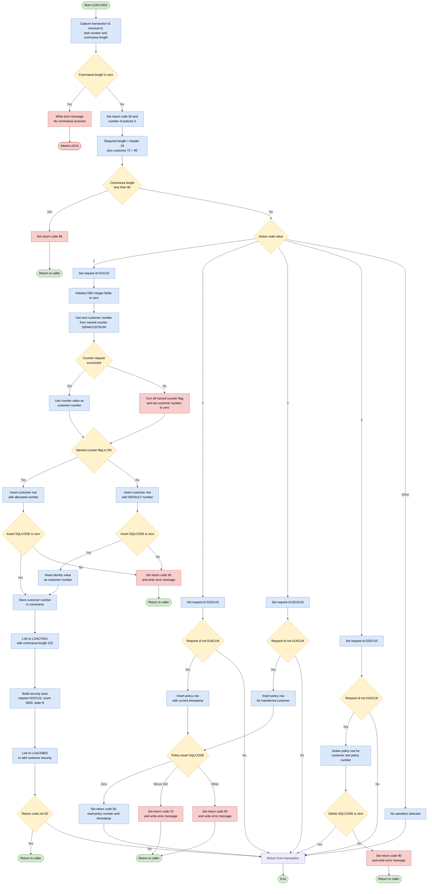
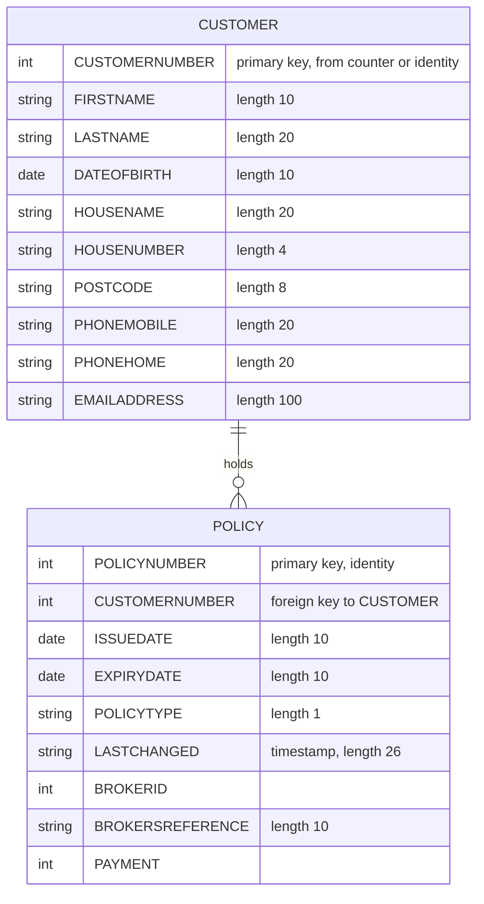

## Table of Contents

- [1. Purpose](#1-purpose)
- [2. Inputs](#2-inputs)
- [3. Outputs](#3-outputs)
- [4. Processing Logic](#4-processing-logic)
  - [4.1 Mermaid Flow Diagram](#41-mermaid-flow-diagram)
  - [4.2 Processing Logic Description](#42-processing-logic-description)
  - [4.3 Database Tables](#43-database-tables)
- [5. Paragraphs](#5-paragraphs)
- [6. Dependencies](#6-dependencies)
- [7. Constraints](#7-constraints)
  - [7.1 Communication Area and Invocation Constraints](#71-communication-area-and-invocation-constraints)
  - [7.2 Control Flow and Execution Constraints](#72-control-flow-and-execution-constraints)
  - [7.3 Data Validation and Mapping Constraints](#73-data-validation-and-mapping-constraints)
  - [7.4 Resource and Database Constraints](#74-resource-and-database-constraints)
- [8. Error Handling](#8-error-handling)
  - [8.1 COMMAREA Validation](#81-commarea-validation)
  - [8.2 Db2 SQL Error Handling](#82-db2-sql-error-handling)
  - [8.3 CICS Named-Counter Failure Handling (Fallback / Recovery)](#83-cics-named-counter-failure-handling-fallback--recovery)
  - [8.4 Post-Link Return Code Propagation](#84-post-link-return-code-propagation)
  - [8.5 Error Logging via WRITE_ERROR_MESSAGE](#85-error-logging-via-write_error_message)
  - [8.6 Operational Routing Guard (Implicit No-Operation)](#86-operational-routing-guard-implicit-no-operation)
- [9. Examples](#9-examples)
  - [9.1 Example 1: Normal call (ACTION_CODE stays '0')](#91-example-1-normal-call-action_code-stays-0)
  - [9.2 Example 2: COMMAREA too short](#92-example-2-commarea-too-short)
  - [9.3 Example 3: No COMMAREA](#93-example-3-no-commarea)
  - [9.4 Example 4: Add customer branch (ACTION_CODE = '1')](#94-example-4-add-customer-branch-action_code--1)

## 1. Purpose

`LGACUS01` is a CICS-hosted Enterprise PL/I program that serves as a direct Db2 customer and policy management service within the GenApp general insurance application. It accepts a communication area from its caller and, depending on an action code, performs one of four customer lifecycle operations: onboarding a new customer (inserting a record into the Db2 CUSTOMER table using a customer number drawn from the CICS named counter `GENACUSTNUM`, then linking to `LGACVS01` for VSAM registration and to `LGACDB02` to create a customer security record), offering a new insurance policy to an existing customer (inserting a row into the POLICY table and returning the Db2-assigned policy number and timestamp), transferring a customer's existing policy (a structurally identical policy insert operation), or deleting a customer's policy (removing the matching POLICY row by customer and policy number, relying on Db2 foreign-key cascade to clean up dependent product-type rows). Throughout all operations the program validates the communication area length, surfaces Db2 and CICS errors by writing timestamped diagnostic messages to a transient data queue via `LGSTSQ`, and returns the allocated customer or policy identifier—along with an appropriate return code—to the calling program.

## 2. Inputs

- **Program parameter**
  - COMM_AREA_PTR: pointer to the CICS communication area (COMM_AREA) passed in by the calling program or transaction. All of the request data below arrives through it. If EIBCALEN is 0, the program abends with code LGCA. If the length is shorter than the 18-byte header plus the 72-byte customer length, it returns with CA_RETURN_CODE '98'.

- **CICS execution environment inputs**
  - EIBCALEN: length of the communication area received. It is used to validate the input and to decide how much of the commarea is written to the error queue.
  - EIBTRNID, EIBTRMID, EIBTASKN: transaction ID, terminal ID and task number of the current task. They are captured for run-time and diagnostic information.
  - Current system date and time, obtained with CICS ASKTIME and FORMATTIME. They are used to stamp error messages.

- **Request control fields in the communication area**
  - CA_REQUEST_ID: 6-character request identifier. Its incoming value is tested against '01ACLM' for the offer, transfer and delete operations, and the program overwrites it with the code for the selected action.
  - ACTION_CODE: selector that decides which operation runs (add, offer, transfer or delete). The program initialises it to '0' and never changes it, so no operation is selected.
  - CA_NUM_POLICIES: policy count, reset to zero when the input is validated.

- **Customer details supplied by the caller**
  - CA_FIRST_NAME, CA_LAST_NAME: customer given name and surname.
  - CA_DOB: date of birth.
  - CA_HOUSE_NAME, CA_HOUSE_NUM: house name and number.
  - CA_POSTCODE: postal code.
  - CA_PHONE_MOBILE, CA_PHONE_HOME: mobile and home telephone numbers.
  - CA_EMAIL_ADDRESS: email address.
  - These are inserted into the CUSTOMER table when a customer is added.

- **Policy details supplied by the caller**
  - CA_POLICY_NUM: policy identifier.
  - CA_ISSUE_DATE, CA_EXPIRY_DATE: policy issue and expiry dates.
  - CA_BROKERID: broker identifier, converted to an integer for the insert.
  - CA_BROKERSREF: broker reference.
  - CA_PAYMENT: payment or premium amount, converted to an integer for the insert.
  - DB2_POLICYTYPE: policy type code used when inserting a policy row.
  - These are used when a policy is offered or transferred.

- **Customer identification and security values**
  - CA_CUSTOMER_NUM: customer number. The program overwrites it with the newly allocated number.
  - D2_CUSTSECR_STATE: customer security state, set to 'N' for a new customer.

- **External data sources and services**
  - CICS named counter GENACUSTNUM in pool GENA: the source of the next customer number. If the counter cannot be read, the program falls back to the database identity value.
  - DB2 identity value (IDENTITY_VAL_LOCAL): returns the generated customer or policy number after an insert.
  - DB2 POLICY table: the program reads back the LASTCHANGED timestamp for the inserted policy. It also uses the customer and policy numbers to delete a policy row.
  - SQLCODE and the SQLCA: the database return status after each SQL statement. It drives the return codes and error handling.
  - Responses from the linked programs LGACVS01, LGACDB02 and LGSTSQ, and the CICS RESP value from the counter request.

## 3. Outputs

**COMMAREA — returned to the caller**
- `CA_RETURN_CODE` — two-digit return code written back to the caller on every exit path: `'00'` (success), `'98'` (COMMAREA too short), `'70'` (foreign-key violation inserting a policy), `'90'` (Db2 or system error)
- `CA_CUSTOMER_NUM` — populated with the newly allocated customer number (from the CICS named counter `GENACUSTNUM` or from Db2 `IDENTITY_VAL_LOCAL()`) after a successful customer insert; returned to the caller as the identifier of the new customer record
- `CA_POLICY_NUM` — populated with the Db2-allocated policy number (`IDENTITY_VAL_LOCAL()`) after a successful policy insert (offer or transfer action); returned to the caller as the identifier of the new policy record
- `CA_LASTCHANGED` — populated with the `LASTCHANGED` timestamp of the newly inserted policy row, read back from the POLICY table; returned to the caller as confirmation of the record's creation time
- `CA_REQUEST_ID` — set by the mainline to the operation code for the selected action (`'01ICUS'`, `'02OCUS'`, `'02UCUS'`, or `'02DCUS'`) before control is passed on; visible to the caller on return
- `CA_NUM_POLICIES` — reset to zero during input validation; returned as part of the COMMAREA

**Db2 — database writes**
- `CUSTOMER` table — a new row is inserted (INSERT INTO CUSTOMER) with columns `CUSTOMERNUMBER`, `FIRSTNAME`, `LASTNAME`, `DATEOFBIRTH`, `HOUSENAME`, `HOUSENUMBER`, `POSTCODE`, `PHONEMOBILE`, `PHONEHOME`, `EMAILADDRESS`; either an explicit customer number (from the named counter) or the Db2 DEFAULT identity value is used
- `POLICY` table — a new row is inserted (INSERT INTO POLICY) with columns `POLICYNUMBER` (DEFAULT), `CUSTOMERNUMBER`, `ISSUEDATE`, `EXPIRYDATE`, `POLICYTYPE`, `LASTCHANGED` (CURRENT TIMESTAMP), `BROKERID`, `BROKERSREFERENCE`, `PAYMENT`; this occurs for the offer-policy (action `'2'`) and transfer-customer (action `'3'`) paths
  - On action `'4'` (delete), a row is deleted from the POLICY table (DELETE FROM POLICY WHERE `CUSTOMERNUMBER` = … AND `POLICYNUMBER` = …)

**CICS LINK calls — downstream programs driven**
- `LGACVS01` — linked with the full COMMAREA (length 225) during customer onboarding to perform VSAM customer record maintenance
- `LGACDB02` — linked with `CDB2AREA` (length 32500) to create the customer security record; the area carries `D2_CUSTOMER_NUM`, `D2_REQUEST_ID` (`'02ACUS'`), `D2_CUSTSECR_COUNT` (`'0000'`), and `D2_CUSTSECR_STATE` (`'N'`) as inputs to that program
- `LGSTSQ` (via `WRITE_ERROR_MESSAGE`) — linked on every error path to write formatted diagnostic messages to a CICS transient data queue; each invocation passes an `ERROR_MSG` record containing date, time, program name, customer number, policy number, SQL request identifier, and SQLCODE

**CICS abnormal termination**
- `EXEC CICS ABEND ABCODE('LGCA')` — issued with NODUMP when no COMMAREA is received at all; this is an observable side-effect terminating the task with abend code `LGCA`

## 4. Processing Logic

### 4.1 Mermaid Flow Diagram

### 4.2 Processing Logic Description

**High-level Summary**

LGACUS01 is a CICS PL/I business-logic program in the General Insurance application (GenApp). It receives a communication area (COMM_AREA) and, according to an action code, can:
- add a new customer
- offer a policy to a customer
- transfer a customer's policy
- delete a customer's policy

As coded, ACTION_CODE is initialised to '0' and is never changed. None of the four business branches is selected, so the program only validates the commarea and then returns. The branch logic is still part of the program and is described below.

**Execution Flow**

1. **Initialisation (INIT_CICS_VARIABLES).** The program copies the CICS transaction id, terminal id, task number and commarea length (EIBTRNID, EIBTRMID, EIBTASKN, EIBCALEN) into the WS_HEADER diagnostic fields.

2. **Input validation (CHECK_INPUTS).**
   - If EIBCALEN is 0, no commarea was received. The program sets the message "NO COMMAREA RECEIVED", calls WRITE_ERROR_MESSAGE and abends with code `LGCA` (NODUMP).
   - Otherwise it sets CA_RETURN_CODE to '00', resets CA_NUM_POLICIES to 0 and saves the commarea address.
   - The required length is the header length (18) plus the customer length (72), which is 90 bytes. If the commarea is shorter than 90 bytes, CA_RETURN_CODE is set to '98' and the program returns to the caller.

3. **Action dispatch.** The program evaluates ACTION_CODE:
   - '1' sets CA_REQUEST_ID to '01ICUS' and runs ONBOARD_CUSTOMER.
   - '2' sets CA_REQUEST_ID to '02OCUS' and runs OFFER_CUSTOMER.
   - '3' sets CA_REQUEST_ID to '02UCUS' and runs TRANSFER_CUSTOMER.
   - '4' sets CA_REQUEST_ID to '02DCUS' and runs DELETE_CUSTOMER.
   - Any other value does nothing. This is always the case, because the value stays '0'.

   The request ids are the truncated 6-byte forms of the longer COBOL originals.

4. **Add customer (ONBOARD_CUSTOMER).**
   - DB2_OUT_INTEGERS is reset to 0.
   - **OBTAIN_CUSTOMER_NUMBER** gets the next value from the CICS named counter `GENACUSTNUM` in pool `GENA`. If the response is not NORMAL, the flag LGAC_NCS is set to 'NO' and the customer number is set to 0. Otherwise the counter value is used.
   - **INSERT_CUSTOMER** has two paths:
     - If LGAC_NCS is 'ON', it inserts a CUSTOMER row with the explicit customer number.
     - If LGAC_NCS is 'NO', it inserts the row with DEFAULT for CUSTOMERNUMBER, so DB2 generates an identity value. The program then reads that value with `IDENTITY_VAL_LOCAL()`.
     - In both paths a non-zero SQLCODE sets CA_RETURN_CODE to '90', writes an error message and returns.
     - On success the customer number is stored in CA_CUSTOMER_NUM.
   - The program links to `LGACVS01` with the commarea (length 225).
   - It then builds the security area CDB2AREA: customer number, request id '02ACUS', count '0000' and state 'N'. It links to `LGACDB02` to add the customer security record.
   - If CA_RETURN_CODE is not '00', the program returns immediately.

5. **Offer policy (OFFER_CUSTOMER).** If CA_REQUEST_ID is not '01ACLM', the program runs INSERT_CUSTOMER_POLICY. Because the request id was just set to '02OCUS', this condition is always true.
   - It converts broker id and payment to binary integers.
   - It inserts a POLICY row with a DB2-generated policy number, the customer number, issue and expiry dates, the policy type, CURRENT TIMESTAMP, the broker id, the broker reference and the payment.
   - SQLCODE 0 gives return code '00'.
   - SQLCODE -530 (foreign key violation) gives return code '70', writes an error message and returns.
   - Any other SQLCODE gives return code '90', writes an error message and returns.
   - On success it reads the new policy number with `IDENTITY_VAL_LOCAL()` and puts it in CA_POLICY_NUM and EM_POLNUM. It then selects LASTCHANGED for that policy into CA_LASTCHANGED.

6. **Transfer (TRANSFER_CUSTOMER).** With the same '01ACLM' guard, it runs TRANSFER_CUSTOMER_POLICY. This repeats the policy insert logic above, with the same SQLCODE handling and the same follow-up reads.

7. **Delete (DELETE_CUSTOMER).** With the same guard, it runs DELETE_CUSTOMER_POLICY. This deletes the POLICY row matching the customer number and policy number. Any non-zero SQLCODE, including 100 (not found), sets return code '90', writes an error message and returns. The comment says 100 is treated as success, but the code does not do that.

8. **Termination.** The program ends with `EXEC CICS RETURN`.

9. **Error logging (WRITE_ERROR_MESSAGE).**
   - It gets the current time with ASKTIME and FORMATTIME, and fills the date and time fields of ERROR_MSG.
   - It links to `LGSTSQ` to write ERROR_MSG to the queue. The message carries the program name, customer number, policy number and SQLCODE.
   - It then writes up to the first 90 bytes of the commarea. The commarea is passed whole if it is shorter than 91 bytes.

**Business rules**

| Rule | Value |
|---|---|
| Return code 00 | Success |
| Return code 70 | Foreign key violation (SQLCODE -530) on policy insert |
| Return code 90 | Other SQL failure |
| Return code 98 | Commarea too short |
| Minimum commarea length | 90 bytes |
| Fallback customer numbering | Database identity, used when the named counter is unavailable |

**External Interactions**

- **CICS named counter** `GENACUSTNUM` in pool `GENA`: allocates customer numbers.
- **DB2 table CUSTOMER**: inserts a new customer.
- **DB2 table POLICY**: inserts, selects and deletes policies.
- **LGACVS01** (CICS LINK): called after the customer is added, with the commarea.
- **LGACDB02** (CICS LINK): adds the customer security record (request '02ACUS', state 'N').
- **LGSTSQ** (CICS LINK): writes error messages and commarea content to the queue.
- **CICS services**: ASKTIME, FORMATTIME, ABEND and RETURN.

**Plain Language Summary**

The program is a gatekeeper for customer requests. It first checks that the caller sent enough information, and stops with an error if not. It then looks at a one-character action code to decide whether to add a customer, offer a policy, transfer a policy or delete a policy.

When adding a customer, it takes the next number from a central counter. If the counter is unavailable, it lets the database pick the number. It saves the customer, notifies two other programs, and creates a default security record for the new customer. For policies, it adds or removes policy records and reports the new policy number and the time of the change.

Any database failure is logged with the date, time, customer and policy numbers, and the program returns a code telling the caller what went wrong.

In the current code the action code is always '0', so no business action runs. The program validates the input and then ends.

### 4.3 Database Tables

## 5. Paragraphs

- **LGACUS01**
  - **Purpose**: Serves as the main entry point and orchestrator for customer onboarding and policy lifecycle actions (such as offering, transferring, or deleting policies).
  - **Operations**:
    - Invokes `INIT_CICS_VARIABLES` to extract runtime context from the CICS Execute Interface Block (EIB).
    - Calls `CHECK_INPUTS` to validate the incoming communication area and verify length requirements.
    - Evaluates `ACTION_CODE` using a `SELECT` construct to route execution to the appropriate business routine (`ONBOARD_CUSTOMER`, `OFFER_CUSTOMER`, `TRANSFER_CUSTOMER`, or `DELETE_CUSTOMER`) and assigns corresponding request identifiers (`01ICUS`, `02OCUS`, `02UCUS`, `02DCUS`).
    - Issues `EXEC CICS RETURN` to terminate program execution and return control to the caller.
  - **Control Flow**:
    - Sequential invocation of initialization and validation routines.
    - Multi-way branching via a `SELECT` statement keyed on `ACTION_CODE`.
  - **Interactions**:
    - CICS runtime communication via `EXEC CICS RETURN`.

- **INIT_CICS_VARIABLES**
  - **Purpose**: Initializes working storage variables with transactional and runtime metadata supplied by CICS.
  - **Operations**:
    - Captures `EIBTRNID` into `WS_TRANSID`.
    - Captures `EIBTRMID` into `WS_TERMID`.
    - Captures `EIBTASKN` into `WS_TASKNUM`.
    - Captures `EIBCALEN` into `WS_CALEN`.
  - **Control Flow**:
    - Direct sequential execution.
  - **Interactions**:
    - Reads values from the CICS EIB structure.

- **CHECK_INPUTS**
  - **Purpose**: Validates the presence and sufficiency of the input communication area before business processing begins.
  - **Operations**:
    - Checks whether `EIBCALEN` is zero; if missing, formats an error message and terminates the transaction abnormally with abend code `LGCA`.
    - Initializes `CA_RETURN_CODE` to `'00'` and resets `CA_NUM_POLICIES` to `0`.
    - Binds `WS_ADDR_DFHCOMMAREA` to `COMM_AREA_PTR`.
    - Calculates the minimum required COMMAREA length (`WS_CA_HEADER_LEN` + `WS_CUSTOMER_LEN`).
    - Compares `WS_CALEN` against the required length; if insufficient, sets `CA_RETURN_CODE` to `'98'` and returns immediately.
  - **Control Flow**:
    - Conditional `IF` branch checking for zero-length COMMAREA with immediate abnormal termination.
    - Conditional `IF` branch checking for minimum COMMAREA length with immediate return.
  - **Interactions**:
    - Calls `WRITE_ERROR_MESSAGE`.
    - Issues `EXEC CICS ABEND` and `EXEC CICS RETURN`.

- **ONBOARD_CUSTOMER**
  - **Purpose**: Coordinates the end-to-end creation of a new customer record across database, VSAM, and security components.
  - **Operations**:
    - Clears internal database integer fields (`DB2_OUT_INTEGERS`).
    - Calls `OBTAIN_CUSTOMER_NUMBER` to retrieve or generate a customer identifier.
    - Calls `INSERT_CUSTOMER` to persist the customer details into Db2.
    - Links to `LGACVS01` passing `COMM_AREA` (length 225) to create associated VSAM records.
    - Populates the security structure `CDB2AREA` with customer details, request ID (`02ACUS`), and initial state flag (`N`).
    - Links to `LGACDB02` passing `CDB2AREA` (length 32500) to persist customer security credentials.
    - Checks `CA_RETURN_CODE` and terminates execution if an error is present.
  - **Control Flow**:
    - Sequential subprogram calls and CICS program links.
    - Conditional `IF` check on `CA_RETURN_CODE` to exit via `EXEC CICS RETURN` on failure.
  - **Interactions**:
    - Issues `EXEC CICS LINK` to `LGACVS01` and `LGACDB02`.
    - Issues `EXEC CICS RETURN`.

- **OBTAIN_CUSTOMER_NUMBER**
  - **Purpose**: Generates the next sequential customer number from the CICS named counter facility.
  - **Operations**:
    - Requests the next value from named counter `GENACUSTNUM` within pool `GENA`.
    - Assigns the generated counter value to `DB2_CUSTOMERNUM_INT`.
    - If the counter request fails, sets `LGAC_NCS` to `'NO'` and resets `DB2_CUSTOMERNUM_INT` to `0` to signal database-generated identity fallback.
  - **Control Flow**:
    - Conditional `IF-ELSE` block checking CICS response code `WS_RESP` against `DFHRESP(NORMAL)`.
  - **Interactions**:
    - CICS named counter server via `EXEC CICS GET COUNTER`.

- **INSERT_CUSTOMER**
  - **Purpose**: Inserts a new customer record into the Db2 `CUSTOMER` table.
  - **Operations**:
    - Sets SQL request identifier `EM_SQLREQ` to `' INSERT CUSTOMER'`.
    - Evaluates `LGAC_NCS` to determine the key insertion strategy:
      - If `'ON'`, inserts into `CUSTOMER` using the explicitly generated `DB2_CUSTOMERNUM_INT`.
      - If `'NO'`, inserts using Db2 `DEFAULT` and retrieves the assigned identity value via `IDENTITY_VAL_LOCAL()`.
    - Maps the customer details from the communication area host variables (`CA_FIRST_NAME`, `CA_LAST_NAME`, `CA_DOB`, `CA_HOUSE_NAME`, `CA_HOUSE_NUM`, `CA_POSTCODE`, `CA_PHONE_MOBILE`, `CA_PHONE_HOME`, `CA_EMAIL_ADDRESS`).
    - Validates `SQLCODE` after insertion; on error, sets `CA_RETURN_CODE` to `'90'`, logs the error, and returns.
    - Stores the resolved customer number in `CA_CUSTOMER_NUM`.
  - **Control Flow**:
    - Conditional `IF-ELSE` construct selecting between explicit customer number insertion and auto-generated identity retrieval.
    - Conditional error handling on non-zero `SQLCODE`.
  - **Interactions**:
    - Db2 SQL operations (`INSERT INTO CUSTOMER`, `SET :DB2_CUSTOMERNUM_INT = IDENTITY_VAL_LOCAL()`).
    - Calls `WRITE_ERROR_MESSAGE` and issues `EXEC CICS RETURN` on error.

- **TRANSFER_CUSTOMER**
  - **Purpose**: Handles customer transfer requests by delegating to policy transfer processing.
  - **Operations**:
    - Verifies that `CA_REQUEST_ID` is not equal to `'01ACLM'`.
    - Calls `TRANSFER_CUSTOMER_POLICY` to execute policy record insertion under the transferred customer.
  - **Control Flow**:
    - Conditional `IF` check on `CA_REQUEST_ID`.
  - **Interactions**:
    - None directly; invokes `TRANSFER_CUSTOMER_POLICY`.

- **DELETE_CUSTOMER**
  - **Purpose**: Handles customer deletion requests by delegating to policy deletion processing.
  - **Operations**:
    - Verifies that `CA_REQUEST_ID` is not equal to `'01ACLM'`.
    - Calls `DELETE_CUSTOMER_POLICY` to remove associated policy records.
  - **Control Flow**:
    - Conditional `IF` check on `CA_REQUEST_ID`.
  - **Interactions**:
    - None directly; invokes `DELETE_CUSTOMER_POLICY`.

- **OFFER_CUSTOMER**
  - **Purpose**: Handles policy offering requests by delegating to policy insertion processing.
  - **Operations**:
    - Verifies that `CA_REQUEST_ID` is not equal to `'01ACLM'`.
    - Calls `INSERT_CUSTOMER_POLICY` to create a new policy record for the customer.
  - **Control Flow**:
    - Conditional `IF` check on `CA_REQUEST_ID`.
  - **Interactions**:
    - None directly; invokes `INSERT_CUSTOMER_POLICY`.

- **INSERT_CUSTOMER_POLICY**
  - **Purpose**: Inserts a new policy record into the Db2 `POLICY` table and retrieves generated policy identifiers.
  - **Operations**:
    - Converts communication area fields `CA_BROKERID` and `CA_PAYMENT` into binary integer host variables `DB2_BROKERID_INT` and `DB2_PAYMENT_INT`.
    - Sets SQL request identifier `EM_SQLREQ` to `' INSERT POLICY  '`.
    - Executes an `INSERT INTO POLICY` statement with input host variables, `DEFAULT` for `POLICYNUMBER`, and `CURRENT TIMESTAMP` for `LASTCHANGED`.
    - Evaluates `SQLCODE`: sets `CA_RETURN_CODE` to `'00'` on success, `'70'` on referential integrity violation (`-530`), or `'90'` for other errors.
    - Retrieves the generated policy number using `IDENTITY_VAL_LOCAL()` and stores it in `CA_POLICY_NUM` and `EM_POLNUM`.
    - Queries the `POLICY` table to retrieve the assigned `LASTCHANGED` timestamp into `CA_LASTCHANGED`.
  - **Control Flow**:
    - `SELECT (SQLCODE)` construct handling success (`0`), foreign key error (`-530`), and general failure branches.
    - Early return on error conditions.
  - **Interactions**:
    - Db2 SQL operations (`INSERT INTO POLICY`, `SET :DB2_POLICYNUM_INT = IDENTITY_VAL_LOCAL()`, `SELECT LASTCHANGED FROM POLICY`).
    - Calls `WRITE_ERROR_MESSAGE` and issues `EXEC CICS RETURN` on error.

- **TRANSFER_CUSTOMER_POLICY**
  - **Purpose**: Inserts a policy record associated with a transferred customer into the Db2 `POLICY` table.
  - **Operations**:
    - Converts `CA_BROKERID` and `CA_PAYMENT` to integer host variables `DB2_BROKERID_INT` and `DB2_PAYMENT_INT`.
    - Sets SQL request identifier `EM_SQLREQ` to `' INSERT POLICY  '`.
    - Executes `INSERT INTO POLICY` with supplied details and `CURRENT TIMESTAMP`.
    - Evaluates `SQLCODE`: sets `CA_RETURN_CODE` to `'00'` on success, `'70'` on referential integrity violation (`-530`), or `'90'` on general errors.
    - Retrieves the generated policy number via `IDENTITY_VAL_LOCAL()` and assigns it to `CA_POLICY_NUM` and `EM_POLNUM`.
    - Queries the newly inserted row to fetch `LASTCHANGED` into `CA_LASTCHANGED`.
  - **Control Flow**:
    - `SELECT (SQLCODE)` construct routing on `0`, `-530`, and other SQL codes.
    - Error exits invoke logging and return control.
  - **Interactions**:
    - Db2 SQL operations (`INSERT INTO POLICY`, `SET :DB2_POLICYNUM_INT = IDENTITY_VAL_LOCAL()`, `SELECT LASTCHANGED FROM POLICY`).
    - Calls `WRITE_ERROR_MESSAGE` and issues `EXEC CICS RETURN` on error.

- **DELETE_CUSTOMER_POLICY**
  - **Purpose**: Deletes a specific policy belonging to a customer from the Db2 `POLICY` table.
  - **Operations**:
    - Sets SQL request identifier `EM_SQLREQ` to `' DELETE POLICY  '`.
    - Executes `DELETE FROM POLICY` matching `CUSTOMERNUMBER` and `POLICYNUMBER`.
    - Evaluates `SQLCODE`; if non-zero, sets `CA_RETURN_CODE` to `'90'`, logs the error, and returns.
  - **Control Flow**:
    - Conditional `IF` check on `SQLCODE` to handle SQL execution errors.
  - **Interactions**:
    - Db2 SQL operation (`DELETE FROM POLICY`).
    - Calls `WRITE_ERROR_MESSAGE` and issues `EXEC CICS RETURN` on error.

- **WRITE_ERROR_MESSAGE**
  - **Purpose**: Formats and logs diagnostic error information and COMMAREA content to a CICS Transient Data Queue (TDQ) or temporary storage via an external logging subprogram.
  - **Operations**:
    - Obtains current absolute time using `EXEC CICS ASKTIME` and formats it into date and time strings via `EXEC CICS FORMATTIME`.
    - Populates timestamp fields in `ERROR_MSG`.
    - Links to error handling program `LGSTSQ` passing `ERROR_MSG`.
    - If `EIBCALEN` is greater than zero, copies up to 90 bytes of `COMM_AREA_RAW` into `CA_DATA` and links to `LGSTSQ` with `CA_ERROR_MSG`.
  - **Control Flow**:
    - Sequential time formatting and message dispatch.
    - Nested `IF-ELSE` structure determining whether and how much raw COMMAREA payload to log based on `EIBCALEN`.
  - **Interactions**:
    - CICS runtime commands (`EXEC CICS ASKTIME`, `EXEC CICS FORMATTIME`).
    - Invokes logging program via `EXEC CICS LINK PROGRAM('LGSTSQ')`.

## 6. Dependencies

- **Calling and input dependencies**
  - COMM_AREA_PTR is the entry parameter. It points to the CICS COMMAREA (DFHCOMMAREA), which is mapped by the COMM_AREA structure from the LGCMAREA include.
    - The caller must supply a COMMAREA of at least 90 bytes. That is 18 bytes of header plus 72 bytes of customer data (WS_CA_HEADER_LEN + WS_CUSTOMER_LEN).
    - If EIBCALEN is 0, the program writes an error message and abends with code LGCA.
    - If the COMMAREA is too short, the program sets CA_RETURN_CODE to '98' and returns.
    - The caller must supply these fields for a customer add: CA_FIRST_NAME, CA_LAST_NAME, CA_DOB, CA_HOUSE_NAME, CA_HOUSE_NUM, CA_POSTCODE, CA_PHONE_MOBILE, CA_PHONE_HOME and CA_EMAIL_ADDRESS.
    - For policy-related actions, the caller supplies CA_ISSUE_DATE, CA_EXPIRY_DATE, CA_BROKERID, CA_BROKERSREF, CA_PAYMENT and CA_POLICY_NUM. The program also reads DB2_POLICYTYPE.
    - The program writes these fields back to the COMMAREA: CA_RETURN_CODE, CA_NUM_POLICIES, CA_CUSTOMER_NUM, CA_POLICY_NUM, CA_LASTCHANGED and CA_REQUEST_ID.
  - ACTION_CODE is a local selector, initialised to '0' and never changed. It decides which of the operations '1' to '4' runs. Because it never changes, no operation is currently selected.
  - CICS EXEC Interface Block (EIB) fields supply runtime context: EIBTRNID, EIBTRMID, EIBTASKN and EIBCALEN.

- **Included copybooks and definitions**
  - plinc/LGPOLICY.inc provides the policy length constants (WS_POLICY_LENGTHS) and the DB2 host variable structures. These cover customer, policy, endowment, house, motor, commercial and claim data.
  - plinc/LGCMAREA.inc provides the COMM_AREA structure that maps the COMMAREA, including the customer, customer-security and policy request layouts.
  - SQLCA, included through EXEC SQL INCLUDE, provides SQLCODE for checking DB2 results.

- **External programs invoked through EXEC CICS LINK**
  - LGACVS01
    - Called after the customer insert, with the COMM_AREA and a length of 225.
    - Its exact function is not visible in this source, but it is linked as part of customer onboarding.
  - LGACDB02
    - Adds the customer security record.
    - Called with the CDB2AREA commarea (length 32500), carrying request id '02ACUS', the customer number, count '0000' and state 'N'.
  - LGSTSQ
    - Error logging program that writes messages to the queues.
    - Called with ERROR_MSG and, when a COMMAREA exists, with CA_ERROR_MSG, which holds up to 90 bytes of the COMMAREA.
  - LGACDB01 is declared as a constant but never linked in this program.

- **Database dependencies (Db2 for z/OS)**
  - CUSTOMER table
    - Receives an INSERT of CUSTOMERNUMBER, FIRSTNAME, LASTNAME, DATEOFBIRTH, HOUSENAME, HOUSENUMBER, POSTCODE, PHONEMOBILE, PHONEHOME and EMAILADDRESS.
    - If the named counter is unavailable (LGAC_NCS = 'NO'), the insert uses DEFAULT for CUSTOMERNUMBER. The program then reads the generated number with IDENTITY_VAL_LOCAL().
    - This depends on the table's identity column definition.
  - POLICY table
    - INSERT of POLICYNUMBER (DEFAULT), CUSTOMERNUMBER, ISSUEDATE, EXPIRYDATE, POLICYTYPE, LASTCHANGED (CURRENT TIMESTAMP), BROKERID, BROKERSREFERENCE and PAYMENT.
      - This is used for the offer and transfer actions.
      - SQLCODE -530 (foreign key violation) maps to return code '70'. Any other non-zero SQLCODE maps to '90'.
    - SELECT of LASTCHANGED by POLICYNUMBER, to return the timestamp.
    - DELETE by CUSTOMERNUMBER and POLICYNUMBER, used for the delete action.
      - The delete relies on foreign key cascade rules to remove rows from the policy-type tables.
  - IDENTITY_VAL_LOCAL() is a Db2 function used to retrieve generated identity values for customers and policies.
  - A Db2 connection and plan or package for the CICS-DB2 attachment is required.

- **CICS services and resources**
  - Named counter server
    - EXEC CICS GET COUNTER uses the counter name GENACUSTNUM in pool GENA.
    - It supplies the next customer number. If the call does not respond normally, the program sets LGAC_NCS to 'NO' and falls back to the Db2 identity column.
  - Time services
    - EXEC CICS ASKTIME and EXEC CICS FORMATTIME produce the date (MMDDYYYY) and time for error messages.
  - Program control
    - EXEC CICS RETURN ends the transaction.
    - EXEC CICS ABEND ABCODE('LGCA') NODUMP handles a missing COMMAREA.
  - Transaction and terminal context come from the EIB. The constant ATRANID ('DSC1') is declared but not used.

- **Configuration values and constants**
  - Counter and pool names
    - GENACOUNT = 'GENACUSTNUM'
    - GENAPOOL = 'GENA'
  - LGAC_NCS = 'ON'
    - This flag selects named-counter mode and is switched to 'NO' on counter failure.
  - Customer security defaults
    - WS_CS_PASSWORD = 'NewPass'
    - WS_CS_STATE = 'N'
    - WS_CA_COUNT = 0
  - Request identifiers
    - '01ICUS' (add customer)
    - '02OCUS' (offer)
    - '02UCUS' (transfer)
    - '02DCUS' (delete)
    - '02ACUS' (add customer security)
    - '01ACLM' is compared against CA_REQUEST_ID to skip policy processing.
  - Return code conventions
    - '00' is success.
    - '70' is a foreign key violation.
    - '90' is an SQL error.
    - '98' is a COMMAREA that is too short.

- **Build and runtime environment**
  - The program is built with the PL/I compiler, the Db2 precompiler or coprocessor, and the CICS translator or coprocessor. It uses Options(Main), so it runs as a CICS main program.
  - The environment needs these resources defined and available:
    - Program definitions for LGACVS01, LGACDB02 and LGSTSQ
    - The CICS named counter pool GENA
    - The Db2 tables CUSTOMER and POLICY

## 7. Constraints

### 7.1 Communication Area and Invocation Constraints

- Communication Area Presence:
  - The program enforces that a communication area must be passed on invocation (`EIBCALEN > 0`). If `EIBCALEN` is equal to 0, an error message (`' NO COMMAREA RECEIVED'`) is logged to the error queue via `LGSTSQ`, and the program terminates immediately by issuing `EXEC CICS ABEND ABCODE('LGCA') NODUMP`.

- Communication Area Size Restrictions:
  - The communication area length must be at least 90 bytes (`WS_CA_HEADER_LEN` of 18 + `WS_CUSTOMER_LEN` of 72) as verified in `CHECK_INPUTS`.
  - If `WS_CALEN` (`EIBCALEN`) is less than 90 bytes, the program sets `CA_RETURN_CODE = '98'` and returns control to the caller via `EXEC CICS RETURN`.
  - When linking to downstream programs, fixed length requirements are enforced:
    - `EXEC CICS LINK PROGRAM(LGACVS01)` requires a COMMAREA length of exactly 225 bytes.
    - `EXEC CICS LINK PROGRAM(LGACDB02)` requires a COMMAREA length of exactly 32,500 bytes (`CDB2AREA`).
    - `EXEC CICS LINK PROGRAM('LGSTSQ')` passes structures matching the exact storage size of `ERROR_MSG` and `CA_ERROR_MSG`.

- Error Logging Boundary:
  - When recording COMMAREA diagnostics during an error condition, the payload captured into `CA_ERROR_MSG.CA_DATA` is capped at a maximum of 90 bytes (`LEFT(COMM_AREA_RAW, 90)` when `EIBCALEN >= 91`, or `LEFT(COMM_AREA_RAW, EIBCALEN)` when `EIBCALEN < 91`).

### 7.2 Control Flow and Execution Constraints

- Hardcoded Action Code Execution Constraint:
  - The variable `ACTION_CODE` is declared with an initial value of `'0'` (`CHAR(1) INIT('0')`) and is not updated by incoming input or execution logic before the `SELECT` construct.
  - Consequently, none of the operation branches (`WHEN ('1')` for `ONBOARD_CUSTOMER`, `WHEN ('2')` for `OFFER_CUSTOMER`, `WHEN ('3')` for `TRANSFER_CUSTOMER`, `WHEN ('4')` for `DELETE_CUSTOMER`) will execute during normal runtime flow, defaulting to `OTHERWISE` and proceeding directly to `EXEC CICS RETURN`.

- Operation-Specific Conditional Restrictions:
  - Under `OFFER_CUSTOMER`, `TRANSFER_CUSTOMER`, and `DELETE_CUSTOMER`, policy operations (`INSERT_CUSTOMER_POLICY`, `TRANSFER_CUSTOMER_POLICY`, and `DELETE_CUSTOMER_POLICY`) are conditionally bypassed if `CA_REQUEST_ID` equals `'01ACLM'`.

- Intermediate Return Code Checks:
  - In `ONBOARD_CUSTOMER`, after invoking `LGACDB02`, the program verifies `CA_RETURN_CODE`. If `CA_RETURN_CODE` is not `'00'`, execution terminates early with `EXEC CICS RETURN`.

### 7.3 Data Validation and Mapping Constraints

- Initialisation and Reset Constraints:
  - Upon entry into `CHECK_INPUTS`, `CA_RETURN_CODE` is explicitly reset to `'00'`, and `CA_NUM_POLICIES` is reset to numeric `0`.
  - In `ONBOARD_CUSTOMER`, the host integer group `DB2_OUT_INTEGERS` is re-initialized to 0 before customer creation.
  - In `ONBOARD_CUSTOMER`, security data fields are constrained to predefined initial states before invoking `LGACDB02`: `D2_REQUEST_ID` is set to `'02ACUS'`, `D2_CUSTSECR_COUNT` is set to `'0000'`, and `D2_CUSTSECR_STATE` is set to `'N'`.

- Field Length and Type Restrictions:
  - Customer identifying strings mapped from the communication area to Db2 host variables and columns are constrained by defined field lengths:
    - `CA_FIRST_NAME`: `CHAR(10)`
    - `CA_LAST_NAME`: `CHAR(20)`
    - `CA_DOB`: `CHAR(10)` (formatted date)
    - `CA_HOUSE_NAME`: `CHAR(20)`
    - `CA_HOUSE_NUM`: `CHAR(4)`
    - `CA_POSTCODE`: `CHAR(8)`
    - `CA_PHONE_MOBILE`: `CHAR(20)`
    - `CA_PHONE_HOME`: `CHAR(20)`
    - `CA_EMAIL_ADDRESS`: `CHAR(100)`
  - Policy attributes are constrained to specific numeric formats and types:
    - `CA_BROKERID` (`PIC '9999999999'`) is mapped to a 31-bit signed binary integer (`DB2_BROKERID_INT`).
    - `CA_PAYMENT` (`PIC '999999'`) is mapped to a 31-bit signed binary integer (`DB2_PAYMENT_INT`).
    - `CA_POLICY_NUM` and `CA_CUSTOMER_NUM` are constrained to 10-digit numeric representations (`PIC '9999999999'`).

### 7.4 Resource and Database Constraints

- Customer Number Allocation and Fallback:
  - The program attempts to retrieve a unique customer identifier from the CICS Named Counter `GENACUSTNUM` in pool `GENA` (`EXEC CICS GET COUNTER`).
  - If the named counter does not return `DFHRESP(NORMAL)`, `LGAC_NCS` is switched from `'ON'` to `'NO'`, setting `DB2_CUSTOMERNUM_INT = 0`.
  - Under `LGAC_NCS = 'ON'`, the `CUSTOMER` table insert explicitly supplies `:DB2_CUSTOMERNUM_INT`.
  - Under `LGAC_NCS = 'NO'`, the `CUSTOMER` table insert supplies the `DEFAULT` clause, triggering Db2 auto-generation, and subsequently queries `IDENTITY_VAL_LOCAL()` to assign `DB2_CUSTOMERNUM_INT`.

- Policy Creation Constraints:
  - `INSERT INTO POLICY` inserts policy records using the `DEFAULT` clause for `POLICYNUMBER` and retrieves the assigned policy ID via `IDENTITY_VAL_LOCAL()`.
  - The timestamp column `LASTCHANGED` is populated with `CURRENT TIMESTAMP` upon insert, followed by an immediate `SELECT LASTCHANGED INTO :CA_LASTCHANGED` filtered by the newly generated `POLICYNUMBER`.

- Referential Integrity and SQL Error Handling Constraints:
  - Database operations check `SQLCODE` immediately following SQL statement executions:
    - Customer insert failures (`SQLCODE <> 0`) assign `CA_RETURN_CODE = '90'`, write diagnostic details to the error queue, and issue `EXEC CICS RETURN`.
    - Policy insert operations evaluate `SQLCODE`: a return code of `0` sets `CA_RETURN_CODE = '00'`; foreign key violation `SQLCODE -530` sets `CA_RETURN_CODE = '70'`, logs the error, and terminates via `EXEC CICS RETURN`; any other non-zero SQLCODE sets `CA_RETURN_CODE = '90'`, logs the error, and terminates.
    - Policy delete operations treat `SQLCODE = 0` as successful. Any non-zero `SQLCODE` (including missing rows if returning non-zero codes other than normal execution) triggers `CA_RETURN_CODE = '90'`, logs the error, and exits.

## 8. Error Handling

### 8.1 COMMAREA Validation

- **Missing COMMAREA (zero-length):** In the `CHECK_INPUTS` procedure, the CICS-supplied `EIBCALEN` field is tested immediately on entry. If it equals zero, the program has received no communication area at all. An error message is set (`EM_MSG_TEXT = ' NO COMMAREA RECEIVED'`), `WRITE_ERROR_MESSAGE` is called to log the event, and then a CICS ABEND with code `LGCA` and `NODUMP` is issued, terminating the transaction.

- **Insufficient COMMAREA length:** Still within `CHECK_INPUTS`, the captured COMMAREA length (`WS_CALEN`) is compared against the minimum required length, which is the sum of the header length constant (`WS_CA_HEADER_LEN`) and the customer data length constant (`WS_CUSTOMER_LEN`). If the actual length is smaller than required, `CA_RETURN_CODE` is set to `'98'` and `EXEC CICS RETURN` exits immediately, returning the error code to the caller without further processing.

---

### 8.2 Db2 SQL Error Handling

- **INSERT INTO CUSTOMER (named-counter path):** After inserting a customer row using the counter-supplied customer number, `SQLCODE` is tested for a non-zero value. Any failure sets `CA_RETURN_CODE` to `'90'`, calls `WRITE_ERROR_MESSAGE` to log the error, and issues `EXEC CICS RETURN` to terminate processing.

- **INSERT INTO CUSTOMER (identity-column path):** The same `SQLCODE <> 0` guard is applied to the fallback insert that uses `DEFAULT` for the customer number. On failure the same `'90'` return code, error logging, and immediate return sequence is triggered.

- **INSERT INTO POLICY (offer and transfer flows):** After inserting a policy row, `SQLCODE` is evaluated with a `SELECT` statement offering three branches:
    - `WHEN (0)`: success — `CA_RETURN_CODE` is set to `'00'`.
    - `WHEN (-530)`: foreign-key violation — `CA_RETURN_CODE` is set to `'70'`, `WRITE_ERROR_MESSAGE` is called, and `EXEC CICS RETURN` exits.
    - `OTHERWISE`: any other SQL error — `CA_RETURN_CODE` is set to `'90'`, `WRITE_ERROR_MESSAGE` is called, and `EXEC CICS RETURN` exits.
    - This same two-tier `SELECT (SQLCODE)` pattern is applied identically in both `INSERT_CUSTOMER_POLICY` and `TRANSFER_CUSTOMER_POLICY`.

- **DELETE FROM POLICY:** After the delete, `SQLCODE` is tested. A value of `0` (row deleted) and implicitly `+100` (row not found) are both treated as acceptable end-states — the comment documents this intent. Any other non-zero `SQLCODE` is treated as a hard error: `CA_RETURN_CODE = '90'`, `WRITE_ERROR_MESSAGE`, and `EXEC CICS RETURN`.

---

### 8.3 CICS Named-Counter Failure Handling (Fallback / Recovery)

- **CICS GET COUNTER failure:** In `OBTAIN_CUSTOMER_NUMBER`, the CICS `GET COUNTER` command retrieves the next customer number from the `GENACUSTNUM` counter in pool `GENA`. The `RESP(WS_RESP)` option captures the command response. If `WS_RESP` is not `DFHRESP(NORMAL)`, the program sets the flag `LGAC_NCS` to `'NO'` and sets `DB2_CUSTOMERNUM_INT` to `0`. This is a silent fallback — there is no error message or abend. The program continues, and `INSERT_CUSTOMER` uses the alternative `DEFAULT` identity-column path for the insert instead of the explicit counter value.

---

### 8.4 Post-Link Return Code Propagation

- **LGACDB02 (customer security) return code check:** After linking to `LGACDB02` to add customer security details, `CA_RETURN_CODE` is tested. If it is not `'00'`, the `ONBOARD_CUSTOMER` procedure issues `EXEC CICS RETURN` immediately, propagating the downstream error back to the original caller without further action.

---

### 8.5 Error Logging via WRITE_ERROR_MESSAGE

- **Centralised logging procedure:** All error paths (except the named-counter fallback and the COMMAREA-length return-code check) invoke the `WRITE_ERROR_MESSAGE` internal procedure before returning. This procedure:
    - Obtains the current date and time via `EXEC CICS ASKTIME` and `EXEC CICS FORMATTIME`.
    - Populates the `ERROR_MSG` structure, which carries the date, time, the hard-coded program identifier `LGACUS01`, the customer number, the policy number, the SQL operation label (`EM_SQLREQ`), and the `SQLCODE` value.
    - Writes the formatted message to a CICS transient data queue by linking to the shared `LGSTSQ` program.
    - Conditionally dumps up to 90 bytes of the raw COMMAREA to the same queue as a second diagnostic record, with a guard to handle the case where `EIBCALEN` is smaller than 90 bytes.

- **WS_EYECATCHER:** The `WS_HEADER` structure is initialised with the literal `'LGACUS01------WS'`, which serves as a dump eye-catcher to identify the program's working storage in any storage dump produced during abnormal termination.

---

### 8.6 Operational Routing Guard (Implicit No-Operation)

- **ACTION_CODE default bypass:** `ACTION_CODE` is declared and initialised to `'0'` and is never modified. The main `SELECT` statement tests for values `'1'` through `'4'`; because the code is always `'0'`, the `OTHERWISE` branch is taken silently and no operation is performed. While this is effectively a design artefact from the COBOL original, it acts as a safety guard preventing any inadvertent execution of business logic.

- **CA_REQUEST_ID claim-type guard:** In `OFFER_CUSTOMER`, `TRANSFER_CUSTOMER`, and `DELETE_CUSTOMER`, the `CA_REQUEST_ID` is tested against `'01ACLM'` before the inner procedure is called. If the request ID matches that claim-type value, the entire inner logic is skipped with no error raised, acting as a conditional bypass.

## 9. Examples

### 9.1 Example 1: Normal call (ACTION_CODE stays '0')

**Input**
- EIBCALEN = 250
- CA_FIRST_NAME = `Jane`, CA_LAST_NAME = `Smith`, CA_DOB = `1985-03-12`
- CA_POSTCODE = `AB12 3CD`, CA_EMAIL_ADDRESS = `jane@x.com`, CA_PHONE_MOBILE = `07700900123`
- CA_NUM_POLICIES = 005
- ACTION_CODE = `'0'` (its initial value)

**Output**
- CA_RETURN_CODE = `00`
- CA_NUM_POLICIES = `000`
- CA_REQUEST_ID is unchanged.
- No customer row is inserted. The program ends with `EXEC CICS RETURN`.

**Explanation:** `CHECK_INPUTS` finds a COMMAREA of 250 bytes, which is at least the required 90 (18 header + 72 customer). It sets the return code to `00` and resets CA_NUM_POLICIES to 0. ACTION_CODE is never changed from `'0'`. The `SELECT` therefore takes the `OTHERWISE` branch, so no business routine runs and the program returns.

### 9.2 Example 2: COMMAREA too short

**Input**
- EIBCALEN = 50
- Any customer field values

**Output**
- CA_RETURN_CODE = `98`
- The program returns to the caller immediately. No `SELECT` is run and nothing is written to DB2.

**Explanation:** The required length is 18 + 72 = 90 bytes. WS_CALEN (50) is less than 90, so `CHECK_INPUTS` sets `98` and issues `EXEC CICS RETURN`.

### 9.3 Example 3: No COMMAREA

**Input**
- EIBCALEN = 0

**Output**
- An error message ` NO COMMAREA RECEIVED` is written through `LGSTSQ`, with the date, time and program name `LGACUS01`.
- The task abends with code `LGCA` and no dump.

**Explanation:** `CHECK_INPUTS` tests EIBCALEN first. When it is 0, it writes the message and abends. No COMMAREA data is logged, because EIBCALEN is not greater than 0.

### 9.4 Example 4: Add customer branch (ACTION_CODE = '1')

This branch cannot be reached in the program as written, because ACTION_CODE is never changed. The example shows what would happen if it were set to `'1'`.

**Input**
- EIBCALEN = 250
- ACTION_CODE = `'1'`
- CA_FIRST_NAME = `Jane`, CA_LAST_NAME = `Smith`
- The named counter `GENACUSTNUM` returns 1001.

**Expected output**
- CA_REQUEST_ID = `01ICUS`
- A row is inserted into CUSTOMER with CUSTOMERNUMBER 1001.
- CA_CUSTOMER_NUM = `0000001001`
- CA_RETURN_CODE = `00`
- `LGACVS01` is linked, then `LGACDB02` is linked with D2_REQUEST_ID `02ACUS`, D2_CUSTOMER_NUM `0000001001`, D2_CUSTSECR_COUNT `0000` and D2_CUSTSECR_STATE `N`.

**Explanation:** `OBTAIN_CUSTOMER_NUMBER` gets 1001 from the named counter, and LGAC_NCS stays `ON`. `INSERT_CUSTOMER` inserts the row using that number. If the counter call fails, LGAC_NCS becomes `NO` and the insert uses `DEFAULT`, so DB2 assigns the number. The program then reads it with `IDENTITY_VAL_LOCAL()`. If the insert fails (SQLCODE ≠ 0), CA_RETURN_CODE is `90`, an error message is logged, and the program returns.

---

Generated by IBM Bob Premium Package for Z
