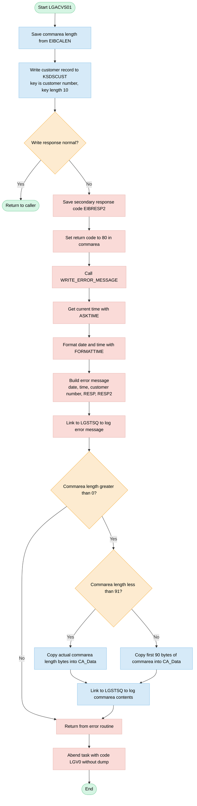
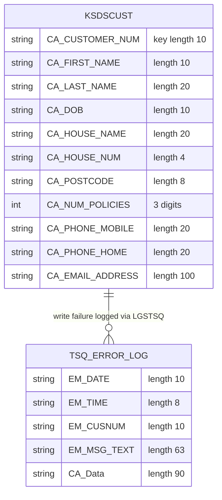

## Table of Contents

- [1. Purpose](#1-purpose)
- [2. Inputs](#2-inputs)
- [3. Outputs](#3-outputs)
  - [3.1 CICS Communications Area (COMMAREA)](#31-cics-communications-area-commarea)
  - [3.2 VSAM File Storage (`KSDSCUST`)](#32-vsam-file-storage-ksdscust)
  - [3.3 CICS Temporary Storage Queue Logging (via `LGSTSQ`)](#33-cics-temporary-storage-queue-logging-via-lgstsq)
  - [3.4 Abnormal Termination (ABEND)](#34-abnormal-termination-abend)
- [4. Processing Logic](#4-processing-logic)
  - [4.1 Mermaid Flow Diagram](#41-mermaid-flow-diagram)
  - [4.2 Processing Logic Description](#42-processing-logic-description)
  - [4.3 Database Tables](#43-database-tables)
- [5. Paragraphs](#5-paragraphs)
- [6. Dependencies](#6-dependencies)
- [7. Constraints](#7-constraints)
- [8. Error Handling](#8-error-handling)
- [9. Examples](#9-examples)
  - [9.1 Example 1: Successful customer add](#91-example-1-successful-customer-add)
  - [9.2 Example 2: Duplicate customer key](#92-example-2-duplicate-customer-key)
  - [9.3 Example 3: Short COMMAREA with a write failure](#93-example-3-short-commarea-with-a-write-failure)

## 1. Purpose

LGACVS01 is a CICS program that adds a new customer to the customer VSAM KSDS file (KSDSCUST). It takes the customer details passed in the communication area and writes them as a record, using the 10-digit customer number as the record key. If the write fails, it sets the return code to 80 and logs a timestamped error message. The message includes the customer number and the CICS response codes. It also logs up to the first 90 bytes of the communication area. Both go to a shared error-logging program (LGSTSQ). The program then abends the transaction with code LGV0, so the caller knows the customer was not added.

## 2. Inputs

- **Procedure parameter**
  - `COMM_AREA_PTR`: pointer to the COMMAREA passed in by the calling program, which is LGACDB01 through a CICS LINK. It addresses the whole 32,500-byte `COMM_AREA` structure, and every field below is read from it.

- **CICS environment input**
  - `EIBCALEN`: length of the COMMAREA that was passed in.
    - It is used as the length of the VSAM write.
    - It decides how much of the COMMAREA is copied into the error message (up to 90 bytes).

- **COMMAREA header fields**
  - `CA_REQUEST_ID`: 6-character code for the type of business request. It tells the called programs which function to perform.
  - `CA_CUSTOMER_NUM`: 10-digit customer number.
    - It is the record key (`Ridfld`, key length 10) for the write to the customer VSAM KSDS file `KSDSCUST`.
    - It is also copied into the error message to identify the customer.

- **COMMAREA customer request fields**
  - These fields form the customer record that is written to the file.
  - Identity and demographics
    - `CA_FIRST_NAME`: customer given name, 10 characters.
    - `CA_LAST_NAME`: customer surname, 20 characters.
    - `CA_DOB`: customer date of birth, 10 characters.
  - Address
    - `CA_HOUSE_NAME`: name of the customer's residence, 20 characters.
    - `CA_HOUSE_NUM`: street number, 4 characters.
    - `CA_POSTCODE`: postal code, 8 characters.
  - Contact details
    - `CA_PHONE_MOBILE`: mobile telephone number, 20 characters.
    - `CA_PHONE_HOME`: home telephone number, 20 characters.
    - `CA_EMAIL_ADDRESS`: email address, 100 characters.
  - Policy summary
    - `CA_NUM_POLICIES`: 3-digit count of policies associated with the customer.

- **COMMAREA customer security fields**
  - These fields share storage with the other request-specific layouts (a union). They are used when the COMMAREA carries a customer security request.
  - `CA_CUSTSECR_PASS`: 32-character password or credential that secures the customer's account.
  - `CA_CUSTSECR_STATE`: 1-character state of the customer's security record.
  - `CA_CUSTSECR_COUNT`: 4-character security counter, such as failed attempts.

- **COMMAREA policy request fields**
  - These fields also share storage with the other request-specific layouts.
  - `CA_POLICY_NUM`: 10-digit policy identifier, used for policy inquiry, add, update and delete requests.

- **External data sources and services**
  - Customer VSAM KSDS file `KSDSCUST`: the target of the CICS WRITE, keyed on the customer number. It is written to, not read.
  - CICS system services: ASKTIME and FORMATTIME supply the current date and time for error messages.
  - Program `LGSTSQ`: receives the formatted error messages through a CICS LINK. It is an output target, not an input.

## 3. Outputs

### 3.1 CICS Communications Area (COMMAREA)
- `CA_RETURN_CODE`
  - Stores the program completion status returned to the calling program. Set to `'80'` when the write operation to the customer VSAM file fails.

### 3.2 VSAM File Storage (`KSDSCUST`)
- `CA_CUSTOMER_NUM`
  - Serves as the 10-byte record key (`Ridfld`) and starting position of the record written (`From`) to the customer VSAM KSDS dataset (`KSDSCUST`), storing the customer details.

### 3.3 CICS Temporary Storage Queue Logging (via `LGSTSQ`)
- `ERROR_MSG`
  - Formatted error detail structure passed via CICS `LINK` to logging program `LGSTSQ` upon a write failure. Contains:
    - `EM_DATE` (system date formatted as `MMDDYYYY`)
    - `EM_TIME` (system time formatted as `HH:MM:SS`)
    - `EM_CUSNUM` (`CA_CUSTOMER_NUM` identifying the customer record that failed)
    - `EM_RESPRC` (CICS EIB response code `WS_RESP`)
    - `EM_RESP2RC` (CICS secondary response code `WS_RESP2`)
- `CA_ERROR_MSG`
  - Diagnostic payload structure containing the literal prefix `'COMMAREA='` and up to 90 bytes of the raw input commarea (`CA_Data`), linked to `LGSTSQ` to record context for troubleshooting.

### 3.4 Abnormal Termination (ABEND)
- `LGV0`
  - CICS transaction abend code triggered via `EXEC CICS ABEND ABCODE('LGV0') NODUMP` when the VSAM file write returns a non-normal CICS response code.

## 4. Processing Logic

### 4.1 Mermaid Flow Diagram



---

### 4.2 Processing Logic Description

**High-level Summary**

LGACVS01 is a CICS PL/I program that adds a customer record to the VSAM KSDS file `KSDSCUST`. It is part of the General Insurance application. The caller passes the customer data in the commarea, and the customer number is the record key. If the write fails, the program sets return code 80, logs diagnostic messages to a queue through the LGSTSQ program, and abends the task with code `LGV0`.

**Execution Flow**

1. **Start and initialisation.** The program is the main procedure and receives the commarea pointer `COMM_AREA_PTR`. The commarea is overlaid on the based structure `COMM_AREA`. It holds the request ID (`CA_REQUEST_ID`), the return code (`CA_RETURN_CODE`), the customer number (`CA_CUSTOMER_NUM`), and the customer, security and policy layouts. The program copies `EIBCALEN`, the length of the commarea passed in, into `WS_Commarea_Len`.

2. **Write the customer record.** The program issues `EXEC CICS WRITE FILE('KSDSCUST')`.
   - The data written starts at `CA_Customer_Num`, and the length is the commarea length.
   - `CA_Customer_Num` is also the `RIDFLD` key, with `KEYLENGTH(10)`.
   - The response goes into `WS_RESP` through `RESP`, so CICS does not abend automatically.

3. **Check the response.**
   - **Normal response:** The program executes `RETURN` and ends.
   - **Any other response, such as a duplicate key, I/O error or file not available:**
     - It saves `EIBRESP2` in `WS_RESP2`.
     - It sets `CA_RETURN_CODE` to `'80'`, the failure code for the caller.
     - It calls `WRITE_ERROR_MESSAGE`.
     - It issues `EXEC CICS ABEND ABCODE('LGV0') NODUMP`. The abend ends the task, so the `EXEC CICS RETURN` after it is not reached.

4. **WRITE_ERROR_MESSAGE routine.**
   - It calls `ASKTIME` to get the current absolute time.
   - It calls `FORMATTIME` to produce the date (MMDDYYYY format) and the time.
   - It fills the `ERROR_MSG` structure with:
     - the date and time
     - the program name `LGACVS01`
     - the customer number (`EM_CUSNUM`)
     - the text "Write file KSDSCUST"
     - the RESP and RESP2 values, edited as signed numbers
   - It links to program `LGSTSQ` with `ERROR_MSG` as the commarea. LGSTSQ writes the message to a queue.
   - If `EIBCALEN > 0`, it also logs the commarea contents. The text is prefixed with `COMMAREA=`, and `CA_Data` is 90 characters long:
     - If `EIBCALEN < 91`, it copies the actual number of bytes.
     - Otherwise it copies only the first 90 bytes.
     - It then links to `LGSTSQ` again with `CA_ERROR_MSG`.
   - If `EIBCALEN = 0`, no commarea data is logged.
   - The routine then returns to the main flow.

**Business Rules**

- The customer number is the unique key. The record is written with this key.
- Return code `80` means the customer file write failed.
- Every failure is logged twice: first the error details, then up to 90 bytes of the input data.
- A failure always ends the task with abend `LGV0` and no dump.

**External Interactions**

- **VSAM KSDS file `KSDSCUST`** (CICS file control): receives the new customer record.
- **Program `LGSTSQ`** (CICS LINK): receives error messages and the commarea snapshot, and logs them.
- **CICS time services** (`ASKTIME`, `FORMATTIME`): provide the timestamp for the error message.
- **CICS ABEND**: ends the task on failure.

**Plain Language Summary**

The program takes the details of a new customer and saves them in the customer file, using the customer number as the lookup key. If the save works, it finishes quietly. If it fails, for example because the customer number already exists, it:
- marks the request as failed (code 80)
- records the time, customer number and error codes in the logging service
- records a copy of the first part of the submitted data
- stops the transaction with the abend code LGV0

---

### 4.3 Database Tables



## 5. Paragraphs

- **LGACVS01 (main procedure body)**
  - Purpose: This is the main entry point (`Proc(COMM_AREA_PTR) Options(Main)`). It adds a customer record to the VSAM KSDS file `KSDSCUST`. The commarea is the data contract. The customer number, `CA_CUSTOMER_NUM`, is the record key.
  - Operations:
    - Copies the incoming commarea length (`EIBCALEN`) into `WS_Commarea_Len`.
    - Issues `EXEC CICS WRITE FILE('KSDSCUST')`. The record is taken `FROM(CA_Customer_Num)` with `LENGTH(WS_Commarea_Len)`. `RIDFLD(CA_Customer_Num)` with `KEYLENGTH(10)` supplies the key. `RESP(WS_RESP)` captures the result.
    - After the write, it compares `WS_RESP` with `DFHRESP(NORMAL)`.
  - Control flow:
    - If `WS_RESP` is not NORMAL:
      - It saves `EIBRESP2` into `WS_RESP2`.
      - It sets `CA_RETURN_CODE` to `'80'`.
      - It calls the internal procedure `WRITE_ERROR_MESSAGE`.
      - It issues `EXEC CICS ABEND ABCODE('LGV0') NODUMP`.
      - It then issues `EXEC CICS RETURN`, which is not reached after the abend.
    - If the write succeeds, a plain `RETURN` ends the program with the commarea unchanged.
  - External interactions:
    - Writes to the VSAM KSDS file `KSDSCUST`.
    - Uses the CICS ABEND and RETURN services on failure.
    - Reads and updates the commarea, which `LGACDB01` passes in.

- **Declarations and data areas (before the executable code)**
  - Purpose: Define the working storage and the commarea layout that the logic uses.
  - Operations:
    - Response and length work fields: `WS_RESP`, `WS_RESP2`, `WS_Comm_Len`, `WS_Commarea_Len`, `WS_STARTCODE` and `WS_SYSID`.
    - Time and date work fields: `WS_ABSTIME`, `WS_TIME` and `WS_DATE`.
    - `ERROR_MSG`, which holds the formatted error text. It contains the date, time, program name `LGACVS01`, and a union. The union is either free text (`EM_MSG_TEXT`) or a structured message with ` CNUM=` plus the customer number, ` Write file KSDSCUST`, ` RESP=` and ` RESP2=`.
    - `CA_ERROR_MSG`, which holds the `COMMAREA=` prefix followed by 90 bytes of commarea data.
    - An eyecatcher field for dump identification.
    - The `COMM_AREA` based structure, which maps over `COMM_AREA_PTR` as a 32500-byte union. It includes the request ID, return code, customer number, and the customer, security and policy request layouts. This program uses only `CA_CUSTOMER_NUM` and `CA_RETURN_CODE`.
  - Control flow: None.
  - External interactions: None.

- **WRITE_ERROR_MESSAGE**
  - Purpose: An internal procedure that builds a timestamped error record. It sends the record to the common logging program `LGSTSQ`. The program name, `LGSTSQ`, indicates that it writes to a CICS TS queue.
  - Operations:
    - Issues `EXEC CICS ASKTIME` to get the current absolute time into `WS_ABSTIME`.
    - Issues `EXEC CICS FORMATTIME` to convert `WS_ABSTIME` into `WS_DATE` (MMDDYYYY) and `WS_TIME`.
    - Fills the `ERROR_MSG` fields:
      - `EM_DATE` from `WS_DATE`.
      - `EM_TIME` from `WS_TIME`.
      - `EM_CUSNUM` from `CA_Customer_Num`.
      - `EM_RESPRC` from `WS_RESP`.
      - `EM_RESP2RC` from `WS_RESP2`.
    - Issues `EXEC CICS LINK PROGRAM('LGSTSQ')` with `ERROR_MSG` as the commarea. The length is `STG(ERROR_MSG)`.
    - Then logs part of the incoming commarea as a second message, as described below.
  - Control flow:
    - If `EIBCALEN > 0`:
      - If `EIBCALEN < 91`, it moves the whole commarea (`LEFT(COMM_AREA_RAW, EIBCALEN)`) into `CA_Data`.
      - Otherwise, it moves the first 90 bytes (`LEFT(COMM_AREA_RAW, 90)`) into `CA_Data`.
      - In both cases, it issues `EXEC CICS LINK PROGRAM('LGSTSQ')` with `CA_ERROR_MSG`, so the commarea content is logged for diagnosis.
    - If `EIBCALEN` is 0, the second link is skipped.
    - It ends with `RETURN` to the caller.
  - External interactions:
    - CICS time services (ASKTIME and FORMATTIME).
    - Two CICS LINKs to `LGSTSQ`, one for the error message and one for the commarea snapshot.

## 6. Dependencies

- **Calling program and input data**
  - Caller: `LGACDB01` calls `LGACVS01` with a CICS LINK. The AGENTS.md architecture notes give this call chain, but the program source doesn't show it.
  - COMMAREA, passed through `COMM_AREA_PTR`
    - The program is declared as `Proc(COMM_AREA_PTR) Options(Main)`. The COMMAREA is the only data contract between the caller and this program.
    - The COMMAREA is the based structure `COMM_AREA`, which overlays `COMM_AREA_RAW` (`CHAR(32500)`).
    - The program reads these header fields:
      - `CA_REQUEST_ID`: the request type.
      - `CA_CUSTOMER_NUM`: the 10-digit customer key. It is used as the `FROM` area and the `RIDFLD` key of the file write. It is also copied into error messages.
    - The program sets `CA_RETURN_CODE` to `'80'` when the write fails.
    - Other fields in the layout are carried in the record and COMMAREA but not used directly by the program logic:
      - Customer request fields: `CA_FIRST_NAME`, `CA_LAST_NAME`, `CA_DOB`, `CA_HOUSE_NAME`, `CA_HOUSE_NUM`, `CA_POSTCODE`, `CA_NUM_POLICIES`, `CA_PHONE_MOBILE`, `CA_PHONE_HOME`, `CA_EMAIL_ADDRESS`.
      - Customer security fields: `CA_CUSTSECR_PASS`, `CA_CUSTSECR_STATE`, `CA_CUSTSECR_COUNT`.
      - Policy field: `CA_POLICY_NUM`.
    - `COMM_AREA_RAW` is also the source of the diagnostic COMMAREA dump written on error.
  - CICS Execute Interface Block (EIB) fields
    - `EIBCALEN`: the COMMAREA length. It sets `WS_Commarea_Len`, which is the length of the file write. It also decides how much COMMAREA data goes into the error dump.
    - `EIBRESP2`: the secondary response code, captured after a failed write.

- **Include and copybook dependencies**
  - `LGCMAREA` (`plinc/LGCMAREA.inc`)
    - It defines the shared COMMAREA layout. The layout is `COMM_AREA_PTR`, `COMM_AREA`, the header fields and the union of request-specific structures: customer, customer security, and policy (endowment, house, motor, commercial, claim).
    - The program source has the expanded include text inline.
    - Every union branch must keep the overall size at 32,500 bytes.
  - `DFHRESP(NORMAL)`: the CICS response-code constant used to test the write result.

- **Files and data stores**
  - VSAM KSDS file `KSDSCUST`
    - It is the customer record store. It must be defined to CICS (CSD file definition).
    - The program writes to it with `EXEC CICS WRITE FILE('KSDSCUST')`.
      - `FROM(CA_Customer_Num)` and `LENGTH(WS_Commarea_Len)` give the data area and length.
      - `RIDFLD(CA_Customer_Num)` with `KEYLENGTH(10)` gives the record key.
      - `RESP(WS_RESP)` captures the result.
    - The record key is the 10-digit customer number.
    - The write area starts at the customer number field. The length comes from `EIBCALEN`, so the COMMAREA must be long enough to hold the whole record.

- **External programs and modules**
  - `LGSTSQ`, invoked with `EXEC CICS LINK PROGRAM('LGSTSQ')`
    - It is the error-logging program, which writes messages to a CICS TS queue.
    - It is called from `WRITE_ERROR_MESSAGE` for these messages:
      - The `ERROR_MSG` structure, passed as the COMMAREA. It holds date, time, program name, customer number, and RESP/RESP2 values.
      - The `CA_ERROR_MSG` structure, which carries up to 90 bytes of the incoming COMMAREA. It is sent when `EIBCALEN > 0`.
        - If `EIBCALEN < 91`, it carries `EIBCALEN` bytes.
        - Otherwise it carries the first 90 bytes.
  - Internal procedure `WRITE_ERROR_MESSAGE`: builds and sends the error messages.

- **CICS services and runtime environment**
  - CICS Transaction Server runtime, with the PL/I CICS translator and the `SYSTEM(CICS)` compile option.
  - `EXEC CICS ASKTIME ABSTIME(WS_ABSTIME)` gets the current absolute time.
  - `EXEC CICS FORMATTIME ABSTIME(WS_ABSTIME) MMDDYYYY(WS_DATE) TIME(WS_TIME)` formats the date and time for the error message.
  - `EXEC CICS ABEND ABCODE('LGV0') NODUMP` ends the task abnormally after a write failure, without a dump.
  - `EXEC CICS RETURN` returns control to CICS.
  - The program must be defined as a CICS program (CSD, `CICSLOAD` deployment), with the file `KSDSCUST` and the program `LGSTSQ` available in the same region.

- **Configuration and hardcoded values**
  - File name `KSDSCUST`.
  - Key length `10`.
  - Called program name `LGSTSQ`.
  - Abend code `LGV0`.
  - Return code `'80'`, set when the write fails.
  - Program eyecatcher and error message identifier `LGACVS01`.
  - 90-byte limit for the COMMAREA dump in the error message.
  - No environment variables or external parameter files are used.

- **Build-time dependencies**
  - Enterprise PL/I for z/OS compiler (V52) with the CICS preprocessor (`PP(MACRO,CICS)`), and the include search path `plinc/*.inc`.
  - zAppBuild/DBB build, with link edit as `CICSLOAD`.

## 7. Constraints

- **Record key and file-access constraints**
  - The customer record is written only to the CICS file `KSDSCUST`, which is a VSAM KSDS.
    - The write is `EXEC CICS WRITE FILE('KSDSCUST')`.
  - The record key is the 10-digit `CA_CUSTOMER_NUM`.
    - It is passed as `RIDFLD(CA_Customer_Num)` with `KEYLENGTH(10)`.
    - It is declared as `PIC '9999999999'`, so it must be numeric and exactly 10 digits.
  - The key must be unique.
    - A KSDS write fails with a non-NORMAL response if a record with the same key already exists. The program does not check for duplicates itself.
    - Any such failure goes to the error path.
  - The record image starts at `CA_Customer_Num` (`FROM(CA_Customer_Num)`).
    - The record contents are whatever follows that field in the commarea.
    - No field-level checks are made on those contents.

- **Record length and commarea size constraints**
  - The record length is taken from the caller's commarea length.
    - `WS_Commarea_Len = EIBCALEN`, and this is passed as `LENGTH(WS_Commarea_Len)`.
    - `WS_Commarea_Len` is `FIXED BIN(15)`, so lengths above 32767 cannot be held. The commarea itself is declared as 32500 bytes.
  - The commarea layout is fixed.
    - `COMM_AREA` is a based union over `COMM_AREA_PTR`.
    - The raw area is 32500 bytes.
    - Fields are fixed-length: request ID 6, return code 2 digits, customer number 10 digits, first name 10, last name 20, DOB 10, house name 20, house number 4, postcode 8, number of policies 3 digits, phones 20 each, email 100.
    - Customer security fields: password 32, count 4, state 1.
    - Policy number: 10 digits.
  - The length written is `EIBCALEN`, which also covers the 6-byte request ID, 2-digit return code and 10-digit customer number that precede and include the key. It is not the length of the customer fields alone.
    - The length is not checked against a minimum or maximum before the write.
    - A zero or mismatched `EIBCALEN` makes the write fail with a non-NORMAL response. That response is handled by the error path.
  - No commarea-length validation is done at the start, and there is no check that a commarea was passed.
    - `EIBCALEN` is tested only when building the error message.

- **Data validation constraints (implied by declarations only)**
  - The program does not validate any input values.
    - `CA_REQUEST_ID`, names, DOB, address, phone, email, password, state and count are not checked.
    - Numeric picture fields such as `CA_CUSTOMER_NUM`, `CA_NUM_POLICIES` and `CA_RETURN_CODE` are not checked for non-numeric content.
  - The only constraints come from the PL/I declarations.
    - They fix data type and size: CHAR lengths and numeric PIC digit counts.
    - Examples are a 3-digit policy count and a 2-digit return code.
  - The expected format for a field such as DOB is not enforced.
    - `CA_DOB` is only a 10-character field.

- **Conditional processing constraints**
  - Error handling runs only when the write response differs from `DFHRESP(NORMAL)`.
    - `IF (WS_RESP <> DFHRESP(NORMAL))` is the only branch on the main path.
  - On a successful write, the program returns with no further processing.
    - It does not set a return code and does not update other files or tables.
  - On any non-NORMAL response, the program does not distinguish between causes.
    - Possible causes include DUPREC, NOTOPEN, a LENGERR or a full file (NOSPACE).
    - All causes get the same handling: return code `80`, an error message, and an abend.

- **Error handling and abend constraints**
  - A failed write sets `CA_RETURN_CODE = '80'`.
    - This is a 2-digit code that marks a failure to write the customer file.
  - A failed write also captures `EIBRESP2` into `WS_RESP2` for diagnostics.
  - A failed write ends the transaction with `EXEC CICS ABEND ABCODE('LGV0') NODUMP`.
    - The abend uses code `LGV0` and no dump is taken.
    - The `EXEC CICS RETURN` after the abend is not reached under normal CICS processing.
  - The error code `80` is set in the commarea just before the abend.
    - The abend terminates the task, so the caller cannot rely on the return code being delivered.

- **Error message formatting and logging constraints**
  - Every failed write must be logged before the abend.
    - `WRITE_ERROR_MESSAGE` is called before the `ABEND`.
  - The error message layout is fixed.
    - Date: 10 characters.
    - Time: 8 characters.
    - Program identifier: 9 characters, `' LGACVS01'`.
    - Variable text: 63 characters.
    - The variable part is a union: it is either free text (`EM_MSG_TEXT`, 63 characters) or the structured text `CNUM=`, customer number, `Write file KSDSCUST`, `RESP=`, response code, `RESP2=`, response 2 code.
  - The response codes are formatted as signed numerics in `PIC '+(5)9'`.
    - They are shown with a sign, so they must fit in 6 digits.
  - The date and time come from `ASKTIME` and `FORMATTIME`.
    - The date is formatted `MMDDYYYY`.
    - The time is formatted with the default `TIME` option.
    - The date and time are those of the error, not of the original request.
  - The error message is sent by `EXEC CICS LINK PROGRAM('LGSTSQ')`, with the commarea length set to `STG(ERROR_MSG)`.
    - Error logging therefore depends on the program `LGSTSQ` being available.
  - The commarea contents are also logged, but only if a commarea exists (`EIBCALEN > 0`).
    - The logged commarea data is limited to 90 characters (`CA_Data` is `CHAR(90)`).
    - If `EIBCALEN < 91`, only `EIBCALEN` characters are copied, using `LEFT(COMM_AREA_RAW, EIBCALEN)`.
    - If `EIBCALEN >= 91`, the data is truncated to the first 90 characters.
    - It is sent as a second `LINK` to `LGSTSQ` with the prefix `COMMAREA=`.
    - If there is no commarea, no commarea dump is logged.

- **Sequencing constraints**
  - The order of operations is fixed.
    - First, read `EIBCALEN`.
    - Second, write to the file.
    - Third, check `RESP`.
    - On error, capture `RESP2`, set the return code, and call `WRITE_ERROR_MESSAGE`.
    - Then abend.
  - Inside `WRITE_ERROR_MESSAGE`, the order is fixed.
    - First, get the time (`ASKTIME`).
    - Then format the time (`FORMATTIME`).
    - Then fill in the message fields.
    - Then log the message (first `LINK`).
    - Then log the commarea (second `LINK`, only when a commarea is present).
  - The error message is logged before the abend. After the abend the task ends and no further code runs.

- **Resource and environment constraints**
  - The program must run under CICS.
    - It uses EXEC CICS commands, `EIBCALEN`, `EIBRESP2` and `DFHRESP`.
    - It is the main procedure (`Options(Main)`), entered with a commarea pointer, `COMM_AREA_PTR`.
  - The CICS file `KSDSCUST` must be defined and open, and the program must be allowed to add records to it.
    - Otherwise the write fails and goes to the error path.
  - The called program `LGSTSQ` must exist for error logging.
    - The `LINK` calls in the error path do not use `RESP`, so a failure such as PGMIDERR would raise a CICS exception condition. The program does not handle it.
  - The error-message storage is fixed at 63 characters for free text.
    - Longer text cannot be held.

## 8. Error Handling

-   **Primary I/O error detection (VSAM write)**
    -   The program writes the customer record to the KSDS file `KSDSCUST` using the customer number (`CA_CUSTOMER_NUM`) as the 10-byte record key.
    -   The CICS write uses a RESP option, so the response code goes into a working-storage field (`WS_RESP`) and no CICS condition is raised for the program to trap.
    -   After the write, the program compares `WS_RESP` with the NORMAL response value. Any other value is a failure. This covers duplicate key, I/O error, and file not open or disabled.
    -   The write failure check is the only explicit conditional error check in the program. It has no retry.
    -   The program does no validation of commarea content before the write. This includes the request ID, name fields, and customer number.

-   **Capture of diagnostic codes**
    -   On failure, the secondary response code (EIBRESP2) is copied to `WS_RESP2`. This gives more detail about why the write failed.
    -   Both the primary and secondary response values are put in the error message in numeric edited form. The edited form shows the sign and suppresses leading zeros.

-   **Error status reporting to the caller**
    -   On failure, the commarea return code (`CA_RETURN_CODE`) is set to '80'. This tells the caller or upstream program that the add-customer operation failed.
    -   On the success path, the return code is not changed here. The program returns normally.

-   **Error logging and user or system notification**
    -   A local routine builds and writes the error messages. It is called only from the write-failure path.
    -   **Timestamp**
        -   The routine gets the current absolute time with a CICS time request. It then formats it into a date (MMDDYYYY) and a time.
        -   These are put in the error message header.
    -   **Error message content**
        -   The error message structure holds the date, time, and program identifier (LGACVS01).
        -   It also holds the customer number (`CA_CUSTOMER_NUM`), a fixed text saying the write to file KSDSCUST failed, and the RESP and RESP2 values.
        -   The message text and the detail layout share the same storage through a union.
    -   **Logging mechanism**
        -   The message is sent by a CICS link to the logging program LGSTSQ. The program passes the message as a commarea with its length.
        -   LGSTSQ handles the actual persistence of the message, normally in a queue.
    -   **Commarea snapshot logging**
        -   If the commarea length (EIBCALEN) is greater than zero, a second message with the prefix "COMMAREA=" is sent to LGSTSQ. It holds the commarea contents.
        -   If EIBCALEN is 90 or less, the commarea data is copied as is, left-justified. If it is longer, it is truncated to the first 90 bytes.
        -   The message length is fixed. If the commarea is empty, no snapshot is written.
        -   This snapshot gives the request ID, return code, customer number, and the first customer details. Support staff can use it to see the failing transaction.

-   **Program termination and recovery**
    -   After logging, the program abends the task with abend code LGV0. The abend request uses NODUMP, so no storage dump is produced. The task ends in a controlled way without noisy diagnostic output.
    -   A CICS return follows the abend request in the code. It is a fallback that is normally not reached, because the abend ends the task.
    -   There is no recovery logic such as retrying the write, using default values, or taking an alternate path.
    -   Backout of recoverable resources is left to CICS through the abend and syncpoint rollback of the unit of work.
    -   The error path always ends the task. The program does not give control back to the caller with the error code to handle.

-   **Absent or implicit mechanisms**
    -   The program has no PL/I ON-unit conditions such as ERROR, CONDITION, or ENDFILE. Only CICS RESP-style checking is used.
    -   The program does not check the RESP of the time or format requests, or of the LGSTSQ link requests, in the logging routine. A failure in these calls goes unnoticed and does not change the program flow.
    -   The program has no handling for a missing commarea (EIBCALEN of zero) before the write. In that case it writes with a zero length, which probably fails, and the failure goes through the normal error path. The logging routine then skips the commarea snapshot.

## 9. Examples

### 9.1 Example 1: Successful customer add

**Input (COMMAREA, EIBCALEN = 200)**

| Field | Value |
|---|---|
| CA_REQUEST_ID | `01ACUS` |
| CA_CUSTOMER_NUM | `0000000123` |
| CA_FIRST_NAME | `Andrew` |
| CA_LAST_NAME | `Pandy` |
| CA_DOB | `1965-05-12` |
| CA_HOUSE_NAME | `Oak Lodge` |
| CA_HOUSE_NUM | `12` |
| CA_POSTCODE | `PO15 5RZ` |
| CA_NUM_POLICIES | `000` |
| CA_PHONE_MOBILE | `07111111111` |
| CA_PHONE_HOME | `01234567890` |
| CA_EMAIL_ADDRESS | `a.pandy@example.com` |

KSDSCUST has no record with key `0000000123`.

**Output**
- A record keyed `0000000123` is added to the KSDSCUST file. It is written from CA_CUSTOMER_NUM for EIBCALEN bytes.
- The program writes no error message.
- CA_RETURN_CODE is not changed by this program.
- The program ends with a normal `RETURN`.

**Explanation:** `EXEC CICS WRITE FILE('KSDSCUST')` uses CA_CUSTOMER_NUM as both the data start and the 10-byte key (`RIDFLD`, `KeyLength(10)`). The write completes with `WS_RESP = DFHRESP(NORMAL)`. The error branch is skipped and the program reaches the final `RETURN`.

### 9.2 Example 2: Duplicate customer key

**Input (COMMAREA, EIBCALEN = 200)**

| Field | Value |
|---|---|
| CA_REQUEST_ID | `01ACUS` |
| CA_CUSTOMER_NUM | `0000000123` |
| CA_FIRST_NAME | `Sally` |
| CA_LAST_NAME | `Jones` |

KSDSCUST already contains a record with key `0000000123`.

**Output**
- CA_RETURN_CODE is set to `80`.
- The program links to `LGSTSQ` twice. The first message looks like this, with the date and time of the failure:
  ```
  05152024   10:32:45 LGACVS01 CNUM=0000000123 Write file KSDSCUST RESP=   +14 RESP2=    +0
  ```
- The second message holds the first 90 bytes of the COMMAREA, because EIBCALEN is greater than 90:
  ```
  COMMAREA=01ACUS800000000123Sally     Jones ...
  ```
- The task abends with ABCODE `LGV0` and no dump.

**Explanation:** The write fails with a non-normal response (here DUPREC, RESP 14). `WS_RESP2` is taken from `EIBRESP2`, and CA_RETURN_CODE is set to `'80'`. `WRITE_ERROR_MESSAGE` then does three things:
- It gets the time with `ASKTIME` and `FORMATTIME`.
- It fills the error structure with the date, time, CA_CUSTOMER_NUM, RESP and RESP2, and sends it to `LGSTSQ`.
- It sends the COMMAREA contents to `LGSTSQ`. When EIBCALEN is 91 or more, it sends only the first 90 bytes.

The program then abends with `LGV0`.

### 9.3 Example 3: Short COMMAREA with a write failure

**Input (COMMAREA, EIBCALEN = 40)**

| Field | Value |
|---|---|
| CA_REQUEST_ID | `01ACUS` |
| CA_CUSTOMER_NUM | `0000000456` |

The KSDSCUST file is closed or disabled, so the write fails.

**Output**
- CA_RETURN_CODE is set to `80`.
- The first `LGSTSQ` message is the standard message with `CNUM=0000000456` and the non-normal RESP and RESP2 values.
- The second `LGSTSQ` message is `COMMAREA=` followed by the 40 bytes of the COMMAREA, padded with blanks to 90 characters.
- The task abends with `LGV0`.

**Explanation:** Any non-normal response takes the error path. Because EIBCALEN is greater than 0 but less than 91, only `EIBCALEN` bytes of the COMMAREA are copied into `CA_Data`. The rest of `CA_Data` stays blank.

---

Generated by IBM Bob Premium Package for Z
