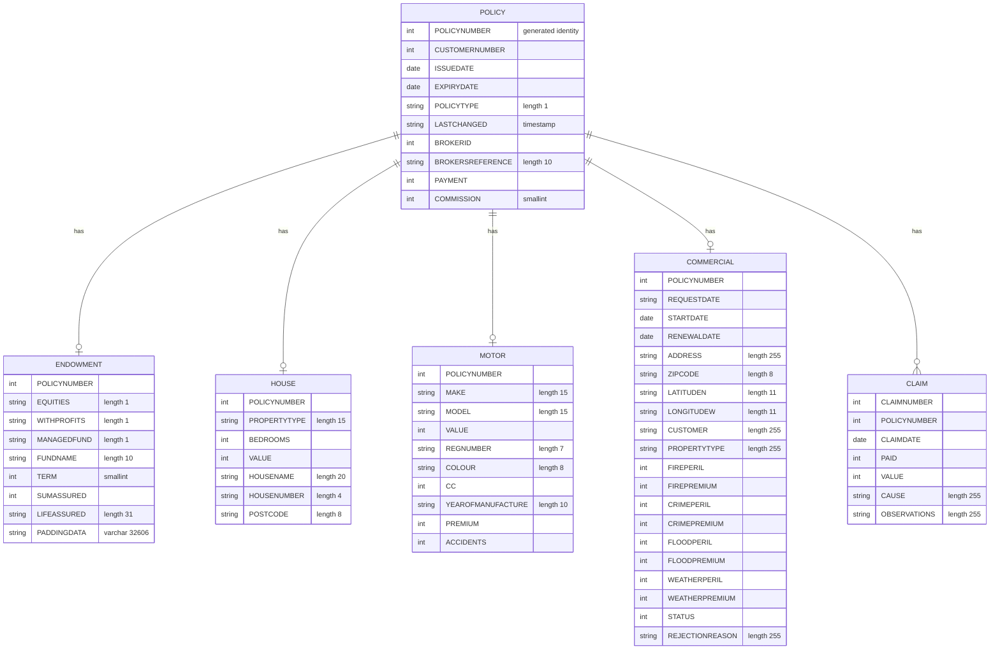

## Table of Contents

- [1. Purpose](#1-purpose)
- [2. Inputs](#2-inputs)
- [3. Outputs](#3-outputs)
- [4. Processing Logic](#4-processing-logic)
  - [4.1 Mermaid Flow Diagram](#41-mermaid-flow-diagram)
  - [4.2 Processing Logic Description](#42-processing-logic-description)
  - [4.3 Database Tables](#43-database-tables)
- [5. Paragraphs](#5-paragraphs)
- [6. Dependencies](#6-dependencies)
  - [6.1 CICS and Runtime Environment](#61-cics-and-runtime-environment)
  - [6.2 External Programs and Subroutines](#62-external-programs-and-subroutines)
  - [6.3 Database Resources (Db2 for z/OS)](#63-database-resources-db2-for-zos)
  - [6.4 Include Files (Copybooks / Header Declarations)](#64-include-files-copybooks--header-declarations)
  - [6.5 Input Parameters and Data Contracts](#65-input-parameters-and-data-contracts)
- [7. Constraints](#7-constraints)
- [8. Error Handling](#8-error-handling)
  - [8.1 COMMAREA Validation](#81-commarea-validation)
  - [8.2 DB2 Error Handling — INSERT_POLICY](#82-db2-error-handling--insert_policy)
  - [8.3 DB2 Error Handling — Supporting Procedures (ABEND + return code 90 pattern)](#83-db2-error-handling--supporting-procedures-abend--return-code-90-pattern)
  - [8.4 Error Logging — WRITE_ERROR_MESSAGE Procedure](#84-error-logging--write_error_message-procedure)
- [9. Examples](#9-examples)
  - [9.1 Example 1: Motor policy with accident loading and bundling discount](#91-example-1-motor-policy-with-accident-loading-and-bundling-discount)
  - [9.2 Example 2: House policy in a high-value postcode range](#92-example-2-house-policy-in-a-high-value-postcode-range)
  - [9.3 Example 3: Rejected requests](#93-example-3-rejected-requests)

## 1. Purpose

LGAPDB01 is a CICS-invoked PL/I program that adds a new insurance policy to the DB2 database. It handles endowment, house, motor, commercial and claim requests. It receives a communication area that identifies the request type, the customer and the policy details. It checks that a communication area was supplied, that the request identifier is recognised, and that the communication area is long enough for that policy type. It then records the policy: a general policy record with a DB2-generated policy number, plus a record in the table for that policy type, or a claim record for a claim request. While doing this it applies business rules to the amounts:

- Motor premiums are loaded according to the vehicle's accident history.
- Commercial flood and weather premiums are surcharged when the postcode already has heavy exposure.
- House payments are increased for high-value properties in a specific postcode range.
- Customers who hold several active motor or house policies get a bundling discount.
- Broker commission is calculated from the adjusted payment and the broker's active policy count.
- Broker commission is reduced when a policy has too many claims in the current year.

The program reports success or failure to the caller through a return code. It covers an unrecognised request, a communication area that is too short, referential integrity violations and general database errors. It then links to a follow-on program, LGAPVS01, to complete processing.

## 2. Inputs

- **Program parameter**
  - COMM_AREA_PTR: pointer to the CICS communication area (COMM_AREA) that the caller passes in. All request data is read from this area, and results are written back into it.
  - EIBCALEN: length of the communication area received. A value of 0 causes an ABEND with code LGCA. It is also checked against the required length for the request type. For endowment requests it determines whether the variable-length padding data is inserted.

- **Request control fields (communication area header)**
  - CA_REQUEST_ID: request type. It selects the processing path and the required communication area length. Valid values are '01AEND' (endowment), '01AHOU' (house), '01AMOT' (motor), '01ACOM' (commercial) and '01ACLM' (claim). Any other value sets the return code to '99'.
  - CA_CUSTOMER_NUM: customer number. It is converted to a DB2 integer and used in the POLICY insert and in the bundling discount count.
  - CA_POLICY_NUM: policy number supplied by the caller. It is used as the claim's associated policy number for claim processing (the claim insert, the yearly claim count and the commission update). It is overwritten with the DB2-generated policy number for the other request types.

- **Common policy fields (communication area)**
  - CA_ISSUE_DATE: policy issue date. It is stored in the POLICY table. For commercial policies it is also stored as the commercial StartDate.
  - CA_EXPIRY_DATE: policy expiry date. It is stored in the POLICY table. For commercial policies it is also stored as the commercial RenewalDate.
  - CA_BROKERID: broker identifier. It is used for the policy insert and for the broker's active policy count that drives the commission tier.
  - CA_BROKERSREF: broker's reference. It is stored in the POLICY table.
  - CA_PAYMENT: base payment amount. It is adjusted by house value and postcode loading and by the bundling discount, and it is the basis of the commission calculation.

- **Endowment policy fields (communication area)**
  - CA_E_WITH_PROFITS, CA_E_EQUITIES, CA_E_MANAGED_FUND: fund option flags.
  - CA_E_FUND_NAME: fund name.
  - CA_E_TERM: policy term.
  - CA_E_SUM_ASSURED: sum assured.
  - CA_E_LIFE_ASSURED: name of the life assured.
  - CA_E_PADDING_DATA: optional variable-length padding data. It is inserted into the PADDINGDATA VARCHAR column only when the supplied communication area is longer than the required length.

- **House policy fields (communication area)**
  - CA_H_PROPERTY_TYPE: property type.
  - CA_H_BEDROOMS: number of bedrooms.
  - CA_H_VALUE: property value. It is also used in the payment loading rule.
  - CA_H_HOUSE_NAME, CA_H_HOUSE_NUMBER: property name and number.
  - CA_H_POSTCODE: property postcode. It is also used in the payment loading rule.

- **Motor policy fields (communication area)**
  - CA_M_MAKE, CA_M_MODEL: vehicle make and model.
  - CA_M_VALUE: vehicle value.
  - CA_M_REGNUMBER: registration number.
  - CA_M_COLOUR: vehicle colour.
  - CA_M_CC: engine capacity.
  - CA_M_MANUFACTURED: year of manufacture.
  - CA_M_PREMIUM: motor premium. It is scaled according to accident history.
  - CA_M_ACCIDENTS: number of accidents. It determines the premium loading.

- **Commercial policy fields (communication area)**
  - CA_B_Address, CA_B_Postcode, CA_B_Latitude, CA_B_Longitude: property location details. The postcode is also used to look up existing flood and weather peril exposure.
  - CA_B_Customer, CA_B_PropType: customer and property type descriptions.
  - CA_B_FirePeril, CA_B_FirePremium, CA_B_CrimePeril, CA_B_CrimePremium: fire and crime peril values and premiums.
  - CA_B_FloodPeril, CA_B_FloodPremium, CA_B_WeatherPeril, CA_B_WeatherPremium: flood and weather peril values and premiums. The premiums are subject to a surcharge.
  - CA_B_Status, CA_B_RejectReason: status code and rejection reason.

- **Claim fields (communication area)**
  - CA_C_Date: claim date.
  - CA_C_Paid: amount paid.
  - CA_C_Value: claim value.
  - CA_C_Cause: cause of the claim.
  - CA_C_Observations: free-text observations.

- **CICS environment inputs**
  - EIBTRNID, EIBTRMID, EIBTASKN: transaction ID, terminal ID and task number of the current task. They are captured for run-time and diagnostic information.
  - ABSTIME from EXEC CICS ASKTIME and FORMATTIME: current date and time. They are used to timestamp error messages.

- **External data sources (DB2)**
  - POLICY table:
    - Active motor and house policies for the customer are counted. The count drives the bundling discount.
    - Active policies for the broker are counted. The count drives the commission percentage.
    - The generated policy number comes from IDENTITY_VAL_LOCAL.
    - The LASTCHANGED timestamp of the new policy is read back.
  - COMMERCIAL table: summed flood and weather peril values for the same postcode (ZIPCODE) among active commercial records. They determine whether a surcharge applies.
  - CLAIM table: count of claims on the policy in the current year. It determines whether the broker commission is halved.
  - DB2 system values: CURRENT DATE and CURRENT TIMESTAMP are used for active-policy checks and for the LASTCHANGED timestamp.
  - SQLCODE: DB2 return status that drives error handling and the return codes.

## 3. Outputs

- **Communication area returned to caller (COMM_AREA via COMM_AREA_PTR)**
  - CA_RETURN_CODE: the status of the add operation.
    - '00' means success. It is set at the start and again after a successful POLICY insert.
    - '70' means a referential integrity violation (SQLCODE -530) on the POLICY insert.
    - '90' means a general DB2 error. Any failed insert, count, sum or update sets it, and each of those paths also abends with 'LGSQ'.
    - '98' means the communication area is shorter than the required length for the request type.
    - '99' means the request identifier is not recognised.
  - CA_POLICY_NUM: set to the DB2-generated policy number (DB2_POLICYNUM_INT, from IDENTITY_VAL_LOCAL) after the POLICY insert. This gives the caller the new policy key.
  - CA_LASTCHANGED: set to the LASTCHANGED timestamp read back from the new POLICY row.
  - CA_M_PREMIUM: for motor requests, rewritten in the commarea with the accident-adjusted premium. The multiplier is 1.0 for up to 2 accidents, 1.2 for 3–5, 1.5 for 6–8 and 3.0 for more than 8, based on CA_M_ACCIDENTS.
  - CA_C_Num: for claim requests, set from DB2_C_Num_INT after the CLAIM insert.

- **Database writes (DB2)**
  - POLICY table
    - A row is inserted for every request type except claims ('01ACLM'). The DB2 default supplies POLICYNUMBER and CURRENT TIMESTAMP supplies LASTCHANGED.
    - Columns written are customer number (DB2_CUSTOMERNUM_INT), issue and expiry dates, policy type, broker id (DB2_BROKERID_INT), broker reference, payment (DB2_PAYMENT_INT) and commission (WS_COMMISSION).
    - DB2_PAYMENT_INT is the stored payment after business-rule adjustments:
      - House policies with postcodes between '600000' and '699999' get a surcharge of 20% (value over 10,000,000 to 15,000,000), 40% (over 15,000,000 to 20,000,000) or 50% (over 20,000,000).
      - A bundling discount of 15% applies when the customer holds more than 2 active motor or house policies.
    - WS_COMMISSION is the broker commission. It is 0% to 5% of the adjusted payment, depending on how many active policies the broker holds. The tiers are 0 policies = 0%, 1 = 1%, 2 = 2%, 3 = 3%, 4 = 4%, and 5 or more = 5%.
    - On a claim request, the POLICY commission is halved with an UPDATE when the policy has more than 3 claims (WS_CLM_CNT) in the current year.
  - Type-specific policy tables, selected by CA_REQUEST_ID
    - ENDOWMENT ('01AEND')
      - The row holds the policy number, equities, with-profits, managed-fund, fund name, term, sum assured and life assured.
      - PADDINGDATA is included only when EIBCALEN exceeds the required length. It carries the extra commarea data as a varying-length string (WS_VARCHAR).
    - HOUSE ('01AHOU'): property type, bedrooms, value, house name, house number and postcode.
    - MOTOR ('01AMOT'): make, model, value, registration, colour, CC, year of manufacture, adjusted premium (DB2_M_PREMIUM_INT) and accidents (DB2_M_ACCIDENTS_INT).
    - COMMERCIAL ('01ACOM')
      - Columns written are the policy number, dates, address, postcode, coordinates, customer, property type, the four peril and premium pairs (fire, crime, flood, weather), status and rejection reason.
      - The flood and weather premiums are raised by 15% when the flag WS_FLOOD_FLG or WS_WEATHER_FLG is 'Y'. A flag is set when the summed peril exposure (WS_PERILCNT) for the same postcode exceeds 3.
    - CLAIM ('01ACLM'): claim number, policy number, claim date, paid, value, cause and observations.

- **Error logging and transaction-control side effects**
  - Error message written to the LGSTSQ queue
    - WRITE_ERROR_MESSAGE links to program LGSTSQ with the ERROR_MSG structure.
    - The message contains the date (EM_DATE), time (EM_TIME), program name, customer number (EM_CUSNUM), policy number (EM_POLNUM), the SQL request description (EM_SQLREQ) and SQLCODE (EM_SQLRC).
    - It can also carry text such as ' NO COMMAREA RECEIVED' (EM_MSG_TEXT).
  - Commarea snapshot to the same queue
    - CA_ERROR_MSG is also sent through LGSTSQ. It holds up to the first 90 bytes of the commarea, or all of it if shorter.
  - CICS abends
    - 'LGCA' is raised when no commarea is received (EIBCALEN = 0).
    - 'LGSQ' is raised on SQL failures, so that earlier updates, such as the POLICY insert, are backed out.
  - Early CICS RETURN
    - The program returns immediately, with CA_RETURN_CODE set, for unrecognised request ids ('99'), a short commarea ('98') and the POLICY insert errors (SQLCODE -530 gives '70', other failures give '90').
  - Downstream program link
    - After the inserts, the program links to LGAPVS01 with the full 32,500-byte COMM_AREA. LGAPVS01 may modify the commarea, which then goes back to the caller on the final CICS RETURN.

## 4. Processing Logic

### 4.1 Mermaid Flow Diagram

```mermaid
graph TD
    A([Start LGAPDB01]) --> B[Capture CICS transaction, terminal, task and commarea length<br>Initialise DB2 host variables]
    B --> C{Commarea length is zero}
    C -- Yes --> C1[Write error message NO COMMAREA RECEIVED]
    C1 --> C2([Abend LGCA])
    C -- No --> D[Set return code 00<br>Convert customer and policy numbers<br>Compute header length]
    D --> E{Request ID}
    E -- 01AEND --> E1[Add endowment length<br>Policy type E]
    E -- 01AHOU --> E2[Add house length<br>Policy type H]
    E -- 01AMOT --> E3[Add motor length<br>Policy type M]
    E -- 01ACOM --> E4[Policy type C]
    E -- 01ACLM --> E5[Policy type X]
    E -- Other --> E6[Set return code 99]
    E6 --> E7([Return to caller])
    E1 --> F{Commarea shorter than required}
    E2 --> F
    E3 --> F
    E4 --> F
    E5 --> F
    F -- Yes --> F1[Set return code 98]
    F1 --> F2([Return to caller])
    F -- No --> G{Request is a claim}
    G -- No --> H[Insert policy row]
    G -- Yes --> J
    H --> H1{House request}
    H1 -- Yes --> H2{Postcode between 600000 and 699999}
    H2 -- Yes --> H3[Raise payment 20 percent for house value 10M to 15M<br>40 percent for 15M to 20M<br>50 percent above 20M]
    H2 -- No --> H4
    H1 -- No --> H4
    H3 --> H4[Bundling discount query<br>Count active motor and house policies for customer]
    H4 --> H5{More than 2 active policies}
    H5 -- Yes --> H6[Reduce payment by 15 percent]
    H5 -- No --> H7
    H6 --> H7[Commission query<br>Count active policies for broker]
    H7 --> H8[Commission 0 to 5 percent of payment by policy count]
    H8 --> H9[Insert into POLICY table]
    H9 --> H10{SQLCODE result}
    H10 -- Minus 530 --> H11[Set return code 70<br>Write error message]
    H11 --> H12([Return to caller])
    H10 -- Other error --> H13[Set return code 90<br>Write error message]
    H13 --> H12
    H10 -- Zero --> H14[Get generated policy number<br>Read LASTCHANGED timestamp]
    H14 --> J{Request ID}
    J -- 01AEND --> K1[Insert ENDOWMENT row<br>Include padding data if extra commarea data]
    J -- 01AHOU --> K2[Insert HOUSE row]
    J -- 01AMOT --> K3[Scale premium by accident count<br>Insert MOTOR row]
    J -- 01ACOM --> K4[Check flood and weather history for postcode]
    J -- 01ACLM --> K5[Count claims this year for policy]
    K4 --> K4A{Flood or weather total above 3}
    K4A -- Yes --> K4B[Raise matching peril premium 15 percent]
    K4A -- No --> K4C[Insert COMMERCIAL row]
    K4B --> K4C
    K5 --> K5A{More than 3 claims this year}
    K5A -- Yes --> K5B[Halve policy commission]
    K5A -- No --> K5C[Insert CLAIM row]
    K5B --> K5C
    K1 --> L{Insert succeeded}
    K2 --> L
    K3 --> L
    K4C --> L
    K5C --> L
    L -- No --> L1[Set return code 90<br>Write error message]
    L1 --> L2([Abend LGSQ to back out updates])
    L -- Yes --> M[Link to LGAPVS01 with commarea]
    M --> N([Return to caller])

    classDef start fill:#d4f1d4,stroke:#7fb77f,color:#000;
    classDef process fill:#dbe9ff,stroke:#8fb2e6,color:#000;
    classDef decision fill:#fff3c4,stroke:#d9c26b,color:#000;
    classDef error fill:#ffd6d6,stroke:#e09a9a,color:#000;
    classDef db fill:#e6d9f5,stroke:#b39ad6,color:#000;

    class A,N start;
    class C1,C2,E6,E7,F1,F2,H11,H12,H13,L1,L2 error;
    class B,D,E1,E2,E3,E4,E5,H3,H6,H8,K4B,K5B,K3,M process;
    class C,E,F,G,H1,H2,H5,H10,J,K4A,K5A,L decision;
    class H,H4,H7,H9,H14,K1,K2,K4,K4C,K5,K5C db;
```

### 4.2 Processing Logic Description

#### 4.2.1 High-level Summary
LGAPDB01 is a CICS PL/I program that adds a new insurance policy or claim to DB2. The caller passes a commarea whose request ID selects one of five operations:
- Endowment (`01AEND`)
- House (`01AHOU`)
- Motor (`01AMOT`)
- Commercial (`01ACOM`)
- Claim (`01ACLM`)

For every request except a claim, the program first inserts a row into the POLICY table. That insert applies pricing rules (house loading, bundling discount, broker commission) and lets DB2 generate the policy number. It then inserts the type-specific detail row. Finally it links to `LGAPVS01` and returns the result in `CA_RETURN_CODE`.

#### 4.2.2 Execution Flow
1. **Initialisation.** The program copies the transaction ID, terminal ID, task number and commarea length (EIBCALEN) into working storage. It zeroes the DB2 integer host variables.
2. **Commarea presence check.** If EIBCALEN is 0, the program sets the message "NO COMMAREA RECEIVED", calls `WRITE_ERROR_MESSAGE` and abends with code `LGCA` (no dump).
3. **Preparation.**
   - `CA_RETURN_CODE` is set to `00`.
   - The commarea address is saved.
   - `CA_CUSTOMER_NUM` is converted to `DB2_CUSTOMERNUM_INT`.
   - `CA_POLICY_NUM` is converted to `DB2_C_PolicyNum_INT`.
   - The customer number is saved in the error message area.
4. **Request validation and length calculation.** The required length starts as the 28-byte header and depends on the request ID:

   | Request ID | Policy type | Required length |
   |---|---|---|
   | `01AEND` | `E` | header + 124 |
   | `01AHOU` | `H` | header + 130 |
   | `01AMOT` | `M` | header + 137 |
   | `01ACOM` | `C` | header only (no full-length addition) |
   | `01ACLM` | `X` | header only (no full-length addition) |
   | Anything else | – | `CA_RETURN_CODE` = `99`, then CICS RETURN |

   If EIBCALEN is less than the required length, `CA_RETURN_CODE` = `98` and the program returns. The length formula uses `WS_REQUIRED_CA_LEN` before it is explicitly initialised, so it relies on the field starting at 0.
5. **Policy insert (not for claims).** `INSERT_POLICY` does the following:
   - It moves broker ID and payment to integer host variables.
   - **House loading.** For a house request whose postcode is above `600000` and below `699999`, it raises the payment by a percentage that depends on house value:
     - value above 10,000,000 and below 15,000,000: +20%
     - value above 15,000,000 and below 20,000,000: +40%
     - value above 20,000,000: +50%
   - **Bundling discount** (`BUNDLING_DISCOUNT`). It counts the customer's currently active policies of type M or H (issue date before today, expiry date after today). If the count is above 2, the payment is reduced by 15%. Any SQLCODE other than 0 sets return code `90`, writes an error message and abends with `LGSQ`.
   - **Commission** (`CALCULATE_COMMISSION`). It counts the broker's currently active policies. The commission is a share of the adjusted payment:

     | Active policies | Commission |
     |---|---|
     | 0 | 0 |
     | 1 | 1% |
     | 2 | 2% |
     | 3 | 3% |
     | 4 | 4% |
     | 5 or more | 5% |

     A SQL error abends with `LGSQ`.
   - **Insert.** It inserts into POLICY with a DB2-generated policy number (`DEFAULT`), the current timestamp, the adjusted payment and the commission.
   - **Insert result.**
     - SQLCODE 0: return code `00`.
     - SQLCODE -530 (referential integrity violation): return code `70`, error message written, CICS RETURN.
     - Any other SQLCODE: return code `90`, error message written, CICS RETURN.
   - **After a successful insert.** `IDENTITY_VAL_LOCAL()` is read into `DB2_POLICYNUM_INT` and copied to `CA_POLICY_NUM` and the error message area. The program then selects `LASTCHANGED` back into the commarea.
6. **Type-specific insert.** A second SELECT on the request ID calls one of these procedures:
   - `INSERT_ENDOW` computes the spare length as EIBCALEN minus the required length. If it is greater than 0, it inserts the endowment row including the PADDINGDATA varchar. Otherwise it inserts without that column.
   - `INSERT_HOUSE` inserts the house row.
   - `INSERT_MOTOR` scales `CA_M_PREMIUM` by accident count (2 or fewer: ×1.0; 3–5: ×1.2; 6–8: ×1.5; more than 8: ×3.0). It then inserts the motor row with the adjusted premium and accident count.
   - `INSERT_COMMERCIAL` calls `VALIDATE_PREV_PERIL`, which sums FLOODPERIL and WEATHERPERIL in COMMERCIAL for the same postcode (ZIPCODE). A sum above 3 sets `WS_FLOOD_FLG` or `WS_WEATHER_FLG` to `Y`. A flagged peril premium is increased by 15% before the COMMERCIAL row is inserted.
   - `INSERT_CLAIM` calls `UPDATE_BROKER_COMM`, which counts the policy's claims in the current year. If the count is above 3, it halves the policy's COMMISSION with an UPDATE. The CLAIM row is then inserted.
   - Any other request ID sets return code `99`.
7. **Error handling in type-specific inserts.** Any SQLCODE other than 0 sets `CA_RETURN_CODE` = `90`, writes an error message and abends with `LGSQ`. The abend backs out the earlier POLICY insert.
8. **Completion.** The program links to `LGAPVS01` with the 32,500-byte commarea, then issues CICS RETURN.
9. **Error message routine** (`WRITE_ERROR_MESSAGE`).
   - It stores the SQLCODE, gets and formats the date and time with ASKTIME and FORMATTIME, and links to `LGSTSQ` with the formatted message.
   - If a commarea exists, it sends up to the first 90 bytes of it (or all of it, if shorter) in a second link to `LGSTSQ`.

#### 4.2.3 External Interactions
- **DB2 tables:**
  - POLICY: insert, count queries, timestamp read, commission update.
  - ENDOWMENT, HOUSE, MOTOR, COMMERCIAL, CLAIM: inserts.
  - COMMERCIAL: also read for peril sums.
  - CLAIM: also read for the claim count.
- **CICS services:**
  - ABEND, RETURN, ASKTIME and FORMATTIME.
  - LINK to `LGSTSQ`, which logs error messages to a queue.
  - LINK to `LGAPVS01`, called after the inserts, with the commarea.

#### 4.2.4 Plain Language Summary
The program takes a request to add a policy (endowment, house, motor or commercial) or a claim. It checks that the request type is known and that enough data was sent. For policies, it works out the price. A house in a high-value area costs more. A customer with several active motor or house policies gets 15% off. The broker earns a commission of 1% to 5%, depending on how many active policies they hold. It saves the main policy record and then the details for that policy type. Motor premiums rise with the number of accidents. Commercial flood and weather premiums rise 15% in postcodes with many earlier risks. For claims, a broker's commission is halved when the policy has more than three claims this year. If anything fails, the program records an error, sets a return code, and cancels the work done in the same transaction where it can.

### 4.3 Database Tables

## 5. Paragraphs

- **LGAPDB01 (main procedure, `Options(Main)`)**
  - Purpose: CICS entry point that adds a policy. It validates the commarea, adds the generic POLICY row, adds the type-specific row, and links to the follow-on program.
  - Setup:
    - Copies EIBTRNID, EIBTRMID, EIBTASKN and EIBCALEN into the WS_HEADER fields.
    - Zeroes the DB2 host-variable groups DB2_IN_INTEGERS and DB2_OUT_INTEGERS.
  - Commarea check:
    - If EIBCALEN = 0, it sets EM_MSG_TEXT to ' NO COMMAREA RECEIVED', calls WRITE_ERROR_MESSAGE, and issues `EXEC CICS ABEND ABCODE('LGCA') NODUMP`.
    - It sets CA_RETURN_CODE to '00' and saves the commarea address in WS_ADDR_DFHCOMMAREA.
    - It converts CA_CUSTOMER_NUM to DB2_CUSTOMERNUM_INT and CA_POLICY_NUM to DB2_C_PolicyNum_INT.
    - It copies CA_CUSTOMER_NUM to EM_CUSNUM for use in error messages.
  - First `SELECT (CA_REQUEST_ID)`: sets the required commarea length and the policy type.
    - '01AEND' adds WS_FULL_ENDOW_LEN to WS_REQUIRED_CA_LEN and sets DB2_POLICYTYPE to 'E'.
    - '01AHOU' adds WS_FULL_HOUSE_LEN and sets 'H'.
    - '01AMOT' adds WS_FULL_MOTOR_LEN and sets 'M'.
    - '01ACOM' sets 'C' and adds no length.
    - '01ACLM' sets 'X' and adds no length.
    - Any other value sets CA_RETURN_CODE to '99' and issues `EXEC CICS RETURN`.
  - Length check: if EIBCALEN is less than WS_REQUIRED_CA_LEN, it sets CA_RETURN_CODE to '98' and issues `EXEC CICS RETURN`.
  - Dispatch:
    - For any request other than '01ACLM', it calls INSERT_POLICY.
    - A second `SELECT (CA_REQUEST_ID)` calls INSERT_ENDOW, INSERT_HOUSE, INSERT_MOTOR, INSERT_COMMERCIAL or INSERT_CLAIM.
    - The OTHERWISE branch sets CA_RETURN_CODE to '99'.
  - Finish: `EXEC CICS LINK PROGRAM('LGAPVS01')` passes COMM_AREA with length 32500, then `EXEC CICS RETURN` ends the transaction.
  - External interactions: CICS ABEND, RETURN and LINK; the type-specific procedures it calls use DB2.

- **INSERT_POLICY**
  - Purpose: inserts the generic row into the POLICY table and obtains the DB2-generated policy number.
  - Operations:
    - Moves CA_BROKERID and CA_PAYMENT into DB2_BROKERID_INT and DB2_PAYMENT_INT.
    - For house requests ('01AHOU'), it loads DB2_H_VALUE_INT from CA_H_VALUE. If CA_H_POSTCODE is between '600000' and '699999', it raises the payment:
      - by 20% when the house value is over 10,000,000 and under 15,000,000;
      - by 40% when it is over 15,000,000 and under 20,000,000;
      - by 50% when it is over 20,000,000.
    - Calls BUNDLING_DISCOUNT, then CALCULATE_COMMISSION.
    - Sets EM_SQLREQ and runs `INSERT INTO POLICY` with DEFAULT for POLICYNUMBER, CURRENT TIMESTAMP for LASTCHANGED, and WS_COMMISSION for COMMISSION.
    - After the insert, it runs `SET :DB2_POLICYNUM_INT = IDENTITY_VAL_LOCAL()` and copies the result to CA_POLICY_NUM and EM_POLNUM.
    - It then selects LASTCHANGED from POLICY into CA_LASTCHANGED.
  - Control flow:
    - Nested IFs apply the house value and postcode surcharges.
    - `SELECT (SQLCODE)` handles the insert result:
      - 0 sets CA_RETURN_CODE to '00'.
      - -530 (referential integrity violation) sets '70', calls WRITE_ERROR_MESSAGE and issues `EXEC CICS RETURN`.
      - Any other value sets '90', calls WRITE_ERROR_MESSAGE and issues `EXEC CICS RETURN`.
  - External interactions: DB2 INSERT into POLICY, `IDENTITY_VAL_LOCAL()`, and a SELECT from POLICY.

- **BUNDLING_DISCOUNT**
  - Purpose: gives a payment discount to customers who hold several active motor or house policies.
  - Operations:
    - Sets EM_SQLREQ to 'BUNDLE DISCNT ' and resets WS_CNT_POLICY to 0.
    - Counts the customer's POLICY rows where ISSUEDATE is before CURRENT DATE, EXPIRYDATE is after it, and POLICYTYPE is 'M' or 'H'.
    - If SQLCODE = 0 and WS_CNT_POLICY > 2, it reduces DB2_PAYMENT_INT by 15%.
  - Control flow:
    - If SQLCODE is not 0, it sets CA_RETURN_CODE to '90' and calls WRITE_ERROR_MESSAGE.
    - It then issues `EXEC CICS ABEND ABCODE('LGSQ') NODUMP` so the POLICY update is backed out, followed by `EXEC CICS RETURN`.
  - External interactions: DB2 SELECT COUNT on POLICY, and CICS ABEND on error.

- **CALCULATE_COMMISSION**
  - Purpose: works out the broker's commission from the number of policies the broker currently holds.
  - Operations:
    - Sets EM_SQLREQ to 'CALULATE COMM ' and resets WS_CNT_POLICY.
    - Counts active POLICY rows for DB2_BROKERID_INT.
    - On success, it sets WS_COMMISSION as a percentage of DB2_PAYMENT_INT. The count selects the rate:
      - 0 gives 0;
      - 1 gives 1%;
      - 2 gives 2%;
      - 3 gives 3%;
      - 4 gives 4%;
      - any higher count gives 5%.
  - Control flow:
    - `SELECT (WS_CNT_POLICY)` is nested inside an IF on SQLCODE = 0.
    - If SQLCODE is not 0, it sets CA_RETURN_CODE to '90', calls WRITE_ERROR_MESSAGE, issues ABEND 'LGSQ' and then RETURN.
  - External interactions: DB2 SELECT COUNT on POLICY, and CICS ABEND on error.

- **INSERT_ENDOW**
  - Purpose: inserts the endowment-specific row into the ENDOWMENT table.
  - Operations:
    - Converts CA_E_TERM and CA_E_SUM_ASSURED to DB2_E_TERM_SINT and DB2_E_SUMASSURED_INT.
    - Sets EM_SQLREQ and computes WS_VARY_LEN as EIBCALEN minus WS_REQUIRED_CA_LEN.
  - Control flow:
    - If WS_VARY_LEN > 0, the commarea holds padding data. It copies that data into WS_VARCHAR with `substr(CA_E_PADDING_DATA,1,WS_VARY_LEN)` and runs an INSERT that includes the PADDINGDATA column.
    - Otherwise it runs an INSERT without PADDINGDATA.
    - If SQLCODE is not 0, it sets CA_RETURN_CODE to '90', calls WRITE_ERROR_MESSAGE, issues ABEND 'LGSQ' and then RETURN.
  - External interactions: DB2 INSERT into ENDOWMENT, and CICS ABEND on error.

- **INSERT_HOUSE**
  - Purpose: inserts the house-specific row into the HOUSE table.
  - Operations:
    - Converts CA_H_VALUE and CA_H_BEDROOMS to DB2_H_VALUE_INT and DB2_H_BEDROOMS_SINT.
    - Inserts the policy number, property type, bedrooms, value, house name, house number and postcode.
  - Control flow: a non-zero SQLCODE sets CA_RETURN_CODE to '90', calls WRITE_ERROR_MESSAGE, issues ABEND 'LGSQ' and then RETURN.
  - External interactions: DB2 INSERT into HOUSE, and CICS ABEND on error.

- **INSERT_MOTOR**
  - Purpose: inserts the motor-specific row into the MOTOR table, loading the premium for accident history first.
  - Operations:
    - Converts CA_M_VALUE and CA_M_CC to integer host variables.
    - Multiplies CA_M_PREMIUM by a factor based on CA_M_ACCIDENTS:
      - 2 or fewer accidents: ×1.00.
      - 3 to 5 accidents: ×1.20.
      - 6 to 8 accidents: ×1.50.
      - More than 8 accidents: ×3.00.
    - Moves the adjusted premium and the accident count to DB2_M_PREMIUM_INT and DB2_M_ACCIDENTS_INT, then inserts the row.
  - Control flow:
    - A chain of independent IF tests on the accident count.
    - A non-zero SQLCODE sets CA_RETURN_CODE to '90', calls WRITE_ERROR_MESSAGE, issues ABEND 'LGSQ' and then RETURN.
  - External interactions: DB2 INSERT into MOTOR, and CICS ABEND on error.

- **INSERT_COMMERCIAL**
  - Purpose: inserts the commercial-property row into the COMMERCIAL table, applying peril surcharges.
  - Operations:
    - Converts the CA_B_* peril, premium and status fields to the DB2_B_*_INT host variables.
    - Calls VALIDATE_PREV_PERIL.
    - If WS_FLOOD_FLG = 'Y', it raises DB2_B_FloodPremium_INT by 15%.
    - If WS_WEATHER_FLG = 'Y', it raises DB2_B_WeatherPremium_INT by 15%.
    - Inserts the row. CA_LASTCHANGED is stored as the request date, and CA_ISSUE_DATE and CA_EXPIRY_DATE are stored as the start and renewal dates.
  - Control flow: two independent IFs on the flags, then the usual SQLCODE <> 0 handling (code '90', WRITE_ERROR_MESSAGE, ABEND 'LGSQ', RETURN).
  - External interactions: DB2 INSERT into COMMERCIAL, and CICS ABEND on error.

- **VALIDATE_PREV_PERIL**
  - Purpose: finds out whether the property's postcode already carries heavy flood or weather exposure.
  - Operations:
    - Sets EM_SQLREQ to ' VALIDATE PERIL'.
    - Resets WS_PERILCNT and WS_FLOOD_FLG, then selects SUM(FLOODPERIL) from COMMERCIAL for rows where ZIPCODE matches CA_B_POSTCODE and STARTDATE is before CURRENT DATE or RENEWALDATE is after it.
    - If SQLCODE = 0 and WS_PERILCNT > 3, it sets WS_FLOOD_FLG to 'Y'.
    - It repeats the same steps for SUM(WEATHERPERIL), setting WS_WEATHER_FLG.
  - Control flow: after each query, a non-zero SQLCODE sets CA_RETURN_CODE to '90', calls WRITE_ERROR_MESSAGE, issues ABEND 'LGSQ' and then RETURN.
  - External interactions: two DB2 SELECT SUM queries on COMMERCIAL, and CICS ABEND on error.

- **INSERT_CLAIM**
  - Purpose: inserts a claim row into the CLAIM table.
  - Operations:
    - Converts CA_C_Paid and CA_C_Value to integer host variables.
    - Calls UPDATE_BROKER_COMM.
    - Inserts the claim number, policy number, claim date, paid amount, value, cause and observations.
    - Copies DB2_C_Num_INT back to CA_C_Num.
  - Control flow: a non-zero SQLCODE sets CA_RETURN_CODE to '90', calls WRITE_ERROR_MESSAGE, issues ABEND 'LGSQ' and then RETURN.
  - External interactions: DB2 INSERT into CLAIM, and CICS ABEND on error.

- **UPDATE_BROKER_COMM**
  - Purpose: penalises brokers when a policy has many claims in the current year.
  - Operations:
    - Sets EM_SQLREQ to 'UPD BRK COMM ' and resets WS_CLM_CNT.
    - Counts CLAIM rows for the policy where YEAR(CLAIMDATE) equals YEAR(CURRENT DATE).
    - If SQLCODE = 0 and WS_CLM_CNT > 3, it runs `UPDATE POLICY SET COMMISSION = (COMMISSION / 2)` for that policy.
  - Control flow:
    - SQLCODE is checked after the count and again after the optional update.
    - A non-zero value sets CA_RETURN_CODE to '90', calls WRITE_ERROR_MESSAGE, issues ABEND 'LGSQ' and then RETURN.
  - External interactions: DB2 SELECT COUNT on CLAIM, DB2 UPDATE on POLICY, and CICS ABEND on error.

- **WRITE_ERROR_MESSAGE**
  - Purpose: shared error logger. It builds a timestamped message and sends it to the logging program.
  - Operations:
    - Copies SQLCODE to EM_SQLRC.
    - Gets the current time with `EXEC CICS ASKTIME` and formats it with `EXEC CICS FORMATTIME` (MMDDYYYY and TIME), then moves the results to EM_DATE and EM_TIME.
    - Calls `EXEC CICS LINK PROGRAM('LGSTSQ')` with ERROR_MSG, which carries the date, time, program name, customer number, policy number, SQL request and SQLCODE.
  - Control flow:
    - If EIBCALEN > 0, it also logs the commarea contents.
    - When EIBCALEN is less than 91, it sets CA_DATA to the commarea contents (LEFT(COMM_AREA_RAW, EIBCALEN)).
    - Otherwise it sets CA_DATA to the first 90 bytes (LEFT(COMM_AREA_RAW, 90)).
    - Either way it then links to LGSTSQ with CA_ERROR_MSG.
  - External interactions: CICS ASKTIME, FORMATTIME and two LINKs to LGSTSQ, the error-queue writer (the code comment says it writes to a TDQ).

## 6. Dependencies

### 6.1 CICS and Runtime Environment
- **CICS Transaction Server APIs**
  - `EXEC CICS ABEND`: Issues transaction abends with abend codes `'LGCA'` (when no COMMAREA is passed, `EIBCALEN = 0`) and `'LGSQ'` (when SQL errors occur during policy and subordinate record insertions, forcing transactional backout).
  - `EXEC CICS RETURN`: Terminates program execution and returns control to the calling CICS program or caller.
  - `EXEC CICS ASKTIME` and `EXEC CICS FORMATTIME`: Obtains and formats the current system date (`MMDDYYYY`) and time (`TIME`) for error logging.
  - `EIB (Execute Interface Block)`: Provides execution context variables including `EIBCALEN` (communication area length), `EIBTRNID` (transaction ID), `EIBTRMID` (terminal ID), and `EIBTASKN` (task number).

### 6.2 External Programs and Subroutines
- **LGAPVS01**
  - Invoked via `EXEC CICS LINK PROGRAM('LGAPVS01')` passing the 32,500-byte COMMAREA to propagate policy addition data to the VSAM backend store after Db2 processing completes.
- **LGSTSQ**
  - Invoked via `EXEC CICS LINK PROGRAM('LGSTSQ')` within the `WRITE_ERROR_MESSAGE` subroutine to write formatted error details and COMMAREA dumps into CICS transient data / temporary storage queues.

### 6.3 Database Resources (Db2 for z/OS)
- **POLICY Table**
  - Target of `INSERT` statements to create master policy records with customer ID, broker ID, payment, commission, issue/expiry dates, policy type, and timestamp.
  - Target of `SELECT` queries to retrieve DB2-generated timestamp (`LASTCHANGED`) and calculate bundling discounts (counting active `'M'` and `'H'` policies) as well as broker commission tiers (counting active broker policies).
  - Target of `UPDATE` statements to halve broker commission when excessive claims occur within the current calendar year.
- **ENDOWMENT Table**
  - Target of `INSERT` operations storing endowment-specific attributes (terms, sum assured, equities, with-profits, managed fund, fund name, life assured, and optional padding varchar data).
- **HOUSE Table**
  - Target of `INSERT` operations storing house policy attributes (property type, bedroom count, property value, house name, house number, and postcode).
- **MOTOR Table**
  - Target of `INSERT` operations storing motor vehicle details (make, model, value, registration number, colour, CC, year of manufacture, accident count, and risk-adjusted premium).
- **COMMERCIAL Table**
  - Target of `INSERT` operations storing commercial property policy records (address, postcode, latitude, longitude, peril indicators, and peril premiums).
  - Target of `SELECT SUM(FLOODPERIL)` and `SELECT SUM(WEATHERPERIL)` queries in `VALIDATE_PREV_PERIL` to evaluate historical peril risk in the property's postal code area.
- **CLAIM Table**
  - Target of `INSERT` operations adding claim details (claim number, policy number, claim date, paid amount, claim value, cause, and observations).
  - Target of `SELECT COUNT(CLAIMNUMBER)` queries in `UPDATE_BROKER_COMM` to determine the frequency of claims for a policy in the current calendar year.
- **Db2 Special Function `IDENTITY_VAL_LOCAL()`**
  - Used after inserting a `POLICY` row to retrieve the assigned identity sequence value (`POLICYNUMBER`).

### 6.4 Include Files (Copybooks / Header Declarations)
- **SQLCA (`EXEC SQL INCLUDE SQLCA;`)**
  - Defines the SQL Communication Area structure and fields (such as `SQLCODE`) for monitoring Db2 statement execution statuses.
- **LGCMAREA (`EXEC SQL INCLUDE LGCMAREA;`)**
  - Defines the standard 32,500-byte communication area layout, including input/output headers and policy-specific data overlays (`CA_REQUEST_ID`, `CA_RETURN_CODE`, `CA_CUSTOMER_NUM`, `CA_POLICY_NUM`, `CA_PAYMENT`, `CA_BROKERID`, and type-specific structures).
- **LGPOLICY (`EXEC SQL INCLUDE LGPOLICY;`)**
  - Supplies structure definitions and length constants (`WS_FULL_ENDOW_LEN`, `WS_FULL_HOUSE_LEN`, `WS_FULL_MOTOR_LEN`, etc.) used to validate COMMAREA lengths for each policy type.
- **DCLPOLIC (`EXEC SQL INCLUDE DCLPOLIC;`)**
  - Db2 table declaration (DCLGEN) providing host variable and column mappings for the `POLICY` table.
- **DCLENDOW (`EXEC SQL INCLUDE DCLENDOW;`)**
  - Db2 table declaration (DCLGEN) providing host variable and column mappings for the `ENDOWMENT` table.

### 6.5 Input Parameters and Data Contracts
- **DFHCOMMAREA (COMM_AREA_PTR)**
  - Primary communication parameter passed via pointer from the calling program containing transaction request types (`01AEND`, `01AHOU`, `01AMOT`, `01ACOM`, `01ACLM`), customer identifiers, policy data, and return code status fields.

## 7. Constraints

- **Communication area presence and size**
  - A communication area must be supplied.
    - If `EIBCALEN = 0`, the program writes `' NO COMMAREA RECEIVED'` through `WRITE_ERROR_MESSAGE`. It then abends with `EXEC CICS ABEND ABCODE('LGCA') NODUMP`.
    - This is the only check that abends before any database work.
  - The communication area must be at least as long as the request needs.
    - `WS_REQUIRED_CA_LEN` starts as the header length, `WS_CA_HEADER_LEN` (28).
    - The first `SELECT (CA_REQUEST_ID)` adds a full-length constant for the request type:
      - `01AEND` adds `WS_FULL_ENDOW_LEN` (124).
      - `01AHOU` adds `WS_FULL_HOUSE_LEN` (130).
      - `01AMOT` adds `WS_FULL_MOTOR_LEN` (137).
      - `01ACOM` and `01ACLM` add nothing, so they only need the 28-byte header.
    - If `EIBCALEN < WS_REQUIRED_CA_LEN`, the program sets `CA_RETURN_CODE = '98'` and issues `EXEC CICS RETURN`.
  - The communication area is limited to 32,500 bytes.
    - `COMM_AREA` is declared as 32,500 bytes: a 6-byte request ID, a 2-byte return code, a 10-byte customer number, and 32,482 bytes of request-specific data.
    - The follow-on `EXEC CICS LINK PROGRAM('LGAPVS01')` passes a fixed `LENGTH(32500)`.
  - The error log copies at most 90 bytes of the communication area.
    - `WRITE_ERROR_MESSAGE` copies `LEFT(COMM_AREA_RAW,EIBCALEN)` when `EIBCALEN < 91`. Otherwise it copies the first 90 bytes.
    - Nothing is logged when `EIBCALEN` is 0.

- **Request identification and routing**
  - `CA_REQUEST_ID` must be one of `01AEND`, `01AHOU`, `01AMOT`, `01ACOM` or `01ACLM`.
    - The first `SELECT` also sets `DB2_POLICYTYPE` to `E`, `H`, `M`, `C` or `X` respectively.
    - Any other value sets `CA_RETURN_CODE = '99'` and issues `EXEC CICS RETURN`, so no insert happens.
    - The second `SELECT` has an `OTHERWISE` branch that sets `'99'` again. Because the first check already returns, this branch cannot be reached.
  - Each request ID drives exactly one insert path.
    - `INSERT_ENDOW`, `INSERT_HOUSE`, `INSERT_MOTOR`, `INSERT_COMMERCIAL` or `INSERT_CLAIM` is called according to the request ID.
  - A claim request does not create a policy.
    - `INSERT_POLICY` is called only when `CA_REQUEST_ID <> '01ACLM'`.
    - The claim is linked to an existing policy through `CA_POLICY_NUM`, which was copied to `DB2_C_Policynum_INT` on entry.

- **Sequencing and dependency constraints**
  - The checks run in a fixed order:
    - The program first checks that a communication area exists.
    - It then sets `CA_RETURN_CODE` to `'00'`.
    - It then validates the request ID and the length.
    - It then inserts the policy row.
    - It then inserts the type-specific row.
    - Finally it links to `LGAPVS01`.
  - The POLICY row must exist before any type-specific row.
    - `INSERT_POLICY` runs first. DB2 allocates the policy number (`VALUES (DEFAULT, ...)`).
    - `SET :DB2_POLICYNUM_INT = IDENTITY_VAL_LOCAL()` then retrieves the number.
    - That number is copied to `CA_POLICY_NUM` and `EM_POLNUM`. The ENDOWMENT, HOUSE, MOTOR and COMMERCIAL inserts use it as their foreign key.
  - The pricing steps run in a fixed order inside `INSERT_POLICY`:
    - First the house-location loading is applied.
    - `BUNDLING_DISCOUNT` follows.
    - `CALCULATE_COMMISSION` follows that.
    - The POLICY insert comes last, so it stores the adjusted payment and commission.
  - Commission is calculated from the payment after the loading and discount have been applied.
  - The issue timestamp is set by the database, not the caller.
    - `LASTCHANGED` is set from `CURRENT TIMESTAMP`.
    - It is read back into `CA_LASTCHANGED` after the insert, and the commercial insert uses it as `RequestDate`.
  - In `INSERT_COMMERCIAL`, `VALIDATE_PREV_PERIL` must run before the insert, because the surcharge flags it sets control the premium that is inserted.
  - In `INSERT_CLAIM`, `UPDATE_BROKER_COMM` runs before the claim row is inserted.
    - The claim count therefore does not include the claim being added.
    - The commission halving triggers when the existing count is already above 3.
  - `LGAPVS01` is linked after every insert path has completed, and only if none of them returned early.

- **Data validation and format rules**
  - Fixed-length character fields: `CA_REQUEST_ID` is `CHAR(6)`, the dates are `CHAR(10)`, and `CA_BROKERSREF` is `CHAR(10)`.
    - The commercial address, customer and property type fields are `CHAR(255)`.
    - The postcode is `CHAR(8)`.
  - Numeric commarea fields are fixed-width `PIC` fields, so only the digits they hold are valid:
    - `CA_CUSTOMER_NUM`, `CA_POLICY_NUM` and `CA_BROKERID` have 10 digits.
    - `CA_PAYMENT`, `CA_M_PREMIUM` and `CA_M_ACCIDENTS` have 6 digits.
    - `CA_H_VALUE` has 8 digits.
  - Numeric fields are converted to binary host variables before use.
    - `DB2_CUSTOMERNUM_INT` and `DB2_BROKERID_INT` are `FIXED BIN(31)`.
    - `DB2_PAYMENT_INT` is `FIXED BIN(31)`.
    - The DB2 bind and insert are the only places where these values are checked.
  - The program does not check dates, postcode format, or value ranges for any field.
    - It does not check for a missing broker, nor for a negative or zero payment.
    - It also does not check the `Y`/`N` indicators or the term of an endowment.
    - The only data checks are the ones the database enforces and the length check.
  - Length constants for each table row are declared in `WS_POLICY_LENGTHS`.
    - The varchar endowment padding is limited to `WS_VARCHAR CHAR(3900) VARYING`.
    - The `ENDOWMENT.PADDINGDATA` column is `VARCHAR(32606)`.
  - The endowment padding insert depends on the communication area length.
    - `WS_VARY_LEN = EIBCALEN - WS_REQUIRED_CA_LEN`.
    - If it is greater than 0, the program copies that many bytes of `CA_E_PADDING_DATA` into `WS_VARCHAR` and uses the insert that includes `PADDINGDATA`.
    - Otherwise it uses the insert without `PADDINGDATA`.

- **Premium and payment business rules**
  - House loading applies only to a house request (`01AHOU`).
    - It applies only when `CA_H_POSTCODE > '600000'` and `< '699999'`.
    - It is a string comparison on the 8-character postcode field.
    - For a house value from 10,000,001 to 14,999,999, the payment is increased by 20%.
    - For a value from 15,000,001 to 19,999,999, the payment is increased by 40%.
    - For a value above 20,000,000, the payment is increased by 50%.
    - The conditions use strict inequalities, so values of exactly 10,000,000, 15,000,000 and 20,000,000 receive no increase.
  - A bundling discount applies when the customer has more than two active motor or house policies.
    - The count is `WS_CNT_POLICY > 2` and `SQLCODE = 0`.
    - A policy is active when `ISSUEDATE < CURRENT DATE` and `EXPIRYDATE > CURRENT DATE`, with `POLICYTYPE IN ('M','H')`.
    - The payment is reduced by 15%.
    - The discount can apply to any request that reaches `INSERT_POLICY`, not only to motor and house requests.
  - Commission is a percentage of the adjusted payment, and the percentage depends on the broker's active policy count.
    - The count covers policies where `BROKERID` matches and the policy is currently active.
    - A count of 0 gives 0, and counts of 1 to 4 give 1% to 4% respectively.
    - A count of 5 or more gives 5%.
    - Commission is only recalculated when `SQLCODE = 0`.
    - `WS_COMMISSION` is `FIXED BIN(31)`, but the `COMMISSION` column is `SMALLINT` (`BIN FIXED(15)` in `DCLPOLICY`), so large commissions can overflow it.
  - Motor premium is scaled by accident history.
    - Up to 2 accidents: unchanged.
    - 3 to 5 accidents: 20% increase.
    - 6 to 8 accidents: 50% increase.
    - More than 8 accidents: 300% increase (tripling).
    - The scaled value is written back to `CA_M_PREMIUM` and then to `DB2_M_PREMIUM_INT`.
    - Because `CA_M_PREMIUM` is a 6-digit field, a scaled premium of 1,000,000 or more would not fit.
  - Commercial peril surcharges depend on the postcode.
    - `VALIDATE_PREV_PERIL` sums `FLOODPERIL` and `WEATHERPERIL` across `COMMERCIAL` rows with the same `ZIPCODE` as `CA_B_POSTCODE`.
    - The date test is `STARTDATE < CURRENT DATE OR RENEWALDATE > CURRENT DATE`.
    - If either sum is greater than 3, the matching flag (`WS_FLOOD_FLG` or `WS_WEATHER_FLG`) is set to `'Y'`.
    - The matching premium is then increased by 15%.
    - Fire and crime premiums have no surcharge.
  - Claim frequency reduces commission.
    - `UPDATE_BROKER_COMM` counts the claims on the policy in the current calendar year (`YEAR(CLAIMDATE) = YEAR(CURRENT DATE)`).
    - If the count is more than 3, `UPDATE POLICY SET COMMISSION = COMMISSION / 2` is issued for that policy.

- **Database and error-handling constraints**
  - Every SQL statement in the program is followed by an `SQLCODE` check, except the following:
    - `IDENTITY_VAL_LOCAL` is not checked.
    - The `LASTCHANGED` read-back after the POLICY insert is not checked.
    - The `CLAIM` insert is checked, but only after `CA_C_Num` has been set from `DB2_C_Num_INT`.
  - The policy insert is the only one with a distinct handling of SQLCODE:
    - `0` sets the return code to `'00'`.
    - `-530` (referential integrity violation) sets `'70'`, writes an error message and returns.
    - Any other code sets `'90'`, writes an error message and returns.
  - Failures after the policy row is written cause a backout.
    - A non-zero `SQLCODE` in `BUNDLING_DISCOUNT`, `CALCULATE_COMMISSION`, the type-specific inserts, `VALIDATE_PREV_PERIL` and `UPDATE_BROKER_COMM` sets `CA_RETURN_CODE = '90'`.
    - It then writes an error message and issues `EXEC CICS ABEND ABCODE('LGSQ') NODUMP`.
    - The abend rolls back the policy insert, so a policy row cannot exist without its type-specific row.
  - Errors are logged for diagnosis.
    - `ERROR_MSG` carries the date, time, program name, customer number, policy number, SQL request label and `SQLCODE`.
    - It is passed to `LGSTSQ` through `EXEC CICS LINK`.
    - The date format is `MMDDYYYY`.
  - The customer number is held in `EM_CUSNUM` early, so errors that happen before a policy number exists can still be reported.
  - The return code values are:
    - `'00'`: success.
    - `'70'`: referential integrity violation on the policy insert.
    - `'90'`: DB2 error.
    - `'98'`: communication area too short.
    - `'99'`: request ID not recognised.
  - Table-level constraints come from the `DECLARE TABLE` definitions:
    - `POLICYNUMBER`, `CUSTOMERNUMBER` and `LASTCHANGED` cannot be null in the POLICY table.
    - The `ENDOWMENT` table requires a non-null `POLICYNUMBER`.
    - The other tables enforce whatever constraints the database defines. A violation of a constraint other than a referential one on the POLICY insert gives `'90'`.

- **Resource and transaction constraints**
  - The program runs as a CICS main program and receives its input only through the communication area. It has no files of its own.
  - There is no explicit commit or rollback. The unit of work is the CICS task, and the `LGSQ` abend is the rollback mechanism.
  - `NODUMP` suppresses the dump on both abends (`LGCA` and `LGSQ`).
  - Each invocation handles exactly one policy or claim, so there are no loops or record-count limits.
  - A single run issues a limited number of SQL calls. They cover the policy insert, the identity lookup, the timestamp read, the discount count, the commission count, and the type-specific insert. The commercial path adds two peril sums, and the claim path adds one count and an optional update.

- **Known inconsistencies**
  - The `CA_REQUEST_ID` comments describe a requirement that every request needs its own length. In the code, commercial and claim requests only need the 28-byte header, so a short communication area can pass the length check for those two request types.

## 8. Error Handling

### 8.1 COMMAREA Validation

- **Missing COMMAREA — immediate ABEND**: At program entry, `EIBCALEN` is tested for zero. If no COMMAREA was passed, an error message is written via `WRITE_ERROR_MESSAGE` and a CICS ABEND with code `LGCA` is issued with `NODUMP`. This is the only path in the program that produces a hard abend rather than a graceful return.

- **Unrecognised request identifier — return code 99**: A `SELECT` statement evaluates `CA_REQUEST_ID` against the five known values. If none match, the `OTHERWISE` branch sets `CA_RETURN_CODE` to `'99'` and immediately issues `EXEC CICS RETURN`, returning control to the caller without performing any database work.
  - The same guard is repeated in the second `SELECT (CA_REQUEST_ID)` block that dispatches to insert procedures, where `OTHERWISE` again sets `CA_RETURN_CODE` to `'99'`.

- **COMMAREA too short — return code 98**: After deriving the minimum required COMMAREA length for the given request type, `EIBCALEN` is compared against `WS_REQUIRED_CA_LEN`. If the actual length is less than required, `CA_RETURN_CODE` is set to `'98'` and `EXEC CICS RETURN` is issued immediately, preventing any DB2 calls with an undersized data area.

---

### 8.2 DB2 Error Handling — INSERT_POLICY

- **Referential integrity violation (SQLCODE -530) — return code 70**: After the `INSERT INTO POLICY`, `SQLCODE` is evaluated in a `SELECT` statement. A value of `-530` indicates a referential integrity constraint failure (the customer number does not exist). `CA_RETURN_CODE` is set to `'70'`, `WRITE_ERROR_MESSAGE` is called to log the event, and `EXEC CICS RETURN` is issued.

- **Any other non-zero SQLCODE — return code 90**: The `OTHERWISE` branch of the same `SELECT (SQLCODE)` catches all remaining DB2 errors. `CA_RETURN_CODE` is set to `'90'`, the error is logged, and the program returns to the caller.

- **Successful insert — return code 00**: An explicit `WHEN (0)` branch sets `CA_RETURN_CODE` to `'00'`, confirming success before proceeding.

---

### 8.3 DB2 Error Handling — Supporting Procedures (ABEND + return code 90 pattern)

All procedures called before or after `INSERT_POLICY` share a uniform error response pattern: on a non-zero `SQLCODE`, `CA_RETURN_CODE` is set to `'90'`, `WRITE_ERROR_MESSAGE` is called, a CICS ABEND with code `LGSQ` and `NODUMP` is issued to force DB2 rollback of any work already committed in the unit of work, and then `EXEC CICS RETURN` is issued. This pattern is applied in:

- **BUNDLING_DISCOUNT**: After a `SELECT COUNT` against the POLICY table to determine whether a bundling discount applies, a non-zero `SQLCODE` triggers the abend/return sequence.

- **CALCULATE_COMMISSION**: After a `SELECT COUNT` against POLICY to derive the broker's policy count tier, a non-zero `SQLCODE` triggers the same sequence.

- **INSERT_ENDOW**: After inserting into the ENDOWMENT table (either with or without the VARCHAR padding column depending on available COMMAREA length), a non-zero `SQLCODE` triggers the sequence.

- **INSERT_HOUSE**: After inserting into the HOUSE table, a non-zero `SQLCODE` triggers the sequence.

- **INSERT_MOTOR**: After inserting into the MOTOR table, a non-zero `SQLCODE` triggers the sequence.

- **INSERT_COMMERCIAL**: After inserting into the COMMERCIAL table, a non-zero `SQLCODE` triggers the sequence.

- **VALIDATE_PREV_PERIL**: Two separate `SELECT SUM` queries (one for flood peril, one for weather peril) are each individually guarded; a non-zero `SQLCODE` from either triggers the sequence.

- **INSERT_CLAIM**: After inserting into the CLAIM table, a non-zero `SQLCODE` triggers the sequence.

- **UPDATE_BROKER_COMM**: Two separate SQLCODE checks are made — one after the initial `SELECT COUNT` of claims for the current year, and a second after the conditional `UPDATE POLICY` that halves the broker's commission. Both independently trigger the abend/return sequence on failure.

---

### 8.4 Error Logging — WRITE_ERROR_MESSAGE Procedure

- **Structured error message to CICS TDQ via LGSTSQ**: The shared `WRITE_ERROR_MESSAGE` procedure is invoked from every error path. It captures the current SQLCODE into `EM_SQLRC`, retrieves the current timestamp via `EXEC CICS ASKTIME` / `EXEC CICS FORMATTIME`, and then links to the `LGSTSQ` program passing the `ERROR_MSG` structure, which contains the date, time, program name (`LGAPDB01`), customer number, policy number, the SQL request label set before each statement, and the SQLCODE.
  - A second call to `LGSTSQ` also logs up to 90 bytes of the raw COMMAREA content for diagnostic purposes, with the actual length clamped to `EIBCALEN` if the COMMAREA is shorter than 90 bytes.

- **WS_EYECATCHER for dump identification**: The working-storage header field `WS_EYECATCHER` is initialised to `'LGAPDB01------WS'` and persists in memory throughout execution, providing a recognisable anchor in any storage dump taken against the program.

- **EM_SQLREQ label set before each SQL statement**: Immediately before every DB2 call, the field `EM_SQLREQ` is set to a short text label identifying the operation (e.g., `' INSERT POLICY'`, `' INSERT HOUSE'`, `'BUNDLE DISCNT '`). If an error subsequently triggers `WRITE_ERROR_MESSAGE`, this label is included in the logged message, identifying precisely which SQL statement failed.

- **EM_CUSNUM and EM_POLNUM pre-loaded into the error structure**: Customer and policy numbers are copied into the error message structure early in the main flow so they are always available in the event message, even if the error occurs before the policy number is generated.

## 9. Examples

### 9.1 Example 1: Motor policy with accident loading and bundling discount

**Input**
| Field | Value |
|---|---|
| CA_REQUEST_ID | `01AMOT` |
| CA_CUSTOMER_NUM | `0000000042` |
| CA_PAYMENT | `001000` |
| CA_M_PREMIUM | `000500` |
| CA_M_ACCIDENTS | `000004` |
| EIBCALEN | 200 (at least 165 required) |
| Active motor/house policies for the customer | 3 |
| Active policies for the broker | 2 |

**Output**
| Field | Value |
|---|---|
| Motor premium stored in MOTOR | 600 |
| Payment stored in POLICY | 850 |
| Commission stored in POLICY | 17 |
| CA_POLICY_NUM | The DB2-generated identity value |
| CA_RETURN_CODE | `00` |

**Explanation**
- The program checks the commarea length for `01AMOT`: 28 header bytes plus 137 = 165. EIBCALEN of 200 passes.
- `INSERT_POLICY` runs first. `BUNDLING_DISCOUNT` counts 3 active motor/house policies. That is more than 2, so the payment drops by 15%: 1000 − 150 = 850.
- `CALCULATE_COMMISSION` finds 2 active broker policies, so commission is 850 × 0.02 = 17.
- The POLICY row is inserted and the generated policy number is copied to `CA_POLICY_NUM`.
- `INSERT_MOTOR` then applies the accident loading. 4 accidents falls in the 3–5 band, so the multiplier is 1.20 and the premium becomes 500 × 1.2 = 600.

### 9.2 Example 2: House policy in a high-value postcode range

**Input**
| Field | Value |
|---|---|
| CA_REQUEST_ID | `01AHOU` |
| CA_PAYMENT | `001000` |
| CA_H_POSTCODE | `640000` |
| CA_H_VALUE | `12000000` |
| Active motor/house policies for the customer | 1 |
| Active policies for the broker | 4 |
| EIBCALEN | Large enough for the house request (at least 158) |

**Output**
| Field | Value |
|---|---|
| Payment stored in POLICY | 1200 |
| Commission stored in POLICY | 48 |
| CA_RETURN_CODE | `00` |

**Explanation**
- The postcode is between `600000` and `699999`, and the house value is between 10,000,000 and 15,000,000. The payment is therefore raised by 20%: 1000 → 1200.
- The customer has only 1 active motor/house policy. The count is not above 2, so there is no bundling discount.
- The broker has 4 active policies, so the 4% commission tier applies: 1200 × 0.04 = 48.
- `INSERT_HOUSE` then writes the HOUSE row using the new policy number.

### 9.3 Example 3: Rejected requests

| CA_REQUEST_ID | EIBCALEN | Result |
|---|---|---|
| `01AXYZ` | any non-zero | `CA_RETURN_CODE = '99'`. The request ID is not recognised, so the program returns at once and nothing is inserted. |
| `01AMOT` | 100 | `CA_RETURN_CODE = '98'`. The commarea is shorter than the required 165 bytes, so the program returns without any DB2 insert. |
| any | 0 | The program writes the error message `NO COMMAREA RECEIVED` and abends with code `LGCA`. |

**Explanation:** The request ID and commarea length are validated before any database work. Invalid requests exit early with a return code and make no DB2 changes.

---

Generated by IBM Bob Premium Package for Z
