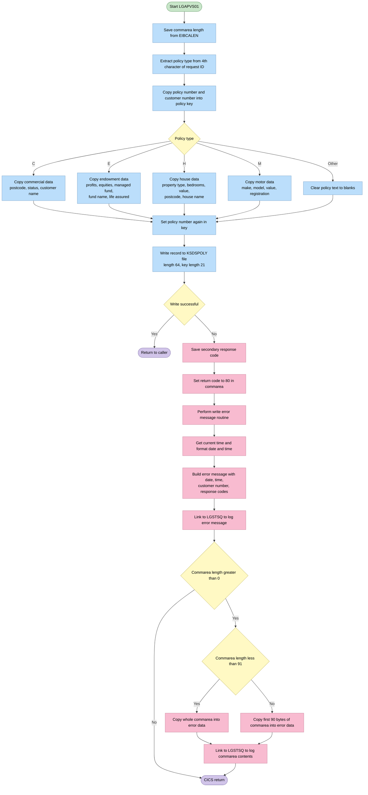
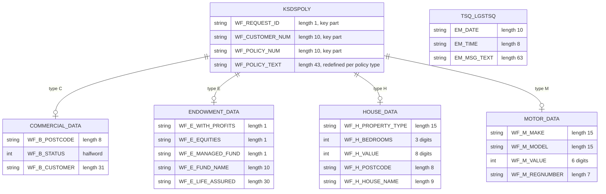

## Table of Contents

- [1. Purpose](#1-purpose)
- [2. Inputs](#2-inputs)
- [3. Outputs](#3-outputs)
- [4. Processing Logic](#4-processing-logic)
  - [4.1 Mermaid Flow Diagram](#41-mermaid-flow-diagram)
  - [4.2 Processing Logic Description](#42-processing-logic-description)
  - [4.3 Database Tables](#43-database-tables)
- [5. Paragraphs](#5-paragraphs)
- [6. Dependencies](#6-dependencies)
  - [6.1 CICS Resources](#61-cics-resources)
  - [6.2 CICS Services](#62-cics-services)
  - [6.3 Linked Programs](#63-linked-programs)
  - [6.4 Communication Area (COMMAREA)](#64-communication-area-commarea)
  - [6.5 Calling / Invoking Program](#65-calling--invoking-program)
  - [6.6 CICS Execution Block Fields](#66-cics-execution-block-fields)
  - [6.7 Include Files](#67-include-files)
- [7. Constraints](#7-constraints)
- [8. Error Handling](#8-error-handling)
- [9. Examples](#9-examples)
  - [9.1 Example 1: Add a motor policy](#91-example-1-add-a-motor-policy)
  - [9.2 Example 2: Add a house policy](#92-example-2-add-a-house-policy)
  - [9.3 Example 3: Duplicate key on write](#93-example-3-duplicate-key-on-write)
  - [9.4 Example 4: Unrecognised policy type](#94-example-4-unrecognised-policy-type)

## 1. Purpose

The primary purpose of `LGAPVS01` is to create and store new insurance policy records within the GenApp application's policy VSAM Key-Sequenced Data Set (`KSDSPOLY`). Acting as a VSAM backend service invoked in a CICS environment, the program accepts policy details through the communication area, formats the corresponding policy data according to the specific policy type—such as Commercial, Endowment, House, or Motor—and persists the new policy record to the VSAM storage file using a composite key consisting of the policy type code, customer number, and policy number. Additionally, it logs diagnostics to a CICS temporary storage queue via error reporting if any write operation failure occurs.

## 2. Inputs

- **Program parameter**
  - COMM_AREA_PTR: pointer to the CICS communication area (COMM_AREA) passed in by the calling program. All business inputs arrive through it.

- **CICS environment values**
  - EIBCALEN: length of the communication area passed in. The program uses it to decide how much of the commarea to copy into the error log.

- **Communication area header fields**
  - CA_REQUEST_ID: 6-character request identifier. Its 4th character is the policy type code that sets WF_REQUEST_ID and selects the policy-specific data to copy.
    - 'C' is commercial, 'E' is endowment, 'H' is house, and 'M' is motor.
  - CA_CUSTOMER_NUM: customer number. It becomes WF_CUSTOMER_NUM, part of the policy record key, and is also written to the error message.
  - CA_POLICY_NUM: policy number. It becomes WF_POLICY_NUM, part of the policy record key.

- **Commercial policy fields** (used when the policy type is 'C')
  - CA_B_POSTCODE: business postcode.
  - CA_B_STATUS: numeric status of the commercial policy, copied to WF_B_STATUS.
  - CA_B_CUSTOMER: business customer name, copied to WF_B_CUSTOMER.

- **Endowment policy fields** (used when the policy type is 'E')
  - CA_E_WITH_PROFITS: with-profits indicator, copied to WF_E_WITH_PROFITS.
  - CA_E_EQUITIES: equities indicator.
  - CA_E_MANAGED_FUND: managed fund indicator.
  - CA_E_FUND_NAME: name of the linked fund, copied to WF_E_FUND_NAME.
  - CA_E_LIFE_ASSURED: name of the person whose life is assured, copied to WF_E_LIFE_ASSURED.

- **House policy fields** (used when the policy type is 'H')
  - CA_H_PROPERTY_TYPE: property classification, copied to WF_H_PROPERTY_TYPE.
  - CA_H_BEDROOMS: number of bedrooms.
  - CA_H_VALUE: value of the house, copied to WF_H_VALUE.
  - CA_H_POSTCODE: postcode of the property, copied to WF_H_POSTCODE.
  - CA_H_HOUSE_NAME: house name.

- **Motor policy fields** (used when the policy type is 'M')
  - CA_M_MAKE: vehicle manufacturer, copied to WF_M_MAKE.
  - CA_M_MODEL: vehicle model.
  - CA_M_VALUE: vehicle value, copied to WF_M_VALUE.
  - CA_M_REGNUMBER: vehicle registration number, copied to WF_M_REGNUMBER.

- **Raw communication area content**
  - COMM_AREA_RAW: raw commarea content. Up to the first 90 bytes are copied into the error log message when the write fails.

- **External data sources and services**
  - KSDSPOLY: the policy VSAM KSDS file that the program writes to. The program also reads the CICS response codes from that write (RESP and EIBRESP2) to decide whether it succeeded.
  - CICS system time (ASKTIME/FORMATTIME): supplies the date and time stamped on error messages.

## 3. Outputs

- **Policy record written to the KSDSPOLY VSAM KSDS file**
  - Written with `EXEC CICS WRITE FILE('KSDSPOLY')`. The record is 64 bytes and the key is 21 bytes. This is the program's main output.
  - Key fields (together they form the record key used as RIDFLD)
    - `WF_POLICY_KEY`: the 21-byte composite key. It is built from the request type, the customer number and the policy number.
    - `WF_REQUEST_ID`: the one-character policy type code. It is taken from position 4 of the request ID in the communication area: 'C' commercial, 'E' endowment, 'H' house, 'M' motor.
    - `WF_CUSTOMER_NUM`: the customer who owns the policy. It is copied from the communication area customer number.
    - `WF_POLICY_NUM`: the unique policy identifier. It is copied from the communication area policy number.
  - Policy-type-specific data (only the group matching `WF_REQUEST_ID` is populated)
    - Commercial policy ('C')
      - `WF_B_STATUS`: the numeric status code of the commercial policy.
      - `WF_B_CUSTOMER`: the name of the business customer.
    - Endowment policy ('E')
      - `WF_E_LIFE_ASSURED`: the person whose life is covered.
      - `WF_E_FUND_NAME`: the investment fund linked to the policy.
      - `WF_E_WITH_PROFITS`: the with-profits indicator.
    - House policy ('H')
      - `WF_H_PROPERTY_TYPE`: the classification of the insured property.
      - `WF_H_POSTCODE`: the postal code of the property.
      - `WF_H_VALUE`: the monetary value of the insured house.
    - Motor policy ('M')
      - `WF_M_MAKE`: the manufacturer of the insured vehicle.
      - `WF_M_REGNUMBER`: the registration number of the vehicle.
      - `WF_M_VALUE`: the monetary value of the insured vehicle.
    - Any other request type clears the policy text area, so the record holds blank policy-specific data.

- **Return code passed back to the caller**
  - `CA_RETURN_CODE` in the communication area is set to '80' when the file write does not return NORMAL. On success the program returns without changing it.
  - After setting it, the program writes the error messages and ends with `EXEC CICS RETURN`.

- **Error message sent to the logging program LGSTSQ**
  - The program makes this call only when the write fails.
  - It calls `EXEC CICS LINK PROGRAM('LGSTSQ')` with `ERROR_MSG` as the COMMAREA.
  - The message contains the following fields.
    - `EM_DATE` and `EM_TIME`: the date and time of the error, from ASKTIME and FORMATTIME.
    - `EM_CUSNUM`: the customer number.
    - `EM_RESPRC`: the CICS response code from the failed write.
    - `EM_RESP2RC`: the secondary response code (EIBRESP2) from the failed write.
    - The fixed text identifies the program (`LGAPVS01`) and the failed operation ("Write file KSDSPOLY").
  - `EM_POLNUM` is part of the message layout but the program never sets it, so it stays blank.

- **Communication area dump sent to the logging program LGSTSQ**
  - This is a second LINK to LGSTSQ, made only on the error path and only when a communication area was passed (`EIBCALEN` > 0).
  - The COMMAREA is `CA_ERROR_MSG`. It holds the "COMMAREA=" prefix and `CA_DATA`, which carries the first 90 bytes of the communication area. If the communication area is shorter than 91 bytes, it carries the whole content.

## 4. Processing Logic

### 4.1 Mermaid Flow Diagram



---

### 4.2 Processing Logic Description

**High-level Summary**

LGAPVS01 is a CICS PL/I backend program that adds a new insurance policy record to the VSAM KSDS file `KSDSPOLY`. The caller passes a COMMAREA. The program picks out the key fields and the policy-type-specific details, builds a fixed-length record, and writes it to the file. If the write fails, it sets return code `80`, logs diagnostic messages through the `LGSTSQ` program, and returns.

**Execution Flow**

1. **Entry and setup.** The program starts as `Proc(COMM_AREA_PTR) Options(Main)`. The COMMAREA is addressed through `COMM_AREA_PTR`. It saves `EIBCALEN` in `WS_Commarea_Len`.
2. **Key construction.**
   - `WF_REQUEST_ID` is the 4th character of `CA_REQUEST_ID`. It is the policy type code, for example `'01AMOT'` gives `'M'`.
   - `WF_CUSTOMER_NUM` comes from `CA_CUSTOMER_NUM`.
   - `WF_POLICY_NUM` comes from `CA_POLICY_NUM`.
   - Together they form the 21-byte key `WF_POLICY_KEY`: 1 byte type, 10 bytes customer, 10 bytes policy.
3. **Policy-type branching.** The program copies different data into the `WF_Policy_Data` area, which is a UNION of 43 bytes:
   - `'C'` (commercial): postcode, status (`WF_B_STATUS`) and customer name (`WF_B_CUSTOMER`).
   - `'E'` (endowment): with-profits flag, equities flag, managed-fund flag, fund name and life assured.
   - `'H'` (house): property type, bedrooms, value, postcode and house name.
   - `'M'` (motor): make, model, value and registration number.
   - Any other value: `WF_Policy_Text` is set to blanks. The record is still written with a blank data area.
4. **Key refresh.** `WF_Policy_Num` is assigned from `CA_Policy_Num` a second time. The result is the same as step 2.
5. **File write.** The program issues `EXEC CICS WRITE FILE('KSDSPOLY')` from `WF_Policy_Info`. The length is 64 bytes, the key is `WF_Policy_Key`, and the key length is 21. The response goes into `WS_RESP`.
6. **Success path.** If `WS_RESP` equals `DFHRESP(NORMAL)`, the program executes `RETURN`. The return code in the COMMAREA is not changed by this program.
7. **Error path.** If the response is anything other than NORMAL:
   - `EIBRESP2` is saved in `WS_RESP2`.
   - `CA_RETURN_CODE` is set to `'80'`. This is the business rule for a VSAM write failure.
   - `WRITE_ERROR_MESSAGE` is called, then `EXEC CICS RETURN` is issued.
8. **WRITE_ERROR_MESSAGE routine.**
   - `ASKTIME` gets the absolute time. `FORMATTIME` produces the date (MMDDYYYY) and time.
   - The `ERROR_MSG` structure is filled with date, time, customer number (`EM_CUSNUM`), `WS_RESP` (`EM_RESPRC`) and `WS_RESP2` (`EM_RESP2RC`). The message text includes the literals `PNUM=`, `CNUM=`, `Write file KSDSPOLY`, `RESP=` and `RESP2=`. The policy number field `EM_POLNUM` is never filled, so it stays blank.
   - `EXEC CICS LINK PROGRAM('LGSTSQ')` passes `ERROR_MSG` so it can be written to the queue.
   - If `EIBCALEN > 0`, the COMMAREA contents are also logged:
     - If `EIBCALEN < 91`, the whole COMMAREA is copied (left-justified) into `CA_Data`.
     - Otherwise, only the first 90 bytes are copied.
     - Either way, `LGSTSQ` is linked again with `CA_ERROR_MSG`.
     - Both LINKs use `LENGTH(STG(ERROR_MSG))`, the size of the first message, even for the `CA_ERROR_MSG` link.
   - The routine then returns.

**Important business rules and notes**

- The record key is type + customer number + policy number, so one policy is unique per type, customer and policy number.
- Return code `80` signals a VSAM add failure. A duplicate key is the usual cause.
- No check is made on `EIBCALEN` before the COMMAREA is used. There is no `'98'` too-short check in this program.
- Only a subset of the commarea fields is stored. For example, the house number, the commercial address and the premium fields are not stored.
- The record is declared as 64 bytes, which is 21 bytes of key plus 43 bytes of data.

**External Interactions**

| Interaction | Purpose |
|---|---|
| CICS file `KSDSPOLY` (VSAM KSDS) | Write the new policy record, keyed by type, customer and policy number |
| CICS `ASKTIME` / `FORMATTIME` | Get the timestamp for the error message |
| CICS `LINK` to `LGSTSQ` | Write error messages and COMMAREA contents to the logging queue (a TS/TD queue) |
| COMMAREA | Input policy data. Output return code `80` on failure |

No Db2 or SQL is used.

**Plain Language Summary**

The program receives a request to add an insurance policy. It copies the identifying numbers (policy type, customer, policy) and the details that fit that policy type (commercial, endowment, house or motor) into a short record. It then stores the record in the policy file. If the store works, it finishes quietly. If it fails, it flags the request as failed with code 80. It also records the time, the customer number, the system error codes and the start of the request data in an error log, then ends.

---

### 4.3 Database Tables



## 5. Paragraphs

- **LGAPVS01 (main procedure)**
  - Purpose: Adds a policy record to the VSAM KSDS policy file `KSDSPOLY` from the data passed in the communication area.
  - Operations:
    - Saves the commarea length (`EIBCALEN`) in `WS_Commarea_Len`.
    - Takes the policy type code `WF_REQUEST_ID` from the 4th character of `CA_REQUEST_ID`.
    - Copies the policy number (`WF_POLICY_NUM`) and customer number (`WF_CUSTOMER_NUM`) from the commarea into the work record. Together with `WF_REQUEST_ID` they form the 21-byte key `WF_POLICY_KEY`.
    - Copies the policy-specific fields (see the next entry).
    - Moves `CA_Policy_Num` to `WF_POLICY_NUM` a second time. This is redundant.
    - Writes the record with `EXEC CICS WRITE FILE('KSDSPOLY')`. The record comes from `WF_Policy_Info`, with length 64, `RIDFLD(WF_Policy_Key)`, `KeyLength(21)` and `RESP(WS_RESP)`.
  - Control flow:
    - After the write, it checks `WS_RESP` against `DFHRESP(NORMAL)`.
    - If the write failed, it saves `EIBRESP2` in `WS_RESP2` and sets `CA_RETURN_CODE` to '80'. It then calls `WRITE_ERROR_MESSAGE` and issues `EXEC CICS RETURN`.
    - If the write succeeded, it ends with a plain `RETURN`.
  - External interactions: CICS file write to `KSDSPOLY`. The commarea (`COMM_AREA`) is a based structure addressed through `COMM_AREA_PTR`.

- **Policy-type SELECT block (inside the main procedure)**
  - Purpose: Copies only the commarea fields that apply to the policy type in `WF_REQUEST_ID`. The fields are laid out as a union over `WF_Policy_Data` in the record.
  - Control flow: `SELECT (WF_Request_ID)` has four `WHEN` branches and an `OTHERWISE`.
    - `WHEN ('C')` (commercial): copies `WF_B_POSTCODE`, `WF_B_STATUS` and `WF_B_CUSTOMER` from the `CA_B_*` fields.
    - `WHEN ('E')` (endowment): copies `WF_E_WITH_PROFITS`, `WF_E_EQUITIES`, `WF_E_MANAGED_FUND`, `WF_E_FUND_NAME` and `WF_E_LIFE_ASSURED` from the `CA_E_*` fields.
    - `WHEN ('H')` (house): copies `WF_H_PROPERTY_TYPE`, `WF_H_BEDROOMS`, `WF_H_VALUE`, `WF_H_POSTCODE` and `WF_H_HOUSE_NAME` from the `CA_H_*` fields.
    - `WHEN ('M')` (motor): copies `WF_M_MAKE`, `WF_M_MODEL`, `WF_M_VALUE` and `WF_M_REGNUMBER` from the `CA_M_*` fields.
    - `OTHERWISE`: blanks `WF_POLICY_TEXT`.
  - External interactions: none. It only moves data in memory.

- **WRITE_ERROR_MESSAGE (internal procedure)**
  - Purpose: Builds an error message and sends it to the logging program `LGSTSQ`. The main procedure calls it when the file write fails.
  - Operations:
    - Issues `EXEC CICS ASKTIME ABSTIME(WS_ABSTIME)` to get the current time.
    - Issues `EXEC CICS FORMATTIME` with `MMDDYYYY(WS_DATE)` and `TIME(WS_TIME)` to format it.
    - Fills `ERROR_MSG` with the date (`EM_DATE`), the time (`EM_TIME`), the customer number from `CA_Customer_Num` (`EM_CUSNUM`), the response code (`EM_RESPRC` from `WS_RESP`) and the secondary response code (`EM_RESP2RC` from `WS_RESP2`).
    - Links to `LGSTSQ` with `ERROR_MSG` as the commarea, using `STG(ERROR_MSG)` as the length.
    - Logs the incoming commarea, as described below.
  - Control flow:
    - If `EIBCALEN > 0`, it logs the commarea contents.
    - If `EIBCALEN < 91`, it moves the whole commarea, left-justified, into `CA_Data`. Otherwise it moves the first 90 bytes.
    - In both cases it links to `LGSTSQ` again with `CA_ERROR_MSG` as the commarea.
    - It then returns to the caller.
  - External interactions:
    - CICS time services (`ASKTIME` and `FORMATTIME`).
    - Two or three CICS `LINK` calls to `LGSTSQ`, which logs the messages. The code does not show where `LGSTSQ` stores them.
    - Both commarea-logging links pass `LENGTH(STG(ERROR_MSG))`, not the size of `CA_ERROR_MSG`.
    - `EM_POLNUM` is never set, so the policy number is not included in the message.

## 6. Dependencies

### 6.1 CICS Resources

- **KSDSPOLY** — VSAM KSDS file accessed via `EXEC CICS WRITE FILE('KSDSPOLY')`. Receives the new 64-byte policy record keyed by the 21-byte composite key (`WF_Policy_Key`). This is the primary output target of the program.

### 6.2 CICS Services

- **EXEC CICS WRITE** — Used to write the new policy record to the `KSDSPOLY` VSAM KSDS file; `RESP` is checked for `DFHRESP(NORMAL)`.
- **EXEC CICS RETURN** — Issues an unconditional return to the calling program (orchestrator), either after a successful write or after an error.
- **EXEC CICS ASKTIME / FORMATTIME** — Retrieves and formats the current absolute timestamp into date (`WS_DATE`) and time (`WS_TIME`) fields used in the error message.
- **EXEC CICS LINK PROGRAM('LGSTSQ')** — Called twice inside `WRITE_ERROR_MESSAGE` to write diagnostic messages to a CICS temporary storage queue. The first invocation passes the structured `ERROR_MSG`; the second passes a dump of the raw COMMAREA bytes.

### 6.3 Linked Programs

- **LGSTSQ** — Error-logging utility. Invoked via `EXEC CICS LINK` to write error messages (structured error details and raw COMMAREA dump) to a CICS temporary storage queue. Called only on a failed `CICS WRITE`.

### 6.4 Communication Area (COMMAREA)

- **`LGCMAREA` include (`plinc/LGCMAREA.inc`)** — Expanded inline at compile time (`%INCLUDE LGCMAREA`). Defines the 32,500-byte `COMM_AREA` structure passed to the program via `COMM_AREA_PTR`. Supplies all input fields:
  - `CA_REQUEST_ID` (character 4 extracted to `WF_Request_ID` as the policy type selector: `C`, `E`, `H`, `M`)
  - `CA_CUSTOMER_NUM` → `WF_Customer_Num`
  - `CA_POLICY_NUM` → `WF_Policy_Num`
  - `CA_RETURN_CODE` — set to `'80'` on write failure
  - `CA_POLICY_SPECIFIC` union branches — `CA_COMMERCIAL`, `CA_ENDOWMENT`, `CA_HOUSE`, `CA_MOTOR` — source of policy-type-specific field values copied into the VSAM record

### 6.5 Calling / Invoking Program

- **LGAPOL01 (orchestrator)** — The add-policy orchestrator that links to `LGAPVS01` via `EXEC CICS LINK`. It populates the COMMAREA before the call and reads `CA_RETURN_CODE` on return.

### 6.6 CICS Execution Block Fields

- **`EIBCALEN`** — Checked at runtime within `WRITE_ERROR_MESSAGE` to determine the safe length of COMMAREA data to dump into the `CA_ERROR_MSG` diagnostic structure before calling `LGSTSQ`.
- **`EIBRESP2`** — Captured into `WS_RESP2` on a failed CICS WRITE to supply secondary response details in the error message.

### 6.7 Include Files

- **`plinc/LGCMAREA.inc`** — PL/I include file (equivalent of a copybook) that provides the `COMM_AREA` / `COMM_AREA_PTR` declarations. Expanded inline in the `.bobz` expanded source.

## 7. Constraints

- Policy type and key constraints
  - The policy type code is one character, taken from position 4 of the 6-character request ID (`SUBSTR(CA_Request_ID,4,1)`).
    - A `SELECT` on `WF_REQUEST_ID` accepts only 'C' (commercial), 'E' (endowment), 'H' (house) and 'M' (motor) as policy types with their own data.
    - Any other value goes to `OTHERWISE`, which blanks `WF_Policy_Text`. The program does not reject the request. It still writes a record with blank policy data.
  - The record key is a fixed 21-byte composite, `WF_POLICY_KEY`.
    - It is built from `WF_REQUEST_ID` (1 byte), `WF_CUSTOMER_NUM` (10 bytes) and `WF_POLICY_NUM` (10 bytes).
    - The `KeyLength(21)` and `Ridfld(WF_Policy_Key)` options on the write enforce it.
  - The key fields come from the commarea `CA_CUSTOMER_NUM` and `CA_POLICY_NUM`, which are 10-digit numeric pictures (`PIC '9999999999'`).
    - The key can therefore hold at most a 10-digit customer number and a 10-digit policy number.
    - `WF_Policy_Num` is assigned twice, before and after the `SELECT`, with the same value.
  - A record whose full key already exists in `KSDSPOLY` cannot be added.
    - The program has no explicit duplicate check.
    - The KSDS rejects a duplicate key, and the non-normal response is handled by the error path.

- Record layout and data size constraints
  - Each policy record is written with a fixed length of 64 bytes: `Length(64)` on the write.
    - The record is the 21-byte key plus a 43-byte policy data area (`WF_Policy_Text`), which gives 64 bytes.
    - The policy data area is a `UNION` that overlays the commercial, endowment, house and motor layouts on the same 43 bytes.
    - Only one policy type's data can be held in a record.
  - Field sizes limit the stored values, and values are truncated or converted on assignment from the commarea.
    - Commercial: postcode is 8 characters, status is `FIXED BIN(15)`, and the customer name is 31 characters. The commarea field `CA_B_Customer` is 255 characters, so it is cut to 31.
    - Endowment: fund name is 10 characters, life assured is 30 characters (`CA_E_LIFE_ASSURED` is 31 characters), and with-profits, equities and managed-fund are each 1-character flags.
    - House: property type is 15 characters, bedrooms is `PIC '(3)9'`, value is `PIC '(8)9'`, postcode is 8 characters, and house name is 9 characters. The commarea house name is 20 characters, so it is cut to 9.
    - Motor: make and model are 15 characters each, value is `PIC '(6)9'` (up to 6 digits), and registration number is 7 characters.
  - Only a subset of the commarea fields is carried into the record.
    - Fields such as issue date, expiry date, broker ID, payment, house number, and the motor colour, cc and premium fields are not stored.
    - The commercial perils, premiums, address and reject reason are also not stored.
  - The commarea itself is limited to 32,500 bytes (`COMM_AREA_RAW CHAR(32500)`).
    - The policy-specific area is a union over several layouts, so only one layout is valid per request.

- Input and commarea constraints
  - The program is a main CICS program that expects a commarea pointer (`COMM_AREA_PTR`) addressing the `COMM_AREA` based structure.
    - The commarea is dereferenced without checking `EIBCALEN`, so it must be passed in and populated by the caller.
    - `WS_Commarea_Len = EIBCALEN` is stored but not used for validation.
  - The caller must supply the request ID in the 6-character `CA_REQUEST_ID` and the customer and policy numbers in numeric picture form.
    - No code checks that the numbers are numeric, that they are non-blank, or that the data is in range.
    - Validation of required fields and value ranges is assumed to be done upstream.
  - Policy type codes must be uppercase single characters. The `SELECT` comparison is case-sensitive.

- Sequencing and processing constraints
  - The processing order is fixed.
    - First the key fields are populated from the commarea.
    - Then type-specific data is moved in based on the policy type.
    - Then the record is written to `KSDSPOLY`.
    - Last, the response is checked.
  - Type-specific data must be moved into the work record before the write, because the write uses the whole `WF_Policy_Info` area.
  - The error message is built and logged only after a failed write. The order is `ASKTIME`, `FORMATTIME`, field population, then `LINK` to `LGSTSQ`.
  - The program does only an add: a single `WRITE` per invocation.
    - There is no read, update or delete, and no retry or rollback logic.

- Error handling and return code constraints
  - The write must complete with `DFHRESP(NORMAL)` (`RESP(WS_RESP)`).
    - On any other response, `EIBRESP2` is saved to `WS_RESP2`.
    - `CA_RETURN_CODE` is set to '80' to tell the caller the add failed.
    - `WRITE_ERROR_MESSAGE` is called, and then `EXEC CICS RETURN` ends the transaction.
  - No specific handling exists for individual conditions such as DUPREC, NOTOPEN or a file-full condition. All non-normal responses go through the same path.
  - On success, the return code is not set and the program just returns, so the caller must treat the unchanged return code as success.
  - The error message has fixed field widths.
    - The date is 10 characters in MMDDYYYY format, and the time is 8 characters.
    - The message carries the policy number, customer number and the `RESP` and `RESP2` values as signed 6-character pictures (`+(5)9`).
    - It also carries the literal text ' Write file KSDSPOLY'.
    - `EM_POLNUM` is declared but not filled in the error routine, so the policy number is not populated in the error message. Only the customer number, `RESP` and `RESP2` are.
  - The commarea snapshot sent to the log is limited to 90 bytes (`CA_Data CHAR(90)`).
    - If `EIBCALEN` is 1 to 90, only that many bytes are copied (`LEFT(COMM_AREA_RAW,EIBCALEN)`).
    - If `EIBCALEN` is 91 or more, only the first 90 bytes are copied.
    - If `EIBCALEN` is 0, no commarea snapshot is logged.
  - Error logging goes through a `LINK` to program `LGSTSQ`, so that program must be available.
    - The `LINK` length is `STG(ERROR_MSG)` for both messages. The commarea data message is therefore sent with the length of the first message structure.

- Resource and environment constraints
  - The VSAM KSDS file must be defined to CICS as `KSDSPOLY`, be open and enabled, and have a 21-byte key and 64-byte records.
  - The program depends on CICS services for `WRITE FILE`, `ASKTIME`, `FORMATTIME`, `LINK` and `RETURN`.
  - Time-stamp formatting for error messages is in MMDDYYYY, which fixes the date layout of logged errors.

## 8. Error Handling

- **Explicit error checks on the CICS file write**
  - The program writes the policy record to the VSAM KSDS file `KSDSPOLY`. It uses a 21-byte composite key (`WF_POLICY_KEY`) as the record identifier and a 64-byte record length.
  - The write uses the RESP option, so CICS returns the outcome in `WS_RESP` instead of raising a condition. This is the only file I/O in the program.
  - After the write, the program compares `WS_RESP` with the NORMAL response value. Any other value is treated as a failure.
  - On failure, the program copies the secondary response code from `EIBRESP2` into `WS_RESP2`. This code gives more detail about the cause, such as a duplicate key or an I/O problem.
  - The program has no retry logic and no alternate write path. A failed write goes straight to error reporting and termination.

- **Return code signalling to the caller**
  - On a failed write, the program sets `CA_RETURN_CODE` in the communication area to '80'.
  - This is the only way the caller learns of the failure. The program raises no abend.
  - The caller reads the code from the shared communication area, which is the only data contract between programs.
  - The program never sets the code to a success value on the normal path. It relies on the value the caller supplied.
  - The code '80' differs from the '98' (communication area too short) and '99' (Db2 or system error) codes in the application's general convention. It marks a VSAM write failure.

- **Error message construction and logging (`WRITE_ERROR_MESSAGE` procedure)**
  - The procedure is called only from the failed-write path.
  - **Timestamping**
    - It gets the current absolute time with ASKTIME.
    - It formats the time with FORMATTIME into a date (MMDDYYYY) and a time. These go into `EM_DATE` and `EM_TIME`.
  - **Message content**
    - The message holds the date, time, program identifier (`LGAPVS01`), customer number, response code (`EM_RESPRC`) and secondary response code (`EM_RESP2RC`).
    - The message layout also has a fixed "Write file KSDSPOLY" text, so the failing operation can be identified.
    - The message layout has a policy number field (`EM_POLNUM`). The procedure never fills it, so the policy number is missing from the message.
  - **Delivery**
    - The message is sent by CICS LINK to the logging program `LGSTSQ`. It is passed in the communication area, and `LGSTSQ` writes it to a CICS queue. The program does not write the queue itself.
    - The LINK has no RESP option, so a failure in the logging program is not detected or handled.

- **Diagnostic capture of the caller's communication area**
  - After the main error message, the procedure checks whether a communication area was passed (`EIBCALEN` greater than 0).
  - If the area is shorter than 91 bytes, it copies the whole area, left-justified, into the 90-byte `CA_Data` field.
  - If the area is 91 bytes or longer, it copies only the first 90 bytes.
  - It then sends the data to `LGSTSQ` in a second LINK, in a "COMMAREA=" prefixed record. This lets support staff see the input data that caused the failure.
  - If no communication area was passed, no data is logged.
  - The LINK length is taken from the size of the main error message structure, not the commarea error structure. This may send a different amount of data than intended.

- **Program termination**
  - After logging, the failure path ends with EXEC CICS RETURN. This stops processing and returns control to the caller with the error code set.
  - The program does not abend, roll back or take other recovery action on a failed write.

- **Input validation and defaulting**
  - **Request type selection**
    - The program takes the policy type code from the fourth character of `CA_Request_ID` and uses it to choose which policy data to copy. The valid codes are 'C' (commercial), 'E' (endowment), 'H' (house) and 'M' (motor).
    - The selection has an OTHERWISE branch. For any other code, the program blanks the policy text area (`WF_Policy_Text`), so no stale or unrelated data is written.
    - An unrecognised type is not reported as an error. The program still writes a record with a blank data area, which is a silent fallback.
  - **No other checks**
    - The program does not check whether the communication area is missing or too short before reading from it. It copies `EIBCALEN` into `WS_Commarea_Len`, but never uses that value for validation.
    - The program has no checks on customer numbers, policy numbers or field contents before the write.
    - The program has no ON-unit or condition handling for PL/I conditions such as ERROR or CONVERSION. It relies entirely on the RESP check after the CICS write.

- **Initialised defaults and diagnostic aids**
  - The error message fields and the time and date fields start as blanks, and the length and response working fields have defined starting values. This stops uninitialised data appearing in log records.
  - The program carries an eyecatcher field, 'Program LGAPVS01', which helps identify the program in dumps.

## 9. Examples

### 9.1 Example 1: Add a motor policy

**Input (COMMAREA)**

| Field | Value |
|---|---|
| CA_REQUEST_ID | `01AMOT` |
| CA_CUSTOMER_NUM | `0000000001` |
| CA_POLICY_NUM | `0000000042` |
| CA_M_MAKE | `FORD` |
| CA_M_MODEL | `FOCUS` |
| CA_M_VALUE | `015000` |
| CA_M_REGNUMBER | `AB12CDE` |

**Output (record written to KSDSPOLY, 64 bytes, key length 21)**

```
Key  : M 0000000001 0000000042
Data : FORD........... FOCUS.......... 015000 AB12CDE
        (MAKE, 15)      (MODEL, 15)    (VALUE) (REG, 7)
```
The program returns normally and `CA_RETURN_CODE` is unchanged.

**Explanation:** `WF_Request_ID` is the 4th character of `CA_REQUEST_ID`, which is `M`. The `SELECT` takes the `WHEN ('M')` branch. That branch copies make, model, value and registration number into the motor view of the `WF_Policy_Data` union. The key is `WF_Request_ID`, `WF_Customer_Num` and `WF_Policy_Num`, which is 1 + 10 + 10 = 21 bytes. The `WRITE FILE` returns NORMAL, so no error handling runs.

### 9.2 Example 2: Add a house policy

**Input (COMMAREA)**

| Field | Value |
|---|---|
| CA_REQUEST_ID | `01AHOU` |
| CA_CUSTOMER_NUM | `0000000007` |
| CA_POLICY_NUM | `0000000108` |
| CA_H_PROPERTY_TYPE | `DETACHED` |
| CA_H_BEDROOMS | `004` |
| CA_H_VALUE | `00250000` |
| CA_H_POSTCODE | `SO212JN` |
| CA_H_HOUSE_NAME | `ROSE COTTAGE` |

**Output (record written to KSDSPOLY)**

```
Key  : H 0000000007 0000000108
Data : DETACHED....... 004 00250000 SO212JN. ROSE COTT
```

**Explanation:** The 4th character of the request ID is `H`, so the house branch runs. `WF_H_HOUSE_NAME` is only `CHAR(9)`. The 20-character `ROSE COTTAGE` is therefore truncated to `ROSE COTT`.

### 9.3 Example 3: Duplicate key on write

**Input:** The same motor request as Example 1, sent again after the record already exists.

**Output**
- `CA_RETURN_CODE` is set to `80`.
- `LGSTSQ` is linked twice. The first message has this form:

```
MM/DD/YYYY HH:MM:SS LGAPVS01 PNUM=           CNUM=0000000001 Write file KSDSPOLY RESP=+000014 RESP2=+000000
```

- The second message is `COMMAREA=` followed by the first 90 bytes of the COMMAREA, or all of it if it is shorter than 91 bytes.
- The program ends with `EXEC CICS RETURN`.

**Explanation:** The `WRITE FILE` returns a non-NORMAL response, here DUPREC (RESP 14). The program saves `EIBRESP2` and sets the return code to `80`. It calls `WRITE_ERROR_MESSAGE`, which gets the time and date with ASKTIME and FORMATTIME, fills in the customer number and response codes, and logs the message through `LGSTSQ`. `EM_POLNUM` is never filled in, so `PNUM=` stays blank.

### 9.4 Example 4: Unrecognised policy type

**Input:** `CA_REQUEST_ID` = `01AXYZ`, with customer `0000000003` and policy `0000000500`.

**Output:** A record is written with key `X0000000003 0000000500`, and its 43-byte data area is all blanks.

**Explanation:** `X` matches none of the `C`, `E`, `H` or `M` branches. The `OTHERWISE` branch sets `WF_Policy_Text` to blanks, so only the key is stored.

---

Generated by IBM Bob Premium Package for Z
