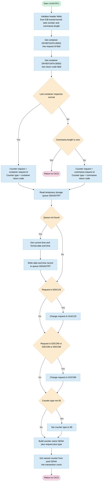
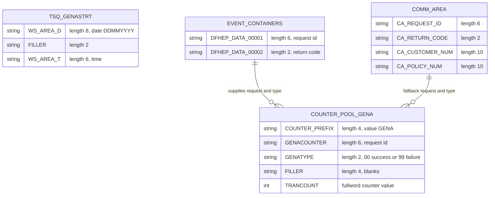

## Table of Contents

- [1. Purpose](#1-purpose)
- [2. Inputs](#2-inputs)
- [3. Outputs](#3-outputs)
- [4. Processing Logic](#4-processing-logic)
  - [4.1 Mermaid Flow Diagram](#41-mermaid-flow-diagram)
  - [4.2 Processing Logic Description](#42-processing-logic-description)
  - [4.3 Database Tables](#43-database-tables)
- [5. Paragraphs](#5-paragraphs)
- [6. Dependencies](#6-dependencies)
  - [6.1 CICS System Services and Facilities](#61-cics-system-services-and-facilities)
  - [6.2 Data Interfaces and Structures](#62-data-interfaces-and-structures)
  - [6.3 Include Files and Copybooks](#63-include-files-and-copybooks)
- [7. Constraints](#7-constraints)
  - [7.1 Input and Invocation Constraints](#71-input-and-invocation-constraints)
  - [7.2 Data Formatting and Normalization Constraints](#72-data-formatting-and-normalization-constraints)
  - [7.3 CICS Resource and State Constraints](#73-cics-resource-and-state-constraints)
  - [7.4 Sequence and Execution Flow Constraints](#74-sequence-and-execution-flow-constraints)
- [8. Error Handling](#8-error-handling)
- [9. Examples](#9-examples)
  - [9.1 Example 1: Successful Channel-Driven Transaction Counter Increment](#91-example-1-successful-channel-driven-transaction-counter-increment)
  - [9.2 Example 2: Failed Transaction via COMMAREA with Request Normalization and Queue Initialization](#92-example-2-failed-transaction-via-commarea-with-request-normalization-and-queue-initialization)

## 1. Purpose

LGASTAT1 is a CICS statistics-collection program that acts as an event-processing adapter target, counting the number of times each GenApp business request type completes with a given outcome. It accepts a request identifier and a return code either from CICS event-processing channel containers (`DFHEP.DATA.00001` and `DFHEP.DATA.00002`) or, if no channel data is present, from the passed communication area, then normalises legacy or variant request codes to a canonical value and collapses any non-zero return code to a single failure indicator. Using these two values it constructs a 16-character named-counter key in the form `GENA<request><outcome>`, retrieves the current running total from the `GENA` named-counter pool, and records a statistics-collection start timestamp in a CICS temporary storage queue (`GENASTRT`) the first time it is invoked, providing a persistent audit trail of when transaction counting began.

## 2. Inputs

- **Program parameter**
  - COMM_AREA_PTR: pointer to the CICS COMMAREA. It addresses the COMM_AREA structure.
- **COMMAREA fields (fallback source when the event channel containers are unavailable)**
  - CA_REQUEST_ID: 6-character business request identifier. It supplies the request part (GENACOUNTER) of the counter name.
  - CA_RETURN_CODE: 2-digit outcome code. It supplies the outcome part (GENATYPE) of the counter name. Any non-zero value becomes '99'.
  - The rest of the shared COMMAREA layout is declared (for example CA_CUSTOMER_NUM and CA_POLICY_NUM) but the program doesn't read it.
- **CICS channel containers (primary source, supplied by the event processing adapter)**
  - Container DFHEP.DATA.00001 (WS_CHANNAME1): its content is read into WS_DATA_REQ and supplies the request identifier for the counter name.
  - Container DFHEP.DATA.00002 (WS_CHANNAME2): its content is read into WS_DATA_RC and supplies the return code for the counter name.
  - The RESP value from the container reads (WS_RESP) decides whether the containers or the COMMAREA are used.
- **CICS task and EIB context**
  - EIBCALEN: COMMAREA length. If it is 0 and the containers are unavailable, the program returns immediately.
  - EIBTRNID, EIBTRMID, EIBTASKN: transaction ID, terminal ID and task number. They are copied into the run-time header (WS_HEADER).
- **External data resources**
  - Temporary storage queue GENASTRT (WS_QNAME): read to get the statistics start date and time stamp (WS_QAREA). If the queue doesn't exist (QIDERR), the program writes it using the current date and time from CICS ASKTIME and FORMATTIME.
  - Named counter pool GENA (GENAPOOL): the program gets the counter GENA<request><type> from this pool. The returned value goes to TRANCOUNT.
- **Constants that shape the external lookups**
  - Counter name prefix 'GENA' and the pool name 'GENA'.
  - Request code normalisation: '02ACUS' becomes '01ACUS'. '02ICOM', '03ICOM' and '05ICOM' become '01ICOM'.

## 3. Outputs

- **Named counter retrieval (CICS GET COUNTER, primary observable side effect)**
  - Counter name built in `GENACOUNT` and passed to the pool `GENAPOOL` ('GENA'). Each call retrieves the counter and advances its value, so this is the program's main external effect.
  - `GENACOUNT`: 16-character counter name made of the 'GENA' prefix, `GENACOUNTER`, `GENATYPE` and trailing blanks.
    - `GENACOUNTER`: request identifier part of the name.
      - Source: the `DFHEP.DATA.00001` container value (`WS_DATA_REQ`), or `CA_REQUEST_ID` from the commarea when the container is not available.
      - Legacy values are normalised: '02ACUS' becomes '01ACUS'. '02ICOM', '03ICOM' and '05ICOM' become '01ICOM'.
    - `GENATYPE`: outcome part of the name.
      - Source: the `DFHEP.DATA.00002` container value (`WS_DATA_RC`), or `CA_RETURN_CODE` from the commarea.
      - '00' is kept for success. Any other value becomes '99' for failure.
  - `GENAPOOL`: fixed pool name ('GENA') that groups the application statistics counters.
  - `TRANCOUNT`: receives the current counter value for the request and outcome combination.
    - It is not displayed, returned or written anywhere else.
    - It is available to the task only.

- **Temporary storage queue write (statistics start timestamp)**
  - `WS_QNAME` ('GENASTRT') is the target queue. The write happens only when the queue does not exist (QIDERR on the read).
  - `WS_QAREA`: 16-character record written to the queue.
    - `WS_AREA_D`: collection start date, formatted DDMMYYYY from the current CICS time.
    - `WS_AREA_T`: collection start time.
  - The queue is written once and serves as a persistent marker of when statistics collection began.

- **Task termination (CICS RETURN)**
  - The program ends with a CICS RETURN on every path.
  - It also returns early, with no counter update and no queue write, when no container data is available and the commarea length (`EIBCALEN`) is 0.
  - No value is passed back to the caller. `COMM_AREA` is read but never modified.

- **Printed messages, files, database and API output**
  - The program prints no messages and writes no files or database records.
  - The only external effects are the named counter retrieval and the one-time temporary storage queue write.
  - `WS_RESP` is set after each CICS call but is never acted on in a way that changes output.
    - The container-read response is the only exception, because it chooses between container input and commarea input.

## 4. Processing Logic

### 4.1 Mermaid Flow Diagram

---

### 4.2 Processing Logic Description

**High-level Summary**

LGASTAT1 is a CICS PL/I main program. It is the target of an event-processing adapter and updates application statistics. It works out which business request ran and whether it succeeded. It builds a counter name of the form `GENA` + request id (6 characters) + outcome (2 characters) + 4 blanks. It then gets that named counter from the counter pool `GENA`. On its first run, it also records the date and time that statistics collection started in a temporary storage queue.

**Execution Flow**

1. **Initialise diagnostics.** The program clears the `WS_HEADER` structure. It sets the eyecatcher `LGASTAT1------WS` and copies in the transaction id (`EIBTRNID`), terminal id (`EIBTRMID`), task number (`EIBTASKN`) and commarea length (`EIBCALEN`). These fields are for debugging only and are not used later.
2. **Read the event containers.** The program gets container `DFHEP.DATA.00001` into `WS_DATA_REQ`, the request id. It then gets container `DFHEP.DATA.00002` into `WS_DATA_RC`, the return code. Both commands use the same `WS_RESP` field. The second command overwrites the first response, so only the response from the second GET CONTAINER is tested.
3. **Choose the data source.**
   - If the response is NORMAL, `GENACOUNTER` is set from `WS_DATA_REQ` and `GENATYPE` from `WS_DATA_RC`.
   - If the response is not NORMAL, the program was not driven by an event channel.
     - If `EIBCALEN = 0`, there is no commarea either, so the program issues `EXEC CICS RETURN` and ends without updating any counter. This is the only validation or error exit.
     - Otherwise `GENACOUNTER` is set from `CA_REQUEST_ID` and `GENATYPE` from `CA_RETURN_CODE` in the commarea.
4. **Record the statistics start time.** The program reads TS queue `GENASTRT` into `WS_QAREA` (length 16).
   - If the response is QIDERR, the queue does not exist yet. The program issues ASKTIME and FORMATTIME (DDMMYYYY and time). It puts the date in `WS_AREA_D` and the time in `WS_AREA_T`. It then writes the 16-byte record to the queue.
   - Any other response, including a successful read, is ignored. The queue is only written once, so its record holds the time the first statistic was captured.
   - The WRITEQ response is not checked.
5. **Normalise the request codes** (business rules):
   - `02ACUS` becomes `01ACUS`.
   - `02ICOM`, `03ICOM` and `05ICOM` all become `01ICOM`.
   - These rules consolidate legacy or variant request codes into one counter.
6. **Normalise the outcome.** If `GENATYPE` is not `'00'`, it becomes `'99'`. This leaves two outcomes per request: success (`00`) and any failure (`99`).
7. **Get the counter.** The program issues `EXEC CICS GET COUNTER` with the 16-character name in `GENACOUNT`, pool `GENA`, and the value returned in `TRANCOUNT`. The response is stored but not tested. `GET COUNTER` returns the next value and increments the counter, so each call adds 1 to the total for that request and outcome. If the counter is not defined, the failure is silently ignored.
8. **End.** The program issues `EXEC CICS RETURN`.

**External Interactions**

| Interaction | Purpose |
|---|---|
| Channel containers `DFHEP.DATA.00001` and `DFHEP.DATA.00002` | Input from the event-processing adapter. They carry the request id and the return code. |
| COMMAREA (`COMM_AREA`, using `CA_REQUEST_ID` and `CA_RETURN_CODE`) | Fallback input when no containers are present. |
| TS queue `GENASTRT` | Holds a single record with the date and time statistics collection began. It is read, and written only if it is missing. |
| Named counter pool `GENA` | Holds the counters named `GENA<request><rc>`. The program gets the counter to increment the count of transactions per request and outcome. |
| EIB fields | Source of the transaction, terminal, task and commarea length diagnostics. |

**Plain Language Summary**

Each time a business request such as a customer inquiry or a policy change finishes, this program counts it. It looks at which request it was and whether it worked. The information comes from an event message or, failing that, from the data passed in by the calling program. If neither is available, it stops without counting. The first time it runs, it saves the date and time as the point where counting began. It then tidies the request name so that old variants of the same request are counted together. It also reduces every kind of failure to a single "failed" code. Finally, it adds one to the matching tally in the shared statistics counter pool and ends.

---

### 4.3 Database Tables

## 5. Paragraphs

- **LGASTAT1**
  - **Purpose**: Serves as the main entry procedure and event-processing adapter target to record and update application transaction statistics using CICS named counters and temporary storage queues.
  - **Operations**:
    - Initializes working storage header fields with execution diagnostic data from the Execute Interface Block (EIB), including transaction ID (`EIBTRNID`), terminal ID (`EIBTRMID`), task number (`EIBTASKN`), and COMMAREA length (`EIBCALEN`).
    - Attempts to retrieve the request identifier and return code from event channel containers `DFHEP.DATA.00001` and `DFHEP.DATA.00002`.
    - Reads the statistics start timestamp from the temporary storage queue `GENASTRT`. If the queue does not exist (`QIDERR`), retrieves the current system time using `EXEC CICS ASKTIME`, formats the date and time using `EXEC CICS FORMATTIME`, and writes a new record into the `GENASTRT` temporary storage queue.
    - Normalizes incoming request identifier codes (maps `02ACUS` to `01ACUS`, and maps `02ICOM`, `03ICOM`, or `05ICOM` to `01ICOM`) and categorizes any non-zero return code as `99` (failure), leaving `00` as success.
    - Constructs the named counter key (`GENA` prefix + normalized request ID + return code category) and fetches/increments the counter value from the named counter pool `GENA`.
    - Returns control to CICS.
  - **Control Flow Elements**:
    - Conditional check on container retrieval response (`WS_RESP = DFHRESP(NORMAL)`): if container read is successful, extracts request ID and return code from container data; otherwise, checks `EIBCALEN` to fall back to COMMAREA values or terminates execution via `EXEC CICS RETURN` if COMMAREA length is zero.
    - Conditional handling on temporary storage queue read (`WS_RESP = DFHRESP(QIDERR)`) to capture and record the initial start timestamp if not already present.
    - Conditional statements to normalize specific request counter IDs (`GENACOUNTER`) and map return code types (`GENATYPE`).
  - **Interactions with External Systems**:
    - CICS Channel and Container API: `EXEC CICS GET CONTAINER` for containers `DFHEP.DATA.00001` and `DFHEP.DATA.00002`.
    - CICS Temporary Storage Queue API: `EXEC CICS READQ TS` and `EXEC CICS WRITEQ TS` on queue `GENASTRT`.
    - CICS Time Services API: `EXEC CICS ASKTIME` and `EXEC CICS FORMATTIME`.
    - CICS Named Counter Facility: `EXEC CICS GET COUNTER` on pool `GENA`.
    - CICS Control API: `EXEC CICS RETURN`.

## 6. Dependencies

### 6.1 CICS System Services and Facilities
- **CICS Named Counter Facility**
  - **Named Counter Pool (`GENAPOOL`)**: Accesses the `GENA` named counter pool using `EXEC CICS GET COUNTER` to retrieve and increment transaction execution counters (`GENACOUNT` / `genacount_str`) based on business request ID and outcome type.
- **CICS Event Processing (EP) Channel and Containers**
  - **`DFHEP.DATA.00001` (`WS_CHANNAME1`)**: Container holding the 6-character business request identifier (`WS_DATA_REQ`) passed by the CICS event processing adapter.
  - **`DFHEP.DATA.00002` (`WS_CHANNAME2`)**: Container holding the 2-character return code/outcome status (`WS_DATA_RC`) passed by the CICS event processing adapter.
- **CICS Temporary Storage (TS) Queue**
  - **`GENASTRT` Queue (`WS_QNAME`)**: Temporary storage queue queried (`EXEC CICS READQ TS`) to track the statistics collection start timestamp. If missing (`DFHRESP(QIDERR)`), it is initialized with the current date and time (`EXEC CICS WRITEQ TS`).
- **CICS Time and Clock Services**
  - **`EXEC CICS ASKTIME` / `EXEC CICS FORMATTIME`**: Used to capture the absolute time and format the current date (`DDMMYYYY`) and time (`TIME`) for logging into the `GENASTRT` queue when initialized.
- **Execute Interface Block (EIB)**
  - **`EIBTRNID`**: Provides the current CICS transaction identifier.
  - **`EIBTRMID`**: Provides the terminal identifier associated with the task.
  - **`EIBTASKN`**: Provides the CICS task number for runtime context.
  - **`EIBCALEN`**: Indicates the length of the passed communication area, evaluated when channel containers are absent.

### 6.2 Data Interfaces and Structures
- **Communication Area (`LGCMAREA` / `COMM_AREA`)**
  - Fallback input interface supplied via `COMM_AREA_PTR` when event channel data is not available.
  - **`CA_REQUEST_ID`**: Supplies the 6-character business function request code (e.g., `'01ACUS'`, `'01ICOM'`) when event containers are missing.
  - **`CA_RETURN_CODE`**: Supplies the 2-character numeric return code indicating transaction outcome when event containers are missing.

### 6.3 Include Files and Copybooks
- **`LGCMAREA.inc` (`LGCMAREA`)**
  - PL/I include file defining the standard 32,500-byte shared communication area structure used across the GenApp application suite.

## 7. Constraints

### 7.1 Input and Invocation Constraints

- Program Input Mechanisms:
  - The program accepts input through two primary mechanisms: CICS channel containers (`DFHEP.DATA.00001` and `DFHEP.DATA.00002`) or a CICS Communication Area (`COMMAREA`).
  - Container input takes precedence over `COMMAREA` input. The second container read response (`WS_RESP`) determines whether channel input is used.
  - When container retrieval fails (returns non-`NORMAL`), the program requires `EIBCALEN > 0` to process the `COMMAREA`. If `EIBCALEN = 0`, execution terminates immediately via `EXEC CICS RETURN`.

### 7.2 Data Formatting and Normalization Constraints

- Named Counter Structure:
  - The counter name string passed to CICS (`GENACOUNT_str`) is strictly constrained to 16 characters with the format:
    - Bytes 1–4: Prefix `'GENA'`.
    - Bytes 5–10: Request identifier (`GENACOUNTER`, 6 characters).
    - Bytes 11–12: Result type (`GENATYPE`, 2 characters).
    - Bytes 13–16: Trailing padding (4 blank spaces, `'    '`).
- Request Identifier Normalization:
  - Legacy customer add request code `'02ACUS'` is consolidated and remapped to `'01ACUS'`.
  - Commercial policy inquiry and maintenance request codes `'02ICOM'`, `'03ICOM'`, and `'05ICOM'` are consolidated and remapped to `'01ICOM'`.
  - All other 6-character request identifiers retain their incoming values without remapping.
- Return Code Normalization:
  - Return code status is restricted to a binary outcome:
    - Success code `'00'` is preserved as `'00'`.
    - Any non-zero return code (`GENATYPE ^= '00'`) is mapped to failure category `'99'`.

### 7.3 CICS Resource and State Constraints

- Named Counter Pool:
  - Counter retrieval is restricted to the specific named counter pool `'GENA'`.
  - The counter retrieval operation (`EXEC CICS GET COUNTER`) stores the transaction count in a fullword binary integer (`FIXED BIN(31)`), constraining the returned count to valid 31-bit signed binary values.
- Temporary Storage Queue (`GENASTRT`):
  - Queue access is fixed to the TS queue named `'GENASTRT'`.
  - The TS queue record length is constrained to 16 bytes (`STG(WS_QAREA)`), partitioned as:
    - Bytes 1–8: Date in `DD/MM/YYYY` format (`WS_AREA_D`, derived from `WS_DATE`).
    - Bytes 9–10: Two blank separator characters (`'  '`).
    - Bytes 11–16: Time in `HHMMSS` format (`WS_AREA_T`, derived from `WS_TIME`).
  - The queue is read unconditionally on each invocation. If the queue does not exist (`DFHRESP(QIDERR)`), the program captures the current timestamp via `ASKTIME`/`FORMATTIME` and initializes the queue via `WRITEQ TS`. Any other condition from `READQ TS` bypasses initialization without error raising.

### 7.4 Sequence and Execution Flow Constraints

- Execution Order:
  - Container retrieval must occur before `COMMAREA` evaluation.
  - TS Queue verification and initialization must execute before counter normalization and counter retrieval.
  - Request code and return code normalization must execute prior to issuing `EXEC CICS GET COUNTER`.
  - The program terminates execution unconditionally via `EXEC CICS RETURN` after attempting the named counter retrieval.

## 8. Error Handling

- **Container retrieval and fallback to the communication area**
  - The program issues two GET CONTAINER commands, one for each event-processing data container (the request identifier and the return code). Both use the RESP option, so a failure does not cause an automatic abend.
  - Both commands write to the same response field, so the second command overwrites the first one's result. Only the outcome of the second container read is tested. A failed first read is not detected unless the second read also fails.
  - If the response is NORMAL, the counter request and type are taken from the container values.
  - If the response is anything else, the program assumes it was not started through the event-processing channel. It falls back to the communication area.
  - In the fallback, the counter request comes from the communication area request identifier. The counter type comes from the communication area return code.

- **Guard against a missing communication area**
  - In the fallback path, the program checks whether the communication area length is zero.
  - If it is zero, there is neither channel data nor communication area data. The program ends immediately with a CICS RETURN, and no counter is retrieved. This protects against reading through an unaddressable communication area pointer.

- **Temporary storage queue handling**
  - The program reads the start-time queue with READQ TS and the RESP option, so no abend occurs if the queue is missing.
  - If the response is QIDERR, the queue does not exist yet. The program creates it:
    - It gets the current absolute time.
    - It formats the date and time.
    - It builds the queue record.
    - It resets the record length to the size of the queue record area.
    - It writes the record with WRITEQ TS.
  - This is recovery logic. The first execution initialises the missing start-time record.
  - Any response other than NORMAL or QIDERR from the read is not handled. The read response is checked only for QIDERR.
  - The WRITEQ TS command also uses RESP, but its response is never checked. A failed write is silently ignored.

- **Data normalisation and default outcome values**
  - Legacy request codes are mapped to consolidated values so they count against a single counter. The code '02ACUS' becomes '01ACUS'. The codes '02ICOM', '03ICOM' and '05ICOM' become '01ICOM'.
  - Any return code other than '00' is collapsed to '99'. This gives only two outcome categories, success and generic failure, and bounds the number of counters.

- **Counter retrieval**
  - The GET COUNTER command uses the RESP option, so the program does not abend if the pool or counter is missing or unavailable.
  - The response is stored but never checked. Failures such as a missing counter or pool are ignored, and the counter value field is not used afterwards.

- **Program termination and notifications**
  - Every path ends with a CICS RETURN, either the early exit for a missing communication area or the normal exit after the counter request.
  - The program writes no error messages. It does no logging, sets no return code in the communication area, and issues no abend.
  - The program has no PL/I ON-unit or condition handling (such as ERROR or SIZE conditions). It relies only on RESP-based checking for CICS commands.
  - The program does not retry.

- **Run-time diagnostic information**
  - The program records the transaction ID, terminal ID, task number and communication area length in a working-storage header with an eyecatcher. This provides diagnostic context in a dump or trace, but the program does not use it for any error decision.

## 9. Examples

### 9.1 Example 1: Successful Channel-Driven Transaction Counter Increment

#### 9.1.1 Input Data
* **CICS Channel Containers:**
  * Container `DFHEP.DATA.00001` (`WS_CHANNAME1`): `'01ICOM'`
  * Container `DFHEP.DATA.00002` (`WS_CHANNAME2`): `'00'`
* **CICS Temporary Storage Queue `GENASTRT`:**
  * Queue exists with start timestamp record: `'15/10/2023  083000'`
* **Named Counter Pool `GENA`:**
  * Named counter `GENA01ICOM00    ` current value: `124`

#### 9.1.2 Expected Output
* **Named Counter Pool `GENA`:**
  * Counter `GENA01ICOM00    ` value incremented to: `125`
  * Variable `TRANCOUNT`: `125`
* **CICS Temporary Storage Queue `GENASTRT`:** Unchanged

#### 9.1.3 Explanation
1. `LGASTAT1` retrieves the request identifier (`'01ICOM'`) from container `DFHEP.DATA.00001` and the return code (`'00'`) from container `DFHEP.DATA.00002`.
2. Because the container read succeeds (`WS_RESP = DFHRESP(NORMAL)`), `GENACOUNTER` is set to `'01ICOM'` and `GENATYPE` is set to `'00'`.
3. The program checks TS queue `GENASTRT`. Since it already exists, reading completes normally without creating a new timestamp.
4. Normalization checks evaluate `'01ICOM'` and `'00'`, requiring no modifications.
5. The 16-character counter name structure `GENACOUNT` formats as `'GENA01ICOM00    '`.
6. `EXEC CICS GET COUNTER` fetches and increments the counter in pool `GENA`, updating its value from `124` to `125`.

---

### 9.2 Example 2: Failed Transaction via COMMAREA with Request Normalization and Queue Initialization

#### 9.2.1 Input Data
* **CICS Channel Containers:** Not present (returns container error condition)
* **COMMAREA Input:**
  * `CA_REQUEST_ID`: `'02ACUS'`
  * `CA_RETURN_CODE`: `01`
  * `EIBCALEN`: `32500`
* **CICS Temporary Storage Queue `GENASTRT`:** Not yet created (`QIDERR` condition on read)
* **CICS System Clock:** `01/11/2023 14:15:30`
* **Named Counter Pool `GENA`:**
  * Named counter `GENA01ACUS99    ` current value: `45`

#### 9.2.2 Expected Output
* **CICS Temporary Storage Queue `GENASTRT`:**
  * Created record containing formatted date and time: `'01112023  141530'`
* **Named Counter Pool `GENA`:**
  * Counter `GENA01ACUS99    ` value incremented to: `46`
  * Variable `TRANCOUNT`: `46`

#### 9.2.3 Explanation
1. Container retrieval fails, prompting the program to inspect `EIBCALEN`. Since `EIBCALEN > 0`, the program falls back to `COMMAREA` fields, loading `GENACOUNTER` with `'02ACUS'` and `GENATYPE` with `'01'`.
2. The TS queue read for `GENASTRT` returns `QIDERR`. The program calls `EXEC CICS ASKTIME` and `FORMATTIME` to capture the current timestamp (`01112023` and `141530`), writing the 16-byte record to `GENASTRT`.
3. Normalization logic converts legacy/alternate request ID `'02ACUS'` to standard `'01ACUS'`.
4. The non-zero return code `'01'` is collapsed into failure status code `'99'`.
5. The assembled counter name `'GENA01ACUS99    '` is retrieved and incremented in named counter pool `GENA`, advancing the failure count to `46`.

---

Generated by IBM Bob Premium Package for Z
