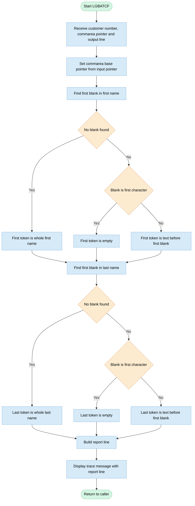

## Table of Contents

- [1. Purpose](#1-purpose)
- [2. Inputs](#2-inputs)
- [3. Outputs](#3-outputs)
  - [3.1 Caller Output Parameters](#31-caller-output-parameters)
  - [3.2 System Output and Diagnostic Logging](#32-system-output-and-diagnostic-logging)
- [4. Processing Logic](#4-processing-logic)
  - [4.1 Mermaid Flow Diagram](#41-mermaid-flow-diagram)
  - [4.2 Processing Logic Description](#42-processing-logic-description)
  - [4.3 Database Tables](#43-database-tables)
- [5. Paragraphs](#5-paragraphs)
- [6. Dependencies](#6-dependencies)
- [7. Constraints](#7-constraints)
- [8. Error Handling](#8-error-handling)
  - [8.1 Explicit validation and conditional checks](#81-explicit-validation-and-conditional-checks)
  - [8.2 Recovery and fallback logic](#82-recovery-and-fallback-logic)
  - [8.3 Exception-like constructs and system condition handling](#83-exception-like-constructs-and-system-condition-handling)
  - [8.4 Pointer and commarea safety](#84-pointer-and-commarea-safety)
  - [8.5 Notifications and termination](#85-notifications-and-termination)
- [9. Examples](#9-examples)
  - [9.1 Example 1: Typical customer](#91-example-1-typical-customer)
  - [9.2 Example 2: Name with an embedded blank](#92-example-2-name-with-an-embedded-blank)
  - [9.3 Example 3: Name field that is all blanks or full](#93-example-3-name-field-that-is-all-blanks-or-full)

## 1. Purpose

LGBATCF is a batch subroutine that LGBATCH calls. It builds one human-readable customer report line. It takes a customer number and a customer commarea, and it extracts the customer's first and last names. It trims each name at the first blank and returns an 80-character line in the form "Customer <number> is <first name> <last name>". It also displays the formatted line as a diagnostic message.

## 2. Inputs

- **Procedure parameters (passed by reference from the caller, LGBATCH)**
  - CUSTNUMBER
    - 10-digit numeric customer identifier.
    - It is concatenated into the report line as "Customer <number> is ...".
  - COMM_PTR
    - Pointer to a caller-supplied LGCMAREA commarea.
    - The program assigns it to COMM_AREA_PTR, so the commarea fields below are read from the caller's storage.
  - LS_LINE
    - CHAR(80) output line.
    - It is a parameter, but the program only writes to it. It is not an input.

- **Commarea data read through COMM_PTR (customer request)**
  - Fields the program actually reads:
    - CA_FIRST_NAME: 10-character given name. It is trimmed at the first blank to form the first-name token.
    - CA_LAST_NAME: 20-character surname. It is trimmed at the first blank to form the last-name token.
  - Other customer fields carried in the commarea. They are present in the layout but not used in the report line:
    - CA_REQUEST_ID: 6-character code for the requested business function (customer or policy inquiry, add, update, delete).
    - CA_CUSTOMER_NUM: 10-digit customer number in the commarea header.
    - CA_DOB: 10-character date of birth.
    - CA_POSTCODE: 8-character postal code.
    - CA_NUM_POLICIES: 3-digit count of the customer's policies.
    - CA_EMAIL_ADDRESS: 100-character email address.

- **Commarea data read through COMM_PTR (policy request)**
  - These fields are part of the shared commarea layout. The program does not use them.
  - Common policy details:
    - CA_POLICY_NUM: 10-digit policy identifier.
    - CA_BROKERID: 10-digit broker identifier.
    - CA_PAYMENT: 6-digit payment amount.
    - CA_EXPIRY_DATE: 10-character policy expiry date.
  - Policy-type specific values:
    - CA_E_SUM_ASSURED: 6-digit endowment sum assured.
    - CA_H_VALUE: 8-digit insured house value.
    - CA_M_VALUE: 6-digit insured motor vehicle value.

- **External data sources**
  - None. The program opens no files, databases, or APIs and reads no environment variables. It takes no console or user input. All data arrives through the parameters and the commarea storage.

## 3. Outputs

### 3.1 Caller Output Parameters
- `LS_LINE`
  - Formatted text output parameter (`CHAR(80)`) returned by reference to the calling program (`LGBATCH`). It contains the synthesized customer description line constructed by concatenating the customer number (`CUSTNUMBER`), trimmed first name (`CA_FIRST_NAME`), and trimmed last name (`CA_LAST_NAME`) in the format `"Customer <CUSTNUMBER> is <FIRST_TOKEN> <LAST_TOKEN>"`.

### 3.2 System Output and Diagnostic Logging
- System Output (`SYSOUT` / Console via `DISPLAY`)
  - A formatted tracing and confirmation string constructed as `'LGBATCHF WAS HERE... ' || LS_LINE` emitted directly to the standard runtime output destination using the PL/I `DISPLAY` statement to verify subroutine execution and show the assembled report line.

## 4. Processing Logic

### 4.1 Mermaid Flow Diagram

---

### 4.2 Processing Logic Description

**High-level Summary**

LGBATCF is a PL/I batch subroutine called by LGBATCH. It builds one 80-character customer report line. The line has the form "Customer <10-digit number> is <first name> <last name>". It takes the customer number as a parameter. It takes the names from a commarea (LGCMAREA layout) that the caller passes by pointer. It writes the line into the output parameter, displays it as a trace message, and returns.

**Execution Flow**

1. **Entry and parameters.** The procedure receives three parameters by reference:
   - `CUSTNUMBER`, a 10-digit numeric picture.
   - `COMM_PTR`, a pointer to the commarea.
   - `LS_LINE`, an 80-character output line.
2. **Commarea mapping.** `COMM_AREA_PTR` is set to `COMM_PTR`. The based `COMM_AREA` structure then overlays the caller's storage. This gives access to `CA_FIRST_NAME` (10 characters) and `CA_LAST_NAME` (20 characters) in the customer request part. The structure is a union with many other layouts, such as policy, security, endowment, house, motor, commercial and claim. Only the customer request layout is used here.
3. **First name trimming.** The program emulates COBOL `STRING ... DELIMITED BY SPACE`. It searches for the first blank in `CA_FIRST_NAME` with `INDEX`.
   - If there is no blank (position 0), `FIRST_TOKEN` is the whole 10-character name.
   - If the blank is in position 1, `FIRST_TOKEN` is an empty string.
   - Otherwise, `FIRST_TOKEN` is the text before the first blank.
4. **Last name trimming.** The same rules apply to `CA_LAST_NAME` (20 characters), and the result goes into `LAST_TOKEN`.
5. **Line construction.** `LS_LINE` is built by concatenating:
   - the literal 'Customer ',
   - `CUSTNUMBER`,
   - the literal ' is ',
   - `FIRST_TOKEN`,
   - one blank,
   - `LAST_TOKEN`.

   The result is padded with blanks to 80 characters.
6. **Trace output.** The program displays 'LGBATCHF WAS HERE... ' followed by the line.
7. **Return.** Control goes back to the caller.

**Business rules and error handling**

- Names are cut at the first embedded blank. A name such as "Mary Ann" therefore shows only "Mary", and a name that starts with a blank shows as empty.
- The program has no explicit validation or error handling. It does not check for a null pointer or for non-numeric data. It always returns normally.
- The customer number always appears as 10 digits, including leading zeros.

**External Interactions**

- There is no database, file, CICS or MQ access.
- The only external interactions are:
  - the caller's commarea, read through the pointer,
  - the caller's output line, written through the parameter,
  - a `DISPLAY` to the batch job's system output as a trace.

**Plain Language Summary**

The caller gives this routine a customer number and a record holding the customer's names. The routine takes the first word of the first name and the first word of the last name. It then writes a sentence such as "Customer 0000001234 is John Smith" into the output line. It also prints that sentence to the job log, then hands control back. It does no checking and does not look anything up.

---

### 4.3 Database Tables

No database tables are used by this program.

## 5. Paragraphs

- **LGBATCF** — The sole procedure in this module and the program's entry point. It is a static-call batch subroutine invoked by `LGBATCH` to format a single customer report line from the supplied customer number and COMMAREA data.

  - Accepts three parameters by reference: `CUSTNUMBER` (10-digit PIC), `COMM_PTR` (a pointer to an `LGCMAREA` commarea structure), and `LS_LINE` (an 80-character output character field).
  - Declares three local working variables: `FIRST_TOKEN` (`CHAR(10) VAR`), `LAST_TOKEN` (`CHAR(20) VAR`), and `POS` (`FIXED BIN(15)`), used during name tokenisation.
  - Includes the full `LGCMAREA` commarea structure inline (expanded from `%INCLUDE LGCMAREA`), declaring a `UNION`-based overlay (`COMM_AREA`) on `COMM_AREA_PTR` that covers all policy and customer request variants — customer, policy, endowment, house, motor, commercial, and claim sub-structures.
  - Anchors the commarea overlay to the caller's data by assigning `COMM_AREA_PTR = COMM_PTR`, making all commarea fields directly addressable.
  - **First-name tokenisation:** Calls `INDEX(CA_FIRST_NAME,' ')` to locate the first blank in the customer's first name.
    - If no blank is found (`POS = 0`), `FIRST_TOKEN` is set to the full `CA_FIRST_NAME`.
    - If the first character is a blank (`POS = 1`), `FIRST_TOKEN` is set to an empty string.
    - Otherwise, `FIRST_TOKEN` is set to the substring of `CA_FIRST_NAME` up to but not including the first blank — replicating COBOL `STRING … DELIMITED BY SPACE` behaviour.
  - **Last-name tokenisation:** Applies the identical three-way conditional logic to `CA_LAST_NAME`, producing `LAST_TOKEN`.
  - **Report line assembly:** Concatenates the literal `'Customer '`, `CUSTNUMBER`, `' is '`, `FIRST_TOKEN`, a single space, and `LAST_TOKEN` into `LS_LINE`, forming a human-readable 80-character output line.
  - Calls `DISPLAY` to write the assembled line to the system console/log with the prefix `'LGBATCHF WAS HERE... '`, providing a trace message.
  - No file I/O, database access, or CICS interactions are performed; the procedure is purely in-memory string formatting.
  - Terminates with `RETURN`, passing control back to the calling program `LGBATCH` with `LS_LINE` populated.

## 6. Dependencies

-  Calling program and parameters
  - LGBATCH (caller)
    - Calls LGBATCF as a batch subroutine and supplies all three parameters by reference.
    - Receives the formatted report line through the output parameter.
  - CUSTNUMBER
    - Input parameter, declared as a 10-digit numeric picture.
    - Its value is concatenated into the report line.
  - COMM_PTR
    - Input parameter, a pointer to a commarea that the caller has already built and addressed.
    - The program assigns it to COMM_AREA_PTR so the based COMM_AREA structure maps onto the caller's storage.
    - The commarea must already be populated with valid data. This applies in particular to CA_FIRST_NAME and CA_LAST_NAME, which the program reads.
  - LS_LINE
    - Output parameter, a CHAR(80) report line returned to the caller.
    - It is built as "Customer <number> is <first> <last>".

-  Shared data structure and include
  - LGCMAREA include (plinc/LGCMAREA.inc)
    - Defines the COMM_AREA layout, which the program expects to match the layout the caller uses.
    - Header fields: CA_REQUEST_ID, CA_RETURN_CODE and CA_CUSTOMER_NUM.
    - Customer request fields: CA_FIRST_NAME, CA_LAST_NAME, CA_DOB, CA_POSTCODE, CA_NUM_POLICIES and CA_EMAIL_ADDRESS.
    - Policy request fields: CA_POLICY_NUM, CA_BROKERID, CA_PAYMENT and CA_EXPIRY_DATE.
    - Policy-specific variants: endowment (CA_E_SUM_ASSURED), house (CA_H_VALUE) and motor (CA_M_VALUE), plus the commercial and claim variants.
    - Only CA_FIRST_NAME and CA_LAST_NAME are read at run time. The remaining fields are part of the layout but unused by this routine.
  - Commarea storage (COMM_AREA_PTR / COMM_AREA)
    - A based, 32,500-byte union overlaid on the caller's storage.
    - It makes the caller's commarea memory layout a dependency.

-  Built-in functions and runtime services
  - PL/I built-in functions INDEX and SUBSTR
    - They find the first blank and extract the leading token from the name fields.
  - PL/I DISPLAY statement
    - Writes a diagnostic message ("LGBATCHF WAS HERE... " followed by the line) to the system console or output.
    - It depends on the runtime's default message destination, typically SYSPRINT or the console.
  - PL/I runtime
    - Handles string concatenation, PIC-to-character conversion, and pointer-based storage addressing.

-  External resources and configuration
  - No files, databases, CICS, MQ or IMS interfaces, external APIs, environment variables, or configuration parameters are used.
  - No external programs are called. The program is a leaf subroutine.

## 7. Constraints

- **Interface and data-type constraints**
  - The procedure LGBATCF takes exactly three parameters, passed by reference: CUSTNUMBER, COMM_PTR and LS_LINE.
    - CUSTNUMBER is declared `PIC '9999999999'`. It must be a 10-digit numeric value.
    - COMM_PTR is a pointer to a commarea laid out as the LGCMAREA structure. The caller must supply a valid, addressable commarea. The program does not check for a null or invalid pointer.
    - LS_LINE is `CHAR(80)`. It is the only output of the procedure.
  - The commarea is mapped over the incoming storage by a BASED structure.
    - `COMM_AREA_PTR = COMM_PTR` is assigned before any field is read.
    - The raw commarea is fixed at 32,500 bytes (`COMM_AREA_RAW CHAR(32500)`).
    - The structure uses unions, so the customer, security, policy, endowment, house, motor, commercial and claim layouts all overlay the same storage. Only the customer-request layout is meaningful for this program, and nothing checks that the commarea actually holds a customer request.
  - Commarea field sizes are fixed by their declarations.
    - CA_REQUEST_ID is 6 characters.
    - CA_RETURN_CODE is 2 digits.
    - CA_CUSTOMER_NUM is 10 digits.
    - CA_FIRST_NAME is 10 characters.
    - CA_LAST_NAME is 20 characters.
    - CA_DOB is 10 characters.
    - CA_POSTCODE is 8 characters.
    - CA_NUM_POLICIES is 3 digits.
    - CA_EMAIL_ADDRESS is 100 characters.
    - CA_POLICY_NUM and CA_BROKERID are 10 digits.
    - CA_PAYMENT is 6 digits.
    - CA_EXPIRY_DATE is 10 characters.
    - CA_E_SUM_ASSURED is 6 digits.
    - CA_H_VALUE is 8 digits.
    - CA_M_VALUE is 6 digits.
  - This program only reads CA_FIRST_NAME and CA_LAST_NAME. It does not validate or use the other commarea fields: CA_CUSTOMER_NUM, CA_DOB, CA_POSTCODE, CA_NUM_POLICIES, CA_EMAIL_ADDRESS, the policy fields and CA_REQUEST_ID.

- **Data validation rules**
  - The program does not reject any input and has no error path.
    - It does not check that the first or last name is non-blank or alphabetic.
    - It does not check that CUSTNUMBER is non-zero, or that it matches CA_CUSTOMER_NUM.
    - It does not check CA_REQUEST_ID or CA_RETURN_CODE.
  - Blank handling for names is the only data-dependent rule.
    - The INDEX function finds the first blank in CA_FIRST_NAME and in CA_LAST_NAME.
    - If there is no blank (POS = 0), the whole field is used as the token.
    - If the first character is blank (POS = 1), the token is an empty string.
    - Otherwise the token is the text before the first blank, `SUBSTR(field,1,POS-1)`.
    - This reproduces the COBOL behaviour of STRING ... DELIMITED BY SPACE.
    - Names with embedded spaces, such as a double-barrelled name written with a space, are truncated at the first blank. For example, "Mary Ann" becomes "Mary".

- **Output formatting and length constraints**
  - The report line has a fixed layout: `'Customer ' || CUSTNUMBER || ' is ' || FIRST_TOKEN || ' ' || LAST_TOKEN`.
    - The literal text, the single-space separators and the order of fields are fixed.
    - CUSTNUMBER is always written as 10 digits, including leading zeros, because it is a PICTURE item.
  - The output is limited to 80 characters.
    - LS_LINE is `CHAR(80)`.
    - The fixed text takes 9 + 10 + 4 + 1 = 24 characters, which leaves 56 for the name tokens.
    - The maximum token lengths are 10 for FIRST_TOKEN and 20 for LAST_TOKEN, so the line never exceeds 80 characters.
    - A shorter line is padded with blanks on the right.
  - The token work variables have fixed capacities.
    - FIRST_TOKEN is `CHAR(10) VAR`.
    - LAST_TOKEN is `CHAR(20) VAR`.
    - These match the source field lengths, so no truncation occurs.
  - If the first name is empty, the line contains two consecutive blanks. If the last name is empty, it ends with a blank. No special formatting handles either case.

- **Sequencing constraints**
  - The statements must run in this order.
    - Set the commarea pointer: COMM_AREA_PTR = COMM_PTR.
    - Extract the first-name token.
    - Extract the last-name token.
    - Build LS_LINE from CUSTNUMBER and the two tokens.
    - Display the line.
    - Return to the caller.
  - The pointer assignment must come before any reference to the BASED commarea fields. Otherwise the fields would be read from unset storage.
  - The tokens must be derived before the line is built, because the line is a concatenation of the token variables.
  - The report line must be built before it is written to the console with DISPLAY.

- **Processing and flow restrictions**
  - The procedure is a batch subroutine called by LGBATCH, and it formats one report line per call.
  - Control flow is straight-line, apart from the two blank-position tests.
    - There are no loops and no file or database I/O.
    - There are no ON-units and no error handling.
    - There is no return-code logic. The procedure ends with RETURN, and the only output is LS_LINE.
  - Each call writes a diagnostic line to the console: `DISPLAY('LGBATCHF WAS HERE... ' || LS_LINE)`. This happens on every call and cannot be switched off.

- **Resource limits**
  - The commarea is a fixed maximum of about 32,500 bytes, set by the declared overlay structure.
  - The line buffer is 80 bytes.
  - The work storage is small and fixed: a 10-byte and a 20-byte varying string, and a 15-bit binary position.
  - There are no record-count, file-size or dynamic memory limits.

## 8. Error Handling

### 8.1 Explicit validation and conditional checks
- The program has no formal validation of its inputs. Its only conditional checks are in the name-parsing logic.
  - The first-name field is searched for its first blank, and the result sets one of three paths.
    - If no blank is found, the whole 10-character field becomes the first-name token.
    - If the blank is in the first position, the token is set to an empty string. This handles an empty or blank-leading first name and avoids a zero-length or invalid substring.
    - Otherwise the token is the text before the first blank.
  - The last-name field is handled the same way for its 20-character field.
  - These checks stop substring operations from running with an invalid length, which would raise a substring-range condition. Without them the program would hit a runtime error when the blank is in position 1.

### 8.2 Recovery and fallback logic
- If a name is blank-leading, the empty-string fallback lets the report line still be built, with an empty name in that position, instead of failing.
- If a name has no embedded blank, the whole field is used as a fallback, so the full value appears on the report line.
- The output line is a fixed 80-character field. Any overflow from a long concatenation is truncated by the PL/I assignment rules, not reported as an error.

### 8.3 Exception-like constructs and system condition handling
- The program has no ON-unit declarations, so it doesn't intercept any PL/I conditions.
  - It has no handlers for ERROR, SUBSCRIPTRANGE, STRINGRANGE, CONVERSION, SIZE or FINISH.
  - It has no SIGNAL statements.
  - It has no file or I/O operations, so there are no end-of-file, key or transmit conditions to handle and no file status checks.
  - It has no database, transaction or messaging calls, so there are no SQL, CICS or similar return codes to test.
- Any runtime condition raised, such as a conversion error on the customer number or an invalid pointer dereference, falls to the default PL/I runtime handling and is not handled in the program.

### 8.4 Pointer and commarea safety
- The program does not check that the commarea pointer passed in is valid or non-null before assigning it to the based structure pointer.
- It does not check the commarea request identifier or the commarea return-code field before using the customer fields.
  - The return-code field exists in the commarea layout but is neither read nor set.
  - A bad pointer or malformed commarea therefore passes through unchecked.

### 8.5 Notifications and termination
- Error messaging and logging are minimal.
  - The only message output is a trace line that shows the formatted report line prefixed with the program name. This is informational, not an error report.
  - The program has no error-specific messages, abend or stop logic, or return-code assignment.
- The program always ends with a normal return to the caller, with no way to signal failure.

## 9. Examples

### 9.1 Example 1: Typical customer

**Input**
- `CUSTNUMBER` = `0000000123`
- `CA_FIRST_NAME` = `John` (padded with blanks to 10 characters)
- `CA_LAST_NAME` = `Smith` (padded with blanks to 20 characters)

**Output**
- `LS_LINE` = `Customer 0000000123 is John Smith`, padded with blanks to 80 characters.
- The console shows `LGBATCHF WAS HERE... Customer 0000000123 is John Smith`.

**Explanation**
- `INDEX` finds the first blank in each name field. It is at position 5 for `John` and position 6 for `Smith`.
- `FIRST_TOKEN` is set to `John` and `LAST_TOKEN` to `Smith`. These are the characters before the first blank.
- The line is built as `'Customer '`, the 10-digit number, `' is '`, the first token, one blank, and the last token. The leading zeros of the number are kept.

### 9.2 Example 2: Name with an embedded blank

**Input**
- `CUSTNUMBER` = `0000004567`
- `CA_FIRST_NAME` = `Mary Ann`
- `CA_LAST_NAME` = `Van Der Berg`

**Output**
- `LS_LINE` = `Customer 0000004567 is Mary Van`

**Explanation**
- The program keeps only the text before the first blank, as COBOL `STRING ... DELIMITED BY SPACE` does.
- `Mary Ann` becomes `Mary`, and `Van Der Berg` becomes `Van`.
- The rest of each name is dropped.

### 9.3 Example 3: Name field that is all blanks or full

**Input**
- `CUSTNUMBER` = `0000000999`
- `CA_FIRST_NAME` = all blanks
- `CA_LAST_NAME` = `ABCDEFGHIJKLMNOPQRST` (all 20 characters used, no blank)

**Output**
- `LS_LINE` = `Customer 0000000999 is  ABCDEFGHIJKLMNOPQRST`. There are two blanks between `is` and the last name.

**Explanation**
- For the blank first name, `INDEX` returns 1, so `FIRST_TOKEN` is set to an empty string.
- The line still has the single separator blank after the empty first token, which gives the double blank.
- For the full last name, `INDEX` returns 0 because there is no blank. The whole 20-character field is used as `LAST_TOKEN`.

---

Generated by IBM Bob Premium Package for Z
