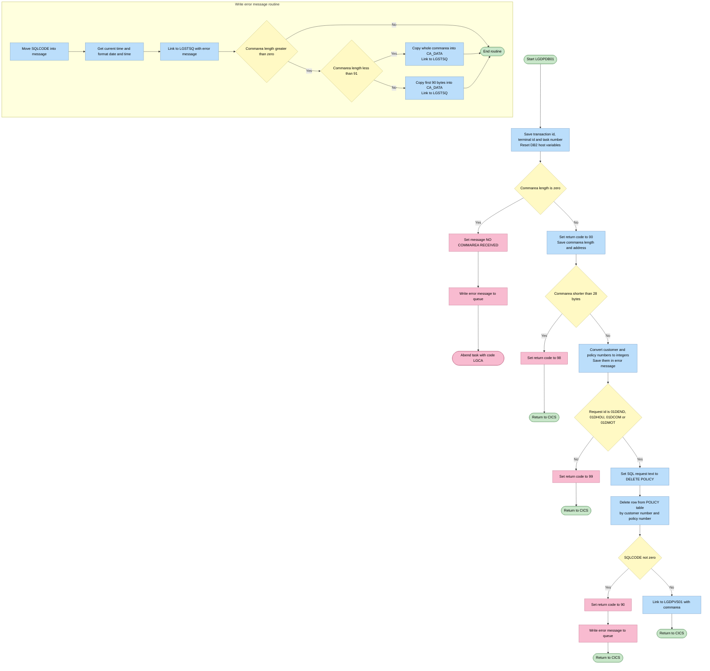
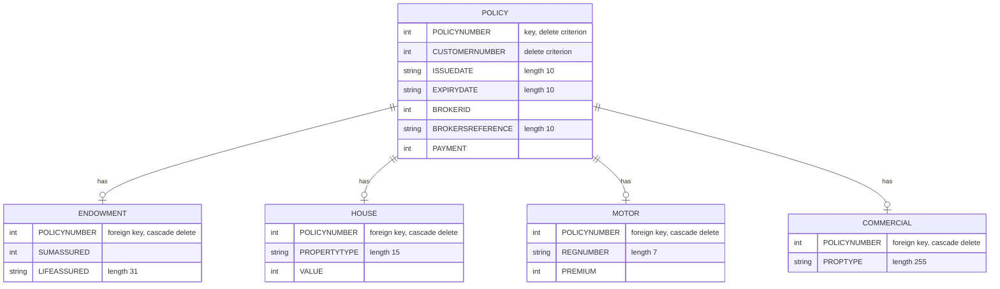

## Table of Contents

- [1. Purpose](#1-purpose)
- [2. Inputs](#2-inputs)
- [3. Outputs](#3-outputs)
  - [3.1 Communication Area (DFHCOMMAREA)](#31-communication-area-dfhcommarea)
  - [3.2 Relational Database Updates (DB2)](#32-relational-database-updates-db2)
  - [3.3 Program Linkage and Inter-Program Interfaces](#33-program-linkage-and-inter-program-interfaces)
  - [3.4 CICS System Side Effects](#34-cics-system-side-effects)
- [4. Processing Logic](#4-processing-logic)
  - [4.1 Mermaid Flow Diagram](#41-mermaid-flow-diagram)
  - [4.2 Processing Logic Description](#42-processing-logic-description)
  - [4.3 Database Tables](#43-database-tables)
- [5. Paragraphs](#5-paragraphs)
- [6. Dependencies](#6-dependencies)
- [7. Constraints](#7-constraints)
- [8. Error Handling](#8-error-handling)
  - [8.1 Input validation and precondition checks](#81-input-validation-and-precondition-checks)
  - [8.2 Database error handling](#82-database-error-handling)
  - [8.3 Error logging and notification](#83-error-logging-and-notification)
  - [8.4 Return code signalling to the caller](#84-return-code-signalling-to-the-caller)
  - [8.5 Gaps and limitations](#85-gaps-and-limitations)
- [9. Examples](#9-examples)
  - [9.1 Example 1: Successful Deletion of an Endowment Policy](#91-example-1-successful-deletion-of-an-endowment-policy)
  - [9.2 Example 2: Invalid Request Code Action](#92-example-2-invalid-request-code-action)
  - [9.3 Example 3: DB2 Error Encountered (e.g. Connection Error / SQL Error)](#93-example-3-db2-error-encountered-eg-connection-error--sql-error)
  - [9.4 Example 2: Invalid Request Code Action](#94-example-2-invalid-request-code-action)
  - [9.5 Example 3: Database Error Handling](#95-example-3-database-error-handling)

## 1. Purpose

LGDPDB01 is a CICS/Db2 PL/I program that deletes an insurance policy. It is part of a general insurance application. The caller passes a communication area with a customer number, a policy number, and a request code for an endowment, house, commercial, or motor delete. The program checks that the communication area is present and big enough. It then removes the matching row from the Db2 POLICY table. Foreign key relationships carry the delete through to the policy-type table. Once the delete succeeds, it links to a follow-on program, LGDPVS01, to continue processing the same request. It reports the outcome to the caller through a return code. That code covers success, a communication area that is too small, a Db2 failure, and an unrecognized request. Failures are logged with a timestamp, customer and policy numbers, the SQLCODE, and part of the communication area. These log entries are written through a shared logging program, LGSTSQ.

## 2. Inputs

**CICS Communication Area (COMMAREA)**

Passed to the program via `COMM_AREA_PTR` on entry through `EXEC CICS LINK` from the orchestrator `LGDPOL01`. The program validates its presence and minimum length before use.

- **`CA_REQUEST_ID`** — 6-character operation code that drives the main `SELECT` branch; recognised values are `'01DEND'` (Endowment), `'01DHOU'` (House), `'01DCOM'` (Commercial), and `'01DMOT'` (Motor). Any other value causes return code `'99'`.
- **`CA_CUSTOMER_NUM`** — 10-digit customer identifier; converted to a `FIXED BIN(31)` host variable (`DB2_CUSTOMERNUM_INT`) and used as the `CUSTOMERNUMBER` predicate in the `DELETE FROM POLICY` SQL statement.
- **`CA_POLICY_NUM`** — 10-digit policy identifier; converted to `DB2_POLICYNUM_INT` and used as the `POLICYNUMBER` predicate in the same `DELETE FROM POLICY` SQL statement.

  The following COMMAREA fields are passed through unchanged to `LGDPVS01` via `EXEC CICS LINK`. They are not read by this program but must be present in the COMMAREA for the downstream VSAM delete step:

  - **`CA_ISSUE_DATE`** — 10-character policy issue date.
  - **`CA_EXPIRY_DATE`** — 10-character policy expiry date.
  - **`CA_PAYMENT`** — 6-digit periodic premium/payment amount.
  - **`CA_BROKERID`** — 10-digit broker identifier.
  - **`CA_BROKERSREF`** — 10-character broker reference code.
  - **`CA_E_SUM_ASSURED`** — Endowment sum assured (used when `CA_REQUEST_ID` is `'01DEND'`).
  - **`CA_E_LIFE_ASSURED`** — 31-character name of the life assured under an endowment policy.
  - **`CA_H_VALUE`** — 8-digit insured valuation of a house property (used when `CA_REQUEST_ID` is `'01DHOU'`).
  - **`CA_H_PROPERTY_TYPE`** — 15-character residential property classification.
  - **`CA_M_PREMIUM`** — 6-digit motor insurance premium (used when `CA_REQUEST_ID` is `'01DMOT'`).
  - **`CA_M_REGNUMBER`** — 7-character vehicle registration number.
  - **`CA_B_PropType`** — 255-character commercial property type (used when `CA_REQUEST_ID` is `'01DCOM'`).

**Db2 Database**

- **`POLICY` table** — The program issues `DELETE FROM POLICY WHERE CUSTOMERNUMBER = :DB2_CUSTOMERNUM_INT AND POLICYNUMBER = :DB2_POLICYNUM_INT`. Due to foreign-key cascade rules defined in the schema, the delete propagates automatically to the corresponding child table (`ENDOWMENT`, `HOUSE`, `MOTOR`, or `COMMERCIAL`). The table content is therefore an implicit external input that determines whether the delete succeeds or returns `SQLCODE 100` (row not found).

**CICS Execution Environment**

- **`EIBCALEN`** — Length of the received COMMAREA, supplied by CICS in the Execute Interface Block. Used to detect a missing COMMAREA (`= 0`, triggers abend `LGCA`) and an undersized COMMAREA (`< 28`, sets return code `'98'`).
- **`EIBTRNID`** / **`EIBTRMID`** / **`EIBTASKN`** — Transaction ID, terminal ID, and task number from the EIB; copied into `WS_HEADER` fields for diagnostic identification in error messages.

## 3. Outputs

### 3.1 Communication Area (DFHCOMMAREA)
- `COMM_AREA`: The primary communication data structure returned to the calling program or passed downstream to linked programs (`LGDPVS01`), containing the processing status and policy request details.
  - `CA_RETURN_CODE`: A two-digit numeric status indicator set by the program to signal the outcome of the policy deletion request:
    - `00`: Success (policy deletion completed or forwarded).
    - `90`: Database error encountered during the DB2 delete operation.
    - `98`: Invalid communication area length (less than the minimum header length).
    - `99`: Unrecognized request identifier.
  - `CA_REQUEST_ID`: Identifies the policy deletion request type passed to the downstream program (`01DEND`, `01DHOU`, `01DCOM`, or `01DMOT`).
  - `CA_CUSTOMER_NUM`: The 10-digit customer number associated with the target policy record.
  - `CA_POLICY_NUM`: The 10-digit policy identifier targeted for deletion.

### 3.2 Relational Database Updates (DB2)
- `POLICY`: Target relational database table where policy records are deleted based on the customer number (`CUSTOMERNUMBER`) and policy number (`POLICYNUMBER`). Due to foreign key cascading constraints, deletion from this table propagates to the corresponding policy-specific detail tables (Endowment, House, Motor, or Commercial).

### 3.3 Program Linkage and Inter-Program Interfaces
- `LGDPVS01`: Target CICS program invoked via `EXEC CICS LINK` when a valid delete request is processed, receiving the full 32,500-byte `COMM_AREA` to perform downstream policy deletion tasks (such as VSAM record cleanup).
- `LGSTSQ`: Error-logging utility program invoked via `EXEC CICS LINK` to log error diagnostics to transient data queues when failures occur:
  - `ERROR_MSG`: Formatted error message structure passed to `LGSTSQ` containing the date (`EM_DATE`), time (`EM_TIME`), program identifier (`LGDPDB01`), customer number (`EM_CUSNUM`), policy number (`EM_POLNUM`), operation name (`EM_SQLREQ`), and DB2 return code (`EM_SQLRC`).
  - `CA_ERROR_MSG`: Error payload structure containing up to 90 bytes of the raw communication area data (`CA_DATA`) passed to `LGSTSQ` for diagnostic context.

### 3.4 CICS System Side Effects
- `EXEC CICS ABEND`: Abnormal termination issued with abend code `LGCA` (without a dump) if the program is invoked without an incoming communication area (`EIBCALEN = 0`).

## 4. Processing Logic

### 4.1 Mermaid Flow Diagram

### 4.2 Processing Logic Description

**High-level Summary**

LGDPDB01 is a reentrant CICS PL/I program in the insurance policy application. It deletes one policy row from the DB2 POLICY table. The row is identified by customer number and policy number. The delete is expected to cascade to the matching policy-type table (Endowment, House, Motor or Commercial) through foreign key definitions. The program validates the commarea and the request id first. After a successful delete it links to a second program, LGDPVS01, and then returns to the caller. It reports problems through a return code in the commarea and through error messages written to a queue.

**Execution Flow**

1. **Initialisation.** The program copies the transaction id (EIBTRNID), terminal id (EIBTRMID) and task number (EIBTASKN) into the WS_HEADER diagnostic fields. It also resets the DB2 host integer variables to 0.
2. **No commarea.** If EIBCALEN is 0, the program sets the message text to "NO COMMAREA RECEIVED" and calls WRITE_ERROR_MESSAGE. It then abends the task with code `LGCA` and no dump.
3. **Commarea present.** The program sets `CA_RETURN_CODE` to '00'. It stores the commarea length in WS_CALEN and the commarea address in WS_ADDR_DFHCOMMAREA.
4. **Length check.** The minimum commarea length is the 28-byte header (WS_CA_HEADER_LEN). If EIBCALEN is less than 28, the program sets the return code to '98' and returns to CICS. It writes no error message in this case.
5. **Key conversion.** `CA_CUSTOMER_NUM` and `CA_POLICY_NUM` are converted into the DB2 integer host variables DB2_CUSTOMERNUM_INT and DB2_POLICYNUM_INT. Both numbers are also stored in the error message fields EM_CUSNUM and EM_POLNUM, in case an error has to be reported.
6. **Request routing.** The program tests `CA_REQUEST_ID` with a SELECT/WHEN construct:
   - `01DEND` (Endowment), `01DHOU` (House), `01DCOM` (Commercial) and `01DMOT` (Motor) are the recognised delete requests. The program calls DELETE_POLICY_DB2_INFO and then links to `LGDPVS01`, passing the whole commarea with a length of 32500.
   - Any other value (OTHERWISE) sets the return code to '99' (unrecognised request).
7. **DELETE_POLICY_DB2_INFO.** The program sets EM_SQLREQ to " DELETE POLICY " and runs `DELETE FROM POLICY WHERE CUSTOMERNUMBER = :customer AND POLICYNUMBER = :policy`.
   - SQLCODE 0 (deleted) and SQLCODE 100 (not found) are both treated as success.
   - The code comment says both are treated as success, because the end result is that the record no longer exists. The actual test is `SQLCODE <> 0`, so a non-zero SQLCODE, including 100, takes the error path. Any such SQLCODE sets the return code to '90', calls WRITE_ERROR_MESSAGE and returns to CICS immediately. In this case LGDPVS01 is not called.
8. **Return.** After the SELECT, the program issues `EXEC CICS RETURN`. The return code in the commarea tells the caller what happened:

| Return code | Meaning |
|---|---|
| 00 | Success |
| 90 | DB2 error on delete |
| 98 | Commarea too short |
| 99 | Unrecognised request id |

9. **WRITE_ERROR_MESSAGE.**
   - It moves SQLCODE into EM_SQLRC and issues ASKTIME and FORMATTIME (MMDDYYYY date and time) to fill EM_DATE and EM_TIME.
   - It links to program `LGSTSQ` with the ERROR_MSG structure, which writes the message to the queue.
   - If EIBCALEN is greater than 0, it copies up to 90 bytes of the commarea into CA_DATA. This is the whole commarea when EIBCALEN is under 91, and the first 90 bytes otherwise. It then links to `LGSTSQ` again with CA_ERROR_MSG (prefix "COMMAREA="). Both branches use `LENGTH(STG(ERROR_MSG))` for the link length.

**Business Rules**

- Only the four request ids `01DEND`, `01DHOU`, `01DCOM` and `01DMOT` are accepted. All four run the same delete against the POLICY table.
- The delete is keyed on both customer number and policy number.
- Policy-type child rows are expected to be removed by database cascade, not by this program.
- The commarea must be at least 28 bytes long.
- The commarea fields in the request include `CA_CUSTOMER_NUM`, `CA_POLICY_NUM` and `CA_REQUEST_ID`. Policy detail fields such as `CA_ISSUE_DATE`, `CA_EXPIRY_DATE`, `CA_PAYMENT`, `CA_BROKERID` and `CA_BROKERSREF` are defined in the shared layout, but this program does not use them.

**External Interactions**

- **DB2 table POLICY.** A DELETE by CUSTOMERNUMBER and POLICYNUMBER. The delete cascades to the Endowment, House, Motor or Commercial child tables.
- **CICS LINK to LGDPVS01.** It is called after a successful delete, with the full 32500-byte commarea. Its purpose is not shown in this source. The name suggests a related follow-up step, such as VSAM handling.
- **CICS LINK to LGSTSQ.** It writes error messages and commarea contents to a queue (TDQ/TSQ).
- **CICS ASKTIME and FORMATTIME.** These supply the timestamps for error messages.
- **CICS ABEND `LGCA`.** It is issued when no commarea is received.
- **CICS RETURN.** It ends the transaction and returns control to the caller.

**Plain Language Summary**

The program receives a request to delete an insurance policy. It first checks that it was given enough information. It then checks that the request is one of the four known delete types: endowment, house, motor or commercial. If so, it removes the policy from the main policy table, and the database automatically removes the matching detail record. If the delete works, it calls another program to finish related work. If anything goes wrong, it sets a code in the shared data area so the caller knows the cause: 90 for a database problem, 98 for too little data and 99 for an unknown request. When a database error occurs, it also logs a time-stamped message with the customer number, policy number and database error code. If no data at all was passed, it logs the problem and stops the task abnormally.

### 4.3 Database Tables

## 5. Paragraphs

- **LGDPDB01 (main procedure, lines 10–256)**: Entry point of the CICS reentrant program, `Proc(DFHEIPTR, COMM_AREA_PTR) Options(Main,Reentrant)`. It deletes a policy row from the DB2 POLICY table. Foreign-key cascade also removes the matching Endowment, House, Motor or Commercial row.
  - **Declarations and setup**
    - It declares the working storage, the error message structures (`ERROR_MSG`, `CA_ERROR_MSG`), the DB2 host integers and the SQLCA.
    - It declares the `COMM_AREA` structure, which is based on `COMM_AREA_PTR`. The structure holds `CA_REQUEST_ID`, `CA_RETURN_CODE`, `CA_CUSTOMER_NUM`, `CA_POLICY_NUM` and the policy-specific data.
    - It copies the transaction ID, terminal ID and task number from the EIB (`EIBTRNID`, `EIBTRMID`, `EIBTASKN`) into the `WS_HEADER` fields.
    - It resets the DB2 host variables to 0.
  - **Commarea validation**
    - If `EIBCALEN = 0`, it sets `EM_MSG_TEXT` to "NO COMMAREA RECEIVED" and calls `WRITE_ERROR_MESSAGE`. It then issues `EXEC CICS ABEND ABCODE('LGCA') NODUMP`.
    - Otherwise it sets `CA_RETURN_CODE` to '00' and saves the commarea length and address in `WS_CALEN` and `WS_ADDR_DFHCOMMAREA`.
    - If `EIBCALEN` is less than the minimum header length (`WS_CA_HEADER_LEN` = 28), it sets `CA_RETURN_CODE` to '98' and issues `EXEC CICS RETURN`.
  - **Data preparation**
    - It converts `CA_CUSTOMER_NUM` and `CA_POLICY_NUM` into the DB2 integer host variables `DB2_CUSTOMERNUM_INT` and `DB2_POLICYNUM_INT`.
    - It also copies both numbers into `EM_CUSNUM` and `EM_POLNUM`, so they appear in any error message.
  - **Request dispatch**
    - A `SELECT (CA_REQUEST_ID)` statement handles the request codes.
    - For '01DEND', '01DHOU', '01DCOM' and '01DMOT' (the delete requests for Endowment, House, Commercial and Motor), it calls `DELETE_POLICY_DB2_INFO`. It then issues `EXEC CICS LINK PROGRAM('LGDPVS01')` with the commarea and a length of 32500.
    - For any other value (`OTHERWISE`), it sets `CA_RETURN_CODE` to '99'.
  - **Termination**: It issues `EXEC CICS RETURN` to give control back to the caller.
  - **External interactions**: CICS ABEND, RETURN and LINK to LGDPVS01. The DB2 work is done in the internal procedures below.

- **DELETE_POLICY_DB2_INFO (lines 263–280)**: Internal procedure that deletes the policy row from DB2.
  - It sets `EM_SQLREQ` to ' DELETE POLICY  ', so an error message identifies the failing request.
  - It runs `EXEC SQL DELETE FROM POLICY WHERE CUSTOMERNUMBER = :DB2_CUSTOMERNUM_INT AND POLICYNUMBER = :DB2_POLICYNUM_INT`.
  - **Control flow**
    - If `SQLCODE <> 0`, it sets `CA_RETURN_CODE` to '90' and calls `WRITE_ERROR_MESSAGE`. It then issues `EXEC CICS RETURN`, which ends the transaction without running the later LINK to LGDPVS01.
    - On success it returns to the caller, and the main flow continues to the LINK.
  - **External interactions**: DB2 DELETE on the POLICY table. The cascade to the policy-type tables comes from the foreign-key definitions. A CICS RETURN is issued on failure.
  - The in-code comment says SQLCODE 100 (row not found) should be treated as success, but the code only accepts SQLCODE 0. A SQLCODE of 100 therefore sets return code '90'.

- **WRITE_ERROR_MESSAGE (lines 287–320)**: Internal procedure that builds an error message and writes it to the error queue through the LGSTSQ program.
  - **Message preparation**
    - It copies `SQLCODE` into `EM_SQLRC`.
    - It issues `EXEC CICS ASKTIME ABSTIME(WS_ABSTIME)`.
    - It issues `EXEC CICS FORMATTIME` with `MMDDYYYY(WS_DATE)` and `TIME(WS_TIME)`.
    - It moves the formatted date and time to `EM_DATE` and `EM_TIME`.
  - **First write**: It issues `EXEC CICS LINK PROGRAM('LGSTSQ')` with `ERROR_MSG` as the commarea. The message holds the date, time, program name, customer number, policy number, SQL request and SQLCODE.
  - **Commarea dump (conditional)**
    - If `EIBCALEN > 0`, it also writes the commarea contents.
    - If `EIBCALEN < 91`, `CA_DATA` gets the whole commarea, left-justified with `LEFT(COMM_AREA_RAW, EIBCALEN)`. It then links to LGSTSQ with `CA_ERROR_MSG`.
    - Otherwise, `CA_DATA` gets the first 90 bytes with `LEFT(COMM_AREA_RAW, 90)`, and it links to LGSTSQ again.
    - Both LINK calls specify `LENGTH(STG(ERROR_MSG))` rather than the length of `CA_ERROR_MSG`.
  - It ends with `RETURN`.
  - **External interactions**: CICS ASKTIME, FORMATTIME and LINK to LGSTSQ, which writes to the queue.

## 6. Dependencies

- **Runtime and transaction environment**
  - CICS transaction runtime
    - The program is `Options(Main,Reentrant)` and runs as a CICS program. It needs the CICS execution interface (`DFHEIPTR`) as its first parameter.
    - It reads the EIB fields `EIBTRNID`, `EIBTRMID`, `EIBTASKN` and `EIBCALEN`. These supply the transaction ID, terminal ID, task number and commarea length. They are used for diagnostics and for commarea validation.
    - It issues `EXEC CICS RETURN` to hand control back to the caller. It issues `EXEC CICS ABEND ABCODE('LGCA') NODUMP` when no commarea is received.
  - DB2 precompiler and runtime
    - The program embeds SQL, so it needs the DB2 precompiler and the CICS-DB2 attachment at run time.
    - `EXEC SQL INCLUDE SQLCA` supplies the SQL communication area. The program reads `SQLCODE` from it to check the result of the delete.

- **Input parameters and data sources**
  - CICS commarea passed by the caller
    - `COMM_AREA_PTR` is the second parameter of the main procedure. It points to the `COMM_AREA` structure, which is based on that pointer.
    - The commarea must be at least 28 bytes (`WS_CA_HEADER_LEN`). If it is shorter, the program sets `CA_RETURN_CODE` to '98' and returns.
    - The commarea must be present (`EIBCALEN` not 0). Otherwise the program writes an error message and abends with `LGCA`.
  - Commarea fields read as input
    - `CA_REQUEST_ID` selects the operation. The accepted values are '01DEND' (Endowment), '01DHOU' (House), '01DCOM' (Commercial) and '01DMOT' (Motor). Any other value sets `CA_RETURN_CODE` to '99'.
    - `CA_CUSTOMER_NUM` is the 10-digit customer number. It is moved to the DB2 host variable `DB2_CUSTOMERNUM_INT` and also into the error message.
    - `CA_POLICY_NUM` is the 10-digit policy number. It is moved to the DB2 host variable `DB2_POLICYNUM_INT` and also into the error message.
  - Other commarea fields
    - These are defined in the commarea layout but not used by this program's logic:
      - Common policy fields: `CA_ISSUE_DATE`, `CA_EXPIRY_DATE`, `CA_PAYMENT`, `CA_BROKERID`, `CA_BROKERSREF`
      - Endowment fields: `CA_E_SUM_ASSURED`, `CA_E_LIFE_ASSURED`
      - House fields: `CA_H_VALUE`, `CA_H_PROPERTY_TYPE`
      - Motor fields: `CA_M_PREMIUM`, `CA_M_REGNUMBER`
      - Commercial field: `CA_B_PROPTYPE`
    - They are part of the shared commarea layout that other policy functions use.
  - Commarea field written as output
    - `CA_RETURN_CODE` is the status returned to the caller. '00' means success, '90' means a DB2 error, '98' means the commarea is too small, and '99' means the request ID is not recognised.

- **Data stores (DB2)**
  - DB2 table `POLICY`
    - The program issues `DELETE FROM POLICY WHERE CUSTOMERNUMBER = :DB2_CUSTOMERNUM_INT AND POLICYNUMBER = :DB2_POLICYNUM_INT`.
    - The comments say the delete cascades through foreign key definitions to the policy-type tables: Endowment, House, Motor and Commercial. Those tables are therefore indirect dependencies, and the cascade must be defined in the database.
  - DB2 host variables
    - `DB2_CUSTOMERNUM_INT` and `DB2_POLICYNUM_INT` are `FIXED BIN(31)` fields. They must be declared in the program so the SQL precompiler can resolve them.

- **External programs and modules (CICS LINK targets)**
  - `LGDPVS01`
    - The program links to it after a successful `POLICY` delete. It passes the whole commarea (`COMM_AREA`) with a length of 32500 bytes.
    - It is probably the VSAM-side delete or follow-on delete program.
    - The data name `LGDPVS1` (`CHAR(8)`, value 'LGDPVS1') is declared in the program but is not used in any command.
  - `LGSTSQ`
    - The error-logging program is called in `WRITE_ERROR_MESSAGE`.
    - It writes the formatted `ERROR_MSG` structure to queues. The program comments describe this as writing to TDQ.
    - It is linked up to two more times to log the first 90 bytes, or fewer, of the commarea (`CA_ERROR_MSG`).

- **CICS services used**
  - `EXEC CICS ASKTIME ABSTIME`
    - It gets the current absolute time.
  - `EXEC CICS FORMATTIME`
    - It formats the absolute time as an `MMDDYYYY` date and a time. The results go into the error message's date and time fields.
  - `EXEC CICS LINK`
    - Used to call `LGDPVS01` and `LGSTSQ`.
  - `EXEC CICS ABEND` and `EXEC CICS RETURN`
    - They end the task abnormally or return control to the caller.

- **Copybooks and include files**
  - `SQLCA`
    - It is included through `EXEC SQL INCLUDE`.
  - `LGCMAREA` (`plinc/LGCMAREA.inc`)
    - The `INCLUDE` statement is commented out, but its content is expanded inline.
    - It defines the common commarea structure `COMM_AREA`, with `CA_REQUEST_ID`, `CA_RETURN_CODE`, `CA_CUSTOMER_NUM`, `CA_POLICY_NUM` and the policy-type-specific layouts for Endowment, House, Motor, Commercial and Claim.

- **Configuration and environment values**
  - Constants and literals coded in the program:
    - Program names 'LGDPVS01' and 'LGSTSQ'
    - Abend code 'LGCA'
    - Minimum commarea length of 28 (`WS_CA_HEADER_LEN`)
    - Link length of 32500
    - Request codes '01DEND', '01DHOU', '01DCOM' and '01DMOT'
  - The queue names that `LGSTSQ` writes to are not defined in this program. They are defined in `LGSTSQ` and in the CICS resource definitions.
  - The program uses no files, environment variables or external parameter files.

## 7. Constraints

- **Communication area presence and size**
  - A commarea must be supplied.
    - `EIBCALEN = 0` writes the error message "NO COMMAREA RECEIVED" through `WRITE_ERROR_MESSAGE`.
    - The program then issues `EXEC CICS ABEND ABCODE('LGCA') NODUMP`, so processing stops with no dump.
  - The commarea must be at least `WS_CA_HEADER_LEN` (28) bytes long.
    - If `EIBCALEN < 28`, the program sets `CA_RETURN_CODE` to '98' and issues `EXEC CICS RETURN`.
    - It does no database work or request validation in that case.
  - The commarea is declared as a 32,500-byte area (`COMM_AREA_RAW`).
    - The `LINK` to `LGDPVS01` passes `COMM_AREA` with `LENGTH(32500)`. This fixes the size of the data handed to the downstream program.
  - The code comments say the minimum-length calculation does not allow for the VARCHAR in the Endowment policy.
    - Only the common header length is checked. No policy-type-specific minimum length is enforced.

- **Request identification and allowed operations**
  - Only four request IDs are accepted in `CA_REQUEST_ID`, a 6-character field: '01DEND' (Endowment), '01DHOU' (House), '01DCOM' (Commercial) and '01DMOT' (Motor).
    - A `SELECT`/`WHEN` block enforces this.
    - Any other value goes to `OTHERWISE`, which sets `CA_RETURN_CODE` to '99' (unrecognised request).
    - No deletion is attempted for an unrecognised request.
  - The program only supports deletion.
    - Inquiry, add and update request IDs are rejected through the '99' path, even though the shared commarea layout covers them.

- **Data format and type constraints**
  - `CA_CUSTOMER_NUM` and `CA_POLICY_NUM` are declared `PIC '9999999999'`, so each is a 10-digit numeric value.
  - Both numbers are converted to `FIXED BIN(31)` host variables (`DB2_CUSTOMERNUM_INT`, `DB2_POLICYNUM_INT`) before being used in SQL.
    - The program does not explicitly check that the picture fields hold valid numerics before the conversion.
  - `CA_RETURN_CODE` is `PIC '99'`, so it is limited to a two-digit numeric code.
  - Other commarea fields in scope are fixed-width.
    - Character fields: `CA_ISSUE_DATE` and `CA_EXPIRY_DATE` (10 characters each), `CA_BROKERSREF` (10), `CA_E_LIFE_ASSURED` (31), `CA_H_PROPERTY_TYPE` (15), `CA_M_REGNUMBER` (7) and `CA_B_PROPTYPE` (255).
    - Numeric picture fields: `CA_BROKERID` (10 digits), `CA_PAYMENT` (6), `CA_E_SUM_ASSURED` (6), `CA_H_VALUE` (8) and `CA_M_PREMIUM` (6).
    - This program neither validates nor uses these fields. They exist only as part of the shared layout, and the program does not check them.
  - The policy-type-specific areas (Endowment, House, Motor, Commercial, Claim) overlay one another in a `UNION` over `CA_POLICY_SPECIFIC`.
    - Only one interpretation of that area is valid at a time.

- **Delete processing rules**
  - Both the customer number and the policy number must match.
    - The SQL `DELETE FROM POLICY` uses `CUSTOMERNUMBER = :DB2_CUSTOMERNUM_INT AND POLICYNUMBER = :DB2_POLICYNUM_INT`.
    - A policy can therefore be deleted only under the customer who owns it.
  - Deletion cascades through foreign keys.
    - The program deletes only from the `POLICY` table.
    - Per the code comments, the foreign key definitions propagate the delete to the Endowment, House, Motor or Commercial table. The program does not delete from those tables itself.
  - The SQL result is checked after the delete.
    - The code comment says SQLCODE 0 and SQLCODE 100 (row not found) should be treated as successful, because the end result is that the record does not exist.
    - The code itself tests `SQLCODE <> 0`. That means an SQLCODE of 100 would also take the error path, which contradicts the comment.
    - On any non-zero SQLCODE, the program sets `CA_RETURN_CODE` to '90', writes an error message and issues `EXEC CICS RETURN`.
    - The call to `LGDPVS01` is skipped on that path.

- **Sequencing constraints**
  - The program runs its checks in a fixed order.
    - It first sets the transaction, terminal and task identifiers.
    - It resets the DB2 host variables to 0.
    - It checks that a commarea is present (`EIBCALEN = 0`).
    - It sets `CA_RETURN_CODE` to '00'.
    - It checks the minimum commarea length.
    - It converts and saves the customer and policy numbers.
    - It validates the request ID.
  - The DB2 delete must succeed before the VSAM-side deletion starts.
    - `DELETE_POLICY_DB2_INFO` runs first.
    - The program then issues `EXEC CICS LINK PROGRAM('LGDPVS01')`, which is the follow-on delete step. The program name suggests VSAM, but the code does not confirm that.
    - The `RETURN` inside the DB2 error handling prevents the link when the delete fails.
  - The return code is set to '00' only after the commarea has been shown to exist.
    - The 'no commarea' abend path leaves it untouched, because the code cannot safely address the commarea.
  - Customer and policy numbers are saved in the error message fields before any processing.
    - This makes sure later error messages (`EM_CUSNUM`, `EM_POLNUM`) carry the right keys.
  - The error message is written before the abend.
    - On the no-commarea path, `WRITE_ERROR_MESSAGE` runs before `EXEC CICS ABEND`.

- **Return code protocol**
  - The program reports status to the caller through `CA_RETURN_CODE`.
    - '00' means success or initial state.
    - '90' means a DB2 delete failure.
    - '98' means the commarea is too small.
    - '99' means the request ID was not recognised.
    - The abend code 'LGCA' is used when no commarea is passed.
  - The return code '00' is set before the later checks. It is not set again after the `LINK` to `LGDPVS01`, so any change made by that program is passed back to the caller.

- **Logging and diagnostics**
  - Errors are logged to a queue by linking to the program `LGSTSQ`, which writes to a TDQ.
    - The message includes the date, time, program name, customer number, policy number, SQL request text and SQLCODE.
    - The date and time come from `ASKTIME` and `FORMATTIME`.
    - The date is in MMDDYYYY format.
  - A second message contains the commarea contents.
    - This message is limited to 90 bytes (`CA_DATA` is `CHAR(90)`).
    - If `EIBCALEN < 91`, only the `EIBCALEN` bytes received are copied, left-justified.
    - Otherwise, the first 90 bytes are copied.
    - The code passes `LENGTH(STG(ERROR_MSG))`, the length of `ERROR_MSG`, on the commarea link instead of the length of `CA_ERROR_MSG`. This is an implementation inconsistency.
  - The `EM_MSG_TEXT` field is `CHAR(63)`, so message text is limited to 63 characters.
    - It shares storage with the CNUM/PNUM/SQL detail fields through a `UNION`.
    - The text message and the key/SQL detail layout cannot both appear in the same message.
  - `EM_SQLRC` is `PIC '+(5)9'`, so the SQLCODE is shown with a sign and at most six positions.

- **Execution environment constraints**
  - The program is a main, reentrant CICS program (`Options(Main,Reentrant)`) that gets the CICS interface block pointer (`DFHEIPTR`) and the commarea pointer (`COMM_AREA_PTR`).
    - It must run under CICS with DB2 access.
    - It has no state that persists between invocations, apart from the commarea.
  - The CICS-related programs it depends on (`LGDPVS01` and `LGSTSQ`) must be available.
    - The program name `LGDPVS1` is also defined in working storage but is not used.

## 8. Error Handling

### 8.1 Input validation and precondition checks

- Missing COMMAREA check
  - The program tests whether the CICS-supplied COMMAREA length is zero.
  - If it is, the program sets the error message text to "NO COMMAREA RECEIVED" and calls the internal error-writing procedure.
  - It then abends the task with abend code `LGCA` and suppresses the dump.
  - This is the only abnormal termination in the program. All other failures use return codes.
- COMMAREA length check
  - After the return code is set to '00', the program checks that the COMMAREA is at least as long as the 28-byte header.
  - If it is shorter, the return code is set to '98' (COMMAREA too short).
  - The program then issues an immediate CICS RETURN, so no database work is done.
- Request identifier validation
  - A SELECT on the request ID accepts only the delete codes `01DEND`, `01DHOU`, `01DCOM` and `01DMOT`.
  - Any other value goes to the OTHERWISE branch. That branch sets the return code to '99' and skips the delete and the link to the VSAM program.
  - The program then falls through to the normal CICS RETURN, so the caller sees the '99' in the COMMAREA.

### 8.2 Database error handling

- SQLCODE check after DELETE
  - The procedure that deletes from the POLICY table sets a request description for the error message before running the SQL.
  - The description is " DELETE POLICY  ".
  - After the DELETE, it tests whether SQLCODE is non-zero.
  - Any non-zero SQLCODE sets the return code to '90', calls the error-writing procedure and returns to CICS immediately.
  - The delete is keyed on both customer number and policy number.
- Handling of "row not found"
  - A comment says SQLCODE 0 and SQLCODE 100 should both count as success, because the end result is that the record does not exist.
  - The code does not do this. It treats every non-zero SQLCODE, including +100, as an error.
  - A delete that finds no matching row therefore returns code '90' and writes an error message.
- Context captured for diagnostics
  - The customer number and policy number are converted to DB2 integer host variables.
  - Before the request is processed, they are also saved in the error message structure.
  - If a failure occurs, the log entry identifies the affected customer and policy.

### 8.3 Error logging and notification

- Error message structure
  - A structured message holds the date, time, program name (LGDPDB01), a free-text message or a diagnostic layout, and the SQLCODE.
  - The diagnostic layout shows customer number, policy number, SQL request description and SQLCODE.
  - The free-text message and the diagnostic layout share storage through a union.
- Error-writing procedure
  - It copies the SQLCODE into the message.
  - It gets the current time with ASKTIME and formats it with FORMATTIME into date (MMDDYYYY) and time fields.
  - It then links to the shared logging program `LGSTSQ`, passing the error message.
  - `LGSTSQ` writes to the CICS queues.
- COMMAREA content logging
  - After logging the error message, the procedure also logs the COMMAREA contents.
  - It does this only when the COMMAREA length is greater than zero.
  - If the COMMAREA is shorter than 91 bytes, it logs only the bytes received, left-justified in the 90-byte data field.
  - Otherwise it logs the first 90 bytes.
  - Both cases link to `LGSTSQ` with a second message that carries the "COMMAREA=" prefix.
  - In both cases the link length is taken from the main error message structure rather than the COMMAREA message structure. This is a possible length mismatch.

### 8.4 Return code signalling to the caller

- Return codes are written to the COMMAREA return code field. The caller inspects them, because the program does not raise exceptions for business or database errors.
  - '00' means success. It is set after the COMMAREA presence check.
  - '90' means the DB2 DELETE failed.
  - '98' means the COMMAREA is too short.
  - '99' means the request ID is not recognised.
- After each error return code is set, the program leaves through CICS RETURN, either directly or by falling through to the final RETURN.
  - This ends the task and hands control back to the caller.

### 8.5 Gaps and limitations

- Unchecked RESP values
  - The program does not check RESP or RESP2 on any CICS command. These commands are ASKTIME, FORMATTIME, LINK to `LGSTSQ` and LINK to `LGDPVS01`.
  - It has no HANDLE CONDITION or HANDLE ABEND logic.
  - It has no PL/I ON-unit handling for conditions such as ERROR or ENDFILE.
- No check after the VSAM link
  - After linking to `LGDPVS01` for the VSAM-side delete, the program does not examine a return code or any response.
  - A failure in that program would pass through unnoticed unless the called program reports it in the COMMAREA.
  - The CICS RETURN that follows does not change the return code.
- Link ordering
  - The DB2 delete runs first. Only if it succeeds does control reach the link to `LGDPVS01`.
  - A failed DB2 delete returns immediately from within the delete procedure. The VSAM step is skipped, so there is no partial delete.
- No retry or fallback
  - The program has no retry logic, no default values and no alternative path for any failure.
  - Each failure goes straight to a return code, a log entry and a return to the caller.

## 9. Examples

The code has been successfully read and analysed. 

Let's review the behavior of `LGDPDB01.pli`:
- Purpose: Delete a policy from DB2 and VSAM.
- It receives a CICS COMMAREA structure.
- It validates the input length (`EIBCALEN` must not be 0, and must be at least `WS_CA_HEADER_LEN` which is 28). If `EIBCALEN` is 0, it abends with `LGCA`. If `< 28`, it returns `98`.
- It initializes `CA_RETURN_CODE = '00'`.
- It converts `CA_CUSTOMER_NUM` and `CA_POLICY_NUM` to DB2 integer variables `DB2_CUSTOMERNUM_INT` and `DB2_POLICYNUM_INT`.
- It checks `CA_REQUEST_ID`:
  - If it is `'01DEND'` (Delete Endowment), `'01DHOU'` (Delete House), `'01DCOM'` (Delete Commercial), or `'01DMOT'` (Delete Motor):
    - It calls `DELETE_POLICY_DB2_INFO` to perform a SQL delete statement on the `POLICY` table.
      - `DELETE FROM POLICY WHERE CUSTOMERNUMBER = :DB2_CUSTOMERNUM_INT AND POLICYNUMBER = :DB2_POLICYNUM_INT`.
      - Note: Due to DB2 foreign key constraints (ON DELETE CASCADE), deleting the row in `POLICY` will automatically delete the related row in the specific policy table (`ENDOWMENT`, `HOUSE`, `MOTOR`, or `COMMERCIAL`).
      - If SQLCODE is 0 or 100 (which are both treated as successful, meaning the record is gone/does not exist), it completes successfully.
      - If SQLCODE is anything else, it sets `CA_RETURN_CODE = '90'`, writes an error message to the queues via `LGSTSQ` (calling `WRITE_ERROR_MESSAGE`), and returns to the caller.
    - If DB2 delete is successful, it calls `EXEC CICS LINK PROGRAM('LGDPVS01') Commarea(COMM_AREA) LENGTH(32500);` to delete the policy information from VSAM storage as well.
  - If it is any other request ID, it sets `CA_RETURN_CODE = '99'` and returns.

Let's formulate the representative usage examples.

### 9.1 Example 1: Successful Deletion of an Endowment Policy
**Scenario:**
A client requests to delete an existing endowment policy for customer number `12345` with policy number `987654321`. The input is valid, and the record exists in the DB2 `POLICY` table.

- **Input:**
  - `CA_REQUEST_ID`: `'01DEND'`
  - `CA_CUSTOMER_NUM`: `0000012345`
  - `CA_POLICY_NUM`: `0000987654` (represented as 10-digit PIC '9999999999')
  - `EIBCALEN`: `32500`
  - DB2 State: A row exists in `POLICY` with `CUSTOMERNUMBER = 12345` and `POLICYNUMBER = 987654`.

- **Output:**
  - `CA_RETURN_CODE`: `'00'`
  - DB2 State: The row is successfully deleted from the `POLICY` table. Due to foreign key cascades, the matching row in `ENDOWMENT` is also deleted.
  - Program Flow: The program invokes `DELETE_POLICY_DB2_INFO` (which returns SQLCODE `0` or `100`), and then issues an `EXEC CICS LINK` to `LGDPVS01` to complete the VSAM deletion. Finally, it returns control with code `'00'`.

### 9.2 Example 2: Invalid Request Code Action
**Scenario:**
An external application passes a delete request with an unrecognized request ID (e.g., `'01DXYZ'`).

- **Input:**
  - `CA_REQUEST_ID`: `'01DXYZ'`
  - `CA_CUSTOMER_NUM`: `0000012345`
  - `CA_POLICY_NUM`: `0000987654`
  - `EIBCALEN`: `32500`

- **Output:**
  - `CA_RETURN_CODE`: `'99'`
  - DB2/VSAM State: Unchanged. No database action is performed.
  - Program Flow: The `SELECT ( CA_REQUEST_ID )` statement evaluates the input and matches the `OTHERWISE` block because `'01DXYZ'` does not match `'01DEND'`, `'01DHOU'`, `'01DCOM'`, or `'01DMOT'`. It sets the return code to `'99'` and terminates without calling DB2 or VSAM delete logic.

### 9.3 Example 3: DB2 Error Encountered (e.g. Connection Error / SQL Error)
**Scenario:**
A request to delete a motor policy is received, but a database failure occurs during the DB2 delete statement execution, returning a negative SQLCODE (e.g., `-911` for deadlock).

- **Input:**
  - `CA_REQUEST_ID`: `'01DMOT'`
  - `CA_CUSTOMER_NUM`: `0000012345`
  - `CA_POLICY_NUM`: `0000987654`
  - `EIBCALEN`: `32500`
  - DB2 State: DB2 engine returns SQLCODE `-911` upon executing the query.

- **Output:**
  - `CA_RETURN_CODE`: `'90'`
  - Logged Data: A diagnostic log message containing the failing SQLCODE is routed to the queue utility `LGSTSQ` via the internal `WRITE_ERROR_MESSAGE` routine.
  - Program Flow: The program executes the `DELETE` statement, which fails with `SQLCODE <> 0` and `SQLCODE <> 100`. The code sets `CA_RETURN_CODE = '90'`, calls `WRITE_ERROR_MESSAGE`, and returns immediately to CICS. `LGDPVS01` is not linked.

I will write down these examples in a structured, direct, and clear manner, conforming strictly to the requested instructions. No top-level markdown heading, direct to the body. No introductory or transition text. Let's write.### Example 1: Successful Deletion of an Endowment Policy

*   **Sample Input Data:**
    *   `CA_REQUEST_ID`: `"01DEND"`
    *   `CA_CUSTOMER_NUM`: `0000012345`
    *   `CA_POLICY_NUM`: `0000987654`
    *   `EIBCALEN`: `32500`
    *   **DB2 Database State:** A row with `CUSTOMERNUMBER = 12345` and `POLICYNUMBER = 987654` exists in the `POLICY` table.

*   **Expected Output:**
    *   `CA_RETURN_CODE`: `"00"`
    *   **DB2 Database State:** The target row in the `POLICY` table is deleted. Corresponding records in the `ENDOWMENT` table are automatically removed via database cascade delete constraints.
    *   **External Program Links:** The CICS program links to `LGDPVS01` to remove the matching policy record from VSAM.

*   **Explanation:**
    *   The program validates the COMMAREA length against `WS_CA_HEADER_LEN` (28 bytes).
    *   The request code `"01DEND"` is matched in the `SELECT` statement, routing execution to `DELETE_POLICY_DB2_INFO`.
    *   The database `DELETE` statement executes successfully, returning `SQLCODE = 0`. Since this is a valid success code, the program proceeds to link to `LGDPVS01` to delete the VSAM counterpart.
    *   Control returns to the caller with `CA_RETURN_CODE = "00"`.

---

### 9.4 Example 2: Invalid Request Code Action

*   **Sample Input Data:**
    *   `CA_REQUEST_ID`: `"01DXYZ"`
    *   `CA_CUSTOMER_NUM`: `0000012345`
    *   `CA_POLICY_NUM`: `0000987654`
    *   `EIBCALEN`: `32500`

*   **Expected Output:**
    *   `CA_RETURN_CODE`: `"99"`
    *   **DB2 Database State:** Unchanged; no SQL delete statement is executed.

*   **Explanation:**
    *   The COMMAREA length check passes.
    *   The `SELECT ( CA_REQUEST_ID )` statement checks the input value `"01DXYZ"`. Because it does not match any expected transaction identifiers (`"01DEND"`, `"01DHOU"`, `"01DCOM"`, or `"01DMOT"`), the program falls into the `OTHERWISE` clause.
    *   The return code is set to `"99"` and the program issues an `EXEC CICS RETURN` without attempting database or VSAM operations.

---

### 9.5 Example 3: Database Error Handling

*   **Sample Input Data:**
    *   `CA_REQUEST_ID`: `"01DMOT"`
    *   `CA_CUSTOMER_NUM`: `0000012345`
    *   `CA_POLICY_NUM`: `0000987654`
    *   `EIBCALEN`: `32500`
    *   **DB2 Database State:** The database returns a transient error code (e.g., deadlocked transaction, `SQLCODE = -911`).

*   **Expected Output:**
    *   `CA_RETURN_CODE`: `"90"`
    *   **Error Logs:** A formatted error queue record is written to the `LGSTSQ` program indicating `SQLCODE = -911` for `DELETE POLICY`.
    *   **External Program Links:** `LGDPVS01` is not linked.

*   **Explanation:**
    *   The request code `"01DMOT"` triggers `DELETE_POLICY_DB2_INFO`.
    *   The `DELETE` statement is executed, but the database returns an error code (`SQLCODE = -911`).
    *   Because `SQLCODE` is neither `0` nor `100` (not found), the program sets `CA_RETURN_CODE` to `"90"` and triggers `WRITE_ERROR_MESSAGE`.
    *   `WRITE_ERROR_MESSAGE` grabs the current time and date, logs the details to a transient data queue via `LGSTSQ`, and immediately exits via `EXEC CICS RETURN`.

---

Generated by IBM Bob Premium Package for Z
