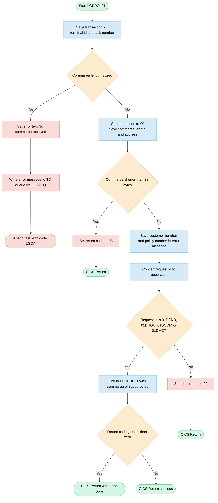
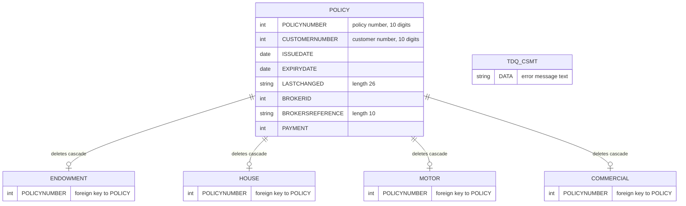

## Table of Contents

- [1. Purpose](#1-purpose)
- [2. Inputs](#2-inputs)
- [3. Outputs](#3-outputs)
- [4. Processing Logic](#4-processing-logic)
  - [4.1 Mermaid Flow Diagram](#41-mermaid-flow-diagram)
  - [4.2 Processing Logic Description](#42-processing-logic-description)
  - [4.3 Database Tables (if applicable)](#43-database-tables-if-applicable)
- [5. Paragraphs](#5-paragraphs)
- [6. Dependencies](#6-dependencies)
- [7. Constraints](#7-constraints)
- [8. Error Handling](#8-error-handling)
  - [8.1 Input validation and commarea checks](#81-input-validation-and-commarea-checks)
  - [8.2 Return code propagation](#82-return-code-propagation)
  - [8.3 Delegation of database error handling](#83-delegation-of-database-error-handling)
  - [8.4 Error logging and notification](#84-error-logging-and-notification)
  - [8.5 Program termination and flow control](#85-program-termination-and-flow-control)
- [9. Examples](#9-examples)
  - [9.1 Example 1: Successful motor policy delete](#91-example-1-successful-motor-policy-delete)
  - [9.2 Example 2: Lowercase request ID is normalised](#92-example-2-lowercase-request-id-is-normalised)
  - [9.3 Example 3: Unrecognised request ID](#93-example-3-unrecognised-request-id)
  - [9.4 Example 4: COMMAREA too short](#94-example-4-commarea-too-short)
  - [9.5 Example 5: No COMMAREA supplied](#95-example-5-no-commarea-supplied)
  - [9.6 Example 6: Downstream DB2 failure](#96-example-6-downstream-db2-failure)

## 1. Purpose

LGDPOL01 is a CICS PL/I program that acts as the front-end dispatcher for deleting an insurance policy record from the General Insurance application. Running under CICS, it receives a communication area carrying a customer number, a policy number, and a request identifier, validates that the commarea is present and of sufficient length, then inspects the request identifier to determine which policy type is being deleted — Endowment (`01DEND`), House (`01DHOU`), Commercial (`01DCOM`), or Motor (`01DMOT`). For any recognised request type it delegates the actual DB2 deletion to the sub-program `LGDPDB01` via a CICS LINK, passing the full commarea; DB2 foreign-key constraints ensure the corresponding type-specific table row (Endowment, House, Motor, or Commercial) is removed alongside the master Policy row. Unrecognised request identifiers result in return code `99`, an undersized commarea returns `98`, and a missing commarea triggers a CICS ABEND. Any error condition is written to a transient data queue through a shared logging sub-program before control is returned to the caller.

## 2. Inputs

- **Program parameter (CICS communication area)**
  - COMM_AREA_PTR: pointer to the communication area that the calling program or transaction passes in. All business inputs below are read from this area. The program abends with code LGCA if no communication area is received (EIBCALEN = 0).
  - The communication area must be at least 28 bytes long (the header length). If it is shorter, the program sets the return code to 98 and returns.

- **Request control fields (communication area header)**
  - CA_REQUEST_ID: 6-character request code. The program uppercases it and uses it to choose the processing path. Valid values are 01DEND, 01DHOU, 01DCOM and 01DMOT. Any other value sets the return code to 99.
  - CA_CUSTOMER_NUM: 10-digit customer number. It is copied into the error message for diagnostics and is passed on to the delete program.
  - CA_RETURN_CODE: 2-digit return code. The program resets it to '00' on entry. The downstream delete program can also set it, and a value above 0 triggers an early return.

- **Policy identification (policy request section of the communication area)**
  - CA_POLICY_NUM: 10-digit policy number. It identifies the policy row to delete and is copied into the error message.
  - Common policy details passed through to the delete program (the program does not use them in its own logic):
    - CA_ISSUE_DATE
    - CA_EXPIRY_DATE
    - CA_LASTCHANGED
    - CA_BROKERID
    - CA_BROKERSREF
    - CA_PAYMENT

- **Customer request section (passed through, not used in this program's logic)**
  - CA_FIRST_NAME and CA_LAST_NAME: customer name fields.
  - CA_NUM_POLICIES: count of the customer's policies.
  - CA_POLICY_DATA: raw policy payload buffer.
  - These fields share storage with the other request-specific areas, so they are carried in the full 32500-byte communication area that the program forwards.

- **CICS runtime context (EIB fields)**
  - EIBCALEN: length of the received communication area. It is used for the validation checks and to decide how much of the area to write to the error log.
  - EIBTRNID, EIBTRMID and EIBTASKN: transaction ID, terminal ID and task number. They are saved in the working header for diagnostics.

- **External programs and services the program calls**
  - LGDPDB01: DB2 delete program, called by CICS LINK with the full communication area. It deletes the policy row and the related Endowment, House, Motor or Commercial row.
  - LGSTSQ: error logging program, called by CICS LINK. It writes error messages and up to 90 bytes of the communication area to the CSMT transient data queue.
  - CICS system time services (ASKTIME and FORMATTIME): supply the current date and time for error messages.

## 3. Outputs

- **Commarea return status (returned to caller)**
  - CA_RETURN_CODE
    - Main status output returned to the caller in the commarea.
    - Set to '00' at the start to show success.
    - Set to '98' when EIBCALEN is less than the 28-byte header length. The program then returns immediately.
    - Set to '99' when CA_REQUEST_ID is not one of 01DEND, 01DHOU, 01DCOM or 01DMOT.
    - A non-zero value set by LGDPDB01 (the DB2 delete program) causes an immediate CICS RETURN with that code.

- **Commarea request fields (returned to the caller)**
  - CA_REQUEST_ID
    - Overwritten with its uppercased value before dispatch.
    - The uppercased value is passed to the delete routine and returned to the caller.
  - CA_CUSTOMER_NUM and CA_POLICY_NUM
    - Identify the customer and policy for the delete.
    - Passed unchanged to LGDPDB01 and returned in the commarea.
    - Also copied into EM_CUSNUM and EM_POLNUM for error diagnostics.
  - Policy details (CA_ISSUE_DATE, CA_EXPIRY_DATE, CA_LASTCHANGED, CA_BROKERID, CA_BROKERSREF, CA_PAYMENT)
    - Passed in the 32500-byte commarea to LGDPDB01.
    - Not modified by this program.
    - Can be changed by the called program, so the caller sees any such changes.
  - Customer-level fields (CA_FIRST_NAME, CA_LAST_NAME, CA_NUM_POLICIES, CA_POLICY_DATA)
    - Part of the same shared commarea buffer.
    - Not modified by this program.
    - Returned as they are after the link.

- **Database side effects (through the linked DB2 delete program)**
  - Link to LGDPDB01 (the name is held in the LGDPDB01 variable) through CICS LINK with COMMAREA(COMM_AREA) and LENGTH(32500).
    - Deletes the row from the DB2 Policy table.
    - Foreign-key propagation also deletes the matching row in the Endowment, House, Motor or Commercial table.
    - CA_REQUEST_ID selects which type is deleted:
      - 01DEND: Endowment
      - 01DHOU: House
      - 01DCOM: Commercial
      - 01DMOT: Motor
    - The outcome comes back to this program through CA_RETURN_CODE.

- **Error logging to the CSMT transient data queue (through CICS LINK to LGSTSQ)**
  - Written only when no commarea is received (EIBCALEN = 0).
  - ERROR_MSG record
    - EM_DATE and EM_TIME hold the formatted date and time, taken from ASKTIME and FORMATTIME.
    - The program name 'LGDPOL01' is a fixed literal in the record.
    - EM_MSG_TEXT is set to ' NO COMMAREA RECEIVED'.
    - EM_CUSNUM, EM_POLNUM, EM_SQLREQ and EM_SQLRC are part of the record layout. EM_SQLREQ and EM_SQLRC are never filled in by this program.
  - CA_ERROR_MSG record
    - CA_DATA holds up to the first 90 bytes of the commarea. It holds the whole commarea if EIBCALEN is under 91.
    - The data is prefixed with the literal 'COMMAREA='.
    - It is written as a second record after the main error message.

- **Transaction control outcomes**
  - CICS ABEND with ABCODE 'LGCA' (NODUMP) when no commarea is received. This ends the task abnormally after the error message is logged.
  - CICS RETURN
    - Ends the transaction normally, in these cases:
      - Early exit with code '98'.
      - Early exit after a non-zero code from LGDPDB01.
      - Normal completion, including the '99' unrecognised-request path.
    - Control and the updated commarea go back to the caller.

## 4. Processing Logic

### 4.1 Mermaid Flow Diagram

### 4.2 Processing Logic Description

**High-level Summary**

LGDPOL01 is a CICS PL/I main program that handles requests to delete an insurance policy. It validates the incoming communication area (commarea) and checks the request identifier. For a valid delete request it links to the DB2 sub-program LGDPDB01, which deletes the row from the Policy table. Foreign key definitions propagate the delete to the matching Endowment, House, Motor or Commercial table. The program reports the outcome to the caller through the commarea return code.

**Execution Flow**

1. **Initialisation.** The program copies the CICS transaction id (EIBTRNID), terminal id (EIBTRMID) and task number (EIBTASKN) into the WS_HEADER diagnostic structure.
2. **Empty commarea check.** If EIBCALEN is 0, no commarea was passed.
   - The program sets the message text " NO COMMAREA RECEIVED".
   - It calls WRITE_ERROR_MESSAGE.
   - It abends the task with code `LGCA` and no dump.
3. **Return code and addresses.** The program sets CA_RETURN_CODE to '00'. It stores the commarea length in WS_CALEN and the commarea address in WS_ADDR_DFHCOMMAREA.
4. **Minimum length check.** If EIBCALEN is less than 28 (WS_CA_HEADER_LEN), the program sets CA_RETURN_CODE to '98' and returns to the caller immediately.
5. **Diagnostic capture.** The program copies CA_CUSTOMER_NUM into EM_CUSNUM and CA_POLICY_NUM into EM_POLNUM. These fill the error message structure in case an error is reported later.
6. **Request dispatch.** The program converts CA_REQUEST_ID to uppercase and evaluates it.
   - **Recognised delete requests.** `01DEND` (Endowment), `01DHOU` (House), `01DCOM` (Commercial) and `01DMOT` (Motor) all call DELETE_POLICY_DB2_INFO.
     - That routine does an EXEC CICS LINK to LGDPDB01, passing the full commarea with a length of 32500.
     - If the returned CA_RETURN_CODE is greater than 0, the program issues an immediate CICS RETURN so the error code goes back to the caller.
   - **Any other value.** The program sets CA_RETURN_CODE to '99' (unrecognised request).
7. **Final return.** The program issues EXEC CICS RETURN. The commarea holds either '00' for success, '99' for an invalid request, or the code set by LGDPDB01.

**WRITE_ERROR_MESSAGE routine**
- The routine gets the current time with ASKTIME and formats it with FORMATTIME. The date is MMDDYYYY and the time is a separate field. Both go into EM_DATE and EM_TIME.
- It links to `LGSTSQ` to write the ERROR_MSG structure, which holds the date, time, program name, customer number, policy number and message text, to the CSMT transient data queue.
- If a commarea exists, it writes a second record to the queue containing the commarea content. It writes at most 90 bytes. If EIBCALEN is less than 91, it writes only the bytes actually received.
- In this program the routine is called only for the "no commarea" case. In that case EIBCALEN is 0, so the second record is not written.

**Business rules**
- Return code 00 means success.
- Return code 98 means the commarea is too short.
- Return code 99 means the request id is unrecognised.
- The request id is case-insensitive because it is uppercased before the check.
- Any non-zero return code from LGDPDB01 is passed straight back to the caller.

**External Interactions**
- **CICS LINK to LGDPDB01.** This program performs the DB2 delete of the policy row and its dependent type-specific row.
- **CICS LINK to LGSTSQ.** This writes error messages to the CSMT transient data queue.
- **CICS ASKTIME / FORMATTIME.** These obtain the timestamp for error messages.
- **CICS ABEND (LGCA).** This ends the task when no commarea is supplied.
- **CICS RETURN.** This returns control and the commarea to the caller.
- LGDPOL01 itself contains no SQL. The DB2 access is entirely within LGDPDB01.
- LGDPVS01 is declared but never used.

**Plain Language Summary**

This program takes a request to delete an insurance policy. It first checks that the request carries information. With nothing at all, it logs an error and stops. If the information is too short to be usable, it marks the request as failed with code 98 and sends it back. If the request type is one of the four known delete types (endowment, house, commercial, motor), it hands the work to another program that removes the policy from the database. If that program reports a problem, the problem is passed back to the requester. If the request type is not recognised, the program marks it as failed with code 99. Otherwise the request ends with a success code of 00.

### 4.3 Database Tables (if applicable)

## 5. Paragraphs

- **LGDPOL01 (main procedure body)**: Entry point (`Proc(COMM_AREA_PTR) Options(Main)`). It validates the incoming CICS commarea, decides which delete path applies, and returns to the caller.
  - Copies EIBTRNID, EIBTRMID and EIBTASKN into WS_TRANSID, WS_TERMID and WS_TASKNUM for diagnostics.
  - If EIBCALEN is 0:
    - It sets EM_MSG_TEXT to ' NO COMMAREA RECEIVED'.
    - It calls WRITE_ERROR_MESSAGE.
    - It issues `EXEC CICS ABEND ABCODE('LGCA') NODUMP`.
  - Sets CA_RETURN_CODE to '00'. It saves EIBCALEN in WS_CALEN and the commarea pointer in WS_ADDR_DFHCOMMAREA.
  - If EIBCALEN is less than WS_CA_HEADER_LEN (28):
    - It sets CA_RETURN_CODE to '98'.
    - It issues `EXEC CICS RETURN`.
  - Copies CA_CUSTOMER_NUM into EM_CUSNUM and CA_POLICY_NUM into EM_POLNUM, so later error messages carry them.
  - Uppercases CA_REQUEST_ID with `UPPERCASE`, then dispatches with a `SELECT` on it:
    - `WHEN` the value is '01DEND', '01DHOU', '01DCOM' or '01DMOT':
      - It calls DELETE_POLICY_DB2_INFO.
      - If CA_RETURN_CODE is then greater than 0, it issues `EXEC CICS RETURN` at once.
    - `OTHERWISE`, it sets CA_RETURN_CODE to '99' (unrecognised request).
  - Ends with `EXEC CICS RETURN` to the caller.
  - External interaction: CICS ABEND and RETURN. Delete work is delegated through DELETE_POLICY_DB2_INFO. The commarea is the interface to the caller.

- **DELETE_POLICY_DB2_INFO**: Internal procedure that deletes the policy.
  - Issues `EXEC CICS LINK PROGRAM(LGDPDB01) COMMAREA(COMM_AREA) LENGTH(32500)`. The full commarea goes to the DB2 delete program.
  - LGDPDB01 deletes the row from the DB2 Policy table. Foreign key definitions propagate the delete to the matching Endowment, House, Motor or Commercial table.
  - It has no branching or loops. The caller checks CA_RETURN_CODE after it returns.
  - External interaction: CICS LINK to LGDPDB01, which does the DB2 access. This procedure contains no SQL itself.

- **WRITE_ERROR_MESSAGE**: Internal procedure that logs an error to the CICS TD queue. It is called only on the no-commarea path.
  - Gets the current time with `EXEC CICS ASKTIME ABSTIME(WS_ABSTIME)`.
  - Formats it with `EXEC CICS FORMATTIME`, giving the date (MMDDYYYY) in WS_DATE and the time in WS_TIME. It copies these into EM_DATE and EM_TIME.
  - Calls `EXEC CICS LINK PROGRAM('LGSTSQ')` with ERROR_MSG as the commarea. LGSTSQ writes the message to the TD queue (CSMT).
  - If EIBCALEN is greater than 0, it also logs the commarea contents:
    - If EIBCALEN is less than 91, CA_DATA gets `LEFT(COMM_AREA_RAW, EIBCALEN)`.
    - Otherwise CA_DATA gets the first 90 bytes, `LEFT(COMM_AREA_RAW, 90)`.
    - In both cases it links to LGSTSQ again with CA_ERROR_MSG as the commarea.
  - Returns to the caller.
  - External interaction: CICS ASKTIME, FORMATTIME, and LINK to LGSTSQ (TD queue write).

## 6. Dependencies

- **Calling environment and input data**
  - CICS transaction environment
    - The program runs as a CICS main program. It reads the EIB fields `EIBTRNID`, `EIBTRMID`, `EIBTASKN` and `EIBCALEN`. It uses them for diagnostic context (transaction ID, terminal ID, task number) and for commarea length validation.
  - Caller-supplied communication area (`COMM_AREA`, addressed by `COMM_AREA_PTR`)
    - The caller must pass this area. If `EIBCALEN` is 0, the program writes an error message and abends with code `LGCA`.
    - The area must be at least 28 bytes long (`WS_CA_HEADER_LEN`). If it is shorter, the program sets `CA_RETURN_CODE` to '98' and returns.
    - `CA_REQUEST_ID` selects the operation. The program accepts 01DEND, 01DHOU, 01DCOM and 01DMOT. Any other value gives return code '99'.
    - `CA_CUSTOMER_NUM` and `CA_POLICY_NUM` identify the customer and the policy to delete. The program also copies them into the error message fields `EM_CUSNUM` and `EM_POLNUM`.
    - `CA_RETURN_CODE` is the output field. The program initialises it to '00' and sets '98' or '99' on errors. A non-zero value set by the called delete program causes an early CICS RETURN.
    - The common policy fields are passed through to the delete program unchanged: `CA_ISSUE_DATE`, `CA_EXPIRY_DATE`, `CA_LASTCHANGED`, `CA_BROKERID`, `CA_BROKERSREF` and `CA_PAYMENT`.
    - The customer request fields share the same storage as the policy request fields: `CA_FIRST_NAME`, `CA_LAST_NAME`, `CA_NUM_POLICIES` and `CA_POLICY_DATA`.

- **Copybooks and included definitions**
  - `LGCMAREA` (`plinc/LGCMAREA.inc`)
    - This include defines the shared commarea layout. It covers the header fields, the customer request, customer security, policy request, and the Endowment, House, Motor, Commercial and Claim policy structures.
    - The program uses it to address the caller's commarea and to read the request fields.

- **External programs and subroutines**
  - `LGDPDB01`
    - The program calls it with CICS LINK, passing `COMM_AREA` with a length of 32500. It performs the DB2 delete of the policy row.
    - The delete cascades to the Endowment, House, Motor or Commercial table through foreign key definitions.
    - It can set `CA_RETURN_CODE` to report a failure.
    - The program holds the name in the `LGDPDB01` variable.
  - `LGSTSQ`
    - The program calls it with CICS LINK from `WRITE_ERROR_MESSAGE`, which writes error messages to the CSMT transient data queue.
    - It receives two things. First, the formatted `ERROR_MSG` record with date, time, program name, customer number and policy number. Second, up to 90 bytes of the commarea as `CA_ERROR_MSG`.
  - `LGDPVS01`
    - The program declares this 8-character program name constant but does not use it. It is a possible VSAM delete program.

- **Databases and data stores (indirect)**
  - DB2 Policy table and the type-specific tables (Endowment, House, Motor, Commercial)
    - The program does not access these tables itself. Its dependency on them is through `LGDPDB01`.
    - Foreign key cascading removes the dependent policy-type rows.
  - Transient data queue CSMT
    - Error messages go to this queue through `LGSTSQ`.

- **CICS services and system commands**
  - `EXEC CICS LINK`
    - Calls `LGDPDB01` and `LGSTSQ`.
  - `EXEC CICS RETURN`
    - Returns control to the caller, either early on an error or at normal completion.
  - `EXEC CICS ABEND ABCODE('LGCA') NODUMP`
    - Ends the task when no commarea is received.
  - `EXEC CICS ASKTIME ABSTIME`
    - Gets the current absolute time.
  - `EXEC CICS FORMATTIME ABSTIME MMDDYYYY TIME`
    - Formats the absolute time into the date and time strings used in error messages.

- **Configuration values and hardcoded constants**
  - Minimum commarea header length of 28 bytes (`WS_CA_HEADER_LEN`).
  - Supported request IDs: 01DEND, 01DHOU, 01DCOM, 01DMOT.
  - Return codes: '00' for success, '98' for a commarea that is too short, '99' for an unrecognised request ID.
  - Abend code `LGCA`.
  - Delete program link length of 32500 bytes.
  - Error commarea capture of up to 90 bytes.
  - Program name literals `'LGSTSQ'`, `'LGDPDB01'` and `'LGDPVS01'`.
  - Working storage eyecatcher `LGDPOL01------WS`, used for runtime debugging.

- **Language runtime dependencies**
  - PL/I built-in functions `UPPERCASE`, `LEFT`, `STG` and `SYSNULL`.
    - The program uses them for request ID normalisation, commarea truncation, length calculation and pointer initialisation.
  - Enterprise PL/I with the CICS translator.
    - The program's `EXEC CICS` statements require CICS translation or integrated translation.

## 7. Constraints

- **Commarea presence and size constraints**
  - A commarea must be supplied.
    - If `EIBCALEN = 0`, the program sets `EM_MSG_TEXT` to ' NO COMMAREA RECEIVED' and calls `WRITE_ERROR_MESSAGE`.
    - It then ends the task with `EXEC CICS ABEND ABCODE('LGCA') NODUMP`, so no dump is produced.
  - The commarea must be at least 28 bytes.
    - `WS_CA_HEADER_LEN` is initialised to 28. This covers `CA_REQUEST_ID` (6), `CA_RETURN_CODE` (2) and `CA_CUSTOMER_NUM` (10), plus the policy number (10) that the program reads next.
    - If `EIBCALEN < WS_CA_HEADER_LEN`, the program sets `CA_RETURN_CODE = '98'` and issues `EXEC CICS RETURN` immediately. No delete is attempted.
  - The commarea is limited to 32500 bytes.
    - `COMM_AREA` is based on `COMM_AREA_PTR` and `COMM_AREA_RAW` is `CHAR(32500)`.
    - The `LINK` to `LGDPDB01` passes `LENGTH(32500)`.
  - The layout of `CA_REQUEST_SPECIFIC` is fixed. Each alternative is a `UNION` overlay on a 32482-byte area.
    - The customer, customer-security and policy views must all fit in that size.
    - The policy-specific part is a 32400-byte union: Endowment, House, Motor, Commercial and Claim overlay each other.
    - Fixed-size `CHAR` and `PIC` fields define the allowed widths of each field. For example, `CA_POLICY_NUM` and `CA_CUSTOMER_NUM` are `PIC '9999999999'`, so each is 10 digits.

- **Request identifier validation and dispatch**
  - `CA_REQUEST_ID` is normalised with `UPPERCASE` before it is evaluated, so the check is case-insensitive.
  - Only four request IDs are accepted, tested with `SELECT`/`WHEN`:
    - `01DEND` for Endowment
    - `01DHOU` for House
    - `01DCOM` for Commercial
    - `01DMOT` for Motor
  - Any other value goes to `OTHERWISE` and sets `CA_RETURN_CODE = '99'`. No delete is attempted, and the program falls through to the final `EXEC CICS RETURN`.
  - The program does not check that the request ID matches the type of the policy being deleted. All four IDs run the same delete path. The policy type is resolved downstream through the foreign-key relationship.

- **Return code protocol**
  - `CA_RETURN_CODE` is a 2-digit numeric picture field. It has these values:
    - '00' means success. It is set after the zero-length check and before any later processing.
    - '98' means the commarea is too short.
    - '99' means the request ID is not recognised.
    - Any other non-zero value is set by `LGDPDB01`.
  - After the delete call, `IF CA_RETURN_CODE > 0` triggers an immediate `EXEC CICS RETURN`. The error code is passed back to the caller unchanged.

- **Sequencing constraints**
  - The checks run in this order:
    - Capture `EIBTRNID`, `EIBTRMID` and `EIBTASKN` into `WS_TRANSID`, `WS_TERMID` and `WS_TASKNUM`.
    - Check that a commarea exists.
    - Set `CA_RETURN_CODE` to '00', and save `EIBCALEN` and the commarea address.
    - Check the commarea length.
    - Copy `CA_CUSTOMER_NUM` and `CA_POLICY_NUM` into `EM_CUSNUM` and `EM_POLNUM`. This happens only after the length check passes, so the program never reads these fields from a commarea that is too short.
    - Uppercase `CA_REQUEST_ID`, then dispatch.
    - Run the delete link only for a recognised request ID.
  - The delete itself is delegated through `EXEC CICS LINK PROGRAM(LGDPDB01)`. The linked program must complete before this program evaluates `CA_RETURN_CODE`.
  - For a missing commarea, the error message is written to the log before the abend. `WRITE_ERROR_MESSAGE` runs first, then `ABEND`.

- **Data integrity and deletion rules**
  - This program does not delete anything itself. The row is deleted by the DB2 program `LGDPDB01`, which is called by name through `CICS LINK`.
  - Deleting from the policy table is meant to cascade to the type-specific table (Endowment, House, Motor or Commercial). This relies on database foreign-key definitions, not on code in this program.
  - Policy identification relies on `CA_POLICY_NUM`, and customer identification relies on `CA_CUSTOMER_NUM`. Both are passed to the delete program in the commarea.
  - The program does not validate:
    - that the policy number or customer number is numeric or non-zero
    - that the policy belongs to the customer
    - the dates, broker ID, payment or other common policy fields
  - Those fields are only passed through to `LGDPDB01`, which does any such validation.

- **Error reporting and logging constraints**
  - `WRITE_ERROR_MESSAGE` builds an error record with these parts:
    - date and time from `ASKTIME`/`FORMATTIME`, with the date in MMDDYYYY format
    - the program name, 'LGDPOL01'
    - the customer number (`EM_CUSNUM`) and policy number (`EM_POLNUM`)
    - a 63-byte message area (`EM_MSG_TEXT`), which is a union with the structured CNUM/PNUM/SQLCODE layout
  - The error record is sent to the logging program `LGSTSQ` with `CICS LINK`. The length is `STG(CA_ERROR_MSG)`.
  - A second record carries the commarea contents. It is written only if `EIBCALEN > 0`.
    - If `EIBCALEN < 91`, only `EIBCALEN` bytes of the commarea are copied.
    - Otherwise the first 90 bytes are copied, because `CA_DATA` is `CHAR(90)`.
  - This path writes no commarea dump for a missing commarea (`EIBCALEN = 0`). Only the first record is written.
  - The `EM_SQLREQ` and `EM_SQLRC` fields exist, but this program never sets them. The SQL code is not reported at this level.

- **Resource and environment constraints**
  - The program must run under CICS. It depends on EIB fields, `EXEC CICS LINK`, `RETURN`, `ABEND`, `ASKTIME` and `FORMATTIME`.
  - The called programs `LGDPDB01` and `LGSTSQ` must be available to CICS.
  - `LGDPVS01` is declared but never used.
  - The commarea address is saved in `WS_ADDR_DFHCOMMAREA` and its length in `WS_CALEN`. These are used for diagnostics only.

## 8. Error Handling

### 8.1 Input validation and commarea checks
- Missing commarea check
  - The program tests whether the CICS commarea length (EIBCALEN) is zero, which means the caller passed no commarea.
  - If it is zero, the program sets the error message text to "NO COMMAREA RECEIVED" and calls the error-logging routine WRITE_ERROR_MESSAGE.
  - It then ends the task with a CICS ABEND using abend code LGCA and the NODUMP option. This is the only hard-failure path in the program.
- Minimum commarea length check
  - The program compares the commarea length with the minimum header length, which is 28 bytes (WS_CA_HEADER_LEN).
  - If the commarea is shorter, CA_RETURN_CODE is set to '98'.
  - The program then issues a CICS RETURN straight away. It does not write an error message, and it does not process the request.
  - The caller learns of the failure only through the return code.
- Request identifier validation
  - The request identifier is converted to uppercase before it is evaluated. This makes the check case-insensitive and acts as a normalisation step.
  - A SELECT statement accepts only four request IDs: 01DEND (Endowment), 01DHOU (House), 01DCOM (Commercial) and 01DMOT (Motor).
  - The OTHERWISE branch handles any other value. It sets CA_RETURN_CODE to '99' and processing falls through to the normal CICS RETURN.
  - No message is logged for an unrecognised request ID. The return code is the only signal.

### 8.2 Return code propagation
- Initialisation of the return code
  - CA_RETURN_CODE is set to '00' after the commarea-presence check, before any further processing. This sets a success default for the caller.
- Return codes used
  - '00' means success or no error.
  - '98' means the commarea is too short.
  - '99' means the request ID is not recognised.
  - A non-zero value set by the called DB2 delete program is passed back to the caller unchanged.
- Check of the downstream program result
  - After the delete routine calls the linked program, the main logic checks whether CA_RETURN_CODE is greater than zero.
  - If it is, the program issues an immediate CICS RETURN, so the failure code reaches the caller without further processing.
  - The program does not interpret the code or change it, and it logs nothing for this failure. The error reporting for DB2 failures is left to the downstream program LGDPDB01.

### 8.3 Delegation of database error handling
- The DELETE_POLICY_DB2_INFO routine uses a CICS LINK to LGDPDB01, passing the full commarea (length 32500).
  - This program contains no SQLCODE checks, no INVALID KEY handling, and no HANDLE CONDITION or RESP checks on the LINK.
  - SQL errors, foreign-key cascade failures and missing-row conditions are handled inside LGDPDB01. They reach this program only through the return code in the commarea.
  - The error message layout has SQL request and SQLCODE fields (EM_SQLREQ and EM_SQLRC). This program never fills them, and it does not use the SQLCODE part of the message.

### 8.4 Error logging and notification
- WRITE_ERROR_MESSAGE routine
  - The routine is called only for the missing-commarea condition.
  - It gets the current time with CICS ASKTIME and formats the date and time with CICS FORMATTIME. It stores them in the message date and time fields.
  - The message record holds the date, the time, the program name (LGDPOL01), and a message text. The text overlays the customer number, policy number, SQL request and SQLCODE fields, because the two share storage.
  - The routine writes the message by linking to the utility program LGSTSQ. LGSTSQ puts the message on the CSMT transient data queue.
- Commarea content dump
  - The routine also logs up to 90 bytes of the commarea in a second message, labelled "COMMAREA=".
  - If the commarea is shorter than 91 bytes, it logs only as many bytes as exist. Otherwise it logs the first 90 bytes.
  - This guards against reading beyond the commarea length. Because the routine is only called when the commarea length is zero, this block is not reached with the current program flow.
- Diagnostic context preparation
  - The customer number and policy number are copied into the error message fields after the length check passes. They are stored in case an error message is needed, so any later logging can include them.
  - Runtime information (transaction ID, terminal ID, task number, commarea address and length) is saved in the WS_HEADER structure. It is available for debugging, for example in a dump.

### 8.5 Program termination and flow control
- Abnormal termination
  - Only the missing-commarea case ends in an ABEND (code LGCA). The abend comes after the error message is written.
- Normal and early returns
  - A CICS RETURN is issued in three cases: when the commarea is too short, when the downstream program returns a non-zero code, and at the end of normal processing.
  - The unrecognised-request path also reaches the final CICS RETURN, with return code '99' in the commarea.
- Gaps and limitations
  - The program has no ON-unit or condition handling for PL/I conditions such as ERROR or ENDFILE.
  - It does not check response codes (RESP or RESP2) on any CICS command, including the LINK commands, ASKTIME, FORMATTIME, or the logging LINK to LGSTSQ.
  - It has no retry or alternate-path logic. Failures are reported through return codes or an abend.
  - The return codes '98' and '99' are set without a logged message.

## 9. Examples

### 9.1 Example 1: Successful motor policy delete

**Input (COMMAREA, EIBCALEN = 32500)**

| Field | Value |
|---|---|
| CA_REQUEST_ID | `01DMOT` |
| CA_RETURN_CODE | `00` |
| CA_CUSTOMER_NUM | `0000000123` |
| CA_POLICY_NUM | `0000004567` |

**Output**

| Field | Value |
|---|---|
| CA_RETURN_CODE | `00` |

LGDPDB01 is linked with the full 32500-byte COMMAREA. The program then issues `EXEC CICS RETURN`.

**Explanation:** EIBCALEN is non-zero and at least 28, so the length checks pass. `CA_RETURN_CODE` is set to `00`. `CA_CUSTOMER_NUM` and `CA_POLICY_NUM` are saved in `EM_CUSNUM` and `EM_POLNUM`. `01DMOT` is one of the four valid request IDs, so the program calls `DELETE_POLICY_DB2_INFO`. That paragraph does an `EXEC CICS LINK PROGRAM(LGDPDB01)`. Per the program's header comments, the DB2 program deletes the Policy row, and the foreign key propagates the delete to the Motor table. LGDPDB01 leaves the return code at `00`, so control reaches the final `EXEC CICS RETURN`.

### 9.2 Example 2: Lowercase request ID is normalised

**Input (COMMAREA, EIBCALEN = 32500)**

| Field | Value |
|---|---|
| CA_REQUEST_ID | `01dhou` |
| CA_CUSTOMER_NUM | `0000000200` |
| CA_POLICY_NUM | `0000009001` |

**Output**

| Field | Value |
|---|---|
| CA_REQUEST_ID | `01DHOU` |
| CA_RETURN_CODE | `00` |

The house policy delete is performed through LGDPDB01.

**Explanation:** `UPPERCASE(CA_REQUEST_ID)` converts `01dhou` to `01DHOU` before the `SELECT`. The `WHEN` clause then matches, so the delete is dispatched as in Example 1.

### 9.3 Example 3: Unrecognised request ID

**Input (COMMAREA, EIBCALEN = 100)**

| Field | Value |
|---|---|
| CA_REQUEST_ID | `01INQC` |
| CA_CUSTOMER_NUM | `0000000123` |
| CA_POLICY_NUM | `0000004567` |

**Output**

| Field | Value |
|---|---|
| CA_RETURN_CODE | `99` |

LGDPDB01 is not called, and no database change is made.

**Explanation:** `01INQC` matches none of `01DEND`, `01DHOU`, `01DCOM` or `01DMOT`. The `OTHERWISE` branch sets `CA_RETURN_CODE` to `99`. The program then returns to the caller.

### 9.4 Example 4: COMMAREA too short

**Input (EIBCALEN = 20)**

The COMMAREA holds only a partial header.

**Output**

| Field | Value |
|---|---|
| CA_RETURN_CODE | `98` |

The program returns immediately, with no delete and no error message.

**Explanation:** `EIBCALEN` is 20, which is less than `WS_CA_HEADER_LEN` (28). The program sets `CA_RETURN_CODE` to `98` and issues `EXEC CICS RETURN`. It does this before it reads the customer or policy numbers or evaluates the request ID.

### 9.5 Example 5: No COMMAREA supplied

**Input (EIBCALEN = 0)**

No COMMAREA is passed.

**Output**

- `EM_MSG_TEXT` is set to ` NO COMMAREA RECEIVED`.
- `WRITE_ERROR_MESSAGE` stamps the date and time on the error message.
- `WRITE_ERROR_MESSAGE` links to `LGSTSQ` to write the message to the TD queue.
- The task abends with code `LGCA`, with no dump.

**Explanation:** The `EIBCALEN = 0` check runs first. The program logs the error and abends, so no return code is returned. The abend also means the later COMMAREA dump to the queue does not run.

### 9.6 Example 6: Downstream DB2 failure

**Input (COMMAREA, EIBCALEN = 32500)**

| Field | Value |
|---|---|
| CA_REQUEST_ID | `01DCOM` |
| CA_CUSTOMER_NUM | `0000000123` |
| CA_POLICY_NUM | `0000007777` |

This assumes LGDPDB01 cannot complete the delete and sets a non-zero return code, for example `90`.

**Output**

| Field | Value |
|---|---|
| CA_RETURN_CODE | `90` |

**Explanation:** `01DCOM` is valid, so LGDPDB01 is linked. It sets a non-zero `CA_RETURN_CODE` in the shared COMMAREA. The `IF ( CA_RETURN_CODE > 0 )` test is then true, and the program issues `EXEC CICS RETURN` straight away. The caller sees the error code set by LGDPDB01.

---

Generated by IBM Bob Premium Package for Z
