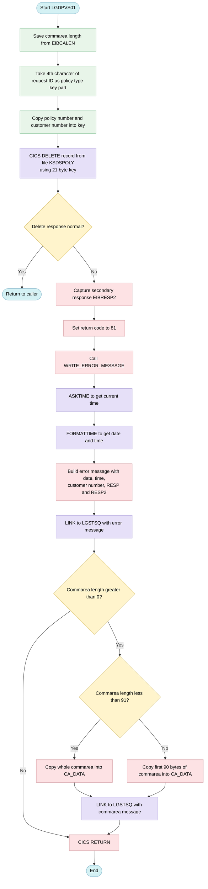
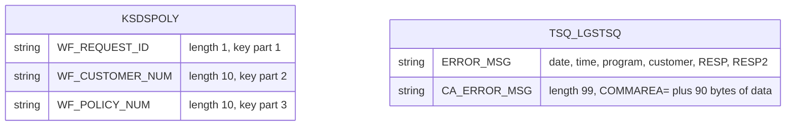

## Table of Contents

- [1. Purpose](#1-purpose)
- [2. Inputs](#2-inputs)
- [3. Outputs](#3-outputs)
- [4. Processing Logic](#4-processing-logic)
  - [4.1 Mermaid Flow Diagram](#41-mermaid-flow-diagram)
  - [4.2 Processing Logic Description](#42-processing-logic-description)
  - [4.3 Database Tables](#43-database-tables)
- [5. Paragraphs](#5-paragraphs)
- [6. Dependencies](#6-dependencies)
  - [6.1 Input Data and Communication Interfaces](#61-input-data-and-communication-interfaces)
  - [6.2 Data Storage and Files](#62-data-storage-and-files)
  - [6.3 External Programs and Modules](#63-external-programs-and-modules)
  - [6.4 CICS Middleware and System Services](#64-cics-middleware-and-system-services)
- [7. Constraints](#7-constraints)
- [8. Error Handling](#8-error-handling)
- [9. Examples](#9-examples)

## 1. Purpose

I have completed reading the PL/I code. The program is a CICS program named `LGDPVS01.pli` that deletes a policy from the `KSDSPOLY` VSAM Key-Sequenced Data Set (KSDS) using a constructed key from the input COMMAREA (`COMM_AREA`).

I will now write a single paragraph describing the overall purpose of the program, focusing on what the code is intended to accomplish, not how it works. I will not include any headings or transitional text.

The overall purpose of the `LGDPVS01` program is to delete a specific insurance policy record from the policy VSAM Key-Sequenced Data Set (KSDS) file based on the requesting parameters received through the application's communication area. It constructs a composite search key using the customer number, policy number, and policy type identifier, and performs a secure deletion of the matching record. If the deletion is successful, it returns control to the caller; if a system or file-level failure occurs during the operation, it captures detailed diagnostic information, sets an error status code, and logs the incident to a temporary storage queue before terminating.

## 2. Inputs

**Communication Area (COMMAREA) — passed by pointer from the calling orchestrator**

- `COMM_AREA` — the 32,500-byte BASED union mapped over `COMM_AREA_PTR`, which is the sole entry-point parameter declared as `Proc(COMM_AREA_PTR) Options(Main)`; it is the complete data contract between the calling program and this program
  - `CA_REQUEST_ID` — 6-character field; character 4 is extracted to populate `WF_Request_ID`, which becomes the first byte of the VSAM KSDS delete key, encoding the policy type (endowment, house, motor, or commercial)
  - `CA_CUSTOMER_NUM` — 10-digit numeric field; copied into `WF_Customer_Num` to form the middle 10 bytes of the 21-byte KSDS record key and echoed into the error message on a failed delete
  - `CA_POLICY_REQUEST` — group item holding the policy-specific data passed in for the delete operation
    - `CA_POLICY_NUM` — 10-digit numeric field within `CA_POLICY_REQUEST`; copied into `WF_Policy_Num` to form the final 10 bytes of the KSDS record key that uniquely identifies the policy record to delete
    - `CA_POLICY_COMMON` — group structure carrying the common policy attributes (issue date, expiry date, last-changed timestamp, broker identifier, broker reference, payment amount) and the policy-type-specific union; present in the COMMAREA layout but not directly read by the delete logic — included here because the full COMMAREA is dumped to the CICS TS error queue via `LGSTSQ` on failure
      - `CA_ISSUE_DATE` — 10-character policy issue date
      - `CA_EXPIRY_DATE` — 10-character policy expiry date
      - `CA_BROKERID` — 10-digit broker identifier
      - `CA_PAYMENT` — 6-digit payment/premium amount
      - `CA_POLICY_SPECIFIC` — union of type-specific policy fields (endowment, house, motor, commercial, claim) carried in the COMMAREA; not used by the delete key construction but forms part of the raw COMMAREA data logged on error
        - `CA_E_SUM_ASSURED` — 6-digit endowment sum assured
        - `CA_H_VALUE` — 8-digit insured house value

**CICS System Fields — implicitly provided by CICS at run time**

- `EIBCALEN` — CICS Execute Interface Block field; read at program entry to obtain the COMMAREA length for a short-COMMAREA guard and again inside `WRITE_ERROR_MESSAGE` to determine how many bytes of raw COMMAREA to log

**External VSAM File**

- `KSDSPOLY` — VSAM KSDS policy file accessed via `EXEC CICS DELETE FILE('KSDSPOLY')`; the program supplies the 21-byte composite key (`WF_Policy_Key` = `WF_Request_ID` + `WF_Customer_Num` + `WF_Policy_Num`) and the file provides the record to be deleted; the CICS `RESP` value returned from this call drives the program's success or error path

**Linked Program Interface**

- `LGSTSQ` — CICS-linked error-logging program; receives `ERROR_MSG` (containing timestamp, program name, policy number, customer number, and RESP/RESP2 codes) and, when `EIBCALEN` is non-zero, a second call passes `CA_ERROR_MSG` containing a dump of the raw COMMAREA bytes

## 3. Outputs

- **Policy record deletion in VSAM KSDS file `KSDSPOLY`**
  - Main business effect: the program issues a CICS DELETE against `KSDSPOLY`, using a 21-byte key.
  - `WF_POLICY_KEY` is the delete key. It is built from three parts:
    - `WF_REQUEST_ID`: the 4th character of `CA_REQUEST_ID`, which gives the policy type.
    - `CA_CUSTOMER_NUM`: the customer who owns the policy.
    - `CA_POLICY_NUM`: the policy number.
  - `WF_POLICY_INFO` is the structure that holds the key.
  - On success, the record is removed and the program returns normally. It sets no return code and writes no message.

- **Return code passed back to the caller through the communication area**
  - `COMM_AREA` is the interface structure mapped over the caller's data.
  - `CA_RETURN_CODE` is set to `'81'` when the delete fails, meaning the response is not NORMAL. The caller sees this value when control returns.
  - On success, `CA_RETURN_CODE` is not changed.
  - The request-specific data is not modified by this program. It only supplies the key:
    - `CA_POLICY_REQUEST`
    - `CA_POLICY_COMMON`
    - `CA_BROKERID`
    - `CA_PAYMENT`
    - `CA_ISSUE_DATE`
    - `CA_EXPIRY_DATE`
    - `CA_E_SUM_ASSURED`
    - `CA_H_VALUE`

- **Error messages written to the `LGSTSQ` logging program**
  - Condition: the messages are written only when the delete fails.
  - Error message record (`ERROR_MSG`), linked to `LGSTSQ` through its commarea. It contains:
    - Current date and time: `EM_DATE` and `EM_TIME`, obtained with ASKTIME and FORMATTIME in MMDDYYYY format.
    - Program identifier: the literal `LGDPVS01`.
    - Message text area: `EM_MSG_TEXT`.
    - Policy number label and value: `EM_POLNUM`.
    - Customer number label and value: `EM_CUSNUM`, taken from `CA_CUSTOMER_NUM`.
    - File label: the literal `Delete file KSDSPOLY`.
    - CICS response codes: `EM_RESPRC` holds RESP and `EM_RESP2RC` holds RESP2.
  - Commarea dump message (`CA_ERROR_MSG`), linked to `LGSTSQ` when the commarea length (`EIBCALEN`) is greater than 0.
    - Content: the `COMMAREA=` prefix followed by `CA_DATA`, which holds the first part of `COMM_AREA_RAW`.
    - Length of data: the whole commarea if it is shorter than 91 bytes, otherwise the first 90 bytes.
    - Purpose: it lets support staff see the request data that caused the failure.

- **Program termination**
  - On failure, the program issues CICS RETURN after logging.
  - On success, it ends with a normal RETURN.

## 4. Processing Logic

### 4.1 Mermaid Flow Diagram

---

### 4.2 Processing Logic Description

**High-level Summary**

LGDPVS01 is a CICS PL/I main program. It deletes one policy record from the VSAM KSDS file `KSDSPOLY`. The caller passes a communication area (COMMAREA) that holds the request ID, customer number and policy number. The program builds a 21-byte key from these fields and issues the delete. If the delete fails, it sets return code `81` and logs diagnostic messages through the helper program `LGSTSQ`.

**Execution Flow**

1. **Entry.** The program starts as `LGDPVS01` with a pointer to the communication area. The `COMM_AREA` structure is based on that pointer. It carries the request ID, return code, customer number and the policy request data.
2. **Initialisation.**
   - `WS_Commarea_Len` is set from `EIBCALEN`, the length of the data passed in.
   - `WF_Request_ID` takes the 4th character of `CA_REQUEST_ID`. This character identifies the policy type, such as endowment, house, motor or commercial.
   - `WF_Policy_Num` is set from `CA_POLICY_NUM`.
   - `WF_Customer_Num` is set from `CA_CUSTOMER_NUM`.
   - Together these three fields form `WF_POLICY_KEY`: 1 byte of request ID, 10 bytes of customer number and 10 bytes of policy number. The key is 21 bytes in total.
3. **Delete.** The program issues `EXEC CICS DELETE FILE('KSDSPOLY')` with `RIDFLD(WF_Policy_Key)` and `KEYLENGTH(21)`. The result goes into `WS_RESP`.
4. **Response check.**
   - If `WS_RESP` equals `DFHRESP(NORMAL)`, the program executes `RETURN` and the delete is complete. The return code is not changed.
   - Otherwise:
     - `EIBRESP2` is saved in `WS_RESP2`.
     - `CA_RETURN_CODE` is set to `'81'`, which signals a policy file failure to the caller.
     - `WRITE_ERROR_MESSAGE` is called.
     - `EXEC CICS RETURN` ends the transaction.
5. **WRITE_ERROR_MESSAGE.**
   - `ASKTIME` gets the current absolute time. `FORMATTIME` converts it to an `MMDDYYYY` date and a time string.
   - The `ERROR_MSG` record is filled with the date, time, customer number, `RESP` and `RESP2`. `EM_POLNUM` is not set here and keeps its initial blank value. The record also contains the program name `LGDPVS01` and the text `Delete file KSDSPOLY`.
   - The program links to `LGSTSQ` with `ERROR_MSG` as the COMMAREA. `LGSTSQ` is the error logging program, probably a TS or TD queue writer.
   - If `EIBCALEN > 0`, the caller's COMMAREA is also logged:
     - If `EIBCALEN < 91`, `CA_DATA` receives the COMMAREA content, left-justified.
     - Otherwise `CA_DATA` receives the first 90 bytes.
     - In both cases the program links to `LGSTSQ` again with `CA_ERROR_MSG`, which starts with the literal `COMMAREA=`.
   - Control then returns to the caller.

**Validations and error handling**

- The only validation is the CICS response code of the delete. Any non-normal response, such as NOTFND, IOERR or a disabled file, is handled the same way. The program sets return code `81` and logs the failure.
- There is no check of `EIBCALEN` before the key is built. A missing or too-short COMMAREA is not handled before the delete.
- The logging copy is capped at 90 bytes so that it fits in the `CA_DATA` field.
- Neither call to `LGSTSQ` checks its own response.
- The `LENGTH(STG(ERROR_MSG))` clause is used for the second link as well, even though the COMMAREA there is `CA_ERROR_MSG`.

**Business rules**

- The policy key is request type (1 byte) + customer number (10) + policy number (10).
- Return code `81` means the policy delete failed.
- Return code `00` (the value on entry) is left unchanged on success.

**External Interactions**

| Interaction | Purpose |
|---|---|
| CICS file `KSDSPOLY` (VSAM KSDS) | Delete the policy record identified by the 21-byte key |
| CICS `ASKTIME` / `FORMATTIME` | Get the timestamp for the error message |
| CICS `LINK` to `LGSTSQ` | Write the error message and COMMAREA content to the logging queue |
| CICS COMMAREA | Receive the request and return the result code to the caller |

**Plain Language Summary**

The program removes an insurance policy from the policy file. It identifies the policy from the customer number, the policy number and the policy type code supplied by the calling program. If the removal works, the program ends quietly. If it fails, the program sets error code 81 for the caller and sends two log entries to a logging program. The first entry has the date, time, customer number and the file system's error codes. The second entry has a copy of the first 90 characters of the data the caller sent.

---

### 4.3 Database Tables

## 5. Paragraphs

- **LGDPVS01**
  - **Purpose:** Serves as the main entry point and primary processing routine of the program to handle the deletion of a policy record from the VSAM KSDS policy file based on input supplied via the communication area.
  - **Operations Performed:**
    - Captures the COMMAREA length (`EIBCALEN`) into `WS_Commarea_Len`.
    - Extracts the 1-character request identifier from the 4th position of `CA_REQUEST_ID` and maps it to `WF_REQUEST_ID`.
    - Populates the VSAM record key `WF_POLICY_KEY` using `WF_REQUEST_ID`, `CA_CUSTOMER_NUM`, and `CA_POLICY_NUM`.
    - Issues a CICS `DELETE` command against the `KSDSPOLY` dataset matching the 21-character composite key.
    - Sets `CA_RETURN_CODE` to `'81'` if the deletion fails and invokes error logging before terminating.
    - Returns control to the calling CICS program.
  - **Control Flow Elements:**
    - Evaluates `WS_RESP` against `DFHRESP(NORMAL)`.
    - On failure, captures `EIBRESP2`, updates `CA_RETURN_CODE`, calls `WRITE_ERROR_MESSAGE`, and issues an immediate `EXEC CICS RETURN`.
  - **Interactions with External Systems:**
    - Performs file I/O operations by executing `EXEC CICS DELETE FILE('KSDSPOLY')`.
    - Interacts with CICS runtime environment via `EXEC CICS RETURN`.

- **WRITE_ERROR_MESSAGE**
  - **Purpose:** Formats error diagnostic details and logs error messages and COMMAREA content to a CICS temporary storage queue via an external logging subprogram.
  - **Operations Performed:**
    - Queries the current system time using `EXEC CICS ASKTIME`.
    - Formats the retrieved timestamp into date (`MMDDYYYY`) and time (`HH:MM:SS`) formats using `EXEC CICS FORMATTIME`.
    - Populates the error message structure `ERROR_MSG` with timestamp data, `CA_CUSTOMER_NUM`, `WS_RESP`, and `WS_RESP2`.
    - Links to program `LGSTSQ` to write the primary error message to a CICS temporary storage queue.
    - Extracts up to 90 bytes of `COMM_AREA_RAW` into `CA_ERROR_MSG` and links to `LGSTSQ` to log the communication area payload.
  - **Control Flow Elements:**
    - Checks if `EIBCALEN > 0` before processing COMMAREA error data.
    - Uses conditional logic (`EIBCALEN < 91`) to truncate or extract the exact length of available COMMAREA bytes.
  - **Interactions with External Systems:**
    - Executes CICS system service commands `EXEC CICS ASKTIME` and `EXEC CICS FORMATTIME`.
    - Invokes external program `LGSTSQ` via `EXEC CICS LINK` to log error data to a CICS temporary storage queue.

## 6. Dependencies

### 6.1 Input Data and Communication Interfaces
- `COMM_AREA` (`LGCMAREA` Include)
  - Serves as the primary communication area passed from caller programs via pointer (`COMM_AREA_PTR`).
  - Supplies input fields:
    - `CA_REQUEST_ID`: Contains the 6-character request identifier; the 4th character is extracted to determine the policy request/type code (`WF_REQUEST_ID`).
    - `CA_CUSTOMER_NUM`: Supplies the 10-digit customer number for the composite policy key and error logging.
    - `CA_POLICY_NUM`: Supplies the 10-digit policy identifier used in forming the record key.
  - Returns execution outcomes to the calling program via `CA_RETURN_CODE` (e.g., set to `'81'` upon deletion failure).
- CICS EXEC Interface Block (`EIB`)
  - `EIBCALEN`: Provides the length of the incoming communication area for validating input availability and controlling the length of data formatted for error reporting.
  - `EIBRESP2`: Provides secondary CICS response information captured during failed file control requests.

### 6.2 Data Storage and Files
- `KSDSPOLY` (VSAM KSDS File)
  - The CICS-managed VSAM Key Sequenced Data Set containing policy records.
  - Targeted by `EXEC CICS DELETE FILE('KSDSPOLY')` using a 21-character composite key (`WF_POLICY_KEY` comprising request ID, customer number, and policy number).

### 6.3 External Programs and Modules
- `LGSTSQ`
  - An external error-logging subprogram invoked via `EXEC CICS LINK`.
  - Receives structured error information (`ERROR_MSG` and `CA_ERROR_MSG`) to log diagnostic and communication area payload data to a CICS Temporary Storage Queue.

### 6.4 CICS Middleware and System Services
- CICS File Control Services
  - Manages record-level delete operations against the `KSDSPOLY` data set using `EXEC CICS DELETE`.
- CICS Program Control Services
  - Handles program linkage to `LGSTSQ` (`EXEC CICS LINK`) and program termination/return control (`EXEC CICS RETURN`).
- CICS Time Services
  - Executes `EXEC CICS ASKTIME` and `EXEC CICS FORMATTIME` to retrieve the current absolute system time (`WS_ABSTIME`) and format timestamp values (`WS_DATE` and `WS_TIME`) for error reporting.

## 7. Constraints

- **Key and identifier constraints**
  - The policy record key must be exactly 21 characters.
    - `WF_POLICY_KEY` is built from `WF_REQUEST_ID` CHAR(1), `WF_CUSTOMER_NUM` CHAR(10) and `WF_POLICY_NUM` CHAR(10).
    - The CICS DELETE passes `KeyLength(21)`, so the key length is fixed.
  - A record is identified only by the full composite key of request type, customer number and policy number.
    - `WF_REQUEST_ID` is taken from the 4th character of `CA_REQUEST_ID`, using `SUBSTR(CA_Request_ID,4,1)`. This is the policy type code, for example endowment, house, motor or commercial.
    - `WF_POLICY_NUM` is copied from `CA_POLICY_NUM`.
    - `WF_CUSTOMER_NUM` is copied from `CA_CUSTOMER_NUM`.
    - The program deletes a single record, and only when the key matches an existing record.
  - The numeric identifiers have fixed formats.
    - `CA_POLICY_NUM` and `CA_CUSTOMER_NUM` are declared `PIC '9999999999'`, which means 10 numeric digits.
    - `CA_REQUEST_ID` is CHAR(6). The program reads its 4th position, so a shorter or malformed value would give a wrong key.
    - The program does not check these formats itself. The caller must supply valid values.
  - The commarea is expected to be present.
    - `COMM_AREA` is BASED on `COMM_AREA_PTR`, and the program uses its fields without any check.
    - `EIBCALEN` is read into `WS_Commarea_Len`, but no validation is done on it before the delete.

- **Data and structure limits**
  - The commarea has size limits.
    - The raw area `COMM_AREA_RAW` is CHAR(32500).
    - The request-specific section is a UNION of at most 32482 characters.
    - Only the policy request layout is used by this program: policy number, common details and type-specific details.
  - The common policy fields have fixed sizes: `CA_ISSUE_DATE` and `CA_EXPIRY_DATE` are CHAR(10), `CA_BROKERID` is 10 digits, and `CA_PAYMENT` is 6 digits.
  - The type-specific fields also have fixed sizes: `CA_E_SUM_ASSURED` is 6 digits and `CA_H_VALUE` is 8 digits.
  - These fields are not read or validated by the delete. They only define the shape of the inbound commarea.
  - Error message fields have fixed capacities.
    - `EM_MSG_TEXT` is CHAR(63).
    - `EM_POLNUM` and `EM_CUSNUM` are CHAR(10).
    - `EM_RESPRC` and `EM_RESP2RC` are `PIC '+(5)9'`, so they hold a signed value of at most 5 digits plus the sign position.
    - `CA_DATA` is CHAR(90). At most 90 bytes of the commarea are echoed in the error log.

- **Conditional processing rules**
  - The delete is attempted unconditionally, with no pre-checks.
    - The program issues `EXEC CICS DELETE FILE('KSDSPOLY')` using `RIDFLD(WF_POLICY_KEY)` and `KeyLength(21)`.
    - The target file is fixed as `KSDSPOLY`.
  - Any CICS response other than normal is treated as a failure.
    - The check is `WS_RESP <> DFHRESP(NORMAL)`.
    - On failure the program captures `EIBRESP2` in `WS_RESP2`.
    - It sets `CA_RETURN_CODE` to `'81'`.
    - It calls `WRITE_ERROR_MESSAGE`, then issues `EXEC CICS RETURN`.
    - A missing record, a file problem or any other error all give the same return code 81. The program does not tell them apart.
  - On success the program does a plain `RETURN`.
    - The return code field is not set, so the caller's existing value is kept.
    - The program does not reset it to `'00'`.
  - The commarea length controls how much is logged.
    - If `EIBCALEN > 0` and `EIBCALEN < 91`, the first `EIBCALEN` bytes of the commarea are logged.
    - If `EIBCALEN >= 91`, the first 90 bytes are logged.
    - If `EIBCALEN = 0`, no commarea data is logged.

- **Sequencing constraints**
  - The key must be assembled before the delete.
    - The assignments to `WF_Request_ID`, `WF_Policy_Num` and `WF_Customer_Num` come first.
    - The delete is issued after them.
  - `WS_RESP` must be checked immediately after the delete. `EIBRESP2` is captured only in the failure branch, so its value is current for that call.
  - The error handling steps must run in a fixed order.
    - `ASKTIME` gets the current time.
    - `FORMATTIME` formats the date as `MMDDYYYY` and the time.
    - The error message is built from the date, time, customer number, `RESP` and `RESP2`.
    - `LINK` to `LGSTSQ` writes the message.
    - If a commarea exists, a second `LINK` to `LGSTSQ` writes the commarea contents.
  - The return code is set to `'81'` before the error message is written and before the transaction returns.

- **Error reporting and logging constraints**
  - Errors are reported by linking to the `LGSTSQ` logging program.
    - The message text is fixed: the program name `LGDPVS01`, the literals `PNUM=`, `CNUM=` and `Delete file KSDSPOLY`, and the `RESP` and `RESP2` values.
    - The date is `MMDDYYYY` text in a 10-character field.
    - The time is an 8-character field.
  - The logged customer number comes from `CA_CUSTOMER_NUM`. `EM_POLNUM` is not set in the error routine, so the policy number field in the message stays blank.
  - The `LINK` calls use `LENGTH(STG(ERROR_MSG))` for both messages.
    - The commarea echo message `CA_ERROR_MSG` is therefore sent using the length of `ERROR_MSG`, not its own length.
    - This is a length constraint that depends on the two structures having compatible sizes.

- **Resource and environment constraints**
  - The program must run under CICS.
    - It uses `EXEC CICS` commands and `EIBCALEN`, `EIBRESP2` and `DFHRESP`.
    - It requires a VSAM KSDS file defined to CICS as `KSDSPOLY`, with a 21-byte key that starts with the request type.
    - It requires the `LGSTSQ` program to be available for logging.
  - The program is the main procedure (`Options(Main)`) and receives its commarea through `COMM_AREA_PTR`. The caller must pass this pointer for the delete to work.
  - The program holds no persistent state. Everything it needs is kept in working storage and the commarea for the current invocation.

## 8. Error Handling

- **Return code signalling to the caller**
  - A return code field in the communication area is set to '81' when the VSAM delete fails. It is the program's only business-level failure indication.
  - The program does not set the return code on success, so it relies on the caller's initial value.
  - The program does not check for a missing or short communication area, so it has no '98' (communication area too short) path. The program's own header and the workspace convention would suggest one.
  - The program sets the return code and then ends the transaction at once with an explicit CICS return. It does not continue or retry.

- **File and I/O error handling**
  - The only I/O operation is the CICS delete against the policy VSAM KSDS file (KSDSPOLY). It uses the 21-character composite key built from the request identifier, customer number and policy number.
  - The delete specifies a RESP option, so CICS does not raise a condition or abend. Instead, the response code is captured in a working field.
  - A conditional check compares that response with the normal response constant. Any other value, such as record not found, I/O error or file disabled, is treated as a failure.
  - On failure the program reads the secondary response code (EIBRESP2) into a second working field, to give more diagnostic detail.
  - The program makes no distinction between failure causes. Every non-normal response gets the same treatment, with no retry, no alternate path and no default value.

- **Error message construction and logging**
  - A common internal procedure, WRITE_ERROR_MESSAGE, builds and records the error details.
  - Timestamp capture
    - The procedure gets the current absolute time and formats it into a date (month, day, year) and a time.
    - Both are placed in the error message structure.
  - Message content
    - The formatted message holds the date, time, program name (LGDPVS01), a message text area, and the policy number and customer number labels.
    - It also holds the literal text identifying the file (Delete file KSDSPOLY) and the primary and secondary response codes as signed numeric edited values.
    - The customer number comes from the communication area, and the response codes come from the captured working fields.
    - The policy number field (EM_POLNUM) is never filled in, so it stays blank in the logged message. The message text field is also never assigned and stays blank.
  - Logging mechanism
    - The message is sent by a CICS link to the logging program LGSTSQ, passing the error message structure as the communication area. The program name suggests it writes to a CICS temporary storage queue.
    - The link has no RESP option, and the program does not check the outcome. A failure in the logging program would not be detected here.

- **Communication area dump for diagnostics**
  - After the first message, the procedure checks whether the incoming communication area length (EIBCALEN) is greater than zero.
  - If the length is greater than zero, a second message holding the communication area contents is sent to LGSTSQ.
  - Length-based truncation
    - If the length is under 91 bytes, the program copies the whole communication area, left-justified, into a 90-character data field.
    - If the length is 91 or more, the program copies only the first 90 bytes. This avoids overflowing the diagnostic field.
  - The link for this second message uses the length of the first error message structure rather than that of the communication area message structure. This is a possible inconsistency in how much data is passed.

- **Program termination and flow control**
  - Normal completion
    - If the delete succeeds, the program ends with a plain return and no message is written.
  - Failure completion
    - After logging, the program executes a CICS return to give control back to the caller with the error return code set.
    - The program does not abend, which is consistent with the workspace convention that errors are logged to a queue instead of abending.
  - The explicit return inside the error branch prevents any further processing after a failure.

- **Gaps and absent mechanisms**
  - There are no PL/I ON-unit handlers, such as ERROR, CONDITION or ENDFILE.
  - There is no HANDLE CONDITION or HANDLE ABEND logic.
  - The program does not validate input, so there are no checks of the request identifier, policy number or customer number before the delete.
  - There are no retries, fallback values or compensating actions after a failed delete.
  - There is no abend for a missing communication area (EIBCALEN of zero). The workspace convention would suggest an abend with code LGCA, but this program does not have one.

## 9. Examples

Example 1: Successful delete of a house policy

Input:
- `CA_REQUEST_ID` = `01DHOU`
- `CA_CUSTOMER_NUM` = `0000000123`
- `CA_POLICY_NUM` = `0000004567`
- Record with key `H00000001230000004567` exists in `KSDSPOLY`.

Output:
- The record is removed from `KSDSPOLY`.
- `CA_RETURN_CODE` is not changed by this program.
- No error message is written. The program returns to its caller.

Explanation:
- The program takes the 4th character of `CA_REQUEST_ID` (`D`) and builds the 21-byte key from the request ID, customer number and policy number. The key is `D00000001230000004567`.
- That key is used to delete the record.
- `RESP` is `NORMAL`, so the error branch is skipped.

For this to hit the record, the 4th character of the request ID must match the first key character the record was stored with.

Example 2: Successful delete of an endowment policy, using the 4th request character

Input:
- `CA_REQUEST_ID` = `01DEND`
- `CA_CUSTOMER_NUM` = `0000000050`
- `CA_POLICY_NUM` = `0000000900`
- A record with key `D00000000500000000900` exists.

Output:
- The record is deleted. No error is logged.

Explanation:
- `SUBSTR(CA_REQUEST_ID,4,1)` is `E`, so `WF_Request_ID` = `E`.
- The key is `E00000000500000000900`.
- This key does not match a record stored as `D…`. In that case the delete fails and Example 3 applies. The record must be stored under `E…` for this call to succeed.

Example 3: Record not found

Input:
- `CA_REQUEST_ID` = `01DMOT`
- `CA_CUSTOMER_NUM` = `0000000777`
- `CA_POLICY_NUM` = `0000009999`
- No record with key `M00000007770000009999` exists.
- `EIBCALEN` = 28 (a commarea of 28 bytes).

Output:
- `WS_RESP` is `NOTFND`, which is not `NORMAL`.
- `CA_RETURN_CODE` = `81`.
- The program calls `LGSTSQ` twice. The first call carries the error message. The second call carries the commarea contents.
- The first message has this layout: `<MM/DD/YYYY> <hh:mm:ss> LGDPVS01 … PNUM=… CNUM=0000000777 Delete file KSDSPOLY RESP=+00013 RESP2=+000002`. The `RESP` and `RESP2` values shown are examples of a not-found condition. The actual values come from the CICS response.
- The second message is `COMMAREA=` followed by the first 28 bytes of the commarea. The remaining bytes of `CA_DATA` are blank.
- The program then ends with `EXEC CICS RETURN`.

Explanation:
- A response other than `NORMAL` makes the program save `EIBRESP2` and set the return code to `81`.
- `WRITE_ERROR_MESSAGE` gets the current date and time with `ASKTIME` and `FORMATTIME`. It fills in the customer number and the `RESP` and `RESP2` codes. It writes the message through `LGSTSQ`.
- `EM_POLNUM` is never assigned, so the policy number field in the message stays blank.
- Because `EIBCALEN` is greater than 0 and less than 91, the whole commarea content is copied into `CA_DATA` and logged as a second message.

Example 4: Failure with a large commarea

Input:
- The same failing delete as in Example 3, but `EIBCALEN` = 200.

Output:
- `CA_RETURN_CODE` = `81`.
- The first message is the same as in Example 3.
- The second message is `COMMAREA=` followed by only the first 90 bytes of the commarea.

Explanation:
- `EIBCALEN` is 91 or more, so the program takes the `ELSE` branch and copies only the first 90 bytes into `CA_DATA`. This keeps the logged message to a fixed size.

---

Generated by IBM Bob Premium Package for Z
