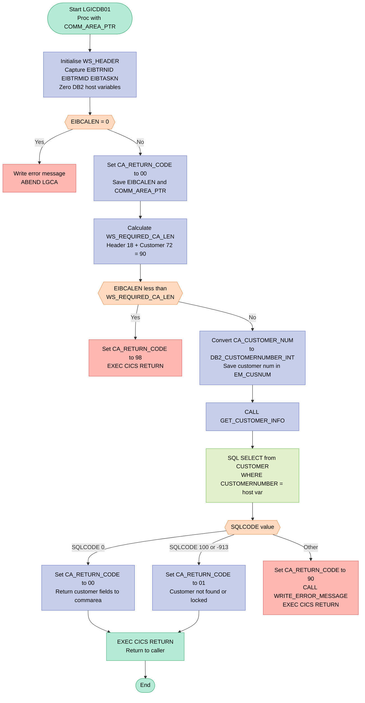
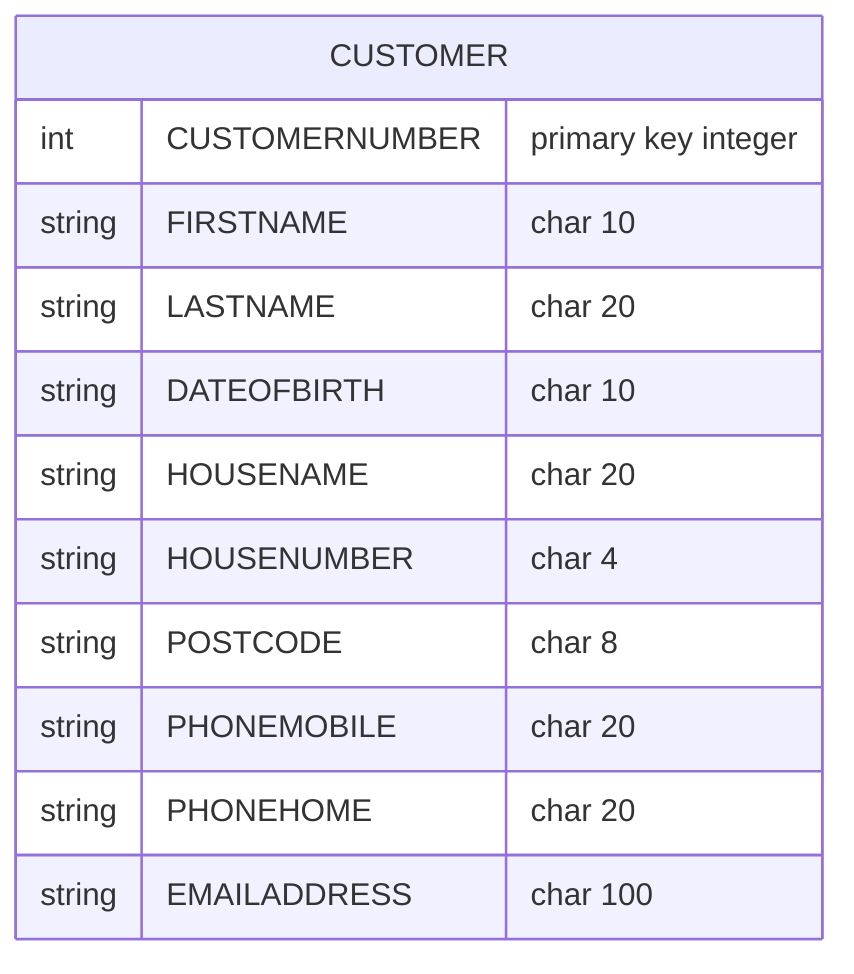

## Table of Contents

- [1. Purpose](#1-purpose)
- [2. Inputs](#2-inputs)
  - [2.1 CICS Execution Interface Block (EIB)](#21-cics-execution-interface-block-eib)
  - [2.2 Communication Area (COMMAREA / `COMM_AREA`)](#22-communication-area-commarea--comm_area)
  - [2.3 External Database (Db2 `CUSTOMER` Table)](#23-external-database-db2-customer-table)
- [3. Outputs](#3-outputs)
  - [3.1 Communication Area Outputs (Caller Return Data)](#31-communication-area-outputs-caller-return-data)
  - [3.2 Error Logging and Diagnostic Outputs](#32-error-logging-and-diagnostic-outputs)
  - [3.3 CICS Control Signals and Side Effects](#33-cics-control-signals-and-side-effects)
- [4. Processing Logic](#4-processing-logic)
  - [4.1 Mermaid Flow Diagram](#41-mermaid-flow-diagram)
  - [4.2 Processing Logic Description](#42-processing-logic-description)
  - [4.3 Database Tables](#43-database-tables)
- [5. Paragraphs](#5-paragraphs)
- [6. Dependencies](#6-dependencies)
- [7. Constraints](#7-constraints)
  - [7.1 Communication Area (COMMAREA) Constraints](#71-communication-area-commarea-constraints)
  - [7.2 Input Data Constraints](#72-input-data-constraints)
  - [7.3 DB2 Query Constraints](#73-db2-query-constraints)
  - [7.4 Return Code and Error Handling Constraints](#74-return-code-and-error-handling-constraints)
  - [7.5 Sequencing and Operational Constraints](#75-sequencing-and-operational-constraints)
- [8. Error Handling](#8-error-handling)
- [9. Examples](#9-examples)
  - [9.1 Example 1: Customer found](#91-example-1-customer-found)
  - [9.2 Example 2: Customer not found](#92-example-2-customer-not-found)
  - [9.3 Example 3: COMMAREA too short](#93-example-3-commarea-too-short)
  - [9.4 Example 4: DB2 error or no COMMAREA](#94-example-4-db2-error-or-no-commarea)

## 1. Purpose

LGICDB01 is a CICS customer inquiry program. A calling application passes it a customer number. It looks that customer up in the DB2 CUSTOMER table and returns the customer's name, date of birth, address, phone numbers and email address in the shared communication area. It first checks that the caller supplied a communication area that is long enough, and it sets a return code for the caller. That code shows whether the lookup succeeded, the customer was not found or the resource was unavailable, a database error occurred, or the communication area was too short. When a failure occurs, the program writes a diagnostic message to a queue. The message has the date, time, customer number, SQL code and part of the communication area, so operations staff can troubleshoot the failure.

## 2. Inputs

### 2.1 CICS Execution Interface Block (EIB)
- `EIBCALEN`
  - Provides the length of the communication area passed by the calling program. Used to validate that a communication area was supplied (`EIBCALEN > 0`) and meets the minimum required length (90 bytes: 18 header/trailer bytes plus 72 customer data bytes).
- `EIBTRNID`
  - Transaction identifier of the executing CICS task; recorded in the program's runtime working-storage header (`WS_TRANSID`).
- `EIBTRMID`
  - Terminal identifier associated with the executing task; recorded in the program's runtime working-storage header (`WS_TERMID`).
- `EIBTASKN`
  - Task number assigned to the current CICS task; recorded in the program's runtime working-storage header (`WS_TASKNUM`).

### 2.2 Communication Area (COMMAREA / `COMM_AREA`)
- `COMM_AREA_PTR`
  - Input parameter pointer passed into the `LGICDB01` entry point referencing the incoming CICS communication area structure.
- `CA_CUSTOMER_NUM`
  - A 10-digit customer number supplied by the caller in the communication area. Acts as the primary search key, converted to a DB2 binary integer (`DB2_CUSTOMERNUMBER_INT`) for querying customer records.

### 2.3 External Database (Db2 `CUSTOMER` Table)
- `CUSTOMER` Table Row
  - Records retrieved via embedded SQL `SELECT` using `CUSTOMERNUMBER = :DB2_CUSTOMERNUMBER_INT`:
    - `FIRSTNAME`: Populates `CA_FIRST_NAME` in the commarea.
    - `LASTNAME`: Populates `CA_LAST_NAME` in the commarea.
    - `DATEOFBIRTH`: Populates `CA_DOB` in the commarea.
    - `HOUSENAME`: Populates `CA_HOUSE_NAME` in the commarea.
    - `HOUSENUMBER`: Populates `CA_HOUSE_NUM` in the commarea.
    - `POSTCODE`: Populates `CA_POSTCODE` in the commarea.
    - `PHONEMOBILE`: Populates `CA_PHONE_MOBILE` in the commarea.
    - `PHONEHOME`: Populates `CA_PHONE_HOME` in the commarea.
    - `EMAILADDRESS`: Populates `CA_EMAIL_ADDRESS` in the commarea.
- `SQLCODE` (from `SQLCA`)
  - Status code returned by Db2 following execution of the SQL `SELECT` statement, evaluated to determine query success (`0`), row not found / deadlock (`100`, `-913`), or database error.

## 3. Outputs

### 3.1 Communication Area Outputs (Caller Return Data)

- **Return Status**
  - `CA_RETURN_CODE`: Communicates the execution status back to the calling program. Set to `'00'` for a successful query, `'01'` when the customer is not found (`SQLCODE = 100`) or a deadlock/timeout occurs (`SQLCODE = -913`), `'90'` for unexpected database errors, and `'98'` when the provided communication area length is insufficient.

- **Customer Information Fields**
  - `CA_FIRST_NAME`: Returns the customer's first name retrieved from the `FIRSTNAME` column of the `CUSTOMER` table.
  - `CA_LAST_NAME`: Returns the customer's surname retrieved from the `LASTNAME` column of the `CUSTOMER` table.
  - `CA_DOB`: Returns the customer's date of birth retrieved from the `DATEOFBIRTH` column of the `CUSTOMER` table.
  - `CA_HOUSE_NAME`: Returns the house or building name retrieved from the `HOUSENAME` column of the `CUSTOMER` table.
  - `CA_HOUSE_NUM`: Returns the street house number retrieved from the `HOUSENUMBER` column of the `CUSTOMER` table.
  - `CA_POSTCODE`: Returns the postal code retrieved from the `POSTCODE` column of the `CUSTOMER` table.
  - `CA_PHONE_MOBILE`: Returns the mobile phone contact number retrieved from the `PHONEMOBILE` column of the `CUSTOMER` table.
  - `CA_PHONE_HOME`: Returns the home phone contact number retrieved from the `PHONEHOME` column of the `CUSTOMER` table.
  - `CA_EMAIL_ADDRESS`: Returns the customer's email address retrieved from the `EMAILADDRESS` column of the `CUSTOMER` table.

### 3.2 Error Logging and Diagnostic Outputs

- **Error and Diagnostic Messages (via `LGSTSQ` Program Call)**
  - `ERROR_MSG`: Formatted error structure passed to the external logging program `LGSTSQ` via `EXEC CICS LINK`. Transmits runtime execution context including timestamp (`EM_DATE`, `EM_TIME`), program identifier (`LGICDB01`), context message (`EM_MSG_TEXT`) or SQL query diagnostic information (`EM_CUSNUM`, `EM_SQLREQ`, `EM_SQLRC`).
  - `CA_ERROR_MSG`: Diagnostic structure passed to `LGSTSQ` via `EXEC CICS LINK` containing the literal prefix `'COMMAREA='` and up to the first 90 bytes of the raw incoming communication area (`CA_DATA`) for troubleshooting failed requests.

### 3.3 CICS Control Signals and Side Effects

- **Abend Signal**
  - Issues an `EXEC CICS ABEND` with abend code `'LGCA'` (without a dump) when invoked without an incoming communication area (`EIBCALEN = 0`).

## 4. Processing Logic

### 4.1 Mermaid Flow Diagram

---

### 4.2 Processing Logic Description

#### 4.2.1 High-level Summary

**LGICDB01** is a CICS-attached Db2 back-end program that retrieves a single customer record from the `CUSTOMER` table and returns the data to its caller through a shared communication area (COMMAREA). It is invoked by the orchestrator program `LGICDB01` via a CICS LINK from the customer-inquiry flow (`LGICUS01`). The program performs no business calculations; its sole responsibility is a single-row SELECT and structured error reporting.

---

#### 4.2.2 Execution Flow

**Step 1 — Entry and initialisation**
On entry, the program receives `COMM_AREA_PTR`, a pointer to the shared COMMAREA. It immediately captures the CICS execution context (`EIBTRNID`, `EIBTRMID`, `EIBTASKN`) into the working-storage diagnostic header and zeroes the Db2 integer host variable block.

**Step 2 — COMMAREA presence check**
`EIBCALEN` is tested. If it is zero, no COMMAREA was passed: the program writes a diagnostic error message and issues an `EXEC CICS ABEND ABCODE('LGCA') NODUMP`. This is the only scenario that ends in an abend rather than a controlled return.

**Step 3 — Initialise return code and save COMMAREA address**
With a valid COMMAREA confirmed, `CA_RETURN_CODE` is set to `'00'` (success) and the COMMAREA length and pointer are preserved in working storage for diagnostic use.

**Step 4 — Minimum COMMAREA length check**
`WS_REQUIRED_CA_LEN` is computed as the sum of the header/trailer constant (18 bytes) and the customer data area constant (72 bytes), giving a minimum of 90 bytes. If `EIBCALEN` is less than this threshold, `CA_RETURN_CODE` is set to `'98'` and `EXEC CICS RETURN` is issued immediately. This protects against truncated or malformed COMMAREA layouts.

**Step 5 — Customer number conversion**
`CA_CUSTOMER_NUM` (a 10-digit picture field from the COMMAREA) is converted to the binary integer host variable `DB2_CUSTOMERNUMBER_INT` for use in the SQL WHERE clause. A copy of the customer number is also placed in `EM_CUSNUM` inside the error message structure for diagnostic purposes.

**Step 6 — Db2 SELECT (GET_CUSTOMER_INFO)**
The internal procedure `GET_CUSTOMER_INFO` executes a single-row SELECT against the `CUSTOMER` table:

| Db2 Column | COMMAREA Target |
|---|---|
| `FIRSTNAME` | `CA_FIRST_NAME` |
| `LASTNAME` | `CA_LAST_NAME` |
| `DATEOFBIRTH` | `CA_DOB` |
| `HOUSENAME` | `CA_HOUSE_NAME` |
| `HOUSENUMBER` | `CA_HOUSE_NUM` |
| `POSTCODE` | `CA_POSTCODE` |
| `PHONEMOBILE` | `CA_PHONE_MOBILE` |
| `PHONEHOME` | `CA_PHONE_HOME` |
| `EMAILADDRESS` | `CA_EMAIL_ADDRESS` |

The WHERE predicate is `CUSTOMERNUMBER = :DB2_CUSTOMERNUMBER_INT`.

**Step 7 — SQLCODE handling**

| SQLCODE | Meaning | Action |
|---|---|---|
| `0` | Row found | `CA_RETURN_CODE = '00'` — success |
| `100` | Row not found | `CA_RETURN_CODE = '01'` — customer unknown |
| `-913` | Deadlock / timeout | `CA_RETURN_CODE = '01'` — resource unavailable |
| Any other | Unexpected Db2 error | `CA_RETURN_CODE = '90'`, call `WRITE_ERROR_MESSAGE`, then `EXEC CICS RETURN` |

Both SQLCODE 100 (not found) and -913 (row locked/deadlock) map to the same `'01'` return code, communicating to the caller that the customer data is currently unavailable.

**Step 8 — Return to caller**
After `GET_CUSTOMER_INFO` completes (for success or soft-error paths), the main routine issues `EXEC CICS RETURN`, passing control back to the orchestrator with the populated COMMAREA.

**WRITE_ERROR_MESSAGE procedure**
When called, this procedure:
1. Captures `SQLCODE` into the error message structure.
2. Calls `EXEC CICS ASKTIME` and `EXEC CICS FORMATTIME` to obtain the current timestamp.
3. Links to the `LGSTSQ` helper program to write the formatted error message to a CICS transient data queue (TDQ).
4. If a COMMAREA was present, writes up to 90 bytes of raw COMMAREA content to the same TDQ for additional context.

---

#### 4.2.3 External Interactions

| System | Interaction | Purpose |
|---|---|---|
| **Db2 `CUSTOMER` table** | `SELECT … WHERE CUSTOMERNUMBER = :host_var` | Retrieves all customer demographic fields for the requested customer number |
| **CICS (ABEND)** | `EXEC CICS ABEND ABCODE('LGCA')` | Fatal exit when no COMMAREA is present |
| **CICS (RETURN)** | `EXEC CICS RETURN` | Normal and error return to calling orchestrator |
| **LGSTSQ** (via `EXEC CICS LINK`) | Transient data queue writer | Records diagnostic error messages and raw COMMAREA snapshots to a TDQ for problem determination |

---

#### 4.2.4 Plain Language Summary

When a user or a calling program wants to look up a customer's details, LGICDB01 is the component that goes to the database and fetches the record. It checks that the incoming request is well-formed (has a COMMAREA of sufficient size and a valid customer number), runs a database query using the customer number as the search key, and then fills the result fields — name, address, date of birth, phone numbers, and email — back into the same shared memory block so the caller can read them. If the customer is not found or the database is temporarily locked, the program signals that with return code `'01'`. If a more serious database error occurs, it logs the full details (timestamp, SQLCODE, and raw COMMAREA snapshot) to a diagnostic queue and returns code `'90'`. Only if no shared memory was provided at all does the program take the drastic step of abending.

---

### 4.3 Database Tables

## 5. Paragraphs

- **LGICDB01**
  - **Purpose**: Serves as the main entry point procedure for the customer inquiry program, validating incoming communication area data and orchestrating the customer lookup.
  - **Operations**:
    - Initializes execution interface block (EIB) tracking variables (`WS_TRANSID`, `WS_TERMID`, `WS_TASKNUM`) and DB2 host variables.
    - Validates that a communication area was passed (`EIBCALEN > 0`) and checks that its length meets the minimum required size (`WS_REQUIRED_CA_LEN`).
    - Converts the communication area customer number (`CA_CUSTOMER_NUM`) into a binary integer host variable (`DB2_CUSTOMERNUMBER_INT`) and saves it to the error message structure.
    - Calls `GET_CUSTOMER_INFO` to retrieve customer details from the database.
    - Returns control to the calling CICS program.
  - **Control Flow**:
    - Evaluates `IF (EIBCALEN = 0)`: triggers `WRITE_ERROR_MESSAGE` and terminates processing via `EXEC CICS ABEND` with abend code `'LGCA'`.
    - Evaluates `IF (EIBCALEN < WS_REQUIRED_CA_LEN)`: sets `CA_RETURN_CODE` to `'98'` and terminates via `EXEC CICS RETURN`.
    - Proceeds sequentially to execute `CALL GET_CUSTOMER_INFO` and final `EXEC CICS RETURN`.
  - **External Interactions**:
    - Interacts with CICS runtime environment via `EXEC CICS ABEND` and `EXEC CICS RETURN`.

- **GET_CUSTOMER_INFO**
  - **Purpose**: Retrieves customer details from the Db2 `CUSTOMER` table using the supplied customer number and sets the appropriate return status.
  - **Operations**:
    - Sets SQL request identifier text to `' SELECT CUSTOMER'`.
    - Executes an embedded SQL `SELECT` against the `CUSTOMER` table matching `CUSTOMERNUMBER` with `:DB2_CUSTOMERNUMBER_INT`, populating customer name, date of birth, address, phone numbers, and email address into the communication area fields.
    - Evaluates `SQLCODE` to determine operation outcome and assigns `CA_RETURN_CODE`.
  - **Control Flow**:
    - Evaluates `SELECT (SQLCODE)`:
      - `WHEN (0)`: sets `CA_RETURN_CODE` to `'00'` (success).
      - `WHEN (100, -913)`: sets `CA_RETURN_CODE` to `'01'` (customer not found or deadlock/timeout).
      - `OTHERWISE`: sets `CA_RETURN_CODE` to `'90'` (database error), calls `WRITE_ERROR_MESSAGE`, and issues `EXEC CICS RETURN` to terminate.
  - **External Interactions**:
    - Queries the IBM Db2 database table `CUSTOMER`.
    - Issues `EXEC CICS RETURN` on unhandled database errors.

- **WRITE_ERROR_MESSAGE**
  - **Purpose**: Formats and logs diagnostic error information and communication area content to the error queue program (`LGSTSQ`).
  - **Operations**:
    - Captures `SQLCODE` into the error message structure (`EM_SQLRC`).
    - Requests system timestamp via `EXEC CICS ASKTIME` and formats date (`MMDDYYYY`) and time (`TIME`) using `EXEC CICS FORMATTIME`.
    - Links to program `LGSTSQ` passing `ERROR_MSG` via COMMAREA.
    - Extracts up to 90 bytes of raw input communication area data (`COMM_AREA_RAW`) and sends a second log entry via `LGSTSQ`.
  - **Control Flow**:
    - Evaluates `IF (EIBCALEN > 0)`:
      - Checks `IF (EIBCALEN < 91)`: slices `COMM_AREA_RAW` to length `EIBCALEN` using `LEFT()` and links to `LGSTSQ`.
      - `ELSE`: slices first 90 bytes using `LEFT()` and links to `LGSTSQ`.
  - **External Interactions**:
    - Interacts with CICS date/time services (`EXEC CICS ASKTIME`, `EXEC CICS FORMATTIME`).
    - Calls external CICS logging program `LGSTSQ` via `EXEC CICS LINK`.

## 6. Dependencies

- **Database (Db2)**
  - Table `CUSTOMER`
    - It is read with a singleton `SELECT` in `GET_CUSTOMER_INFO`. The key is `CUSTOMERNUMBER`.
    - Columns read: `FIRSTNAME`, `LASTNAME`, `DATEOFBIRTH`, `HOUSENAME`, `HOUSENUMBER`, `POSTCODE`, `PHONEMOBILE`, `PHONEHOME` and `EMAILADDRESS`.
    - Each column is returned into the matching commarea field: `CA_FIRST_NAME`, `CA_LAST_NAME`, `CA_DOB`, `CA_HOUSE_NAME`, `CA_HOUSE_NUM`, `CA_POSTCODE`, `CA_PHONE_MOBILE`, `CA_PHONE_HOME` and `CA_EMAIL_ADDRESS`.
    - The CHAR host variables must match the column lengths exactly.
    - No indicator variables are used, so a nullable column would give SQLCODE -305.
  - Host variable `DB2_CUSTOMERNUMBER_INT`
    - It is a `FIXED BIN(31)` field converted from `CA_CUSTOMER_NUM`. It is the `WHERE` predicate input.
  - `SQLCA` (`EXEC SQL INCLUDE SQLCA`)
    - `SQLCODE` is checked after the `SELECT`.
    - 0 gives `CA_RETURN_CODE` '00'.
    - 100 and -913 give '01' (customer not found or resource unavailable).
    - Any other value gives '90', after which the program logs the error and returns.
    - `SQLCODE` is also copied into `EM_SQLRC` for the error message.
  - Db2 environment
    - The program needs a Db2 subsystem connection through the CICS-Db2 attachment.
    - It needs a bound plan or package with execute authority on `CUSTOMER`.

- **Include files and data structures**
  - `SQLCA` is included through `EXEC SQL INCLUDE SQLCA`.
  - `LGCMAREA` (`plinc/LGCMAREA.inc`) holds the COMMAREA layout.
    - It is shown expanded in the source. The original `EXEC SQL INCLUDE LGCMAREA` is commented out.
    - It is the only data contract with callers.
    - Key fields are `CA_REQUEST_ID`, `CA_RETURN_CODE`, `CA_CUSTOMER_NUM` and the customer request block.
    - The policy, security, endowment, house, motor, commercial and claim branches share the same union storage.
    - The total size is 32500 bytes.
    - The union branch sizes must stay unchanged.
    - The include is resolved through the build include search path (`pliincludeSearch`).

- **CICS runtime and services**
  - Execution environment
    - The program runs as a CICS transaction, compiled with `SYSTEM(CICS)` and `PP(MACRO,CICS)`.
    - It is defined as `Proc(COMM_AREA_PTR) Options(Main)`.
    - It is deployed as `CICSLOAD`.
    - It needs a CICS program definition in the CSD (`Resources/`).
  - Execute Interface Block (EIB) fields
    - `EIBTRNID`, `EIBTRMID` and `EIBTASKN` fill the debug header `WS_TRANSID`, `WS_TERMID` and `WS_TASKNUM`.
    - `EIBCALEN` is used for the following:
      - Zero length: the program writes an error message, then abends.
      - Minimum length: the program checks the received length against `WS_REQUIRED_CA_LEN`.
      - Error dump: it limits how many bytes of the commarea are written to the error queue.
  - CICS commands
    - `EXEC CICS RETURN` returns control to the caller on these paths:
      - Normal completion.
      - Commarea too short (`CA_RETURN_CODE` '98').
      - Db2 error (`CA_RETURN_CODE` '90').
    - `EXEC CICS ABEND ABCODE('LGCA') NODUMP` is issued when no commarea is received.
    - `EXEC CICS ASKTIME ABSTIME` gets the current absolute time.
    - `EXEC CICS FORMATTIME ABSTIME MMDDYYYY TIME` formats the date and time for the error message.
    - `EXEC CICS LINK PROGRAM('LGSTSQ')` writes the error messages.

- **External programs**
  - `LGSTSQ`
    - It is invoked by CICS LINK from `WRITE_ERROR_MESSAGE`.
    - It writes error records to the CICS queues (a TS queue and/or TD queue). The queue definitions are outside this program.
    - Two commareas are passed:
      - `ERROR_MSG` has the date, time, program name, customer number, SQL request text and `SQLCODE`.
      - `CA_ERROR_MSG` has up to 90 bytes of the incoming commarea, prefixed with 'COMMAREA='.
    - Both LINKs have no `RESP` handling.
  - Calling programs
    - The orchestrator that links to this program is `LGICUS01`, or `LGIPOL01` in the policy flow. It must supply the commarea.

- **Input parameters**
  - `COMM_AREA_PTR` is the pointer to the DFHCOMMAREA passed by the caller.
  - Required commarea input
    - `CA_CUSTOMER_NUM` is the 10-digit lookup key.
    - `CA_REQUEST_ID` identifies the request type.
  - Minimum length
    - 90 bytes, which is `WS_CA_HEADERTRAILER_LEN` (18) plus `WS_CUSTOMER_LEN` (72).
    - Shorter input gives return code '98'.
  - Outputs written back to the caller
    - The customer fields listed under the `CUSTOMER` table.
    - `CA_RETURN_CODE`, with values '00', '01', '90' and '98'.

- **Configuration and constants**
  - Hard-coded length constants
    - `WS_CA_HEADERTRAILER_LEN` = 18.
    - `WS_CUSTOMER_LEN` = 72.
    - These duplicate the length constants in other programs and must be kept consistent.
  - Hard-coded identifiers
    - ABEND code `LGCA`.
    - Linked program name `LGSTSQ`.
    - Eye-catcher `LGICDB01------WS`.
    - Error message program tag ` LGICDB01`.
  - There are no environment variables, external files or VSAM datasets.

- **Build and deployment**
  - zAppBuild (DBB/Groovy) with the PL/I compiler V52.
    - Compile options: `PP(INCLUDE('ID(++INCLUDE)')),SOURCE`.
    - Link edit options: `MAP,RENT,COMPAT(PM5)`.
  - A Db2 bind step and the Db2 table DDL (`jcl/`).
  - A CICS CSD definition for the program (`Resources/`).

## 7. Constraints

### 7.1 Communication Area (COMMAREA) Constraints

- **COMMAREA must be present**: If `EIBCALEN = 0` (no COMMAREA received), the program immediately writes an error message and issues `EXEC CICS ABEND ABCODE('LGCA') NODUMP`. Processing cannot continue without a COMMAREA.
- **COMMAREA minimum length**: The received COMMAREA length (`EIBCALEN`) must be at least `WS_CA_HEADERTRAILER_LEN (18) + WS_CUSTOMER_LEN (72) = 90` bytes. If `EIBCALEN < 90`, the program sets `CA_RETURN_CODE = '98'` and returns immediately without performing any DB2 access.
- **COMMAREA total size**: The full COMMAREA layout is fixed at 32500 bytes (`COMM_AREA_RAW CHAR(32500)`). No branch of the union structure may exceed this size.
- **CA_CUSTOMER_NUM format**: Declared as `PIC '9999999999'` — a 10-digit numeric picture field. Only numeric digit characters are structurally valid; the field is used as the sole lookup key for the customer inquiry.

### 7.2 Input Data Constraints

- **Customer number required as lookup key**: `CA_CUSTOMER_NUM` must be supplied by the caller before invocation; it is the only input used in the `WHERE CUSTOMERNUMBER = :DB2_CUSTOMERNUMBER_INT` predicate of the SELECT. No alternative lookup path exists.
- **Customer number converted to binary integer**: `CA_CUSTOMER_NUM` is converted to `DB2_CUSTOMERNUMBER_INT` (`FIXED BIN(31)`) before the SQL query. The value must be representable as a 31-bit signed binary integer; values outside that range would cause a conversion error.
- **No policy-level input accepted**: Although the COMMAREA structure contains a `CA_POLICY_REQUEST` section, this program reads only the customer section (`CA_CUSTOMER_REQUEST`). No policy number or policy-type input is examined or processed.

### 7.3 DB2 Query Constraints

- **Single-row SELECT with no cursor**: The SQL `SELECT … INTO` targets a single row. The query implicitly assumes at most one row exists for a given `CUSTOMERNUMBER`; if the table has duplicate customer numbers, the query would raise a DB2 error (SQLCODE -811, which falls into the OTHERWISE branch and returns `CA_RETURN_CODE = '90'`).
- **Columns retrieved are fixed**: The SELECT retrieves exactly nine columns (`FIRSTNAME`, `LASTNAME`, `DATEOFBIRTH`, `HOUSENAME`, `HOUSENUMBER`, `POSTCODE`, `PHONEMOBILE`, `PHONEHOME`, `EMAILADDRESS`). No other CUSTOMER table columns are accessible through this program.
- **Host variable sizes must match column lengths**: Each host variable (`CA_FIRST_NAME CHAR(10)`, `CA_LAST_NAME CHAR(20)`, etc.) must exactly match the corresponding DB2 column length. A mismatch would cause a truncation or padding discrepancy at runtime.
- **No nullable column indicator variables**: No SQL indicator variables are declared for any of the nine retrieved columns. If any CUSTOMER column is defined as `NULL`-able in the table and contains a NULL value, DB2 will raise SQLCODE -305, which falls into the OTHERWISE branch and triggers `CA_RETURN_CODE = '90'`.

### 7.4 Return Code and Error Handling Constraints

- **`CA_RETURN_CODE = '00'`**: Set only when `SQLCODE = 0` (row found and fetched successfully).
- **`CA_RETURN_CODE = '01'`**: Set when `SQLCODE = 100` (no matching customer row found) or `SQLCODE = -913` (deadlock or timeout — resource unavailable). These two conditions are treated as equivalent "not found / unavailable" outcomes; no distinction is surfaced to the caller.
- **`CA_RETURN_CODE = '90'`**: Set for any other SQL error. The program logs the error to the CICS TS queue via `LGSTSQ` and returns immediately; no partial customer data is returned.
- **`CA_RETURN_CODE = '98'`**: Set exclusively when the incoming COMMAREA is shorter than the required minimum. The program returns without any DB2 call.
- **No ABEND on SQL errors**: All SQL error conditions are handled by setting a return code and returning to the caller, except the zero-length COMMAREA case which unconditionally ABENDs with code `LGCA`.

### 7.5 Sequencing and Operational Constraints

- **Strict execution order**: The program enforces a fixed sequence — COMMAREA presence check → COMMAREA length check → customer number conversion → DB2 SELECT. No step may be skipped or reordered; a failure at any earlier step short-circuits all subsequent steps.
- **DB2 access only after COMMAREA validation**: The `GET_CUSTOMER_INFO` procedure is called only after both COMMAREA checks pass. A short or absent COMMAREA prevents any database interaction.
- **Error logging before early return**: Whenever `WRITE_ERROR_MESSAGE` is called (on DB2 errors or absent COMMAREA), it must complete — obtaining timestamp via `EXEC CICS ASKTIME`/`FORMATTIME` and writing to the TS queue via `LGSTSQ` — before the program returns to the caller.
- **COMMAREA dump limited to 90 bytes**: Inside `WRITE_ERROR_MESSAGE`, if `EIBCALEN < 91`, only the actual COMMAREA bytes are copied; otherwise exactly 90 bytes are written. This caps the diagnostic output regardless of actual COMMAREA size.
- **No data written to COMMAREA on error paths**: Output fields (`CA_FIRST_NAME`, `CA_LAST_NAME`, etc.) are populated only on SQLCODE 0. On any error return code (`'01'`, `'90'`, `'98'`), those fields are left in their uninitialised state.

## 8. Error Handling

- **Input validation and request pre-checks**
  - Missing commarea check
    - The program tests whether the CICS-supplied commarea length is zero, which means the caller passed no communication area.
    - When it is zero, the program sets the message text to "NO COMMAREA RECEIVED" and calls the shared error-logging procedure.
    - It then abends the task with abend code LGCA and suppresses the dump. This is the only unrecoverable, abend-style termination in the program.
  - Minimum commarea length check
    - The program computes the required length as the header/trailer length (18) plus the customer data length (72), which gives 90 bytes.
    - If the received length is smaller, it sets the commarea return code to '98' and returns to CICS immediately.
    - No database access happens in this case, and no error message is written to the queue. The caller learns of the problem only through the return code.

- **Database (DB2) error handling**
  - SQLCODE evaluation after the customer SELECT
    - The program evaluates the SQL return code with a multi-branch select after the single-row query on the CUSTOMER table.
    - A zero SQLCODE is success, and the return code is set to '00'.
    - SQLCODE +100 (row not found) and -913 (deadlock or timeout, so the resource is unavailable) are both treated as "not found or resource unavailable". The return code is set to '01'. Nothing is logged and processing returns normally to the caller.
    - Any other SQLCODE falls into the default branch and is treated as a database error. The return code is set to '90', the error-logging procedure is called, and the program returns to CICS immediately.
  - Diagnostic context preparation
    - Before the query, the program saves the customer number in the error message structure so it appears in any later error record.
    - It also sets the SQL request label to " SELECT CUSTOMER", which identifies the failing operation in the log.
    - The SQLCODE is placed in the error message only when the logging procedure runs.

- **Return code signaling to the caller**
  - The return code starts as '00' once a commarea is confirmed to be present.
  - Later checks overwrite it to report the outcome:
    - '00' means success.
    - '01' means customer not found or resource unavailable.
    - '90' means a database error.
    - '98' means the commarea is too short.
  - The caller reads this field to decide what to do next. It is the program's main way of reporting failures.

- **Error logging and notification**
  - Central error-logging procedure
    - A single procedure builds and writes the error records. Both the missing-commarea path and the unexpected-SQLCODE path call it.
    - It formats the error message with the current date, time, program identifier, customer number, SQL request label and SQLCODE.
    - It gets the timestamp from the CICS system clock (ASKTIME) and formats it into date and time strings (FORMATTIME).
  - Queue-based logging
    - The procedure links to the helper program LGSTSQ to write the formatted error message to the error queue.
    - It then writes a second record containing the commarea contents, so the failing request can be reconstructed.
    - If the commarea is shorter than 91 bytes, the record holds as much of it as exists. Otherwise it holds the first 90 bytes.
    - This second record is written only when a commarea is present.
  - No explicit error handling around the logging calls
    - The program does not check whether the queue-writing links succeed. A failure in logging would not be detected or recovered from by this program.

- **Program termination and control flow on error**
  - Early return to CICS
    - After the too-short-commarea and database-error cases, the program returns control to CICS straight away. This prevents further processing with bad data or state.
  - Abend termination
    - Only the missing-commarea case abends the task, with abend code LGCA. This reflects a severe invocation error.
  - Normal completion
    - If the lookup succeeds or the row is not found, the program falls through to a normal return to CICS. The return code tells the caller which of the two happened.

- **Limitations and gaps in error handling**
  - No PL/I ON-unit or condition handling
    - The program defines no ON-units for conditions such as ERROR, CONVERSION or SIZE.
    - It relies entirely on explicit checks of the commarea length and SQLCODE.
  - No CICS response checking
    - The program does not check the response codes of the CICS time, formatting and link commands. It also sets up no CICS HANDLE or RESP handling.
  - No retry or fallback logic
    - The program has no retries and no alternate data sources.
    - A deadlock or timeout (-913) is not retried. It is mapped to the same "not found" return code as a missing row.
  - No validation of the customer number content
    - The program does not check that the customer number is numeric or non-zero before the lookup. An invalid number would show up as a not-found or database error result.

## 9. Examples

### 9.1 Example 1: Customer found

**Input (COMMAREA, EIBCALEN = 200)**

| Field | Value |
|---|---|
| CA_REQUEST_ID | `01ICUS` |
| CA_CUSTOMER_NUM | `0000000001` |

The CUSTOMER table has a row for customer 1:

| Column | Value |
|---|---|
| FIRSTNAME | Andrew |
| LASTNAME | Pandy |
| DATEOFBIRTH | 1950-07-11 |
| HOUSENAME | Pandy Mansion |
| HOUSENUMBER | 1 |
| POSTCODE | PO1 1AA |
| PHONEMOBILE | 07722 123456 |
| PHONEHOME | 01962 123456 |
| EMAILADDRESS | a.pandy@example.com |

**Output (COMMAREA returned to caller)**

| Field | Value |
|---|---|
| CA_RETURN_CODE | `00` |
| CA_FIRST_NAME | `Andrew` |
| CA_LAST_NAME | `Pandy` |
| CA_DOB | `1950-07-11` |
| CA_HOUSE_NAME | `Pandy Mansion` |
| CA_HOUSE_NUM | `1` |
| CA_POSTCODE | `PO1 1AA` |
| CA_PHONE_MOBILE | `07722 123456` |
| CA_PHONE_HOME | `01962 123456` |
| CA_EMAIL_ADDRESS | `a.pandy@example.com` |

**Explanation**
- EIBCALEN (200) is at least the required length of 90 (`WS_REQUIRED_CA_LEN` = 18 + 72), so processing continues.
- `CA_CUSTOMER_NUM` is converted to `DB2_CUSTOMERNUMBER_INT` = 1 and used in the SELECT.
- SQLCODE is 0, so `CA_RETURN_CODE` stays `00` and the customer columns are copied into the COMMAREA fields.
- The program ends with `EXEC CICS RETURN`.

### 9.2 Example 2: Customer not found

**Input (EIBCALEN = 200)**

| Field | Value |
|---|---|
| CA_REQUEST_ID | `01ICUS` |
| CA_CUSTOMER_NUM | `0000999999` |

No row exists for customer 999999.

**Output**

| Field | Value |
|---|---|
| CA_RETURN_CODE | `01` |
| Customer detail fields | Not populated |

No error message is written.

**Explanation**
- The SELECT returns SQLCODE +100 (no row).
- The `WHEN (100, -913)` branch sets `CA_RETURN_CODE` to `01`.
- SQLCODE -913 (resource unavailable) gives the same result.
- The program returns normally without calling `WRITE_ERROR_MESSAGE`.

### 9.3 Example 3: COMMAREA too short

**Input (EIBCALEN = 50)**

| Field | Value |
|---|---|
| CA_REQUEST_ID | `01ICUS` |
| CA_CUSTOMER_NUM | `0000000001` |

**Output**

| Field | Value |
|---|---|
| CA_RETURN_CODE | `98` |

There is no DB2 access and no customer data is returned.

**Explanation**
- The program sets `CA_RETURN_CODE` to `00` and computes `WS_REQUIRED_CA_LEN` = 18 + 72 = 90.
- Because 50 < 90, it sets `CA_RETURN_CODE` to `98` and issues `EXEC CICS RETURN` immediately.

### 9.4 Example 4: DB2 error or no COMMAREA

**Input A: SELECT fails with SQLCODE -904 (EIBCALEN = 200, CA_CUSTOMER_NUM = `0000000001`)**

| Output | Value |
|---|---|
| CA_RETURN_CODE | `90` |
| Message sent to LGSTSQ | Date, time, ` LGICDB01`, ` CNUM=0000000001`, ` SELECT CUSTOMER`, ` SQLCODE=-00904` |
| Second message sent to LGSTSQ | `COMMAREA=` followed by the first 90 bytes of the COMMAREA |

- Any SQLCODE other than 0, 100 or -913 takes the `OTHERWISE` branch.
- The program sets `CA_RETURN_CODE` to `90`, calls `WRITE_ERROR_MESSAGE`, and returns.

**Input B: EIBCALEN = 0**

| Output | Value |
|---|---|
| Message sent to LGSTSQ | ` NO COMMAREA RECEIVED` |
| Result | Task abends with code `LGCA`, with no dump |

- With no COMMAREA, the program logs the message and abends.
- It never reaches the return-code logic.

---

Generated by IBM Bob Premium Package for Z
