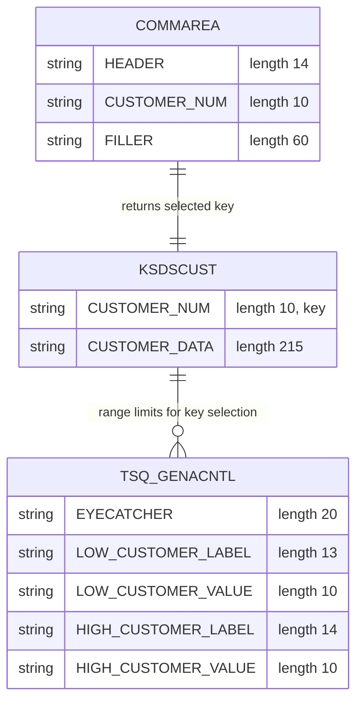

## Table of Contents

- [1. Purpose](#1-purpose)
- [2. Inputs](#2-inputs)
  - [2.1 Communication Area Parameters](#21-communication-area-parameters)
  - [2.2 CICS System Fields and Environment Indicators](#22-cics-system-fields-and-environment-indicators)
  - [2.3 Terminal User Inputs](#23-terminal-user-inputs)
  - [2.4 External Data Stores and Queues](#24-external-data-stores-and-queues)
- [3. Outputs](#3-outputs)
  - [3.1 Communication Area Outputs](#31-communication-area-outputs)
  - [3.2 Terminal Outputs](#32-terminal-outputs)
  - [3.3 Temporary Storage Queue Outputs](#33-temporary-storage-queue-outputs)
- [4. Processing Logic](#4-processing-logic)
  - [4.1 Mermaid Flow Diagram](#41-mermaid-flow-diagram)
  - [4.2 Processing Logic Description](#42-processing-logic-description)
  - [4.3 Database Tables](#43-database-tables)
- [5. Paragraphs](#5-paragraphs)
- [6. Dependencies](#6-dependencies)
- [7. Constraints](#7-constraints)
  - [7.1 Program Calling Context and Invocation Constraints](#71-program-calling-context-and-invocation-constraints)
  - [7.2 Temporary Storage Queue (TSQ) Constraints](#72-temporary-storage-queue-tsq-constraints)
  - [7.3 Key Generation and Random Number Constraints](#73-key-generation-and-random-number-constraints)
  - [7.4 VSAM Customer Master File Constraints](#74-vsam-customer-master-file-constraints)
  - [7.5 Output Constraints and Communication Protocols](#75-output-constraints-and-communication-protocols)
  - [7.6 Execution and Input/Output Mode Constraints](#76-execution-and-inputoutput-mode-constraints)
  - [7.7 Temporary Storage Queue (TSQ) Structure and Concurrency Constraints](#77-temporary-storage-queue-tsq-structure-and-concurrency-constraints)
  - [7.8 Key Generation and Numeric Limits](#78-key-generation-and-numeric-limits)
  - [7.9 VSAM File and Record Constraints](#79-vsam-file-and-record-constraints)
  - [7.10 Temporary Storage Queue (TSQ) Structure and Concurrency Constraints](#710-temporary-storage-queue-tsq-structure-and-concurrency-constraints)
  - [7.11 Key Generation and Numeric Limits](#711-key-generation-and-numeric-limits)
  - [7.12 VSAM File and Record Constraints](#712-vsam-file-and-record-constraints)
- [8. Error Handling](#8-error-handling)
  - [8.1 CICS Command and Response Code Evaluation](#81-cics-command-and-response-code-evaluation)
  - [8.2 Concurrency and Resource Contention Handling](#82-concurrency-and-resource-contention-handling)
  - [8.3 Fallback and Default Value Initialization](#83-fallback-and-default-value-initialization)
  - [8.4 Caller Invocation and Output Route Handling](#84-caller-invocation-and-output-route-handling)
- [9. Examples](#9-examples)
  - [9.1 Example 1: LINK call with existing TS queue range](#91-example-1-link-call-with-existing-ts-queue-range)
  - [9.2 Example 2: Terminal start with no TS queue (defaults)](#92-example-2-terminal-start-with-no-ts-queue-defaults)
  - [9.3 Example 3: Key not found by the VSAM read](#93-example-3-key-not-found-by-the-vsam-read)

## 1. Purpose

LGICVS01 is a CICS customer-inquiry routine in the General Insurance application. It returns a valid, existing customer number that the caller can use for inquiry or testing. It gets the allowed range of customer numbers from the shared GENACNTL temporary storage queue. If the queue or its low and high entries don't exist, it creates them with default boundaries. It picks a pseudo-random number within that range and reads the KSDSCUST customer VSAM file for the nearest key at or above that number, so the result is a real customer record. It then returns the customer number in one of two ways. A calling program that used LINK or a similar call gets it in the communication area. A transaction started from a terminal gets it as text on the screen.

## 2. Inputs

### 2.1 Communication Area Parameters
- `COMM_AREA_PTR`
  - A pointer parameter passed to the program entry point representing the address of the caller-supplied communication area (`COMMA_DATA`).
- `COMMA_DATA`
  - A based communication area structure mapped via `COMM_AREA_PTR` used when the program is invoked through a program link (`EXEC CICS LINK`).
  - `COMMA_DATA_H`: A 14-character header field within the communication area providing descriptive header information or label data.
  - `COMMA_DATA_HIGH`: A 10-digit numeric field in the communication area used to pass customer search data.
  - `COMMA_DATA_FILL`: A 60-character filler field within the input structure.

### 2.2 CICS System Fields and Environment Indicators
- `EIBTASKN`
  - The CICS Execute Interface Block task number, supplied by the runtime environment and used as a seed value for generating pseudo-random customer numbers.
- `EIBCALEN`
  - The CICS Execute Interface Block communication area length, providing the size of the passed communication area to determine input data length.
- `WS_STARTCODE`
  - A 2-character field populated via `EXEC CICS ASSIGN STARTCODE` indicating how the transaction was initiated (e.g., direct terminal invocation vs. distributed/linked call).
- `WS_INVOKEPROG`
  - An 8-character field populated via `EXEC CICS ASSIGN INVOKINGPROG` holding the name of the calling program, used to evaluate whether the program was called via `EXEC CICS LINK`.
- `WS_SYSID`
  - A 4-character field populated via `EXEC CICS ASSIGN SYSID` identifying the local CICS system identifier.

### 2.3 Terminal User Inputs
- `WS_RECV`
  - A record buffer populated via `EXEC CICS RECEIVE` containing raw terminal input when the transaction is run directly from a 3270 terminal.
  - `WS_RECV_TRANID`: A 5-character field holding the transaction identifier entered by the user.
  - `WS_RECV_DATA`: A 74-character field holding any user-supplied payload or screen data following the transaction identifier.

### 2.4 External Data Stores and Queues
- `STSQ_NAME` (`GENACNTL`)
  - A CICS Temporary Storage Queue named `GENACNTL` containing shared control records that supply the valid customer range boundaries.
  - `READ_MSG`: Target buffer structure populated by `EXEC CICS READQ TS` into overlay fields:
    - `READ_CUST_LOW`: 10-digit numeric picture field holding the low customer boundary read from the queue.
    - `READ_CUST_HIGH`: 10-digit numeric picture field holding the high customer boundary read from the queue.
- `KSDSCUST`
  - The VSAM Key-Sequenced Data Set (KSDS) holding customer master records, accessed via `EXEC CICS READ FILE('KSDSCUST') GTEQ` using a generic or exact search key.
  - `CA_AREA`: Record buffer mapped over the retrieved VSAM record.
    - `CA_CUSTOMER_NUM`: 10-character customer identification number read directly from the VSAM dataset.

## 3. Outputs

### 3.1 Communication Area Outputs
- `COMMA_DATA`: Communication area data structure passed back to the calling program when invoked via program link or distributed program call.
  - `COMMA_DATA_H`: Character header field populated with descriptive label text (`HIGH CUSTOMER=`) identifying the returned customer information.
  - `COMMA_DATA_HIGH`: Numeric picture field holding the retrieved customer identification number passed back to the caller.

### 3.2 Terminal Outputs
- `WRITE_MSG`: Structured record buffer used for terminal display output.
  - `WRITE_MSG_H`: Header label (`HIGH CUSTOMER=`) sent as part of the terminal message display when the program is executed directly via transaction.
  - `WRITE_MSG_HIGH`: Customer identifier value appended immediately after the header text in the formatted terminal text output.

### 3.3 Temporary Storage Queue Outputs
- `STSQ_NAME`: Target CICS Temporary Storage Queue name (`GENACNTL`) written to when initializing missing customer control records.
  - `WRITE_MSG_E`: Eyecatcher header record written to item 1 of the temporary storage queue to initialize the queue if not already present.
  - `WRITE_MSG_L`: Control record containing the low customer boundary label and initial numeric limit written to the temporary storage queue.
  - `WRITE_MSG_H`: Control record containing the high customer boundary label and initial numeric limit written to the temporary storage queue.

## 4. Processing Logic

### 4.1 Mermaid Flow Diagram

```mermaid
graph TD
    A([Start LGICVS01]) --> B[Clear receive area]
    B --> C[Assign SYSID, STARTCODE and INVOKINGPROG]
    C --> D{Started by LINK or invoking program present}
    D -- Yes --> E[Set flag to C for COMMAREA<br>Copy header and set length from EIBCALEN]
    D -- No --> F[Receive terminal input<br>Set flag to R and reduce length by 5]
    E --> G[Initialize low and high to 1000001<br>Set queue flags to Y]
    F --> G
    G --> H[Enqueue on GENACNTL resource]
    H --> I[Read TS queue item 1]
    I --> J{Read response normal}
    J -- No --> P[Keep defaults and flags]
    J -- Yes --> K[Clear eyecatcher flag]
    K --> L[Read next TS queue item]
    L --> M{Record starts with LOW CUSTOMER}
    M -- Yes --> M1[Set low value and clear low flag]
    M -- No --> N{Record starts with HIGH CUSTOMER}
    M1 --> N
    N -- Yes --> N1[Set high value and clear high flag]
    N -- No --> O{Response greater than 0}
    N1 --> O
    O -- No --> L
    O -- Yes --> P
    P --> Q[Move low and high to message record]
    Q --> R{Eyecatcher flag is Y}
    R -- Yes --> R1[Write eyecatcher record to TS queue]
    R -- No --> S{Low flag is Y}
    R1 --> S
    S -- Yes --> S1[Write LOW CUSTOMER record to TS queue]
    S -- No --> T{High flag is Y}
    S1 --> T
    T -- Yes --> T1[Write HIGH CUSTOMER record to TS queue]
    T -- No --> U[Dequeue GENACNTL resource]
    T1 --> U
    U --> V[Compute random customer number between low and high]
    V --> W[Store random number as search key]
    W --> X[Read KSDSCUST file with GTEQ]
    X --> Y{Read response normal}
    Y -- Yes --> Y1[Replace key with actual customer number found]
    Y -- No --> Z{Flag is C}
    Y1 --> Z
    Y -- No --> Z
    Z -- Yes --> Z1[Return header and customer number in COMMAREA<br>Blank the filler]
    Z -- No --> Z2[Send customer text to terminal<br>Erase screen and free keyboard]
    Z1 --> END1[CICS RETURN]
    Z2 --> END1
    END1 --> END2([End])

    classDef start fill:#d5f5e3,stroke:#82c99a,color:#000;
    classDef process fill:#d6eaf8,stroke:#85a9d6,color:#000;
    classDef decision fill:#fdebd0,stroke:#e0b080,color:#000;
    classDef io fill:#e8daef,stroke:#b39ac9,color:#000;

    class A,END2 start;
    class B,C,E,G,K,M1,N1,P,Q,V,W,Y1,Z1 process;
    class D,J,M,N,O,R,S,T,Y,Z decision;
    class F,H,I,L,R1,S1,T1,U,X,Z2,END1 io;
```



### 4.2 Processing Logic Description

**High-level Summary**

LGICVS01 is a CICS PL/I program that returns a real customer number from the KSDSCUST VSAM file. It reads the customer number range (low and high) from the GENACNTL temporary storage queue. If the queue or any of its records are missing, it creates them with defaults. It then picks a random number inside the range and reads KSDSCUST with GTEQ to find the nearest existing customer key. The caller gets the result in the COMMAREA (LINK or program invocation). A terminal-started transaction gets it as a text screen.

**Execution Flow**

1. **Initialization**: The program clears the receive work area. It then issues three CICS ASSIGN calls to get the SYSID, STARTCODE and INVOKINGPROG. Their responses are stored in WS_RESP but not checked.
2. **Determine invocation mode**:
   - If the first character of the start code is 'D' (a program-initiated start) or an invoking program name is present, the caller used LINK or a program call. The flag is set to 'C' (COMMAREA). The header is copied from the COMMAREA and the length is set from EIBCALEN.
   - Otherwise the program was started from a terminal. It does a CICS RECEIVE into WS_RECV and sets the flag to 'R'. It copies the data portion and reduces the length by 5 for the transaction ID.
3. **Set defaults**: WS_CUST_LOW and WS_CUST_HIGH are both set to 1000001. The three queue flags (eyecatcher, low, high) are all set to 'Y', meaning the record must be written.
4. **Serialize**: The program issues ENQ on the resource name GENACNTL, so concurrent tasks cannot update the queue at the same time.
5. **Read the TS queue**: It reads item 1 of queue GENACNTL.
   - If the response is not NORMAL, the queue is treated as missing and the defaults and 'Y' flags remain.
   - If the response is NORMAL, the eyecatcher flag is cleared. A loop then reads the next items until a response greater than 0 occurs (end of queue or any error):
     - A record starting with `LOW CUSTOMER` sets WS_CUST_LOW from the numeric overlay and clears the low flag.
     - A record starting with `HIGH CUSTOMER` sets WS_CUST_HIGH from the numeric overlay and clears the high flag.
6. **Prepare message values**: The low and high values are moved into WRITE_MSG_LOW and WRITE_MSG_HIGH.
7. **Create missing queue records** (written with NOSUSPEND):
   - If the eyecatcher flag is 'Y', it writes `**** GENAPP CNTL` (20 bytes).
   - If the low flag is 'Y', it writes the `LOW CUSTOMER=` record (23 bytes).
   - If the high flag is 'Y', it writes the `HIGH CUSTOMER=` record (24 bytes).
8. **Release**: The program issues DEQ on GENACNTL.
9. **Random selection**: It computes `FLOOR(RANDOM(EIBTASKN) * (HIGH - LOW) + LOW)`. This gives a pseudo-random customer number in the range, seeded by the task number. The result is stored in WS_RANDOM_NUMBER and moved into WRITE_MSG_HIGH, which is the search key.
10. **VSAM read**: It does a CICS READ of file KSDSCUST with GTEQ, a 10-byte key, and a record length of 225. The data goes into CA_AREA.
    - If the response is NORMAL, WRITE_MSG_HIGH is replaced with the real customer number found (CA_CUSTOMER_NUM).
    - If it is not NORMAL, for example NOTFND, the random number stays as the result. There is no explicit error handling.
11. **Return the result**:
    - Flag 'C': the program fills the COMMAREA with the header (`HIGH CUSTOMER=`), the customer number, and 60 blanks.
    - Otherwise: the program sends a 24-byte text (the header only, WRITE_MSG_H) to the terminal with WAIT, ERASE, TERMINAL and FREEKB.
12. **End**: CICS RETURN ends the task.

**Business rules and observations**
- The default customer range is 1000001 to 1000001 when the queue is absent.
- The ENQ/DEQ pair protects only the queue read and create section. It does not cover the random selection or the VSAM read.
- RESP values from the ASSIGN, RECEIVE, WRITEQ and READ commands are not checked, except for the TS queue reads and the KSDSCUST read.
- The terminal output is `WRITE_MSG_H` with a length of 24. This is the label field followed by the 10-digit value that follows it in the structure.

**External Interactions**

| Resource | Type | Purpose |
|---|---|---|
| GENACNTL | CICS TS queue | Stores the eyecatcher, LOW CUSTOMER and HIGH CUSTOMER range records. Read at the start and created with defaults if missing. |
| GENACNTL | ENQ/DEQ resource | Serializes access to the queue during read and initialization. |
| KSDSCUST | VSAM KSDS file | Customer master file, read by GTEQ to find an existing customer number at or after the random key. |
| COMMAREA | Caller interface | Returns the customer number to LINK callers. |
| Terminal | 3270 screen | Displays the result for terminal-started transactions, using CICS RECEIVE and SEND TEXT. |

**Plain Language Summary**

The program picks a customer number at random for testing or demonstration. It looks up a shared control list, which holds the smallest and largest customer numbers allowed. If that list doesn't exist yet, it creates one with a default value. It then chooses a random number between the two limits and finds the nearest real customer in the customer file. The customer number is handed back to the calling program, or shown on the screen if a person started the transaction.

### 4.3 Database Tables



## 5. Paragraphs

- **LGICVS01**
  - **Purpose:** Serves as the main procedure entry point for the customer inquiry VSAM transaction/program. It determines the invocation method, initializes or retrieves low and high customer boundary numbers from a CICS Temporary Storage Queue (TSQ), selects a random customer number within that range, retrieves the matching or next available customer record from a VSAM KSDS data set, and returns the result via COMMAREA or terminal output.
  - **Operations:**
    - Queries execution environment attributes including system ID (`SYSID`), start code (`STARTCODE`), and invoking program (`INVOKINGPROG`).
    - Handles input by either establishing COMMAREA addressing or receiving screen/terminal input data.
    - Serializes access to TSQ `GENACNTL` using CICS ENQ/DEQ commands.
    - Reads customer range boundaries (`LOW CUSTOMER` and `HIGH CUSTOMER`) from TSQ `GENACNTL`.
    - If TSQ entries are missing, initializes default customer boundary records (1000001) and writes them to the TSQ.
    - Generates a pseudo-random customer key between the low and high customer boundaries using `RANDOM(EIBTASKN)`.
    - Performs a generic or greater-than-or-equal (`GTEQ`) keyed read against the VSAM file `KSDSCUST`.
    - Formats and returns the retrieved customer number into the caller's COMMAREA structure or transmits it as formatted text directly to the CICS terminal screen.
    - Concludes execution and returns control to CICS.
  - **Control Flow:**
    - Evaluates `WS_STARTCODE` and `WS_INVOKEPROG` via an `IF-THEN-ELSE` block to branch between CICS LINK/COMMAREA processing mode (`'C'`) and terminal transaction RECEIVE mode (`'R'`).
    - Uses an `IF` block checking the first TSQ read response code (`DFHRESP(NORMAL)`), followed by a `DO UNTIL (WS_RESP > 0)` loop reading sequential queue items with embedded `IF` conditions to parse low and high customer identifiers.
    - Uses conditional `IF` blocks checking flags (`WS_FLAG_TSQE`, `WS_FLAG_TSQL`, `WS_FLAG_TSQH`) to selectively insert missing queue entries.
    - Uses an `IF` check on the VSAM `READ` response code to update the high message value with the retrieved `CA_CUSTOMER_NUM`.
    - Uses a `SELECT-WHEN-OTHERWISE` block on `WS_FLAG` to route the final output to either the COMMAREA buffer or the terminal screen via `EXEC CICS SEND TEXT`.
  - **Interactions with External Systems:**
    - CICS CICS control commands: `EXEC CICS ASSIGN`, `EXEC CICS RECEIVE`, `EXEC CICS ENQ`, `EXEC CICS DEQ`, `EXEC CICS SEND TEXT`, and `EXEC CICS RETURN`.
    - CICS Temporary Storage: `EXEC CICS READQ TS` and `EXEC CICS WRITEQ TS` operations against TSQ `GENACNTL`.
    - VSAM data set: `EXEC CICS READ FILE('KSDSCUST')` with `GTEQ` key searching against the customer master file.

## 6. Dependencies

- **Files and data sets**
  - VSAM KSDS file `KSDSCUST`
    - It is the customer master file, read through `EXEC CICS READ FILE('KSDSCUST')`.
    - The read is a GTEQ search with a 10-byte key. The key is `RIDFLD(WRITE_MSG_HIGH)` with `KEYLENGTH(F10)`. The program uses it to find the nearest existing customer number to the random target.
    - The record goes into the `CA_AREA` buffer, with `LENGTH(F82)`, which is initialised to 225. `CA_CUSTOMER_NUM` is the first 10 bytes of the record and is the value returned.
    - The file must be defined in the CICS CSD (`Resources/`) and be open and enabled.
    - The program reads `RESP` from `WS_RESP` and uses the record only when the response is `DFHRESP(NORMAL)`. Otherwise it keeps the randomly generated number.

- **CICS temporary storage queue**
  - TS queue `GENACNTL`, held in `STSQ_NAME`
    - It stores the customer number range shared across transactions and tasks.
    - It holds three kinds of record:
      - An eyecatcher record, `**** GENAPP CNTL`.
      - A `LOW CUSTOMER=` record.
      - A `HIGH CUSTOMER=` record.
    - `READQ TS ITEM(1)` and `READQ TS NEXT` load the records into `READ_MSG`. `READ_CUST_LOW` and `READ_CUST_HIGH` parse the values into `WS_CUST_LOW` and `WS_CUST_HIGH`.
    - `WRITEQ TS ... NOSUSPEND` creates any missing record from `WRITE_MSG_E`, `WRITE_MSG_L` and `WRITE_MSG_H`. The flags `WS_FLAG_TSQE`, `WS_FLAG_TSQL` and `WS_FLAG_TSQH` decide which records to write.
    - The queue needs a TS model or definition that permits it. It must be created on first use if it does not exist.
  - ENQ/DEQ on the resource named by `STSQ_NAME`
    - `EXEC CICS ENQ` and `DEQ` with `LENGTH(STG(STSQ_NAME))` serialise access to the queue.
    - This avoids races between concurrent tasks that read and initialise the range.

- **Input parameters and data sources**
  - Caller `COMMAREA`, passed as `COMM_AREA_PTR`
    - It is mapped by the based structure `COMMA_DATA`, which has `COMMA_DATA_H`, `COMMA_DATA_HIGH` and `COMMA_DATA_FILL`.
    - It is used when the program is invoked by LINK or by a program-initiated start. The program tests this with `STARTCODE` beginning with `D`, or with a non-blank invoking program.
    - It is also the output channel. The program writes the header label and the selected customer number into it for the caller.
    - `EIBCALEN` supplies the COMMAREA length, and is copied into `WS_RECV_LEN`.
  - Terminal input via `EXEC CICS RECEIVE INTO(WS_RECV)`
    - It is used when the program is started directly as a transaction from a terminal.
    - The data lands in `WS_RECV`, which has `WS_RECV_TRANID` and `WS_RECV_DATA`. `WS_RECV_LEN` receives the length.
  - Execute Interface Block (EIB) fields
    - `EIBCALEN` gives the COMMAREA length.
    - `EIBTASKN` is the task number, used as the seed for `RANDOM`.
  - Default range values
    - `WS_CUST_LOW` and `WS_CUST_HIGH` both default to `1000001`. They are used when the TS queue is missing or lacks the range records.

- **CICS runtime services**
  - `EXEC CICS ASSIGN`
    - `SYSID`, `STARTCODE` and `INVOKINGPROG` are retrieved to decide how the program was started.
    - These values set `WS_FLAG` to `C` (commarea) or `R` (receive).
  - `EXEC CICS SEND TEXT`
    - It sends `WRITE_MSG_H` to the terminal, with `ERASE`, `WAIT`, `FREEKB` and `LENGTH(24)`.
    - It is used in the non-COMMAREA path, which needs a terminal.
  - `EXEC CICS RETURN`
    - It ends the transaction and returns control to the caller or CICS.
  - `DFHRESP(NORMAL)`
    - It is the response-code translation used to test the outcome of `READQ TS` and `READ`.

- **Language runtime and built-in functions**
  - PL/I built-ins `RANDOM`, `FLOOR`, `FLOAT`, `SUBSTR` and `STG`
    - `RANDOM(EIBTASKN)` and `FLOOR` produce the random customer number between the low and high range boundaries.
    - `STG` provides the length of the ENQ/DEQ resource name.
  - The `Options(Main)` entry point with the `Proc(COMM_AREA_PTR)` parameter
    - It follows the CICS PL/I convention for passing the COMMAREA pointer.

- **External programs and callers**
  - No `CALL` or `EXEC CICS LINK` to other programs.
  - The program is called by other programs through LINK, or started as a transaction from a terminal. In the GenApp architecture its callers are the customer-add programs, such as `LGACDB01` and `LGACVS01`.
  - No `%INCLUDE` or `EXEC SQL INCLUDE` members are used. All data structures are declared locally.

- **Database dependencies**
  - There are no Db2 or SQL dependencies. The program contains no `EXEC SQL` statements.

- **Configuration and environment**
  - A CICS region is required.
    - It must have the transaction and program definitions for `LGICVS01`.
    - It must have the `KSDSCUST` file definition.
    - It must allow TS queue creation and use for `GENACNTL`.
    - It must support ENQ resources.
  - The build is through zAppBuild.
    - The compile uses `SYSTEM(CICS)` and `PP(MACRO,CICS)`.
    - The program deploys as `CICSLOAD`.
  - There are no environment variables or external configuration files.

## 7. Constraints

I have successfully read the entire PL/I program `LGICVS01.pli`. Now let's analyze it thoroughly to extract all constraints, validation rules, dependencies, and formatting behaviors.

Let's break down the logic of the program to understand every constraint enforced or implied.

### 7.1 Program Calling Context and Invocation Constraints
- **Calling Context / Modes**:
  - The program can be invoked via standard LINK (with COMMAREA / pointer COMM_AREA_PTR) or directly via a Transaction (terminal invocation with `RECEIVE`).
  - This is controlled by checking CICS assign parameters:
    ```pli
    EXEC CICS ASSIGN STARTCODE(WS_STARTCODE) RESP(WS_RESP);
    EXEC CICS ASSIGN INVOKINGPROG(WS_INVOKEPROG) RESP(WS_RESP);
    ```
    If `SUBSTR(WS_STARTCODE,1,1) = 'D'` (which corresponds to Distributed Program Link, or a transaction invocation with COMMAREA, etc.) or `WS_INVOKEPROG ^= ' '` (meaning it was called by another program, i.e., linked to), then `WS_FLAG` is set to `'C'` (indicating COMMAREA mode).
    In this COMMAREA mode:
    - `WS_COMMAREA` is assigned `COMMA_DATA_H`.
    - `WS_RECV_LEN` is set to `EIBCALEN`.
    - It maps its return data directly over the caller's COMMAREA via the pointer `COMM_AREA_PTR` (`COMMA_DATA BASED(COMM_AREA_PTR)`).
    Otherwise (not called by another program / not DPL, implying a terminal transaction call):
    - It performs `EXEC CICS RECEIVE INTO(WS_RECV) LENGTH(WS_RECV_LEN) RESP(WS_RESP);`.
    - `WS_FLAG` is set to `'R'`.
    - `WS_COMMAREA` is set to `WS_RECV_DATA`.
    - `WS_RECV_LEN` is adjusted (`WS_RECV_LEN = WS_RECV_LEN - 5;`).

### 7.2 Temporary Storage Queue (TSQ) Constraints
- **TSQ Name**:
  - The name is defined as `'GENACNTL'`. It can also have a 4-character extension `STSQ_EXT` which, however, does not appear to be initialized or appended in this specific code (only `STSQ_NAME` is used in CICS TSQ commands: `EXEC CICS READQ TS QUEUE(STSQ_NAME)...`). Thus, the TSQ name is strictly `'GENACNTL'` (8 characters).
- **TSQ Locks / Concurrency**:
  - To prevent concurrent read/write race conditions on the TSQ, the program uses CICS ENQUEUE and DEQUEUE:
    ```pli
    EXEC CICS ENQ RESOURCE(STSQ_NAME) LENGTH(STG(STSQ_NAME));
    ...
    EXEC CICS DEQ RESOURCE(STSQ_NAME) LENGTH(STG(STSQ_NAME));
    ```
    This serializes execution across multiple tasks accessing the same `GENACNTL` queue.
- **TSQ Layout & Record Sequencing Constraints**:
  - The queue stores control records. When reading from item 1:
    - If the TSQ does not exist (`WS_RESP` is not `NORMAL`), the program initializes boundaries and prepares to write them.
    - If the TSQ exists (`WS_RESP = DFHRESP(NORMAL)`), the program reads subsequent items sequentially in a loop:
      ```pli
      DO UNTIL (WS_RESP > 0);
        EXEC CICS READQ TS QUEUE(STSQ_NAME) INTO(READ_MSG) RESP(WS_RESP) NEXT;
      ```
      - Inside this loop, if the record starts with `'LOW CUSTOMER'`, it extracts `READ_CUST_LOW` from the record:
        `WS_CUST_LOW  = READ_CUST_LOW;`
      - If the record starts with `'HIGH CUSTOMER'`, it extracts `READ_CUST_HIGH` from the record:
        `WS_CUST_HIGH = READ_CUST_HIGH;`
    - The record layouts (or offsets within `READ_MSG`) are critical structural constraints:
      ```pli
      DCL 1  READ_MSG UNION,                                                       
            3 READ_MSG_MSG             CHAR(80) INIT(' '),                         
            3 *,                                                                   
              5 *                      CHAR(13),                                   
              5 READ_CUST_LOW          PIC '(10)9',                                
            3 *,                                                                   
              5 *                      CHAR(14),                                   
              5 READ_CUST_HIGH         PIC '(10)9';
      ```
      This means:
      - The `LOW CUSTOMER` value is a 10-digit numeric picture (`PIC '(10)9'`) located starting at byte 14 (after 13 characters of label `'LOW CUSTOMER='`).
      - The `HIGH CUSTOMER` value is a 10-digit numeric picture (`PIC '(10)9'`) located starting at byte 15 (after 14 characters of label `'HIGH CUSTOMER='`).
- **Default/Fallback values for Customer Boundaries**:
  - If TSQ records are not found or do not exist, both `WS_CUST_LOW` and `WS_CUST_HIGH` default to `1000001` (since they are initialized to `1000001` and only updated if the corresponding record is read).
- **TSQ Creation/Persistence Constraints**:
  - If the TSQ does not exist, or specific headers/records are missing, they are written to the TSQ with `NOSUSPEND` option (preventing the transaction from suspending if the TSQ is full or locked by another system-level limit):
    - Header: `"**** GENAPP CNTL"`, written with length 20 (from `WRITE_MSG_E` which is `CHAR(20)`).
    - Low Record: `"LOW CUSTOMER="` followed by the value, written with length 23 (from `WRITE_MSG_L` which is `CHAR(13)` plus `WRITE_MSG_LOW` which is `CHAR(10)`).
    - High Record: `"HIGH CUSTOMER="` followed by the value, written with length 24 (from `WRITE_MSG_H` which is `CHAR(14)` plus `WRITE_MSG_HIGH` which is `PIC '(10)9'`).

### 7.3 Key Generation and Random Number Constraints
- **Key Generation Logic**:
  - The program selects a random customer number between `WS_CUST_LOW` and `WS_CUST_HIGH` inclusive.
  - The random calculation uses:
    ```pli
    WS_RANDOM_NUMBER = FLOOR(RANDOM(EIBTASKN) * FLOAT(WS_CUST_HIGH - WS_CUST_LOW) + WS_CUST_LOW);
    ```
    - The seed for the pseudo-random generator `RANDOM` is `EIBTASKN` (the current CICS task number).
    - The calculation results in a `FIXED BIN(31)` integer within the range `[WS_CUST_LOW, WS_CUST_HIGH]`.
    - This integer is assigned to `WRITE_MSG_HIGH` (which is a `PIC '(10)9'` field).

### 7.4 VSAM Customer Master File Constraints
- **File Name**:
  - The program reads the VSAM dataset `'KSDSCUST'`.
- **Search Key Constraint**:
  - The search key used is `WRITE_MSG_HIGH` (which contains the generated random customer number).
  - The field `WRITE_MSG_HIGH` is a numeric picture `PIC '(10)9'` of length 10.
  - The key length (`KEYLENGTH`) is explicitly specified as `F10` (which is a fixed bin variable initialized to `10`).
- **Read Operation & Search Constraint**:
  - The read uses `GTEQ` (Greater Than or Equal):
    ```pli
    EXEC CICS READ FILE('KSDSCUST')                                              
              INTO(CA_AREA)                                                      
              LENGTH(F82)                                                        
              RIDFLD(WRITE_MSG_HIGH)                                             
              KEYLENGTH(F10)                                                     
              RESP(WS_RESP)                                                      
              GTEQ;
    ```
    - This means the program does not require an exact match. It looks for the first record with a key *greater than or equal to* the randomly generated customer number.
    - If a record is found (`WS_RESP = DFHRESP(NORMAL)`), the actual customer number retrieved from VSAM (`CA_CUSTOMER_NUM` from `CA_AREA`) is assigned to `WRITE_MSG_HIGH`:
      `WRITE_MSG_HIGH = CA_CUSTOMER_NUM;`
    - If no record is found or the read fails (e.g., `NOTFND`), the program keeps the randomly generated key (`WS_RANDOM_NUMBER`) in `WRITE_MSG_HIGH`.
- **Record Length Constraint**:
  - The buffer `CA_AREA` is used to hold the read customer record.
  - The length constraint is `F82` (initialized to `225`).
  - Structurally, `CA_AREA` consists of:
    - `CA_CUSTOMER_NUM`: `CHAR(10)` (the 10-byte character field representing the unique customer identifier).
    - An anonymous filler: `CHAR(215)`.
    - The total length is exactly `10 + 215 = 225` bytes, which matches the CICS READ length parameter `F82` (`225`).

### 7.5 Output Constraints and Communication Protocols
- **Output Formats Based on Execution Mode**:
  - **COMMAREA Mode (`WS_FLAG = 'C'`)**:
    - The output is passed back to the caller through the based structure `COMMA_DATA` mapped via `COMM_AREA_PTR`:
      ```pli
      COMMA_DATA_H    = WRITE_MSG_H;                                           
      COMMA_DATA_HIGH = WRITE_MSG_HIGH;                                        
      COMMA_DATA_FILL = (60)' ';
      ```
      - `COMMA_DATA_H` is a 14-character field set to `"HIGH CUSTOMER="` (derived from `WRITE_MSG_H`).
      - `COMMA_DATA_HIGH` is a 10-digit numeric picture `PIC '(10)9'` set to the resulting customer number (either the nearest actual customer key retrieved from VSAM, or the random key if the VSAM read was unsuccessful).
      - `COMMA_DATA_FILL` is a 60-character space filler.
      - The total length of `COMMA_DATA` is exactly `14 + 10 + 60 = 84` bytes.
  - **Terminal / Interactive Mode (`WS_FLAG ^= 'C'`)**:
    - The output is sent directly to the invoking terminal:
      ```pli
      EXEC CICS SEND TEXT FROM(WRITE_MSG_H)                                    
                WAIT                                                           
                ERASE                                                          
                TERMINAL                                                       
                LENGTH(24)                                                     
                FREEKB;
      ```
      - It sends the content of `WRITE_MSG_H` which contains `"HIGH CUSTOMER="` followed by the 10-digit customer number (stored in `WRITE_MSG_HIGH` overlay/adjacent field).
      - Note: In `WRITE_MSG`, `WRITE_MSG_H` is declared as `CHAR(14) INIT('HIGH CUSTOMER=')` followed immediately by `WRITE_MSG_HIGH PIC '(10)9'`. Since they are consecutive fields inside the `WRITE_MSG` structure, sending `WRITE_MSG_H` with a `LENGTH(24)` effectively sends the 14 characters of `"HIGH CUSTOMER="` and the 10 characters of `WRITE_MSG_HIGH` together.
      - The screen is erased (`ERASE`), the keyboard is unlocked (`FREEKB`), and the program waits for completion (`WAIT`).

Let's double-check all details and format the constraints into logical categories as requested:
- Data validation rules (e.g., required fields, value ranges, formats)
- Conditional restrictions on processing or data flow
- Limits on resource usage (e.g., file size, record count, memory)
- Timing or sequencing constraints (e.g., operations that must occur in a specific order)
- Any other rules that restrict or govern how the program behaves or what inputs/outputs are allowed

Everything should start with "-" and use proper indentations to reflect hierarchy. Do not use numbered bullet points. Do not add the section heading. The response must start directly with the section body content.

Let's organize the categories:
### 7.6 Execution and Input/Output Mode Constraints
- Mode determination: The program dynamically determines its processing and communication mode (COMMAREA mode or Terminal mode) based on how it is invoked.
  - If `STARTCODE` starts with `'D'` or `INVOKINGPROG` is not blank, the program operates in COMMAREA mode (`WS_FLAG = 'C'`).
  - Otherwise, it operates in Terminal mode (`WS_FLAG = 'R'`), requiring an interactive `RECEIVE` command.
- COMMAREA structural requirements:
  - When running in COMMAREA mode, the program maps the return structure to the caller-supplied area using a pointer `COMM_AREA_PTR`.
  - The output structure `COMMA_DATA` must be exactly 84 bytes, comprising:
    - `COMMA_DATA_H`: 14 characters.
    - `COMMA_DATA_HIGH`: 10-digit numeric picture (`PIC '(10)9'`).
    - `COMMA_DATA_FILL`: 60 characters.
- Terminal output requirements:
  - When running in Terminal mode, output is transmitted via `EXEC CICS SEND TEXT` with a strict length constraint of 24 bytes starting from `WRITE_MSG_H` (encompassing the 14-byte label `"HIGH CUSTOMER="` and the 10-byte customer number value).

### 7.7 Temporary Storage Queue (TSQ) Structure and Concurrency Constraints
- Queue name validation:
  - The TSQ name is strictly hardcoded as `'GENACNTL'`.
- Concurrency control:
  - All read and write access to the `'GENACNTL'` TSQ is wrapped within serialized resource locks via `EXEC CICS ENQ` and `DEQ` using the queue name as the resource identifier to prevent race conditions.
- Record layout and parsing constraints:
  - The program assumes the TSQ contains structured records formatted to fit into an 80-byte message layout (`READ_MSG` union):
    - The `LOW CUSTOMER` record must start with `'LOW CUSTOMER'` in its first 12 characters, and its numeric value must reside starting at position 14 as a 10-digit numeric picture (`READ_CUST_LOW`).
    - The `HIGH CUSTOMER` record must start with `'HIGH CUSTOMER'` in its first 13 characters, and its numeric value must reside starting at position 15 as a 10-digit numeric picture (`READ_CUST_HIGH`).
- Initialization constraints:
  - If the TSQ is empty or missing these records, default values of `1000001` are enforced for both low and high customer boundaries.
  - Write statements to update or create missing boundaries use the `NOSUSPEND` option, meaning writes fail rather than suspend if CICS resources are exhausted.

### 7.8 Key Generation and Numeric Limits
- Range constraints:
  - The target customer number to search for is randomly generated within the inclusive range defined by `[WS_CUST_LOW, WS_CUST_HIGH]`.
- Randomization seed dependency:
  - The random number generator `RANDOM(EIBTASKN)` is seeded with the current CICS task number (`EIBTASKN`), ensuring pseudo-random distribution across unique executions but deterministic behavior within the same task.

### 7.9 VSAM File and Record Constraints
- Dataset name:
  - All database queries must target the VSAM dataset named `'KSDSCUST'`.
- Search key constraints:
  - The search key used in the record lookup (`RIDFLD`) must be a 10-byte numeric picture field (`WRITE_MSG_HIGH`).
  - The `KEYLENGTH` is strictly enforced as 10 bytes (defined by `F10`).
- Record retrieval logic:
  - The search is performed using the Greater Than or Equal (`GTEQ`) search option, meaning the program does not require an exact match but rather finds the nearest customer record equal to or above the generated random number.
- Record buffer and size limit:
  - The buffer into which the VSAM record is read (`CA_AREA`) must be exactly 225 bytes (defined by `F82`), partitioned into:
    - `CA_CUSTOMER_NUM`: 10-character alphanumeric field at the beginning.
    - Filler: 215-character trailing area.

This layout fits all criteria perfectly. Let's write out the response starting directly with the body content and following all guidelines.### Execution and Input/Output Mode Constraints
- Mode determination: The program dynamically determines its processing and communication mode (COMMAREA mode or Terminal mode) based on how it is invoked.
  - If the CICS `STARTCODE` starts with `'D'` or `INVOKINGPROG` is not blank, the program operates in COMMAREA mode (`WS_FLAG = 'C'`).
  - Otherwise, it operates in Terminal mode (`WS_FLAG = 'R'`), requiring an interactive `RECEIVE` command to obtain input data.
- COMMAREA structural requirements:
  - When running in COMMAREA mode, the program maps the return structure to the caller-supplied area using the pointer `COMM_AREA_PTR`.
  - The output structure `COMMA_DATA` must be exactly 84 bytes, partitioned into:
    - `COMMA_DATA_H`: 14 characters (containing `'HIGH CUSTOMER='`).
    - `COMMA_DATA_HIGH`: 10-digit numeric picture (`PIC '(10)9'`).
    - `COMMA_DATA_FILL`: 60 characters (filled with spaces).
- Terminal output requirements:
  - When running in Terminal mode, output is transmitted via `EXEC CICS SEND TEXT` with a strict length constraint of 24 bytes starting from `WRITE_MSG_H`. This encompasses the 14-byte label `"HIGH CUSTOMER="` and the adjacent 10-digit customer number value in `WRITE_MSG_HIGH`.

### 7.10 Temporary Storage Queue (TSQ) Structure and Concurrency Constraints
- Queue name validation:
  - The TSQ name is strictly restricted to the 8-character string `'GENACNTL'`.
- Concurrency control:
  - All read and write operations on the `'GENACNTL'` TSQ must be serialized. This is enforced using `EXEC CICS ENQ` and `DEQ` commands with the queue name as the resource identifier to prevent concurrent update anomalies.
- Record layout and parsing constraints:
  - The program expects TSQ records to fit into an 80-byte union message layout (`READ_MSG`):
    - The `LOW CUSTOMER` record must contain the prefix `'LOW CUSTOMER'` in its first 12 characters, with its 10-digit numeric value starting at position 14.
    - The `HIGH CUSTOMER` record must contain the prefix `'HIGH CUSTOMER'` in its first 13 characters, with its 10-digit numeric value starting at position 15.
- Boundary initialization constraints:
  - If the TSQ is empty or missing either record, default boundary values of `1000001` are enforced for both the low and high customer limits.
  - Write commands that populate missing boundaries use the `NOSUSPEND` option, meaning these updates will immediately fail rather than suspend the transaction if CICS storage limits are exceeded.

### 7.11 Key Generation and Numeric Limits
- Range constraints:
  - The target customer number to search for is randomly generated and must fall within the inclusive boundary defined by `[WS_CUST_LOW, WS_CUST_HIGH]`.
- Randomization seed dependency:
  - The random number generator `RANDOM(EIBTASKN)` uses the current CICS task number (`EIBTASKN`) as its seed, ensuring task-unique pseudo-random key generation.

### 7.12 VSAM File and Record Constraints
- Dataset name:
  - All customer inquiries must target the VSAM dataset named `'KSDSCUST'`.
- Search key constraints:
  - The search key used in the record lookup (`RIDFLD`) must be a 10-byte numeric picture field (`WRITE_MSG_HIGH`).
  - The `KEYLENGTH` is strictly enforced as 10 bytes (defined by `F10`).
- Record retrieval logic:
  - The search is performed using the Greater Than or Equal (`GTEQ`) search option, which does not require an exact match but rather finds the nearest customer record equal to or above the generated random number.
- Record buffer and size limit:
  - The buffer into which the VSAM record is read (`CA_AREA`) must be exactly 225 bytes (defined by `F82`), partitioned into:
    - `CA_CUSTOMER_NUM`: A 10-character alphanumeric field at the beginning.
    - Filler: A 215-character trailing area.

## 8. Error Handling

### 8.1 CICS Command and Response Code Evaluation
- CICS command responses are captured using the standard response parameter across invocation, queue, and file operations.
- The program evaluates the response code against the normal completion condition after reading the temporary storage queue and querying the VSAM dataset.
- The sequential scan of the temporary storage queue uses a conditional loop that terminates when the response code indicates a non-zero status, handling conditions such as end-of-queue or missing items without abending.

### 8.2 Concurrency and Resource Contention Handling
- Access to the temporary storage queue is serialized using resource enqueue and dequeue commands on the control queue resource name, preventing race conditions during concurrent initialization or read operations.
- Queue write operations specify the non-suspend option, which instructs CICS to handle full-storage or resource-unavailable conditions immediately rather than suspending the task.

### 8.3 Fallback and Default Value Initialization
- Customer low and high range boundaries are pre-initialized to default fallback values prior to accessing the temporary storage queue.
- If the temporary storage queue does not exist or specific boundary records are missing, tracking flags preserve the default boundary values, allowing the program to continue execution without interruption.
- Missing queue entries are automatically initialized with default values via conditional write commands, establishing the required control records for subsequent executions.
- If the generic or exact read against the customer VSAM dataset does not return a normal response, the program retains the generated pseudo-random customer identifier as the fallback customer number.

### 8.4 Caller Invocation and Output Route Handling
- The program determines its invocation context by evaluating the start code and invoking program attributes retrieved from CICS system assignments.
- A conditional evaluation distinguishes between a program link invocation (using the communication area) and a direct terminal transaction invocation (using terminal receive and send commands).
- Output is routed conditionally based on the invocation mode, either populating the communication area structure or transmitting formatted text to the terminal before issuing a clean return.

## 9. Examples

### 9.1 Example 1: LINK call with existing TS queue range

**Input**
- Invocation: `EXEC CICS LINK PROGRAM('LGICVS01') COMMAREA(...)`, so `WS_INVOKEPROG` is non-blank and `WS_FLAG = 'C'`.
- TS queue `GENACNTL` already exists. Its items are:
  - Item 1: `**** GENAPP CNTL`
  - Item 2: `LOW CUSTOMER=0000000001` (`READ_CUST_LOW` = 0000000001)
  - Item 3: `HIGH CUSTOMER=0000000100` (`READ_CUST_HIGH` = 0000000100)
- The `KSDSCUST` VSAM file contains customer keys `0000000001`, `0000000005`, `0000000042` and `0000000100`.
- The random draw gives `WS_RANDOM_NUMBER` = 37.

**Output (COMMAREA returned to caller)**
```
COMMA_DATA_H    = "HIGH CUSTOMER="
COMMA_DATA_HIGH = 0000000042
COMMA_DATA_FILL = (60 blanks)
```

**Explanation**
- The program serializes access with ENQ on `GENACNTL`.
- Item 1 reads normally, so `WS_FLAG_TSQE` is cleared. The loop then reads the items with `NEXT`. The `LOW CUSTOMER` item sets `WS_CUST_LOW` = 1 and the `HIGH CUSTOMER` item sets `WS_CUST_HIGH` = 100. The loop ends when `READQ` returns a non-normal response, such as ITEMERR at the end of the queue.
- No queue records are rewritten, because all three flags are cleared.
- The random value is `FLOOR(RANDOM * (100 − 1) + 1)`, which here is 37. It is placed in `WRITE_MSG_HIGH`.
- `READ FILE('KSDSCUST') ... GTEQ` with key `0000000037` returns the next key at or above it, `0000000042`. `CA_CUSTOMER_NUM` replaces `WRITE_MSG_HIGH`.
- Because `WS_FLAG = 'C'`, the label and customer number are moved into the COMMAREA, and the program returns.

### 9.2 Example 2: Terminal start with no TS queue (defaults)

**Input**
- Invocation: transaction entered at a terminal. `WS_STARTCODE` is not `D` and `WS_INVOKEPROG` is blank, so the program does `RECEIVE` and sets `WS_FLAG = 'R'`.
- TS queue `GENACNTL` does not exist, so `READQ ITEM(1)` returns a non-normal response.
- `KSDSCUST` contains key `1000001`, stored as `0001000001`.

**Output (screen via SEND TEXT, 24 bytes)**
```
HIGH CUSTOMER=0001000001
```

**Explanation**
- `WS_CUST_LOW` and `WS_CUST_HIGH` keep their initial values of 1000001.
- The queue was not found, so all three flags stay `'Y'`. The program writes the eyecatcher `**** GENAPP CNTL` (20 bytes), `LOW CUSTOMER=` plus the low value (23 bytes), and `HIGH CUSTOMER=` plus the high value (24 bytes) to the new queue. This initializes the queue for later calls.
- The range is a single value (high − low = 0), so the random number is 1000001.
- The `GTEQ` read finds key `0001000001`, which is moved into `WRITE_MSG_HIGH`.
- `WS_FLAG` is `'R'`, so the `OTHERWISE` branch runs. It sends `WRITE_MSG_H` and `WRITE_MSG_HIGH` (24 bytes) to the terminal with `ERASE` and `FREEKB`.

### 9.3 Example 3: Key not found by the VSAM read

**Input**
- Invocation: LINK call. The queue range is 2000000 to 2000500, and the random draw gives 2000600.
- `KSDSCUST` has no key at or above `2000600`, so the READ returns a non-NORMAL response (for example NOTFND).

**Output (COMMAREA)**
```
COMMA_DATA_H    = "HIGH CUSTOMER="
COMMA_DATA_HIGH = 2000600 (the generated random value, as a 10-digit picture)
COMMA_DATA_FILL = (60 blanks)
```

**Explanation**
- `WS_RESP` is not NORMAL, so the assignment `WRITE_MSG_HIGH = CA_CUSTOMER_NUM` is skipped.
- `WRITE_MSG_HIGH` still holds the random number, and that value is returned unchanged. The caller receives a number that may not exist in the file.

---

Generated by IBM Bob Premium Package for Z
