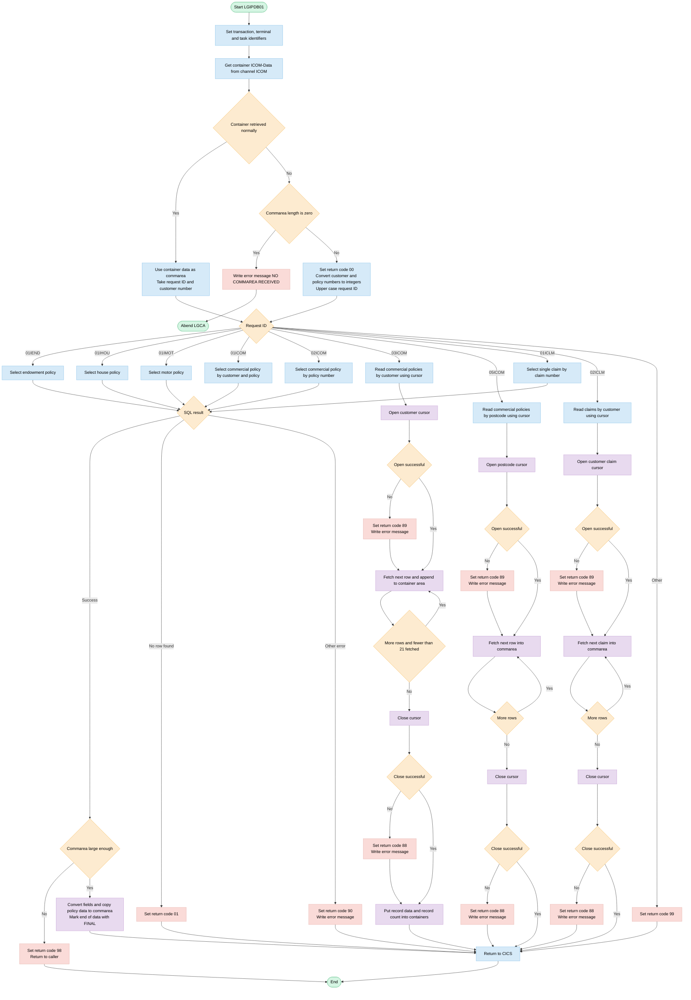
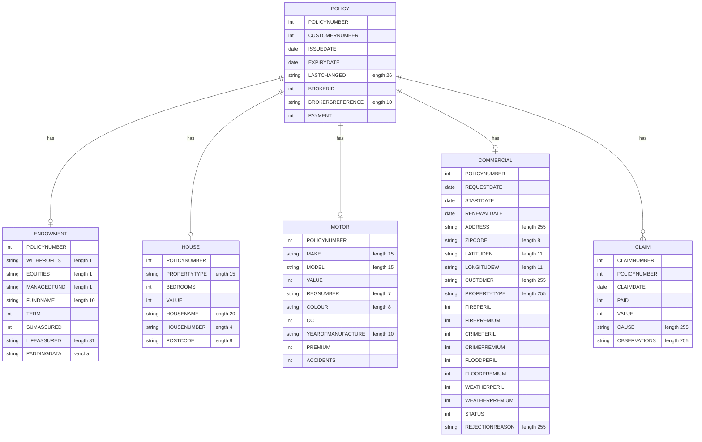

## Table of Contents

- [1. Purpose](#1-purpose)
- [2. Inputs](#2-inputs)
- [3. Outputs](#3-outputs)
- [4. Processing Logic](#4-processing-logic)
  - [4.1 Mermaid Flow Diagram](#41-mermaid-flow-diagram)
  - [4.2 Processing Logic Description](#42-processing-logic-description)
  - [4.3 Database Tables](#43-database-tables)
- [5. Paragraphs](#5-paragraphs)
- [6. Dependencies](#6-dependencies)
  - [6.1 Calling Environment and Input Data](#61-calling-environment-and-input-data)
  - [6.2 Database (Db2 for z/OS)](#62-database-db2-for-zos)
  - [6.3 Copybooks and Included Structures](#63-copybooks-and-included-structures)
  - [6.4 External Programs and Subroutines](#64-external-programs-and-subroutines)
  - [6.5 CICS Services Used](#65-cics-services-used)
  - [6.6 Configuration Values and Constants](#66-configuration-values-and-constants)
- [7. Constraints](#7-constraints)
- [8. Error Handling](#8-error-handling)
  - [8.1 Request and Environment Validation](#81-request-and-environment-validation)
  - [8.2 Request Routing Errors](#82-request-routing-errors)
  - [8.3 Database (Db2) Error Handling](#83-database-db2-error-handling)
  - [8.4 Commarea Size and Buffer Protection](#84-commarea-size-and-buffer-protection)
  - [8.5 Error Logging and Notification](#85-error-logging-and-notification)
  - [8.6 Return Code Summary](#86-return-code-summary)
- [9. Examples](#9-examples)
  - [9.1 Example 1: Motor policy inquiry that succeeds](#91-example-1-motor-policy-inquiry-that-succeeds)
  - [9.2 Example 2: Policy not found, or commarea too small](#92-example-2-policy-not-found-or-commarea-too-small)
  - [9.3 Example 3: Commercial policies by customer (`03ICOM`)](#93-example-3-commercial-policies-by-customer-03icom)
  - [9.4 Example 4: Claim inquiry and an unrecognised request](#94-example-4-claim-inquiry-and-an-unrecognised-request)

## 1. Purpose

LGIPDB01 is a CICS inquiry program for an insurance application. It returns the full details of an individual policy or claim from DB2. The caller passes a request code, either in a channel container or in a commarea, along with customer, policy or claim identifiers. The program reads that code and chooses which kind of record to look up. The options are endowment, house, motor and commercial policies, and individual claims. It also supports lookups that return several records: commercial policies by customer or by postal code, and claims by customer. The program reads the matching policy, commercial or claim data from the DB2 tables, using the customer, policy, claim or postcode value as the key. It then returns the data to the caller in the shared communication area. If the request code is not recognised, the program sets the return code to 99 so the caller knows the inquiry was not supported. If no commarea is supplied, it records an error message and abends the transaction.

## 2. Inputs

- **Program invocation parameter**
  - COMM_AREA_PTR: pointer to the CICS communication area passed to the program. The `COMM_AREA` structure is based on it. It is the main route for caller input and for returned output.
  - EIBCALEN: length of the commarea received.
    - `0` means no commarea, and the program abends with ABCODE `LGCA`.
    - A value smaller than the length needed for the result sets the return code to `98`.
  - EIBTRNID, EIBTRMID and EIBTASKN: CICS execution interface block values (transaction ID, terminal ID and task number). They are copied into the runtime and debug header and used for diagnostics.

- **Request selection and key inputs (commarea fields)**
  - CA_REQUEST_ID: six-character request code, converted to upper case.
    - It selects the retrieval routine: `01IEND`, `01IHOU`, `01IMOT`, `01ICOM`, `02ICOM`, `03ICOM`, `05ICOM`, `01ICLM` or `02ICLM`.
    - Any other value sets the return code to `99`.
  - CA_CUSTOMER_NUM: customer number. It is converted to `DB2_CUSTOMERNUM_INT` and used as a key for:
    - endowment, house, motor and commercial policy inquiry (`01IEND`, `01IHOU`, `01IMOT`, `01ICOM`)
    - the customer commercial cursor (`03ICOM`)
    - the customer claim cursor (`02ICLM`)
  - CA_POLICY_NUM: policy number. It is converted to `DB2_POLICYNUM_INT` and used as a key for single policy lookups, including the policy-only commercial lookup (`02ICOM`).
  - CA_C_Num: claim number, used for the single claim lookup (`01ICLM`). It is moved to `DB2_CLAIMNUM_INT`.
  - CA_B_POSTCODE: commercial property postcode, used as the search key for the postcode-based commercial cursor (`05ICOM`).

- **CICS channel and container input**
  - Container `ICOM-Data` on channel `ICOM`:
    - It is read with `EXEC CICS GET CONTAINER` and is the primary input source.
    - If it is found, the program uses its contents as the commarea: request ID and customer number are taken from it, and the container's storage is also used to hold the returned records.
    - If it is not found, the program falls back to the standard commarea.
  - Container length (`ICOM_Data_Length`): returned by the `GET CONTAINER` call.

- **External data sources (Db2 tables)**
  - POLICY table: common policy details, read through joins by customer number, policy number or claim.
    - Fields: issue date, expiry date, last changed, broker ID, broker reference and payment.
    - Broker ID, broker reference and payment can be null, signalled by indicator variables.
  - ENDOWMENT table: endowment-specific details such as profits, equities, managed fund, fund name, term, sum assured, life assured and variable-length padding data. Read for `01IEND`.
  - HOUSE table: property type, bedrooms, value, house name and number, and postcode. Read for `01IHOU`.
  - MOTOR table: make, model, value, registration number, colour, engine capacity, year of manufacture, premium and accidents. Read for `01IMOT`.
  - COMMERCIAL table: address, postcode, latitude and longitude, customer, property type, fire, crime, flood and weather perils and premiums, status and rejection reason. Read for `01ICOM`, `02ICOM`, `03ICOM` and `05ICOM`.
  - CLAIM table: claim number, policy number, claim date, paid amount, value, cause and observations. Read for `01ICLM` and `02ICLM`.
  - SQLCA: the SQL communications area, whose SQLCODE drives the result handling and return codes `01`, `90`, `89` and `88`.

- **Derived Db2 host variables used as search criteria**
  - DB2_CUSTOMERNUM_INT: customer number key, derived from `CA_CUSTOMER_NUM`.
  - DB2_POLICYNUM_INT: policy number key, derived from `CA_POLICY_NUM`.
  - DB2_CLAIMNUM_INT: claim number key, derived from `CA_C_Num`.

- **CICS runtime services**
  - EXEC CICS ASKTIME and FORMATTIME: current system date and time, used to timestamp error messages.

## 3. Outputs

- **Commarea return code (CA_RETURN_CODE)**
  - Reports the outcome of the inquiry to the caller.
  - '00' means success. It is set at the start when the program is invoked with a commarea.
  - '01' means no row was found (SQLCODE 100). The customer, policy or claim number is invalid. It applies to the single-row endowment, house, motor, commercial and claim inquiries.
  - '88' means a cursor CLOSE failed. It applies to the customer commercial, postcode commercial and customer claim cursors.
  - '89' means a cursor OPEN failed. It applies to the same three cursors.
  - '90' means a SELECT returned an unexpected SQLCODE. An error message is also logged.
  - '98' means the commarea is too small for the data. The program returns to the caller immediately.
  - '99' means CA_REQUEST_ID was not recognised.

- **Policy data returned in the commarea (single-policy inquiries)**
  - Common policy details come from the policy table.
    - Issue date, expiry date (DB2_EXPIRYDATE), last-changed timestamp, broker reference, broker ID (DB2_BROKERID) and payment (DB2_PAYMENT).
    - Broker ID and payment are copied only when their null indicators show a value. Otherwise the previous value is kept.
    - For '01ICOM' and '02ICOM' the source columns are the commercial request, start and renewal dates. They are assigned into the last-changed, issue and expiry fields in that order.
  - Endowment (request '01IEND')
    - With-profits, equities and managed-fund flags, fund name, term, sum assured (DB2_E_SUMASSURED) and life assured.
    - Variable-length padding data is copied when it is non-null. The 'FINAL' end-of-data marker is placed after the padding.
  - House (request '01IHOU')
    - Property type, bedrooms, house value (DB2_H_VALUE), house name, house number and postcode.
    - The 'FINAL' marker is placed in the house filler.
  - Motor (request '01IMOT')
    - Make, model, vehicle value, registration number, colour, engine capacity and year of manufacture.
    - Premium (DB2_M_PREMIUM) and accident count are also set directly in the commarea.
    - The 'FINAL' marker is placed in the motor filler.
  - Commercial single policy (requests '01ICOM' and '02ICOM')
    - Address, postcode (DB2_B_POSTCODE), latitude, longitude, customer, property type and rejection reason.
    - Fire (DB2_B_FIREPREMIUM), crime, flood and weather peril values and premiums.
    - Underwriting status (DB2_B_STATUS).
    - The 'FINAL' marker is placed in the commercial filler.
    - '02ICOM' selects by policy number only and also returns the owning customer number in CA_CUSTOMER_NUM.
  - Claim (request '01ICLM')
    - Customer number, policy number, claim number, claim date, amount paid (DB2_C_PAID), claim value (DB2_C_VALUE), cause and observations.
    - The 'FINAL' marker is placed in the claim filler.

- **Multi-row results**
  - Customer commercial policies ('03ICOM')
    - The customer cursor is read and each row is built in the channel container storage.
    - A row count is kept and the loop stops after more than 20 records.
    - Customer number and policy number are set on each row, plus the common policy fields and the commercial details.
    - Container 'ICOM-Data' on channel 'ICOM' receives the accumulated records (record count × 1202 bytes).
    - Container 'ICOM-Count' on channel 'ICOM' receives the 2-byte record count.
  - Postcode commercial policies ('05ICOM')
    - Rows from the postcode cursor are fetched into the commarea. The postcode is the search key.
    - Each row overwrites the same commarea area. No count or container is written.
  - Customer claims ('02ICLM')
    - Rows from the customer claim cursor are fetched into the commarea. Each row overwrites the previous one. No count or container is written.
    - The 'FINAL' marker is placed after each row.

- **Error logging (WRITE_ERROR_MESSAGE)**
  - Called when a SELECT fails with an unexpected SQLCODE ('90'), a cursor OPEN fails ('89'), a cursor CLOSE fails ('88'), or no commarea is received.
  - Builds a formatted message containing:
    - Current date and time.
    - Program tag ' LGIPOL01'.
    - Customer number and policy number.
    - SQL request description such as ' SELECT ENDOW ' or ' SELECT Claim '.
    - SQLCODE.
  - Sends the message to the CICS program LGSTSQ, which writes it to the TD/TS queue.
  - Sends a second message with the first 90 bytes of the commarea, or less if the commarea is shorter. It is prefixed 'COMMAREA='.
  - When no commarea is received the message text is ' NO COMMAREA RECEIVED'.

- **Program termination effects**
  - If no commarea is received, the program abends with code 'LGCA' and no dump.
  - The program ends with EXEC CICS RETURN after processing. The updated commarea or channel containers are the observable output.
  - If the commarea is too small, a CICS RETURN is issued immediately after '98' is set.

## 4. Processing Logic

### 4.1 Mermaid Flow Diagram

---

### 4.2 Processing Logic Description

#### 4.2.1 High-level Summary
LGIPDB01 is a CICS and Db2 PL/I back-end program of the GenApp insurance application. It handles policy and claim inquiries. A calling program (an LGIPOL01-style orchestrator) passes in a request code, a customer number and a policy number. LGIPDB01 reads the matching data from Db2 and puts it into the shared communication area (commarea). It returns a two-digit return code that tells the caller whether the inquiry worked.

It can retrieve:
- a single endowment, house, motor or commercial policy;
- several commercial policies, by customer or by postcode;
- a single claim, or all claims for a customer.

#### 4.2.2 Execution Flow
1. **Initialisation.** The program copies the CICS transaction ID, terminal ID and task number into the working-storage header. The header's eye-catcher `LGIPDB01-----WS` is used to identify the program in dumps.
2. **Getting the input.** The program issues a CICS GET CONTAINER for container `ICOM-Data` on channel `ICOM`.
   - If the container is found, its address becomes the commarea. The request ID and customer number are taken from it. The container-based path does not reset the return code. It does not convert the policy number either.
   - If the container is not found, the program falls back to the classic commarea.
     - If the commarea length is zero, it sets the message "NO COMMAREA RECEIVED", writes the error message and abends with code `LGCA` (NODUMP).
     - Otherwise it sets the return code to `00` and records the commarea length and address. It converts the customer and policy numbers to Db2 integers (`DB2_CUSTOMERNUM_INT`, `DB2_POLICYNUM_INT`). It saves both numbers in the error message area. It upper-cases the request ID.
3. **Routing on the request ID.** The program dispatches on `WS_REQUEST_ID`:

| Request ID | Routine | Purpose |
|---|---|---|
| `01IEND` | GET_ENDOW_DB2_INFO | Single endowment policy |
| `01IHOU` | GET_HOUSE_DB2_INFO | Single house policy |
| `01IMOT` | GET_MOTOR_DB2_INFO | Single motor policy |
| `01ICOM` | GET_COMMERCIAL_DB2_INFO_1 | Commercial policy by customer and policy |
| `02ICOM` | GET_COMMERCIAL_DB2_INFO_2 | Commercial policy by policy number only (also returns the customer number) |
| `03ICOM` | GET_COMMERCIAL_DB2_INFO_3 | All commercial policies of a customer, through a cursor |
| `05ICOM` | GET_COMMERCIAL_DB2_INFO_5 | Commercial policies for a postcode, through a cursor |
| `01ICLM` | GET_CLAIM_DB2_INFO_1 | Single claim by claim number (taken from the commarea claim number field) |
| `02ICLM` | GET_CLAIM_DB2_INFO_2 | All claims for a customer, through a cursor |
| anything else | – | Return code `99` |

   After the routine finishes, the program issues `EXEC CICS RETURN`.

4. **Single-row inquiries (endowment, house, motor, commercial 1 and 2, claim 1).** Each routine does a single-row SELECT from the policy table joined to the type-specific table.
   - SQLCODE 0 (success):
     - The program works out the commarea size needed: header/trailer length 33 plus the full length of the policy type.
       - Endowment is 124, house 130, motor 137, commercial 1174 and claim 618.
       - For endowment, the length of the variable padding data is added when that column is not null.
     - If the length received (`EIBCALEN`) is less than the length required, it sets return code `98` and returns at once.
     - Otherwise it converts the integer host variables to display numerics. Broker ID and payment are moved only when their null indicators are not -1.
     - It copies the common policy fields (issue date, expiry date, last changed, broker ID, broker reference, payment) into the commarea.
     - It copies the type-specific block into the policy area with SUBSTR. For motor, premium and accidents are also moved separately, because the motor length constant is shorter than the full structure.
     - It writes the end-of-data marker `FINAL` after the data. For endowment, it writes the marker after the padding data.
   - SQLCODE 100 (no row found): return code `01`, meaning the customer or policy number is invalid.
   - Any other SQLCODE: return code `90`, then WRITE_ERROR_MESSAGE.
5. **Commercial by customer (`03ICOM`).**
   - The program resets the record count and opens `Cust_Cursor`. If the open fails, it sets return code `89` and logs the error.
   - It then loops until SQLCODE is greater than 0. Each fetch fills the commarea at the current container position, converts the integer fields and copies the common fields and the commercial block. It then increments the record count and moves the pointer to the end of the record (`CA_B_FILLER`).
   - After 20 records it forces SQLCODE to 17. This stops the loop and caps the result at 21 rows.
   - It closes the cursor. If the close fails, it sets return code `88` and logs the error.
   - It puts the record data (record count × 1202 bytes) into container `ICOM-Data`. It puts the 2-byte record count into container `ICOM-Count` on channel `ICOM`.
6. **Commercial by postcode (`05ICOM`).**
   - It opens `Zip_Cursor`, using the commarea postcode as the key. Open failure gives return code `89`.
   - It fetches rows until SQLCODE is greater than 0. Each fetched row is written to the same commarea position, so each fetch overwrites the previous one. The pointer is not advanced and no containers are written.
   - It closes the cursor. Close failure gives return code `88`.
7. **Claims by customer (`02ICLM`).**
   - It opens `CusClaim_Cursor`. Open failure gives return code `89`.
   - It fetches rows until SQLCODE is greater than 0. Each row is written to the same commarea position, so each fetch overwrites the previous one. It writes `FINAL` after each row.
   - It closes the cursor. Close failure gives return code `88`.
8. **Error logging (WRITE_ERROR_MESSAGE).**
   - It stores the SQLCODE in the message. It gets the time with ASKTIME and FORMATTIME, then formats the date (MMDDYYYY) and time.
   - It links to program `LGSTSQ` with the error message, which includes the program tag, customer number, policy number, SQL request text and SQLCODE.
   - If a commarea exists, it links to `LGSTSQ` again with up to the first 90 bytes of the commarea as `COMMAREA=...`.

**Return codes used:**

| Code | Meaning |
|---|---|
| `00` | OK |
| `01` | No row found for the customer or policy |
| `88` | Cursor close failed |
| `89` | Cursor open failed |
| `90` | Other Db2 error |
| `98` | Commarea too small |
| `99` | Unrecognised request ID |

#### 4.2.3 External Interactions
- **Db2**
  - Single-row SELECTs are used against POLICY joined with ENDOWMENT, HOUSE, MOTOR, COMMERCIAL and CLAIM.
  - Three scrollable cursors are used: `Cust_Cursor` (commercial policies by customer), `Zip_Cursor` (commercial policies by postcode) and `CusClaim_Cursor` (claims by customer).
  - All access is read-only.
  - Null indicators are used for broker ID, broker reference, payment and the endowment padding data.
- **CICS containers.** `ICOM-Data` and `ICOM-Count` on channel `ICOM` carry the request in and the multi-record results out.
- **CICS services.** ASKTIME, FORMATTIME, ABEND (`LGCA`) and RETURN.
- **Program LGSTSQ.** It is called by CICS LINK to write error messages and a commarea extract to the CICS error queues.

#### 4.2.4 Plain Language Summary
Another program asks this one for insurance information. The request says what is wanted (an endowment, house, motor or commercial policy, or a claim), who the customer is and which policy applies. The program looks the information up in the database and fills it into the shared message area. It adds the word `FINAL` to show where the data stops.

It first checks that the message area is large enough for the answer. If it is too small, it sends back code 98. If nothing is found, it sends back 01. If the database has a problem, it sends back 90 and records the details in an error log. If the request type is not recognised, it sends back 99.

For some requests the answer can contain many policies or claims. The program reads them one at a time. For the commercial-by-customer request it stops after about 20 policies and returns them in a separate container, with a count.

---

### 4.3 Database Tables

## 5. Paragraphs

- **LGIPDB01 (main procedure / mainline)**
  - Purpose: Entry point of the "Inquire Policy" program. It takes a request ID, fetches policy or claim details from Db2, and returns them in the commarea or a CICS container.
  - Operations:
    - Copies `EIBTRNID`, `EIBTRMID` and `EIBTASKN` into `WS_HEADER` for diagnostics.
    - Issues `EXEC CICS GET CONTAINER('ICOM-Data')` on channel `ICOM`.
    - If the container is found (`WS_RESP = DFHRESP(NORMAL)`):
      - Saves the container pointer in `ICOM_Pointer_Start` and `COMM_AREA_PTR`.
      - Copies `CA_REQUEST_ID` to `WS_Request_ID`.
      - Copies `CA_CUSTOMER_NUM` to `DB2_CUSTOMERNUM_INT`.
    - Otherwise it uses the normal commarea:
      - Sets `CA_RETURN_CODE` to '00'.
      - Saves `EIBCALEN` and the commarea address.
      - Converts `CA_CUSTOMER_NUM` and `CA_POLICY_NUM` to the Db2 integer host variables `DB2_CUSTOMERNUM_INT` and `DB2_POLICYNUM_INT`.
      - Copies the customer and policy numbers into the error message fields `EM_CUSNUM` and `EM_POLNUM`.
      - Upper-cases `CA_REQUEST_ID` into `WS_REQUEST_ID`.
    - Dispatches on `WS_REQUEST_ID` and then issues `EXEC CICS RETURN`.
  - Control flow:
    - If the container is missing and `EIBCALEN = 0`, it sets `EM_MSG_TEXT` to ' NO COMMAREA RECEIVED', calls **WRITE_ERROR_MESSAGE**, and abends with code `LGCA` (NODUMP).
    - A `SELECT (WS_REQUEST_ID)` routes the request:
      - '01IEND' calls **GET_ENDOW_DB2_INFO**.
      - '01IHOU' calls **GET_HOUSE_DB2_INFO**.
      - '01IMOT' calls **GET_MOTOR_DB2_INFO**.
      - '01ICOM' calls **GET_Commercial_DB2_INFO_1**.
      - '02ICOM' calls **GET_Commercial_DB2_INFO_2**.
      - '03ICOM' calls **GET_Commercial_DB2_INFO_3**.
      - '05ICOM' calls **GET_Commercial_DB2_INFO_5**.
      - '01ICLM' first sets `DB2_CLAIMNUM_INT` from `CA_C_Num`, then calls **GET_Claim_DB2_INFO_1**.
      - '02ICLM' calls **GET_Claim_DB2_INFO_2**.
      - Any other value sets `CA_RETURN_CODE` to '99'.
  - External interactions: CICS GET CONTAINER, ABEND and RETURN. The cursors and the SQLCA are declared here and used by the sub-procedures.

- **GET_ENDOW_DB2_INFO**
  - Purpose: Retrieves one endowment policy for the requested customer and policy number.
  - Operations:
    - Sets `EM_SQLREQ` to ' SELECT ENDOW '.
    - Runs a singleton SELECT on the join of POLICY and ENDOWMENT. It matches `POLICY.POLICYNUMBER = ENDOWMENT.POLICYNUMBER`, `DB2_CUSTOMERNUM_INT` and `DB2_POLICYNUM_INT`.
    - Selects the common policy columns and the endowment columns, including `PADDINGDATA` and `LENGTH(PADDINGDATA)`.
    - Reads the nullable columns BROKERID, BROKERSREF, PAYMENT, PADDINGDATA and the padding length with indicator variables. Output goes to working storage rather than directly into the commarea, because the VARCHAR length is not known in advance.
  - Control flow:
    - `SELECT (SQLCODE)`.
    - Code 0 calls **GET_ENDOW_DB2_INFO_A**.
    - Code 100 sets `CA_RETURN_CODE` to '01' (no matching customer/policy).
    - Any other code sets '90' and calls **WRITE_ERROR_MESSAGE**.
  - External interactions: Db2 tables POLICY and ENDOWMENT.

- **GET_ENDOW_DB2_INFO_A**
  - Purpose: Checks that the commarea is big enough and moves the endowment data into it.
  - Operations:
    - Computes `WS_REQUIRED_CA_LEN` as header/trailer length plus `WS_FULL_ENDOW_LEN`. If the padding length is not null, it adds `DB2_E_PADDING_LEN` to the required length and to `END_POLICY_POS`.
    - Converts the integer host variables (term, sum assured, and broker ID and payment when not null) to numeric picture fields.
    - Copies the common policy fields (issue date, expiry date, last changed, broker ID, broker reference, payment) to the `CA_` fields.
    - Moves the endowment text into `CA_POLICY_RAW` using `SUBSTR` with `WS_ENDOW_LEN`.
    - Copies the padding data into `CA_E_PADDING_DATA` when it is not null.
    - Writes the marker 'FINAL' at `END_POLICY_POS` in `CA_E_PADDING_DATA`.
  - Control flow:
    - If `EIBCALEN` is less than the required length, it sets `CA_RETURN_CODE` to '98' and issues `EXEC CICS RETURN` immediately.
    - Null indicators (`<> MINUS_ONE`) decide which fields are moved.
  - External interactions: CICS RETURN on a short commarea. It does no I/O of its own.

- **GET_HOUSE_DB2_INFO**
  - Purpose: Retrieves one house policy for the requested customer and policy number.
  - Operations:
    - Sets `EM_SQLREQ` to ' SELECT HOUSE '.
    - Runs a singleton SELECT on the join of POLICY and HOUSE for the common policy columns and the house columns (property type, bedrooms, value, house name, house number, postcode).
    - On success, adds the header/trailer length and `WS_FULL_HOUSE_LEN` to `WS_REQUIRED_CA_LEN`.
    - Converts the integer fields, skipping null broker ID and payment.
    - Moves the common fields to the `CA_` fields.
    - Moves `DB2_HOUSE_TEXT` (`WS_HOUSE_LEN` bytes) to `CA_POLICY_RAW`.
    - Writes 'FINAL' to `CA_H_FILLER`.
  - Control flow:
    - If `SQLCODE = 0` it checks the commarea length. A short commarea sets '98' and issues CICS RETURN.
    - If `SQLCODE = 100`, `CA_RETURN_CODE` is '01'.
    - Any other `SQLCODE` sets '90' and calls **WRITE_ERROR_MESSAGE**.
  - External interactions: Db2 tables POLICY and HOUSE.

- **GET_MOTOR_DB2_INFO**
  - Purpose: Retrieves one motor policy for the requested customer and policy number.
  - Operations:
    - Sets `EM_SQLREQ` to ' SELECT MOTOR '.
    - Runs a singleton SELECT on the join of POLICY and MOTOR for the common columns and the motor columns (make, model, value, registration number, colour, CC, year of manufacture, premium, accidents).
    - On success, computes the required commarea length from `WS_FULL_MOTOR_LEN`.
    - Converts the integer fields to numerics and assigns `CA_M_PREMIUM` and `CA_M_ACCIDENTS` directly, because the shorter `WS_MOTOR_LEN` does not cover them.
    - Moves the common fields, then moves `DB2_MOTOR_TEXT` (`WS_MOTOR_LEN` bytes) to `CA_POLICY_RAW`.
    - Writes 'FINAL' to `CA_M_FILLER`.
  - Control flow:
    - `SQLCODE = 0` leads to the length check, with '98' and CICS RETURN if the commarea is too short.
    - `SQLCODE = 100` sets '01'.
    - Any other code sets '90' and calls **WRITE_ERROR_MESSAGE**.
  - External interactions: Db2 tables POLICY and MOTOR.

- **GET_Commercial_DB2_INFO_1**
  - Purpose: Retrieves one commercial policy by customer number and policy number.
  - Operations:
    - Sets `EM_SQLREQ` to ' SELECT Commrcl '.
    - Runs a singleton SELECT on the join of POLICY and COMMERCIAL. It reads dates, address, postcode, latitude, longitude, customer, property type, the four peril and premium pairs, status and rejection reason.
    - On success, computes the required length from `WS_FULL_COMM_LEN`.
    - Converts the peril, premium and status integers to numeric fields.
    - Moves the common fields and `DB2_COMM_TEXT` (`WS_COMM_LEN` bytes) to `CA_POLICY_RAW`.
    - Writes 'FINAL' to `CA_B_FILLER`.
  - Control flow:
    - `SQLCODE = 0` leads to the length check, with '98' and CICS RETURN if the commarea is too short.
    - `SQLCODE = 100` sets '01'.
    - Any other code sets '90' and calls **WRITE_ERROR_MESSAGE**.
  - External interactions: Db2 tables POLICY and COMMERCIAL.

- **GET_Commercial_DB2_INFO_2**
  - Purpose: Retrieves one commercial policy by policy number only. It also returns the owning customer number.
  - Operations:
    - Sets `EM_SQLREQ` to ' SELECT Commrcl '.
    - Runs a singleton SELECT on the POLICY and COMMERCIAL join, filtered on `DB2_POLICYNUM_INT`. It also reads `CustomerNumber` into `DB2_CUSTOMERNUM_INT`.
    - On success, applies the same length check and conversions as the previous procedure.
    - Sets `CA_Customer_NUM` from the retrieved customer number.
    - Moves the common fields and the commercial text to the commarea.
    - Writes 'FINAL' to `CA_B_FILLER`.
  - Control flow: The return-code logic is the same as in **GET_Commercial_DB2_INFO_1**: '98' with CICS RETURN, '01' for no row, '90' with an error message otherwise.
  - External interactions: Db2 tables POLICY and COMMERCIAL.

- **GET_Commercial_DB2_INFO_3**
  - Purpose: Returns all commercial policies of a customer, using cursor `Cust_Cursor`.
  - Operations:
    - Sets `EM_SQLREQ` and resets `ICOM_Record_Count` to 0.
    - Opens `Cust_Cursor`, which joins POLICY and COMMERCIAL on `DB2_CUSTOMERNUM_INT`.
    - Calls **GET_Commercial_DB2_INFO_3_Cur** repeatedly, then closes the cursor.
    - Sets `ICOM_Data_Length` to the record count multiplied by 1202.
    - Puts container 'ICOM-Data' (the `ICOM_Record` buffer) and container 'ICOM-Count' (2 bytes) on channel 'ICOM'.
  - Control flow:
    - If OPEN fails (`SQLCODE <> 0`), it sets '89' and calls **WRITE_ERROR_MESSAGE**.
    - `DO UNTIL (SQLCODE > 0)` is the fetch loop.
    - If CLOSE fails, it sets '88' and calls **WRITE_ERROR_MESSAGE**.
  - External interactions: Db2 cursor operations on POLICY and COMMERCIAL, and CICS PUT CONTAINER.

- **GET_Commercial_DB2_INFO_3_Cur**
  - Purpose: Fetches one row from `Cust_Cursor` and appends it to the container buffer.
  - Operations:
    - Points `COMM_AREA_PTR` at the current `ICOM_Pointer` position.
    - Fetches the customer number, policy number, dates and commercial columns into host variables.
    - On success, converts the integers to numerics and fills the common `CA_` fields and the customer and policy numbers.
    - Moves the commercial text to `CA_POLICY_RAW`.
    - Increments `ICOM_Record_Count` and advances `ICOM_Pointer` to `ADDR(CA_B_FILLER)`, ready for the next record.
  - Control flow:
    - Processing happens only when `SQLCODE = 0`.
    - If the record count exceeds 20, it forces `SQLCODE = 17` to end the loop in the caller.
  - External interactions: Db2 FETCH from `Cust_Cursor`.

- **GET_Commercial_DB2_INFO_5**
  - Purpose: Retrieves commercial policies by postcode, using cursor `Zip_Cursor`.
  - Operations:
    - Sets `EM_SQLREQ`.
    - Opens `Zip_Cursor`, which joins POLICY and COMMERCIAL where `Commercial.Zipcode = CA_B_POSTCODE`.
    - Calls **GET_Commercial_DB2_INFO_5_Cur** in a loop, then closes the cursor.
  - Control flow:
    - OPEN failure sets '89' and calls **WRITE_ERROR_MESSAGE**.
    - `DO UNTIL (SQLCODE > 0)` is the fetch loop.
    - CLOSE failure sets '88' and calls **WRITE_ERROR_MESSAGE**.
  - External interactions: Db2 cursor operations on POLICY and COMMERCIAL.

- **GET_Commercial_DB2_INFO_5_Cur**
  - Purpose: Fetches one row from `Zip_Cursor`.
  - Operations:
    - Fetches customer number, policy number and the commercial columns.
    - When `SQLCODE = 0`, converts the integers to numerics and moves the customer and policy numbers, the common fields and the commercial text into the same commarea area.
    - Each fetched row overwrites the previous one, so only the last row remains. There is no record counter, no pointer advance and no container output.
  - Control flow: Processing happens only when `SQLCODE = 0`.
  - External interactions: Db2 FETCH from `Zip_Cursor`.

- **GET_Claim_DB2_INFO_1**
  - Purpose: Retrieves a single claim by claim number.
  - Operations:
    - Sets `EM_SQLREQ` to ' SELECT Claim '.
    - Runs a singleton SELECT on the join of POLICY and CLAIM where `CLAIM.ClaimNumber = DB2_CLAIMNUM_INT`.
    - Reads customer number, claim number, policy number, claim date, paid, value, cause and observations.
    - On success, computes the required length from `WS_FULL_CLAIM_LEN`.
    - Sets `CA_CUSTOMER_NUM` and `CA_POLICY_NUM`, converts claim number, paid and value to numerics, and moves the common fields.
    - Moves `DB2_CLAIM_TEXT` to `CA_POLICY_RAW` and writes 'FINAL' to `CA_C_FILLER`.
  - Control flow: `SQLCODE = 0` leads to the length check, with '98' and CICS RETURN if the commarea is too short. `SQLCODE = 100` sets '01'. Any other code sets '90' and calls **WRITE_ERROR_MESSAGE**.
  - External interactions: Db2 tables POLICY and CLAIM.

- **GET_Claim_DB2_INFO_2**
  - Purpose: Retrieves the claims of a customer, using cursor `CusClaim_Cursor`.
  - Operations:
    - Sets `EM_SQLREQ`.
    - Opens `CusClaim_Cursor`, which joins POLICY and CLAIM on `DB2_CUSTOMERNUM_INT`.
    - Calls **GET_ClaiM_DB2_INFO_2_Cur** in a loop, then closes the cursor.
  - Control flow:
    - OPEN failure sets '89' and calls **WRITE_ERROR_MESSAGE**.
    - `DO UNTIL (SQLCODE > 0)` is the fetch loop.
    - CLOSE failure sets '88' and calls **WRITE_ERROR_MESSAGE**.
  - External interactions: Db2 cursor operations on POLICY and CLAIM.

- **GET_ClaiM_DB2_INFO_2_Cur**
  - Purpose: Fetches one claim row from `CusClaim_Cursor`.
  - Operations:
    - Fetches customer number, claim number, policy number, date, paid, value, cause and observations.
    - When `SQLCODE = 0`, sets `CA_CUSTOMER_NUM` and `CA_POLICY_NUM`, converts claim number, paid and value to numerics, and moves the common fields.
    - Moves `DB2_CLAIM_TEXT` to `CA_POLICY_RAW` and writes 'FINAL' to `CA_C_FILLER`.
    - Each fetched row overwrites the previous one, so only the last claim remains in the commarea.
  - Control flow: Processing happens only when `SQLCODE = 0`.
  - External interactions: Db2 FETCH from `CusClaim_Cursor`.

- **WRITE_ERROR_MESSAGE**
  - Purpose: Common error logging routine, called whenever a Db2 failure or a missing commarea is detected.
  - Operations:
    - Copies `SQLCODE` into `EM_SQLRC`.
    - Issues `EXEC CICS ASKTIME` and `FORMATTIME` (MMDDYYYY and TIME) to set `EM_DATE` and `EM_TIME`.
    - Links to program `LGSTSQ` with the `ERROR_MSG` structure, which writes the message to the queue.
    - If a commarea exists, links to `LGSTSQ` again with `CA_ERROR_MSG`, which carries the first 90 bytes of the commarea, or all of it if `EIBCALEN` is less than 91.
  - Control flow:
    - It does nothing further when `EIBCALEN = 0`.
    - It chooses between the short and the 90-byte commarea copy based on `EIBCALEN`.
  - External interactions: CICS ASKTIME, FORMATTIME and LINK to `LGSTSQ`, for TD/TS queue logging.

## 6. Dependencies

### 6.1 Calling Environment and Input Data
- CICS transaction environment
  - LGIPDB01 runs as a CICS main program (`Options(Main)`). It depends on the CICS-supplied EXEC Interface Block fields `EIBTRNID`, `EIBTRMID`, `EIBTASKN` and `EIBCALEN`. It uses them to fill the run-time header and to check the size of the commarea it received.
  - The CICS response code `DFHRESP(NORMAL)` is tested after the container read.
- Commarea passed by the caller (`COMM_AREA`, based on `COMM_AREA_PTR`)
  - The caller provides this area when no channel is present.
  - It is also the area the program fills with the results.
  - Input fields:
    - `CA_REQUEST_ID`: the six-character request code, converted to upper case. Accepted values are `01IEND`, `01IHOU`, `01IMOT`, `01ICOM`, `02ICOM`, `03ICOM`, `05ICOM`, `01ICLM` and `02ICLM`. Any other value sets `CA_RETURN_CODE` to `99`.
    - `CA_CUSTOMER_NUM`: copied into `DB2_CUSTOMERNUM_INT`. It is the key for the single-policy lookups and for the customer-based commercial and claim cursors.
    - `CA_POLICY_NUM`: copied into `DB2_POLICYNUM_INT`. It selects the policy row.
    - `CA_C_Num`: copied into `DB2_CLAIMNUM_INT` for the single-claim inquiry (`01ICLM`).
    - `CA_B_POSTCODE`: the search key for the postcode-based commercial cursor (`Zip_Cursor`, request `05ICOM`).
  - Output fields:
    - `CA_RETURN_CODE`:
      - `00`: success.
      - `01`: no row found.
      - `88`: cursor close failed.
      - `89`: cursor open failed.
      - `90`: SQL error.
      - `98`: commarea too small.
      - `99`: unrecognised request.
    - Common policy fields: `CA_ISSUE_DATE`, `CA_EXPIRY_DATE`, `CA_LASTCHANGED`, `CA_BROKERID`, `CA_BROKERSREF` and `CA_PAYMENT`.
    - `CA_POLICY_RAW`: holds the policy-specific data for the endowment, house, motor, commercial or claim layout.
    - End marker: the literal `FINAL` is written after the data.
  - The caller must supply a commarea at least as long as the required length. That length is `WS_CA_HEADERTRAILER_LEN` plus the `WS_FULL_*_LEN` value for the policy type. If it is shorter, the program sets return code `98` and returns.
  - If `EIBCALEN` is 0 and no container is found, the program writes an error message and abends with code `LGCA`.
- CICS channel and containers
  - Channel `ICOM` (`ICOM_Channel`) is used as an alternative input path.
  - Container `ICOM-Data` (`ICOM_Container`) is read with `GET CONTAINER ... SET(ICOM_Pointer)`. If the read succeeds, it replaces the commarea as the source of the request ID and customer number.
  - Output containers on the `ICOM` channel, written by the customer-based commercial multi-row inquiry (`03ICOM`):
    - `ICOM-Data` is written with `PUT CONTAINER`. It holds up to 20 records of 1202 bytes each.
    - `ICOM-Count` is written with `PUT CONTAINER`. It holds a 2-byte record count.

### 6.2 Database (Db2 for z/OS)
- Db2 runtime and precompiler services
  - `EXEC SQL INCLUDE SQLCA` provides `SQLCODE`. The program tests `SQLCODE` for 0, 100 and other values after each SQL statement.
  - Indicator variables handle nullable columns. The program tests them against `MINUS_ONE`.
    - `IND_BROKERID`
    - `IND_BROKERSREF`
    - `IND_PAYMENT`
    - `IND_E_PADDINGDATA`
    - `IND_E_PADDINGDATAL`
  - Host variables are declared in `DB2_IN_INTEGERS`, `DB2_OUT_INTEGERS`, `DB2_CUSTOMER`, `DB2_POLICY`, `DB2_ENDOWMENT`, `DB2_HOUSE`, `DB2_MOTOR`, `DB2_COMMERCIAL` and `DB2_CLAIM`.
- Tables accessed (read-only)
  - `POLICY`
    - Joined with every other table on `POLICYNUMBER` and `CUSTOMERNUMBER`.
    - Supplies the common policy columns `ISSUEDATE`, `EXPIRYDATE`, `LASTCHANGED`, `BROKERID`, `BROKERSREFERENCE` and `PAYMENT`.
  - `ENDOWMENT`
    - Columns: `WITHPROFITS`, `EQUITIES`, `MANAGEDFUND`, `FUNDNAME`, `TERM`, `SUMASSURED`, `LIFEASSURED` and the variable-length `PADDINGDATA`, plus `LENGTH(PADDINGDATA)`.
  - `HOUSE`
    - Columns: `PROPERTYTYPE`, `BEDROOMS`, `VALUE`, `HOUSENAME`, `HOUSENUMBER` and `POSTCODE`.
  - `MOTOR`
    - Columns: `MAKE`, `MODEL`, `VALUE`, `REGNUMBER`, `COLOUR`, `CC`, `YEAROFMANUFACTURE`, `PREMIUM` and `ACCIDENTS`.
  - `COMMERCIAL`
    - Columns:
      - Dates and location: `RequestDate`, `StartDate`, `RenewalDate`, `Address`, `Zipcode`, `LatitudeN` and `LongitudeW`.
      - Customer and property: `Customer` and `PropertyType`.
      - Perils and premiums: Fire, Crime, Flood and Weather, each with a peril code and a premium.
      - Underwriting: `Status` and `RejectionReason`.
  - `CLAIM`
    - Columns: `ClaimNumber`, `PolicyNumber`, `ClaimDate`, `Paid`, `Value`, `Cause` and `Observations`.
- Cursors declared (insensitive scroll)
  - `Cust_Cursor`: commercial policies for a customer, joining `POLICY` and `COMMERCIAL` by `DB2_CUSTOMERNUM_INT`.
  - `Zip_Cursor`: commercial policies for a postcode, joining `POLICY` and `COMMERCIAL` by `CA_B_POSTCODE`.
  - `CusClaim_Cursor`: claims for a customer, joining `POLICY` and `CLAIM` by `DB2_CUSTOMERNUM_INT`.
- Singleton SELECT statements
  - Endowment: `POLICY` joined with `ENDOWMENT`, by customer and policy number.
  - House: `POLICY` joined with `HOUSE`, by customer and policy number.
  - Motor: `POLICY` joined with `MOTOR`, by customer and policy number.
  - Commercial, request `01ICOM`: `POLICY` joined with `COMMERCIAL`, by customer and policy number.
  - Commercial, request `02ICOM`: `POLICY` joined with `COMMERCIAL`, by policy number only.
  - Claim, request `01ICLM`: `POLICY` joined with `CLAIM`, by claim number.
- Host variable roles from the supplied context
  - `DB2_CUSTOMERNUM_INT`, `DB2_POLICYNUM_INT` and `DB2_CLAIMNUM_INT` are the search keys.
  - Payment and broker: `DB2_PAYMENT`, `DB2_BROKERID` and `DB2_EXPIRYDATE`.
  - Product-specific values: `DB2_E_SUMASSURED`, `DB2_H_VALUE`, `DB2_M_PREMIUM`, `DB2_B_STATUS`, `DB2_B_FIREPREMIUM`, `DB2_B_POSTCODE`, `DB2_C_PAID` and `DB2_C_VALUE`.
  - The program converts the binary-integer host variables, such as `DB2_PAYMENT_INT` and `DB2_BROKERID_INT`, to the picture-format fields before moving them to the commarea.

### 6.3 Copybooks and Included Structures
- `LGPOLICY` (`plinc\LGPOLICY.inc`)
  - Defines the policy field lengths (`WS_POLICY_LENGTHS`) and the Db2 output structures for customer, policy, endowment, house, motor, commercial and claim data.
  - It is expanded inline in the source.
- `LGCMAREA` (`plinc\LGCMAREA.inc`)
  - Defines the commarea layout (`COMM_AREA` and its redefinitions).
  - It is expanded inline in the source.
- `SQLCA`
  - The Db2 communications area, included through `EXEC SQL INCLUDE`.

### 6.4 External Programs and Subroutines
- `LGSTSQ`
  - Called with `EXEC CICS LINK PROGRAM('LGSTSQ')` from `WRITE_ERROR_MESSAGE`. It writes error messages to the CICS queues (the CSMT transient data queue).
  - First call: passes `ERROR_MSG`, which holds the date, time, program name, customer number, policy number, SQL request text and SQLCODE.
  - Second call: passes `CA_ERROR_MSG`, which holds up to 90 bytes of the commarea. It runs only when `EIBCALEN` is greater than 0.

### 6.5 CICS Services Used
- `EXEC CICS GET CONTAINER` reads the request from the channel.
- `EXEC CICS PUT CONTAINER` returns the multi-record result and the record count.
- `EXEC CICS ASKTIME` and `EXEC CICS FORMATTIME` obtain and format the current date and time (`MMDDYYYY` and time) for the error message.
- `EXEC CICS LINK` calls `LGSTSQ`.
- `EXEC CICS ABEND ABCODE('LGCA') NODUMP` handles the missing commarea case.
- `EXEC CICS RETURN` ends the transaction normally. It also ends it early when the commarea is too small.

### 6.6 Configuration Values and Constants
- Hard-coded names:
  - Channel `ICOM`.
  - Containers `ICOM-Data` and `ICOM-Count`.
  - Program `LGSTSQ`.
  - Abend code `LGCA`.
  - Eyecatcher `LGIPDB01-----WS`.
  - Program name `LGIPOL01`, embedded in the error message.
- Length constants in `WS_POLICY_LENGTHS` and `WS_COMMAREA_LENGTHS`. They are used to check commarea capacity and to size the data moved:
  - `WS_ENDOW_LEN` 52, `WS_HOUSE_LEN` 58, `WS_MOTOR_LEN` 65, `WS_COMM_LEN` 1102 and `WS_CLAIM_LEN` 546.
  - `WS_FULL_ENDOW_LEN` 124, `WS_FULL_HOUSE_LEN` 130, `WS_FULL_MOTOR_LEN` 137, `WS_FULL_COMM_LEN` 1174 and `WS_FULL_CLAIM_LEN` 618.
  - `WS_CA_HEADERTRAILER_LEN` 33.
- Multi-row result limits:
  - Each ICOM record is 1202 bytes.
  - The maximum is 20 records, enforced by forcing `SQLCODE` to 17 when the count exceeds 20.
  - The ICOM work buffer length is 32767 bytes (`ICOM_Length`).
- No external environment variables or configuration files are read.

## 7. Constraints

- **Input and request validation**
  - The request ID must be one of nine recognised codes.
    - The accepted codes are `01IEND`, `01IHOU`, `01IMOT`, `01ICOM`, `02ICOM`, `03ICOM`, `05ICOM`, `01ICLM` and `02ICLM`.
    - `CA_REQUEST_ID` is converted with `UPPERCASE` into `WS_REQUEST_ID`, so matching is case-insensitive.
    - A `SELECT (WS_REQUEST_ID)` dispatches to the matching retrieval routine.
    - The `OTHERWISE` branch sets `CA_RETURN_CODE` to `'99'` for any other value.
  - A communication area must be present when no `ICOM-Data` container is found.
    - If the `EXEC CICS GET CONTAINER` response is not `DFHRESP(NORMAL)` and `EIBCALEN = 0`, the program sets `EM_MSG_TEXT` to ' NO COMMAREA RECEIVED'.
    - It then calls `WRITE_ERROR_MESSAGE` and issues `EXEC CICS ABEND ABCODE('LGCA') NODUMP`.
  - The input source is chosen by whether the container read succeeds.
    - If the `ICOM-Data` container on channel `ICOM` is read successfully, the request ID and customer number come from that container.
    - Otherwise they come from the commarea.
    - Only the commarea path converts `CA_POLICY_NUM` to `DB2_POLICYNUM_INT`.
    - Only the commarea path resets `CA_RETURN_CODE` to `'00'` at the start.
  - Customer and policy numbers are carried as numeric values.
    - `CA_CUSTOMER_NUM` and `CA_POLICY_NUM` are 10-digit numeric pictures.
    - They are converted to `FIXED BIN(31)` host variables (`DB2_CUSTOMERNUM_INT` and `DB2_POLICYNUM_INT`) before they are used as keys.
  - The claim number comes from the commarea only for request `01ICLM`.
    - `DB2_CLAIMNUM_INT` is set from `CA_C_Num` only in that branch.
    - It is then used as the search key for the single-claim lookup.

- **Data selection and key rules**
  - Single-policy inquiries must match both customer and policy.
    - Endowment, house, motor and `01ICOM` commercial lookups join `POLICY` to the type-specific table on `POLICYNUMBER`.
    - They also require `POLICY.CUSTOMERNUMBER = :DB2_CUSTOMERNUM_INT` and `POLICY.POLICYNUMBER = :DB2_POLICYNUM_INT`.
    - The selection uses a singleton `SELECT INTO`, so it expects at most one row.
  - Commercial request `02ICOM` selects by policy number only.
    - The customer number is not a filter.
    - The customer number is read back from the row into `DB2_CUSTOMERNUM_INT` and moved to `CA_CUSTOMER_NUM`.
  - Commercial request `03ICOM` returns all commercial policies for one customer.
    - It uses `Cust_Cursor` with `Policy.CustomerNumber = :DB2_CUSTOMERNUM_INT`.
  - Commercial request `05ICOM` returns all commercial policies in one postal area.
    - It uses `Zip_Cursor` with `Commercial.Zipcode = :CA_B_POSTCODE`.
  - Claim request `01ICLM` selects one claim by claim number only.
    - `CLAIM.ClaimNumber = :DB2_ClaimNum_INT` joined to `POLICY` is the only filter.
  - Claim request `02ICLM` returns all claims for a customer.
    - It uses `CusClaim_Cursor` with `POLICY.CustomerNumber = :DB2_CUSTOMERNUM_INT`.
  - Cursors are declared as `Insensitive Scroll`.
    - Results are a static snapshot taken when the cursor is opened.

- **Database result and error handling**
  - SQLCODE decides the outcome of every singleton select.
    - SQLCODE 0 means success and the data is processed.
    - SQLCODE 100 sets `CA_RETURN_CODE` to `'01'` (no matching customer or policy).
    - Any other SQLCODE sets `CA_RETURN_CODE` to `'90'` and calls `WRITE_ERROR_MESSAGE`.
    - The endowment routine tests this with `SELECT (SQLCODE)`. The other routines use `IF`/`ELSE`.
  - Cursor open and close failures have their own return codes.
    - A non-zero SQLCODE after `OPEN` sets `CA_RETURN_CODE` to `'89'`.
    - A non-zero SQLCODE after `CLOSE` sets `CA_RETURN_CODE` to `'88'`.
    - Both call `WRITE_ERROR_MESSAGE`.
    - After an open failure the fetch loop still runs, because there is no early exit.
  - Fetch loops run until SQLCODE becomes positive.
    - `DO UNTIL (SQLCODE > 0)` stops on SQLCODE 100 (end of data).
    - It also stops on the artificial SQLCODE 17 set by the record-limit logic.
    - A negative SQLCODE on fetch does not end the loop.
  - Nullable columns use indicator variables.
    - `BROKERID`, `BROKERSREF`, `PAYMENT`, `PADDINGDATA` and the padding length have indicator variables.
    - Without them, a null value would fail the fetch with SQLCODE -305.
    - Null `BROKERID` and `PAYMENT` values are not moved into `DB2_BROKERID` or `DB2_PAYMENT` (indicator equal to -1, `MINUS_ONE`).
  - Error logging captures context for diagnosis.
    - `WRITE_ERROR_MESSAGE` records the date, time, customer number, policy number, SQL request label and SQLCODE.
    - It writes them by linking to `LGSTSQ`.
    - It also writes up to 90 bytes of the commarea.
    - If `EIBCALEN` is under 91, it writes only `EIBCALEN` bytes.
    - It writes the commarea data only when `EIBCALEN > 0`.

- **Resource and size limits**
  - The commarea must be large enough for the returned data.
    - After a successful select, the required length is the header/trailer length (33) plus the full length of the policy type.
    - The full lengths are 124 for endowment, 130 for house, 137 for motor, 1174 for commercial and 618 for claim.
    - If `EIBCALEN < WS_REQUIRED_CA_LEN`, the program sets `CA_RETURN_CODE` to `'98'` and issues `EXEC CICS RETURN` without moving data.
  - Endowment length includes variable padding.
    - If the padding length indicator (`IND_E_PADDINGDATAL`) is not -1, `DB2_E_PADDING_LEN` is added to the required length.
    - It is also added to the end-of-data position (`END_POLICY_POS`).
  - Database output goes into working storage first.
    - The code uses working-storage host variables because the varchar length is not known in advance.
    - This avoids overwriting CICS storage beyond the commarea.
  - Multi-record results are capped at about 20 rows.
    - The commarea length check does not cover the `03ICOM` cursor fetch. A record counter limits the rows instead.
    - After `ICOM_Record_Count` is incremented, a count above 20 sets SQLCODE to 17 to end the loop.
    - Each record is 1202 bytes, as set by `ICOM_Data_Length = ICOM_Record_Count * 1202` and the `CHAR(1202)` `ICOM_Record`.
    - `ICOM_Length` is initialised to 32767.
    - The limit is only checked after the 21st row has been fetched and stored, so a 21st record is stored but the loop stops.
  - Fixed-length structure limits apply.
    - The commarea raw area is 32500 bytes.
    - Free-text fields have fixed sizes, such as address 255, email 100 and padding data up to 32611.
    - The error message commarea copy is limited to 90 bytes.

- **Sequencing and processing order**
  - Initialisation happens before dispatch.
    - Transaction ID, terminal ID and task number are captured first.
    - The container read and the commarea or container checks follow.
    - The request ID is dispatched only after those steps.
  - Singleton retrieval follows a strict order.
    - The select runs first.
    - The SQLCODE is checked next.
    - The commarea length is checked after that.
    - Data is moved to the commarea only after the length check passes.
  - Each response is terminated with an end-of-data marker.
    - The literal `'FINAL'` (5 characters) is written after the policy data.
    - For endowment it is at `END_POLICY_POS` in `CA_E_PADDING_DATA`.
    - For the other types it is in the type-specific filler field, such as `CA_H_FILLER`, `CA_M_FILLER`, `CA_B_FILLER` or `CA_C_FILLER`.
  - Cursors are processed in open, fetch-loop, close order.
    - Each cursor is opened before its first fetch.
    - Fetching continues until the loop ends.
    - The cursor is closed afterwards.
  - Multi-row commercial output for `03ICOM` is returned through containers.
    - After the loop, `ICOM-Data` is put on channel `ICOM` with length `ICOM_Record_Count * 1202`.
    - The `ICOM-Count` container then holds the 2-byte record count.
    - After each fetched row, `ICOM_Pointer` advances to `ADDR(CA_B_FILLER)` so the next record is written after the previous one.
    - Each fetch re-sets `COMM_AREA_PTR` from `ICOM_Pointer`.
  - The program always ends with `EXEC CICS RETURN`.
    - The return happens after the dispatch completes.
    - It also happens early on a length shortfall.

- **Output and data-format constraints**
  - Numeric DB2 integers are converted to fixed-width numeric pictures before they reach the commarea.
    - Examples are payment (6 digits), broker ID (10 digits), house value (8 digits), motor premium (6 digits), commercial peril premiums (8 digits), claim paid and value (8 digits) and status (4 digits).
    - Each value is limited to its picture size.
  - Return code values are two-digit codes in `CA_RETURN_CODE` (`PIC '99'`).
    - `00` means success.
    - `01` means no matching row.
    - `88` means cursor close failure.
    - `89` means cursor open failure.
    - `90` means a general DB2 error.
    - `98` means the commarea is too small.
    - `99` means an unrecognised request.
  - Dates are 10-character values and the last-changed timestamp is 26 characters.
    - They are copied as character fields without validation.
  - Only the policy-type-specific length is copied into the shared raw policy area.
    - The copy length is `WS_ENDOW_LEN` (52), `WS_HOUSE_LEN` (58), `WS_MOTOR_LEN` (65) or `WS_COMM_LEN` (1102).
    - The `SUBSTR` length is fixed for each policy type.
  - Several choices in the commercial and claim paths conflict with the defined lengths.
    - The single-claim and per-customer claim routines copy `DB2_CLAIM_TEXT` using `WS_COMM_LEN` (1102) rather than `WS_CLAIM_LEN` (546).
    - The `01ICOM`, `02ICOM` and `01ICLM` paths read the common-policy host variables such as `DB2_BROKERID` and `DB2_PAYMENT`, but their selects do not populate them. They hold their initial values.
    - The `05ICOM` loop has no record cap or container output, and it overwrites the same commarea area on each fetch.
  - Some processing constraints are not enforced.
    - `GET_Commercial_DB2_INFO_5` has no `ICOM_Record_Count` limit.
    - The `01ICOM`/`02ICOM` selects map `RequestDate`, `StartDate` and `RenewalDate` into host variables in a different order from the declared names. `DB2_LASTCHANGED` receives `RequestDate`, `DB2_ISSUEDATE` receives `StartDate` and `DB2_EXPIRYDATE` receives `RenewalDate`.

## 8. Error Handling

### 8.1 Request and Environment Validation
- **Container retrieval check**
  - The program first tries to get the "ICOM-Data" container from the "ICOM" channel and captures the CICS response in a response variable.
  - A normal response means the container data is used as the commarea and the request ID and customer number are taken from it.
  - Any other response is not treated as an error. It is a fallback that makes the program use the traditional commarea path.
- **Missing commarea check (fatal)**
  - On the fallback path, the program tests whether the commarea length is zero.
  - If it is, it sets the message text "NO COMMAREA RECEIVED" and calls the common error-message routine.
  - It then abends the task with abend code LGCA and suppresses the dump. This is the only abend in the program.
- **Return code initialisation**
  - On the commarea path, the return code is set to "00" before processing starts, so the caller sees a clean state unless an error is flagged later.
  - The container path does not initialise the return code.
- **Context capture for diagnostics**
  - The customer number and policy number are saved into the error message structure up front, so any later error message identifies the failing request.
  - The request ID is converted to upper case before it is evaluated. This tolerates mixed-case input from callers.

### 8.2 Request Routing Errors
- **Unrecognised request ID**
  - The dispatch logic selects a routine for the nine valid request codes: 01IEND, 01IHOU, 01IMOT, 01ICOM, 02ICOM, 03ICOM, 05ICOM, 01ICLM and 02ICLM.
  - Any other value goes to the default branch, which sets the return code to "99".
  - No message is written to the queue and no abend is issued. The caller finds out only through the return code.

### 8.3 Database (Db2) Error Handling
- **SQLCODE evaluation after singleton SELECTs**
  - This applies to the endowment, house, motor, commercial (by customer and policy), commercial (by policy only) and single claim lookups.
  - SQLCODE 0 means success, and processing continues to the commarea length check and data move.
  - SQLCODE +100 (no row found) is treated as a business-level "not found", meaning an invalid customer, policy or claim number. The return code is set to "01", and no message is logged.
  - Any other SQLCODE is treated as an unexpected database failure. The return code is set to "90" and the common error-message routine is called to log it.
  - The endowment routine uses a multi-way evaluation on SQLCODE. The other routines use nested IF logic. The outcomes are the same.
- **Cursor open failure**
  - This applies to the customer commercial cursor, the postcode commercial cursor and the customer claim cursor.
  - A non-zero SQLCODE after the OPEN sets the return code to "89" and logs the error.
- **Cursor close failure**
  - A non-zero SQLCODE after the CLOSE sets the return code to "88" and logs the error.
- **Cursor fetch loop control**
  - The fetch loops repeat until SQLCODE is greater than zero. This normally means end of data (+100).
  - Each fetch routine moves data to the commarea only when SQLCODE is 0.
  - The fetch routines have no explicit handling for negative SQLCODEs, so a fetch failure is not reported with its own return code.
  - An open failure does not stop the fetch loop from running.
- **Result-set size cap**
  - In the customer-based commercial cursor routine, the record count is incremented for each fetched row.
  - When it exceeds 20, the program sets SQLCODE to 17 to force the loop to end. This stops the fetch loop and limits the volume returned.
  - The postcode cursor and claim cursor have no equivalent limit.
- **Empty result sets from cursors**
  - Cursor-based routines do not set the "not found" return code "01" when no rows are returned.
- **Null value handling with indicator variables**
  - Broker ID, broker reference, payment and the endowment padding data and its length are fetched with indicator variables. This avoids a SQLCODE -305 failure when a column is null.
  - Before moving broker ID and payment to the output fields, the program checks that the indicator is not -1, so null values are not moved.
  - For endowments, padding length and padding data are added to the required commarea length and copied only if their indicators show they are not null.

### 8.4 Commarea Size and Buffer Protection
- **Insufficient commarea length**
  - After a successful SELECT in the endowment, house, motor, both single-row commercial and single claim routines, the program works out the required commarea length. This is the header and trailer length plus the full length of the specific policy type. For endowments, the variable-length padding is added too.
  - If the received length is smaller than the required length, the return code is set to "98" and the program returns to CICS immediately.
  - No data is moved and no message is logged in this case.
  - This protects against overwriting storage beyond the caller's commarea.
- **Working-storage staging**
  - Db2 output is selected into working-storage host variables first, then moved to the commarea only after the length check passes. This avoids storage overlays.
- **End-of-data marker**
  - After the data is moved, the string "FINAL" is placed after the policy data so the caller can detect the end of the returned data. This is part of the output protocol rather than an error check.

### 8.5 Error Logging and Notification
- **Common error-message routine**
  - It is called for the missing commarea case and for the "90", "89" and "88" database errors.
  - It saves the SQLCODE in the message.
  - It gets the current time with ASKTIME and formats the date and time with FORMATTIME.
  - The message structure carries the date, time, program tag, customer number, policy number, the SQL request description and the SQLCODE.
- **SQL request description**
  - Before each database operation, the program records a short description of the request, such as SELECT ENDOW, SELECT HOUSE, SELECT MOTOR, SELECT Commrcl or SELECT Claim. This lets the log show which operation failed.
- **Logging by LINK to LGSTSQ**
  - The formatted error message is sent by CICS LINK to the program LGSTSQ, which writes it to the CSMT transient data queue (the comments say CSMT) and to a temporary storage queue.
  - If the commarea length is greater than zero, a second LINK sends up to the first 90 bytes of the commarea.
  - When the commarea is shorter than 91 bytes, only the available bytes are sent.
  - This gives support staff the request data that was received.
- **No response checking on logging calls**
  - The calls to LGSTSQ, ASKTIME and FORMATTIME have no response checking, so a failure in the logging path would not be detected.
  - The same applies to the PUT CONTAINER commands that return cursor results.

### 8.6 Return Code Summary
- "00" means success and is the initial value.
- "01" means no matching row was found.
- "88" means a cursor close failed.
- "89" means a cursor open failed.
- "90" means an unexpected Db2 error on a singleton SELECT.
- "98" means the commarea was too small.
- "99" means the request ID was not recognised.
- No commarea at all causes an abend with code LGCA.

## 9. Examples

### 9.1 Example 1: Motor policy inquiry that succeeds

**Input (commarea)**

| Field | Value |
|---|---|
| `CA_REQUEST_ID` | `01imot` |
| `CA_CUSTOMER_NUM` | `0000000042` |
| `CA_POLICY_NUM` | `0000000517` |
| `EIBCALEN` | 200 |

**Database row:** a POLICY and MOTOR join row exists for customer 42 and policy 517. Its expiry date is `2026-03-31`, its broker ID is 1001, its payment is 350, and its motor premium is 640.

**Output**
- `CA_RETURN_CODE` = `00`
- `CA_EXPIRY_DATE` = `2026-03-31`, `CA_BROKERID` = `0000001001` and `CA_PAYMENT` = `000350`
- `CA_M_PREMIUM` = `000640`, plus the other motor fields (make, model, registration, and so on)
- The text `FINAL` is written at the start of `CA_M_FILLER` to mark the end of the data.

**Explanation:** The request ID is converted to upper case, giving `01IMOT`, so `GET_MOTOR_DB2_INFO` runs. It selects the row using the customer and policy numbers as keys. The SQLCODE is 0, and the required length is 33 + 137 = 170. That is less than `EIBCALEN` (200), so the data is moved into the commarea. If the broker ID or payment were null, those two fields would not be moved.

### 9.2 Example 2: Policy not found, or commarea too small

**Input A:** `CA_REQUEST_ID` = `01IHOU`, customer 42, policy 9999 (no matching HOUSE row), `EIBCALEN` = 200.
- **Output:** `CA_RETURN_CODE` = `01`. No policy data is returned.
- **Explanation:** The select returns SQLCODE 100, which means no row was found, so the return code is set to `01`.

**Input B:** `CA_REQUEST_ID` = `01IEND`, a valid customer and policy, `EIBCALEN` = 100.
- **Output:** `CA_RETURN_CODE` = `98`, and the program returns to the caller immediately.
- **Explanation:** The select succeeds. The required length is 33 + 124 = 157, plus the length of any non-null padding data. That is more than 100, so the commarea is too small. The program sets `98` and issues `EXEC CICS RETURN`.

### 9.3 Example 3: Commercial policies by customer (`03ICOM`)

**Input:** `CA_REQUEST_ID` = `03ICOM`, `CA_CUSTOMER_NUM` = `0000000042`. The ICOM container on the ICOM channel holds the work area. Customer 42 has 3 commercial policies.

**Output**
- Three 1202-byte records are written one after another into the container. Each record holds the customer number, policy number, dates, postcode, peril and premium values, status and rejection reason.
- `ICOM-Data` is returned with a length of 3 × 1202 = 3606 bytes.
- `ICOM-Count` is returned as 3.
- The return code stays `00`.

**Explanation:** `GET_Commercial_DB2_INFO_3` opens `Cust_Cursor` and fetches rows until SQLCODE becomes positive. The positive code is 100 when the rows run out. Each successful fetch fills one record and increments `ICOM_Record_Count`. If the count goes above 20, the program forces SQLCODE to 17 to stop the loop. It then closes the cursor and puts the data and the count into the containers.

### 9.4 Example 4: Claim inquiry and an unrecognised request

**Input A:** `CA_REQUEST_ID` = `01ICLM`, `CA_C_Num` = `0000000088`, `EIBCALEN` is large enough.
- **Output:** `CA_CUSTOMER_NUM`, `CA_POLICY_NUM` and the claim fields (`CA_C_Num`, date, paid, value, cause, observations) are filled in from the matching claim row. The return code is `00`.
- **Explanation:** The claim number is copied to `DB2_CLAIMNUM_INT`, and `GET_CLAIM_DB2_INFO_1` selects the single claim row by that number.

**Input B:** `CA_REQUEST_ID` = `01XXXX`.
- **Output:** `CA_RETURN_CODE` = `99`.
- **Explanation:** The ID matches none of the `WHEN` values, so the `OTHERWISE` branch sets return code `99`.

---

Generated by IBM Bob Premium Package for Z
