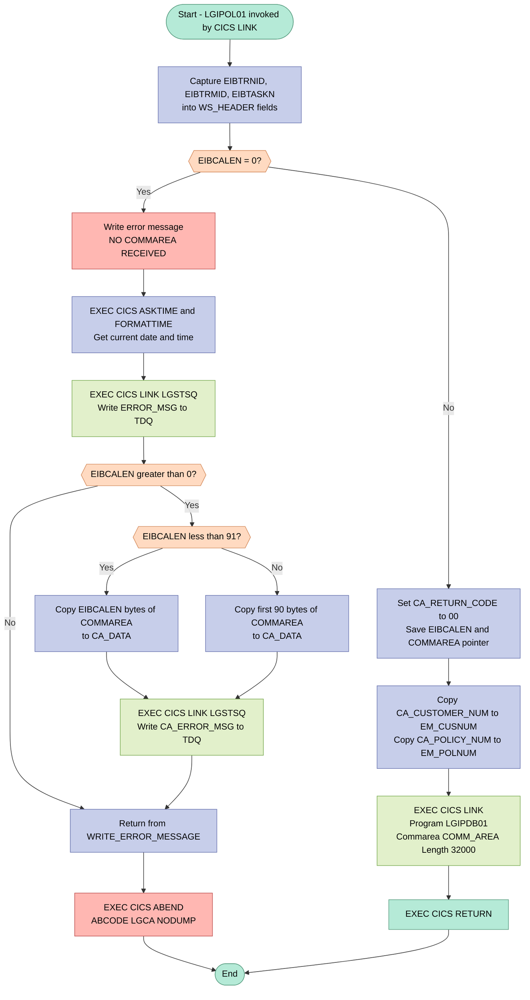
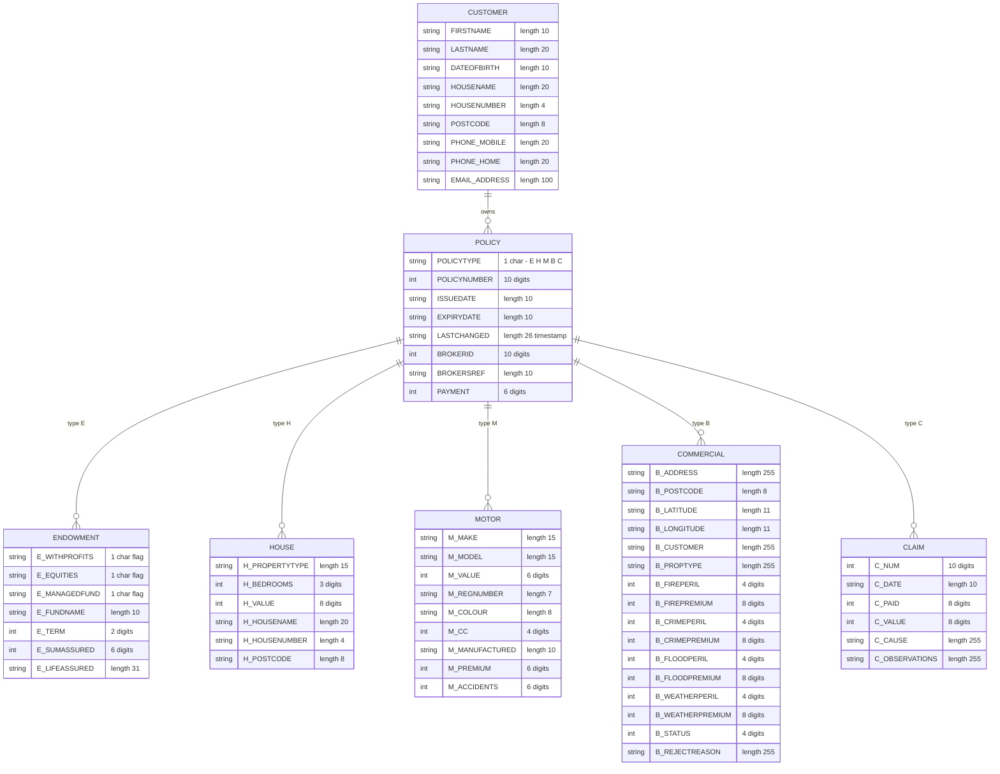

## Table of Contents

- [1. Purpose](#1-purpose)
- [2. Inputs](#2-inputs)
- [3. Outputs](#3-outputs)
  - [3.1 Communication Area Outputs](#31-communication-area-outputs)
  - [3.2 Error Logging and Queue Outputs](#32-error-logging-and-queue-outputs)
  - [3.3 CICS Control and Transaction Side Effects](#33-cics-control-and-transaction-side-effects)
- [4. Processing Logic](#4-processing-logic)
  - [4.1 Mermaid Flow Diagram](#41-mermaid-flow-diagram)
  - [4.2 Processing Logic Description](#42-processing-logic-description)
  - [4.3 Database Tables](#43-database-tables)
- [5. Paragraphs](#5-paragraphs)
- [6. Dependencies](#6-dependencies)
  - [6.1 Include Files (PL/I Copybooks)](#61-include-files-pli-copybooks)
  - [6.2 External Programs Invoked](#62-external-programs-invoked)
  - [6.3 CICS Services Used](#63-cics-services-used)
  - [6.4 CICS Execute Interface Block (EIB) Fields](#64-cics-execute-interface-block-eib-fields)
  - [6.5 Input Data (COMMAREA)](#65-input-data-commarea)
  - [6.6 Working-Storage / Configuration Constants](#66-working-storage--configuration-constants)
- [7. Constraints](#7-constraints)
  - [7.1 COMMAREA Presence and Integrity](#71-commarea-presence-and-integrity)
  - [7.2 Return Code Initialisation and Flow](#72-return-code-initialisation-and-flow)
  - [7.3 Sequencing of Operations](#73-sequencing-of-operations)
  - [7.4 Data Field Sizing and Type Constraints](#74-data-field-sizing-and-type-constraints)
  - [7.5 DB2 Host Variable Sizing Constraints](#75-db2-host-variable-sizing-constraints)
  - [7.6 Error Diagnostic Constraints](#76-error-diagnostic-constraints)
- [8. Error Handling](#8-error-handling)
- [9. Examples](#9-examples)
  - [9.1 Example 1: Successful Policy Inquiry Request](#91-example-1-successful-policy-inquiry-request)
  - [9.2 Example 2: Invocation with Missing COMMAREA (Zero Length)](#92-example-2-invocation-with-missing-commarea-zero-length)

## 1. Purpose

LGIPOL01 is the business-logic entry point for the policy inquiry transaction in an insurance application. A caller passes it a communications area containing a customer number and policy number, and it returns the full details of that one policy (endowment, house, motor, commercial, or claim). The program does not read the database itself. It first checks that a communications area was supplied. If none was, it logs an error message and abends the transaction. Otherwise it sets the return code to success and records the customer and policy numbers for any later error reporting. It then hands the request to the database inquiry program LGIPDB01, which fills the shared communications area with the customer, policy, and policy-type-specific data, and finally returns control to the caller. The program also contains a routine that stamps error messages with the date, time, program name, and customer and policy identifiers. The routine writes them, along with a snippet of the communications area, to a central logging queue through the LGSTSQ program.

## 2. Inputs

- **Program parameter**
  - COMM_AREA_PTR: Pointer parameter of the main procedure. It addresses the CICS COMMAREA passed in by the caller. The COMM_AREA based structure is overlaid on it.

- **Caller-supplied COMMAREA (COMM_AREA)**
  - Request header fields
    - CA_REQUEST_ID: 6-character request identifier supplied by the caller.
    - CA_CUSTOMER_NUM: 10-digit customer number. The program copies it into the error message (EM_CUSNUM) and passes it to LGIPDB01.
    - CA_RETURN_CODE: 2-digit return code. The program sets it to '00' on entry. LGIPDB01 later overwrites it with the outcome.
  - Policy request fields
    - CA_POLICY_NUM: 10-digit policy number to inquire on. The program copies it into the error message (EM_POLNUM) and passes it to LGIPDB01 as the lookup key.
  - COMM_AREA_RAW: Raw 32500-byte view of the COMMAREA. Its first 90 bytes, or EIBCALEN bytes if fewer, are written to the error queue when the COMMAREA is missing.
  - Policy detail areas (CA_ISSUE_DATE, CA_EXPIRY_DATE, CA_PAYMENT, CA_BROKERID and the endowment, house, motor, commercial and claim areas)
    - These fields are part of the COMMAREA layout.
    - LGIPDB01 populates them on return. The program does not use them as inputs.

- **CICS runtime context (EXEC interface block)**
  - EIBCALEN: Length of the COMMAREA received. A value of 0 means no COMMAREA, which causes an error message and an ABEND with code LGCA.
  - EIBTRNID: Transaction ID of the running task. It is recorded in the working header (WS_TRANSID).
  - EIBTRMID: Terminal ID. It is recorded in the working header (WS_TERMID).
  - EIBTASKN: CICS task number. It is recorded in the working header (WS_TASKNUM).

- **External programs and system services**
  - LGIPDB01: Database inquiry program, linked via CICS LINK with the COMMAREA. It supplies the DB2 policy and customer data returned in the COMMAREA, and the return code.
  - CICS ASKTIME and FORMATTIME: Provide the current date and time for the error message timestamp.
  - LGSTSQ: Logging program, linked to write error messages and COMMAREA data to the queue. It is used only on the error path.

- **Database-sourced data (obtained indirectly through LGIPDB01)**
  - DB2 customer data (DB2_CUSTOMER): Customer demographic details.
  - DB2 policy data (DB2_POLICY): Common policy attributes.
  - DB2 policy-type data (DB2_ENDOWMENT, DB2_MOTOR, DB2_COMMERCIAL): Policy-type-specific data.
  - These structures are declared as host variable layouts. LGIPOL01 does not query DB2 itself.

- **Constants and configuration**
  - WS_REQUIRED_CA_LEN: Required COMMAREA length, initialised to 0 and not used for validation in this program.
  - CA_POLICYTYPE (DB2_POLICYTYPE): Policy type indicator, declared but not referenced in the logic.

## 3. Outputs

### 3.1 Communication Area Outputs
- `COMM_AREA`
  - The primary communication area structure passed back to the invoking program upon completion or passed to downstream programs. It conveys the inquiry status, retrieved customer data, and policy-specific details.
  - `CA_RETURN_CODE`: A 2-digit status code initialized to `'00'` by the program to signify successful processing or updated by downstream routines to indicate an error condition.
  - `CA_CUSTOMER_NUM`: The 10-digit customer number associated with the inquired policy returned to the caller.
  - `CA_POLICY_REQUEST`: Sub-structure containing common and policy-specific details populated by the database retrieval layer and returned via the COMMAREA.
    - `CA_POLICY_NUM`: The 10-digit policy identifier that was inquired upon.
    - `CA_POLICY_COMMON`: Common policy fields returned to the caller, including `CA_ISSUE_DATE`, `CA_EXPIRY_DATE`, `CA_LASTCHANGED`, `CA_BROKERID`, `CA_BROKERSREF`, and `CA_PAYMENT`.
    - `CA_POLICY_SPECIFIC`: Union structure containing specific policy data populated for the inquired policy type:
      - `CA_ENDOWMENT`: Populated with endowment policy details such as with-profits flags, equities flags, managed fund flags, fund name, policy term, sum assured, and life assured name.
      - `CA_HOUSE`: Populated with house policy details such as property type, bedrooms, property value, house name, house number, and postcode.
      - `CA_MOTOR`: Populated with motor policy details including make, model, value, registration number, colour, engine capacity (CC), manufacture date, premium, and accident count.
      - `CA_COMMERCIAL`: Populated with commercial policy details including property address, geographic coordinates, perils, and premiums.
      - `CA_CLAIM`: Populated with claim details including claim number, date, paid amount, claim value, cause, and observations.

### 3.2 Error Logging and Queue Outputs
- `ERROR_MSG`
  - A formatted error log structure passed as a COMMAREA to the logging program `LGSTSQ` via `EXEC CICS LINK`. It provides diagnostics including the date (`EM_DATE`), time (`EM_TIME`), program identifier (`'LGIPOL01'`), message text (`EM_MSG_TEXT`), customer number (`EM_CUSNUM`), policy number (`EM_POLNUM`), SQL request (`EM_SQLREQ`), and SQL code (`EM_SQLRC`).
- `CA_ERROR_MSG`
  - A secondary diagnostic message structure passed to `LGSTSQ` containing a snapshot of the raw COMMAREA data (`CA_DATA`) up to 90 bytes to assist in troubleshooting missing or malformed inputs.

### 3.3 CICS Control and Transaction Side Effects
- `EXEC CICS ABEND`
  - Abnormal termination issued with abend code `'LGCA'` (no dump) when the program is invoked without an incoming COMMAREA (`EIBCALEN = 0`).
- `EXEC CICS RETURN`
  - Normal termination returning control and the populated `COMM_AREA` back to the calling CICS program or client transaction.

## 4. Processing Logic

### 4.1 Mermaid Flow Diagram



---

### 4.2 Processing Logic Description

#### 4.2.1 High-level Summary

`LGIPOL01` is a lightweight CICS orchestrator program responsible for handling insurance policy inquiry requests. It acts as the intermediary layer between the calling front-end (menu or another program) and the DB2 backend handler `LGIPDB01`. The program performs minimal business logic: it validates that a COMMAREA was received, initialises the return code, captures key identifiers for error reporting, and delegates the actual database retrieval to `LGIPDB01` via a CICS LINK.

---

#### 4.2.2 Execution Flow

**Step 1 – Environment capture**
Immediately on entry, the program captures the current CICS transaction ID (`EIBTRNID`), terminal ID (`EIBTRMID`), and task number (`EIBTASKN`) into the `WS_HEADER` working-storage structure. The eyecatcher `'LGIPOL01------WS'` in `WS_HEADER` allows any subsequent system dump to be easily identified as belonging to this program.

**Step 2 – COMMAREA presence check**
The program checks `EIBCALEN`. If it equals zero, no COMMAREA was passed by the caller. This is a fatal condition; the program:
1. Populates `EM_MSG_TEXT` with `' NO COMMAREA RECEIVED'`.
2. Calls the internal `WRITE_ERROR_MESSAGE` procedure to log the error.
3. Issues `EXEC CICS ABEND ABCODE('LGCA') NODUMP` to terminate the task with a recognisable abend code.

This is the **only** code path that results in an abend; all other errors are handled non-abend by the DB2 backend.

**Step 3 – COMMAREA initialisation**
If a COMMAREA is present, the program:
- Sets `CA_RETURN_CODE` to `'00'` (success assumed until the backend reports otherwise).
- Stores `EIBCALEN` in `WS_CALEN` and saves the COMMAREA pointer for later reference.
- Copies `CA_CUSTOMER_NUM` and `CA_POLICY_NUM` into the error message template (`EM_CUSNUM`, `EM_POLNUM`) so that any error written later will automatically include the customer and policy identifiers.

**Step 4 – Delegation to LGIPDB01**
The core business delegation:
```
EXEC CICS LINK Program(LGIPDB01)
          Commarea(COMM_AREA)
          Length(32000);
```
The full 32,000-byte COMMAREA — containing the policy type, policy number, and customer number supplied by the caller — is passed to `LGIPDB01`. That program performs all DB2 SELECTs against the POLICY, CUSTOMER, ENDOWMENT, HOUSE, MOTOR, COMMERCIAL, and CLAIM tables, then populates the relevant policy-specific section of the COMMAREA and sets `CA_RETURN_CODE` to `'00'` (success) or an error code (e.g. `'99'`).

`LGIPOL01` contains **no SQL itself**; it is a pure orchestrator.

**Step 5 – Return to caller**
`EXEC CICS RETURN` hands control back to the program that linked to `LGIPOL01`. The COMMAREA — now populated by `LGIPDB01` — is implicitly returned to the caller.

---

#### 4.2.3 WRITE_ERROR_MESSAGE Procedure

This reusable internal procedure is called on the fatal no-COMMAREA path:

1. **Timestamps** – Issues `EXEC CICS ASKTIME` / `EXEC CICS FORMATTIME` to obtain the current date (`MM/DD/YYYY`) and time (`HH:MM:SS`) and stores them in the error message structure.
2. **Primary error write** – Links to `LGSTSQ` (the shared transient-data queue writer) with the structured `ERROR_MSG` (date, time, program name, customer number, policy number, message text). This writes the diagnostic line to a CICS TDQ for operator review.
3. **COMMAREA dump** – If `EIBCALEN > 0`, up to 90 bytes of the raw COMMAREA are written to the same TDQ as a second entry (`CA_ERROR_MSG`), giving operators the actual bytes received. If the COMMAREA is shorter than 91 bytes, only the actual length is copied; otherwise the first 90 bytes are taken.

---

#### 4.2.4 External Interactions

| Program / System | Mechanism | Purpose |
|---|---|---|
| **LGIPDB01** | `EXEC CICS LINK` | Performs all DB2 queries to retrieve policy and customer details; populates the response COMMAREA |
| **LGSTSQ** | `EXEC CICS LINK` (inside `WRITE_ERROR_MESSAGE`) | Writes error/diagnostic messages to a CICS Transient Data Queue (TDQ) |
| **CICS EIB** | Direct field access | Reads `EIBCALEN`, `EIBTRNID`, `EIBTRMID`, `EIBTASKN` for validation and diagnostics |

---

#### 4.2.5 Plain Language Summary

When a user or calling program wants to look up the details of an insurance policy, it calls `LGIPOL01` and provides a COMMAREA containing the customer number and policy number. `LGIPOL01` first checks that the COMMAREA actually arrived — if not, it logs an error and abends. Assuming all is well, it immediately forwards the entire COMMAREA to a specialist database program (`LGIPDB01`), which goes to DB2, fetches the policy record (whether it is an Endowment, House, Motor, Commercial, or Claim policy), and fills in all the details. Once `LGIPDB01` finishes, `LGIPOL01` simply returns to the original caller with the now-populated COMMAREA. The program itself does no database work; it is purely a pass-through coordinator.

---

### 4.3 Database Tables

`LGIPOL01` contains no SQL statements and performs no direct database access. All DB2 interactions are delegated to `LGIPDB01`. The tables accessed indirectly through that backend are shown below for reference.



## 5. Paragraphs

- **LGIPOL01 (main procedure body)**
  - Purpose: This is the entry point, declared `Proc(COMM_AREA_PTR) Options(Main)`. It runs the policy inquiry business logic. It validates that a COMMAREA was received, delegates the DB2 inquiry to the database program LGIPDB01, and returns to CICS.
  - Operations:
    - Copies the CICS EIB transaction ID, terminal ID and task number (`EIBTRNID`, `EIBTRMID`, `EIBTASKN`) into `WS_TRANSID`, `WS_TERMID` and `WS_TASKNUM`.
    - Sets `CA_RETURN_CODE` to '00'.
    - Saves the COMMAREA length (`EIBCALEN`) in `WS_CALEN`.
    - Saves the COMMAREA address in `WS_ADDR_DFHCOMMAREA`.
    - Moves `CA_CUSTOMER_NUM` and `CA_POLICY_NUM` into `EM_CUSNUM` and `EM_POLNUM`, so any later error message includes them.
    - Issues `EXEC CICS LINK Program(LGIPDB01) Commarea(COMM_AREA) Length(32000)`. LGIPDB01 fills `COMM_AREA` with the policy details and sets `CA_RETURN_CODE`.
    - Issues `EXEC CICS RETURN` and then a PL/I `RETURN`.
  - Control flow:
    - `IF EIBCALEN = 0` handles the missing-COMMAREA case. It sets `EM_MSG_TEXT` to ' NO COMMAREA RECEIVED' and calls `WRITE_ERROR_MESSAGE`. It then issues `EXEC CICS ABEND ABCODE('LGCA') NODUMP`, so the rest of the logic is skipped.
    - Otherwise processing runs straight through with no loops.
    - The program does not check `CA_RETURN_CODE` after the LINK. It returns the COMMAREA to the caller as it stands.
    - `WS_REQUIRED_CA_LEN` is declared but never used to check the COMMAREA length.
  - External interactions:
    - CICS LINK to LGIPDB01. That program performs the DB2 access for the policy types (endowment, house, motor, commercial and claim) using the structures in the included copybooks LGPOLICY and LGCMAREA.
    - CICS ABEND.
    - CICS RETURN.

- **WRITE_ERROR_MESSAGE**
  - Purpose: This internal procedure logs error information. It is called only from the main body, when no COMMAREA is received. The message includes date, time, program name, customer number, policy number and a message text. It also records part of the COMMAREA contents.
  - Operations:
    - Issues `EXEC CICS ASKTIME ABSTIME(ABS_TIME)` to get the current absolute time.
    - Issues `EXEC CICS FORMATTIME` to convert it into `DATE1` (MMDDYYYY) and `TIME1`.
    - Copies them into `EM_DATE` and `EM_TIME` in the `ERROR_MSG` structure.
    - Links to program LGSTSQ with `ERROR_MSG` as the COMMAREA, using `STG(ERROR_MSG)` as the length. LGSTSQ writes the message to the queues.
    - If a COMMAREA exists, copies up to the first 90 bytes of `COMM_AREA_RAW` into `CA_DATA` in `CA_ERROR_MSG`. It then links to LGSTSQ again to write this second record.
  - Control flow:
    - `IF EIBCALEN > 0` guards the COMMAREA dump.
    - Nested inside it, `IF EIBCALEN < 91` copies only `EIBCALEN` bytes with `LEFT(COMM_AREA_RAW, EIBCALEN)`. The `ELSE` branch copies a fixed 90 bytes with `LEFT(COMM_AREA_RAW, 90)`. Both branches issue the same LINK to LGSTSQ.
    - The procedure ends with `RETURN` to its caller.
  - External interactions:
    - CICS time services: ASKTIME and FORMATTIME.
    - Up to two CICS LINKs to the logging program LGSTSQ, which writes to the message queues.
  - Note: In the only case where this procedure is called, `EIBCALEN` is 0, so the COMMAREA dump block is skipped and only the first LINK to LGSTSQ runs.

## 6. Dependencies

### 6.1 Include Files (PL/I Copybooks)

- `LGPOLICY` (`plinc/LGPOLICY.inc`)
  - Provides all DB2 host-variable structures (`DB2_CUSTOMER`, `DB2_POLICY`, `DB2_ENDOWMENT`, `DB2_HOUSE`, `DB2_MOTOR`, `DB2_COMMERCIAL`, `DB2_CLAIM`) and the policy-length constants (`WS_POLICY_LENGTHS`)
  - Defines DB2 null-indicator variables (`IND_BROKERID`, `IND_BROKERSREF`, `IND_PAYMENT`, `IND_E_PADDINGDATA`, `IND_E_PADDINGDATAL`)
- `LGCMAREA` (`plinc/LGCMAREA.inc`)
  - Defines `COMM_AREA_PTR` and the 32 500-byte `COMM_AREA` UNION structure that is the sole data contract between programs
  - Contains the full policy-type-specific sub-structures: `CA_ENDOWMENT`, `CA_HOUSE`, `CA_MOTOR`, `CA_COMMERCIAL`, `CA_CLAIM`

### 6.2 External Programs Invoked

- `LGIPDB01` — primary downstream program, invoked via `EXEC CICS LINK` with the full `COMM_AREA` (length 32 000); performs all DB2 reads for the policy inquiry and sets `CA_RETURN_CODE`
- `LGSTSQ` — error-logging utility, invoked via `EXEC CICS LINK` twice inside `WRITE_ERROR_MESSAGE`; writes formatted error messages (program name, date, time, customer number, policy number, SQLCODE) and a COMMAREA dump to a CICS transient data queue

### 6.3 CICS Services Used

- `EXEC CICS LINK` — used to call `LGIPDB01` (main policy lookup) and `LGSTSQ` (error logging)
- `EXEC CICS RETURN` — ends the CICS transaction and returns control to the caller
- `EXEC CICS ABEND ABCODE('LGCA') NODUMP` — issued when no COMMAREA is received (`EIBCALEN = 0`)
- `EXEC CICS ASKTIME` / `EXEC CICS FORMATTIME` — used inside `WRITE_ERROR_MESSAGE` to obtain and format the current date and time for error messages

### 6.4 CICS Execute Interface Block (EIB) Fields

- `EIBTRNID` — transaction identifier; copied into `WS_TRANSID` for diagnostics
- `EIBTRMID` — terminal identifier; copied into `WS_TERMID` for diagnostics
- `EIBTASKN` — task number; copied into `WS_TASKNUM` for diagnostics
- `EIBCALEN` — COMMAREA length; checked at startup to detect a missing COMMAREA and used inside `WRITE_ERROR_MESSAGE` to bound the COMMAREA dump

### 6.5 Input Data (COMMAREA)

- `COMM_AREA` (32 500 bytes, passed by the caller via the CICS COMMAREA mechanism)
  - `CA_REQUEST_ID` — 6-character operation code identifying the request type (e.g., `'01IMOT'`)
  - `CA_RETURN_CODE` — 2-digit return code; initialised to `'00'` by this program; final value set by `LGIPDB01`
  - `CA_CUSTOMER_NUM` — 10-digit customer identifier; captured for error-message inclusion
  - `CA_POLICY_NUM` — 10-digit policy identifier within `CA_POLICY_REQUEST`; captured for error-message inclusion
  - `CA_POLICY_COMMON` — common policy fields (issue date, expiry date, last-changed timestamp, broker ID, broker reference, payment amount) returned by `LGIPDB01`
  - `CA_POLICY_SPECIFIC` — UNION of policy-type-specific sub-structures (`CA_ENDOWMENT`, `CA_HOUSE`, `CA_MOTOR`, `CA_COMMERCIAL`, `CA_CLAIM`); populated by `LGIPDB01` according to policy type

### 6.6 Working-Storage / Configuration Constants

- `WS_EYECATCHER` (`'LGIPOL01------WS'`) — static identifier embedded in working storage for dump analysis
- `WS_CA_HEADERTRAILER_LEN` (33) — fixed overhead length of the COMMAREA header/trailer
- `WS_REQUIRED_CA_LEN` — computed minimum COMMAREA length validated before processing
- `WS_POLICY_LENGTHS` (from `LGPOLICY`) — policy-segment length constants (`WS_CUSTOMER_LEN`, `WS_POLICY_LEN`, `WS_ENDOW_LEN`, `WS_HOUSE_LEN`, `WS_MOTOR_LEN`, `WS_COMM_LEN`, `WS_CLAIM_LEN`, and their full/summary variants) used for COMMAREA sizing

## 7. Constraints

### 7.1 COMMAREA Presence and Integrity

- **COMMAREA must be present on entry** — `EIBCALEN` is tested immediately at program entry; if it equals zero, the program writes an error message and issues `EXEC CICS ABEND ABCODE('LGCA') NODUMP` unconditionally. Processing cannot continue without a COMMAREA.
- **COMMAREA total size is fixed at 32 500 bytes** — `COMM_AREA_RAW` is declared as `CHAR(32500)`. The CICS LINK to `LGIPDB01` passes the COMMAREA with an explicit `LENGTH(32000)`, meaning the downstream program only receives the first 32 000 bytes. Data beyond offset 32 000 is not forwarded and must not carry essential fields.
- **COMMAREA layout is immutable in structure** — the UNION overlay requires that every branch (`CA_CUSTOMER_REQUEST`, `CA_CUSTSECR_REQUEST`, `CA_POLICY_REQUEST`, `CA_POLICY_SPECIFIC`) occupy exactly `CHAR(32482)` (`CA_REQUEST_SPECIFIC`). Adding a field to any branch must be compensated by shrinking that branch's filler field by the same byte count or the structure overflows.

### 7.2 Return Code Initialisation and Flow

- **`CA_RETURN_CODE` must be initialised to `'00'` before any downstream call** — the program sets `CA_RETURN_CODE = '00'` unconditionally at the top of the mainline procedure, before the CICS LINK. This guarantees the return code field is not left with a stale value from a prior transaction.
- **Return code semantics are binary: success or failure is signalled only by `LGIPDB01`** — `LGIPOL01` itself does not set `CA_RETURN_CODE` to any error value; only the absence of a COMMAREA causes an immediate abend. All content-level error codes (`'98'`, `'99'`) are set exclusively by `LGIPDB01`.

### 7.3 Sequencing of Operations

- **`CA_CUSTOMER_NUM` and `CA_POLICY_NUM` must be captured before the CICS LINK** — both are copied into `EM_CUSNUM` and `EM_POLNUM` (for error message use) immediately after initialisation and before the call to `LGIPDB01`. Any modification to the COMMAREA by the called program after this point does not affect the diagnostic copies.
- **CICS LINK to `LGIPDB01` must precede `EXEC CICS RETURN`** — the program unconditionally links `LGIPDB01` and then issues `EXEC CICS RETURN`. There is no conditional path that skips the database call; the link is a mandatory step in every successful execution.
- **`EXEC CICS RETURN` terminates the transaction** — the explicit `EXEC CICS RETURN` immediately follows the CICS LINK. No logic executes after that point in the mainline. The subsequent PL/I `RETURN;` statement is unreachable under CICS and serves only as a syntactic delimiter.

### 7.4 Data Field Sizing and Type Constraints

- **`CA_POLICY_NUM` is a 10-digit numeric picture field** (`PIC '9999999999'`) — only unsigned decimal digits 0–9 are valid. Any non-numeric content in this field produces undefined behaviour in the PIC comparison.
- **`CA_CUSTOMER_NUM` is a 10-digit numeric picture field** (`PIC '9999999999'`) — same constraint; the field must contain exactly 10 decimal digits.
- **`CA_RETURN_CODE` is a 2-digit picture field** (`PIC '99'`) — it can only hold values `'00'` through `'99'`. The defined operational values are `'00'` (success), `'98'` (COMMAREA too short), and `'99'` (Db2 or system error). Any value outside this range is structurally possible but semantically undefined.
- **`CA_REQUEST_ID` is exactly 6 characters** — the field is `CHAR(6)`. The expected encoding format is two-digit operation code followed by a 4-character entity code (e.g., `'01IMOT'`). No length padding or truncation is performed within `LGIPOL01`.
- **`CA_POLICYTYPE` (surfaced as `DB2_POLICYTYPE CHAR`)** — a single character that governs which `CA_POLICY_SPECIFIC` UNION branch the downstream `LGIPDB01` uses. Valid values are `'E'` (Endowment), `'H'` (House), `'M'` (Motor), `'B'` (Commercial), and `'C'` (Claim). `LGIPOL01` does not validate this field itself; it delegates that responsibility to `LGIPDB01`.
- **Policy-type-specific data structures have fixed maximum sizes** enforced by their UNION overlay fields:
  - Endowment: `CA_E_PADDING_DATA CHAR(32348)` limits total endowment payload to `52` bytes of active data within the 32 400-byte `CA_POLICY_RAW` space.
  - House: `CA_H_FILLER CHAR(32342)` — 58 bytes of active data.
  - Motor: `CA_M_FILLER CHAR(32323)` — 77 bytes of active data.
  - Commercial: `CA_B_FILLER CHAR(31298)` — 1 102 bytes of active data.
  - Claim: `CA_C_FILLER CHAR(31854)` — 546 bytes of active data.

### 7.5 DB2 Host Variable Sizing Constraints

- **`DB2_CUSTOMER` field widths must exactly match DB2 column definitions** — the host variable fields (`DB2_FIRSTNAME CHAR(10)`, `DB2_LASTNAME CHAR(20)`, `DB2_DATEOFBIRTH CHAR(10)`, `DB2_HOUSENAME CHAR(20)`, `DB2_HOUSENUMBER CHAR(4)`, `DB2_POSTCODE CHAR(8)`, `DB2_PHONE_MOBILE CHAR(20)`, `DB2_PHONE_HOME CHAR(20)`, `DB2_EMAIL_ADDRESS CHAR(100)`) must not diverge from their table column lengths; a mismatch causes a Db2 SQLCODE error or data truncation.
- **Nullable DB2 columns require indicator variables** — `IND_BROKERID`, `IND_BROKERSREF`, `IND_PAYMENT`, `IND_E_PADDINGDATA`, and `IND_E_PADDINGDATAL` are declared as `FIXED BIN(15)` indicator variables. These must be checked after any SELECT on nullable columns; failure to do so would result in SQLCODE -305.
- **`WS_MOTOR_LEN` (65) is smaller than the full `CA_MOTOR` structure** — `CA_M_PREMIUM` and `CA_M_ACCIDENTS` are populated by explicit field-level assignments in `LGIPDB01` rather than by bulk structure copy. Any new trailing motor field must likewise be assigned explicitly rather than relying on a structure move.

### 7.6 Error Diagnostic Constraints

- **Error message COMMAREA dump is capped at 90 bytes** — within `WRITE_ERROR_MESSAGE`, if `EIBCALEN` is between 1 and 90 (inclusive), exactly `EIBCALEN` bytes of `COMM_AREA_RAW` are written; if `EIBCALEN` exceeds 90, only the first 90 bytes are captured into `CA_DATA`. No more than 90 bytes of COMMAREA content are ever written to the error TS queue.
- **Error messages are written to a CICS TS queue via `LGSTSQ`; no abend is issued for content errors** — the only condition that triggers an abend is `EIBCALEN = 0`. All other errors are logged and the transaction continues or returns cleanly.
- **`WRITE_ERROR_MESSAGE` only writes COMMAREA data if `EIBCALEN > 0`** — the inner COMMAREA dump block is guarded by `IF EIBCALEN > 0`, preventing a reference to a null or zero-length COMMAREA buffer.

## 8. Error Handling

- **Input validation and precondition checks**
  - The program checks whether the CICS-supplied COMMAREA length (EIBCALEN) is zero, which means the caller passed no COMMAREA.
  - This is the only explicit validation in the program.
  - If the COMMAREA is missing, the program sets the message text to "NO COMMAREA RECEIVED". It then calls the internal error-writing procedure and abends the task.
  - A working-storage field for the required COMMAREA length (WS_REQUIRED_CA_LEN) and a header/trailer length field are declared.
    - Neither is used in any comparison.
    - No check ever tests whether the COMMAREA is long enough for the policy-inquiry fields.

- **Abnormal termination**
  - When no COMMAREA is received, the program issues a CICS ABEND with abend code "LGCA" and the NODUMP option.
    - The task ends abnormally, and no storage dump is produced.
    - Nothing after the abend runs, so the downstream database program is never called.
  - This is the only forced termination path.

- **Return code handling**
  - The COMMAREA return code (CA_RETURN_CODE) is set to "00" after the COMMAREA check passes. This marks the start of the request as successful.
  - The called database program (LGIPDB01) is expected to set the return code on failure.
    - LGIPOL01 does not inspect the return code after the LINK.
    - It passes the COMMAREA straight back to the caller, so the caller must interpret any error code.

- **Error message construction and logging**
  - A common error message structure holds the date, time, program name, and a variable part.
    - The variable part is either free-form message text or a formatted layout of customer number, policy number, SQL request name, and SQLCODE.
    - The SQL request and SQLCODE fields are declared but never populated in this program.
  - The customer number and policy number are copied into the message structure before the LINK to the database program.
    - They are therefore available for any later error message.
    - In the no-COMMAREA case this copy has not happened yet, so the message contains only the text, date, and time.
  - The internal procedure WRITE_ERROR_MESSAGE does the logging.
    - It gets the current absolute time (ASKTIME) and formats it into date and time strings (FORMATTIME, MMDDYYYY date format).
    - It places the date and time in the message.
    - It then links to the logging program LGSTSQ, passing the error message as the COMMAREA.
    - LGSTSQ writes the message to the queues (TDQ/TSQ).
  - The procedure also logs the incoming COMMAREA contents as a second record.
    - This happens only if the COMMAREA length is greater than zero.
    - If the length is under 91 bytes, it logs just the received bytes, taken from the left of the raw COMMAREA.
    - If the length is 91 bytes or more, it logs the first 90 bytes.
    - Both paths link to LGSTSQ with a "COMMAREA=" prefixed record.
    - In the current flow the procedure is only called when the length is zero, so this second record is never written in practice. It is defensive logic for reuse.

- **Conditions not handled**
  - The CICS LINK to LGIPDB01 has no RESP/RESP2 or HANDLE CONDITION handling, and no ON-unit or other condition handling is defined.
    - Failures such as the program not being found, or an abend in the linked program, are not trapped here.
    - They go to CICS default handling, which normally abends the task.
  - The calls inside the error-logging procedure (ASKTIME, FORMATTIME, and the LINKs to LGSTSQ) have no response checks.
    - A failure while logging is not detected and has no fallback.
  - There are no retries, default-value substitutions, or alternate processing paths.

- **Normal completion path**
  - After a successful LINK, the program issues a CICS RETURN to give control back to the caller.
  - A trailing PL/I RETURN follows it and is effectively unreachable.

## 9. Examples

### 9.1 Example 1: Successful Policy Inquiry Request

#### 9.1.1 Input COMMAREA Data
* **`CA_REQUEST_ID`**: `'01IMOT'` (Motor Policy Inquiry)
* **`CA_RETURN_CODE`**: `'00'`
* **`CA_CUSTOMER_NUM`**: `0000000001`
* **`CA_POLICY_NUM`**: `0000000001`
* **`EIBCALEN`**: `32500`

#### 9.1.2 Expected Output COMMAREA Data
* **`CA_RETURN_CODE`**: `'00'`
* **`CA_CUSTOMER_NUM`**: `0000000001`
* **`CA_POLICY_NUM`**: `0000000001`
* **`CA_ISSUE_DATE`**: `'2020-01-15'`
* **`CA_EXPIRY_DATE`**: `'2021-01-14'`
* **`CA_LASTCHANGED`**: `'2020-01-15-10.00.00.000000'`
* **`CA_BROKERID`**: `0000000010`
* **`CA_BROKERSREF`**: `'BRKREF0001'`
* **`CA_PAYMENT`**: `000450`
* **`CA_MOTOR` (Specific Details)**:
  * `CA_M_MAKE`: `'FORD           '`
  * `CA_M_MODEL`: `'FOCUS          '`
  * `CA_M_VALUE`: `015000`
  * `CA_M_REGNUMBER`: `'AB12CDE'`
  * `CA_M_COLOUR`: `'BLUE    '`
  * `CA_M_CC`: `1600`
  * `CA_M_MANUFACTURED`: `'2018-05-10'`
  * `CA_M_PREMIUM`: `000450`
  * `CA_M_ACCIDENTS`: `000000`

#### 9.1.3 Explanation
1. `LGIPOL01` receives control and checks `EIBCALEN`. Since `EIBCALEN > 0`, it avoids the abend routine.
2. It initialises `CA_RETURN_CODE` to `'00'` and captures `CA_CUSTOMER_NUM` and `CA_POLICY_NUM` into error-reporting variables.
3. It issues `EXEC CICS LINK PROGRAM('LGIPDB01')` passing the `COMM_AREA` structure with a length of `32000`.
4. Downstream program `LGIPDB01` queries the `POLICY` and `MOTOR` Db2 tables using `CA_POLICY_NUM`, populates the common and motor-specific fields in the COMMAREA, and returns control.
5. `LGIPOL01` returns control to the calling CICS program via `EXEC CICS RETURN`.

---

### 9.2 Example 2: Invocation with Missing COMMAREA (Zero Length)

#### 9.2.1 Input Data
* **`EIBCALEN`**: `0`
* **`COMM_AREA`**: (Not supplied)

#### 9.2.2 Expected Output / Behavior
* **CICS ABEND**: Code `'LGCA'` with `NODUMP`
* **Temporary Storage Queue Log (`LGSTSQ`)**:
  * Record 1: Formatted timestamp, program name `'LGIPOL01'`, and error message `' NO COMMAREA RECEIVED'`.

#### 9.2.3 Explanation
1. Upon invocation, `LGIPOL01` checks the communications area length via `EIBCALEN`.
2. Detecting `EIBCALEN = 0`, it branches to the missing COMMAREA error path.
3. It sets `EM_MSG_TEXT` to `' NO COMMAREA RECEIVED'`, formats the system date and time via `EXEC CICS ASKTIME` and `EXEC CICS FORMATTIME`, and invokes `LGSTSQ` via CICS LINK to log the error message.
4. It terminates the transaction immediately by executing `EXEC CICS ABEND ABCODE('LGCA') NODUMP`.

---

Generated by IBM Bob Premium Package for Z
