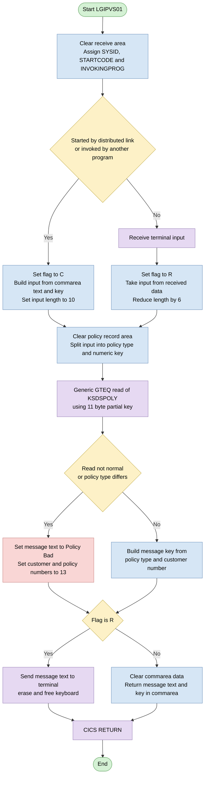
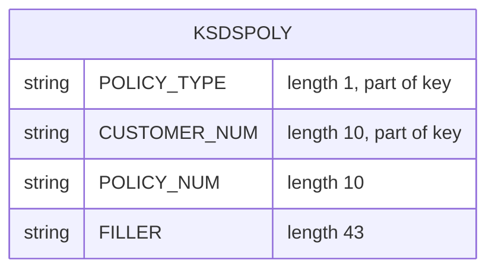

## Table of Contents

- [1. Purpose](#1-purpose)
- [2. Inputs](#2-inputs)
- [3. Outputs](#3-outputs)
  - [3.1 Commarea Response (Program Invocation via LINK/START)](#31-commarea-response-program-invocation-via-linkstart)
  - [3.2 Terminal Display Output (Direct Terminal Invocation)](#32-terminal-display-output-direct-terminal-invocation)
- [4. Processing Logic](#4-processing-logic)
  - [4.1 Mermaid Flow Diagram](#41-mermaid-flow-diagram)
  - [4.2 Processing Logic Description](#42-processing-logic-description)
  - [4.3 Database Tables](#43-database-tables)
- [5. Paragraphs](#5-paragraphs)
- [6. Dependencies](#6-dependencies)
- [7. Constraints](#7-constraints)
- [8. Error Handling](#8-error-handling)
- [9. Examples](#9-examples)
  - [9.1 Example 1: Terminal input, matching policy found](#91-example-1-terminal-input-matching-policy-found)
  - [9.2 Example 2: Called by another program, matching policy found](#92-example-2-called-by-another-program-matching-policy-found)
  - [9.3 Example 3: No matching policy](#93-example-3-no-matching-policy)

## 1. Purpose

Este programa CICS en PL/I consulta el archivo VSAM de pólizas KSDSPOLY mediante una lectura genérica de clave parcial (GTEQ). Con ella localiza la primera póliza cuyo tipo y número de cliente coinciden con los de la clave solicitada. La clave parcial, formada por el tipo de póliza y un número de cliente, la recibe de un programa invocador a través de la COMMAREA, o bien de la entrada que el usuario escribe en el terminal. Si encuentra una póliza del tipo solicitado, devuelve el tipo de póliza y el número de cliente con el mensaje "Policy Key=". Si no la encuentra o la lectura falla, devuelve el mensaje "Policy Bad=" con valores de relleno. El resultado se envía a la pantalla cuando la entrada vino del terminal. Cuando el programa fue invocado por otro programa, el resultado vuelve en la COMMAREA.

## 2. Inputs

- **Program parameter (CICS commarea)**
  - COMMA_PTR (pointer to DFHCOMMAREA): the main procedure parameter, which addresses the commarea passed by a calling program on LINK or a started transaction.
  - COMMA_DATA_TEXT: an 11-character text field in the commarea. It is combined with the key to build the working input string.
  - COMMA_DATA_KEY: a 21-character field in the commarea that carries the partial policy key to search for. It holds the policy type and the numeric part, normally the customer number.

- **Terminal input (CICS RECEIVE)**
  - WS_RECV_DATA: a 74-character field that holds the text a user types after the transaction identifier. It is used when no calling program or distributed start is detected. It supplies the policy type and partial key.
  - WS_COMMAREA: an 80-character working area filled from either the commarea or the terminal data. It is the source of the search key values.
  - PART_KEY_TYPE: the first character of the input. It is the requested policy type and the first byte of the generic GTEQ key. The record found is checked against it.
  - PART_KEY_NUM: a ten-digit numeric field taken from the input after the policy type. It is the customer number part of the generic GTEQ key.

- **CICS execution environment (EXEC CICS ASSIGN)**
  - WS_STARTCODE: the CICS start code. A first character of 'D' means the program was started by a distributed program link. It decides whether input comes from the commarea or the terminal.
  - WS_INVOKEPROG: the name of the invoking program. A non-blank value means the program was called by another program, so input and output use the commarea.
  - WS_FLAG: a flag set from the two values above. 'C' means commarea input and 'R' means terminal input. It decides whether the result is returned in the commarea or sent to the terminal.

- **External data source (VSAM file KSDSPOLY)**
  - CA_POLICY_TYPE: the policy type read from the matching record, using a generic GTEQ read with an 11-byte key length. It is compared with the requested type.
  - CA_CUSTOMER_NUM: the customer number from the record found. It is used to build the returned key.
  - CA_POLICY_NUM: the policy number from the record found. It identifies the individual policy.

- **Output message fields built from the inputs**
  - WRITE_MSG_TEXT: the message label, 'Policy Key=' or 'Policy Bad='. It is set to 'Policy Bad=' when the read fails or the policy type does not match.
  - WRITE_MSG_KEY_CH: the 21-character policy key built from the record found. It is sent to the terminal or copied into the commarea.
  - WRITE_MSG_CUSTNUM: the customer number in the message. It is set to 13 when the lookup fails.
  - WRITE_MSG_POLNUM: the policy number in the message. It is set to 13 when the lookup fails.

## 3. Outputs

### 3.1 Commarea Response (Program Invocation via LINK/START)
- `COMMA_DATA`: The primary communication data structure updated and returned to the calling program when invoked programmatically (`WS_FLAG = 'C'`).
  - `COMMA_DATA_TEXT`: Returns the status indicator string representing the outcome of the policy lookup (`'Policy Key='` on successful record retrieval or `'Policy Bad='` upon failure or mismatch).
  - `COMMA_DATA_KEY`: Returns the composite policy key string (policy type concatenated with customer number) on success, or a default/fallback value on failure.

### 3.2 Terminal Display Output (Direct Terminal Invocation)
- `WRITE_MSG`: The formatted message structure transmitted to the 3270 terminal using `EXEC CICS SEND TEXT` when the transaction is run interactively (`WS_FLAG = 'R'`).
  - `WRITE_MSG_TEXT`: Displays the status prefix (`'Policy Key='` on success or `'Policy Bad='` on failure).
  - `WRITE_MSG_KEY`: The union subfield containing the result details displayed after the status text:
    - `WRITE_MSG_KEY_CH`: Transmits the combined policy type and customer number string when the lookup succeeds.
    - `WRITE_MSG_CUSTNUM`: Numeric formatted customer number field set to the error placeholder value (`13`) when the policy lookup fails.
    - `WRITE_MSG_POLNUM`: Numeric formatted policy number field set to the error placeholder value (`13`) when the policy lookup fails.

## 4. Processing Logic

### 4.1 Mermaid Flow Diagram



### 4.2 Processing Logic Description

**High-level Summary**

LGIPVS01 is a CICS PL/I main program. It does a generic browse (GTEQ) of the policy VSAM file KSDSPOLY. The partial key is a one-character policy type followed by a numeric part, normally a customer number. The partial key comes from a commarea, when the program is linked or started by another program, or from terminal input. The program checks that the record found has the requested policy type. It then returns "Policy Key=" with the key found, or "Policy Bad=" with placeholder values, either in the commarea or on the terminal.

**Execution Flow**

1. **Initialization**
   - `WS_RECV` is set to blanks.
   - Three `EXEC CICS ASSIGN` commands fetch `SYSID`, `STARTCODE` into `WS_STARTCODE`, and `INVOKINGPROG` into `WS_INVOKEPROG`. The RESP values of these commands are not checked.

2. **Determine invocation mode**
   - If the first character of `WS_STARTCODE` is 'D' (distributed program link), or `WS_INVOKEPROG` is not blank, the program was called by another program.
     - `WS_FLAG` is set to 'C'.
     - `WS_COMMAREA` is built from `COMMA_DATA_TEXT` concatenated with `COMMA_DATA_KEY`.
     - `WS_RECV_LEN` is set to 10.
   - Otherwise the program was started from a terminal.
     - `EXEC CICS RECEIVE` reads the input into `WS_RECV`, and the received length is placed in `WS_RECV_LEN`.
     - `WS_FLAG` is set to 'R'.
     - `WS_COMMAREA` is taken from `WS_RECV_DATA`, which is the data after the 5-character transaction ID.
     - `WS_RECV_LEN` is reduced by 6. This removes the transaction ID and the separator, leaving the length of the numeric portion.

3. **Build the partial key**
   - `CA_AREA` is cleared.
   - `PART_KEY_TYPE` is the first character of `WS_COMMAREA`.
   - `PART_KEY_NUM` is taken from `WS_COMMAREA` starting at position 2 for `WS_RECV_LEN` characters.
   - The key is 11 bytes: 1 byte of type plus 10 digits.

4. **Read the policy file**
   - `EXEC CICS READ FILE('KSDSPOLY')` uses GENERIC and GTEQ with `KEYLENGTH` 11 and `RIDFLD(PART_KEY)`.
   - The record goes into `CA_AREA`, with a length of 64.
   - This returns the first record whose key is greater than or equal to the partial key.

5. **Validate the result**
   - If `CA_POLICY_TYPE` differs from `PART_KEY_TYPE`, or the response is not NORMAL, the lookup has failed.
     - `WRITE_MSG_TEXT` becomes 'Policy Bad='.
     - `WRITE_MSG_CUSTNUM` and `WRITE_MSG_POLNUM` are both set to 13.
   - Otherwise `WRITE_MSG_KEY_CH` is set to `CA_POLICY_TYPE` concatenated with `CA_CUSTOMER_NUM`. The message text stays 'Policy Key='.
   - Business rule: a record of a different policy type is treated as not found, even if the GTEQ read succeeded.

6. **Return the result**
   - If `WS_FLAG` is 'R', `EXEC CICS SEND TEXT` sends the 80-byte `WRITE_MSG` to the terminal with WAIT, ERASE and FREEKB.
   - Otherwise `COMMA_DATA` is cleared, then `COMMA_DATA_TEXT` is set to `WRITE_MSG_TEXT` and `COMMA_DATA_KEY` to `WRITE_MSG_KEY_CH`.

7. **Finish**
   - `EXEC CICS RETURN` ends the program.

**External Interactions**

- **KSDSPOLY (VSAM KSDS, read through CICS file control)**
  - Generic GTEQ read to find the first policy record matching the requested policy type and customer key.
  - The record layout is policy type (1), customer number (10), policy number (10), and 43 bytes of filler.
- **CICS ASSIGN**
  - Gets the system ID, start code and invoking program name, which decide how the program was invoked.
- **CICS RECEIVE / SEND TEXT**
  - Terminal input and output when the program is started from a terminal.
- **COMMAREA (DFHCOMMAREA)**
  - Input and output channel with a calling program. It is 90 bytes long: an 11-byte text, a 21-byte key and 58 bytes of filler.
- **CICS RETURN**
  - Returns control to CICS or to the caller.

**Plain Language Summary**

The program looks up a policy. It is given a policy type letter and a customer number, or the first part of one. It finds the first policy on file that comes at or after that number. If the policy found is of the requested type, it answers "Policy Key=" followed by the type and customer number. If nothing suitable is found, or the file read fails, it answers "Policy Bad=" with placeholder numbers (13). A person at a terminal sees the answer on screen. Another program that called this one gets the answer back in its shared data area.

### 4.3 Database Tables



## 5. Paragraphs

**LGIPVS01 (main procedure)**
- Purpose: CICS entry point. It does a generic GTEQ browse of the policy VSAM file KSDSPOLY for a partial key. The key comes either from a commarea (when the program is linked or started) or from terminal input. It returns the result in the commarea or sends it to the terminal.
- There are no internal sub-paragraphs or called procedures. All logic runs in one straight-line procedure, in the logical sections below.

**Initialization and invocation detection**
- Purpose: Clear the work areas and find out how the program was invoked.
- Operations:
  - Blanks the `WS_RECV` structure.
  - Issues `EXEC CICS ASSIGN` for SYSID, STARTCODE (into `WS_STARTCODE`) and INVOKINGPROG (into `WS_INVOKEPROG`). All three use `RESP(WS_RESP)`, and the response is not checked.
- External interaction: CICS ASSIGN commands.

**Input acquisition (commarea vs terminal)**
- Purpose: Fill `WS_COMMAREA` with the request data (policy type plus partial key) and set `WS_FLAG` to show the invocation mode.
- Control flow: An IF/ELSE tests whether the first character of `WS_STARTCODE` is 'D' or `WS_INVOKEPROG` is non-blank.
  - Commarea branch (true):
    - Sets `WS_FLAG` to 'C'.
    - Builds `WS_COMMAREA` by concatenating `COMMA_DATA_TEXT` and `COMMA_DATA_KEY`.
    - Sets `WS_RECV_LEN` to 10.
  - Terminal branch (false):
    - Issues `EXEC CICS RECEIVE INTO(WS_RECV)` with `LENGTH(WS_RECV_LEN)`.
    - Sets `WS_FLAG` to 'R'.
    - Copies `WS_RECV_DATA` into `WS_COMMAREA`.
    - Subtracts 6 from `WS_RECV_LEN`, which accounts for the transaction ID and separator.
- External interaction: CICS RECEIVE from the terminal, in the terminal branch only.

**Partial key construction**
- Purpose: Build the generic search key.
- Operations:
  - Blanks `CA_AREA`.
  - Takes `PART_KEY_TYPE` from the first character of `WS_COMMAREA`.
  - Takes `PART_KEY_NUM` from `WS_COMMAREA` starting at position 2, using `WS_RECV_LEN` as the length. The result is converted to the 10-digit numeric picture.

**Policy file read (GTEQ browse)**
- Purpose: Locate the first policy record at or after the partial key.
- Operations: Issues `EXEC CICS READ FILE('KSDSPOLY')` with these options:
  - `INTO(CA_AREA)`
  - `LENGTH(F64)`
  - `RIDFLD(PART_KEY)`
  - `KEYLENGTH(F11)`
  - `GENERIC`
  - `GTEQ`
  - `RESP(WS_RESP)`
- On a successful read, `CA_AREA` receives `CA_POLICY_TYPE`, `CA_CUSTOMER_NUM` and `CA_POLICY_NUM`.
- External interaction: VSAM KSDS file KSDSPOLY, read through CICS file control.

**Result evaluation and message building**
- Purpose: Check that the record found has the requested policy type and prepare the response message.
- Control flow: An IF/ELSE tests whether `CA_POLICY_TYPE` differs from `PART_KEY_TYPE`, or `WS_RESP` is not `DFHRESP(NORMAL)`.
  - Failure branch (true):
    - Sets `WRITE_MSG_TEXT` to 'Policy Bad='.
    - Sets `WRITE_MSG_CUSTNUM` to 13.
    - Sets `WRITE_MSG_POLNUM` to 13.
  - Success branch (false): sets `WRITE_MSG_KEY_CH` to `CA_POLICY_TYPE` concatenated with `CA_CUSTOMER_NUM`. `WRITE_MSG_TEXT` keeps its initial value 'Policy Key='.

**Response delivery**
- Purpose: Return the result to the caller or the terminal, depending on `WS_FLAG`.
- Control flow: An IF/ELSE tests `WS_FLAG`.
  - Terminal mode ('R'): issues `EXEC CICS SEND TEXT FROM(WRITE_MSG)` with TERMINAL, WAIT, ERASE, LENGTH(80) and FREEKB.
  - Commarea mode ('C'):
    - Blanks `COMMA_DATA`.
    - Copies `WRITE_MSG_TEXT` into `COMMA_DATA_TEXT`.
    - Copies `WRITE_MSG_KEY_CH` into `COMMA_DATA_KEY`.
- External interaction: CICS SEND TEXT to the terminal, in terminal mode only. In commarea mode the result is returned through the commarea storage.

**Termination**
- Purpose: End the transaction or program.
- Operations: Issues `EXEC CICS RETURN`, followed by `END LGIPVS01`.

## 6. Dependencies

- **Data stores and files**
  - CICS file `KSDSPOLY`, a VSAM KSDS policy file
    - It is read with `EXEC CICS READ` using `GENERIC` and `GTEQ`.
    - The record is read into `CA_AREA` with a length of 64 (`F64`).
    - The key is `PART_KEY` (`PART_KEY_TYPE` plus `PART_KEY_NUM`) with a key length of 11 (`F11`).
    - The file must be defined to CICS (FCT/CSD), must be open and enabled, and must have a key that starts with the policy type and customer number.
    - The record layout must match `CA_POLICY_TYPE`, `CA_CUSTOMER_NUM` and `CA_POLICY_NUM`.
    - The `RESP` value (`WS_RESP`) is checked against `DFHRESP(NORMAL)` to decide between "Policy Key=" and "Policy Bad=".

- **Runtime environment and transaction services**
  - CICS Transaction Server runtime
    - The program is a CICS PL/I main procedure (`Options(Main)`) and needs the CICS PL/I translator and command-level interface.
    - `DFHRESP(NORMAL)` is resolved by the CICS translator.
  - CICS `ASSIGN SYSID`
    - It fills `WS_SYSID` with the local system ID.
    - The value is retrieved but not used afterwards.
  - CICS `ASSIGN STARTCODE`
    - It fills `WS_STARTCODE` and shows how the task was started.
    - A first character of 'D' means a distributed program link.
    - This decides whether input comes from the commarea or the terminal.
  - CICS `ASSIGN INVOKINGPROG`
    - It fills `WS_INVOKEPROG`.
    - A non-blank value means another program invoked this one, so the commarea path is used.
  - CICS `RETURN`
    - It ends the task and returns control to CICS or to the calling program.

- **Input sources and parameters**
  - `DFHCOMMAREA`, addressed through the `COMMA_PTR` parameter
    - It is supplied by a linking or starting program.
    - `COMMA_DATA_TEXT` (11 characters) and `COMMA_DATA_KEY` (21 characters) supply the partial key.
    - The commarea must be at least 90 bytes to match the declared layout.
    - On return it carries the result: the message label in `COMMA_DATA_TEXT` and the key in `COMMA_DATA_KEY`.
  - Terminal input through `EXEC CICS RECEIVE INTO(WS_RECV)`
    - It is used when the program is not linked or started by another program.
    - The terminal data is laid out as the transaction ID (`WS_RECV_TRANID`, 5 characters) followed by the data (`WS_RECV_DATA`, 74 characters).
    - The data holds the policy type and numeric partial key.
    - The length (`WS_RECV_LEN`) is adjusted by subtracting 6 to get the key number length.
    - The terminal user or calling transaction must supply a policy type character followed by a numeric customer number.

- **Output targets**
  - Terminal output through `EXEC CICS SEND TEXT FROM(WRITE_MSG)`
    - It is used only when the input came from the terminal (`WS_FLAG = 'R'`).
    - It sends an 80-byte message with the `ERASE`, `WAIT` and `FREEKB` options.
    - It needs a terminal attached to the task.
  - Commarea return
    - It is used when the program was invoked by another program.
    - The result is written back into `COMMA_DATA_TEXT` and `COMMA_DATA_KEY`.

- **External programs and modules**
  - No `CALL`, `LINK` or `XCTL` statements to other programs.
  - Calling programs or transactions
    - They are runtime callers that pass the commarea (by link, start or distributed program link) or start the transaction from a terminal.
  - No `%INCLUDE` members or copybooks.
    - All data structures are declared inline.

- **Configuration and environment values**
  - Hard-coded constants
    - File name `KSDSPOLY`.
    - Record length 64 and key length 11.
    - Message labels 'Policy Key=' and 'Policy Bad='.
    - Placeholder value 13 for the customer and policy numbers on failure.
  - No environment variables, parameter files or external configuration are read.

- **Compilation and deployment dependencies**
  - PL/I compiler with the CICS translator or integrated CICS preprocessor
  - CICS program definition for `LGIPVS01`
  - CICS transaction definition, if it is run from a terminal
  - CICS file definition for `KSDSPOLY`, which points to the VSAM KSDS dataset

## 7. Constraints

- Invocation mode and input source constraints
  - The program reads its input from only one of two sources, chosen by how it was started.
    - Commarea mode applies when the first character of `WS_STARTCODE` is 'D' (distributed program link) or `WS_INVOKEPROG` is not blank. The program sets `WS_FLAG` to 'C', builds `WS_COMMAREA` from `COMMA_DATA_TEXT || COMMA_DATA_KEY`, and sets `WS_RECV_LEN` to 10.
    - Terminal mode applies in every other case. The program issues `EXEC CICS RECEIVE INTO(WS_RECV)`, sets `WS_FLAG` to 'R', copies `WS_RECV_DATA` to `WS_COMMAREA`, and reduces `WS_RECV_LEN` by 6.
  - In commarea mode the caller must supply a commarea, because `DFHCOMMAREA` is accessed through `COMMA_PTR` with no check that the pointer is valid or that a commarea was passed.
  - The commarea layout is fixed:
    - 11 bytes of text (`COMMA_DATA_TEXT`).
    - 21 bytes of key (`COMMA_DATA_KEY`).
    - 58 bytes of filler.
    - The commarea is therefore 90 bytes.
  - The `WS_COMMAREA` working area is 80 characters. It holds the 32 bytes of text and key in commarea mode, or the 74 bytes of `WS_RECV_DATA` in terminal mode.
  - The terminal input must have the layout `WS_RECV`: a 5-character transaction ID followed by up to 74 characters of data.
    - `WS_RECV_LEN` starts at 80 and is the maximum receive length.
    - The `RECEIVE` is limited to the 80-byte `WS_RECV` area.
    - The `- 6` adjustment is a fixed offset, with no explicit allowance for the separator between transaction ID and data.

- Input data format and validation constraints
  - The first character of the input must be the policy type, and it goes into `PART_KEY_TYPE`.
  - The numeric part of the key is taken from position 2 of `WS_COMMAREA` for `WS_RECV_LEN` characters and assigned to `PART_KEY_NUM`, which is `PIC '9999999999'`.
    - The input must be numeric, up to 10 digits.
    - The program does not explicitly check that the value is numeric. A non-numeric value would raise a PL/I conversion condition.
  - In commarea mode the length is fixed at 10, so the numeric part is the 10 characters after the policy type.
  - In terminal mode the length depends on the received length minus 6.
    - A length that is zero, negative or too long is not validated. It could cause a substring range problem.
  - The key length is fixed. The `GENERIC` read uses `KEYLENGTH(F11)`, which is 11 bytes: 1 for the policy type and 10 for the customer number. `PART_KEY` has the same 11-byte length.
  - The `RESP` values of the `ASSIGN` and `RECEIVE` commands are stored in `WS_RESP` but never checked. `WS_RESP` is overwritten by the later commands, so failures there are ignored.

- File access and record lookup constraints
  - Lookups are done only against the VSAM KSDS file `KSDSPOLY`, using a generic, greater-than-or-equal (`GTEQ`) read.
    - `RIDFLD(PART_KEY)` supplies the search key.
    - `KEYLENGTH(F11)` fixes the generic key length at 11 bytes.
  - The record is read into `CA_AREA`, which is 64 bytes:
    - 1 byte policy type.
    - 10 bytes customer number.
    - 10 bytes policy number.
    - 43 bytes filler.
  - `LENGTH(F64)` limits the record read to 64 bytes.
  - A `GTEQ` read can return a record whose key is higher than the one requested. The program therefore has to compare record and request to confirm a match.
  - Only the first matching record is returned. There is no browse loop, so the program does not process more than one record per request.
  - Only the policy type and customer number are returned in the output key. The policy number is read but not returned in `WRITE_MSG_KEY_CH`.
  - `CA_AREA` is cleared to blanks before the read, so no stale data is left if the read fails.

- Match and result determination constraints
  - A lookup counts as successful only if both conditions hold:
    - `CA_POLICY_TYPE` equals `PART_KEY_TYPE`.
    - `WS_RESP` equals `DFHRESP(NORMAL)`.
  - A record of a different policy type is treated as a failure, even if the read itself succeeded.
  - Any non-normal response from the read (for example NOTFND, ENDFILE or IOERR) is treated as a failure. No distinction is made between the causes.
  - Only the policy type is compared. The customer number in the record is not required to equal the requested one, because of the `GTEQ` generic read.
  - On failure:
    - `WRITE_MSG_TEXT` is changed from 'Policy Key=' to 'Policy Bad='.
    - `WRITE_MSG_CUSTNUM` and `WRITE_MSG_POLNUM` are both set to the placeholder value 13.
  - On success, `WRITE_MSG_KEY_CH` is set to `CA_POLICY_TYPE || CA_CUSTOMER_NUM`, 11 characters padded to the 21-character field.

- Output and response constraints
  - The output goes to only one destination, chosen by `WS_FLAG`.
    - Terminal mode ('R'): `EXEC CICS SEND TEXT FROM(WRITE_MSG)` with `TERMINAL`, `WAIT`, `ERASE` and `FREEKB`.
      - The message is fixed at 80 bytes, matching the `WRITE_MSG` size (11 + 21 + 48).
      - The screen is erased and the keyboard is freed.
      - The send waits until it completes.
    - Commarea mode ('C'): the program blanks `COMMA_DATA` and sets `COMMA_DATA_TEXT` to `WRITE_MSG_TEXT` and `COMMA_DATA_KEY` to `WRITE_MSG_KEY_CH`.
      - The result is limited to the 11-byte text and the 21-byte key.
      - The caller must check the text to see whether the lookup worked.
  - The `SEND` command's response is not checked.
  - The output message layout is fixed.
    - The `WRITE_MSG_KEY` union overlays the 21-character `WRITE_MSG_KEY_CH` with the type (1), customer number (10) and policy number (10) fields.
    - The trailing 48 characters are blank filler.
  - On a failed lookup in terminal mode, the placeholder 13 values are written to numeric picture fields. They appear as '0000000013' in both the customer and policy number positions of the message.

- Sequencing and lifecycle constraints
  - The program follows a fixed order:
    - Clear the work areas.
    - Retrieve the `SYSID`, start code and invoking program.
    - Determine the invocation mode and get the input.
    - Clear `CA_AREA`.
    - Build the partial key.
    - Read the file.
    - Evaluate the result.
    - Return the output.
    - Issue `EXEC CICS RETURN`.
  - The input source must be identified before the partial key can be built.
  - The key must be built before the file read.
  - The read result must be evaluated before the message is formed.
  - The output step depends on `WS_FLAG` set in the earlier step.
  - The program always ends with `EXEC CICS RETURN`. It runs once per invocation, with no looping or pseudo-conversational state.
  - `WS_SYSID` is retrieved but not used in any later decision.

- Resource and size limits
  - The processing limits are fixed by the declarations.
    - Input data: up to 74 characters from the terminal, or 32 characters from the commarea.
    - Working commarea: 80 characters.
    - Policy record area: 64 bytes.
    - Key: 11 bytes.
    - Returned message: 80 bytes on the terminal, or 32 bytes (text plus key) in the commarea.
  - The numeric key part is limited to 10 digits by the picture definition.
  - Each invocation reads at most one record and returns one result.
  - There are no loops or counters, so processing time and storage are bounded by the constant sizes.

## 8. Error Handling

- **Explicit validation of the lookup result**
  - After the generic GTEQ read of the KSDSPOLY file, one combined condition decides whether the lookup succeeded.
    - The first test is whether the policy type in the record that was read (CA_POLICY_TYPE) differs from the requested type (PART_KEY_TYPE). A GTEQ read returns the next record at or above the key, so this catches a record of a different policy type.
    - The second test is whether the CICS response code (WS_RESP) differs from the normal response. This catches any failed read, such as a not-found, end-of-file or I/O condition.
  - Either test marks the lookup as failed. No other validation is done on the input. The policy type and numeric key are taken from the input without checking that they are numeric or the right length.

- **Failure signalling and default values**
  - On failure, the response message label (WRITE_MSG_TEXT) changes from 'Policy Key=' to 'Policy Bad='.
  - The customer number and policy number in the message (WRITE_MSG_CUSTNUM, WRITE_MSG_POLNUM) are both set to the placeholder value 13. This lets the caller or user spot a failure and stops stale or empty key data from being returned.
  - On success, the message key (WRITE_MSG_KEY_CH) is built from the policy type and customer number found by the browse. The default label 'Policy Key=' stays unchanged.
  - The message area and the output commarea are blank-filled before they are populated. The working input area, the receive area and the policy area (CA_AREA) are also cleared first. This keeps leftover data from affecting the result.

- **Error reporting to the caller or user**
  - The program has no abend, no separate error log and no error-specific termination. Failure is reported only through the message text and placeholder values.
  - The report goes out by one of two paths, chosen by the invocation flag (WS_FLAG).
    - For terminal invocation (flag 'R'), the message is sent to the terminal with SEND TEXT. The options WAIT, ERASE and FREEKB make sure the user sees the message and the keyboard is released.
    - For a commarea call (flag 'C'), the label and key are copied into the commarea fields (COMMA_DATA_TEXT, COMMA_DATA_KEY). The calling program then checks the 'Policy Key=' or 'Policy Bad=' label to see the outcome.
  - After the result is delivered, the program ends normally with a CICS RETURN on both success and failure paths.

- **CICS response code handling**
  - Every CICS command uses the RESP option. This suppresses the default abend for unexpected conditions and puts the outcome in WS_RESP. The commands are the ASSIGN commands for SYSID, STARTCODE and INVOKINGPROG, plus RECEIVE and READ.
  - Only the response from the READ is tested.
    - The responses from the three ASSIGN commands and the RECEIVE are overwritten and never checked. A failure there is silent. Execution continues with initial or blank values, which can later show up as a failed lookup.
    - The SEND TEXT command has no RESP option, so it relies on default CICS handling.
  - There are no HANDLE CONDITION or HANDLE ABEND routines. There are also no PL/I ON-unit conditions such as ERROR, CONVERSION or SIZE.

- **Invocation-mode detection and fallback paths**
  - A branching check on the start code (WS_STARTCODE) and the invoking program name (WS_INVOKEPROG) chooses how to get input and return output.
    - A start code beginning with 'D' (distributed program link), or a non-blank invoking program, selects the commarea path.
    - Any other case falls back to receiving input from the terminal. This is the default alternate path.
  - In the terminal path, the length of the received data is reduced by 6 to remove the transaction identifier portion, which gives the length of the key portion. In the commarea path, the length is set to a fixed value of 10.
  - The commarea path assumes a commarea was passed. There is no check on the commarea length or presence (such as a test of EIBCALEN), so a missing commarea is not handled.

- **Implicit limitations in the error handling**
  - Input is not validated before the numeric key is built. Non-numeric or short input could raise a PL/I conversion or size condition, and no ON-unit handles it.
  - The program cannot tell why a lookup failed. Not found, wrong type and I/O error all give the same 'Policy Bad=' result with the same placeholder values.
  - The program has no retry logic.

## 9. Examples

### 9.1 Example 1: Terminal input, matching policy found

**Input** (typed at the terminal, no invoking program, start code not `D`)
```
LGPV E0000000001
```
- `WS_RECV_TRANID` = `LGPV `, `WS_RECV_DATA` = `E0000000001`.
- The `KSDSPOLY` file has a record with type `E` and customer `0000000001`.

**Output** (`SEND TEXT` to the terminal, 80 bytes)
```
Policy Key=E0000000001
```

**Explanation**
- The program sets `WS_FLAG` = `R` and receives the input. It sets `WS_RECV_LEN` to 16 − 6 = 10.
- It sets `PART_KEY_TYPE` = `E` and `PART_KEY_NUM` = `0000000001`.
- The generic GTEQ read returns a normal response, and `CA_POLICY_TYPE` = `E` equals `PART_KEY_TYPE`.
- `WRITE_MSG_KEY_CH` is built as `CA_POLICY_TYPE || CA_CUSTOMER_NUM`. `WRITE_MSG_TEXT` keeps its initial value `Policy Key=`.
- Because `WS_FLAG` = `R`, the message goes to the terminal.

### 9.2 Example 2: Called by another program, matching policy found

**Input** (the commarea passed by the caller; `WS_INVOKEPROG` is not blank)
- `COMMA_DATA_TEXT` = `C0000000001`. The first byte is the requested policy type, followed by the 10-digit customer number.
- `COMMA_DATA_KEY` = blank.
- `KSDSPOLY` contains a `C` record for customer `0000000001`.

**Output** (returned in the commarea)
- `COMMA_DATA_TEXT` = `Policy Key=`
- `COMMA_DATA_KEY` = `C0000000001` followed by the rest of the 21-byte field.

**Explanation**
- `WS_FLAG` = `C`, and `WS_COMMAREA` = `COMMA_DATA_TEXT || COMMA_DATA_KEY`. `WS_RECV_LEN` is fixed at 10.
- The type `C` and number `0000000001` are taken from `WS_COMMAREA`, and the read succeeds with a matching type.
- The program clears `COMMA_DATA`, then copies `WRITE_MSG_TEXT` and `WRITE_MSG_KEY_CH` into it.
- Nothing is sent to the terminal. The program ends with `EXEC CICS RETURN`.

### 9.3 Example 3: No matching policy

**Input** (terminal)
```
LGPV H0000000099
```
- The GTEQ read finds no record, or finds a record whose type is not `H`. For example, it might return a type `M` record, or `NOTFND`.

**Output** (terminal)
```
Policy Bad=
```
The message key part is `0000000013` in the customer field and `0000000013` in the policy field.

**Explanation**
- Either `CA_POLICY_TYPE ^= PART_KEY_TYPE` or `WS_RESP ^= DFHRESP(NORMAL)` is true.
- The program sets `WRITE_MSG_TEXT` to `Policy Bad=` and sets both `WRITE_MSG_CUSTNUM` and `WRITE_MSG_POLNUM` to the placeholder value 13.
- When the caller is another program, the same `Policy Bad=` text and the placeholder key are returned in `COMMA_DATA_TEXT` and `COMMA_DATA_KEY`.

---

Generated by IBM Bob Premium Package for Z
