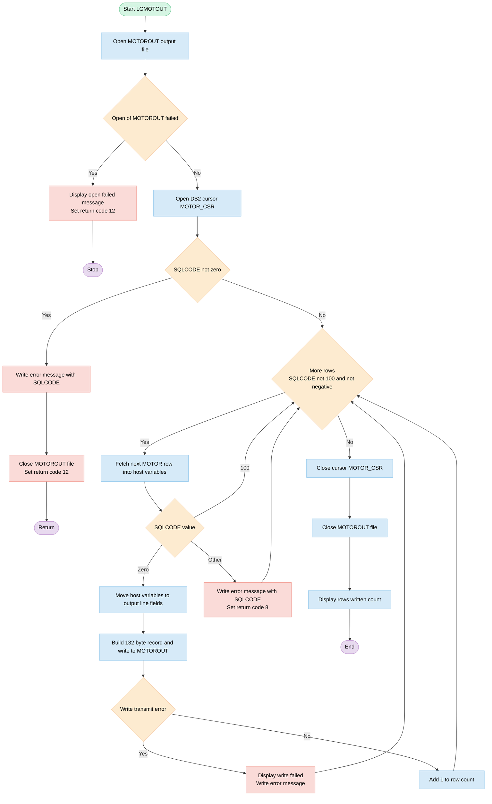
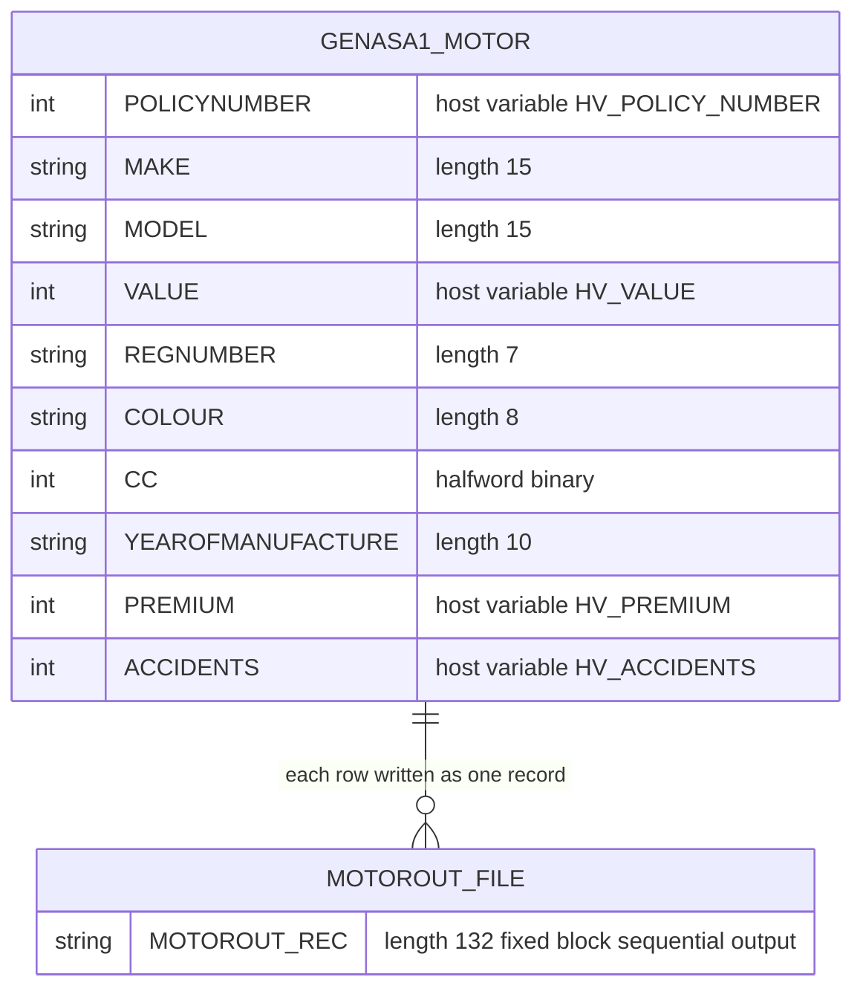

## Table of Contents

- [1. Purpose](#1-purpose)
- [2. Inputs](#2-inputs)
- [3. Outputs](#3-outputs)
  - [3.1 Return Values and Return Codes](#31-return-values-and-return-codes)
  - [3.2 Sequential File Output](#32-sequential-file-output)
  - [3.3 Console and Display Messages](#33-console-and-display-messages)
- [4. Processing Logic](#4-processing-logic)
  - [4.1 Mermaid Flow Diagram](#41-mermaid-flow-diagram)
  - [4.2 Processing Logic Description](#42-processing-logic-description)
  - [4.3 Database Tables](#43-database-tables)
- [5. Paragraphs](#5-paragraphs)
- [6. Dependencies](#6-dependencies)
  - [6.1 Database Dependencies](#61-database-dependencies)
  - [6.2 File and Dataset Dependencies](#62-file-and-dataset-dependencies)
  - [6.3 Runtime and Language Environment Dependencies](#63-runtime-and-language-environment-dependencies)
  - [6.4 Internal Procedure Dependencies](#64-internal-procedure-dependencies)
  - [6.5 Working Storage and State Dependencies](#65-working-storage-and-state-dependencies)
  - [6.6 Build and Deployment Dependencies](#66-build-and-deployment-dependencies)
  - [6.7 External Programs and Includes](#67-external-programs-and-includes)
- [7. Constraints](#7-constraints)
  - [7.1 Data Validation and Formatting Constraints](#71-data-validation-and-formatting-constraints)
  - [7.2 Operational and Sequencing Constraints](#72-operational-and-sequencing-constraints)
  - [7.3 Resource and File Constraints](#73-resource-and-file-constraints)
  - [7.4 Error Handling and Return Code Constraints](#74-error-handling-and-return-code-constraints)
- [8. Error Handling](#8-error-handling)
- [9. Examples](#9-examples)
  - [9.1 Example 1: Successful Extraction of Motor Policy Records](#91-example-1-successful-extraction-of-motor-policy-records)
  - [9.2 Example 2: Cursor Open Error (Db2 Table Unavailable)](#92-example-2-cursor-open-error-db2-table-unavailable)

## 1. Purpose

LGMOTOUT is a batch (non-CICS) PL/I program. It exports the contents of the motor insurance policy table (GENASA1.MOTOR) to a flat file. It reads every motor policy row through a read-only Db2 cursor. For each row, it builds a fixed-width, space-separated line with the policy number, vehicle make, model, value, registration number, colour, engine capacity, year of manufacture, premium and accident count. It writes each line as a 132-byte record to the MOTOROUT sequential output file. The program counts the rows it writes successfully and displays the total when it finishes. It reports failures to open the output file, open the cursor, fetch rows or write records. Fetch and cursor errors are shown as a diagnostic message with the SQL code. The program sets a return code to tell the calling job how the run ended: 0 for success, 8 for a fetch error, and 12 for an open or cursor error.

## 2. Inputs

- Database Inputs
  - `GENASA1.MOTOR` Table: Relational table queried via the cursor `MOTOR_CSR` (`SELECT POLICYNUMBER, MAKE, MODEL, VALUE, REGNUMBER, COLOUR, CC, YEAROFMANUFACTURE, PREMIUM, ACCIDENTS FROM GENASA1.MOTOR FOR READ ONLY`). Each row fetched populates the host structure `WS_MOTOR_HV`:
    - `HV_POLICY_NUMBER`: Binary integer representing the policy number (`POLICYNUMBER` column).
    - `HV_MAKE`: Character string holding the vehicle manufacturer name (`MAKE` column).
    - `HV_MODEL`: Character string holding the vehicle model name (`MODEL` column).
    - `HV_VALUE`: Binary integer representing the vehicle valuation amount (`VALUE` column).
    - `HV_REGNUMBER`: Character string holding the vehicle registration number (`REGNUMBER` column).
    - `HV_COLOUR`: Character string holding the vehicle colour (`COLOUR` column).
    - `HV_CC`: Binary integer holding the engine cubic capacity (`CC` column).
    - `HV_YEAROFMANUFACTURE`: Character string holding the year of vehicle manufacture (`YEAROFMANUFACTURE` column).
    - `HV_PREMIUM`: Binary integer representing the insurance premium amount (`PREMIUM` column).
    - `HV_ACCIDENTS`: Binary integer representing the recorded accident count (`ACCIDENTS` column).
  - `SQLCA`: External Db2 communication area providing the status and return codes (`SQLCODE`) for database cursor operations (`OPEN`, `FETCH`, and `CLOSE`).

## 3. Outputs

### 3.1 Return Values and Return Codes

- `PLIRETC`: Program return code set via the `PLIRETC` built-in function to communicate termination status to the operating system or calling batch step.
  - Return Code `0`: Successful execution (all rows processed and written).
  - Return Code `8`: Db2 fetch error encountered while retrieving motor policy records.
  - Return Code `12`: File open failure on `MOTOROUT` or cursor open error on `MOTOR_CSR`.

### 3.2 Sequential File Output

- `MOTOROUT`: Sequential output dataset (`RECORD OUTPUT SEQUENTIAL`, fixed-block, 132-byte records) containing formatted motor policy records extracted from the database.
  - `MOTOROUT_REC`: 132-character record buffer populated from `WS_MOTOR_LINE` via `STRING(WS_MOTOR_LINE)` and written to the file for each fetched row.
  - `WS_MOTOR_LINE`: Structure containing formatted output data written to each file record:
    - `WS_OUT_POLNUM`: 9-digit policy number (`HV_POLICY_NUMBER`).
    - `WS_OUT_MAKE`: Insured vehicle manufacturer name (`HV_MAKE`).
    - `WS_OUT_MODEL`: Insured vehicle model name (`HV_MODEL`).
    - `WS_OUT_VALUE`: 9-digit vehicle monetary value (`HV_VALUE`).
    - `WS_OUT_REGNUMBER`: Vehicle registration or license plate number (`HV_REGNUMBER`).
    - `WS_OUT_COLOUR`: Insured vehicle colour (`HV_COLOUR`).
    - `WS_OUT_CC`: 4-digit engine displacement in cubic centimeters (`HV_CC`).
    - `WS_OUT_YEAROFMFR`: Vehicle manufacture year string (`HV_YEAROFMANUFACTURE`).
    - `WS_OUT_PREMIUM`: 9-digit policy premium amount (`HV_PREMIUM`).
    - `WS_OUT_ACCIDENTS`: 9-digit total accident count recorded for the policy (`HV_ACCIDENTS`).

### 3.3 Console and Display Messages

- File and Execution Status Messages (`DISPLAY`):
  - `'LGMOTOUT: OPEN MOTOROUT FAILED'`: Displayed if the `UNDEFINEDFILE` condition is triggered when opening the `MOTOROUT` output dataset.
  - `'LGMOTOUT: WRITE FAILED'`: Displayed if a `TRANSMIT` error occurs during record write operations (`MOTOROUT_OK = '0'B`).
  - `'LGMOTOUT: ROWS WRITTEN=' || WS_ROW_COUNT`: Summary message displayed upon completion, outputting the total count of successfully processed and written records (`WS_ROW_COUNT`).
- Database Error Messages (`WRITE_ERROR_MESSAGE`):
  - Formatted message string displaying system date, time, program identifier, active SQL operation, and error return code:
    - `EM_DATE`: Date component formatted in the error message.
    - `EM_TIME`: Time component formatted in the error message.
    - `EM_SQLREQ`: Name of the active SQL cursor operation (`OPEN MOTOR-CSR`, `FETCH MOTOR-CSR`, `CLOSE MOTOR-CSR`).
    - `EM_SQLRC`: Numeric SQLCODE value (`SQLCODE`) identifying the Db2 failure reason.

## 4. Processing Logic

### 4.1 Mermaid Flow Diagram



### 4.2 Processing Logic Description

**High-level Summary**

LGMOTOUT is a batch (non-CICS) PL/I program. It reads every row from the DB2 table `GENASA1.MOTOR` through a read-only cursor. It formats each row as a fixed-width line and writes it to the sequential output file MOTOROUT, which has 132-byte fixed-block records. When it finishes, it displays the number of rows written. Return codes are 0 for success, 8 for a fetch error and 12 for an open or cursor error.

**Execution Flow**

1. **Initialization.** The program declares:
   - the output file MOTOROUT (record, sequential, FB, 132 bytes) and its record buffer `MOTOROUT_REC`;
   - the flag `MOTOROUT_OK`, which starts as true;
   - the row counter `WS_ROW_COUNT`;
   - the error message structure;
   - the host variable structure `WS_MOTOR_HV`;
   - the output line layout `WS_MOTOR_LINE`;
   - the SQLCA;
   - the cursor `MOTOR_CSR`, which selects POLICYNUMBER, MAKE, MODEL, VALUE, REGNUMBER, COLOUR, CC, YEAROFMANUFACTURE, PREMIUM and ACCIDENTS from `GENASA1.MOTOR` FOR READ ONLY.
2. **Open the output file.** An `ON UNDEFINEDFILE(MOTOROUT)` handler is established first.
   - If the open fails, the handler displays "LGMOTOUT: OPEN MOTOROUT FAILED", sets the return code to 12 with `PLIRETC(12)` and issues `STOP`.
3. **Open the cursor.** `EM_SQLREQ` is set to " OPEN MOTOR-CSR " and the cursor is opened.
   - If SQLCODE is not 0, the program moves SQLCODE into `EM_SQLRC` and calls `WRITE_ERROR_MESSAGE`.
   - It then closes MOTOROUT, sets return code 12 and returns.
4. **Fetch loop.** The loop `DO WHILE (SQLCODE ^= 100 & SQLCODE >= 0)` calls `FETCH_MOTOR_ROWS`. It ends at end of data (+100) or on any negative SQLCODE.
5. **`FETCH_MOTOR_ROWS`.** The procedure sets `EM_SQLREQ` to " FETCH MOTOR-CSR " and fetches one row into `WS_MOTOR_HV`. It then branches on SQLCODE:
   - **0:** calls `WRITE_MOTOR_ROW`.
   - **100:** does nothing, and the loop ends.
   - **Anything else:** moves SQLCODE into `EM_SQLRC`, calls `WRITE_ERROR_MESSAGE` and sets return code 8. The negative SQLCODE (or a positive one other than 100) then stops the loop.
6. **`WRITE_MOTOR_ROW`.**
   - It copies each host variable into the matching output field. Numeric values are converted to zero-padded picture fields: policy number, value, premium and accidents are 9 digits, and CC is 4 digits. Make, model, registration, colour and year of manufacture are character fields.
   - Fields are separated by single blanks, and the line is padded with 15 blanks.
   - The line is moved to `MOTOROUT_REC` with `STRING(WS_MOTOR_LINE)`.
   - An `ON TRANSMIT(MOTOROUT)` handler sets `MOTOROUT_OK` to false on a transmission error. The flag is set to true before the `WRITE`.
   - If the write failed, the program displays "LGMOTOUT: WRITE FAILED" and calls `WRITE_ERROR_MESSAGE`. If it succeeded, `WS_ROW_COUNT` is incremented. A failed write does not stop the loop.
7. **`WRITE_ERROR_MESSAGE`.** It builds one display line from the date, time, program name `LGMOTOUT`, the SQL request text and "SQLCODE=" plus the formatted SQLCODE. `WS_DATE` and `WS_TIME` are only initialized to blanks and are never populated, so the date and time portions of the message are blank.
8. **Termination.** After the loop, the program closes the cursor (`EM_SQLREQ` is set to " CLOSE MOTOR-CSR ", and SQLCODE is not checked after the close). It then closes MOTOROUT and displays "LGMOTOUT: ROWS WRITTEN=" followed by the count. Control returns with whatever return code was set last.

**Important business rules and notes**
- The program has no filtering or calculation. Every row of the MOTOR table is exported as is.
- The row count only includes records that were written successfully.
- A fetch error, return code 8, ends the loop. The program still closes the cursor and file and displays the count.
- The return code is 12 for failure to open the file or cursor and 8 for a fetch error.
- On a fetch error `PLIRETC(8)` is called, but the main program then continues to its normal end. The code does not reset the return code to 0 on success.

**External Interactions**
- **DB2:** the program opens, fetches from and closes the read-only cursor `MOTOR_CSR` on `GENASA1.MOTOR`. SQLCODE drives the control flow.
- **Sequential file MOTOROUT:** fixed-block output with 132-byte records, receiving one formatted line per motor policy.
- **Console or SYSOUT (DISPLAY):** error messages and the final row count summary.
- **Job return code:** set through `PLIRETC`.

**Plain Language Summary**

The program reads the whole motor insurance policy table in the database and writes one line of text per policy to a flat file. Each line holds the policy number, vehicle make, model, value, registration, colour, engine size, year of manufacture, premium and number of accidents. If the file or the database cannot be opened, it reports the problem and ends with an error code of 12. If reading a row fails midway, it reports the error and sets a code of 8. If a write fails, it reports that but carries on with the next row. At the end it reports how many lines it wrote.

### 4.3 Database Tables



## 5. Paragraphs

- **LGMOTOUT (main procedure)**
  - Purpose: Batch (non-CICS) driver that reads every row of GENASA1.MOTOR through the DB2 cursor MOTOR_CSR. It writes each row as a formatted 132-byte record to the sequential output file MOTOROUT.
  - Operations:
    - Declares the output file, the error message structure, the host variable structure WS_MOTOR_HV, the output line layout WS_MOTOR_LINE, the SQLCA, and the cursor.
    - Registers an ON UNDEFINEDFILE handler for MOTOROUT, then opens the file.
    - Sets EM_SQLREQ and opens the cursor.
    - Loops over the fetch routine.
    - Closes the cursor and the file.
    - Displays the count of rows written (WS_ROW_COUNT).
  - Control flow:
    - The ON UNDEFINEDFILE unit displays "OPEN MOTOROUT FAILED", sets the return code to 12 with PLIRETC(12), and issues STOP.
    - If SQLCODE is not 0 after the cursor OPEN, it fills EM_SQLRC, calls WRITE_ERROR_MESSAGE, closes the file, sets return code 12, and returns.
    - `DO WHILE (SQLCODE ^= 100 & SQLCODE >= 0)` repeatedly calls FETCH_MOTOR_ROWS. It ends at end-of-data or on any negative SQLCODE.
  - External interactions:
    - Opens, writes and closes the MOTOROUT sequential file.
    - Runs DB2 OPEN and CLOSE on MOTOR_CSR (a FOR READ ONLY cursor).
    - Writes messages to the console or SYSOUT with DISPLAY.
    - Sets the program return code with PLIRETC.

- **FETCH_MOTOR_ROWS**
  - Purpose: Fetches one row from MOTOR_CSR and routes processing according to the SQLCODE.
  - Operations:
    - Sets EM_SQLREQ to the FETCH request text.
    - Runs EXEC SQL FETCH into the ten host variables: HV_POLICY_NUMBER, HV_MAKE, HV_MODEL, HV_VALUE, HV_REGNUMBER, HV_COLOUR, HV_CC, HV_YEAROFMANUFACTURE, HV_PREMIUM and HV_ACCIDENTS.
  - Control flow: A `SELECT (SQLCODE)` statement chooses the branch.
    - `WHEN (0)` calls WRITE_MOTOR_ROW.
    - `WHEN (100)` does nothing. This is end of data, and the main loop then stops.
    - `OTHERWISE` copies SQLCODE to EM_SQLRC, calls WRITE_ERROR_MESSAGE, and sets return code 8 with PLIRETC(8). The negative SQLCODE then stops the main loop.
  - External interactions: DB2 FETCH from the MOTOR table, and error reporting through WRITE_ERROR_MESSAGE.

- **WRITE_MOTOR_ROW**
  - Purpose: Formats the fetched row and writes it to MOTOROUT.
  - Operations:
    - Copies each host variable into the matching field of WS_MOTOR_LINE. This includes the numeric conversions to picture fields, such as HV_PREMIUM to WS_OUT_PREMIUM.
    - Moves STRING(WS_MOTOR_LINE) into the 132-byte MOTOROUT_REC. The 119-byte line is padded to 132 bytes.
    - Sets up an ON TRANSMIT(MOTOROUT) unit that clears MOTOROUT_OK.
    - Sets MOTOROUT_OK to true, then runs WRITE FILE(MOTOROUT) FROM(MOTOROUT_REC).
  - Control flow:
    - If MOTOROUT_OK is false after the write, it displays "WRITE FAILED" and calls WRITE_ERROR_MESSAGE.
    - Otherwise it increments WS_ROW_COUNT.
    - The ON TRANSMIT handler is what clears the flag when an I/O transmission error occurs.
  - External interactions: Sequential record write to MOTOROUT, and console output through DISPLAY on failure.

- **WRITE_ERROR_MESSAGE**
  - Purpose: Builds and displays a standard error line with date, time, program name, the SQL request text, and the SQLCODE.
  - Operations:
    - Moves SQLCODE into EM_SQLRC.
    - Moves WS_DATE into EM_DATE and WS_TIME into EM_TIME.
    - Displays the concatenation of EM_DATE, EM_TIME, ' LGMOTOUT', EM_SQLREQ, ' SQLCODE=' and EM_SQLRC.
  - Control flow: Straight-line code with no branching.
  - External interactions: Console or SYSOUT output through DISPLAY. WS_DATE and WS_TIME are initialized to blanks and never populated in this program, so the date and time fields in the message appear blank.

## 6. Dependencies

### 6.1 Database Dependencies
- **Db2 table `GENASA1.MOTOR`**
  - This is the only data source. It is read through the cursor `MOTOR_CSR` declared `FOR READ ONLY`.
  - The columns selected are `POLICYNUMBER`, `MAKE`, `MODEL`, `VALUE`, `REGNUMBER`, `COLOUR`, `CC`, `YEAROFMANUFACTURE`, `PREMIUM` and `ACCIDENTS`.
  - The program does not write to this table.
- **Db2 SQL communication area (`EXEC SQL INCLUDE SQLCA`)**
  - It supplies `SQLCODE`.
  - `SQLCODE` controls the open, fetch and close logic. The fetch loop runs while `SQLCODE` is not 100 and is not negative.
  - `SQLCODE` is also reported in error messages.
- **Db2 runtime environment**
  - The program needs an active Db2 connection and a bound plan or package with authority to read `GENASA1.MOTOR`.
  - It is a batch (non-CICS) program, so the Db2 attachment comes from the batch job.
  - The cursor is opened with `OPEN`, fetched with `FETCH` and released with `CLOSE`.
- **Host variable structure `WS_MOTOR_HV`**
  - It receives each fetched row: `HV_POLICY_NUMBER`, `HV_MAKE`, `HV_MODEL`, `HV_VALUE`, `HV_REGNUMBER`, `HV_COLOUR`, `HV_CC`, `HV_YEAROFMANUFACTURE`, `HV_PREMIUM` and `HV_ACCIDENTS`.
  - The data types and lengths must match the Db2 column definitions, for example `CHAR(15)` for make and model, `CHAR(7)` for registration number and `CHAR(10)` for year of manufacture.
  - No indicator variables are declared.

### 6.2 File and Dataset Dependencies
- **Sequential output file `MOTOROUT`**
  - It is declared `FILE RECORD OUTPUT SEQUENTIAL` with `ENV(FB RECSIZE(132))`.
  - It needs a `MOTOROUT` DD statement in the run JCL, with fixed-block records of 132 bytes.
  - It receives one formatted record per fetched motor row.
  - If the file cannot be opened, the `UNDEFINEDFILE` ON-unit displays a message, sets return code 12 and stops the program.
  - A `TRANSMIT` ON-unit sets `MOTOROUT_OK` to false on a write error.
- **Output record buffers**
  - `MOTOROUT_REC` is a `CHAR(132)` buffer written to `MOTOROUT`.
  - `WS_MOTOR_LINE` is the 119-byte formatted line, padded to 132 bytes. Its fields are `WS_OUT_POLNUM`, `WS_OUT_MAKE`, `WS_OUT_MODEL`, `WS_OUT_VALUE`, `WS_OUT_REGNUMBER`, `WS_OUT_COLOUR`, `WS_OUT_CC`, `WS_OUT_YEAROFMFR`, `WS_OUT_PREMIUM` and `WS_OUT_ACCIDENTS`.

### 6.3 Runtime and Language Environment Dependencies
- **`PLIRETC` built-in**
  - It sets the job return code: 8 for a fetch error and 12 for an open or cursor error.
  - It is also used for the file open failure, where it sets 12.
- **`DISPLAY` statement (SYSOUT)**
  - It reports the following on the job's standard output:
    - the open failure message
    - the write failure message
    - the formatted error messages
    - the final `ROWS WRITTEN=` count
- **PL/I runtime ON-condition handling**
  - The program depends on the `UNDEFINEDFILE` and `TRANSMIT` conditions for file error detection.

### 6.4 Internal Procedure Dependencies
- **`FETCH_MOTOR_ROWS`**
  - Fetches one row and branches on `SQLCODE`.
  - A value of 0 writes the row.
  - A value of 100 ends the loop quietly.
  - Any other value reports an error and sets return code 8.
- **`WRITE_MOTOR_ROW`**
  - Moves the host variables into `WS_MOTOR_LINE` and writes the record to `MOTOROUT`.
  - Increments `WS_ROW_COUNT` on a successful write.
- **`WRITE_ERROR_MESSAGE`**
  - Builds and displays an error line made up of date, time, program name, SQL request text and `SQLCODE`.
  - It uses the `ERROR_MSG` structure, with `EM_DATE`, `EM_TIME`, `EM_SQLREQ` and `EM_SQLRC`.
  - The source never assigns `WS_DATE` or `WS_TIME`, so these fields stay blank in the message.

### 6.5 Working Storage and State Dependencies
- **`WS_ROW_COUNT`**
  - A 9-digit counter of rows written successfully. It is reported at the end of the run.
- **`MOTOROUT_OK`**
  - A bit flag set to true before each write and reset to false by the `TRANSMIT` ON-unit.
  - It decides whether a row is counted or a write failure is reported.
- **`WS_TIME` and `WS_DATE`**
  - Date and time fields that feed `EM_DATE` and `EM_TIME`.

### 6.6 Build and Deployment Dependencies
- **PL/I and Db2 precompile and compile**
  - The source contains embedded SQL, so it needs the Db2 precompiler or integrated SQL preprocessing.
  - It is built through zAppBuild as a non-CICS program and deployed as `LOAD`.
- **Db2 bind**
  - The program needs a Db2 plan or package bound for it, with read access to `GENASA1.MOTOR`.
- **Run JCL**
  - The JCL must run the program under a Db2 batch attachment, such as `IKJEFT01` or `DSN RUN`.
  - It must supply the `MOTOROUT` DD.

### 6.7 External Programs and Includes
- No external programs are called. All procedures are internal.
- No `%INCLUDE` members are used. The only include is the Db2 `SQLCA`.
- No environment variables, input parameters or configuration files are used.

## 7. Constraints

### 7.1 Data Validation and Formatting Constraints

- Data Type and Length Restrictions
  - `HV_POLICY_NUMBER`, `HV_VALUE`, `HV_PREMIUM`, and `HV_ACCIDENTS` are restricted to 31-bit fixed binary integers (`FIXED BIN(31)`), formatted as 9-digit numeric picture strings (`PIC '999999999'`) upon output. Values transferred to these fields must fit within standard 9-digit unsigned numeric ranges.
  - `HV_CC` is constrained to a 15-bit fixed binary integer (`FIXED BIN(15)`) and formatted into a 4-digit picture field (`PIC '9999'`).
  - Vehicle character fields enforce strict length limits mapping directly to database column sizes: `HV_MAKE` (`CHAR(15)`), `HV_MODEL` (`CHAR(15)`), `HV_REGNUMBER` (`CHAR(7)`), `HV_COLOUR` (`CHAR(8)`), and `HV_YEAROFMANUFACTURE` (`CHAR(10)`).
  - Null indicators are not provided for the host variables in the `FETCH` statement; therefore, all columns retrieved from table `GENASA1.MOTOR` must be non-null to prevent runtime SQL errors (e.g., `SQLCODE -305`).

- Output Record Layout and Padding
  - The record layout `WS_MOTOR_LINE` structures motor policy attributes separated by single-character space delimiters (`CHAR(1)`), occupying 119 bytes of active data.
  - The record is constrained to a fixed 132-byte length using a trailing 15-character blank filler (`CHAR(15) INIT(' ')`) and mapped into `MOTOROUT_REC` via `STRING(WS_MOTOR_LINE)`.

### 7.2 Operational and Sequencing Constraints

- Sequential Execution Lifecycle
  - File allocation and availability for `MOTOROUT` are verified via the `UNDEFINEDFILE` condition handler prior to opening the dataset.
  - The Db2 cursor `MOTOR_CSR` must be opened successfully (`SQLCODE = 0`) before initiating the fetch loop. If cursor opening fails, the `MOTOROUT` file is closed, return code 12 is set, and the program terminates.
  - The fetch loop runs sequentially, executing `FETCH_MOTOR_ROWS` as long as `SQLCODE ^= 100 & SQLCODE >= 0`.
  - Upon cursor exhaustion (`SQLCODE = 100`), processing must sequentially close `MOTOR_CSR`, close `MOTOROUT`, and display the summary row count before terminating.

- Database Access Mode
  - The cursor `MOTOR_CSR` is explicitly defined with the `FOR READ ONLY` clause, constraining database operations to read-only access and preventing in-place positional updates or deletes.

### 7.3 Resource and File Constraints

- File Organization and Record Format
  - The output file `MOTOROUT` is declared as `RECORD OUTPUT SEQUENTIAL` with fixed-block attributes `ENV(FB RECSIZE(132))`. Records must be written strictly as 132-byte fixed-length records.
  - Row counting is constrained by `WS_ROW_COUNT` defined as `PIC '999999999'`, supporting a maximum count of 999,999,999 records.

### 7.4 Error Handling and Return Code Constraints

- Condition Handling and Exception Routing
  - An `UNDEFINEDFILE(MOTOROUT)` condition traps missing or invalid dataset definitions on `OPEN`, setting return code 12 via `PLIRETC(12)` and terminating execution with `STOP`.
  - A `TRANSMIT(MOTOROUT)` condition handler captures I/O transmission errors during `WRITE FILE(MOTOROUT)`. It resets `MOTOROUT_OK` to `'0'B`, which suppresses incrementing `WS_ROW_COUNT` and displays a failure notification.
  - SQL errors encountered during fetch operations (any `SQLCODE` other than `0` and `100`) trigger `WRITE_ERROR_MESSAGE`, set the application return code to 8 via `CALL PLIRETC(8)`, and halt the fetch loop.
  - Failure during `OPEN MOTOR_CSR` sets the application return code to 12 via `CALL PLIRETC(12)`.

## 8. Error Handling

-**Output file open failure**
  - An ON UNDEFINEDFILE condition handler is established for the MOTOROUT file before the file is opened.
  - If the open fails, the handler displays "LGMOTOUT: OPEN MOTOROUT FAILED" and sets the PL/I return code to 12 through PLIRETC. It then stops the program with STOP.
  - No SQL work has started at this point, so no database cleanup is needed.

- **DB2 cursor open failure**
  - SQLCODE is checked right after the OPEN of the cursor. Any nonzero value counts as an error.
  - The request description field EM_SQLREQ is set to the open request text before the call, so the error message names the failing request.
  - On failure, the program does the following:
    - It copies SQLCODE into the formatted message field EM_SQLRC.
    - It calls the common error message routine.
    - It closes the MOTOROUT file.
    - It sets the return code to 12 through PLIRETC.
    - It leaves the program with RETURN, so the fetch loop never runs.

- **DB2 fetch error handling**
  - Each fetch is followed by a SELECT/WHEN evaluation of SQLCODE.
    - SQLCODE 0 is the normal path and calls the write routine.
    - SQLCODE 100 is end of data. It is a deliberate no-op that lets the loop finish normally.
    - Any other SQLCODE is treated as a fetch error:
      - The code is moved into EM_SQLRC.
      - The common error message routine is called.
      - The return code is set to 8 through PLIRETC.
  - The loop condition continues only while SQLCODE is neither 100 nor negative. A negative SQLCODE from a failed fetch therefore ends the loop.
  - A positive warning SQLCODE other than 100 also falls into the OTHERWISE branch and sets return code 8. The loop condition (not 100 and not negative) lets such a warning continue the loop, and the next fetch resets SQLCODE.
  - EM_SQLREQ is set to the fetch request text before each fetch, so the error message identifies the request.

- **Output write error handling**
  - An ON TRANSMIT condition handler for MOTOROUT is established in the write routine. When a transmission error occurs, it sets the MOTOROUT_OK flag to false.
  - MOTOROUT_OK is set to true before each write, so every write starts from a known good state.
  - After the write, the flag is tested:
    - If it is false, the program displays "LGMOTOUT: WRITE FAILED" and calls the common error message routine.
    - If it is true, WS_ROW_COUNT is incremented. Failed writes are therefore not counted in the final total.
  - A write failure does not stop processing or change the return code. The program continues with the next row.
  - The error message after a write failure reuses the last SQLCODE and the fetch request text in EM_SQLREQ, so it does not describe the file error itself.

- **Error notification and logging**
  - A common routine builds and displays a formatted message containing the date, time, program name, the failing request description and the SQLCODE.
  - The routine copies the current SQLCODE into the message again, so its output reflects the latest SQL state.
  - The date and time fields in the message come from working variables initialised to blanks. Nothing in the program populates them, so the timestamp portion of the message is blank.
  - Plain DISPLAY messages cover file-level failures: the open failure and the write failure.
  - A final summary message "LGMOTOUT: ROWS WRITTEN=" followed by the row count is displayed on successful completion.

- **Return code and termination strategy**
  - The header comment defines the return codes: 0 for success, 8 for a fetch error and 12 for an open or cursor error.
  - The open file failure uses PLIRETC(12) followed by STOP.
  - The cursor open failure uses PLIRETC(12) followed by RETURN, after closing the output file.
  - A fetch error sets return code 8 and ends the loop through the negative SQLCODE condition. The program then goes through the normal close steps.
  - A write failure does not change the return code.

- **Cleanup and recovery behavior**
  - After a cursor open failure, the output file is closed before the program returns.
  - After a fetch error, the program does not return early. It still closes the cursor and the output file and then displays the row count summary, so rows already written are preserved.
  - No retries or alternate-path fallbacks are implemented.
  - The SQLCODE after the cursor close is not checked. The close request text is set in EM_SQLREQ, but no error test follows it.
  - No explicit checks exist for invalid data values.

## 9. Examples

### 9.1 Example 1: Successful Extraction of Motor Policy Records

This example demonstrates normal batch processing where records are read from the `GENASA1.MOTOR` Db2 table and written to the `MOTOROUT` sequential file.

#### 9.1.1 Input Data

**Db2 Table `GENASA1.MOTOR` Rows:**

| Column | Row 1 Value | Row 2 Value |
| :--- | :--- | :--- |
| `POLICYNUMBER` | `100000001` | `100000002` |
| `MAKE` | `FORD           ` | `TOYOTA         ` |
| `MODEL` | `FOCUS          ` | `COROLLA        ` |
| `VALUE` | `15000` | `22000` |
| `REGNUMBER` | `AB12CDE` | `XY56ZAB` |
| `COLOUR` | `BLUE    ` | `RED     ` |
| `CC` | `1600` | `1998` |
| `YEAROFMANUFACTURE` | `2020-05-15` | `2022-11-01` |
| `PREMIUM` | `450` | `620` |
| `ACCIDENTS` | `0` | `1` |

#### 9.1.2 Expected Output

**Sequential File `MOTOROUT` (Record Length 132, Fixed-Block):**

```text
000100000001 FORD            FOCUS           000015000 AB12CDE BLUE     1600 2020-05-15 000000450 000000000               
000100000002 TOYOTA          COROLLA         000022000 XY56ZAB RED      1998 2022-11-01 000000620 000000001               
```

**Job Log / System Display:**

```text
LGMOTOUT: ROWS WRITTEN=000000002
```

**Return Code:** `0`

#### 9.1.3 Processing Flow

1. The program opens the `MOTOROUT` output dataset and declares cursor `MOTOR_CSR` to select all columns from `GENASA1.MOTOR`.
2. `OPEN MOTOR_CSR` completes successfully with `SQLCODE = 0`.
3. The fetch loop executes:
   - **Row 1:** Values are fetched into `WS_MOTOR_HV`, formatted into `WS_MOTOR_LINE` with numeric fields padded according to their `PIC` specifications, packed into the 132-byte `MOTOROUT_REC`, and written to `MOTOROUT`. `WS_ROW_COUNT` increments to 1.
   - **Row 2:** The second row is fetched, formatted, and written. `WS_ROW_COUNT` increments to 2.
   - **Row 3:** `FETCH` returns `SQLCODE = 100` (End of Data), terminating the loop.
4. The cursor and output file are closed, the total row count is displayed, and the program terminates with return code 0.

---

### 9.2 Example 2: Cursor Open Error (Db2 Table Unavailable)

This example illustrates error handling when Db2 cannot open the cursor due to an unavailable table or authorization issue.

#### 9.2.1 Input Data

- **Db2 State:** `GENASA1.MOTOR` is unavailable (e.g., table space in `STOPPED` status or `SQLCODE = -904`).
- **`OPEN MOTOR_CSR` Execution:** Returns `SQLCODE = -904`.

#### 9.2.2 Expected Output

**Sequential File `MOTOROUT`:**
- Empty (0 records written).

**Job Log / System Display:**

```text
         LGMOTOUT OPEN MOTOR-CSR  SQLCODE=-00904
```

**Return Code:** `12`

#### 9.2.3 Processing Flow

1. The program successfully opens the sequential dataset `MOTOROUT`.
2. It executes `OPEN MOTOR_CSR`, which fails with `SQLCODE = -904`.
3. The error handler sets `EM_SQLRC` to `-904`, invokes `WRITE_ERROR_MESSAGE` to display the formatted error message with the failed operation name and return code.
4. The program closes `MOTOROUT`, sets the return code to `12` via `CALL PLIRETC(12)`, and terminates without entering the fetch loop.

---

Generated by IBM Bob Premium Package for Z
