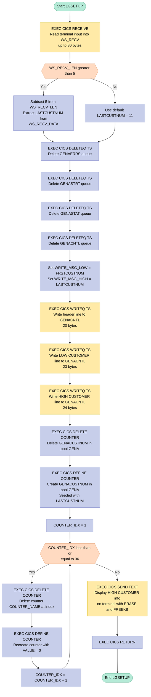

## Table of Contents

- [1. Purpose](#1-purpose)
- [2. Inputs](#2-inputs)
  - [2.1 Terminal User Input](#21-terminal-user-input)
- [3. Outputs](#3-outputs)
  - [3.1 CICS Temporary Storage Queues (TSQ)](#31-cics-temporary-storage-queues-tsq)
  - [3.2 CICS Named Counters (Pool `GENA`)](#32-cics-named-counters-pool-gena)
  - [3.3 Terminal Display / User Messages](#33-terminal-display--user-messages)
- [4. Processing Logic](#4-processing-logic)
  - [4.1 Mermaid Flow Diagram](#41-mermaid-flow-diagram)
  - [4.2 Processing Logic Description](#42-processing-logic-description)
  - [4.3 Database Tables](#43-database-tables)
- [5. Paragraphs](#5-paragraphs)
- [6. Dependencies](#6-dependencies)
  - [6.1 CICS Services](#61-cics-services)
  - [6.2 Transaction Input](#62-transaction-input)
  - [6.3 Runtime Environment](#63-runtime-environment)
  - [6.4 Include Files / Copybooks](#64-include-files--copybooks)
  - [6.5 External Programs / Modules](#65-external-programs--modules)
- [7. Constraints](#7-constraints)
- [8. Error Handling](#8-error-handling)
- [9. Examples](#9-examples)
  - [9.1 Example 1: Default setup (no high customer number supplied)](#91-example-1-default-setup-no-high-customer-number-supplied)
  - [9.2 Example 2: Overriding the high customer number](#92-example-2-overriding-the-high-customer-number)
  - [9.3 Example 3: Short numeric override](#93-example-3-short-numeric-override)
  - [9.4 Example 4: Objects that do not exist yet (first-time setup)](#94-example-4-objects-that-do-not-exist-yet-first-time-setup)

## 1. Purpose

LGSETUP is a CICS PL/I program that resets the GenApp insurance demonstration application to a clean starting state. It accepts an optional high customer number after the transaction ID, and the default is 11. It clears the application's temporary storage queues for errors, start-up, status, and control information. It then rebuilds the control queue with the low and high customer number boundaries. It also recreates the named counter for customer numbers, seeded with the high customer number. Finally, it resets every named transaction statistics counter to zero. These counters track successful and failed inquiry, add, delete, and update transactions across the customer, motor, endowment, house, and commercial policy areas. When setup is done, it shows the resulting customer range on the terminal and returns control to CICS.

## 2. Inputs

### 2.1 Terminal User Input

- `WS_RECV` (Terminal Input Buffer)
  - `WS_RECV_TRANID`: A 5-character field that receives the CICS transaction identifier (e.g., `'LGSE '`) from the terminal when the transaction is initiated.
  - `WS_RECV_DATA`: An optional 74-character field following the transaction identifier that supplies the high customer number (e.g., `'0000000011'`). When provided, it overrides the default high customer number (`LASTCUSTNUM = 11`), configuring the initial seed value for the customer number counter and the upper customer boundary stored in the control queue.
- `WS_RECV_LEN` (Input Length): A binary halfword field initialized to 80 that receives the actual length of data entered at the terminal via `EXEC CICS RECEIVE`. It determines whether user-supplied data was provided beyond the 5-character transaction identifier.

## 3. Outputs

### 3.1 CICS Temporary Storage Queues (TSQ)
- **GENACNTL (`STSQ_NAME`) Control Records**: Receives three sequential text records defining the GenApp customer configuration boundaries:
  - Header record (`WRITE_MSG_E`): Set to `'**** GENAPP CNTL    '` (length 20).
  - Low customer boundary record (`WRITE_MSG_L` with `WRITE_MSG_LOW`): Text string `'LOW CUSTOMER='` followed by a 10-digit customer number (`FRSTCUSTNUM`, initialized to `1`).
  - High customer boundary record (`WRITE_MSG_H` with `WRITE_MSG_HIGH`): Text string `'HIGH CUSTOMER='` followed by a 10-digit customer number (`LASTCUSTNUM`, default `11` or input override).
- **Deleted Queues (`STSQ_ERRS`, `STSQ_STRT`, `STSQ_STAT`, `STSQ_NAME`)**: Deleted to clear previous application run states, errors (`GENAERRS`), start data (`GENASTRT`), statistics (`GENASTAT`), and control records (`GENACNTL`).

### 3.2 CICS Named Counters (Pool `GENA`)
- **Customer Number Counter (`GENACOUNT` / `GENACUSTNUM`)**: Defined in counter pool `GENA` with an initial value equal to `LASTCUSTNUM` (default `11` or derived from input data) to supply the starting seed for generating new unique customer identifiers.
- **Transaction Statistics Counters (`COUNTER_TABLE` / `COUNTER_ARRAY`)**: 36 named counters defined in counter pool `GENA` with an initial value of zero (`ZERO_VALUE`), resetting metrics for success (`00`) and failure (`99`) outcomes across all supported transaction types:
  - `GENA01ICUS00`, `GENA01ICUS99`: Customer Inquiry
  - `GENA01ACUS00`, `GENA01ACUS99`: Customer Add
  - `GENA01UCUS00`, `GENA01UCUS99`: Customer Update
  - `GENA01IMOT00`, `GENA01IMOT99`: Motor Policy Inquiry
  - `GENA01AMOT00`, `GENA01AMOT99`: Motor Policy Add
  - `GENA01DMOT00`, `GENA01DMOT99`: Motor Policy Delete
  - `GENA01UMOT00`, `GENA01UMOT99`: Motor Policy Update
  - `GENA01IEND00`, `GENA01IEND99`: Endowment Policy Inquiry
  - `GENA01AEND00`, `GENA01AEND99`: Endowment Policy Add
  - `GENA01DEND00`, `GENA01DEND99`: Endowment Policy Delete
  - `GENA01UEND00`, `GENA01UEND99`: Endowment Policy Update
  - `GENA01IHOU00`, `GENA01IHOU99`: House Policy Inquiry
  - `GENA01AHOU00`, `GENA01AHOU99`: House Policy Add
  - `GENA01DHOU00`, `GENA01DHOU99`: House Policy Delete
  - `GENA01UHOU00`, `GENA01UHOU99`: House Policy Update
  - `GENA01ICOM00`, `GENA01ICOM99`: Commercial Policy Inquiry
  - `GENA01ACOM00`, `GENA01ACOM99`: Commercial Policy Add
  - `GENA01DCOM00`, `GENA01DCOM99`: Commercial Policy Delete

### 3.3 Terminal Display / User Messages
- **Confirmation Message (`WRITE_MSG_H` / `WRITE_MSG_HIGH`)**: Transmitted directly to the initiating terminal via `EXEC CICS SEND TEXT` with screen erase and keyboard unlock, outputting the formatted text `'HIGH CUSTOMER=nnnnnnnnnn'` (24 characters) to confirm successful environment initialization and display the configured high customer number threshold.

## 4. Processing Logic

### 4.1 Mermaid Flow Diagram

---

### 4.2 Processing Logic Description

#### 4.2.1 High-level Summary

`LGSETUP` is a CICS initialisation utility for the GenApp insurance application. It performs a clean-slate reset of the entire GenApp runtime environment by deleting and recreating four CICS Temporary Storage (TS) queues and 37 CICS named counters (one customer-number counter plus 36 transaction-statistics counters). An optional high customer number may be supplied on the terminal command line to override the built-in default of 11.

---

#### 4.2.2 Execution Flow

**Step 1 — Receive terminal input**
The program issues `EXEC CICS RECEIVE INTO(WS_RECV) LENGTH(WS_RECV_LEN)` to collect whatever the terminal operator typed. The receive buffer is an 80-byte structure split into a 5-character transaction-ID field (`WS_RECV_TRANID`) and a 74-character data field (`WS_RECV_DATA`).

**Step 2 — Determine the high customer number**
If `WS_RECV_LEN` is greater than 5 (i.e., the operator typed more than just the 4-character transaction code `LGSE` plus a space), the excess length is calculated by subtracting 5 from `WS_RECV_LEN`. The remaining characters in `WS_RECV_DATA` are converted and stored in `LASTCUSTNUM`, overriding the default value of 11. If no additional data was provided, `LASTCUSTNUM` remains 11, representing the highest customer number currently in the sample dataset.

**Step 3 — Delete all four GenApp TS queues**
Four `EXEC CICS DELETEQ TS` commands unconditionally purge the existing queues:
- `GENAERRS` — error records accumulated during previous runs
- `GENASTRT` — application start-time information
- `GENASTAT` — transaction status records
- `GENACNTL` — the primary control queue holding customer number boundaries

Response codes are captured in `WS_RESP` but no explicit error branching is coded; any ITEMERR (queue not found) condition is silently tolerated, which is the correct behaviour for a reset scenario.

**Step 4 — Rebuild the GENACNTL control queue**
The control message structure `WRITE_MSG` is populated with `FRSTCUSTNUM` (always 1) and `LASTCUSTNUM` (default 11 or operator-supplied value). Three `EXEC CICS WRITEQ TS NOSUSPEND` commands write successive records to the freshly empty `GENACNTL` queue:
1. A 20-byte header banner `**** GENAPP CNTL    `
2. A 23-byte "LOW CUSTOMER=" record showing the first valid customer number
3. A 24-byte "HIGH CUSTOMER=" record showing the highest valid customer number

The `NOSUSPEND` option prevents the program from hanging if the TS queue becomes temporarily unavailable.

**Step 5 — Reset the customer-number named counter**
`EXEC CICS DELETE COUNTER(GENACUSTNUM) POOL(GENA)` removes the existing counter (silently ignoring INVREQ if it does not yet exist). `EXEC CICS DEFINE COUNTER(GENACUSTNUM) POOL(GENA) VALUE(LASTCUSTNUM)` recreates it, seeded to the current high customer number. This counter is the authoritative source used by `LGACDB01` to generate unique customer numbers for new customers.

**Step 6 — Reset all 36 transaction-statistics counters (loop)**
A `DO` loop iterates from 1 to 36 over the `COUNTER_ARRAY` overlay of `COUNTER_TABLE`. For each counter name, the program:
1. Issues `EXEC CICS DELETE COUNTER` to remove the existing counter from pool `GENA`
2. Issues `EXEC CICS DEFINE COUNTER VALUE(ZERO_VALUE)` to recreate it at zero

The 36 counters cover every combination of operation (Inquire, Add, Delete, Update) × policy type (Customer, Motor, Endowment, House, Commercial) × outcome (`00` = success, `99` = failure). Resetting them to zero allows clean performance monitoring after each environment initialisation.

**Step 7 — Send completion message to terminal**
`EXEC CICS SEND TEXT FROM(WRITE_MSG_H)` writes the 24-byte "HIGH CUSTOMER=" summary line to the operator's terminal with `ERASE` (clears the screen) and `FREEKB` (unlocks the keyboard), giving the operator visual confirmation that setup completed.

**Step 8 — Return to CICS**
`EXEC CICS RETURN` hands control back to CICS. No COMMAREA is passed.

---

#### 4.2.3 External Interactions

| CICS Resource | Operation | Purpose |
|---|---|---|
| `GENAERRS` TS queue | DELETE | Clear accumulated error records from previous runs |
| `GENASTRT` TS queue | DELETE | Clear application start-up timestamp records |
| `GENASTAT` TS queue | DELETE | Clear transaction status records |
| `GENACNTL` TS queue | DELETE then WRITE (×3) | Reset and repopulate the customer number boundary control record |
| `GENACUSTNUM` named counter, pool `GENA` | DELETE then DEFINE | Reset the customer-number generator to the current high-customer value |
| 36 transaction-statistics named counters, pool `GENA` | DELETE then DEFINE | Reset all per-operation per-policy-type success/failure counters to zero |
| Terminal | RECEIVE / SEND TEXT | Accept optional high-customer input; display confirmation message |

---

#### 4.2.4 Plain Language Summary

`LGSETUP` is the "reset button" for the GenApp insurance demo environment. When the operator types its transaction code (optionally followed by a customer number), the program wipes all GenApp housekeeping queues and counters in CICS and rebuilds them from scratch. It records the valid range of customer numbers (lowest = 1, highest = 11 by default or whatever the operator specifies) into a control queue, resets the counter that hands out new customer numbers, and zeros out all 36 statistical counters that track how many successful and failed transactions of each type have occurred. A brief confirmation message is displayed on the terminal when the process is complete. No database tables are accessed.

---

### 4.3 Database Tables

No database tables are accessed by `LGSETUP`. All interactions are with CICS Temporary Storage queues and CICS Named Counters exclusively; therefore no entity-relationship diagram applies.

## 5. Paragraphs

- **LGSETUP (main procedure, `Proc Options(Main)`)**
  - Purpose: CICS transaction that resets the GenApp environment. It deletes and recreates the GenApp temporary storage queues and the named counters. The optional high customer number comes after the transaction id, for example `LGSE 0000000011`. The default is 11.
  - The whole program is one main procedure with no internal sub-procedures or labelled paragraphs. The sections below follow its logical blocks in execution order.

- **Declarations (working storage and static data)**
  - `WS_RESP` holds the response code from each CICS command.
  - `WS_RECV` is the receive buffer. It is a 5-character transaction id (`WS_RECV_TRANID`) followed by a 74-character data field (`WS_RECV_DATA`). `WS_RECV_LEN` starts at 80.
  - `WRITE_MSG` is the control message layout. It has a 20-character header (`**** GENAPP CNTL`), `LOW CUSTOMER=` with a 10-digit picture field, `HIGH CUSTOMER=` with a 10-digit picture field, and filler.
  - `FRSTCUSTNUM` is 1 and `LASTCUSTNUM` is 11. `ZERO_VALUE` is 0.
  - `GENACOUNT` is `GENACUSTNUM`, the customer number counter. `GENAPOOL` is `GENA`, the counter pool.
  - The queue names are `GENASTRT` (`STSQ_STRT`), `GENASTAT` (`STSQ_STAT`), `GENAERRS` (`STSQ_ERRS`) and `GENACNTL` (`STSQ_NAME`).
  - `COUNTER_COUNT` is 36 and `COUNTER_IDX` is the loop index.
  - `COUNTER_TABLE` is a static structure of 36 counter names, each 16 characters. They follow the pattern `GENA01` + operation (I, A, D or U) + entity (CUS, MOT, END, HOU or COM) + outcome (`00` for success, `99` for failure).
  - `COUNTER_ARRAY` is a based overlay at `ADDR(COUNTER_TABLE)`. It exposes the table as `COUNTER_NAME(36)` so the loop can index the names.
  - There is no control flow or external interaction here. It is only data definition and initialisation.

- **Receive input and override high customer number**
  - Operations:
    - `EXEC CICS RECEIVE INTO(WS_RECV) LENGTH(WS_RECV_LEN) RESP(WS_RESP)` reads the terminal input that started the transaction.
    - If more than 5 bytes arrived, 5 is subtracted from `WS_RECV_LEN` to get the length of the data after the transaction id.
    - `LASTCUSTNUM` is set from `SUBSTR(WS_RECV_DATA,1,WS_RECV_LEN)`.
  - Control flow: a single `IF WS_RECV_LEN > 5 THEN DO` decides whether to override the default of 11.
  - External interaction: terminal input through CICS RECEIVE. `WS_RESP` is not tested afterwards.

- **Delete TS queues**
  - Operations: four `EXEC CICS DELETEQ TS` commands remove `GENAERRS`, `GENASTRT`, `GENASTAT` and `GENACNTL`, in that order.
  - Control flow: none. `RESP(WS_RESP)` is coded on each command, so a missing queue does not abend. The response is not checked.
  - External interaction: CICS temporary storage queues are deleted.

- **Re-create customer number control queue**
  - Operations:
    - `WRITE_MSG_LOW` is set from `FRSTCUSTNUM` and `WRITE_MSG_HIGH` from `LASTCUSTNUM`.
    - Three `EXEC CICS WRITEQ TS QUEUE(GENACNTL)` commands (`NOSUSPEND`, `RESP(WS_RESP)`) write these items in order:
      - `WRITE_MSG_E`, the 20-byte header.
      - `WRITE_MSG_L`, with length 23: the `LOW CUSTOMER=` text plus the 10-digit low number.
      - `WRITE_MSG_H`, with length 24: the `HIGH CUSTOMER=` text plus the 10-digit high number.
  - Control flow: sequential, with no branching and no response checking.
  - External interaction: writes three items to the `GENACNTL` temporary storage queue.

- **Customer number counter reset**
  - Operations:
    - `EXEC CICS DELETE COUNTER(GENACOUNT) POOL(GENAPOOL)` removes the existing `GENACUSTNUM` named counter.
    - `EXEC CICS DEFINE COUNTER(GENACOUNT) POOL(GENAPOOL) VALUE(LASTCUSTNUM)` recreates it, starting at the high customer number.
  - Control flow: sequential. `RESP(WS_RESP)` is coded, so a failed delete, such as when the counter does not exist, does not stop the program.
  - External interaction: CICS named counter server, pool `GENA`.

- **Transaction statistics counter loop**
  - Operations: `DO COUNTER_IDX = 1 TO COUNTER_COUNT` runs 36 times. For each `COUNTER_NAME(COUNTER_IDX)` it does two things:
    - It issues `EXEC CICS DELETE COUNTER` in pool `GENA`.
    - It issues `EXEC CICS DEFINE COUNTER` with `VALUE(ZERO_VALUE)`, which resets the counter to zero.
  - Control flow: an iterative `DO` loop over the counter array. Response codes are not checked, so a counter that does not exist is skipped silently.
  - External interaction: CICS named counter server. This covers the inquiry, add, delete and update counters for customer, motor, endowment, house and commercial transactions, each with a success and a failure counter.

- **Confirmation display and termination**
  - Operations:
    - `EXEC CICS SEND TEXT FROM(WRITE_MSG_H) TERMINAL WAIT ERASE LENGTH(24) FREEKB` clears the screen and shows the `HIGH CUSTOMER=` message to the user. The keyboard is freed.
    - `EXEC CICS RETURN` ends the transaction.
    - `END LGSETUP;` closes the procedure.
  - Control flow: straight-line end of the program, with no error branches.
  - External interaction: terminal output through CICS SEND TEXT. Control then returns to CICS.

## 6. Dependencies

### 6.1 CICS Services

- **EXEC CICS RECEIVE**
  - Reads the terminal input buffer into `WS_RECV` (80 bytes); supplies the optional high-customer-number override that follows the 5-character transaction identifier `LGSE`

- **CICS Temporary Storage (TS) Queues**
  - **`GENAERRS`** – error-record queue; deleted during setup to clear accumulated error data from previous runs
  - **`GENASTRT`** – start-time/start-up queue; deleted to reset application start state
  - **`GENASTAT`** – transaction status queue; deleted to ensure a clean statistics slate
  - **`GENACNTL`** – control information queue; deleted and recreated with three records holding the label, low customer number (`1`), and high customer number (`LASTCUSTNUM`); consumed at runtime by other GenApp programs to determine customer number boundaries

- **CICS Named Counters (pool `GENA`)**
  - **`GENACUSTNUM`** – customer-number counter; deleted and redefined with the current high customer number so that `LGACDB01` (and any other program calling `GET COUNTER`) always produces a unique, sequenced customer number
  - **36 transaction-statistics counters** (e.g. `GENA01ICUS00`, `GENA01ICUS99`, … `GENA01UCUS99`) – one success (`00`) and one failure (`99`) counter per operation (Inquire, Add, Delete, Update) for each policy/customer entity type (Customer, Motor, Endowment, House, Commercial); all deleted and redefined to zero during setup

- **EXEC CICS SEND TEXT**
  - Sends the high-customer confirmation message to the invoking terminal after setup completes; depends on a live CICS terminal session

- **EXEC CICS RETURN**
  - Returns control to CICS after setup is complete

---

### 6.2 Transaction Input

- **CICS terminal input (transaction `LGSE`)**
  - The program is invoked as a CICS terminal transaction; the operator optionally appends a 10-digit high-customer-number value after the 4-character transaction code (e.g. `LGSE 0000000011`), which overrides the default value of `11` used to seed `GENACUSTNUM` and the `GENACNTL` control queue

---

### 6.3 Runtime Environment

- **CICS region**
  - The program runs exclusively under CICS; it uses no batch or Db2 facilities and has no COMMAREA; the CICS region must have the Named Counter Server configured and accessible under pool `GENA`

- **Named Counter Server**
  - Must be active and reachable by the CICS region so that `DELETE COUNTER` and `DEFINE COUNTER` commands against pool `GENA` can execute successfully

---

### 6.4 Include Files / Copybooks

- None — `LGSETUP` contains all its data declarations inline and does not `%INCLUDE` any external include file

---

### 6.5 External Programs / Modules

- None — no `EXEC CICS LINK`, `EXEC CICS XCTL`, or static/dynamic `CALL` is issued; the program is entirely self-contained

## 7. Constraints

- **Input data constraints**
  - Maximum input size
    - The receive buffer WS_RECV is 79 characters: a 5-character WS_RECV_TRANID plus a 74-character WS_RECV_DATA.
    - WS_RECV_LEN is initialised to 80 and is passed as the LENGTH on EXEC CICS RECEIVE, so it caps the amount of data accepted.
    - The buffer is 1 byte shorter than the declared length of 80. The code does not guard against this mismatch.
  - Optional high customer number override
    - The default LASTCUSTNUM is 11, set by INIT.
    - The default is overridden only when WS_RECV_LEN > 5 after the RECEIVE.
    - If only the transaction id is entered, the default is kept.
  - Format of the override
    - The value follows the 5-character transaction id. Example: 'LGSE 0000000011'.
    - The code computes the length as WS_RECV_LEN - 5. It then assigns SUBSTR(WS_RECV_DATA,1,WS_RECV_LEN) to LASTCUSTNUM.
    - The substring is converted implicitly to FIXED BIN(31). The data must therefore be numeric, or the conversion raises a PL/I condition.
    - The code does not check for numeric content, for range, or for a positive value.
    - Trailing blanks or extra characters become part of the converted string.
  - Value range
    - LASTCUSTNUM is FIXED BIN(31), so it is limited to that range.
    - WRITE_MSG_HIGH is PIC '9999999999', so it holds at most 10 digits. It holds no sign and no decimals.
    - The code does not check that the high value is at least FRSTCUSTNUM (1).

- **Fixed configuration constraints**
  - Customer number range
    - FRSTCUSTNUM is fixed at 1 and is not configurable. It is always written as the low customer value.
    - Only the high bound can be changed at run time.
  - Named resources
    - The TS queue names are fixed 8-character names: GENAERRS, GENASTRT, GENASTAT and GENACNTL.
    - The customer counter is GENACUSTNUM, a 16-character name. The pool is GENA.
    - The names are STATIC INIT values and the program never changes them.
  - Statistics counters
    - There are exactly 36 counters: COUNTER_COUNT is 36, and COUNTER_NAME is dimensioned (36).
    - Each name is 16 characters.
    - The names follow the pattern GENA01 + operation (I, A, D or U) + type (CUS, MOT, END, HOU or COM) + outcome (00 for success, 99 for failure).
    - The counters cover:
      - Customer: inquiry, add and update.
      - Motor, endowment and house: inquiry, add, delete and update.
      - Commercial: inquiry, add and delete only. There is no update counter for commercial.
    - COUNTER_COUNT and the table size must stay in step. COUNTER_ARRAY overlays COUNTER_TABLE through BASED(ADDR(COUNTER_TABLE)). A change to either one without the other would run past the table.
    - All statistics counters are reset to ZERO_VALUE (0).

- **Control message format constraints**
  - The control message in WRITE_MSG has a fixed layout:
    - A 20-character header, '**** GENAPP CNTL    '.
    - 'LOW CUSTOMER=' followed by a 10-digit zoned number.
    - A 1-character filler.
    - 'HIGH CUSTOMER=' followed by a 10-digit zoned number.
    - A 60-character filler.
  - The explicit LENGTH values on the TS writes and the SEND are 20, 23 and 24. They are tied to the field layout.
    - The WRITE_MSG_E write uses LENGTH(20).
    - The WRITE_MSG_L write uses LENGTH(23). WRITE_MSG_L is 13 characters and WRITE_MSG_LOW is 10, so the 23 covers both.
    - The WRITE_MSG_H write uses LENGTH(24). WRITE_MSG_H is 14 characters and WRITE_MSG_HIGH is 10, so the 24 covers both.
    - The SEND TEXT uses LENGTH(24), which matches the high-customer segment.
  - Each message is written as a separate TS item, so the control queue always has three items in a fixed order.

- **Sequencing constraints**
  - The RECEIVE must come first. The optional high value has to be known before the control message is built and the counter is defined.
  - The four TS queues are deleted before the control queue is rewritten. This guarantees a clean state and makes the new control queue start at item 1.
  - The low and high values are moved into the message before the WRITEQ TS commands.
  - Within the control queue, items are written in this order: header, low, high.
  - For each counter, DELETE COUNTER is issued before DEFINE COUNTER, so a counter that already exists can be redefined.
  - The customer number counter is processed before the statistics counters loop.
  - The SEND TEXT with ERASE, WAIT and FREEKB comes only after all resource setup is complete.
  - EXEC CICS RETURN ends the transaction last.

- **Resource handling and error-handling constraints**
  - Response handling
    - Every EXEC CICS command uses RESP(WS_RESP), so CICS does not abend the task on an exceptional condition.
    - WS_RESP is never tested after any command.
    - Errors are therefore ignored and processing always continues, which has these effects:
      - A failed RECEIVE is not detected.
      - A failed DELETEQ or DELETE COUNTER is tolerated. This is expected when the resource does not exist yet.
      - A failed WRITEQ or DEFINE COUNTER is not reported.
    - Because the same variable is reused, only the last response is held, and it is never examined.
  - TS writes
    - The WRITEQ TS commands use NOSUSPEND. The task does not wait if TS storage is short, and the command fails instead.
    - The failure is not checked.
  - Counter pool
    - All counters belong to the GENA named counter pool. They are deleted and defined only within that pool.
  - Loop bounds
    - The counter loop runs from COUNTER_IDX = 1 to COUNTER_COUNT. COUNTER_IDX is FIXED BIN(15), which is enough for 36.

- **Environment and output constraints**
  - The program must run as a CICS transaction. It uses EXEC CICS RECEIVE, SEND TEXT and RETURN, so it needs an attached terminal or terminal-like input.
  - The SEND TEXT uses the TERMINAL, WAIT, ERASE and FREEKB options. The screen is cleared, the output is sent immediately, and the keyboard is released.
  - The only output to the user is the 'HIGH CUSTOMER=nnnnnnnnnn' text, 24 characters long. The low value and the header are not shown on the terminal.
  - The program does not report success or failure to the user.
  - The named counter server and the TS queue facilities must be available for the setup to take effect.

## 8. Error Handling

-   **CICS response capture (RESP option)**
    -   Every EXEC CICS command in the program (RECEIVE, DELETEQ TS, WRITEQ TS, DELETE COUNTER, DEFINE COUNTER) carries the RESP option, which stores the outcome in WS_RESP.
        -   Because RESP is specified, CICS does not abend the task on an exceptional condition (such as QIDERR, COUNTER_NOT_FOUND or a duplicate counter). It returns the condition code in WS_RESP and processing continues.
    -   WS_RESP is a single shared variable. Each command overwrites the previous value.
    -   The program never tests WS_RESP after any command.
        -   Failures are therefore captured but silently ignored. No branch, retry, message or termination depends on the value.

-   **Tolerance of expected failures (implicit fallback)**
    -   Delete-then-recreate logic
        -   The four DELETEQ TS commands (GENAERRS, GENASTRT, GENASTAT, GENACNTL) and every DELETE COUNTER command are written to tolerate the object being absent.
        -   On a first-time setup the queue or counter does not exist and the delete returns a not-found response. Because the response is not checked, this is treated as normal and execution continues to the recreate step.
    -   Counter loop
        -   The loop over the 36 statistics counters deletes and then defines each counter inside the same iteration.
        -   A failed delete or define for one counter does not stop the loop, and the next counter is still processed.

-   **Input validation and defaulting**
    -   Receive length check
        -   After the RECEIVE, the program checks whether the received length is greater than 5, meaning data was supplied after the transaction identifier.
        -   If no extra data was supplied, the high customer number keeps its initial default of 11. This is the fallback path.
    -   Length adjustment
        -   When extra data is present, the length is reduced by 5 (the transaction ID length) so that only the data portion is extracted.
    -   Gaps in validation
        -   The RECEIVE response is not checked, so a failed RECEIVE is not detected.
        -   The extracted substring is converted straight to the numeric field. There is no check that it is numeric or in range.
        -   The program has no protection against a non-numeric value or a length that exceeds the buffer.
        -   There is no PL/I ON-unit (for example CONVERSION, SIZE or STRINGRANGE) to catch conversion or substring errors.

-   **Write safeguards**
    -   Each WRITEQ TS command to the control queue GENACNTL specifies NOSUSPEND, so the task is not suspended if a TS resource shortage occurs. The command returns immediately with a condition code.
    -   Each WRITEQ TS command also gives an explicit LENGTH (20, 23 and 24). This bounds the data written for each control record.
    -   The WRITEQ responses are not examined, so a failed write leaves the control queue incomplete without any notification.

-   **User and system notifications**
    -   The program has no error messages, logging, error-queue writes or abend calls.
    -   The only terminal output is the final SEND TEXT, which shows the "HIGH CUSTOMER=" control message.
        -   It uses WAIT, ERASE and FREEKB, so the output is flushed, the screen is cleared and the keyboard is released.
        -   This message is shown whether or not earlier steps succeeded. It is a completion indicator, not an error report.
    -   The SEND TEXT command has no RESP option. A failure there falls under default CICS condition handling and can abend the task.

-   **Program termination**
    -   The program always ends normally through EXEC CICS RETURN after the setup steps. It has no early exit or alternate termination path for errors.
    -   Apart from the default CICS handling of the SEND TEXT command, which has no RESP, there is no abnormal-termination logic.

## 9. Examples

### 9.1 Example 1: Default setup (no high customer number supplied)

**Input**
- Terminal entry: `LGSE`
- `WS_RECV_LEN` after RECEIVE is 4. This is not greater than 5, so `LASTCUSTNUM` keeps its default of 11.

**Expected output**
- TS queues `GENAERRS`, `GENASTRT`, `GENASTAT` and `GENACNTL` are deleted.
- Queue `GENACNTL` is rewritten with three items:
  - `**** GENAPP CNTL    `
  - `LOW CUSTOMER=0000000001`
  - `HIGH CUSTOMER=0000000011`
- Named counter `GENACUSTNUM` in pool `GENA` is deleted and redefined with value 11.
- All 36 statistics counters, from `GENA01ICUS00` to `GENA01UCUS99`, are deleted and redefined with value 0.
- The terminal is erased and shows: `HIGH CUSTOMER=0000000011`

**Explanation**
The received length is not greater than 5, so there is no data after the transaction id. The program skips the override and uses the initial values `FRSTCUSTNUM` = 1 and `LASTCUSTNUM` = 11. The numeric-picture fields `WRITE_MSG_LOW` and `WRITE_MSG_HIGH` zero-pad these values to 10 digits.

### 9.2 Example 2: Overriding the high customer number

**Input**
- Terminal entry: `LGSE 0000000500`
- `WS_RECV_LEN` after RECEIVE is 15. This is greater than 5, so it becomes 15 − 5 = 10.
- `WS_RECV_DATA` starts with `0000000500`.

**Expected output**
- `GENACNTL` is recreated with:
  - `**** GENAPP CNTL    `
  - `LOW CUSTOMER=0000000001`
  - `HIGH CUSTOMER=0000000500`
- Counter `GENACUSTNUM` is redefined with value 500.
- All 36 transaction counters are reset to 0.
- The terminal shows: `HIGH CUSTOMER=0000000500`

**Explanation**
The length is greater than 5, so the program subtracts the 5-character transaction id. It converts the first 10 characters of `WS_RECV_DATA` into `LASTCUSTNUM` (500). That value goes into the `HIGH CUSTOMER` message and is the initial value of the `GENACUSTNUM` counter. The low value stays at 1.

### 9.3 Example 3: Short numeric override

**Input**
- Terminal entry: `LGSE 250`
- `WS_RECV_LEN` is 8, so it becomes 3. The data is `250`.

**Expected output**
- `GENACNTL` item 3 is `HIGH CUSTOMER=0000000250`.
- `GENACUSTNUM` is defined with value 250.
- The terminal shows: `HIGH CUSTOMER=0000000250`

**Explanation**
Only the first 3 characters of `WS_RECV_DATA` are used (`SUBSTR(WS_RECV_DATA,1,3)`). They are converted to 250 and used in the same way as in Example 2.

### 9.4 Example 4: Objects that do not exist yet (first-time setup)

**Input**
- Terminal entry: `LGSE`
- The TS queues and named counters do not exist yet, for example on a fresh region.

**Expected output**
- The result is the same as Example 1. `WS_RESP` may be non-normal for the DELETEQ and DELETE COUNTER commands, but processing continues. The queues and counters are created, and the terminal shows `HIGH CUSTOMER=0000000011`.

**Explanation**
Every CICS command uses `RESP(WS_RESP)`, and the program never checks the value. A failed delete on a missing object is therefore ignored. The following WRITEQ and DEFINE COUNTER commands then create the objects.

---

Generated by IBM Bob Premium Package for Z
