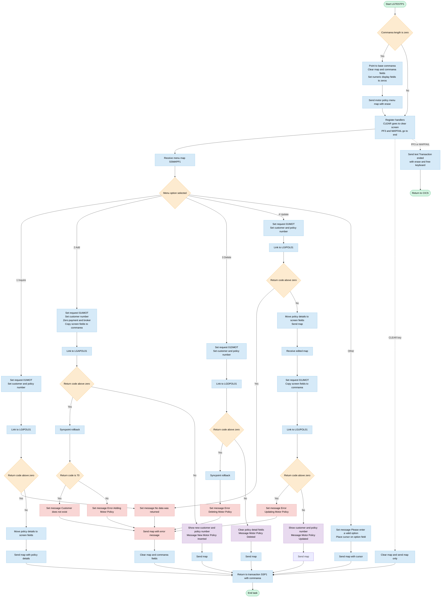
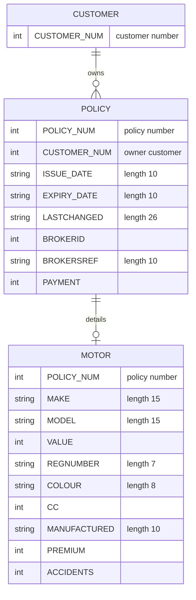

## Table of Contents

- [1. Purpose](#1-purpose)
- [2. Inputs](#2-inputs)
- [3. Outputs](#3-outputs)
- [4. Processing Logic](#4-processing-logic)
  - [4.1 Mermaid Flow Diagram](#41-mermaid-flow-diagram)
  - [4.2 Processing Logic Description](#42-processing-logic-description)
  - [4.3 Database Tables](#43-database-tables)
- [5. Paragraphs](#5-paragraphs)
- [6. Dependencies](#6-dependencies)
- [7. Constraints](#7-constraints)
  - [7.1 User Interface and Input Validation Constraints](#71-user-interface-and-input-validation-constraints)
  - [7.2 Communication Area (COMMAREA) Interface Constraints](#72-communication-area-commarea-interface-constraints)
  - [7.3 Transaction Flow and Execution Sequencing Constraints](#73-transaction-flow-and-execution-sequencing-constraints)
  - [7.4 CICS Condition and Attention Identifier (AID) Constraints](#74-cics-condition-and-attention-identifier-aid-constraints)
- [8. Error Handling](#8-error-handling)
- [9. Examples](#9-examples)
  - [9.1 Example 1: Inquire Motor Policy Details (Option 1)](#91-example-1-inquire-motor-policy-details-option-1)
  - [9.2 Example 2: Add New Motor Policy (Option 2)](#92-example-2-add-new-motor-policy-option-2)
  - [9.3 Example 3: Invalid Menu Option Handling](#93-example-3-invalid-menu-option-handling)

## 1. Purpose

LGTESTP1 is the CICS online front-end for the motor policy menu. It lets a user work with a customer's motor insurance policies from a single screen (map SSMAPP1 in mapset SSMAP). The user enters a menu option along with the customer number, policy number and policy details. The program then runs the matching action by calling the back-end policy programs: inquire, add, delete, or update. For an inquiry, it shows the vehicle and policy details, which include issue and expiry dates, make, model, value, registration, colour, engine capacity, manufacture date, premium and accident count. For an add, it takes the details entered on the screen, creates the policy and returns the new customer and policy numbers. For a delete, it removes the policy and clears the screen fields. For an update, it first displays the current details, accepts the user's changes, and then applies them. The program also reports outcomes and errors to the user, such as a successful add, update or delete, a missing customer, no data returned, a failed operation, or an invalid option. It returns control to the same transaction so the menu stays available for the next request, and it ends the session with a "Transaction ended" message when the user presses PF3 or a map failure occurs.

## 2. Inputs

- **Program parameters (CICS entry)**
  - `DFHEIPTR`: CICS EXEC interface block pointer. It gives the program access to `EIBCALEN` and other EIB fields.
  - `COMM_AREA_PTR`: pointer to the CICS COMMAREA (`COMM_AREA`, 32,500 bytes).
    - On first entry (`EIBCALEN = 0`) the program points it at its own `BASE_COMM_AREA` and initialises it.
    - On later entries it holds the commarea passed back by `RETURN TRANSID('SSP1') COMMAREA(COMM_AREA)`.
  - `EIBCALEN`: length of the incoming commarea. It decides whether to display the initial menu or process the user's reply.

- **Terminal/screen input (BMS map `SSMAPP1` in mapset `SSMAP`, read with `EXEC CICS RECEIVE MAP`)**
  - Menu selection
    - `ENP1OPTO`: one-character option the user entered.
      - It is the `SELECT` key, which chooses the operation: '1' inquire, '2' add, '3' delete, '4' update.
      - Any other value produces the "Please enter a valid option" message.
  - Policy keys
    - `ENP1CNOO` / `ENP1CNOI`: customer number entered on the screen. It populates `CA_CUSTOMER_NUM` for inquire, delete and update. For add, the value is taken from `ENP1CNOI`.
    - `ENP1PNOO`: policy number entered on the screen. It populates `CA_POLICY_NUM` for inquire, delete and update.
  - Policy dates (used for add and update)
    - `ENP1IDAI`: issue date, mapped to `CA_ISSUE_DATE`.
    - `ENP1EDAI`: expiry date, mapped to `CA_EXPIRY_DATE`.
  - Vehicle details (used for add and update)
    - `ENP1CMKI`: vehicle make, mapped to `CA_M_MAKE`.
    - `ENP1CMOI`: vehicle model, mapped to `CA_M_MODEL`.
    - `ENP1REGI`: registration number, mapped to `CA_M_REGNUMBER`.
    - `ENP1COLI`: colour, mapped to `CA_M_COLOUR`.
    - `ENP1CCI`: engine cubic capacity, mapped to `CA_M_CC`.
    - `ENP1MANI`: manufactured date, mapped to `CA_M_MANUFACTURED`.
  - Financial and risk details (used for add and update)
    - `ENP1VALI`: vehicle value, mapped to `CA_M_VALUE`.
    - `ENP1PREI`: premium, mapped to `CA_M_PREMIUM`.
    - `ENP1ACCI`: number of accidents, mapped to `CA_M_ACCIDENTS`.
  - Update flow: a second `RECEIVE MAP` reads the user's edited values after the existing policy has been displayed.
  - AID keys and map conditions
    - `CLEAR` key: redisplays a blank menu.
    - `PF3` key: ends the transaction.
    - `MAPFAIL` condition (no map data received): ends the transaction.

- **Data returned from called programs (via COMMAREA `COMM_AREA`)**
  - `LGIPOL01` (inquiry, `CA_REQUEST_ID` = '01IMOT'): returns the stored motor policy details.
    - Returned fields: `CA_ISSUE_DATE`, `CA_EXPIRY_DATE`, `CA_M_MAKE`, `CA_M_MODEL`, `CA_M_VALUE`, `CA_M_REGNUMBER`, `CA_M_COLOUR`, `CA_M_CC`, `CA_M_MANUFACTURED`, `CA_M_PREMIUM`, `CA_M_ACCIDENTS`.
    - The program displays them on the screen.
  - `LGAPOL01` (add, '01AMOT') and `LGUPOL01` (update, '01UMOT'): return `CA_CUSTOMER_NUM` and `CA_POLICY_NUM` after a successful add or update. The program shows them on the screen.
  - `LGDPOL01` (delete, '01DMOT'): returns a status in `CA_RETURN_CODE`.
  - `CA_RETURN_CODE`: status set by every called program. A value above 0 sends the program to an error path.
    - A value of 70 after an add means the customer does not exist.
    - Any other non-zero value gives the generic add, update, delete or no-data error message.

- **Constants and request control values set by the program (not external data, but they drive the called back-end programs)**
  - `CA_REQUEST_ID`: operation code passed to the back-end programs ('01IMOT', '01AMOT', '01DMOT', '01UMOT').

## 3. Outputs

- **Screen output (BMS map `SSMAPP1` in mapset `SSMAP`)**
  - Motor policy menu display
    - `ENP1CNOO`, `ENP1PNOO`: customer number and policy number. On first entry (`EIBCALEN = 0`) both are set to `'0000000000'`.
    - `ENP1VALO`, `ENP1CCO`, `ENP1ACCO`, `ENP1PREO`: numeric fields. On first entry they are initialised to zeros so the screen starts blank.
    - `ENP1OPTO`: the menu option the user selected. It decides which transaction runs. `'1'` inquires, `'2'` adds, `'3'` deletes and `'4'` updates. Any other value sends the "Please enter a valid option" message.
  - Policy details shown after inquiry (options 1 and 4). The back-end commarea values are moved into the map input fields (`...I`) before the map is sent.
    - `CA_ISSUE_DATE`, `CA_EXPIRY_DATE`: policy start and end dates.
    - `CA_M_MAKE`, `CA_M_MODEL`, `CA_M_REGNUMBER`, `CA_M_COLOUR`, `CA_M_CC`, `CA_M_MANUFACTURED`: vehicle details.
    - `CA_M_VALUE`, `CA_M_PREMIUM`, `CA_M_ACCIDENTS`: vehicle value, premium and accident count.
  - Confirmation after a successful add or update
    - `CA_CUSTOMER_NUM`, `CA_POLICY_NUM`: the customer and policy numbers returned by the back-end program, shown on the screen.
    - The option field is cleared.
  - Field clearing after a successful delete
    - The date and vehicle fields on the map are blanked.
  - `CLEAR` key handling
    - The map is cleared and re-sent without data (`MAPONLY`).
  - Invalid-option handling
    - The cursor is positioned on the option field (`ENP1OPTL = -1`).

- **Messages shown in the error field `ERP1FLDO`**
  - Success messages
    - `'New Motor Policy Inserted'` after a successful add.
    - `'Motor Policy Updated'` after a successful update.
    - `'Motor Policy Deleted'` after a successful delete.
  - Error messages
    - `'Customer does not exist'`: add failed with return code 70.
    - `'Error Adding Motor Policy'`: add failed with any other nonzero return code.
    - `'Error Updating Motor Policy'`: update failed.
    - `'Error Deleting Motor Policy'`: delete failed.
    - `'No data was returned.'`: inquiry failed. This applies to option 1 and to the inquiry step of option 4.
  - Validation message
    - `'Please enter a valid option'`: the menu option is not 1–4.

- **Terminal text output**
  - `MSGEND` (`'Transaction ended      '`) is sent as text with `ERASE` and `FREEKB`. This happens when PF3 is pressed or when no map data is received (`MAPFAIL`), and the task then ends.

- **Data passed to called programs through the commarea `COMM_AREA`**
  - Request routing
    - `CA_REQUEST_ID`: operation code for the back-end program. `'01IMOT'` is inquire (options 1 and 4). `'01AMOT'` is add, `'01UMOT'` is update and `'01DMOT'` is delete.
    - Target programs: `LGIPOL01` (inquire), `LGAPOL01` (add), `LGUPOL01` (update) and `LGDPOL01` (delete). All are called with a 32500-byte commarea.
  - Keys
    - `CA_CUSTOMER_NUM`, `CA_POLICY_NUM`: identify the policy to process. Add and update take the customer number from the map input field.
  - Policy data sent for add and update
    - `CA_ISSUE_DATE`, `CA_EXPIRY_DATE`.
    - `CA_M_MAKE`, `CA_M_MODEL`, `CA_M_VALUE`, `CA_M_REGNUMBER`, `CA_M_COLOUR`, `CA_M_CC`, `CA_M_MANUFACTURED`, `CA_M_PREMIUM`, `CA_M_ACCIDENTS`.
    - `CA_PAYMENT`, `CA_BROKERID`, `CA_BROKERSREF`: reset to zero or blank before the call.
  - Database changes
    - The program does not write to files or databases itself. The called programs persist the add, update and delete changes.
    - On an add or delete failure, `EXEC CICS SYNCPOINT ROLLBACK` backs out the changes.

- **Transaction control and returned state**
  - After a successful action or an invalid option, `EXEC CICS RETURN TRANSID('SSP1') COMMAREA(COMM_AREA)` restarts the menu transaction and passes the commarea along.
  - After an error message is sent, the commarea (`CA_REQUEST_ID`, `CA_RETURN_CODE`, `CA_CUSTOMER_NUM` and the policy data) is reset. The transaction then returns to `SSP1`.
  - The `CLEAR` key also returns to `SSP1` with the commarea.
  - A plain `EXEC CICS RETURN` ends the task. It is used at the end of the `ENDIT` path.

## 4. Processing Logic

### 4.1 Mermaid Flow Diagram

---

### 4.2 Processing Logic Description

**High-level Summary**

LGTESTP1 is a pseudo-conversational CICS transaction (SSP1) written in PL/I. It runs the Motor Policy menu screen (map SSMAPP1 in mapset SSMAP) of the insurance application. The user enters a customer number, a policy number and an option. The program then calls a back-end program through CICS LINK to inquire, add, delete or update a motor policy. It formats the result or an error message on the same screen and returns control to CICS with the transaction ID SSP1 and the commarea, so the next key press restarts the menu.

**Execution Flow**

1. **First-time entry.** If the commarea length (EIBCALEN) is zero, this is the first invocation.
   - The program points the commarea at a local base area.
   - It clears the output map and the commarea header fields: request ID, return code, customer number and the request-specific area.
   - It sets the displayed customer number, policy number, value, CC, accidents and premium fields to zeros.
   - It sends the empty menu map with ERASE.
2. **Handlers.** Every pass registers the following handlers:
   - CLEAR goes to CLEARIT.
   - PF3 goes to ENDIT.
   - The MAPFAIL condition goes to ENDIT.
3. **Receive.** The program receives map SSMAPP1 into SSMAPP1I. If the user pressed Enter with no data, MAPFAIL ends the transaction. The program then selects on the option field (ENP1OPTO):
   - **Option 1 (Inquire).**
     - It sets CA_REQUEST_ID to `01IMOT` and takes the customer and policy numbers from the screen.
     - It LINKs to LGIPOL01 with a 32500-byte commarea.
     - If CA_RETURN_CODE is above 0, it goes to NO_DATA with the message "No data was returned."
     - Otherwise it copies these fields to the screen: issue date, expiry date, make, model, value, registration, colour, CC, manufactured date, premium and accidents. It sends the map and returns with the SSP1 transaction ID.
   - **Option 2 (Add).**
     - It sets the request to `01AMOT` and takes the customer number from the input field.
     - It zeroes payment and broker ID, blanks the broker reference, and copies all the motor fields from the screen to the commarea.
     - It LINKs to LGAPOL01.
     - If the return code is above 0, it issues SYNCPOINT ROLLBACK and goes to NO_ADD. Return code 70 gives "Customer does not exist". Any other code gives "Error Adding Motor Policy".
     - On success it displays the returned customer and policy numbers, clears the option field, and shows "New Motor Policy Inserted".
   - **Option 3 (Delete).**
     - It sets the request to `01DMOT` and passes the customer and policy numbers.
     - It LINKs to LGDPOL01.
     - On a non-zero return code it issues SYNCPOINT ROLLBACK and shows "Error Deleting Motor Policy".
     - On success it blanks the policy detail fields and shows "Motor Policy Deleted".
   - **Option 4 (Update).**
     - First the program performs an inquiry (`01IMOT` through LGIPOL01). A failure gives "No data was returned."
     - It displays the current values and waits for the user to edit them by issuing another RECEIVE MAP.
     - It then builds a `01UMOT` request with payment and broker values zeroed and the edited screen values, and LINKs to LGUPOL01.
     - A non-zero return code gives "Error Updating Motor Policy". Success shows "Motor Policy Updated".
   - **Any other option.** The program shows "Please enter a valid option", sets the cursor on the option field (ENP1OPTL = -1), and sends the map with CURSOR.
4. **Error exit (ERROR_OUT).** The program sends the map with the error message. It then clears the output map and the whole commarea, including the request ID, return code and customer number. It returns with transaction SSP1.
5. **Exit paths.**
   - ENDIT_STARTIT returns to CICS with TRANSID SSP1 and the commarea, which keeps the conversation going.
   - ENDIT (PF3 or MAPFAIL) sends the text "Transaction ended" with ERASE and FREEKB, then returns without a transaction ID.
   - CLEARIT (CLEAR key) clears the map, sends the map only, and returns with SSP1.

**Business rules**

- Request codes are `01IMOT` (inquire), `01AMOT` (add), `01UMOT` (update) and `01DMOT` (delete).
- A return code above 0 from any back-end program is treated as failure.
- Return code 70 on add means the customer does not exist.
- Add and delete failures trigger a rollback of the unit of work. Inquire and update failures do not.
- Payment and broker fields are always set to 0 or blank for add and update.
- Update is a two-step interaction: it shows the current data and then waits for the edited data.

**External Interactions**

| Target | Purpose |
|---|---|
| CICS BMS map SSMAPP1 (mapset SSMAP) | Terminal input and output |
| LGIPOL01 | Motor policy inquiry. Also used as the first step of update. |
| LGAPOL01 | Motor policy add |
| LGUPOL01 | Motor policy update |
| LGDPOL01 | Motor policy delete |
| CICS SYNCPOINT ROLLBACK | Backs out changes after a failed add or delete |
| CICS RETURN with TRANSID SSP1 | Pseudo-conversational restart |

The program does not issue any SQL itself. The linked programs access the data, and the policy tables listed below are inferred from the commarea layout.

**Plain Language Summary**

The program is a simple menu screen for motor insurance policies. The user types a customer number, optionally a policy number, and picks 1 to view a policy, 2 to add one, 3 to delete one, or 4 to change one. The program asks a specialist program to do the work. If that program reports a problem, the screen shows a short message such as "Customer does not exist" or "Error Deleting Motor Policy". If everything works, it shows the policy details or a confirmation message. For add and delete failures, any partial changes are undone. PF3 ends the session and CLEAR resets the screen. Any other option value produces a "valid option" prompt.

---

### 4.3 Database Tables

## 5. Paragraphs

- **LGTESTP1 (Main Procedure — program entry and first-time initialisation)**
  - Entry point declared as `Proc(DFHEIPTR,COMM_AREA_PTR) Options(Main,Reentrant)`, making it a CICS menu program for Motor Policy transactions.
  - On the very first invocation (`EIBCALEN = 0`), the COMMAREA pointer is set to a local base area, the motor policy panel output structure (`SSMAPP1O`) is cleared, and key COMMAREA fields (`CA_REQUEST_ID`, `CA_RETURN_CODE`, `CA_CUSTOMER_NUM`, `CA_REQUEST_INITIALISER`) are initialised to zero/blank. Numeric output fields on the screen (customer number, policy number, value, CC, accidents, premium) are pre-filled with zeroes.
  - A `EXEC CICS SEND MAP` (mapname `SSMAPP1`, mapset `SSMAP`) with `ERASE` then displays the blank motor policy menu to the terminal.
  - Control falls through to label `A_GAIN` on subsequent invocations; on first entry the SEND is followed by an implicit fall-through since there is no explicit RETURN before `A_GAIN`.

- **A_GAIN (Main Dispatch Loop)**
  - Serves as the re-entry point after each pseudo-conversational cycle.
  - Registers two AID handlers: `CLEAR` routes to `CLEARIT` and `PF3` routes to `ENDIT`; a `MAPFAIL` condition also routes to `ENDIT`.
  - Issues `EXEC CICS RECEIVE MAP('SSMAPP1')` to read the operator's input from the motor policy screen into `SSMAPP1I`.
  - Evaluates the single-character option field `ENP1OPTO` using a `SELECT` statement to dispatch to one of four motor policy operations or an error branch:
    - **Option '1' — Inquire Motor Policy:** Sets `CA_REQUEST_ID = '01IMOT'`, copies `ENP1CNOO` and `ENP1PNOO` into the COMMAREA, issues `EXEC CICS LINK PROGRAM('LGIPOL01')`. On a non-zero return code branches to `NO_DATA`; otherwise maps all returned motor policy fields (`CA_ISSUE_DATE`, `CA_EXPIRY_DATE`, `CA_M_MAKE`, `CA_M_MODEL`, `CA_M_VALUE`, `CA_M_REGNUMBER`, `CA_M_COLOUR`, `CA_M_CC`, `CA_M_MANUFACTURED`, `CA_M_PREMIUM`, `CA_M_ACCIDENTS`) back to the output map fields and sends the updated screen, then goes to `ENDIT_STARTIT`.
    - **Option '2' — Add Motor Policy:** Sets `CA_REQUEST_ID = '01AMOT'`, reads all motor field inputs from the screen into the COMMAREA, issues `EXEC CICS LINK PROGRAM('LGAPOL01')`. On failure issues `EXEC CICS SYNCPOINT ROLLBACK` and branches to `NO_ADD`; on success writes the returned customer and policy numbers back to the screen input fields, sets the error field to `'New Motor Policy Inserted'`, sends the screen, and goes to `ENDIT_STARTIT`.
    - **Option '3' — Delete Motor Policy:** Sets `CA_REQUEST_ID = '01DMOT'`, copies identifiers into the COMMAREA, issues `EXEC CICS LINK PROGRAM('LGDPOL01')`. On failure issues rollback and branches to `NO_DELETE`; on success clears all motor detail screen fields, sets the confirmation message `'Motor Policy Deleted'`, sends the screen, and goes to `ENDIT_STARTIT`.
    - **Option '4' — Update Motor Policy:** First performs an inquiry (`CA_REQUEST_ID = '01IMOT'`, links `LGIPOL01`) to retrieve the current policy data and display it. On inquiry failure branches to `NO_DATA`. Then issues a second `EXEC CICS RECEIVE MAP` to collect the user's edits, reloads all motor fields into the COMMAREA, sets `CA_REQUEST_ID = '01UMOT'`, and issues `EXEC CICS LINK PROGRAM('LGUPOL01')`. On failure branches to `NO_UPD`; on success updates screen fields, sets `'Motor Policy Updated'`, sends the screen, and goes to `ENDIT_STARTIT`.
    - **OTHERWISE — Invalid Option:** Writes `'Please enter a valid option'` to the error field, sets the option field length attribute to `-1` (cursor positioning), sends the screen with `CURSOR`, and goes to `ENDIT_STARTIT`.

- **ENDIT_STARTIT (Pseudo-Conversational Return)**
  - Issues `EXEC CICS RETURN TRANSID('SSP1') COMMAREA(COMM_AREA)` to end the current task and schedule re-entry under transaction `SSP1` with the current COMMAREA preserved, implementing the pseudo-conversational model.

- **ENDIT (Session Termination)**
  - Reached when the operator presses PF3, CLEAR triggers a MAPFAIL, or a MAPFAIL condition fires.
  - Sends the literal message `'Transaction ended      '` (`MSGEND`) as free text with `ERASE` and `FREEKB`.
  - Issues `EXEC CICS RETURN` with no TRANSID, ending the conversational session completely.

- **CLEARIT (Screen Clear Handler)**
  - Activated when the operator presses the CLEAR key.
  - Clears the `SSMAPP1O` output structure and re-sends the motor policy map using `MAPONLY` (map skeleton only, no data), refreshing the screen to a blank state.
  - Issues `EXEC CICS RETURN TRANSID('SSP1') COMMAREA(COMM_AREA)` to continue the pseudo-conversational cycle.

- **NO_ADD (Add Failure Handler)**
  - Inspects `CA_RETURN_CODE` with a `SELECT`:
    - Return code `70` sets `ERP1FLDO` to `'Customer does not exist'`.
    - Any other code sets `ERP1FLDO` to `'Error Adding Motor Policy'`.
  - Branches unconditionally to `ERROR_OUT`.

- **NO_UPD (Update Failure Handler)**
  - Sets `ERP1FLDO` to `'Error Updating Motor Policy'` and branches to `ERROR_OUT`.

- **NO_DELETE (Delete Failure Handler)**
  - Sets `ERP1FLDO` to `'Error Deleting Motor Policy'` and branches to `ERROR_OUT`.

- **NO_DATA (Inquiry Failure Handler)**
  - Sets `ERP1FLDO` to `'No data was returned.'` and branches to `ERROR_OUT`.

- **ERROR_OUT (Common Error Display and Reset)**
  - Sends the motor policy map (`SSMAPP1`, mapset `SSMAP`) with the error message already populated in `ERP1FLDO` so the operator sees the failure reason.
  - Resets all state: clears `SSMAPP1O`, blanks `COMM_AREA_RAW`, zeroes `CA_RETURN_CODE` and `CA_CUSTOMER_NUM`, clears `CA_REQUEST_ID` and `CA_REQUEST_INITIALISER`.
  - Branches to `ENDIT_STARTIT` to return pseudo-conversationally, allowing the operator to retry.

## 6. Dependencies

-  Called programs (CICS LINK)
  - LGIPOL01
    - Linked with request ID '01IMOT' to inquire a motor policy.
    - Used for menu option 1 (inquire) and for the lookup step of option 4 (update).
    - Receives CA_CUSTOMER_NUM and CA_POLICY_NUM.
    - Returns the motor policy details and CA_RETURN_CODE.
  - LGAPOL01
    - Linked with request ID '01AMOT' to add a new motor policy (menu option 2).
    - Receives the customer number and the policy details entered on the screen. These are issue and expiry dates, make, model, value, registration, colour, CC, manufactured date, premium and accidents.
    - Also receives CA_PAYMENT, CA_BROKERID and CA_BROKERSREF, which are set to 0, 0 and blank.
    - Returns the new policy number and CA_RETURN_CODE.
    - Return code 70 means the customer does not exist.
  - LGUPOL01
    - Linked with request ID '01UMOT' to update a motor policy (menu option 4).
    - Receives the modified screen values after the inquiry.
    - Returns CA_RETURN_CODE.
  - LGDPOL01
    - Linked with request ID '01DMOT' to delete a motor policy (menu option 3).
    - Receives the customer and policy numbers.
    - Returns CA_RETURN_CODE.
  - All four links pass COMM_AREA with LENGTH(32500). The called programs must honour this commarea contract.

-  CICS transaction and terminal resources
  - BMS mapset SSMAP
    - Contains the maps SSMAPP1 (motor policy menu), SSMAPC1, SSMAPP2, SSMAPP3, SSMAPP4 and SSMAPP5.
    - Only SSMAPP1 is actually used in the logic. The other map structures are declared but not used.
    - The program uses SEND MAP, SEND MAP MAPONLY, SEND MAP CURSOR and RECEIVE MAP against SSMAPP1.
  - Transaction ID SSP1
    - Each EXEC CICS RETURN TRANSID('SSP1') restarts this program as a pseudo-conversational transaction.
    - The commarea is passed on each return.
  - CICS terminal I/O
    - EXEC CICS SEND TEXT sends the "Transaction ended" message (MSGEND) with ERASE and FREEKB.
    - It is used when PF3 is pressed or on a MAPFAIL.
  - CICS aid and condition handling
    - HANDLE AID routes CLEAR to the CLEARIT routine and PF3 to the ENDIT routine.
    - HANDLE CONDITION MAPFAIL routes to ENDIT.
  - CICS syncpoint control
    - EXEC CICS SYNCPOINT ROLLBACK backs out work when the add or delete link returns a non-zero return code.
  - CICS runtime interface
    - DFHEIPTR is passed as a parameter to the main procedure and EIBCALEN is tested.
    - EIBCALEN = 0 detects the first invocation, which sends the initial menu.
    - The program is compiled as Options(Main,Reentrant) and needs the CICS PL/I translator and runtime.

-  Include members and copybooks
  - SSMAP (plinc/SSMAP.inc)
    - Defines the BMS symbolic map structures for the mapset.
    - Input structures are SSMAPC1I and SSMAPP1I to SSMAPP5I.
    - Output structures are SSMAPC1O and SSMAPP1O to SSMAPP5O.
    - Includes the menu option field ENP1OPTO and the policy fields on the SSMAPP1 map.
  - LGCMAREA (plinc/LGCMAREA.inc)
    - Defines the COMM_AREA structure, based on COMM_AREA_PTR, with a 32500-byte raw redefinition.
    - Request and return fields:
      - CA_REQUEST_ID and CA_RETURN_CODE
      - CA_CUSTOMER_NUM and CA_POLICY_NUM
    - Common policy fields:
      - CA_ISSUE_DATE and CA_EXPIRY_DATE
      - CA_PAYMENT, CA_BROKERID and CA_BROKERSREF
    - Motor policy fields:
      - CA_M_MAKE, CA_M_MODEL, CA_M_VALUE
      - CA_M_REGNUMBER, CA_M_COLOUR, CA_M_CC
      - CA_M_MANUFACTURED, CA_M_PREMIUM, CA_M_ACCIDENTS
    - Other layouts, not used by this program: customer, security, endowment, house, commercial and claim.

-  Input parameters and data sources
  - DFHEIPTR
    - Pointer to the CICS EXEC interface block. It gives access to EIBCALEN and other EIB fields.
  - COMM_AREA_PTR
    - The incoming commarea pointer. It is reset to the local BASE_COMM_AREA storage on the first invocation (EIBCALEN = 0).
    - It is reused on subsequent pseudo-conversational invocations.
  - Terminal user input from map SSMAPP1
    - ENP1OPTO is the menu option (1 inquire, 2 add, 3 delete, 4 update).
    - ENP1CNOI and ENP1CNOO hold the customer number.
    - ENP1PNOO and ENP1PNOI hold the policy number.
    - Motor policy detail fields:
      - ENP1IDAI and ENP1EDAI (issue and expiry dates)
      - ENP1CMKI and ENP1CMOI (make and model)
      - ENP1VALI (value)
      - ENP1REGI (registration number)
      - ENP1COLI (colour)
      - ENP1CCI (CC)
      - ENP1MANI (manufactured date)
      - ENP1PREI (premium)
      - ENP1ACCI (accidents)
  - Terminal attention keys
    - PF3 ends the transaction.
    - CLEAR clears the screen and redisplays the menu.

-  Configuration values and constants
  - Hard-coded request codes: '01IMOT', '01AMOT', '01DMOT' and '01UMOT'.
  - Hard-coded program names: LGIPOL01, LGAPOL01, LGUPOL01 and LGDPOL01.
  - Hard-coded identifiers: transaction ID SSP1, mapset SSMAP and map SSMAPP1.
  - Commarea length of 32500.
  - Static message MSGEND, "Transaction ended".
  - Screen messages for success and error outcomes:
    - 'New Motor Policy Inserted'
    - 'Motor Policy Updated'
    - 'Motor Policy Deleted'
    - 'Customer does not exist' (return code 70)
    - 'Error Adding Motor Policy'
    - 'Error Updating Motor Policy'
    - 'Error Deleting Motor Policy'
    - 'No data was returned.'
    - 'Please enter a valid option'

-  Indirect dependencies
  - Back-end data stores
    - The program does not access files or databases itself.
    - The linked programs LGIPOL01, LGAPOL01, LGUPOL01 and LGDPOL01 perform the actual policy data access, which is presumably a database.
    - Any failure there reaches this program only through CA_RETURN_CODE.
  - There are no environment variables, external files, queues or direct SQL calls in this program.

## 7. Constraints

### 7.1 User Interface and Input Validation Constraints
- Menu Option Selection Constraint:
  - The program restricts the menu option input (`ENP1OPTO`) to single-character values `'1'`, `'2'`, `'3'`, and `'4'`.
  - Any other option value executes the `OTHERWISE` branch of the `SELECT` statement, setting the cursor to the option field (`ENP1OPTL = -1`), displaying `'Please enter a valid option'` in `ERP1FLDO`, and redisplaying the map.
- Map Field Size and Type Constraints:
  - Policy Number (`ENP1PNOI` / `ENP1PNOO`): Enforces a maximum length of 10 characters (`CHARACTER(10)`).
  - Customer Number (`ENP1CNOI` / `ENP1CNOO`): Enforces a maximum length of 10 characters (`CHARACTER(10)`).
  - Issue Date (`ENP1IDAI` / `ENP1IDAO`): Enforces a maximum length of 10 characters (`CHARACTER(10)`).
  - Expiry Date (`ENP1EDAI` / `ENP1EDAO`): Enforces a maximum length of 10 characters (`CHARACTER(10)`).
  - Vehicle Make (`ENP1CMKI` / `ENP1CMKO`): Enforces a maximum length of 20 characters (`CHARACTER(20)`).
  - Vehicle Model (`ENP1CMOI` / `ENP1CMOO`): Enforces a maximum length of 20 characters (`CHARACTER(20)`).
  - Vehicle Value (`ENP1VALI` / `ENP1VALO`): Enforces a maximum length of 6 characters (`CHARACTER(6)`).
  - Registration Number (`ENP1REGI` / `ENP1REGO`): Enforces a maximum length of 7 characters (`CHARACTER(7)`).
  - Vehicle Colour (`ENP1COLI` / `ENP1COLO`): Enforces a maximum length of 8 characters (`CHARACTER(8)`).
  - Engine Capacity (CC) (`ENP1CCI` / `ENP1CCO`): Enforces a maximum length of 8 characters (`CHARACTER(8)`).
  - Manufactured Date (`ENP1MANI` / `ENP1MANO`): Enforces a maximum length of 10 characters (`CHARACTER(10)`).
  - Accidents (`ENP1ACCI` / `ENP1ACCO`): Enforces a maximum length of 6 characters (`CHARACTER(6)`).
  - Premium (`ENP1PREI` / `ENP1PREO`): Enforces a maximum length of 6 characters (`CHARACTER(6)`).
  - Error Message Field (`ERP1FLDO`): Enforces a maximum output length of 40 characters (`CHARACTER(40)`).

### 7.2 Communication Area (COMMAREA) Interface Constraints
- Fixed COMMAREA Buffer Length:
  - All `EXEC CICS LINK` calls to backend programs (`LGIPOL01`, `LGAPOL01`, `LGDPOL01`, `LGUPOL01`) enforce a rigid COMMAREA length of exactly 32,500 bytes (`LENGTH(32500)`).
- Request Identifier Formatting:
  - The program enforces specific 6-character action codes in `CA_REQUEST_ID` matching the selected operation:
    - Inquire: `'01IMOT'`
    - Add: `'01AMOT'`
    - Delete: `'01DMOT'`
    - Update: `'01UMOT'` (following an inquiry phase with `'01IMOT'`)
- Backend Return Code Handling:
  - `CA_RETURN_CODE = 0`: Interpreted as successful execution.
  - `CA_RETURN_CODE > 0`: Interpreted as an error, triggering branches to dedicated error routines (`NO_DATA`, `NO_ADD`, `NO_DELETE`, or `NO_UPD`).
  - `CA_RETURN_CODE = 70` during policy addition: Explicitly handled to indicate `'Customer does not exist'`.

### 7.3 Transaction Flow and Execution Sequencing Constraints
- First-Time Entry vs. Re-entry Sequencing:
  - Governed by checking `EIBCALEN = 0`.
  - When `EIBCALEN = 0`, the program initialises working storage fields (`BASE_COMM_AREA`, output structure `SSMAPP1O`, and numeric screen fields to zero strings), issues `EXEC CICS SEND MAP('SSMAPP1') MAPSET('SSMAP') ERASE`, and enters the input reception loop.
- Conversational / Pseudo-Conversational Return:
  - On standard completion or recovered error, the program executes `EXEC CICS RETURN TRANSID('SSP1') COMMAREA(COMM_AREA)` to maintain continuity of the pseudo-conversational session under transaction ID `SSP1`.
  - When processing an unrecoverable exit or terminal message, it issues `EXEC CICS SEND TEXT FROM(MSGEND) ... ERASE FREEKB` followed by a basic `EXEC CICS RETURN` without a `TRANSID`.
- Update Operation (Option 4) Sequencing:
  - Enforces a two-step sequence: it first inquires the existing motor policy (`LINK PROGRAM('LGIPOL01')` with request `'01IMOT'`), displays the current data onto the screen (`SEND MAP`), receives any modifications from the user (`RECEIVE MAP`), and only then links to the update backend program (`LINK PROGRAM('LGUPOL01')` with request `'01UMOT'`).
- Transaction Integrity and Rollback:
  - If an error occurs (`CA_RETURN_CODE > 0`) during Policy Add (Option 2) or Policy Delete (Option 3), an explicit `EXEC CICS SYNCPOINT ROLLBACK` is executed before branching to the error display routine to back out uncommitted changes.

### 7.4 CICS Condition and Attention Identifier (AID) Constraints
- Key Interception:
  - Intercepts attention identifier actions using `EXEC CICS HANDLE AID`:
    - `PF3`: Diverts flow to label `ENDIT`, sending the `'Transaction ended'` text and terminating the transaction.
    - `CLEAR`: Diverts flow to label `CLEARIT`, clearing the screen buffer (`SSMAPP1O = ''`), sending an empty map (`MAPONLY`), and returning pseudo-conversationally with `TRANSID('SSP1')`.
- Map Condition Interception:
  - Uses `EXEC CICS HANDLE CONDITION MAPFAIL(ENDIT)` to immediately terminate the session if a `MAPFAIL` condition occurs during map reception.

## 8. Error Handling

- **Terminal input and AID key handling**
  - A CICS HANDLE AID routes the CLEAR key to a CLEARIT routine, which blanks the output map and resends only the map definition (MAPONLY).
    - The program then returns to the same transaction (SSP1) with the communication area, so the user gets a fresh menu.
  - The PF3 key is routed to the ENDIT routine, which sends the text "Transaction ended" to the terminal with screen erase and keyboard freed, and then ends the task.
  - A CICS HANDLE CONDITION routes the MAPFAIL condition (the user submits the screen with no data) to the same ENDIT termination routine.
    - There is no explicit RESP check on the RECEIVE MAP. Errors on that command rely on this handler and on default CICS abend behavior.

- **Input validation**
  - The menu option (ENP1OPTO) is evaluated in a SELECT with WHEN branches for '1', '2', '3' and '4'.
  - The OTHERWISE branch handles any other value:
    - It puts the message "Please enter a valid option" in the error field (ERP1FLDO).
    - It sets the option field length to -1, which places the cursor on the option field.
    - It resends the map with the CURSOR option and returns to transaction SSP1 with the communication area so the user can retry.
  - No other field-level validation is done here (for example customer number format, dates, or numeric content). Such validation is left to the called back-end programs.

- **Back-end return code checks (LINK results)**
  - After each LINK to a back-end program (LGIPOL01, LGAPOL01, LGDPOL01, LGUPOL01), the program tests the returned CA_RETURN_CODE.
  - Any value above zero is treated as a failure and sent to a specific error routine.
  - Inquire (option 1): a non-zero return code goes to the NO_DATA routine.
  - Add (option 2): a non-zero return code first triggers a CICS SYNCPOINT ROLLBACK and then goes to the NO_ADD routine.
  - Delete (option 3): a non-zero return code first triggers a CICS SYNCPOINT ROLLBACK and then goes to the NO_DELETE routine.
  - Update (option 4):
    - The program first links to the inquire program to load the current data, and a non-zero return code goes to NO_DATA.
    - After the user edits the data, it links to the update program, and a non-zero return code goes to NO_UPD.
    - Unlike add and delete, the update failure path does not issue an explicit rollback.
  - The LINK commands have no RESP or RESP2 checks and no HANDLE CONDITION for PGMIDERR or similar conditions.
    - A failure of the LINK itself (for example the program is not found) is not handled here and is left to default CICS behavior.

- **Error message routines and user notification**
  - NO_ADD examines the return code in more detail:
    - Return code 70 produces "Customer does not exist".
    - Any other value produces "Error Adding Motor Policy".
  - NO_UPD sets "Error Updating Motor Policy".
  - NO_DELETE sets "Error Deleting Motor Policy".
  - NO_DATA sets "No data was returned." for failed inquiries, including the inquiry that precedes an update.
  - All of these routines converge on the ERROR_OUT routine. It sends the menu map with the message in the error field (ERP1FLDO) so the user sees the failure on screen.
  - NO_ADD ends with a branch to ERROR_OUT in each of its SELECT branches. NO_UPD, NO_DELETE and NO_DATA each branch to ERROR_OUT unconditionally.

- **Recovery, reset and fallback logic**
  - After showing an error, ERROR_OUT clears the map output area, the whole communication area, and the request id, return code, customer number and request-specific area.
    - This stops stale data and the failing return code from carrying into the next interaction.
  - It then branches to ENDIT_STARTIT, which returns to transaction SSP1 with the communication area so the user can try again from the menu.
  - Transactional recovery is done by explicit SYNCPOINT ROLLBACK on failed add and delete operations. It undoes any uncommitted changes made by the back-end programs.
  - When the program starts with no communication area (first entry, EIBCALEN of zero), it applies default initial values.
    - It points the communication area at a local base area and clears the map output.
    - It sets the request id to blank and the return code and customer number to zero.
    - It sets the numeric screen fields (customer number, policy number, value, CC, accidents, premium) to zeros.
    - It sends the clean menu with screen erase.
    - This keeps the later logic from working with uninitialized data.

- **Normal-flow messages and termination**
  - Successful operations give confirmation messages: "New Motor Policy Inserted", "Motor Policy Deleted" and "Motor Policy Updated". The program then returns to transaction SSP1 with the communication area.
  - The "Transaction ended" message (MSGEND) is shown only on the PF3 and MAPFAIL exits through ENDIT.
  - The program has no PL/I ON-unit handling (ON ERROR, ON CONDITION and so on) and no explicit ABEND calls. Unexpected runtime or CICS errors are left to the default PL/I and CICS handling.

## 9. Examples

### 9.1 Example 1: Inquire Motor Policy Details (Option 1)

#### 9.1.1 Input Data
* **Menu Option (`ENP1OPTO`)**: `'1'`
* **Customer Number (`ENP1CNOO`)**: `'0000000001'`
* **Policy Number (`ENP1PNOO`)**: `'0000000010'`

#### 9.1.2 Expected Output
* **Program Link**: `EXEC CICS LINK PROGRAM('LGIPOL01')` with `CA_REQUEST_ID = '01IMOT'`, `CA_CUSTOMER_NUM = 1`, and `CA_POLICY_NUM = 10`
* **Map Fields Populated (`SSMAPP1`)**:
  * Issue Date (`ENP1IDAI`): `'2023-01-15'` (retrieved from `CA_ISSUE_DATE`)
  * Expiry Date (`ENP1EDAI`): `'2024-01-15'` (retrieved from `CA_EXPIRY_DATE`)
  * Make (`ENP1CMKI`): `'FORD'` (retrieved from `CA_M_MAKE`)
  * Model (`ENP1CMOI`): `'FOCUS'` (retrieved from `CA_M_MODEL`)
  * Value (`ENP1VALI`): `15000` (retrieved from `CA_M_VALUE`)
  * Registration (`ENP1REGI`): `'AB12CDE'` (retrieved from `CA_M_REGNUMBER`)
  * Colour (`ENP1COLI`): `'BLUE'` (retrieved from `CA_M_COLOUR`)
  * Engine CC (`ENP1CCI`): `1600` (retrieved from `CA_M_CC`)
  * Manufactured Date (`ENP1MANI`): `'2020-05-01'` (retrieved from `CA_M_MANUFACTURED`)
  * Premium (`ENP1PREI`): `450` (retrieved from `CA_M_PREMIUM`)
  * Accidents (`ENP1ACCI`): `0` (retrieved from `CA_M_ACCIDENTS`)
* **Transaction State**: Pseudo-conversational return with transaction ID `SSP1` passing the populated commarea.

#### 9.1.3 Explanation
1. The program receives the screen map input and evaluates `ENP1OPTO`.
2. Matching option `'1'`, it sets `CA_REQUEST_ID` to `'01IMOT'` and populates the commarea with customer number and policy number.
3. It links to `LGIPOL01` to fetch policy details from the backend.
4. Upon return with `CA_RETURN_CODE = 0`, the returned vehicle and policy attributes are copied to the symbolic output map fields, sent back to the terminal, and the transaction is reinvoked via `SSP1`.

---

### 9.2 Example 2: Add New Motor Policy (Option 2)

#### 9.2.1 Input Data
* **Menu Option (`ENP1OPTO`)**: `'2'`
* **Customer Number (`ENP1CNOI`)**: `'0000000002'`
* **Issue Date (`ENP1IDAI`)**: `'2023-06-01'`
* **Expiry Date (`ENP1EDAI`)**: `'2024-06-01'`
* **Vehicle Make (`ENP1CMKI`)**: `'TOYOTA'`
* **Vehicle Model (`ENP1CMOI`)**: `'COROLLA'`
* **Vehicle Value (`ENP1VALI`)**: `20000`
* **Registration (`ENP1REGI`)**: `'XY67ZAB'`
* **Colour (`ENP1COLI`)**: `'RED'`
* **Engine CC (`ENP1CCI`)**: `1800`
* **Manufactured Date (`ENP1MANI`)**: `'2021-03-10'`
* **Premium (`ENP1PREI`)**: `500`
* **Accidents (`ENP1ACCI`)**: `0`

#### 9.2.2 Expected Output
* **Program Link**: `EXEC CICS LINK PROGRAM('LGAPOL01')` with `CA_REQUEST_ID = '01AMOT'` and all vehicle details populated in `COMM_AREA`
* **Map Fields Populated (`SSMAPP1`)**:
  * Customer Number (`ENP1CNOI`): `'0000000002'`
  * Generated Policy Number (`ENP1PNOI`): `'0000000025'` (assigned by backend)
  * Option Field (`ENP1OPTI`): `''`
  * Status Message (`ERP1FLDO`): `'New Motor Policy Inserted'`
* **Transaction State**: Pseudo-conversational return with transaction ID `SSP1`.

#### 9.2.3 Explanation
1. When option `'2'` is chosen, the program assigns `CA_REQUEST_ID = '01AMOT'` and loads motor vehicle attributes from the map into the commarea.
2. It executes a CICS LINK to `LGAPOL01`.
3. With `CA_RETURN_CODE = 0`, the program receives the newly created policy number in `CA_POLICY_NUM`, sets the confirmation message `'New Motor Policy Inserted'` in `ERP1FLDO`, clears the option field, redisplays the screen, and reinvokes `SSP1`.

---

### 9.3 Example 3: Invalid Menu Option Handling

#### 9.3.1 Input Data
* **Menu Option (`ENP1OPTO`)**: `'9'`

#### 9.3.2 Expected Output
* **Error Message (`ERP1FLDO`)**: `'Please enter a valid option'`
* **Cursor Position**: Positioned at option field (`ENP1OPTL = -1`)
* **Transaction State**: Redisplays map with message and re-executes `SSP1`.

#### 9.3.3 Explanation
1. The program receives option `'9'` which falls through to the `OTHERWISE` block in the `SELECT` statement.
2. It sets the error message in `ERP1FLDO`, flags the cursor for the option input field via `ENP1OPTL = -1`, sends the map with `CURSOR`, and returns with transaction ID `SSP1` to wait for valid user input.

---

Generated by IBM Bob Premium Package for Z
