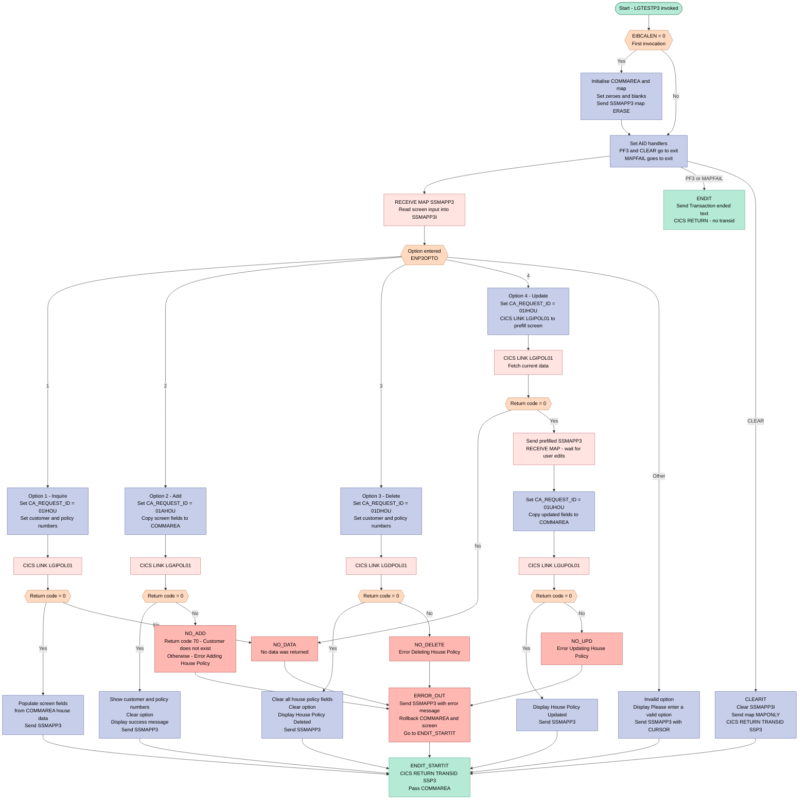
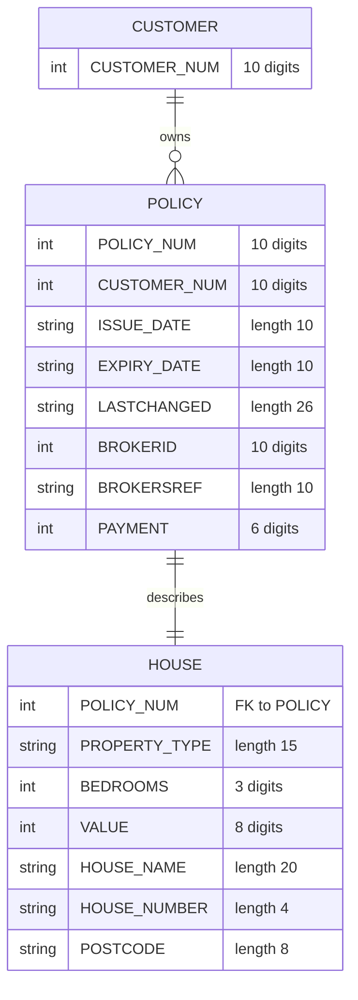

## Table of Contents

- [1. Purpose](#1-purpose)
- [2. Inputs](#2-inputs)
  - [2.1 CICS Execution and Interface Parameters](#21-cics-execution-and-interface-parameters)
  - [2.2 User Interface Inputs (BMS Map SSMAPP3)](#22-user-interface-inputs-bms-map-ssmapp3)
  - [2.3 External Service Responses (CICS Linked Programs)](#23-external-service-responses-cics-linked-programs)
- [3. Outputs](#3-outputs)
- [4. Processing Logic](#4-processing-logic)
  - [4.1 Mermaid Flow Diagram](#41-mermaid-flow-diagram)
  - [4.2 Processing Logic Description](#42-processing-logic-description)
  - [4.3 Database Tables](#43-database-tables)
- [5. Paragraphs](#5-paragraphs)
- [6. Dependencies](#6-dependencies)
  - [6.1 CICS Environment and System Services](#61-cics-environment-and-system-services)
  - [6.2 Invoked Programs and Subroutines](#62-invoked-programs-and-subroutines)
  - [6.3 User Interface and Map Definitions](#63-user-interface-and-map-definitions)
  - [6.4 Data Interfaces and Communication Structures](#64-data-interfaces-and-communication-structures)
- [7. Constraints](#7-constraints)
- [8. Error Handling](#8-error-handling)
  - [8.1 User Input and Option Validation](#81-user-input-and-option-validation)
  - [8.2 CICS Exception and Attention Identifier Handling](#82-cics-exception-and-attention-identifier-handling)
  - [8.3 Service Invocation and Return Code Checks](#83-service-invocation-and-return-code-checks)
  - [8.4 Recovery, Transaction Rollback, and Error Reset Logic](#84-recovery-transaction-rollback-and-error-reset-logic)
- [9. Examples](#9-examples)
  - [9.1 Example 1: Inquire House Policy (Option 1)](#91-example-1-inquire-house-policy-option-1)
  - [9.2 Example 2: Add New House Policy (Option 2)](#92-example-2-add-new-house-policy-option-2)
  - [9.3 Example 3: Delete House Policy (Option 3)](#93-example-3-delete-house-policy-option-3)

## 1. Purpose

LGTESTP3 is a CICS online menu program for house insurance policies, run under transaction SSP3. It shows a house policy screen (map SSMAPP3) where an operator picks one of four actions: inquire about a policy, add a new one, delete one, or update one. For each choice it passes the entered customer, policy and property details to the matching back-end service (LGIPOL01 for inquiry, LGAPOL01 for add, LGDPOL01 for delete, LGUPOL01 for update). It then shows the result on the screen. A successful add, update or delete shows a confirmation message, and an inquiry fills the screen with the stored policy and property details. An update first retrieves the current policy so the operator can edit it. Invalid options, missing data and failures in the back-end services produce error messages. A failed add or delete rolls back the work done so far. The program keeps the conversation going by returning to its own transaction after each screen. It ends with a "Transaction ended" message when the operator presses PF3 or no screen input arrives.

## 2. Inputs

### 2.1 CICS Execution and Interface Parameters
- `DFHEIPTR` - Pointer to the CICS Execute Interface Block (EIB), supplying runtime transaction control information such as `EIBCALEN` to determine whether communication area data was passed on invocation.
- `COMM_AREA_PTR` - Pointer to the incoming CICS communication area (`COMM_AREA`), passed from previous transactions or pseudo-conversational returns across menu interactions.

### 2.2 User Interface Inputs (BMS Map SSMAPP3)
- `ENP3OPTI` / `ENP3OPTO` - Menu option entered by the user selecting the transaction action ('1' for Inquire, '2' for Add, '3' for Delete, '4' for Update).
- `ENP3CNOI` / `ENP3CNOO` - Customer number entered by the user to identify the customer associated with the house policy.
- `ENP3PNOI` / `ENP3PNOO` - Policy number entered by the user to identify the specific house policy for inquiry, deletion, or update.
- `ENP3IDAI` - Policy issue date entered by the user for adding or updating a house policy.
- `ENP3EDAI` - Policy expiry date entered by the user for adding or updating a house policy.
- `ENP3TYPI` - Property type (e.g., Detached, Semi-Detached, Flat) entered by the user for adding or updating a house policy.
- `ENP3BEDI` - Number of bedrooms in the insured property entered by the user for adding or updating a house policy.
- `ENP3VALI` - Property valuation amount entered by the user for adding or updating a house policy.
- `ENP3HNMI` - House name entered by the user as part of the property address for adding or updating a house policy.
- `ENP3HNOI` - House or street number entered by the user as part of the property address for adding or updating a house policy.
- `ENP3HPCI` - Postal code of the insured property entered by the user for adding or updating a house policy.

### 2.3 External Service Responses (CICS Linked Programs)
- `CA_RETURN_CODE` - Return status code received in the communication area from linked programs (`LGIPOL01`, `LGAPOL01`, `LGDPOL01`, `LGUPOL01`), indicating whether the requested operation succeeded or resulted in an error.
- `CA_POLICY_NUM` - Generated policy number returned in the communication area by `LGAPOL01` upon successful creation of a new house policy.
- Policy Details from `LGIPOL01` (Inquiry Service) - Fields returned in the communication area and mapped to the display screen upon successful inquiry:
  - `CA_ISSUE_DATE` - Issue date of the retrieved policy.
  - `CA_EXPIRY_DATE` - Expiration date of the retrieved policy.
  - `CA_H_PROPERTY_TYPE` - Property classification of the retrieved house policy.
  - `CA_H_BEDROOMS` - Number of bedrooms of the retrieved house policy.
  - `CA_H_VALUE` - Assessed property value of the retrieved house policy.
  - `CA_H_HOUSE_NAME` - House name of the retrieved property address.
  - `CA_H_HOUSE_NUMBER` - House number of the retrieved property address.
  - `CA_H_POSTCODE` - Postal code of the retrieved property address.

## 3. Outputs

-   Screen output (BMS map SSMAPP3 in mapset SSMAP)
    -   Initial menu display
        -   When the program starts with no commarea, a blank house policy menu is sent with the screen erased.
        -   The customer number and policy number fields are shown as zeros, the value field as zeros, and the bedrooms field as zeros.
    -   Policy detail display after an inquiry (option 1)
        -   Issue date and expiry date, as ENP3IDAI and ENP3EDAI, are taken from CA_ISSUE_DATE and CA_EXPIRY_DATE.
        -   Property type, bedrooms and value are taken from CA_H_PROPERTY_TYPE, CA_H_BEDROOMS and CA_H_VALUE.
        -   House name, house number and postcode are taken from CA_H_HOUSE_NAME, CA_H_HOUSE_NUMBER and CA_H_POSTCODE.
        -   The screen is sent and the transaction then returns to wait for the next input.
    -   Policy detail display before an update (option 4)
        -   The same current policy details are retrieved with an inquiry and shown on the screen so the operator can change them.
        -   The program then receives the changed screen and sends it to the update service.
    -   Result after a successful add (option 2)
        -   The customer number (ENP3CNOI) and policy number (ENP3PNOI) are set from CA_CUSTOMER_NUM and CA_POLICY_NUM, so the new policy number is returned to the screen.
        -   The option field ENP3OPTI is cleared.
        -   The message "New House Policy Inserted" is shown in ERP3FLDO.
    -   Result after a successful update (option 4)
        -   The customer number and policy number are refreshed from the commarea.
        -   The option field ENP3OPTI is cleared.
        -   The message "House Policy Updated" is shown.
    -   Result after a successful delete (option 3)
        -   The issue date, expiry date, property type, bedrooms, value, house name, house number, postcode and option fields are blanked.
        -   The message "House Policy Deleted" is shown.
    -   Invalid option feedback
        -   The message "Please enter a valid option" is shown in ERP3FLDO.
        -   The cursor is positioned on the option field (ENP3OPTL = -1).
    -   Error messages, sent in ERP3FLDO
        -   "Customer does not exist" is shown when an add fails with return code 70.
        -   "Error Adding House Policy" is shown for any other add failure.
        -   "Error Updating House Policy" is shown when an update fails.
        -   "Error Deleting House Policy" is shown when a delete fails.
        -   "No data was returned." is shown when an inquiry (option 1, or the inquiry step of option 4) returns a non-zero return code.
    -   Clear key
        -   The input map is blanked and the map is sent with MAPONLY, which redisplays an empty menu.

-   Terminal text output
    -   When PF3 is pressed or no map data is received (MAPFAIL), the text "Transaction ended" (MSGEND) is sent with the screen erased and the keyboard freed. The task then ends.

-   Calls to back-end services (data passed in the commarea, with the database effects happening in the called programs)
    -   Request routing
        -   CA_REQUEST_ID tells the called program which operation to run:
            -   '01IHOU' calls LGIPOL01 to inquire.
            -   '01AHOU' calls LGAPOL01 to add.
            -   '01DHOU' calls LGDPOL01 to delete.
            -   '01UHOU' calls LGUPOL01 to update.
    -   Keys sent to the services
        -   CA_CUSTOMER_NUM identifies the policy owner.
        -   CA_POLICY_NUM identifies the policy to inquire about or delete.
    -   Policy data sent on add and update
        -   CA_ISSUE_DATE and CA_EXPIRY_DATE
        -   CA_H_PROPERTY_TYPE, CA_H_BEDROOMS and CA_H_VALUE
        -   CA_H_HOUSE_NAME, CA_H_HOUSE_NUMBER and CA_H_POSTCODE
    -   Defaults set before add and update
        -   CA_BROKERID is 0, CA_PAYMENT is 0 and CA_BROKERSREF is blank.
    -   Results returned by the services
        -   CA_RETURN_CODE decides whether the screen shows success data or an error message.
        -   CA_POLICY_NUM is returned by the add and update services and shown on the screen.
        -   The house details fields are returned by the inquiry service for display.

-   Transaction control and commit behaviour
    -   After a successful add, update, delete or inquiry, or after an invalid option, the program returns to CICS with transaction ID SSP3 and passes the commarea (COMM_AREA) to the next run. The conversation continues.
    -   After a failed add or delete, a syncpoint rollback undoes any changes made by the called service.
    -   After a failed update or inquiry, the program does not issue a rollback.
    -   After any error, the error message is displayed and then the following are reset before the transaction returns with SSP3:
        -   The input map and the raw commarea are blanked.
        -   CA_REQUEST_ID is blank.
        -   CA_RETURN_CODE is 0.
        -   CA_CUSTOMER_NUM is 0.
        -   The request-specific area (CA_REQUEST_INITIALISER) is blank.
    -   The program ends without a transaction ID when PF3 is pressed, MAPFAIL occurs, or the code reaches the fall-through return after the option selection.

-   Return values
    -   The program has no function return value. Its results are observable through the screen output, the commarea passed to the next transaction, and the database changes made by the called services.

## 4. Processing Logic

### 4.1 Mermaid Flow Diagram

---

### 4.2 Processing Logic Description

#### 4.2.1 High-level Summary

LGTESTP3 is the **House Policy Menu** program for CICS transaction `SSP3`. It presents a single BMS screen (`SSMAPP3`) to an operator, accepts a one-character option code (`1`=Inquire, `2`=Add, `3`=Delete, `4`=Update), calls the appropriate back-end policy orchestrator over a CICS LINK, and redisplays the screen with results or error messages. Between invocations the COMMAREA is passed back through `EXEC CICS RETURN TRANSID(SSP3)`, making the program pseudo-conversational.

---

#### 4.2.2 Execution Flow

**Step 1 — First-time initialisation (`EIBCALEN = 0`)**  
When the transaction is started fresh (no COMMAREA from a prior invocation), the program:
- Anchors `COMM_AREA_PTR` to a local storage base area.
- Zeroes and blanks every COMMAREA field (`CA_REQUEST_ID`, `CA_RETURN_CODE`, `CA_CUSTOMER_NUM`, `CA_REQUEST_INITIALISER`).
- Pre-fills the numeric output fields on the screen map with `0000000000` / `00000000` / `000` so they display correctly.
- Issues `EXEC CICS SEND MAP ('SSMAPP3') ERASE` to paint the blank house-policy screen.

**Step 2 — AID and condition handlers (`A_GAIN`)**  
Every cycle (first and subsequent) the program registers:
- `PF3` → `ENDIT` (end transaction).
- `CLEAR` → `CLEARIT` (blank the screen and loop).
- `MAPFAIL` → `ENDIT` (no data entered — end gracefully).

**Step 3 — Receive screen input**  
`EXEC CICS RECEIVE MAP ('SSMAPP3')` reads the operator's input into `SSMAPP3I`. The key field is `ENP3OPTO` (the option character). Customer number and policy number are on the screen in both input (`ENP3CNOI`, `ENP3PNOI`) and output (`ENP3CNOO`, `ENP3PNOO`) variants due to the BMS symbolic map split.

**Step 4 — Option dispatch (`SELECT ENP3OPTO`)**

| Option | Operation | Request ID | Back-end called |
|--------|-----------|-----------|----------------|
| `1` | Inquire | `01IHOU` | `LGIPOL01` |
| `2` | Add | `01AHOU` | `LGAPOL01` |
| `3` | Delete | `01DHOU` | `LGDPOL01` |
| `4` | Update | `01IHOU` then `01UHOU` | `LGIPOL01` then `LGUPOL01` |
| other | Invalid | — | none |

**Option 1 — Inquire**  
Sets `CA_REQUEST_ID='01IHOU'`, copies the screen's customer number (`ENP3CNOO`) and policy number (`ENP3PNOO`) into the COMMAREA, then links to `LGIPOL01`. On success the returned house policy fields (`CA_H_PROPERTY_TYPE`, `CA_H_BEDROOMS`, `CA_H_VALUE`, `CA_H_HOUSE_NAME`, `CA_H_HOUSE_NUMBER`, `CA_H_POSTCODE`, `CA_ISSUE_DATE`, `CA_EXPIRY_DATE`) are moved into the screen input map and the refreshed screen is sent.

**Option 2 — Add**  
Sets `CA_REQUEST_ID='01AHOU'`, reads the customer number from the screen input variant (`ENP3CNOI`), clears broker/payment fields to zero/blank, copies all house property fields from the screen into the COMMAREA, then links to `LGAPOL01`. On success the new customer and policy numbers returned in the COMMAREA are echoed back to the screen and the message `New House Policy Inserted` is displayed. On failure, a `SYNCPOINT ROLLBACK` is issued before branching to the error handler; return code `70` maps to `Customer does not exist`.

**Option 3 — Delete**  
Sets `CA_REQUEST_ID='01DHOU'`, supplies the customer and policy numbers from the output map fields, then links to `LGDPOL01`. On success all policy-detail fields are blanked on the screen and the message `House Policy Deleted` is shown. On failure a `SYNCPOINT ROLLBACK` is issued.

**Option 4 — Update (two-phase)**  
This is the only option that stays in the same CICS task long enough for a second RECEIVE:
1. First it inquires the existing policy (`01IHOU` → `LGIPOL01`) to pre-populate the screen.
2. Sends the pre-filled screen and immediately issues a second `EXEC CICS RECEIVE MAP` to collect the operator's changes.
3. Then sets `CA_REQUEST_ID='01UHOU'`, copies all edited fields from the screen into the COMMAREA, clears broker/payment ancillary fields, and links to `LGUPOL01`.
4. On success displays `House Policy Updated`; on failure branches to `NO_UPD`.

**Invalid option**  
Writes `Please enter a valid option` to the error field `ERP3FLDO`, sets the option field length to `-1` (cursor placement), and sends the map with `CURSOR`.

**Step 5 — Return / termination paths**

| Label | Action |
|-------|--------|
| `ENDIT_STARTIT` | `EXEC CICS RETURN TRANSID('SSP3') COMMAREA(COMM_AREA)` — keeps the transaction alive for the next operator action |
| `ENDIT` | Sends the `Transaction ended` text, then plain `EXEC CICS RETURN` — ends the transaction |
| `CLEARIT` | Blanks `SSMAPP3I`, sends the map skeleton (MAPONLY), returns with `TRANSID('SSP3')` and the COMMAREA |

**Step 6 — Error handling (`ERROR_OUT`)**  
All four error labels (`NO_ADD`, `NO_UPD`, `NO_DELETE`, `NO_DATA`) set an appropriate message in `ERP3FLDO` and fall through to `ERROR_OUT`. `ERROR_OUT`:
- Sends `SSMAPP3` with the error message.
- Resets `SSMAPP3I`, `COMM_AREA_RAW`, `CA_REQUEST_ID`, `CA_RETURN_CODE`, `CA_CUSTOMER_NUM`, and `CA_REQUEST_INITIALISER` to zero/blank, preventing stale data from persisting.
- Transfers to `ENDIT_STARTIT` to allow the operator to retry.

---

#### 4.2.3 External Interactions

| Called program | Request ID | Purpose |
|----------------|-----------|---------|
| `LGIPOL01` | `01IHOU` | Retrieve an existing house policy from Db2 |
| `LGAPOL01` | `01AHOU` | Add a new house policy to Db2 |
| `LGDPOL01` | `01DHOU` | Delete a house policy from Db2 |
| `LGUPOL01` | `01UHOU` | Update an existing house policy in Db2 |

All interactions use a 32 500-byte COMMAREA (`COMM_AREA`) passed via `EXEC CICS LINK`. Each orchestrator populates the relevant `CA_HOUSE` sub-structure and sets `CA_RETURN_CODE` (`00` = success, non-zero = error).

---

#### 4.2.4 Plain Language Summary

LGTESTP3 is the house insurance policy screen handler. When an operator opens the `SSP3` transaction, they see a form asking for a customer number, a policy number, and property details (type, bedrooms, value, address, postcode). They type a single digit to choose what to do:

- **1** looks up an existing policy and fills the screen with its details.  
- **2** takes what is typed on screen and creates a brand-new policy record in the database.  
- **3** deletes the policy identified by the customer and policy numbers.  
- **4** first retrieves the current policy to let the operator see and change it, then saves the changes.

After each successful action the screen stays up so the operator can do another transaction. Pressing PF3 or CLEAR exits cleanly. If anything goes wrong (unknown customer, database error, etc.) an error message appears on screen and the form is reset so the operator can try again.

---

### 4.3 Database Tables

The program itself contains no embedded SQL; all database access is delegated to the linked orchestrators and their Db2 back-end programs. The house policy data touched through the COMMAREA corresponds to the following Db2 structures:

## 5. Paragraphs

- **LGTESTP3 (main procedure, initial entry block)**
  - Purpose: Entry point of the house policy menu transaction SSP3. It is a reentrant main procedure that receives the CICS interface pointer and `COMM_AREA_PTR`. It also holds the declarations for the BMS map structures (SSMAPC1/P1/P2/P3/P4/P5 input and output) and the COMMAREA layout.
  - Operations:
    - Declares `MSGEND` ("Transaction ended") and the COMMAREA as a based union over `COMM_AREA_PTR`. The union has request, customer, policy-common and house, endowment, motor, commercial and claim overlays.
    - Declares `BASE_COMM_AREA` as storage sized to the COMMAREA.
    - When `EIBCALEN = 0` (first invocation), it points `COMM_AREA_PTR` at `BASE_COMM_AREA`. It blanks the output map `SSMAPP3O`, clears `CA_REQUEST_ID` and `CA_REQUEST_INITIALISER`, and sets `CA_RETURN_CODE` and `CA_CUSTOMER_NUM` to 0. It then sets the customer number, policy number, value and bedroom output fields to zeros.
  - Control flow: One `IF EIBCALEN = 0` guard. Otherwise, execution falls through to `A_GAIN`.
  - External interaction: `EXEC CICS SEND MAP('SSMAPP3') MAPSET('SSMAP') ERASE` displays the menu screen.

- **A_GAIN (receive and dispatch)**
  - Purpose: Main processing point for each user interaction. It reads the screen and dispatches on the option entered.
  - Operations:
    - `HANDLE AID` routes CLEAR to `CLEARIT` and PF3 to `ENDIT`.
    - `HANDLE CONDITION MAPFAIL` routes to `ENDIT`.
    - `RECEIVE MAP('SSMAPP3')` reads the screen into `SSMAPP3I`.
    - A `SELECT` on `ENP3OPTO` chooses the transaction branch.
  - Control flow: `SELECT` with `WHEN` branches for '1', '2', '3' and '4' and an `OTHERWISE` branch. Each branch ends with `GO TO` to a label.
  - External interaction: CICS terminal I/O (BMS RECEIVE MAP) and CICS condition and AID handling.

  - **WHEN '1' (inquire house policy)**
    - Sets `CA_REQUEST_ID` to '01IHOU'. It copies the customer and policy numbers from the screen into `CA_CUSTOMER_NUM` and `CA_POLICY_NUM`.
    - Links to program `LGIPOL01` with the 32500-byte COMMAREA.
    - If `CA_RETURN_CODE > 0`, it goes to `NO_DATA`.
    - Otherwise it moves the issue date, expiry date, property type, bedrooms, value, house name, house number and postcode to the screen fields. It sends the map and goes to `ENDIT_STARTIT`.
    - External interaction: CICS LINK to `LGIPOL01` (which reads the policy data) and SEND MAP.

  - **WHEN '2' (add house policy)**
    - Sets `CA_REQUEST_ID` to '01AHOU'. It takes the customer number from the screen input and resets `CA_PAYMENT`, `CA_BROKERID` and `CA_BROKERSREF`.
    - Copies the issue date, expiry date and house details from the screen into the COMMAREA.
    - Links to `LGAPOL01`.
    - If `CA_RETURN_CODE > 0`, it issues `SYNCPOINT ROLLBACK` and goes to `NO_ADD`.
    - On success it writes the returned customer and policy numbers back to the screen and blanks the option field. It sets the message "New House Policy Inserted", sends the map and goes to `ENDIT_STARTIT`.
    - External interaction: CICS LINK to `LGAPOL01` (which inserts the policy), a conditional SYNCPOINT ROLLBACK and SEND MAP.

  - **WHEN '3' (delete house policy)**
    - Sets `CA_REQUEST_ID` to '01DHOU'. It sets the customer and policy numbers from the screen.
    - Links to `LGDPOL01`.
    - If `CA_RETURN_CODE > 0`, it issues `SYNCPOINT ROLLBACK` and goes to `NO_DELETE`.
    - On success it blanks the detail and option fields. It sets the message "House Policy Deleted", sends the map and goes to `ENDIT_STARTIT`.
    - External interaction: CICS LINK to `LGDPOL01` (which deletes the policy), a conditional SYNCPOINT ROLLBACK and SEND MAP.

  - **WHEN '4' (update house policy)**
    - First does an inquiry. It sets '01IHOU' and links to `LGIPOL01`. If `CA_RETURN_CODE > 0`, it goes to `NO_DATA`.
    - It displays the current values with SEND MAP, then issues a second RECEIVE MAP so the user can edit them.
    - It sets `CA_REQUEST_ID` to '01UHOU' and rebuilds the COMMAREA from the edited screen fields. It resets payment, broker ID and broker reference.
    - Links to `LGUPOL01`.
    - If `CA_RETURN_CODE > 0`, it goes to `NO_UPD`.
    - On success it refreshes the customer and policy numbers, blanks the option and sets the message "House Policy Updated". It sends the map and goes to `ENDIT_STARTIT`.
    - External interaction: two CICS LINKs (`LGIPOL01`, `LGUPOL01`), two BMS sends and one extra BMS receive.

  - **OTHERWISE (invalid option)**
    - Sets the message "Please enter a valid option" and sets `ENP3OPTL = -1` to position the cursor on the option field.
    - Sends the map with `CURSOR` and goes to `ENDIT_STARTIT`.

  - After the `SELECT`, a plain `EXEC CICS RETURN` is coded. Every `SELECT` branch ends in a `GO TO`, so it is effectively unreachable.

- **ENDIT_STARTIT**
  - Purpose: Normal pseudo-conversational exit.
  - Operations: Returns to CICS with `TRANSID('SSP3')` and passes `COMM_AREA`, so the next terminal input restarts the transaction with the COMMAREA.
  - Control flow: Reached by `GO TO` from every successful branch and from `ERROR_OUT`. It does not return to the caller.
  - External interaction: CICS RETURN with TRANSID and COMMAREA.

- **ENDIT**
  - Purpose: Terminates the transaction when the user presses PF3 or a MAPFAIL occurs.
  - Operations: Sends the text "Transaction ended" (`MSGEND`) with ERASE and FREEKB, then issues a plain `RETURN` without a TRANSID.
  - Control flow: Reached only through the `HANDLE AID PF3` and `HANDLE CONDITION MAPFAIL` routing.
  - External interaction: CICS SEND TEXT and RETURN.

- **CLEARIT**
  - Purpose: Handles the CLEAR key by resetting the screen.
  - Operations: Blanks the input map `SSMAPP3I`. It sends the map with `MAPONLY`, which shows the blank menu. It then returns to transaction SSP3 with the COMMAREA.
  - Control flow: Reached only through the `HANDLE AID CLEAR` routing.
  - External interaction: CICS SEND MAP (MAPONLY) and RETURN with TRANSID.

- **NO_ADD**
  - Purpose: Error handler for a failed add.
  - Operations: Runs a `SELECT` on `CA_RETURN_CODE`. Code 70 sets the message "Customer does not exist". Any other code sets "Error Adding House Policy". Both cases go to `ERROR_OUT`.
  - Control flow: `SELECT` with a `WHEN (70)` and an `OTHERWISE`.

- **NO_UPD**
  - Purpose: Error handler for a failed update.
  - Operations: Sets the message "Error Updating House Policy" and goes to `ERROR_OUT`.

- **NO_DELETE**
  - Purpose: Error handler for a failed delete.
  - Operations: Sets the message "Error Deleting House Policy" and goes to `ERROR_OUT`.

- **NO_DATA**
  - Purpose: Error handler used when the inquiry (options 1 and 4) fails or returns nothing.
  - Operations: Sets the message "No data was returned." and goes to `ERROR_OUT`.

- **ERROR_OUT**
  - Purpose: Common error exit that shows the message and resets state.
  - Operations:
    - Sends the map `SSMAPP3O`, which includes the error text in `ERP3FLDO`.
    - Blanks the input map and the raw COMMAREA (`COMM_AREA_RAW`).
    - Clears `CA_REQUEST_ID` and `CA_REQUEST_INITIALISER`, and sets `CA_RETURN_CODE` and `CA_CUSTOMER_NUM` to 0.
    - Goes to `ENDIT_STARTIT` to return to SSP3.
  - External interaction: CICS SEND MAP.

## 6. Dependencies

### 6.1 CICS Environment and System Services
- CICS Transaction Server
  - Provides the execution environment and transaction runtime context.
  - Manages pseudo-conversational state transitions and next-transaction routing via `EXEC CICS RETURN TRANSID('SSP3')`.
  - Handles screen I/O operations through Basic Mapping Support (`EXEC CICS SEND MAP`, `EXEC CICS RECEIVE MAP`, and `EXEC CICS SEND TEXT`).
  - Manages attention identifier conditions (`EXEC CICS HANDLE AID` for `CLEAR` and `PF3`) and exceptional mapping conditions (`EXEC CICS HANDLE CONDITION MAPFAIL`).
  - Controls transaction work boundaries and error rollbacks via `EXEC CICS SYNCPOINT ROLLBACK`.

### 6.2 Invoked Programs and Subroutines
- `LGIPOL01`
  - Policy inquiry orchestrator module called via `EXEC CICS LINK PROGRAM('LGIPOL01')` using request ID `'01IHOU'` to retrieve existing house policy and property risk details.
- `LGAPOL01`
  - Policy creation orchestrator module invoked via `EXEC CICS LINK PROGRAM('LGAPOL01')` using request ID `'01AHOU'` to add a new house policy record for a customer.
- `LGUPOL01`
  - Policy update orchestrator module invoked via `EXEC CICS LINK PROGRAM('LGUPOL01')` using request ID `'01UHOU'` to update property and house policy details.
- `LGDPOL01`
  - Policy deletion orchestrator module invoked via `EXEC CICS LINK PROGRAM('LGDPOL01')` using request ID `'01DHOU'` to remove an existing house policy.

### 6.3 User Interface and Map Definitions
- Mapset `SSMAP` / Map `SSMAPP3`
  - CICS Basic Mapping Support (BMS) screen definitions used to present the House Policy Menu to the terminal operator and capture interactive transaction requests (Inquire, Add, Delete, Update) along with property data fields.
- Include File `SSMAP.inc`
  - PL/I structure definitions mapping the symbolic BMS layout for input structure `SSMAPP3I` and output overlay `SSMAPP3O` (including field length, flag, attribute, and value descriptors for policy and house attributes).

### 6.4 Data Interfaces and Communication Structures
- Include File `LGCMAREA.inc`
  - Standard application COMMAREA definition (`COMM_AREA`) shared across all CICS LINK program calls. It structures the 32,500-byte data exchange buffer including:
    - Control header fields: `CA_REQUEST_ID`, `CA_RETURN_CODE`, and `CA_CUSTOMER_NUM`.
    - General policy fields: `CA_POLICY_NUM`, `CA_ISSUE_DATE`, `CA_EXPIRY_DATE`, `CA_PAYMENT`, `CA_BROKERID`, and `CA_BROKERSREF`.
    - House policy specific fields (`CA_HOUSE`): `CA_H_PROPERTY_TYPE`, `CA_H_BEDROOMS`, `CA_H_VALUE`, `CA_H_HOUSE_NAME`, `CA_H_HOUSE_NUMBER`, and `CA_H_POSTCODE`.
- Input Parameters
  - `DFHEIPTR`: CICS Execution Interface Block (EIB) pointer passed by the CICS environment.
  - `COMM_AREA_PTR`: Pointer to the communication area used to retain conversational state between pseudo-conversational invocations.

## 7. Constraints

- **Menu option validation**
  - The menu option field ENP3OPTO accepts only '1' (inquire), '2' (add), '3' (delete) and '4' (update).
    - A SELECT/WHEN structure enforces this. Any other value falls into OTHERWISE.
    - OTHERWISE sets the message 'Please enter a valid option' in ERP3FLDO and sets ENP3OPTL = -1, which places the cursor on the option field.
    - OTHERWISE then redisplays the map with the CURSOR option and goes to ENDIT_STARTIT, so the transaction continues.
  - Only one option is processed per screen interaction. The SELECT runs once per RECEIVE, and each branch ends by sending the map and returning to the transaction.
  - The program does no explicit validation of the data fields: customer number, policy number, dates, property type, bedrooms, value, house name, house number and postcode.
    - It copies them as entered into the commarea fields and into the CA_ fields, which have fixed lengths and PIC types.
    - The called back-end services (LGIPOL01, LGAPOL01, LGUPOL01, LGDPOL01) must do any validation. The program only reacts to a non-zero CA_RETURN_CODE.
  - Data length and format limits come from the field definitions.
    - CA_CUSTOMER_NUM and CA_POLICY_NUM are PIC '9999999999' (10 digits).
    - CA_H_BEDROOMS is PIC '999' (3 digits).
    - CA_H_VALUE is PIC '99999999' (8 digits).
    - CA_H_PROPERTY_TYPE is CHAR(15), CA_H_HOUSE_NAME is CHAR(20), CA_H_HOUSE_NUMBER is CHAR(4) and CA_H_POSTCODE is CHAR(8).
    - CA_ISSUE_DATE and CA_EXPIRY_DATE are CHAR(10).
    - CA_BROKERID is PIC '9999999999', CA_PAYMENT is PIC '999999' and CA_BROKERSREF is CHAR(10).

- **Request and commarea content rules**
  - Each option sets a fixed CA_REQUEST_ID that selects the back-end operation:
    - '01IHOU' for inquire (options 1 and 4)
    - '01AHOU' for add
    - '01DHOU' for delete
    - '01UHOU' for update
  - Each option links to a fixed back-end program:
    - Inquire: LGIPOL01
    - Add: LGAPOL01
    - Delete: LGDPOL01
    - Update: LGUPOL01
  - Add and update requests must send neutral defaults for broker and payment data: CA_PAYMENT = 0, CA_BROKERID = 0 and CA_BROKERSREF = blank.
  - Inquire and delete take the customer and policy numbers from the output map fields (ENP3CNOO and ENP3PNOO). Add and update take the customer number from the input field ENP3CNOI.
  - Add and update populate the house attributes from the screen input fields (ENP3IDAI, ENP3EDAI, ENP3TYPI, ENP3BEDI, ENP3VALI, ENP3HNMI, ENP3HNOI, ENP3HPCI).
  - The commarea has a fixed layout. Every LINK passes COMM_AREA with LENGTH(32500), matching the 32500-byte COMM_AREA_RAW. The house policy data must fit within this area, whose sub-structure ends with a filler field CA_H_FILLER.
  - The policy number is not set from the screen for add. The back-end must generate it, and the program returns it to the screen (ENP3PNOI = CA_POLICY_NUM).
  - Input field ENP3OPTI is blanked after a successful add or update, and after a successful delete.

- **Sequencing and flow control**
  - First-time entry: when EIBCALEN = 0, the program must initialise the commarea and the map before anything else.
    - It points COMM_AREA_PTR at BASE_COMM_AREA, blanks SSMAPP3O and CA_REQUEST_ID, and zeroes CA_RETURN_CODE and CA_CUSTOMER_NUM.
    - It blanks CA_REQUEST_INITIALISER and sets ENP3CNOO = '0000000000', ENP3PNOO = '0000000000', ENP3VALO = '00000000' and ENP3BEDO = '000'.
    - It then sends the menu map with ERASE.
  - Handlers are registered before the RECEIVE MAP: PF3 goes to ENDIT, CLEAR goes to CLEARIT, and MAPFAIL goes to ENDIT.
    - If no data is entered, the MAPFAIL condition ends the transaction.
  - The screen must be received (RECEIVE MAP) before any option is evaluated.
  - Update is a two-step conversation.
    - The current policy is first retrieved with LGIPOL01 (request '01IHOU') and displayed.
    - The program then does a second RECEIVE MAP to capture the user's changes.
    - Only then does it set '01UHOU' and call LGUPOL01.
    - If the inquiry fails (CA_RETURN_CODE > 0), the program goes to NO_DATA and never reaches the update.
  - After every successful or error-handled path, the program returns with TRANSID('SSP3') and the commarea, which keeps the pseudo-conversational cycle going (ENDIT_STARTIT).
  - Only PF3 or a MAPFAIL ends the conversation. Both go through ENDIT, which sends the 'Transaction ended' message with ERASE and FREEKB, then returns without a TRANSID.
  - CLEAR (CLEARIT) blanks the input map, sends the empty map with MAPONLY and returns with the TRANSID and commarea.
  - Control flow relies on GO TO labels in a fixed order. The main SELECT never falls through to the error paragraphs. After the SELECT, the code only reaches EXEC CICS RETURN, which is the unreachable fall-through path.
  - The program is declared Options(Main,Reentrant), so it cannot keep state in static storage across tasks. The commarea carries state between transactions.

- **Error handling and recovery**
  - Back-end failure for any LINK is detected by CA_RETURN_CODE > 0.
  - Add failure
    - Rolls back with EXEC CICS SYNCPOINT ROLLBACK and goes to NO_ADD.
    - Return code 70 gives 'Customer does not exist'.
    - Any other non-zero code gives 'Error Adding House Policy'.
  - Delete failure
    - Rolls back with SYNCPOINT ROLLBACK and goes to NO_DELETE.
    - The message is 'Error Deleting House Policy'.
  - Update failure
    - Goes to NO_UPD with the message 'Error Updating House Policy'.
    - The program issues no explicit SYNCPOINT ROLLBACK for update, unlike add and delete. It relies on the back-end program or on CICS to handle recovery.
  - Inquiry failure (options 1 and 4) goes to NO_DATA with the message 'No data was returned.', with no rollback.
  - Inquiry results are displayed only when CA_RETURN_CODE is 0.
  - The ERROR_OUT paragraph sends the error message map, then resets the state.
    - It blanks the input map and COMM_AREA_RAW.
    - It blanks CA_REQUEST_ID, zeroes CA_RETURN_CODE and CA_CUSTOMER_NUM, and blanks CA_REQUEST_INITIALISER.
    - This ensures stale data is not carried into the next transaction. It then returns to ENDIT_STARTIT.
  - The messages are fixed text of at most 40 characters, matching ERP3FLDO (CHAR(40)).

- **Output and display rules**
  - On a successful add or update, the screen shows the generated customer and policy numbers and the message 'New House Policy Inserted' or 'House Policy Updated'.
  - On a successful delete, all house detail fields and the option are blanked and the message 'House Policy Deleted' is shown.
  - On a successful inquiry, the screen is filled with issue date, expiry date, property type, bedrooms, value, house name, house number and postcode.
  - The map and mapset names (SSMAPP3 and SSMAP) are fixed. The map data areas (SSMAPP3I and SSMAPP3O) must keep the fixed field lengths.
    - The map field widths limit what the user can enter: for example, the option is 1 character, bedrooms 3, value 8, house number 4, postcode 8, property type 15 and house name 20.
  - The success-path output uses the SSMAPP3O/SSMAPP3I overlay and the display uses SEND MAP FROM(SSMAPP3O).

- **Environment and resource limits**
  - The commarea is limited to 32,500 bytes, fixed by the COMM_AREA_RAW declaration and the LENGTH(32500) value on all LINK commands.
  - The program runs under transaction SSP3 as a CICS pseudo-conversational program. It depends on the SSMAP mapset and on the four back-end programs being installed.
  - The exit message MSGEND is a static CHAR(24) with the text 'Transaction ended'.

## 8. Error Handling

### 8.1 User Input and Option Validation

- Option Selection Validation:
  - An explicit check evaluates the user-entered option field on the house policy screen. If the value entered is not one of the supported menu actions (inquire, add, delete, or update), execution branches to an invalid option handler.
  - The program populates an error message prompting the user to enter a valid option, sets the option field length indicator to reposition the cursor to the input field, redisplays the map with the cursor positioned at the invalid field, and re-initiates the pseudo-conversational transaction loop.

### 8.2 CICS Exception and Attention Identifier Handling

- CICS Condition Handling:
  - An explicit condition handler is established for the map failure condition before receiving screen input.
  - If a map failure condition occurs when attempting to read the screen map, execution redirects to the transaction termination routine, which sends a termination message and ends the CICS task.
- Attention Identifier (AID) Exception Trapping:
  - Attention identifier handlers intercept key presses:
    - Pressing the Program Function 3 (PF3) key routes control directly to the termination routine, sending a transaction ended message and terminating the session.
    - Pressing the CLEAR key routes control to a screen clear routine, which resets the input map area, sends an empty map layout back to the terminal, and restarts the transaction pseudo-conversationally.

### 8.3 Service Invocation and Return Code Checks

- Business Service Return Code Verification:
  - Following each linked backend policy service invocation (inquiry, add, delete, and update orchestrators), the program inspects the communication area return code.
  - If the return code indicates a non-zero status (failure or abnormal condition), standard execution halts, and the program branches to dedicated error routines tailored to the specific operation:
    - Inquiry Failure: When a policy inquiry service returns a non-zero code, execution branches to a no-data handler that sets a descriptive message indicating no data was returned before transferring control to the common error processing routine.
    - Add Policy Failure: When the policy add service returns a non-zero code, the program initiates transactional rollback, checks whether the return code indicates a missing customer, sets a specific missing-customer message or a generic error message, and routes to common error handling.
    - Delete Policy Failure: When the policy deletion service returns a non-zero code, the program initiates transactional rollback, sets an error message indicating failure to delete the house policy, and proceeds to common error handling.
    - Update Policy Failure: When the policy update service returns a non-zero code, the program sets an update failure error message and proceeds to common error handling.

### 8.4 Recovery, Transaction Rollback, and Error Reset Logic

- CICS Syncpoint Rollback:
  - When errors occur during add or delete operations, an explicit syncpoint rollback is issued to revert any uncommitted updates and database changes across the linked programs, maintaining transactional data consistency.
- Common Error Cleanup and State Reset:
  - After displaying the mapped error message to the terminal screen, the shared error routing routine resets the entire screen structure, clears the raw communication area buffer, and re-initialises operational control fields (request identifier, customer number, return code, and initialiser area) back to default empty and zero states before re-invoking the transaction for subsequent user input.

## 9. Examples

### 9.1 Example 1: Inquire House Policy (Option 1)

This scenario demonstrates retrieving details for an existing house policy.

#### 9.1.1 Sample Input Data
* **Map Screen Fields (`SSMAPP3I` / `SSMAPP3O`):**
  * Option (`ENP3OPTO`): `'1'`
  * Customer Number (`ENP3CNOO`): `'0000000001'`
  * Policy Number (`ENP3PNOO`): `'0000000100'`
* **Mocked Backend Return Data (`LGIPOL01` COMMAREA):**
  * `CA_RETURN_CODE`: `0`
  * `CA_ISSUE_DATE`: `'2023-01-15'`
  * `CA_EXPIRY_DATE`: `'2024-01-14'`
  * `CA_H_PROPERTY_TYPE`: `'Detached       '`
  * `CA_H_BEDROOMS`: `004`
  * `CA_H_VALUE`: `00350000`
  * `CA_H_HOUSE_NAME`: `'Rose Cottage        '`
  * `CA_H_HOUSE_NUMBER`: `'12  '`
  * `CA_H_POSTCODE`: `'AB12 3CD'`

#### 9.1.2 Expected Output
* **CICS Action:** `EXEC CICS LINK PROGRAM('LGIPOL01')` executed with `CA_REQUEST_ID = '01IHOU'`.
* **Map Screen Display (`SSMAPP3O`):**
  * Issue Date (`ENP3IDAI`): `'2023-01-15'`
  * Expiry Date (`ENP3EDAI`): `'2024-01-14'`
  * Property Type (`ENP3TYPI`): `'Detached       '`
  * Bedrooms (`ENP3BEDI`): `'004'`
  * Property Value (`ENP3VALI`): `'00350000'`
  * House Name (`ENP3HNMI`): `'Rose Cottage        '`
  * House Number (`ENP3HNOI`): `'12  '`
  * Postcode (`ENP3HPCI`): `'AB12 3CD'`

#### 9.1.3 Explanation
1. The operator enters option `'1'` along with customer number `'0000000100'` and policy number `'0000000100'`.
2. `LGTESTP3` prepares `COMM_AREA` by setting `CA_REQUEST_ID` to `'01IHOU'`, copying `CA_CUSTOMER_NUM` and `CA_POLICY_NUM`, and executing `CICS LINK` to `LGIPOL01`.
3. Upon successful retrieval (`CA_RETURN_CODE = 0`), the program populates the map output fields from the returned `CA_HOUSE` structure and sends map `SSMAPP3` back to the terminal.

---

### 9.2 Example 2: Add New House Policy (Option 2)

This scenario demonstrates creating a new house policy record for an existing customer.

#### 9.2.1 Sample Input Data
* **Map Screen Fields (`SSMAPP3I`):**
  * Option (`ENP3OPTI`): `'2'`
  * Customer Number (`ENP3CNOI`): `'0000000001'`
  * Issue Date (`ENP3IDAI`): `'2024-05-01'`
  * Expiry Date (`ENP3EDAI`): `'2025-04-30'`
  * Property Type (`ENP3TYPI`): `'Semi-Detached  '`
  * Bedrooms (`ENP3BEDI`): `'003'`
  * Property Value (`ENP3VALI`): `'00250000'`
  * House Name (`ENP3HNMI`): `'Oak Villa           '`
  * House Number (`ENP3HNOI`): `'45  '`
  * Postcode (`ENP3HPCI`): `'XY98 7ZT'`
* **Mocked Backend Return Data (`LGAPOL01` COMMAREA):**
  * `CA_RETURN_CODE`: `0`
  * `CA_POLICY_NUM`: `0000000105`

#### 9.2.2 Expected Output
* **CICS Action:** `EXEC CICS LINK PROGRAM('LGAPOL01')` executed with `CA_REQUEST_ID = '01AHOU'`.
* **Map Screen Display (`SSMAPP3O`):**
  * Customer Number (`ENP3CNOI`): `'0000000001'`
  * Policy Number (`ENP3PNOI`): `'0000000105'`
  * Option (`ENP3OPTI`): `' '` (cleared)
  * Error/Status Message (`ERP3FLDO`): `'New House Policy Inserted'`

#### 9.2.3 Explanation
1. The operator selects option `'2'` and enters the property details and customer number.
2. `LGTESTP3` formats `COMM_AREA`, setting `CA_REQUEST_ID` to `'01AHOU'`, mapping input property attributes into `CA_HOUSE`, and initialising `CA_PAYMENT`, `CA_BROKERID`, and `CA_BROKERSREF`.
3. It links to `LGAPOL01`. Because `CA_RETURN_CODE` is `0`, it reflects the newly generated policy number (`0000000105`) on the screen, clears the option field, sets the confirmation message in `ERP3FLDO`, and sends map `SSMAPP3`.

---

### 9.3 Example 3: Delete House Policy (Option 3)

This scenario demonstrates removing an existing house policy.

#### 9.3.1 Sample Input Data
* **Map Screen Fields (`SSMAPP3I` / `SSMAPP3O`):**
  * Option (`ENP3OPTO`): `'3'`
  * Customer Number (`ENP3CNOO`): `'0000000001'`
  * Policy Number (`ENP3PNOO`): `'0000000100'`
* **Mocked Backend Return Data (`LGDPOL01` COMMAREA):**
  * `CA_RETURN_CODE`: `0`

#### 9.3.2 Expected Output
* **CICS Action:** `EXEC CICS LINK PROGRAM('LGDPOL01')` executed with `CA_REQUEST_ID = '01DHOU'`.
* **Map Screen Display (`SSMAPP3O`):**
  * Issue Date, Expiry Date, Type, Bedrooms, Value, House Name, Number, Postcode (`ENP3IDAI` through `ENP3HPCI`): All cleared to `' '`
  * Option (`ENP3OPTI`): `' '`
  * Error/Status Message (`ERP3FLDO`): `'House Policy Deleted'`

#### 9.3.3 Explanation
1. The operator submits option `'3'` with the target customer and policy numbers.
2. `LGTESTP3` sets `CA_REQUEST_ID` to `'01DHOU'` and links to `LGDPOL01`.
3. When the deletion succeeds (`CA_RETURN_CODE = 0`), the program blanks all property detail fields, blanks the option field, sets `ERP3FLDO` to `'House Policy Deleted'`, and sends map `SSMAPP3`.

---

Generated by IBM Bob Premium Package for Z
