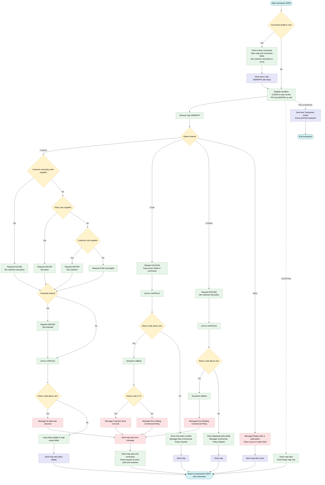
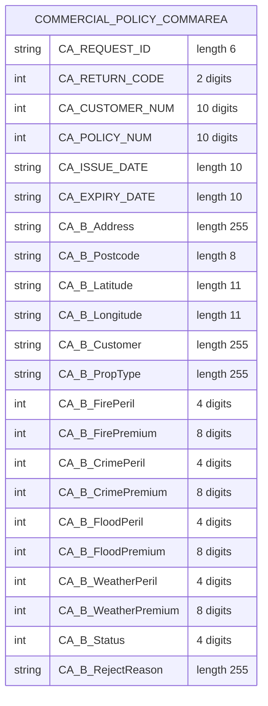

## Table of Contents

- [1. Purpose](#1-purpose)
- [2. Inputs](#2-inputs)
- [3. Outputs](#3-outputs)
- [4. Processing Logic](#4-processing-logic)
  - [4.1 Mermaid Flow Diagram](#41-mermaid-flow-diagram)
  - [4.2 Processing Logic Description](#42-processing-logic-description)
  - [4.3 Database Tables](#43-database-tables)
- [5. Paragraphs](#5-paragraphs)
- [6. Dependencies](#6-dependencies)
  - [6.1 CICS Infrastructure](#61-cics-infrastructure)
  - [6.2 BMS Mapset](#62-bms-mapset)
  - [6.3 PL/I Include Files (Copybooks)](#63-pli-include-files-copybooks)
  - [6.4 External Programs (CICS LINK)](#64-external-programs-cics-link)
  - [6.5 Input Data Sources](#65-input-data-sources)
  - [6.6 COMMAREA Fields Passed to/from Back-end Programs](#66-commarea-fields-passed-tofrom-back-end-programs)
- [7. Constraints](#7-constraints)
- [8. Error Handling](#8-error-handling)
- [9. Examples](#9-examples)
  - [9.1 Example 1: Inquire Commercial Policy by Policy Number (Option '1')](#91-example-1-inquire-commercial-policy-by-policy-number-option-1)
  - [9.2 Example 2: Add New Commercial Policy (Option '2')](#92-example-2-add-new-commercial-policy-option-2)
  - [9.3 Example 3: Invalid Menu Option (Error Case)](#93-example-3-invalid-menu-option-error-case)

## 1. Purpose

`LGTESTP4` is the CICS interactive menu program for the GenApp **Commercial Policy** transaction (`SSP4`). It presents the BMS map `SSMAPP4` to a terminal user and handles three policy operations driven by a single-character option field: option `1` performs an inquiry by linking to `LGIPOL01` with one of four request codes (`01ICOM`, `02ICOM`, `03ICOM`, or `05ICOM`) depending on whether the user supplies a customer number, a policy number, a postcode, or a combination; option `2` adds a new commercial policy by populating the full set of commercial policy fields in the COMMAREA and linking to `LGAPOL01`; and option `3` deletes an existing policy by linking to `LGDPOL01`. After each successful operation the program redisplays the map with returned or cleared data and re-invokes the transaction pseudo-conversationally via `EXEC CICS RETURN TRANSID('SSP4')`. Errors from the back-end programs are caught, a rollback is issued where appropriate, a diagnostic message is written to the error field on the map, the COMMAREA is reset, and the transaction restarts cleanly.

## 2. Inputs

-	Procedure parameters (CICS-supplied)
	- DFHEIPTR: CICS EXEC interface pointer. CICS supplies it, and the program needs it to run EXEC CICS commands and read EIB fields.
	- COMM_AREA_PTR: Pointer to the communication area that CICS passes in. It holds state between pseudo-conversational runs of transaction SSP4.
		- When the transaction first starts, the commarea length (EIBCALEN) is 0. The program then points the pointer at its own local storage and initialises it.

- CICS execution interface and terminal-control inputs
	- EIBCALEN: Length of the commarea received. A value of 0 means this is the first entry. The program then initialises the commarea and sends the menu map.
	- Terminal attention keys (HANDLE AID): CLEAR clears the screen and restarts the transaction. PF3 ends the transaction.
	- MAPFAIL condition: Raised when RECEIVE MAP finds no data. The program ends the transaction.

- Terminal user input (map SSMAPP4 in mapset SSMAP, received into SSMAPP4I and read through the SSMAPP4O output view)
	- Menu option
		- ENP4OPTO: Selects the operation. "1" is inquire, "2" is add, "3" is delete. Any other value gives an invalid-option message.
	- Policy keys
		- ENP4CNOO: Customer number. A blank or all-zero value means no customer was supplied. It selects the inquiry type and supplies the customer for add and delete.
		- ENP4PNOO: Policy number. A blank or all-zero value means no policy was supplied. It selects the inquiry type and identifies the policy to inquire on or delete.
	- Policy dates
		- ENP4IDAO: Issue date. Used when adding a policy.
		- ENP4EDAO: Expiry date. Used when adding a policy.
	- Property details
		- ENP4ADDO: Business property address.
		- ENP4HPCO: Postcode. On inquiry, a non-blank value selects a postcode search. On add, it is stored with the policy.
		- ENP4LATO: Latitude.
		- ENP4LONO: Longitude.
		- ENP4CUSO: Business customer name.
		- ENP4PTYO: Property type.
	- Peril and premium details
		- ENP4FPEO and ENP4FPRO: Fire peril and fire premium.
		- ENP4CPEO and ENP4CPRO: Crime peril and crime premium.
		- ENP4XPEO and ENP4XPRO: Flood peril and flood premium.
		- ENP4WPEO and ENP4WPRO: Weather peril and weather premium.
	- Status details
		- ENP4STAO: Policy status code.
		- ENP4REJO: Reject reason text.

- Commarea values returned by called programs (each is read after an EXEC CICS LINK)
	- LGIPOL01 (policy inquiry)
		- CA_RETURN_CODE: Result code. A value above 0 gives a "No data was returned" message.
		- CA_CUSTOMER_NUM, CA_POLICY_NUM: Customer and policy numbers returned.
		- CA_ISSUE_DATE, CA_EXPIRY_DATE: Policy dates.
		- CA_B_Address, CA_B_Postcode, CA_B_Latitude, CA_B_Longitude: Property address and location.
		- CA_B_Customer, CA_B_PropType: Business customer name and property type.
		- CA_B_FirePeril, CA_B_FirePremium, CA_B_CrimePeril, CA_B_CrimePremium, CA_B_FloodPeril, CA_B_FloodPremium, CA_B_WeatherPeril, CA_B_WeatherPremium: Peril and premium values.
		- CA_B_Status, CA_B_RejectReason: Policy status and reject reason.
	- LGAPOL01 (policy add)
		- CA_RETURN_CODE: Result code. 70 means the customer does not exist. Any other value above 0 is a general add error.
		- CA_POLICY_NUM: Newly generated policy number, shown back to the user.
	- LGDPOL01 (policy delete)
		- CA_RETURN_CODE: Result code. A value above 0 gives a delete error message.

- Commarea fields that the program sets as request data for the called programs
	- CA_REQUEST_ID: Operation code built from the menu option and key fields. The values are '01ICOM', '02ICOM', '03ICOM', '05ICOM', '01ACOM' and '01DCOM'.
	- CA_CUSTOMER_NUM, CA_POLICY_NUM: Keys copied from the screen.
	- CA_B_Postcode: Search key for the postcode inquiry.
	- CA_ISSUE_DATE, CA_EXPIRY_DATE, CA_B_Address, CA_B_Latitude, CA_B_Longitude, CA_B_Customer, CA_B_PropType, CA_B_FirePeril, CA_B_FirePremium, CA_B_CrimePeril, CA_B_CrimePremium, CA_B_FloodPeril, CA_B_FloodPremium, CA_B_WeatherPeril, CA_B_WeatherPremium, CA_B_Status, CA_B_RejectReason: Policy details copied from the screen for the add operation.

- External programs and files
	- LGIPOL01, LGAPOL01, LGDPOL01: Back-end programs invoked through EXEC CICS LINK. They read and write the policy data (typically in Db2). The program does not access files or databases directly.
	- Mapset SSMAP: BMS mapset that defines the screen layout for map SSMAPP4.

## 3. Outputs

- **Terminal screen output (map SSMAPP4 in mapset SSMAP, sent with CICS SEND MAP)**
  - Initial menu display
    - Sent with ERASE when no COMMAREA exists (EIBCALEN = 0).
    - The screen is blanked first. The customer number (ENP4CNOO) and policy number (ENP4PNOO) show zeros. The peril, premium and status fields are blank.
  - Inquiry result display (option '1')
    - Policy details returned by LGIPOL01 are moved into the map input fields and sent back to the user.
    - Policy identification and dates
      - ENP4CNOI shows the customer number (CA_CUSTOMER_NUM).
      - ENP4IDAI shows the issue date (CA_ISSUE_DATE).
      - ENP4EDAI shows the expiry date (CA_EXPIRY_DATE).
    - Property location and ownership
      - ENP4ADDI shows the business address (CA_B_Address).
      - ENP4HPCI shows the postcode (CA_B_Postcode).
      - ENP4LATI and ENP4LONI show the latitude and longitude.
      - ENP4CUSI shows the business customer name (CA_B_Customer).
      - ENP4PTYI shows the property type (CA_B_PropType).
    - Coverage and premiums
      - ENP4FPEI and ENP4FPRI show the fire peril and fire premium (CA_B_FirePeril, CA_B_FirePremium).
      - ENP4CPEI and ENP4CPRI show the crime peril and crime premium.
      - ENP4XPEI and ENP4XPRI show the flood peril and flood premium.
      - ENP4WPEI and ENP4WPRI show the weather peril and weather premium.
    - Status
      - ENP4STAI shows the policy status (CA_B_Status).
      - ENP4REJI shows the reject reason (CA_B_RejectReason).
  - Add confirmation display (option '2')
    - ENP4CNOI shows the customer number and ENP4PNOI shows the newly generated policy number (CA_POLICY_NUM).
    - ENP4OPTI is cleared.
    - The message ERP4FLDO is "New Commercial Policy Inserted".
  - Delete confirmation display (option '3')
    - The detail fields are blanked: expiry date, address, postcode, latitude, longitude, customer, property type, all peril and premium fields, status, reject reason and option.
    - The message ERP4FLDO is "Commercial Policy Deleted".
  - Invalid option display
    - The message ERP4FLDO is "Please enter a valid option".
    - The cursor is placed on the option field (ENP4OPTL = -1, sent with CURSOR).
  - Error displays (ERROR_OUT)
    - Message ERP4FLDO is "Customer does not exist" when the add returns CA_RETURN_CODE 70.
    - Message ERP4FLDO is "Error Adding Commercial Policy" for any other add failure.
    - Message ERP4FLDO is "Error Deleting Commercial Policy" when the delete fails.
    - Message ERP4FLDO is "No data was returned." when the inquiry returns CA_RETURN_CODE > 0.
    - After the error map is sent, the input map and the COMMAREA are reset to blanks and zeros.
  - Clear key handling
    - A blank SSMAPP4 map is sent with MAPONLY, which redisplays the empty menu.

- **Requests and data passed to called programs (COMMAREA COMM_AREA, 32500 bytes, via CICS LINK)**
  - Request control fields
    - CA_REQUEST_ID tells the back-end program which operation to run.
      - '01ICOM' inquires by customer and policy.
      - '02ICOM' inquires by policy only.
      - '03ICOM' inquires by customer only.
      - '05ICOM' inquires by postcode.
      - '01ACOM' adds a policy.
      - '01DCOM' deletes a policy.
    - CA_CUSTOMER_NUM and CA_POLICY_NUM identify the customer and policy for the request.
    - CA_B_Postcode is the search key for a postcode inquiry.
  - Inquiry request to LGIPOL01
    - The program is invoked for option '1'.
    - It returns the commercial policy details and CA_RETURN_CODE.
  - Add request to LGAPOL01
    - The program is invoked for option '2'.
    - The commercial policy data comes from the screen and is stored by the called program.
    - Dates and location: CA_ISSUE_DATE, CA_EXPIRY_DATE, CA_B_Address, CA_B_Postcode, CA_B_Latitude, CA_B_Longitude.
    - Customer and property: CA_B_Customer, CA_B_PropType.
    - Perils and premiums: CA_B_FirePeril, CA_B_FirePremium, CA_B_CrimePeril, CA_B_CrimePremium, CA_B_FloodPeril, CA_B_FloodPremium, CA_B_WeatherPeril, CA_B_WeatherPremium.
    - Status: CA_B_Status, CA_B_RejectReason.
    - On success it returns the new CA_POLICY_NUM.
  - Delete request to LGDPOL01
    - The program is invoked for option '3'.
    - CA_CUSTOMER_NUM and CA_POLICY_NUM identify the policy to delete.
  - Return status
    - CA_RETURN_CODE comes back from each called program.
    - A value above 0 selects the error path, and 70 means the customer does not exist.

- **Transaction control and persisted state**
  - EXEC CICS SYNCPOINT ROLLBACK is issued when an add or delete returns a non-zero CA_RETURN_CODE. This backs out database changes made by the called program.
  - EXEC CICS RETURN TRANSID('SSP4') COMMAREA(COMM_AREA) ends the task after each successful screen. It reschedules the SSP4 transaction and passes the COMMAREA on to the next iteration.
  - The COMMAREA is reset after errors and at start-up: CA_REQUEST_ID is blank, CA_RETURN_CODE and CA_CUSTOMER_NUM are 0, and the request area is blank. This gives the next transaction iteration a clean state.

- **Termination output**
  - On PF3, or on a MAPFAIL condition, the program sends the text "Transaction ended" (MSGEND) to the terminal. It uses ERASE and FREEKB, then returns to CICS and ends the conversation.

- **Return values**
  - The program has no function return value. Its observable results are the screens, the COMMAREA passed to the next SSP4 iteration, the LINK calls to the back-end programs, and the rollback on failure.

## 4. Processing Logic

### 4.1 Mermaid Flow Diagram

### 4.2 Processing Logic Description

#### 4.2.1 High-level Summary
LGTESTP4 is a CICS pseudo-conversational menu program for commercial insurance policies. It runs as transaction SSP4 and uses the BMS map SSMAPP4 in mapset SSMAP.

From one screen the user can:
- inquire on a commercial policy (option 1)
- add a commercial policy (option 2)
- delete a commercial policy (option 3)

The program does not read or write data itself. It builds a request in the shared communication area (COMM_AREA) and links to a back-end program to do the work:
- LGIPOL01 for inquiry
- LGAPOL01 for add
- LGDPOL01 for delete

It then shows the result or an error message on the same screen.

#### 4.2.2 Execution Flow

**1. First entry**
- If the commarea length (EIBCALEN) is 0, this is the first call.
  - The program points COMM_AREA_PTR at a local base storage area.
  - It blanks the output map and the commarea request ID.
  - It sets CA_RETURN_CODE and CA_CUSTOMER_NUM to 0 and blanks the request-specific area.
  - It sets the customer and policy number map fields to ten zeros and blanks the peril, premium and status fields.
  - It sends the empty menu with ERASE.
- On later entries (commarea present), it goes straight to receiving the screen.

**2. Setup at A_GAIN**
- HANDLE AID routes CLEAR to CLEARIT and PF3 to ENDIT.
- HANDLE CONDITION routes MAPFAIL to ENDIT.
- RECEIVE MAP reads the user's input into SSMAPP4I.

**3. Option selection**

The program branches on the option field ENP4OPTO.

*Option 1 – Inquiry*
- The program picks the request ID from the key fields. A field counts as "not supplied" if it is blank or all zeros.
  - Customer and policy both supplied: `01ICOM`, and both numbers are copied to the commarea.
  - Policy only: `02ICOM`, and the policy number is copied.
  - Customer only: `03ICOM`, and the customer number is copied.
- If the postcode field is not blank, the request ID is overridden to `05ICOM` and the postcode is placed in CA_B_Postcode. This is a postcode search and it takes precedence over the other two checks.
- If neither key is supplied and no postcode is entered, the request ID is left as it was.
- The program links to LGIPOL01 with a 32500-byte commarea.
- If CA_RETURN_CODE is above 0, it goes to NO_DATA.
- Otherwise it copies the returned data to the map fields:
  - customer number
  - issue and expiry dates
  - address, postcode, latitude and longitude
  - customer name and property type
  - fire, crime, flood and weather perils and premiums
  - status and reject reason
- It sends the map and returns to transaction SSP4 with the commarea (ENDIT_STARTIT).

*Option 2 – Add*
- The request ID is set to `01ACOM`.
- The customer number and all policy fields from the screen are copied into the commarea:
  - dates
  - address, postcode, latitude and longitude
  - customer name and property type
  - perils and premiums
  - status and reject reason
- The program links to LGAPOL01.
- If CA_RETURN_CODE is above 0, the program issues SYNCPOINT ROLLBACK and goes to NO_ADD:
  - Return code 70 gives the message "Customer does not exist".
  - Any other value gives "Error Adding Commercial Policy".
- On success, it shows the customer number and the newly generated policy number. It clears the option field and shows "New Commercial Policy Inserted". It then sends the map and returns to SSP4.

*Option 3 – Delete*
- The request ID is set to `01DCOM`, and the customer and policy numbers are copied to the commarea.
- The program links to LGDPOL01.
- If CA_RETURN_CODE is above 0, it issues SYNCPOINT ROLLBACK and goes to NO_DELETE, with the message "Error Deleting Commercial Policy".
- On success, it blanks the displayed expiry date, address, postcode, coordinates, customer, property type, perils, premiums, status, reject reason and option. It shows "Commercial Policy Deleted", sends the map and returns to SSP4.

*Any other option*
- The program shows "Please enter a valid option" and sets the option field length to -1 so the cursor lands there. It sends the map with CURSOR and returns to SSP4.

**4. Error handling (ERROR_OUT)**
- The messages are:
  - "No data was returned." (inquiry failed)
  - "Error Adding Commercial Policy" or "Customer does not exist" (add failed)
  - "Error Deleting Commercial Policy" (delete failed)
- The map is sent with the message.
- The program then blanks the input map and COMM_AREA_RAW. It resets the request ID, return code and customer number, and clears the request-specific area.
- It returns to SSP4 with the cleared commarea.

**5. Special keys**
- CLEAR: the program blanks the input map, sends the map with MAPONLY (screen layout only) and returns to SSP4 with the commarea.
- PF3 or MAPFAIL (no data entered): the program sends the text "Transaction ended" with ERASE and FREEKB, then ends with a plain RETURN. SSP4 is not restarted.

**Business rules**
- A key field is empty if it is blank or all zeros.
- A postcode search takes priority over customer and policy keys.
- Any non-zero return code from a back-end program is a failure.
- Failed add or delete requests are rolled back.
- Return code 70 on an add specifically means the customer does not exist.

#### 4.2.3 External Interactions
- **CICS BMS:** map SSMAPP4 in mapset SSMAP is received from and sent to the terminal.
- **CICS LINK to LGIPOL01:** retrieves commercial policy details by customer, policy or postcode.
- **CICS LINK to LGAPOL01:** inserts a new commercial policy and returns the new policy number.
- **CICS LINK to LGDPOL01:** deletes a commercial policy.
- **CICS SYNCPOINT ROLLBACK:** undoes changes when an add or delete fails.
- **CICS RETURN with TRANSID SSP4:** keeps the dialogue going and passes the commarea to the next iteration.
- No SQL or files are accessed directly in this program. Any database access happens in the linked programs.

#### 4.2.4 Plain Language Summary
The program shows a screen for managing commercial insurance policies.
- The user types an option: 1 to look up a policy, 2 to create one, or 3 to delete one.
- For a lookup, the user can give a customer number, a policy number, or a postcode. The program uses whichever is given, and a postcode takes priority.
- The program does not do the work itself. It passes the request to a specialist program and shows what comes back.
- If something goes wrong, it shows a plain message, such as "Customer does not exist" or "Error Deleting Commercial Policy". It also undoes any partial change, wipes the working data and waits for the next entry.
- PF3 ends the session, and CLEAR resets the screen.

### 4.3 Database Tables

## 5. Paragraphs

- **Initial Screen Send (EIBCALEN = 0 block)**
  - Handles the very first entry into transaction SSP4 when no COMMAREA exists (`EIBCALEN = 0`).
  - Sets the local `COMM_AREA_PTR` to the address of the working-storage `BASE_COMM_AREA`.
  - Clears the `SSMAPP4O` map output structure, resets `CA_REQUEST_ID`, `CA_RETURN_CODE`, and `CA_CUSTOMER_NUM` to their initial values, and pre-fills all peril, premium, and status output fields with blanks or zeros.
  - Issues `EXEC CICS SEND MAP('SSMAPP4') MAPSET('SSMAP') ERASE` to display the blank commercial policy menu screen and then falls through to `A_GAIN` to wait for input.

- **A_GAIN (main input loop label)**
  - Acts as the re-entry point for every conversation cycle of the transaction.
  - Registers AID-key handlers: CLEAR key routes to `CLEARIT`, PF3 routes to `ENDIT`.
  - Registers a MAPFAIL condition handler that also routes to `ENDIT`.
  - Receives the commercial policy map from the terminal (`EXEC CICS RECEIVE MAP('SSMAPP4') INTO(SSMAPP4I) MAPSET('SSMAP')`), populating `SSMAPP4I` with the user's keystrokes.
  - Dispatches on the single-character option field `ENP4OPTO` using a `SELECT` statement:
    - `'1'` → inquiry branch
    - `'2'` → add branch
    - `'3'` → delete branch
    - Any other value → invalid-option branch

- **Option '1' — Inquiry Branch**
  - Determines the correct inquiry request type from the combination of `ENP4CNOO` (customer number) and `ENP4PNOO` (policy number) supplied on the screen:
    - Both present: `CA_REQUEST_ID = '01ICOM'` (inquire by customer and policy).
    - Policy only: `CA_REQUEST_ID = '02ICOM'`.
    - Customer only: `CA_REQUEST_ID = '03ICOM'`.
  - If a non-blank postcode (`ENP4HPCO`) is also present, overrides the request type with `CA_REQUEST_ID = '05ICOM'` and loads `CA_B_Postcode`.
  - Calls `LGIPOL01` via `EXEC CICS LINK PROGRAM('LGIPOL01') COMMAREA(COMM_AREA) LENGTH(32500)`.
  - Checks `CA_RETURN_CODE`; a non-zero value branches to `NO_DATA`.
  - On success, copies all returned commercial policy fields from the COMMAREA (`CA_ISSUE_DATE`, `CA_EXPIRY_DATE`, `CA_B_Address`, `CA_B_Postcode`, `CA_B_Latitude`, `CA_B_Longitude`, `CA_B_Customer`, `CA_B_PropType`, all four perils and premiums, `CA_B_Status`, `CA_B_RejectReason`) into the corresponding `SSMAPP4I` input fields for redisplay.
  - Sends the refreshed map with `EXEC CICS SEND MAP('SSMAPP4') FROM(SSMAPP4O)` and branches to `ENDIT_STARTIT`.

- **Option '2' — Add Branch**
  - Sets `CA_REQUEST_ID = '01ACOM'` and loads all editable screen fields from `SSMAPP4O` into the COMMAREA commercial policy structure (`CA_CUSTOMER_NUM`, `CA_ISSUE_DATE`, `CA_EXPIRY_DATE`, `CA_B_Address`, `CA_B_Postcode`, coordinates, customer name, property type, all four perils and premiums, status, and reject reason).
  - Calls `LGAPOL01` via `EXEC CICS LINK PROGRAM('LGAPOL01') COMMAREA(COMM_AREA) LENGTH(32500)`.
  - On a non-zero `CA_RETURN_CODE`, issues `EXEC CICS SYNCPOINT ROLLBACK` and branches to `NO_ADD`.
  - On success, copies the returned `CA_CUSTOMER_NUM` and newly generated `CA_POLICY_NUM` back to the screen input fields, clears the option field, writes the confirmation message `'New Commercial Policy Inserted'` to `ERP4FLDO`, sends the updated map, and branches to `ENDIT_STARTIT`.

- **Option '3' — Delete Branch**
  - Sets `CA_REQUEST_ID = '01DCOM'` and loads `CA_CUSTOMER_NUM` and `CA_POLICY_NUM` from the screen fields.
  - Calls `LGDPOL01` via `EXEC CICS LINK PROGRAM('LGDPOL01') COMMAREA(COMM_AREA) LENGTH(32500)`.
  - On a non-zero `CA_RETURN_CODE`, issues `EXEC CICS SYNCPOINT ROLLBACK` and branches to `NO_DELETE`.
  - On success, blanks all policy-detail screen input fields (`ENP4EDAI`, address, postcode, coordinates, customer, property type, all perils and premiums, status, reject reason, option), writes the confirmation message `'Commercial Policy Deleted'` to `ERP4FLDO`, sends the refreshed map, and branches to `ENDIT_STARTIT`.

- **OTHERWISE — Invalid Option Branch**
  - Writes `'Please enter a valid option'` to `ERP4FLDO` and sets `ENP4OPTL = -1` to position the cursor on the option field.
  - Sends the map back with `EXEC CICS SEND MAP ... CURSOR` to highlight the erroneous field and branches to `ENDIT_STARTIT`.

- **ENDIT_STARTIT (pseudo-conversational return)**
  - Issues `EXEC CICS RETURN TRANSID('SSP4') COMMAREA(COMM_AREA)` to end the current task while scheduling transaction SSP4 to restart on the next user input, preserving the COMMAREA state across the conversation.

- **ENDIT (normal termination)**
  - Triggered by PF3, MAPFAIL, or any normal end-of-transaction path.
  - Sends the literal `'Transaction ended'` text to the terminal via `EXEC CICS SEND TEXT ... ERASE FREEKB` then issues an unconditional `EXEC CICS RETURN` to close the transaction.

- **CLEARIT (CLEAR key handler)**
  - Blanks the entire `SSMAPP4I` map input structure.
  - Repaints the screen with a map-only send (`EXEC CICS SEND MAP('SSMAPP4') MAPSET('SSMAP') MAPONLY`) to show the blank form.
  - Returns via `EXEC CICS RETURN TRANSID('SSP4') COMMAREA(COMM_AREA)` to stay in pseudo-conversational mode.

- **NO_ADD (add-failure error routing)**
  - Checks `CA_RETURN_CODE` with a `SELECT`:
    - Return code 70: writes `'Customer does not exist'` to `ERP4FLDO`.
    - Any other non-zero code: writes `'Error Adding Commercial Policy'`.
  - Both cases branch to `ERROR_OUT`.

- **NO_DELETE (delete-failure error routing)**
  - Writes `'Error Deleting Commercial Policy'` to `ERP4FLDO` and branches unconditionally to `ERROR_OUT`.

- **NO_DATA (inquiry-failure error routing)**
  - Writes `'No data was returned.'` to `ERP4FLDO` and branches unconditionally to `ERROR_OUT`.

- **ERROR_OUT (common error display and reset)**
  - Sends the current `SSMAPP4O` map (containing the error message in `ERP4FLDO`) to the terminal via `EXEC CICS SEND MAP('SSMAPP4') FROM(SSMAPP4O)`.
  - Resets all state: blanks `SSMAPP4I` and `COMM_AREA_RAW`, clears `CA_REQUEST_ID`, `CA_RETURN_CODE`, and `CA_CUSTOMER_NUM` so the next interaction starts clean.
  - Branches to `ENDIT_STARTIT` to return control to CICS in pseudo-conversational mode.

## 6. Dependencies

### 6.1 CICS Infrastructure

- **CICS transaction `SSP4`** — the transaction identifier under which `LGTESTP4` runs; used in every `EXEC CICS RETURN TRANSID('SSP4')` to keep the pseudo-conversational loop alive
- **CICS COMMAREA (`COMM_AREA` / `COMM_AREA_PTR`)** — 32,500-byte inter-program data contract passed on every `EXEC CICS LINK` and `EXEC CICS RETURN COMMAREA`; its layout is the universal data contract for all GenApp programs
- **`EIBCALEN` (Execute Interface Block field)** — tested at start-up to detect the first invocation; controls whether the map is sent with `ERASE` before any data is collected
- **CICS `HANDLE AID` / `HANDLE CONDITION`** — used to intercept PF3, CLEAR key, and `MAPFAIL` condition, routing them to `ENDIT` and `CLEARIT` respectively

### 6.2 BMS Mapset

- **Mapset `SSMAP`** — the BMS mapset that contains all screen maps used by the GenApp menus; the source is **not** in this repository
  - **Map `SSMAPP4`** — the commercial policy screen; sent (`EXEC CICS SEND MAP`) and received (`EXEC CICS RECEIVE MAP`) on every pseudo-conversational cycle; its symbolic layout is provided by `plinc/SSMAP.inc`

### 6.3 PL/I Include Files (Copybooks)

- **`plinc/SSMAP.inc`** — PL/I symbolic map for mapset `SSMAP`; inlined via `%INCLUDE SSMAP`; defines all `SSMAPP4I` / `SSMAPP4O` input/output field structures (`ENP4OPTO`, `ENP4CNOO`, `ENP4PNOO`, `ENP4HPCO`, and all display fields)
- **`plinc/LGCMAREA.inc`** — COMMAREA copybook; inlined via `%INCLUDE LGCMAREA`; declares the `COMM_AREA` union including the `CA_COMMERCIAL` branch (`CA_B_Address`, `CA_B_Postcode`, `CA_B_Customer`, `CA_B_PropType`, `CA_B_FirePeril`, `CA_B_FirePremium`, `CA_B_Status`, `CA_B_RejectReason`, etc.) together with `CA_REQUEST_ID`, `CA_RETURN_CODE`, `CA_CUSTOMER_NUM`, `CA_POLICY_NUM`, `CA_ISSUE_DATE`, and `CA_EXPIRY_DATE`

### 6.4 External Programs (CICS LINK)

- **`LGIPOL01`** — commercial policy inquiry orchestrator; linked with `EXEC CICS LINK PROGRAM('LGIPOL01')` when option `'1'` is chosen; accepts request IDs `01ICOM`, `02ICOM`, `03ICOM`, and `05ICOM` for inquiry by customer+policy, policy only, customer only, and postcode respectively; returns policy data in the COMMAREA
- **`LGAPOL01`** — commercial policy add orchestrator; linked when option `'2'` is chosen with request ID `01ACOM`; receives all commercial policy fields from the screen via COMMAREA and returns the newly assigned policy number; a `SYNCPOINT ROLLBACK` is issued on failure
- **`LGDPOL01`** — commercial policy delete orchestrator; linked when option `'3'` is chosen with request ID `01DCOM`; identified by customer number and policy number; a `SYNCPOINT ROLLBACK` is issued on failure

### 6.5 Input Data Sources

- **Screen input fields (BMS map `SSMAPP4`)** — all user-entered values are the sole runtime input source:
  - `ENP4OPTO` — menu option (`1`=inquire, `2`=add, `3`=delete)
  - `ENP4CNOO` — customer number
  - `ENP4PNOO` — policy number
  - `ENP4HPCO` — business postcode (also triggers postcode-based inquiry)
  - `ENP4ADDO`, `ENP4LATO`, `ENP4LONO`, `ENP4CUSO`, `ENP4PTYO`, `ENP4FPEO`, `ENP4FPRO`, `ENP4CPEO`, `ENP4CPRO`, `ENP4XPEO`, `ENP4XPRO`, `ENP4WPEO`, `ENP4WPRO`, `ENP4STAO`, `ENP4REJO`, `ENP4IDAO`, `ENP4EDAO` — commercial policy detail fields used on add

### 6.6 COMMAREA Fields Passed to/from Back-end Programs

- **`CA_REQUEST_ID`** — six-character operation code (`01ICOM`, `02ICOM`, `03ICOM`, `05ICOM`, `01ACOM`, `01DCOM`) set before each `EXEC CICS LINK`
- **`CA_RETURN_CODE`** — numeric return code inspected after each link; non-zero routes to error handling
- **`CA_CUSTOMER_NUM`** — ten-digit customer number passed to and returned from back-end programs
- **`CA_POLICY_NUM`** — ten-digit policy number passed on inquiry/delete; holds the new number returned after a successful add
- **`CA_ISSUE_DATE`**, **`CA_EXPIRY_DATE`** — policy validity dates exchanged with back-end programs
- **`CA_B_*` fields** (`CA_B_Address`, `CA_B_Postcode`, `CA_B_Latitude`, `CA_B_Longitude`, `CA_B_Customer`, `CA_B_PropType`, `CA_B_FirePeril`, `CA_B_FirePremium`, `CA_B_CrimePeril`, `CA_B_CrimePremium`, `CA_B_FloodPeril`, `CA_B_FloodPremium`, `CA_B_WeatherPeril`, `CA_B_WeatherPremium`, `CA_B_Status`, `CA_B_RejectReason`) — the full set of commercial policy attributes in the `CA_COMMERCIAL` COMMAREA branch

## 7. Constraints

-
 Menu option constraints
  - The option field (ENP4OPTO, mapped from the map's ENP4OPT) must be '1' (inquire), '2' (add) or '3' (delete). It is checked with `SELECT (ENP4OPTO)`.
  - Any other value, including blank, goes to the `OTHERWISE` branch. That branch sets "Please enter a valid option" in ERP4FLDO and sets ENP4OPTL to -1 to put the cursor on the option field. It then resends the map with `CURSOR` and returns to transaction SSP4.
  - Only one operation can run per screen interaction. Each `WHEN` branch ends by sending the map and returning to SSP4.

- Key-field presence rules for inquiry (option '1')
  - A key field (ENP4CNOO or ENP4PNOO) counts as "not supplied" if it is all blanks or '0000000000'. Any other value counts as supplied.
  - The request type is chosen from which keys are present:
    - Customer number and policy number both supplied: CA_REQUEST_ID is '01ICOM', and both CA_CUSTOMER_NUM and CA_POLICY_NUM are set.
    - Only policy number supplied: CA_REQUEST_ID is '02ICOM', and only CA_POLICY_NUM is set.
    - Only customer number supplied: CA_REQUEST_ID is '03ICOM', and only CA_CUSTOMER_NUM is set.
    - Neither supplied: none of the three branches runs, so CA_REQUEST_ID keeps its earlier value (blank after start-up or an error). The called program is still linked.
  - If the postcode field ENP4HPCO is neither blank nor all spaces, it overrides the choice above. CA_REQUEST_ID becomes '05ICOM' and CA_B_Postcode is set to the postcode. This is a postcode-based inquiry. It takes precedence over the customer and policy number combinations.
  - The postcode is an 8-character field (CA_B_Postcode CHAR(8)).

- Inquiry result constraints
  - After the link to LGIPOL01, CA_RETURN_CODE must be 0. Any value above 0 goes to NO_DATA and shows "No data was returned."
  - The inquiry result is only displayed when the return code is 0. Policy details (dates, address, postcode, latitude, longitude, customer, property type, the four peril and premium pairs, status and reject reason) are copied to the map and sent.

- Add policy constraints (option '2')
  - The request is always CA_REQUEST_ID '01ACOM'. The program does not check that the customer number, dates, address or any other field is present or valid. It copies the screen values straight into the commarea, and validation is left to LGAPOL01.
  - The commarea field types and lengths set formats that the back-end program must accept:
    - CA_CUSTOMER_NUM is 10 numeric digits.
    - CA_B_FirePeril, CA_B_CrimePeril, CA_B_FloodPeril, CA_B_WeatherPeril and CA_B_Status are 4 numeric digits.
    - The four premium fields are 8 numeric digits.
    - CA_ISSUE_DATE and CA_EXPIRY_DATE are 10-character strings.
    - CA_B_Address, CA_B_Customer, CA_B_PropType and CA_B_RejectReason are 255-character strings.
    - CA_B_Latitude and CA_B_Longitude are 11-character strings.
  - The add is only successful if CA_RETURN_CODE from LGAPOL01 is 0. A return code above 0 triggers `EXEC CICS SYNCPOINT ROLLBACK`, so the add is undone before the error is shown.
  - Return code 70 shows "Customer does not exist", so the customer must already exist for a policy to be added. Any other non-zero return code shows "Error Adding Commercial Policy".
  - On success, the generated policy number (CA_POLICY_NUM) and the customer number are returned to the screen. The option field is cleared and "New Commercial Policy Inserted" is shown.

- Delete policy constraints (option '3')
  - The request is always CA_REQUEST_ID '01DCOM', and both the customer number (CA_CUSTOMER_NUM) and the policy number (CA_POLICY_NUM) are passed from the screen.
  - The program does not check that these keys are present. The back-end program LGDPOL01 does that.
  - A non-zero CA_RETURN_CODE triggers `EXEC CICS SYNCPOINT ROLLBACK`. The program then shows "Error Deleting Commercial Policy" whatever the return code.
  - On success, the expiry date, address, postcode, latitude, longitude, customer, property type, all perils and premiums, status, reject reason and option fields are blanked. "Commercial Policy Deleted" is shown. The issue date field is not cleared.

- Sequencing and transaction flow constraints
  - On first entry (`EIBCALEN = 0`) the commarea is pointed at BASE_COMM_AREA and the output map is blanked. The request ID is blanked and the return code and customer number are set to 0. The request initialiser area is blanked.
  - The customer and policy number fields are set to '0000000000'. The peril, premium and status fields are blanked.
  - The menu map SSMAPP4 in mapset SSMAP is sent with `ERASE`, and the program then falls through to receive the input.
  - Handler setup must happen before the receive. `HANDLE AID` is set for CLEAR and PF3. `HANDLE CONDITION` is set for MAPFAIL.
  - The map must be received before the option is evaluated.
  - PF3 and MAPFAIL both go to ENDIT. This sends "Transaction ended" with `ERASE` and `FREEKB`, then ends the transaction.
  - CLEAR blanks the input map and sends the empty map (`MAPONLY`). The program then returns to SSP4 with the commarea.
  - After each processed option, the program returns with `TRANSID('SSP4')` and passes the commarea. This keeps the conversation pseudo-conversational.
  - A back-end link must complete and be checked for its return code before results are displayed or updates are accepted.

- Error handling and reset constraints
  - All errors (NO_ADD, NO_DELETE, NO_DATA) go through ERROR_OUT. It sends the map with the error message, then resets state before returning to SSP4.
  - The reset blanks SSMAPP4I and the whole commarea (COMM_AREA_RAW). It also blanks CA_REQUEST_ID, sets CA_RETURN_CODE and CA_CUSTOMER_NUM to 0, and blanks the request initialiser. No stale data from a failed request carries into the next one.
  - The error message field is limited to 40 characters (ERP4FLDO CHAR(40)). Messages must fit that length.

- Resource and size constraints
  - The commarea is a fixed 32500 bytes (`COMM_AREA_RAW CHAR(32500)`). Every `LINK` to LGIPOL01, LGAPOL01 and LGDPOL01 passes it with `LENGTH(32500)`.
  - The commercial-policy detail area (CA_B_FILLER and related fields) must fit inside that size.
  - Screen fields have fixed widths:
    - Customer and policy numbers are 10 characters.
    - Postcode is 8.
    - Address is 25.
    - Peril fields are 4.
    - Premium fields are 8.
    - Status is 4.
    - Reject reason is 25.
    - Option is 1.
  - Moving the 255-character commarea fields to the narrower screen fields (for example 25-character address and customer) truncates the data.
  - The program is `Options(Main,Reentrant)`, so it must not hold changeable state in static storage. The only static item is the constant MSGEND, a 24-character string.

- Dependency constraints
  - Inquiry depends on LGIPOL01, add on LGAPOL01, and delete on LGDPOL01. Each must return a CA_RETURN_CODE that the program can interpret: 0 for success, 70 for customer-not-found on add, and any other positive value for a general failure.
  - The BMS mapset SSMAP and the commarea layout from the SSMAP and LGCMAREA includes must match what the back-end programs expect.

## 8. Error Handling

-	**Terminal and key-based CICS handling**
	-	Exceptions from the map receive are handled with condition handlers set up before the screen is received.
		-	A MAPFAIL condition (no data entered on the screen) branches to the ENDIT routine. That routine sends "Transaction ended" to the terminal, erases the screen, frees the keyboard and returns without a transaction ID. This ends the conversation cleanly.
		-	The PF3 key is routed to the same ENDIT routine, so the user can leave the transaction.
		-	The CLEAR key is routed to the CLEARIT routine. It blanks the input map, resends the empty map in map-only mode, and returns to transaction SSP4 with the commarea. This resets the screen and keeps the conversation going.
	-	No RESP or RESP2 checks follow the LINK, SEND or RECEIVE commands.
		-	Any condition other than MAPFAIL, such as a LINK failure for a program that is not found, is not handled. CICS default handling applies, which normally abends the transaction.

-	**Input validation**
	-	The menu option (ENP4OPTO) is evaluated in a SELECT statement. Any value other than '1', '2' or '3' goes to the OTHERWISE branch.
		-	That branch puts the message "Please enter a valid option" in the error field.
		-	It sets the option field length to -1, which positions the cursor on the option field.
		-	It resends the map with the CURSOR option and returns to transaction SSP4 with the commarea, so the user can retry.
	-	For the inquiry option, the customer and policy number fields are tested for blank or all-zero values.
		-	These tests choose the request type. Both keys give '01ICOM', policy only gives '02ICOM', and customer only gives '03ICOM'.
		-	They are not rejections. If neither key is supplied, no request ID is set by this logic. The request ID keeps its earlier value, and a non-blank postcode can still override it with '05ICOM'.
		-	There is no explicit error for the case where neither key nor postcode is given. Handling of that case is left to the called program, through its return code.

-	**Return-code checks on called back-end programs**
	-	After each LINK to a policy program, the program tests the return code (CA_RETURN_CODE) set by the callee. A value above zero means failure.
		-	For inquiry (LGIPOL01), a non-zero return code goes to NO_DATA. That sets the message "No data was returned." and falls into the common error-out routine.
		-	For add (LGAPOL01), a non-zero return code first issues a SYNCPOINT ROLLBACK, then goes to NO_ADD.
		-	For delete (LGDPOL01), a non-zero return code first issues a SYNCPOINT ROLLBACK, then goes to NO_DELETE. That sets the message "Error Deleting Commercial Policy".
	-	In the add failure path, the return code is examined in a SELECT statement.
		-	Return code 70 gives the specific message "Customer does not exist".
		-	Any other value gives the generic message "Error Adding Commercial Policy".
		-	Both messages continue to the common error-out routine.

-	**Transactional recovery**
	-	A syncpoint rollback is issued on add and delete failures. This backs out any recoverable updates the called program made before it failed, so no partial changes remain.
	-	The inquiry path does not roll back, because it is read-only.

-	**Recovery and reset logic**
	-	The common ERROR_OUT routine sends the map with the error message to the user. It then resets the working state.
		-	The input map is blanked.
		-	The raw commarea is cleared.
		-	The request ID is set to blanks.
		-	The return code and customer number are set to zero.
		-	The request-specific area is blanked.
	-	It then returns to transaction SSP4 with the cleaned commarea, so the next interaction starts from a clean state and a failed request does not carry over.
	-	At first entry (EIBCALEN of zero), the program initialises the commarea pointer and the commarea fields. It also sets the customer and policy number fields to zeros and blanks the peril, premium and status fields. It then sends the initial menu map with the screen erased. This prevents use of uninitialised data.
	-	The commarea pointer is set to a local storage area on first entry. This is a fallback for when no commarea was passed.

-	**User notifications**
	-	All errors are shown to the user through the error field (ERP4FLDO) on the SSMAPP4 map.
		-	The messages used are "Please enter a valid option", "Customer does not exist", "Error Adding Commercial Policy", "Error Deleting Commercial Policy" and "No data was returned."
	-	Success is also reported in the same field, with "New Commercial Policy Inserted" and "Commercial Policy Deleted". This lets the user tell failure from success.
	-	The termination message "Transaction ended" is sent on PF3 or MAPFAIL.

-	**Program termination and flow control**
	-	Failure paths use GO TO branches (NO_DATA, NO_ADD, NO_DELETE, ERROR_OUT, ENDIT_STARTIT). Together they act as a centralised error-exit structure.
	-	All error paths end in a pseudo-conversational return to SSP4, except the ENDIT path, which ends the transaction.
	-	The program has no PL/I ON-unit handling (such as ON ERROR) and no explicit abend or logging of errors. Error reporting is limited to the screen messages and the CICS default handling.

## 9. Examples

### 9.1 Example 1: Inquire Commercial Policy by Policy Number (Option '1')

#### 9.1.1 Input Data
* **Map Fields (`SSMAPP4`):**
  * `ENP4OPTO` (Option): `'1'`
  * `ENP4CNOO` (Customer Number): `'0000000000'` (or spaces)
  * `ENP4PNOO` (Policy Number): `'0000001001'`
  * `ENP4HPCO` (Postcode): `'        '` (spaces)
* **Backend Data Returned via COMMAREA:**
  * `CA_RETURN_CODE`: `00`
  * `CA_CUSTOMER_NUM`: `0000000025`
  * `CA_ISSUE_DATE`: `'2023-01-15'`
  * `CA_EXPIRY_DATE`: `'2024-01-15'`
  * `CA_B_Address`: `'100 Industrial Way'`
  * `CA_B_Postcode`: `'AB12 3CD'`
  * `CA_B_Customer`: `'ACME Corp'`
  * `CA_B_PropType`: `'Warehouse'`
  * `CA_B_FirePeril`: `'1000'`
  * `CA_B_FirePremium`: `'00050000'`
  * `CA_B_Status`: `'0001'`

#### 9.1.2 Expected Output
* **Target Program Linked:** `LGIPOL01` with `CA_REQUEST_ID = '02ICOM'`
* **Map Fields Displayed (`SSMAPP4`):**
  * `ENP4CNOI`: `0000000025`
  * `ENP4IDAI`: `'2023-01-15'`
  * `ENP4EDAI`: `'2024-01-15'`
  * `ENP4ADDI`: `'100 Industrial Way'`
  * `ENP4HPCI`: `'AB12 3CD'`
  * `ENP4CUSI`: `'ACME Corp'`
  * `ENP4PTYI`: `'Warehouse'`
  * `ENP4FPEI`: `'1000'`
  * `ENP4FPRI`: `'00050000'`
  * `ENP4STAI`: `'0001'`

#### 9.1.3 Explanation
When option `'1'` is entered with a non-zero policy number and an unpopulated customer number, the program sets the COMMAREA request ID to `'02ICOM'` (inquiry by policy only). It executes `EXEC CICS LINK` to `LGIPOL01`. Upon receiving return code `00`, the program populates the screen fields from the commercial policy structure in the COMMAREA and re-displays the map.

---

### 9.2 Example 2: Add New Commercial Policy (Option '2')

#### 9.2.1 Input Data
* **Map Fields (`SSMAPP4`):**
  * `ENP4OPTO` (Option): `'2'`
  * `ENP4CNOO` (Customer Number): `'0000000025'`
  * `ENP4IDAO` (Issue Date): `'2023-05-01'`
  * `ENP4EDAO` (Expiry Date): `'2024-05-01'`
  * `ENP4ADDO` (Address): `'500 High Street'`
  * `ENP4HPCO` (Postcode): `'SW1A 1AA'`
  * `ENP4CUSO` (Customer): `'Global Logistics Ltd'`
  * `ENP4PTYO` (Property Type): `'Office'`
  * `ENP4FPEO` (Fire Peril): `'0500'`
  * `ENP4FPRO` (Fire Premium): `'00025000'`
  * `ENP4STAO` (Status): `'0001'`
* **Backend Data Returned via COMMAREA:**
  * `CA_RETURN_CODE`: `00`
  * `CA_POLICY_NUM`: `0000001042`

#### 9.2.2 Expected Output
* **Target Program Linked:** `LGAPOL01` with `CA_REQUEST_ID = '01ACOM'`
* **Map Fields Displayed (`SSMAPP4`):**
  * `ENP4CNOI`: `'0000000025'`
  * `ENP4PNOI`: `'0000001042'` (generated policy number)
  * `ENP4OPTI`: `' '`
  * `ERP4FLDO` (Message): `'New Commercial Policy Inserted'`

#### 9.2.3 Explanation
Selecting option `'2'` sets `CA_REQUEST_ID` to `'01ACOM'` and transfers all commercial policy details entered on the map into `COMM_AREA`. The program calls `LGAPOL01` via `EXEC CICS LINK`. On successful return (`CA_RETURN_CODE = 0`), the new policy number generated by the back-end is copied to `ENP4PNOI` and the success message is presented to the user.

---

### 9.3 Example 3: Invalid Menu Option (Error Case)

#### 9.3.1 Input Data
* **Map Fields (`SSMAPP4`):**
  * `ENP4OPTO` (Option): `'9'`

#### 9.3.2 Expected Output
* **Map Fields Displayed (`SSMAPP4`):**
  * `ERP4FLDO` (Error Message): `'Please enter a valid option'`
  * Screen cursor positioned on `ENP4OPT` (`ENP4OPTL = -1`)

#### 9.3.3 Explanation
When `ENP4OPTO` is not `'1'`, `'2'`, or `'3'`, execution branches to the `OTHERWISE` clause. The error message is loaded into `ERP4FLDO`, the option field length flag is set to `-1` to position the terminal cursor on the option input, and the map is redisplayed without invoking any back-end service.

---

Generated by IBM Bob Premium Package for Z
