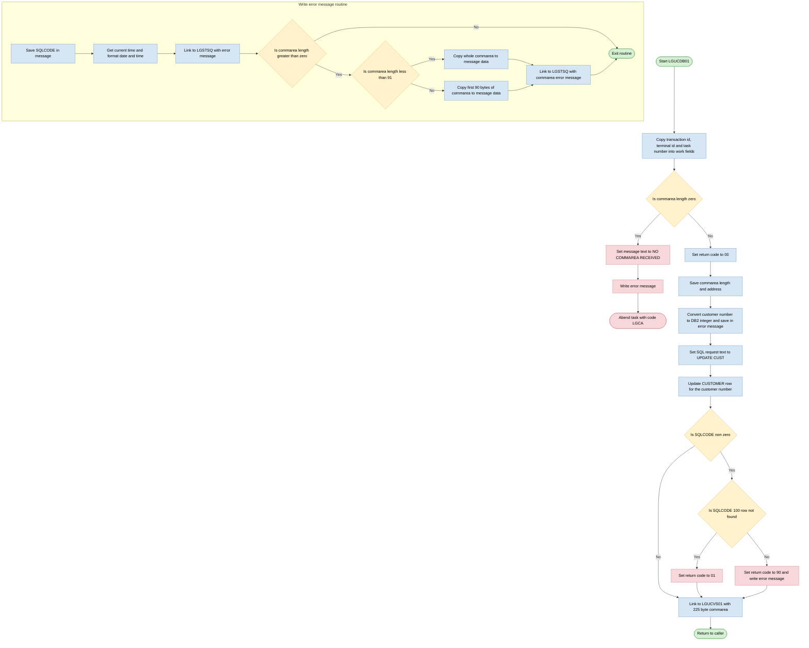
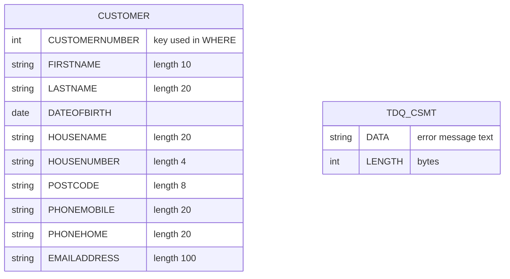

## Table of Contents

- [1. Purpose](#1-purpose)
- [2. Inputs](#2-inputs)
- [3. Outputs](#3-outputs)
- [4. Processing Logic](#4-processing-logic)
  - [4.1 Mermaid Flow Diagram](#41-mermaid-flow-diagram)
  - [4.2 Processing Logic Description](#42-processing-logic-description)
  - [4.3 Database Tables](#43-database-tables)
- [5. Paragraphs](#5-paragraphs)
- [6. Dependencies](#6-dependencies)
  - [6.1 Database Dependencies](#61-database-dependencies)
  - [6.2 External Program Dependencies](#62-external-program-dependencies)
  - [6.3 CICS System Services and Runtime Environment](#63-cics-system-services-and-runtime-environment)
  - [6.4 Data Structures and Include Files](#64-data-structures-and-include-files)
- [7. Constraints](#7-constraints)
- [8. Error Handling](#8-error-handling)
- [9. Examples](#9-examples)
  - [9.1 Example 1: Successful customer update](#91-example-1-successful-customer-update)
  - [9.2 Example 2: Customer not found](#92-example-2-customer-not-found)
  - [9.3 Example 3: Other DB2 error](#93-example-3-other-db2-error)
  - [9.4 Example 4: No commarea received](#94-example-4-no-commarea-received)

## 1. Purpose

LGUCDB01 is an online CICS PL/I backend service program within the GenApp general insurance application responsible for updating existing customer demographic and contact information across both relational and file-based data stores. Upon invocation with a communication area containing modified customer data—such as personal names, date of birth, residential address attributes, telephone numbers, and email address—the program updates the corresponding record in the Db2 CUSTOMER database table keyed by the customer number and invokes the companion VSAM update module (LGUCVS01) to keep customer data synchronized across storage layers, reporting execution outcomes and errors back to the caller through standard return codes and diagnostic queues.

## 2. Inputs

**CICS COMMAREA — passed via `COMM_AREA_PTR` parameter**

- `CA_REQUEST_ID` — 6-character field identifying the business operation requested by the caller; passed through unchanged when the program links to `LGUCVS01`
- `CA_RETURN_CODE` — 2-digit outcome code read on entry (initialised to `'00'`); written back to the caller with `'01'` (customer not found) or `'90'` (database error)
- `CA_CUSTOMER_NUM` — 10-digit numeric customer identifier; converted to the Db2 integer host variable `DB2_CUSTOMERNUM_INT` and used in the `WHERE CUSTOMERNUMBER` clause to select the row to update; also copied into the error message area for diagnostics
- `CA_FIRST_NAME` — customer given name (up to 10 characters); mapped to the `FIRSTNAME` column in the `UPDATE CUSTOMER` statement
- `CA_LAST_NAME` — customer family name (up to 20 characters); mapped to the `LASTNAME` column
- `CA_DOB` — customer date of birth as a 10-character string; mapped to the `DATEOFBIRTH` column
- `CA_HOUSE_NAME` — residence name (up to 20 characters); mapped to the `HOUSENAME` column
- `CA_HOUSE_NUM` — house number (up to 4 characters); mapped to the `HOUSENUMBER` column
- `CA_POSTCODE` — postal code (up to 8 characters); mapped to the `POSTCODE` column
- `CA_PHONE_MOBILE` — mobile telephone number (up to 20 characters); mapped to the `PHONEMOBILE` column
- `CA_PHONE_HOME` — home telephone number (up to 20 characters); mapped to the `PHONEHOME` column
- `CA_EMAIL_ADDRESS` — email address (up to 100 characters); mapped to the `EMAILADDRESS` column

**Db2 — `CUSTOMER` table**

- The existing `CUSTOMER` row identified by `CUSTOMERNUMBER = :DB2_CUSTOMERNUM_INT` acts as an implicit input: if no matching row exists (`SQLCODE = 100`), the program sets `CA_RETURN_CODE = '01'` and the update is a no-op; any other non-zero `SQLCODE` is treated as a hard error

**CICS execution context**

- `EIBCALEN` — CICS-provided commarea length; checked on entry to confirm a commarea was passed (abend `LGCA` if zero) and used in `WRITE_ERROR_MESSAGE` to determine how many bytes of the commarea to log
- `EIBTRNID` / `EIBTRMID` / `EIBTASKN` — CICS EIB fields supplying the transaction id, terminal id, and task number recorded in the working-storage header for dump identification

## 3. Outputs

- **Database updates (DB2 CUSTOMER table)**
  - The program updates the one CUSTOMER row whose CUSTOMERNUMBER equals the customer number.
    - `DB2_CUSTOMERNUM_INT`
      - Role: selects the row to update. It is the integer form of `CA_CUSTOMER_NUM`, which is also the key the VSAM update program uses.
    - `CA_FIRST_NAME`
      - Role: new value for the FIRSTNAME column.
    - `CA_LAST_NAME`
      - Role: new value for the LASTNAME column.
    - `CA_DOB`
      - Role: new value for the DATEOFBIRTH column.
    - `CA_HOUSE_NAME`
      - Role: new value for the HOUSENAME column.
    - `CA_HOUSE_NUM`
      - Role: new value for the HOUSENUMBER column.
    - `CA_POSTCODE`
      - Role: new value for the POSTCODE column.
    - `CA_PHONE_MOBILE`
      - Role: new value for the PHONEMOBILE column.
    - `CA_PHONE_HOME`
      - Role: new value for the PHONEHOME column.
    - `CA_EMAIL_ADDRESS`
      - Role: new value for the EMAILADDRESS column.

- **Return values to the caller (commarea)**
  - `CA_RETURN_CODE`
    - Role: the outcome indicator the caller sees on return.
    - Value '00': the update succeeded. The program sets this on entry.
    - Value '01': the customer row was not found (SQLCODE 100).
    - Value '90': any other DB2 error. An error message is also written.
  - `CA_REQUEST_ID`, `CA_CUSTOMER_NUM`, and the customer detail fields
    - Role: the program passes the whole commarea to the VSAM update program `LGUCVS01`, which applies the same customer details to its own store. Because the commarea is passed by reference, the caller sees any changes made there.
    - The `LINK` passes 225 bytes of the commarea.

- **Calls to other programs**
  - `LINK PROGRAM(LGUCVS01)` with `COMM_AREA`
    - Role: passes the customer details so the VSAM customer record is updated after the DB2 update. This happens whether or not the DB2 update succeeded.
  - `LINK PROGRAM('LGSTSQ')` with `ERROR_MSG`
    - Role: writes the formatted diagnostic message to the message queue (the CSMT TD queue and/or a TS queue, as handled by `LGSTSQ`). This happens on a DB2 error other than SQLCODE 100, and when no commarea is received.
  - `LINK PROGRAM('LGSTSQ')` with `CA_ERROR_MSG`
    - Role: writes the first 90 bytes of the commarea, or as much as was received if it is shorter. The text is prefixed with 'COMMAREA='. It follows the main error message to give diagnostic context.

- **Error message content (written to the message queue)**
  - `EM_DATE`, `EM_TIME`
    - Role: the date (MMDDYYYY) and time of the error, taken from CICS ASKTIME and FORMATTIME.
  - `EM_CUSNUM`
    - Role: the customer number being processed, copied from `CA_CUSTOMER_NUM`.
  - `EM_SQLREQ`
    - Role: identifies the failing SQL request. It is set to ' UPDATE CUST    '.
  - `EM_SQLRC`
    - Role: the SQLCODE of the failed statement.
  - `EM_MSG_TEXT`
    - Role: the free-text message ' NO COMMAREA RECEIVED', used when the program is called without a commarea.
  - Program name literal ' LGUCDB01'
    - Role: identifies the source program in the message.

- **Abnormal termination**
  - `EXEC CICS ABEND ABCODE('LGCA') NODUMP`
    - Role: ends the transaction with abend code LGCA when no commarea is received (`EIBCALEN = 0`). It happens after the error message is written.

- **Control flow outcome**
  - `EXEC CICS RETURN`
    - Role: returns control to CICS or the calling program, with the updated commarea, after the `LGUCVS01` link completes.

## 4. Processing Logic

### 4.1 Mermaid Flow Diagram

### 4.2 Processing Logic Description

**High-level Summary**

LGUCDB01 is a PL/I CICS program with DB2 access. It updates one customer's personal and contact details in the DB2 `CUSTOMER` table. The caller passes the new values in the commarea. The program sets a return code in the commarea to show the outcome. After the DB2 update it links to the VSAM update program `LGUCVS01` and then returns to the caller. If a DB2 error occurs, it writes diagnostic messages to a CICS queue through the helper program `LGSTSQ`.

**Execution Flow**

1. **Initialisation.** The program copies the CICS transaction id, terminal id and task number (`EIBTRNID`, `EIBTRMID`, `EIBTASKN`) into the `WS_HEADER` debug structure. It also clears the retry flag.
2. **Commarea check.**
   - If `EIBCALEN` is 0, no commarea was received.
   - The program sets the message text to ` NO COMMAREA RECEIVED` and calls `WRITE_ERROR_MESSAGE`.
   - It then abends the task with code `LGCA` and no dump.
   - No further processing happens on this path.
3. **Commarea set-up.**
   - `CA_RETURN_CODE` is set to `00`, which means success.
   - The commarea length and address are saved in `WS_CALEN` and `WS_ADDR_DFHCOMMAREA`.
   - The 10-digit `CA_CUSTOMER_NUM` is converted to the binary integer `DB2_CUSTOMERNUM_INT` for use in the SQL.
   - The same number is stored in `EM_CUSNUM` in case an error message is needed.
4. **`UPDATE_CUSTOMER_INFO`.**
   - `EM_SQLREQ` is set to ` UPDATE CUST    `.
   - The program updates `CUSTOMER` where `CUSTOMERNUMBER` equals the host variable.
   - The columns updated are FIRSTNAME, LASTNAME, DATEOFBIRTH, HOUSENAME, HOUSENUMBER, POSTCODE, PHONEMOBILE, PHONEHOME and EMAILADDRESS. They are set from the matching `CA_` commarea fields.
5. **SQLCODE evaluation.**
   - SQLCODE = 0: the return code stays `00`.
   - SQLCODE = 100: no customer row matched, so the return code is set to `01`. No error message is written.
   - Any other non-zero SQLCODE: the return code is set to `90` and `WRITE_ERROR_MESSAGE` is called.
6. **Link to VSAM program.** The program always issues `EXEC CICS LINK PROGRAM(LGUCVS01)` with the commarea and a length of 225. It does this even if the DB2 update returned `01` or `90`. No check is made on the DB2 result before the link.
7. **Return.** The program issues `EXEC CICS RETURN`.

**`WRITE_ERROR_MESSAGE` routine**

1. It stores SQLCODE in `EM_SQLRC`.
2. It issues `ASKTIME` and `FORMATTIME` (MMDDYYYY date and time) and puts the results in `EM_DATE` and `EM_TIME`.
3. It links to `LGSTSQ` with the `ERROR_MSG` structure. That structure holds the date, time, program name, customer number, SQL request text and SQLCODE.
4. If the commarea length is greater than 0, it links to `LGSTSQ` a second time with `CA_ERROR_MSG`, which starts with the text `COMMAREA=`.
   - If the length is under 91, it sends the entire commarea.
   - Otherwise it sends the first 90 bytes.

**Business rules**

- Return code `00` means success.
- Return code `01` means the customer was not found.
- Return code `90` means a DB2 error.
- A missing commarea is a fatal condition and causes abend `LGCA`.

**External Interactions**

- **DB2.** An `UPDATE` on the `CUSTOMER` table, keyed by `CUSTOMERNUMBER`.
- **CICS program `LGUCVS01`.** Called through `LINK` to update the customer data in VSAM. The commarea is passed with a length of 225.
- **CICS program `LGSTSQ`.** Called through `LINK` to write error messages to the TD/TS queue (CSMT).
- **CICS services.** `ASKTIME`, `FORMATTIME`, `ABEND` and `RETURN`.

**Plain Language Summary**

The program receives a customer number and new details such as name, birth date, address, phones and email. It finds that customer in the database and overwrites the stored details. If the customer doesn't exist, it tells the caller with code 01. If something else goes wrong in the database, it tells the caller with code 90 and logs a time-stamped error note with the customer number and a copy of the request data. If the caller sent no data at all, it logs the problem and stops the transaction. After the database step, it passes the same data to a second program that updates the matching customer file. Then it hands control back to the caller.

### 4.3 Database Tables

## 5. Paragraphs

- **LGUCDB01 (main procedure, `Proc(COMM_AREA_PTR) Options(Main)`)**
  - Purpose: CICS entry point that updates a customer's details in DB2. It then links to the VSAM update program LGUCVS01.
  - Operations:
    - Declares the working storage: the debug header `WS_HEADER`, the DB2 integer host variables, the time and date fields, the `ERROR_MSG` and `CA_ERROR_MSG` structures, and the SQLCA include.
    - Declares the commarea `COMM_AREA` as a based structure over `COMM_AREA_PTR`. Its fields are `CA_REQUEST_ID`, `CA_RETURN_CODE`, `CA_CUSTOMER_NUM`, and the customer and policy variants.
    - Copies `EIBTRNID`, `EIBTRMID` and `EIBTASKN` into `WS_TRANSID`, `WS_TERMID` and `WS_TASKNUM`, and clears `WS_RETRY`.
    - Sets `CA_RETURN_CODE` to '00', saves `EIBCALEN` in `WS_CALEN`, and saves the commarea pointer in `WS_ADDR_DFHCOMMAREA`.
    - Converts `CA_CUSTOMER_NUM` into the integer host variable `DB2_CUSTOMERNUM_INT`. It also copies `CA_CUSTOMER_NUM` into `EM_CUSNUM` for use in error messages.
    - Calls `UPDATE_CUSTOMER_INFO`.
    - Issues `EXEC CICS LINK PROGRAM(LGUCVS01)` with the commarea and a length of 225.
    - Issues `EXEC CICS RETURN`.
  - Control flow:
    - If `EIBCALEN = 0`, no commarea was received. It sets `EM_MSG_TEXT` to ' NO COMMAREA RECEIVED', calls `WRITE_ERROR_MESSAGE`, and abends with `EXEC CICS ABEND ABCODE('LGCA') NODUMP`, so the program ends there.
    - Otherwise it runs straight through: update, link, return.
    - The link to LGUCVS01 happens whatever return code the DB2 update set.
  - External interactions:
    - CICS: ABEND, LINK to LGUCVS01 and RETURN.
    - It reads the commarea passed by the caller, and the update changes the DB2 `CUSTOMER` table (done in `UPDATE_CUSTOMER_INFO`).

- **UPDATE_CUSTOMER_INFO (internal procedure)**
  - Purpose: updates the customer's row in the DB2 `CUSTOMER` table and sets the commarea return code from the result.
  - Operations:
    - Sets `EM_SQLREQ` to ' UPDATE CUST    ' so any error message names the failed request.
    - Runs an SQL `UPDATE CUSTOMER`. It sets FIRSTNAME, LASTNAME, DATEOFBIRTH, HOUSENAME, HOUSENUMBER, POSTCODE, PHONEMOBILE, PHONEHOME and EMAILADDRESS from the `CA_*` commarea fields.
    - The WHERE clause is `CUSTOMERNUMBER = :DB2_CUSTOMERNUM_INT`.
  - Control flow:
    - If `SQLCODE <> 0`, it checks for SQLCODE 100 (no matching row). In that case it sets `CA_RETURN_CODE` to '01' and does not write an error message.
    - For any other non-zero SQLCODE, it sets `CA_RETURN_CODE` to '90' and calls `WRITE_ERROR_MESSAGE`.
    - If `SQLCODE` is 0, the return code stays '00'.
  - External interactions: DB2 update of the `CUSTOMER` table, and, through `WRITE_ERROR_MESSAGE`, CICS links on errors.

- **WRITE_ERROR_MESSAGE (internal procedure)**
  - Purpose: builds a timestamped diagnostic message and sends it to the error queue through the CICS program LGSTSQ.
  - Operations:
    - Moves `SQLCODE` into `EM_SQLRC`.
    - Issues `EXEC CICS ASKTIME ABSTIME(WS_ABSTIME)` to get the current time.
    - Issues `EXEC CICS FORMATTIME` with MMDDYYYY and TIME to fill `WS_DATE` and `WS_TIME`. It copies these to `EM_DATE` and `EM_TIME`.
    - Links to `LGSTSQ` with `ERROR_MSG` as the commarea, using `STG(ERROR_MSG)` as the length. The message holds the date, time, program name, customer number, SQL request text and SQLCODE.
    - Moves up to 90 bytes of the commarea into `CA_DATA` with `LEFT(COMM_AREA_RAW, ...)`. It links to `LGSTSQ` again with `CA_ERROR_MSG`, which starts with 'COMMAREA='.
  - Control flow:
    - The commarea dump runs only when `EIBCALEN > 0`.
    - If `EIBCALEN < 91`, it copies `EIBCALEN` bytes. Otherwise it copies the first 90 bytes. Both branches then issue the same LINK.
    - It ends with `RETURN` to the caller.
  - External interactions: CICS ASKTIME, FORMATTIME and LINK to LGSTSQ. LGSTSQ writes the messages to the CICS queues (a TD queue, per the comments in the source).

## 6. Dependencies

### 6.1 Database Dependencies
- **Db2 Relational Database**:
  - `CUSTOMER` Table: Target relational table updated with modified customer demographic and contact data based on `CUSTOMERNUMBER`.
  - Db2 Subsystem Services: Relies on the Db2 relational database manager for SQL statement processing (`UPDATE`), concurrency control, and status feedback via `SQLCODE` in the `SQLCA`.

### 6.2 External Program Dependencies
- `LGUCVS01`: External backend CICS program invoked via `EXEC CICS LINK` with a 225-byte communication area slice to synchronize the customer updates into the corresponding VSAM data store.
- `LGSTSQ`: Shared error logging utility program invoked via `EXEC CICS LINK` to write formatted diagnostic error records and communication area dumps to transient data / temporary storage queues.

### 6.3 CICS System Services and Runtime Environment
- **CICS Transaction Server (CICS TS)**:
  - Command Level Interface (`EXEC CICS`): Execution environment managing program linkage, control transfers, and task termination (`LINK`, `RETURN`, `ABEND`).
  - CICS Time Services (`ASKTIME`, `FORMATTIME`): Services used to capture absolute timestamps and format them into readable date (`MMDDYYYY`) and time strings for error tracking.
  - Execute Interface Block (`DFHEIBLK`): Provides CICS execution runtime fields, specifically `EIBCALEN` (commarea length check), `EIBTRNID` (transaction ID), `EIBTRMID` (terminal ID), and `EIBTASKN` (task number).
  - CICS Abend Handling: Invokes abend code `LGCA` without a memory dump if executed without a valid input communication area (`EIBCALEN = 0`).

### 6.4 Data Structures and Include Files
- `LGCMAREA` (`COMM_AREA`): Primary inter-program communication area structure passed via pointer (`COMM_AREA_PTR`). Supplies the incoming customer update payload (`CA_CUSTOMER_NUM`, `CA_FIRST_NAME`, `CA_LAST_NAME`, `CA_DOB`, `CA_HOUSE_NAME`, `CA_HOUSE_NUM`, `CA_POSTCODE`, `CA_PHONE_MOBILE`, `CA_PHONE_HOME`, `CA_EMAIL_ADDRESS`) and returns operational status via `CA_RETURN_CODE`.
- `SQLCA`: Standard Db2 SQL Communications Area defining SQL return codes and diagnostic fields (`SQLCODE`) to verify database update operations.

## 7. Constraints

- **Input presence and commarea constraints**
  - A commarea is mandatory.
    - `EIBCALEN = 0` triggers `NO COMMAREA RECEIVED` in `EM_MSG_TEXT`. `WRITE_ERROR_MESSAGE` logs it, and `EXEC CICS ABEND ABCODE('LGCA') NODUMP` ends the task without a dump.
    - No update is attempted, and the program does not link to `LGUCVS01`.
  - The program does not validate the commarea length beyond the zero check.
    - The `COMM_AREA` layout is a 32500-byte based structure over `COMM_AREA_PTR`.
    - The caller is implicitly expected to supply at least the customer fields: request ID, return code, customer number, and the first name through email address.
    - No check confirms that `EIBCALEN` covers the whole customer request area.
  - The `LINK` to `LGUCVS01` passes a fixed `LENGTH(225)`. The commarea is therefore implicitly limited to the first 225 bytes of the customer request data on that call.

- **Data format and field size constraints**
  - Field lengths are fixed by the `COMM_AREA` declarations:
    - `CA_REQUEST_ID` is `CHAR(6)`.
    - `CA_RETURN_CODE` is `PIC '99'`.
    - `CA_CUSTOMER_NUM` is `PIC '9999999999'`, a 10-digit numeric.
    - `CA_FIRST_NAME` is `CHAR(10)`.
    - `CA_LAST_NAME` is `CHAR(20)`.
    - `CA_DOB` is `CHAR(10)`.
    - `CA_HOUSE_NAME` is `CHAR(20)`.
    - `CA_HOUSE_NUM` is `CHAR(4)`.
    - `CA_POSTCODE` is `CHAR(8)`.
    - `CA_PHONE_MOBILE` is `CHAR(20)`.
    - `CA_PHONE_HOME` is `CHAR(20)`.
    - `CA_EMAIL_ADDRESS` is `CHAR(100)`.
  - The customer number is converted into `DB2_CUSTOMERNUM_INT`, a `FIXED BIN(31)` host variable, and used as the DB2 key.
    - The key is therefore limited to what a 31-bit binary integer can hold.
    - A non-numeric or invalid value in `CA_CUSTOMER_NUM` is not checked by the program.
  - `CA_DOB` is a 10-character string written straight to `DATEOFBIRTH`.
    - The program does no date format or range validation.
    - Any format restriction comes from DB2, which reports a failure through a non-zero SQLCODE.
  - No required-field, range, or format checks exist for the name, address, phone, or email fields. Content is passed to DB2 as supplied, so only DB2 column definitions and constraints limit it.

- **Processing and data flow constraints**
  - The update is keyed and affects customer rows only.
    - The `UPDATE CUSTOMER` statement has the condition `WHERE CUSTOMERNUMBER = :DB2_CUSTOMERNUM_INT`.
    - Only the row matching the supplied customer number can change.
  - Only a fixed set of columns is updated:
    - `FIRSTNAME`
    - `LASTNAME`
    - `DATEOFBIRTH`
    - `HOUSENAME`
    - `HOUSENUMBER`
    - `POSTCODE`
    - `PHONEMOBILE`
    - `PHONEHOME`
    - `EMAILADDRESS`
  - Other columns, and other commarea sections such as policy and security data, are not used by this program.
  - The update is a full replacement of those nine columns. There is no partial or conditional update based on whether a field is blank.
  - The DB2 outcome decides the return code:
    - SQLCODE 0 leaves `CA_RETURN_CODE` at `'00'`.
    - SQLCODE 100 (no matching row) sets `'01'`. No error message is written.
    - Any other non-zero SQLCODE sets `'90'` and writes an error message.
  - The program does not stop on a failed update.
    - After `UPDATE_CUSTOMER_INFO` returns, it still links to `LGUCVS01` and then returns, whether the code is `'00'`, `'01'`, or `'90'`.
    - The caller must check `CA_RETURN_CODE`.
    - `LGUCVS01` receives the commarea with the return code already set.

- **Sequencing constraints**
  - The commarea check comes first, before any other processing.
  - `CA_RETURN_CODE` is set to `'00'` before the update. The program also stores `WS_CALEN`, `WS_ADDR_DFHCOMMAREA`, `DB2_CUSTOMERNUM_INT`, and `EM_CUSNUM` before it calls the update.
  - The sequence is fixed:
    - Run the DB2 update (`UPDATE_CUSTOMER_INFO`).
    - Link to `LGUCVS01` for the VSAM update.
    - Return with `EXEC CICS RETURN`.
  - Setting `EM_SQLREQ = ' UPDATE CUST    '` before the SQL runs ensures a failure message identifies the failing operation.
  - Within `WRITE_ERROR_MESSAGE`, the order is:
    - Move the SQLCODE to `EM_SQLRC`.
    - Issue `ASKTIME` and `FORMATTIME`.
    - Move the date and time into the message.
    - Link to `LGSTSQ` with the error message.
    - Link to `LGSTSQ` with the commarea data.
  - `WS_RETRY` is cleared to blank at start. It is never changed, so no retry logic exists.

- **Error handling and diagnostic constraints**
  - A missing commarea always ends in abend `LGCA` with no dump.
  - Only SQLCODE values other than 0 and 100 are logged to the queue. SQLCODE 100 is signalled only through return code `'01'`.
  - Each logged error produces up to two queue writes through `LGSTSQ`.
    - The first is the `ERROR_MSG` record. It holds the date (MMDDYYYY), the time, the program name `LGUCDB01`, the customer number, the SQL request description, and the SQLCODE.
    - The second is the `CA_ERROR_MSG` record. It begins with `COMMAREA=` followed by `CA_DATA`.
  - Commarea logging is limited to 90 bytes.
    - If `EIBCALEN` is 1 to 90, only that many bytes are copied. The `CA_DATA` area is `CHAR(90)`.
    - If `EIBCALEN` is 91 or more, the first 90 bytes are copied.
    - If `EIBCALEN` is 0, the commarea dump is skipped.
  - The message text area is 63 bytes (`EM_MSG_TEXT CHAR(63)`). The SQLCODE field `EM_SQLRC` is edited as `PIC '+(5)9'`, a signed value of at most five digits.
  - No error handling covers failures of the `LGUCVS01` link or the `LGSTSQ` links. No `RESP` or `HANDLE CONDITION` is coded.

- **Resource and size limits**
  - The commarea structure is a maximum of 32500 bytes (`COMM_AREA_RAW CHAR(32500)`).
  - The commarea logged to the queue is at most 90 bytes.
  - The commarea passed to the VSAM program is 225 bytes.
  - `WS_CALEN` is `FIXED BIN(15)`, so a stored commarea length above 32767 would be out of range. This is consistent with the 32500-byte structure.
  - `EM_VARIABLE` is a union of the free text and the structured diagnostic fields. Only one of those views is meaningful at a time.

- **Transaction and environment constraints**
  - The program must run under CICS with DB2.
    - It uses the EIB fields `EIBTRNID`, `EIBTRMID`, `EIBTASKN`, and `EIBCALEN`.
    - It uses the SQLCA included through `EXEC SQL INCLUDE SQLCA`.
  - The programs `LGUCVS01` and `LGSTSQ` must be defined to CICS and available for the `LINK` calls.
  - There is no explicit `SYNCPOINT` or `ROLLBACK`.
    - Commit and backout depend on the CICS task, the `RETURN`, and any abend.
    - The DB2 update stays uncommitted until task end unless the task abends. Abend `LGCA` happens before any update.
    - A failed update (return code `'01'` or `'90'`) is not rolled back by this program. Only the update statement's own failure semantics apply.

## 8. Error Handling

-  **Input validation (commarea presence)**
  - The program checks whether the CICS commarea length (EIBCALEN) is zero before doing any work.
  - If no commarea was received, it sets the message text to "NO COMMAREA RECEIVED". It then calls the common error-message procedure to log the problem.
  - It then abends the task with abend code "LGCA", with the NODUMP option, so no dump is produced. The program ends here, and no database update or VSAM link is attempted.

-  **Database error handling (DB2 UPDATE outcome)**
  - After the UPDATE of the CUSTOMER table, the program tests the SQLCODE. A value of zero means success, and the return code stays at the initial value.
  - **Row not found (SQLCODE 100)**
    - The commarea return code is set to "01" to tell the caller that no customer row matched the customer number.
    - No error message is written to the queue for this case. It is treated as a business-level outcome, not a system error.
  - **Any other non-zero SQLCODE**
    - The commarea return code is set to "90" to indicate a general database error.
    - The common error-message procedure is called to log the failure.
  - There is no retry. The program has a retry flag field, but it is only initialised to blank and never used for retry logic.

-  **Return code signalling to the caller**
  - The commarea return code is set to "00" on entry. This is the default for success.
  - The return code takes the value "01" or "90" depending on the database outcome. The calling program reads this value.
  - The program continues after a database failure. It still links to the VSAM update program and then returns to CICS. The failure is communicated through the return code, not by terminating the program.

-  **Diagnostic context preparation**
  - The program records the SQL request description (" UPDATE CUST    ") in the error message structure before the UPDATE runs. The message therefore identifies which database operation failed.
  - The customer number is saved into the error message structure before the update is called. This ensures it is available for the diagnostic message.
  - The CICS transaction ID, terminal ID, and task number are captured in a working-storage header at startup. They give runtime context for debugging.

-  **Error logging and notification (error message procedure)**
  - **Message content**
    - The SQLCODE is placed in the message, in an edited signed numeric field.
    - The current date and time are obtained with the CICS ASKTIME and FORMATTIME commands. They are placed in the message, so each entry is timestamped.
    - The message also carries the program name, the customer number, the policy number field, and the SQL request description.
  - **Message delivery**
    - The formatted message is sent by linking to the logging program LGSTSQ. That program writes it to the CICS queue (the comment says TD queue CSMT).
  - **Commarea snapshot**
    - If a commarea exists, a second record is written containing the commarea contents, prefixed with "COMMAREA=".
    - If the commarea is shorter than 91 bytes, only the bytes actually received are copied.
    - If it is longer, the first 90 bytes are copied. This avoids overrunning the log field and limits the volume logged.
    - Both branches link to the same logging program.

-  **Limitations and gaps in error handling**
  - There is no explicit check of the response from the CICS LINK to the VSAM update program LGUCVS01. No HANDLE CONDITION, RESP, or RESP2 options are used on any CICS command.
  - There is no PL/I ON-unit handling, such as for ERROR or CONDITION. A failure in the CICS or logging calls would fall to default CICS abend handling.
  - The "NO COMMAREA" abend path and the database error path use different strategies. The first terminates the task, and the second records a return code and continues.

## 9. Examples

### 9.1 Example 1: Successful customer update

**Input (commarea, EIBCALEN = 225)**

| Field | Value |
|---|---|
| CA_REQUEST_ID | `01UCUS` |
| CA_CUSTOMER_NUM | `0000000042` |
| CA_FIRST_NAME | `Alice` |
| CA_LAST_NAME | `Smith` |
| CA_DOB | `1985-03-12` |
| CA_HOUSE_NAME | `Rose Cottage` |
| CA_HOUSE_NUM | `12` |
| CA_POSTCODE | `AB1 2CD` |
| CA_PHONE_MOBILE | `07700900123` |
| CA_PHONE_HOME | `01962811234` |
| CA_EMAIL_ADDRESS | `alice.smith@example.com` |

Assume CUSTOMER row 42 exists.

**Output**
- The CUSTOMER row with CUSTOMERNUMBER = 42 now holds the new names, date of birth, address, phone numbers and email.
- `CA_RETURN_CODE` = `00`.
- No error message is written.
- The program links to `LGUCVS01` with the commarea (length 225) and then returns to CICS.

**Explanation:** EIBCALEN is not 0, so the program sets `CA_RETURN_CODE` to `'00'`. It converts `CA_CUSTOMER_NUM` to the integer `DB2_CUSTOMERNUM_INT` (42) and copies it to `EM_CUSNUM`. The UPDATE finds one row and SQLCODE is 0, so the return code stays `00`. Control then passes to `LGUCVS01`.

### 9.2 Example 2: Customer not found

**Input (commarea)**

| Field | Value |
|---|---|
| CA_CUSTOMER_NUM | `0000009999` |
| CA_FIRST_NAME | `Bob` |
| CA_LAST_NAME | `Jones` |
| Other fields | Populated as in Example 1 |

Assume no CUSTOMER row 9999 exists.

**Output**
- No rows are updated.
- `CA_RETURN_CODE` = `01`.
- No error message is written to the queue.
- The program still links to `LGUCVS01` and then returns.

**Explanation:** The UPDATE with `WHERE CUSTOMERNUMBER = 9999` matches no row and returns SQLCODE 100. The program sets `CA_RETURN_CODE` to `'01'`. This is treated as a normal "not found" result, so `WRITE_ERROR_MESSAGE` is not called.

### 9.3 Example 3: Other DB2 error

**Input:** A valid commarea for customer `0000000042`. The UPDATE fails with SQLCODE -904 (resource unavailable).

**Output**
- `CA_RETURN_CODE` = `90`.
- Two messages are sent to the `LGSTSQ` queue program:
  1. The error message, laid out as `<date> <time> LGUCDB01 CNUM=0000000042 PNUM=<blank> UPDATE CUST SQLCODE= -00904`.
  2. `COMMAREA=` followed by the first 90 bytes of the commarea. The commarea is 225 bytes, which is at least 91, so it is cut to 90.
- The program still links to `LGUCVS01` and then returns.

**Explanation:** SQLCODE is non-zero and not 100, so the return code is set to `'90'` and `WRITE_ERROR_MESSAGE` runs. It puts SQLCODE in `EM_SQLRC` and formats the date and time with ASKTIME/FORMATTIME. It then links to `LGSTSQ` twice, once with the error message and once with the commarea data.

### 9.4 Example 4: No commarea received

**Input:** The transaction is started with EIBCALEN = 0.

**Output**
- The message `NO COMMAREA RECEIVED` is sent to `LGSTSQ`.
- The task abends with code `LGCA` (no dump).
- No DB2 update is attempted.

**Explanation:** The `EIBCALEN = 0` check sets `EM_MSG_TEXT` and calls `WRITE_ERROR_MESSAGE`. It then issues `EXEC CICS ABEND ABCODE('LGCA') NODUMP`. Because EIBCALEN is 0, only the first `LGSTSQ` link runs and the commarea dump is skipped.

---

Generated by IBM Bob Premium Package for Z
