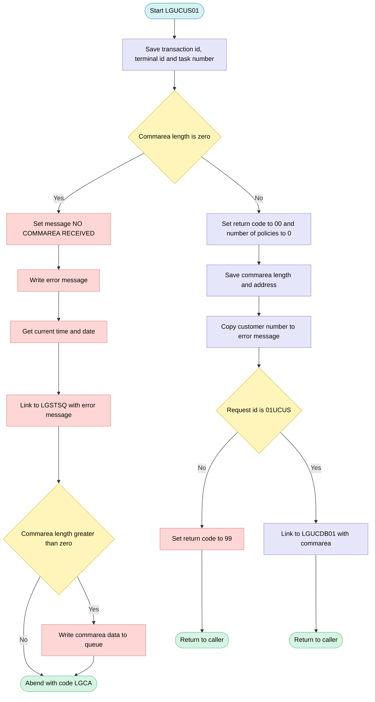
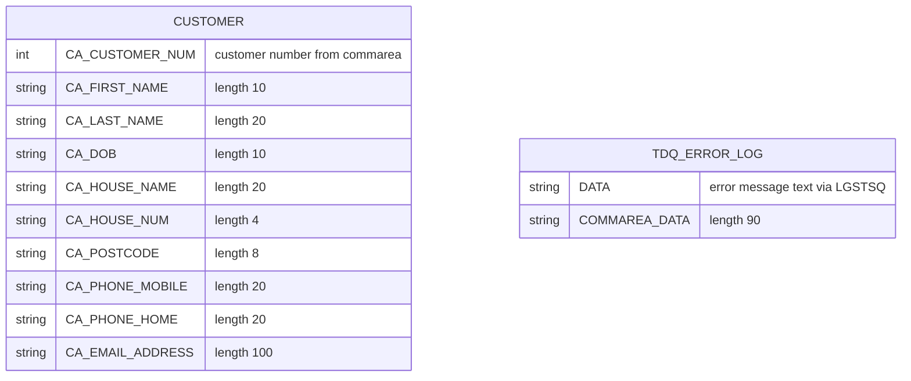

## Table of Contents

- [1. Purpose](#1-purpose)
- [2. Inputs](#2-inputs)
- [3. Outputs](#3-outputs)
- [4. Processing Logic](#4-processing-logic)
  - [4.1 Mermaid Flow Diagram](#41-mermaid-flow-diagram)
  - [4.2 Processing Logic Description](#42-processing-logic-description)
  - [4.3 Database Tables](#43-database-tables)
- [5. Paragraphs](#5-paragraphs)
- [6. Dependencies](#6-dependencies)
  - [6.1 CICS System Services and Runtime Environment](#61-cics-system-services-and-runtime-environment)
  - [6.2 External Programs and Subroutines](#62-external-programs-and-subroutines)
  - [6.3 Included Copybooks and Data Structures](#63-included-copybooks-and-data-structures)
  - [6.4 Input Data and Invocation Contract](#64-input-data-and-invocation-contract)
- [7. Constraints](#7-constraints)
- [8. Error Handling](#8-error-handling)
  - [8.1 Explicit Validation Checks](#81-explicit-validation-checks)
  - [8.2 Program Abends and Termination](#82-program-abends-and-termination)
  - [8.3 Logging and Error Queue Notifications](#83-logging-and-error-queue-notifications)
  - [8.4 Diagnostic Eyecatcher](#84-diagnostic-eyecatcher)
- [9. Examples](#9-examples)
  - [9.1 Example 1: Valid update request](#91-example-1-valid-update-request)
  - [9.2 Example 2: Unrecognised request ID](#92-example-2-unrecognised-request-id)
  - [9.3 Example 3: No commarea supplied](#93-example-3-no-commarea-supplied)

## 1. Purpose

LGUCUS01 is a CICS orchestrator program in the GenApp insurance application that acts as the entry point for updating an existing customer's details. It receives a 32,500-byte communication area, validates that a commarea was provided (aborting with code `LGCA` if not), confirms that the request identifier is `'01UCUS'` (rejecting any other value with return code `'99'`), and then delegates the actual database work by issuing a `CICS LINK` to the Db2 backend program `LGUCDB01`, passing the full commarea unchanged. The program contains no SQL of its own; its sole business responsibility is request routing and lightweight guard-rail validation, supported by an error-reporting utility that timestamps and writes diagnostic messages — including the customer number and commarea content — to a CICS transient data queue via `LGSTSQ`.

## 2. Inputs

**CICS COMMAREA (passed via `COMM_AREA_PTR` parameter)**

- `CA_REQUEST_ID` *(CHAR 6)* — Operation discriminator; must equal `'01UCUS'` for the update-customer path to execute; any other value causes an immediate return with code `'99'`
- `CA_RETURN_CODE` *(PIC '99')* — Initialised to `'00'` by this program; interpreted as an output, but its pre-existing value could be set by the caller
- `CA_CUSTOMER_NUM` *(PIC '9999999999')* — Ten-digit customer identifier; copied into the error-message structure for diagnostics and forwarded to `LGUCDB01` via the COMMAREA
- `CA_CUSTOMER_REQUEST` — Group structure carrying all customer detail fields passed in for the update:
  - `CA_FIRST_NAME` *(CHAR 10)* — Customer's given name to be updated
  - `CA_LAST_NAME` *(CHAR 20)* — Customer's family name to be updated
  - `CA_DOB` *(CHAR 10)* — Customer's date of birth to be updated
  - `CA_HOUSE_NAME` *(CHAR 20)* — House name component of the customer's address
  - `CA_HOUSE_NUM` *(CHAR 4)* — House number component of the customer's address
  - `CA_POSTCODE` *(CHAR 8)* — Postal code of the customer's address
  - `CA_NUM_POLICIES` *(PIC '999')* — Number of policies linked to the customer; reset to zero at entry
  - `CA_PHONE_MOBILE` *(CHAR 20)* — Customer's mobile telephone number
  - `CA_PHONE_HOME` *(CHAR 20)* — Customer's home telephone number
  - `CA_EMAIL_ADDRESS` *(CHAR 100)* — Customer's email address
  - `CA_POLICY_DATA` *(CHAR 32267)* — Variable-length area carrying policy data belonging to the customer

**CICS Execution Environment**

- `EIBCALEN` — Length of the COMMAREA supplied by the caller; checked on entry; a value of zero causes an `ABEND LGCA`; its size also controls how much of the COMMAREA raw data is written to the diagnostic queue
- `EIBTRNID` — CICS transaction identifier; captured into `WS_TRANSID` for diagnostic context
- `EIBTRMID` — CICS terminal identifier; captured into `WS_TERMID` for diagnostic context
- `EIBTASKN` — CICS task number; captured into `WS_TASKNUM` for diagnostic context

**Downstream Program Called via CICS LINK**

- `LGUCDB01` — Db2 back-end program; receives the entire 32 500-byte COMMAREA (including `CA_CUSTOMER_NUM` and all `CA_CUSTOMER_REQUEST` fields) and performs the physical database update

## 3. Outputs

- **Commarea return code (returned to caller)**
  - `CA_RETURN_CODE`
    - Set to '00' once a commarea has been received, which signals success to the caller unless the called program changes it.
    - Set to '99' when `CA_REQUEST_ID` is not '01UCUS', which rejects the request as an unsupported request type. The program then returns immediately without updating anything.
    - The linked update program `LGUCDB01` can also change it, because it works on the same commarea.

- **Commarea data returned to the caller**
  - `CA_NUM_POLICIES`
    - Reset to 0 at the start of every request.
    - Because the program passes the whole commarea to `LGUCDB01`, that program may update it before the commarea returns to the caller.
  - Customer detail fields passed to `LGUCDB01` and returned in the commarea:
    - `CA_CUSTOMER_NUM` identifies the customer to be updated.
    - `CA_FIRST_NAME`, `CA_LAST_NAME` and `CA_DOB` hold the customer's name and date of birth.
    - `CA_HOUSE_NAME`, `CA_HOUSE_NUM` and `CA_POSTCODE` hold the address details.
    - `CA_PHONE_MOBILE`, `CA_PHONE_HOME` and `CA_EMAIL_ADDRESS` hold the contact details.
    - `CA_POLICY_DATA` holds the policy data area. It travels in the same commarea.
  - `CA_REQUEST_ID` is passed through unchanged and decides whether the update is attempted.

- **Data written to databases or other programs (side effects)**
  - Customer update through a CICS LINK to `LGUCDB01`
    - The whole 32500-byte commarea (`COMM_AREA`) is passed to this program.
    - `LGUCDB01` applies the new customer values to the customer data store. This is the main business output of the program.
    - The link runs only when `CA_REQUEST_ID` is '01UCUS'.

- **Error and diagnostic messages written to the logging queue**
  - Both messages are written by linking to `LGSTSQ`, which writes to the TD/TS queue. They are produced only when no commarea is received (`EIBCALEN` = 0).
  - Error message record (`ERROR_MSG`)
    - `EM_DATE` and `EM_TIME` are the formatted current date (MMDDYYYY) and time of the error.
    - The program name 'LGUCUS01' identifies the source of the error.
    - `EM_MSG_TEXT` contains ' NO COMMAREA RECEIVED'.
    - `EM_CUSNUM` holds the customer number from the commarea, and `EM_POLNUM`, `EM_SQLREQ` and `EM_SQLRC` are available for the policy number, SQL request and SQLCODE.
  - Commarea dump record (`CA_ERROR_MSG`)
    - It has the prefix 'COMMAREA=' followed by `CA_DATA`, which holds up to the first 90 bytes of the commarea.
    - It is written only if `EIBCALEN` is greater than 0. In the no-commarea case `EIBCALEN` is 0, so the program writes it only if the error routine is called with a commarea present.

- **Program termination outcomes**
  - Abnormal termination
    - When no commarea is received, the program issues a CICS ABEND with abend code 'LGCA' and no dump.
  - Normal return to caller
    - The program issues `EXEC CICS RETURN` after the customer update.
    - It also issues `EXEC CICS RETURN` right after setting return code '99' for an invalid request ID.

## 4. Processing Logic

### 4.1 Mermaid Flow Diagram

### 4.2 Processing Logic Description

**High-level Summary**

LGUCUS01 is a CICS PL/I business-logic program that handles a request to update customer details. It checks that the caller supplied a communication area (commarea) and that the request code is the update-customer code `01UCUS`. If both checks pass, it links to the database program LGUCDB01, which does the actual update. If the commarea is missing, it logs an error and abends the transaction.

**Execution Flow**

1. **Capture runtime information.** The program copies the transaction id (`EIBTRNID`), terminal id (`EIBTRMID`) and task number (`EIBTASKN`) into the working-storage header `WS_HEADER`. This is diagnostic information.
2. **Check the commarea length.** If `EIBCALEN` is 0, no commarea was received:
   - It sets the error text to "NO COMMAREA RECEIVED".
   - It calls `WRITE_ERROR_MESSAGE`.
   - It abends the task with code `LGCA` and no dump (`NODUMP`).
3. **Initialise the commarea.** When a commarea is present:
   - It sets `CA_RETURN_CODE` to `00`.
   - It resets `CA_NUM_POLICIES` to 0.
   - It saves the commarea length and address in `WS_CALEN` and `WS_ADDR_DFHCOMMAREA`.
   - It copies `CA_CUSTOMER_NUM` into `EM_CUSNUM` so any later error message names the customer.
4. **Validate the request id.** If `CA_REQUEST_ID` is not `01UCUS`, the program sets `CA_RETURN_CODE` to `99` and issues `EXEC CICS RETURN` with no further processing.
5. **Update the customer.** For a valid request, `UPDATE_CUSTOMER_INFO` runs `EXEC CICS LINK PROGRAM(LGUCDB01)`. It passes the commarea with length 32500. LGUCDB01 uses the customer fields in the commarea (name, date of birth, address, phone numbers, email) to update the data.
6. **Return.** The program issues `EXEC CICS RETURN` to give control back to the caller. LGUCDB01 sets the final return code in the commarea.

**WRITE_ERROR_MESSAGE procedure**

1. It gets the current time with `ASKTIME` and formats it with `FORMATTIME` into `WS_DATE` (MMDDYYYY) and `WS_TIME`.
2. It places the date and time in the `ERROR_MSG` structure.
3. It links to `LGSTSQ` to write the error message to the queues.
4. If `EIBCALEN` is greater than 0, it also writes the commarea content, using `CA_ERROR_MSG` with the prefix "COMMAREA=":
   - If `EIBCALEN` is less than 91, it writes the commarea as received.
   - Otherwise it writes the first 90 bytes.
   - In both cases it makes a second link to `LGSTSQ`.

In the missing-commarea path, `EIBCALEN` is 0, so the second write is skipped. Only the first error message is logged.

**Business rules**

- Only request id `01UCUS` is accepted. Any other value gives return code `99`.
- A missing commarea is a hard failure and ends in abend `LGCA`.
- The number of policies is reset to 0 on every update request.
- At most 90 bytes of commarea data go into the error log.

**External Interactions**

- **LGUCDB01.** A CICS LINK that performs the database update for the customer.
- **LGSTSQ.** A CICS LINK that writes error messages to the logging queues (a TDQ/TSQ).
- **CICS services.** ASKTIME, FORMATTIME, ABEND and RETURN.
- The program has no direct SQL. All database access is in LGUCDB01.

**Plain Language Summary**

The program takes an "update customer" request and checks that it arrived with data and the right request code. If no data arrived, it records an error in the log and stops the transaction. If the request code is wrong, it marks the request as failed (code 99) and returns. If everything is correct, it hands the request to the database program that changes the customer's record, then returns to whoever called it.

### 4.3 Database Tables

## 5. Paragraphs

- **Main Procedure Body (LGUCUS01)**
  - Serves as the program entry point and overall orchestrator for the Update Customer function.
  - Captures the CICS execution context by moving `EIBTRNID`, `EIBTRMID`, and `EIBTASKN` into `WS_TRANSID`, `WS_TERMID`, and `WS_TASKNUM` respectively for diagnostics and dump identification.
  - Validates the presence of a COMMAREA: if `EIBCALEN = 0`, it populates `EM_MSG_TEXT` with a "NO COMMAREA RECEIVED" message, calls `WRITE_ERROR_MESSAGE` to log the fault, then issues `EXEC CICS ABEND ABCODE('LGCA') NODUMP` to terminate abnormally.
  - Initialises the COMMAREA return code to `'00'` and resets `CA_NUM_POLICIES` to zero, then copies `EIBCALEN` and the COMMAREA pointer into working-storage fields.
  - Copies `CA_CUSTOMER_NUM` into the error message structure (`EM_CUSNUM`) so it is available for any subsequent diagnostic write.
  - Validates the request type: if `CA_REQUEST_ID` is not equal to `'01UCUS'`, sets `CA_RETURN_CODE` to `'99'` and issues `EXEC CICS RETURN` immediately, rejecting any unknown request.
  - On a valid request, calls the internal procedure `UPDATE_CUSTOMER_INFO`, then issues `EXEC CICS RETURN` to hand control back to the caller.

- **UPDATE_CUSTOMER_INFO**
  - Encapsulates the single step required to persist a customer update: a `EXEC CICS LINK` to the back-end Db2 update program `LGUCDB01`.
  - Passes the entire 32,500-byte COMMAREA (`COMM_AREA`) to `LGUCDB01` so the back-end receives all customer detail fields (`CA_FIRST_NAME`, `CA_LAST_NAME`, `CA_DOB`, `CA_HOUSE_NAME`, `CA_HOUSE_NUM`, `CA_POSTCODE`, `CA_PHONE_MOBILE`, `CA_PHONE_HOME`, `CA_EMAIL_ADDRESS`) as well as the customer number and return code slot.
  - Contains no conditional logic; it is a simple delegation layer that separates orchestration (this program) from SQL execution (`LGUCDB01`).
  - On return from the link the procedure ends, and control reverts to the main body which then issues `EXEC CICS RETURN`.

- **WRITE_ERROR_MESSAGE**
  - Provides centralised error logging by writing diagnostic information to a CICS Transient Data Queue via the shared logging utility `LGSTSQ`.
  - Calls `EXEC CICS ASKTIME` to obtain the current absolute time, then formats it into `WS_DATE` (MM/DD/YYYY) and `WS_TIME` (HH:MM:SS) using `EXEC CICS FORMATTIME`. These are stamped into the `ERROR_MSG` structure fields `EM_DATE` and `EM_TIME`.
  - Issues a `EXEC CICS LINK` to `LGSTSQ` passing the fully populated `ERROR_MSG` structure (which includes date, time, program identifier `LGUCUS01`, customer number, policy number, SQL request name, and SQLCODE).
  - Conditionally logs a portion of the raw COMMAREA content for further diagnosis:
    - If `EIBCALEN > 0` and less than 91 bytes long, the entire COMMAREA is placed into `CA_DATA` using `LEFT(COMM_AREA_RAW, EIBCALEN)` and linked to `LGSTSQ` via `CA_ERROR_MSG`.
    - If `EIBCALEN >= 91`, the first 90 bytes of the COMMAREA are extracted and similarly logged.
    - If `EIBCALEN = 0`, the COMMAREA dump step is skipped entirely.
  - Returns to its caller after logging is complete; it does not alter any return codes or COMMAREA fields.

## 6. Dependencies

### 6.1 CICS System Services and Runtime Environment
- **CICS Transaction Server**: Provides the execution environment and transaction management for this program.
  - **EIB (EXEC Interface Block)**: Supplies runtime context data accessed by the program:
    - `EIBCALEN`: Length of the communication area passed to the program, used to validate COMMAREA presence.
    - `EIBTRNID`: Current CICS transaction identifier, stored in `WS_TRANSID`.
    - `EIBTRMID`: Current terminal identifier, stored in `WS_TERMID`.
    - `EIBTASKN`: CICS task number, stored in `WS_TASKNUM`.
  - **CICS Commands**:
    - `EXEC CICS ASKTIME`: Captures the current system time in absolute time format (`WS_ABSTIME`).
    - `EXEC CICS FORMATTIME`: Formats the absolute time into date (`MMDDYYYY`) and time (`TIME`) for error logging.
    - `EXEC CICS LINK`: Invokes subordinate external programs synchronously passing a COMMAREA.
    - `EXEC CICS RETURN`: Terminates program execution and returns control to the calling program or CICS.
    - `EXEC CICS ABEND`: Terminates execution abnormally with abend code `LGCA` when invoked without a COMMAREA (`EIBCALEN = 0`).

### 6.2 External Programs and Subroutines
- **LGUCDB01**: External Db2 backend customer update program invoked via `EXEC CICS LINK PROGRAM(LGUCDB01)` to execute the actual database updates for customer details using the 32,500-byte `COMM_AREA`.
- **LGSTSQ**: External utility program invoked via `EXEC CICS LINK PROGRAM('LGSTSQ')` to log formatted error messages (`ERROR_MSG`) and COMMAREA diagnostic data (`CA_ERROR_MSG`) to temporary storage or transient data queues.

### 6.3 Included Copybooks and Data Structures
- **LGCMAREA (`plinc/LGCMAREA.inc`)**: Defines the shared 32,500-byte communication area (`COMM_AREA`) layout passed between callers and backend programs, including:
  - `CA_REQUEST_ID`: Operational request identifier expected to be `'01UCUS'` for customer update.
  - `CA_RETURN_CODE`: Return status indicator initialized to `'00'` and set to `'99'` for invalid request types.
  - `CA_CUSTOMER_NUM`: 10-digit customer number to be updated.
  - `CA_CUSTOMER_REQUEST`: Sub-structure containing customer details (`CA_FIRST_NAME`, `CA_LAST_NAME`, `CA_DOB`, `CA_HOUSE_NAME`, `CA_HOUSE_NUM`, `CA_POSTCODE`, `CA_NUM_POLICIES`, `CA_PHONE_MOBILE`, `CA_PHONE_HOME`, `CA_EMAIL_ADDRESS`, `CA_POLICY_DATA`).

### 6.4 Input Data and Invocation Contract
- **Caller COMMAREA (`COMM_AREA_PTR`)**: Input pointer to the DFHCOMMAREA passed by the calling transaction or program (e.g., `LGTESTC1`). It requires `EIBCALEN > 0` and `CA_REQUEST_ID = '01UCUS'` to process customer updates.

## 7. Constraints

- **Commarea presence and structure**
  - A commarea must be supplied.
    - The check is `IF (EIBCALEN = 0)`.
    - If it fails, `EM_MSG_TEXT` is set to ' NO COMMAREA RECEIVED' and `WRITE_ERROR_MESSAGE` is called.
    - The program then ends with `EXEC CICS ABEND ABCODE('LGCA') NODUMP`, so no dump is produced.
  - No minimum commarea length is checked beyond being non-zero.
    - `WS_COMMAREA_LENGTHS` holds a header length of 28 and a required length of 0, but neither is used in a comparison.
    - The other length fields in `WS_POLICY_LENGTHS` are also not used to check anything.
  - The commarea layout is fixed.
    - `COMM_AREA` is a based union of 32500 bytes (`COMM_AREA_RAW`).
    - `CA_REQUEST_ID` is CHAR(6), `CA_RETURN_CODE` is PIC '99', and `CA_CUSTOMER_NUM` is PIC '9999999999' (10 digits).
    - The request-specific part is a 32482-byte union.
  - Customer detail field sizes are fixed.
    - `CA_FIRST_NAME` is 10 characters and `CA_LAST_NAME` is 20.
    - `CA_DOB` is 10 and `CA_HOUSE_NAME` is 20.
    - `CA_HOUSE_NUM` is 4 and `CA_POSTCODE` is 8.
    - `CA_NUM_POLICIES` is PIC '999'.
    - `CA_PHONE_MOBILE` and `CA_PHONE_HOME` are 20 each.
    - `CA_EMAIL_ADDRESS` is 100 and `CA_POLICY_DATA` is 32267.
  - `CA_POLICY_NUM` is a 10-digit numeric field (PIC '9999999999'). It is part of the policy request overlay and is not used by this program.

- **Request validation**
  - Only the update-customer request is accepted.
    - `CA_REQUEST_ID` must equal '01UCUS'.
    - Any other value sets `CA_RETURN_CODE` to '99' and issues `EXEC CICS RETURN`.
    - No update is attempted and no error message is written in this case.
  - The program does not validate the contents of the customer fields. This covers the name, date of birth, address, postcode, phone numbers, email, and the customer number's numeric content. Validation of these fields is left to the called program.

- **Sequencing and processing flow**
  - The program runs its steps in a fixed order:
    - Copy the transaction ID, terminal ID, and task number from the EIB into `WS_HEADER`.
    - Check that a commarea was received.
    - Reset `CA_RETURN_CODE` to '00' and `CA_NUM_POLICIES` to 0.
    - Save `EIBCALEN` in `WS_CALEN`, save the commarea address, and copy `CA_CUSTOMER_NUM` into `EM_CUSNUM` for diagnostics.
    - Check the request ID.
    - Call `UPDATE_CUSTOMER_INFO`.
    - Return to the caller.
  - The return code and policy count are reset only after the commarea presence check passes, so a missing commarea never reaches this step.
  - The customer number is saved for error messages before the request ID is checked.
  - The database update runs only when the request ID is valid.
    - `UPDATE_CUSTOMER_INFO` issues `EXEC CICS LINK PROGRAM(LGUCDB01) COMMAREA(COMM_AREA) LENGTH(32500)`.
    - All table updates are delegated to `LGUCDB01`.
    - The program does not inspect the return code from the link, so it passes back whatever `LGUCDB01` sets in the commarea.
  - `CA_NUM_POLICIES` is always set to 0 at the start of an update request, so any value the caller supplied is discarded.

- **Resource and size limits**
  - The commarea passed to `LGUCDB01` is always 32500 bytes, whatever length the caller supplied (`EIBCALEN`).
  - The error-log copy of the commarea is limited to 90 bytes (`CA_DATA` is CHAR(90)).
    - If `EIBCALEN` is under 91, only `EIBCALEN` bytes are copied (`LEFT(COMM_AREA_RAW, EIBCALEN)`).
    - Otherwise the first 90 bytes are copied.
    - Nothing is logged if `EIBCALEN` is 0.
  - The error message text area `EM_MSG_TEXT` is limited to 63 characters.
  - Error message fields have fixed sizes: date 10 (`EM_DATE`), time 8 (`EM_TIME`), customer number 10 (`EM_CUSNUM`), policy number 10 (`EM_POLNUM`), SQL request 16 (`EM_SQLREQ`), and SQL code PIC '+(5)9' (`EM_SQLRC`).

- **Error handling and logging**
  - Every error message written to the queues contains a date, a time, the program name, and the customer number.
    - The date is formatted as MMDDYYYY and the time with FORMATTIME, both from ASKTIME.
    - The message is sent by linking to `LGSTSQ`, with the length taken from `STG(ERROR_MSG)`.
  - The commarea content is logged as a second `LGSTSQ` message, prefixed with 'COMMAREA='.
  - The no-commarea case is the only path that logs an error.
    - It ends in an abend with code 'LGCA'.
    - The commarea-content logging inside `WRITE_ERROR_MESSAGE` is skipped for this case, because `EIBCALEN` is 0.
  - An invalid request ID is reported only through return code '99' in the commarea.
  - The only return codes this program sets are '00' on entry and '99' for an invalid request ID.

- **Interface constraints**
  - Dependencies and names the program relies on:
    - The target database update program is `LGUCDB01`, held in an 8-character field.
    - The queue-writing program is `LGSTSQ`.
    - The program must run under CICS, because it uses `EIBCALEN`, `EIBTRNID`, `EIBTRMID`, `EIBTASKN`, LINK, RETURN, ABEND, ASKTIME, and FORMATTIME.
    - The commarea is addressed through the `COMM_AREA_PTR` parameter.

## 8. Error Handling

### 8.1 Explicit Validation Checks
- Communication Area Length Validation
  - Evaluates whether the incoming communication area length received from CICS is zero.
  - If no communication area is supplied, sets a specific descriptive error text indicating that no communication area was received, triggers error logging, and terminates execution immediately.
- Request Identifier Validation
  - Evaluates whether the request identifier matches the expected update customer transaction code.
  - If the identifier does not match, sets an error return code of 99 and exits back to the caller using a standard CICS return command without invoking downstream business logic.

### 8.2 Program Abends and Termination
- Immediate Program Abend
  - Issues an explicit CICS ABEND command with abend code 'LGCA' and suppresses dump generation when the communication area length check detects zero bytes.
- Early Program Exit
  - Terminates further transaction processing via CICS RETURN immediately following the detection of an invalid request identifier.

### 8.3 Logging and Error Queue Notifications
- Timestamped Error Queue Logging
  - Formats current system date and time using CICS ASKTIME and FORMATTIME commands into an error message structure.
  - Links to the logging subprogram 'LGSTSQ', passing the formatted error message containing the timestamp, program identifier, customer number, policy number, and diagnostic information.
- Communication Area Payload Diagnostics
  - Evaluates the communication area length to log diagnostics when payload data is available.
  - If the communication area is less than 91 bytes, extracts the available characters and passes them via another link call to 'LGSTSQ'.
  - If the communication area contains 91 bytes or more, truncates the payload to 90 bytes and passes it to 'LGSTSQ' for diagnostic logging.

### 8.4 Diagnostic Eyecatcher
- Storage Eyecatcher
  - Declares an eye-catcher string in the working storage header structure to aid in program identification and post-mortem analysis during debugging or storage inspection.

## 9. Examples

### 9.1 Example 1: Valid update request

**Input (EIBCALEN > 0, commarea):**

| Field | Value |
|---|---|
| CA_REQUEST_ID | `01UCUS` |
| CA_CUSTOMER_NUM | `0000000123` |
| CA_FIRST_NAME | `John` |
| CA_LAST_NAME | `Smith` |
| CA_DOB | `1980-05-12` |
| CA_POSTCODE | `AB1 2CD` |
| CA_EMAIL_ADDRESS | `john.smith@example.com` |
| CA_NUM_POLICIES | `005` |

**Output:**
- `CA_RETURN_CODE` = `00` on return from `LGUCUS01`, unless `LGUCDB01` sets a different value.
- `CA_NUM_POLICIES` = `000`.
- The program issues `EXEC CICS LINK PROGRAM('LGUCDB01')` with the 32500-byte commarea, then returns to the caller.

**Explanation:**
- The commarea length is non-zero, so the program doesn't abend.
- It resets `CA_RETURN_CODE` to `00` and `CA_NUM_POLICIES` to `0`.
- It copies `CA_CUSTOMER_NUM` into `EM_CUSNUM` for possible diagnostics.
- `CA_REQUEST_ID` equals `01UCUS`, so `UPDATE_CUSTOMER_INFO` links to `LGUCDB01`. That program applies the new name, date of birth, address and contact details to the customer record.

### 9.2 Example 2: Unrecognised request ID

**Input:**

| Field | Value |
|---|---|
| CA_REQUEST_ID | `01ICUS` |
| CA_CUSTOMER_NUM | `0000000123` |
| CA_FIRST_NAME | `John` |

**Output:**
- `CA_RETURN_CODE` = `99`.
- The program returns immediately.
- `LGUCDB01` is not called, so nothing is updated.

**Explanation:**
- The commarea is present, so the program initialises it and stores the customer number.
- `CA_REQUEST_ID` is not `01UCUS`, so the program sets `CA_RETURN_CODE` to `99` and issues `EXEC CICS RETURN`.

### 9.3 Example 3: No commarea supplied

**Input:** The program is invoked with `EIBCALEN = 0`, so no commarea is passed.

**Output:**
- `WRITE_ERROR_MESSAGE` builds a message line and links to `LGSTSQ` to write it to the queue. The message has this form: `<MMDDYYYY date> <time> LGUCUS01 NO COMMAREA RECEIVED`.
- The task abends with code `LGCA`, with no dump.

**Explanation:**
- `EIBCALEN = 0`, so the program sets `EM_MSG_TEXT` to ` NO COMMAREA RECEIVED`.
- It calls `WRITE_ERROR_MESSAGE`. That procedure gets the current time with `ASKTIME` and formats it with `FORMATTIME`.
- It links to `LGSTSQ` to write the error message.
- The commarea length is 0, so the commarea contents aren't written.
- The program then issues `EXEC CICS ABEND ABCODE('LGCA') NODUMP`.

---

Generated by IBM Bob Premium Package for Z
