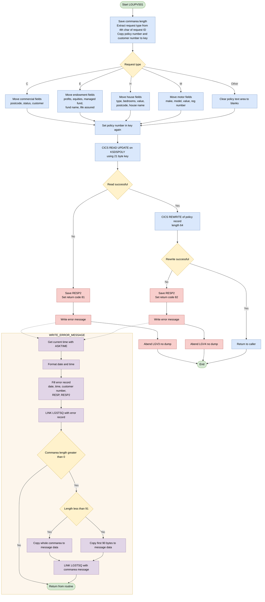
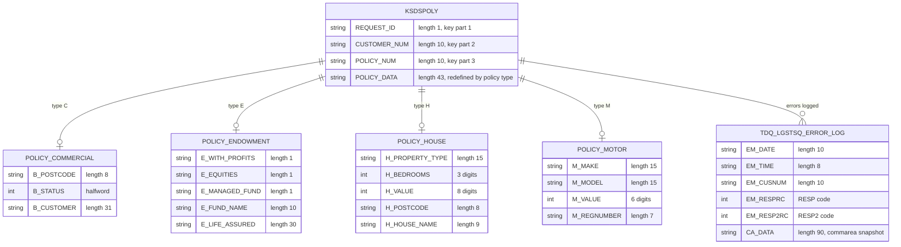

## Table of Contents

- [1. Purpose](#1-purpose)
- [2. Inputs](#2-inputs)
  - [2.1 Communication Area (COMMAREA) — passed via `COMM_AREA_PTR`](#21-communication-area-commarea--passed-via-comm_area_ptr)
  - [2.2 Policy-Type-Specific COMMAREA Fields](#22-policy-type-specific-commarea-fields)
  - [2.3 CICS Resources](#23-cics-resources)
  - [2.4 Linked Program](#24-linked-program)
- [3. Outputs](#3-outputs)
- [4. Processing Logic](#4-processing-logic)
  - [4.1 Mermaid Flow Diagram](#41-mermaid-flow-diagram)
  - [4.2 Processing Logic Description](#42-processing-logic-description)
  - [4.3 Database Tables](#43-database-tables)
- [5. Paragraphs](#5-paragraphs)
- [6. Dependencies](#6-dependencies)
- [7. Constraints](#7-constraints)
  - [7.1 Data Validation Constraints](#71-data-validation-constraints)
  - [7.2 Sequencing and Operational Constraints](#72-sequencing-and-operational-constraints)
  - [7.3 Error Handling and Return-Code Constraints](#73-error-handling-and-return-code-constraints)
  - [7.4 File and Resource Constraints](#74-file-and-resource-constraints)
- [8. Error Handling](#8-error-handling)
  - [8.1 CICS file I/O response checking](#81-cics-file-io-response-checking)
  - [8.2 Return code signalling to the caller](#82-return-code-signalling-to-the-caller)
  - [8.3 Transaction abend and termination](#83-transaction-abend-and-termination)
  - [8.4 Error logging and notification](#84-error-logging-and-notification)
  - [8.5 Input handling and defaults](#85-input-handling-and-defaults)
  - [8.6 Gaps and limitations](#86-gaps-and-limitations)
- [9. Examples](#9-examples)
  - [9.1 Example 1: Successful motor policy update](#91-example-1-successful-motor-policy-update)
  - [9.2 Example 2: Successful house policy update](#92-example-2-successful-house-policy-update)
  - [9.3 Example 3: Policy record not found](#93-example-3-policy-record-not-found)
  - [9.4 Example 4: Rewrite failure](#94-example-4-rewrite-failure)

## 1. Purpose

`LGUPVS01` is the VSAM back-end program responsible for persisting insurance policy updates to the GenApp VSAM KSDS file (`KSDSPOLY`). Invoked by the update-policy orchestrator (`LGUPOL01`) via a CICS LINK, it receives a communication area identifying the policy to be modified along with the revised policy data. It extracts the policy type indicator, customer number, and policy number from the communication area to form a 21-character record key, then maps the type-specific fields — commercial, endowment, house, or motor — into a working-file policy record structure. It locks the existing KSDS record with a CICS READ UPDATE, rewrites it with the updated content, and returns control to the caller; if either the read or the rewrite fails, it logs a timestamped diagnostic message to a CICS temporary storage queue via `LGSTSQ` and issues a NODUMP abend (`LGV3` or `LGV4` respectively) before returning.

## 2. Inputs

### 2.1 Communication Area (COMMAREA) — passed via `COMM_AREA_PTR`

- `CA_REQUEST_ID` — 6-character request identifier passed by the calling orchestrator (`LGUPOL01`). The fourth character is extracted as the policy-type discriminator (`'C'`, `'E'`, `'H'`, or `'M'`) and drives which branch of policy-specific fields is populated before the VSAM rewrite.
- `CA_CUSTOMER_NUM` — 10-digit customer number. Copied into the VSAM record key and written to the error message record for traceability when a file operation fails.
- `CA_POLICY_NUM` — 10-digit policy number. Forms the trailing portion of the 21-character VSAM KSDS key used to locate and lock the policy record for update.
- `CA_RETURN_CODE` — 2-digit return code field. Written by this program (`'81'` on read failure, `'82'` on rewrite failure) and returned to the caller; it is therefore an input/output contract field.

### 2.2 Policy-Type-Specific COMMAREA Fields

These fields are read from the COMMAREA only for the matching policy type and are written into the VSAM record image:

- **Commercial (`'C'`)**
  - `CA_B_Postcode` — postal code of the commercial property
  - `CA_B_Status` — numeric status code of the commercial policy
  - `CA_B_Customer` — customer description associated with the commercial policy

- **Endowment (`'E'`)**
  - `CA_E_WITH_PROFITS` — single-character with-profits participation indicator
  - `CA_E_EQUITIES` — single-character equities participation indicator
  - `CA_E_MANAGED_FUND` — single-character managed-fund participation indicator
  - `CA_E_FUND_NAME` — name of the investment fund linked to the endowment policy
  - `CA_E_LIFE_ASSURED` — name of the person whose life is covered

- **House (`'H'`)**
  - `CA_H_PROPERTY_TYPE` — classification of the residential property (e.g., detached, flat)
  - `CA_H_BEDROOMS` — number of bedrooms
  - `CA_H_VALUE` — monetary value of the insured property
  - `CA_H_HOUSE_NAME` — name of the insured house or property
  - `CA_H_POSTCODE` — postal code of the insured property

- **Motor (`'M'`)**
  - `CA_M_MAKE` — manufacturer name of the insured vehicle
  - `CA_M_MODEL` — model name of the insured vehicle
  - `CA_M_VALUE` — monetary value of the insured vehicle
  - `CA_M_REGNUMBER` — registration (licence plate) number of the insured vehicle

### 2.3 CICS Resources

- **`KSDSPOLY` (VSAM KSDS file)** — the VSAM key-sequenced dataset holding policy records. The program issues a CICS `READ … UPDATE` against this file using the 21-character composite key (`WF_Policy_Key`), then a `REWRITE` to apply the update. It is the primary external data store the program reads from and writes to.
- **`EIBCALEN` (CICS EIB field)** — the length of the passed COMMAREA, read at program entry to validate that a COMMAREA is present and to control error-message truncation in `WRITE_ERROR_MESSAGE`.

### 2.4 Linked Program

- **`LGSTSQ`** — a CICS-linked error-logging utility. Invoked (once or twice) only on file-operation failure; receives the `ERROR_MSG` structure and optionally a dump of the raw COMMAREA content as its input.

## 3. Outputs

- **Updated policy record in the KSDSPOLY VSAM KSDS file**
  - Role: This is the main output. The program locks the record with a CICS READ UPDATE, then rewrites it with CICS REWRITE from the working-file image. The length written is 64 bytes.
  - Key variables:
    - `WF_POLICY_INFO`: The full record image that is rewritten.
    - `WF_POLICY_KEY`: The 21-byte key (request type, customer number, policy number) that selects the record to lock and update.
      - `WF_REQUEST_ID`: The policy type code ('C', 'E', 'H' or 'M'). It is taken from byte 4 of the request ID in the communication area. It is the first byte of the key and decides which policy-specific fields are populated.
      - `CA_CUSTOMER_NUM`: The customer number, copied into the key.
      - `CA_POLICY_NUM`: The policy number, copied into the key.
  - Policy-specific data written, depending on the request type:
    - Commercial ('C'):
      - `WF_B_STATUS`: The status of the commercial policy.
      - The postcode and customer fields are also written but are not tracked as key outputs.
    - Endowment ('E'):
      - `WF_E_WITH_PROFITS`: Whether the policy participates in with-profits.
      - `WF_E_FUND_NAME`: The name of the linked fund.
      - `WF_E_LIFE_ASSURED`: The name of the person whose life is covered.
    - House ('H'):
      - `WF_H_PROPERTY_TYPE`: The type of property.
      - `WF_H_VALUE`: The insured value of the property.
      - `WF_H_POSTCODE`: The postcode of the property.
    - Motor ('M'):
      - `WF_M_MAKE`: The vehicle manufacturer.
      - `WF_M_VALUE`: The insured value of the vehicle.
      - `WF_M_REGNUMBER`: The vehicle registration number.
    - Other request types: the policy data area is blanked, so the rewritten record carries no policy-specific data.

- **Return code passed back to the caller in the communication area**
  - Role: The program sets this when a file operation fails. Otherwise it leaves the communication area unchanged.
  - Values:
    - `CA_RETURN_CODE` = '81': The READ UPDATE of KSDSPOLY failed.
    - `CA_RETURN_CODE` = '82': The REWRITE of KSDSPOLY failed.

- **Error messages sent to the logging program LGSTSQ**
  - Role: When the READ UPDATE or REWRITE fails, the program writes diagnostic messages. It does this by linking to LGSTSQ through CICS LINK, which handles the queue logging.
  - Error message record:
    - Contents: date, time, program name, policy number, customer number, the text "Re-write KSDSPOLY", and the response codes.
    - Key variables:
      - `CA_CUSTOMER_NUM`: Written to the message to identify the customer.
      - `WS_RESP` and `WS_RESP2`: The CICS response and reason codes that are formatted into the message. They are the failure reason.
  - Communication area dump record:
    - Contents: the prefix "COMMAREA=" followed by up to the first 90 bytes of the incoming communication area.
    - Role: It gives context for diagnosis. It is sent only when the communication area length is greater than zero.

- **Transaction abends on failure**
  - Role: Each failure ends the transaction with an abend and no dump.
  - Values:
    - Abend code 'LGV3': Issued when the READ UPDATE fails.
    - Abend code 'LGV4': Issued when the REWRITE fails.

## 4. Processing Logic

### 4.1 Mermaid Flow Diagram

---

### 4.2 Processing Logic Description

**High-level Summary**

LGUPVS01 is a CICS PL/I subprogram of the General Insurance application. It updates one policy record in the VSAM KSDS file `KSDSPOLY`. The caller passes a commarea with the policy type, customer number, policy number and the new policy details. The program builds a 64-byte policy record from those values. It reads the existing record for update, then rewrites it with the new data. If either file operation fails, it sets a return code, logs the error through the `LGSTSQ` program, and abends the transaction.

**Execution Flow**

1. **Initialisation.**
   - The program saves `EIBCALEN` in `WS_Commarea_Len`.
   - It takes the policy type `WF_Request_ID` from the 4th character of `CA_REQUEST_ID`. For example, a request ID such as `01UCOM` would give the type `U`; the type values the program tests for are `C`, `E`, `H` and `M`.
   - It copies `CA_POLICY_NUM` and `CA_CUSTOMER_NUM` into the working-file key `WF_Policy_Key`.
   - The key is 21 characters: 1 for the request type, 10 for the customer number and 10 for the policy number.
2. **Policy-type selection.** The program selects on `WF_Request_ID` and moves only the fields for that policy type into the overlaid `WF_Policy_Data` area.
   - `C` (commercial): postcode, status and customer.
   - `E` (endowment): with-profits flag, equities flag, managed-fund flag, fund name and life assured.
   - `H` (house): property type, bedrooms, value, postcode and house name.
   - `M` (motor): make, model, value and registration number.
   - Any other value: the 43-byte policy text area is set to blanks.
3. **Key reset.** `WF_Policy_Num` is set from `CA_Policy_Num` again so the key is correct.
4. **Read for update.** `EXEC CICS READ FILE('KSDSPOLY') UPDATE` reads the record with the 21-byte key into `WS_FileIn`. This locks the record for the following rewrite.
5. **Read error handling.** If `WS_RESP` is not NORMAL:
   - `EIBRESP2` is saved in `WS_RESP2`.
   - `CA_RETURN_CODE` is set to `81`.
   - `WRITE_ERROR_MESSAGE` is called.
   - The program abends with code `LGV3` and no dump.
6. **Rewrite.** `EXEC CICS REWRITE FILE('KSDSPOLY')` writes `WF_Policy_Info` back. The length is `WS_Commarea_LenF`, which is 64.
7. **Rewrite error handling.** If the response is not NORMAL, the handling matches the read failure:
   - `WS_RESP2` is saved and `CA_RETURN_CODE` is set to `82`.
   - The error is logged.
   - The program abends with code `LGV4` and no dump.
8. **Normal completion.** The program returns to the caller.

**WRITE_ERROR_MESSAGE routine**

- It gets the current time with `ASKTIME` and formats it with `FORMATTIME` (`MMDDYYYY` and time).
- It fills the error record `ERROR_MSG` with the date, time, customer number, RESP code and RESP2 code. The record also holds the program name and the text "Re-write KSDSPOLY".
- It calls `LGSTSQ` with `LINK` to write the record. `LGSTSQ` is probably the program that writes to the shared error queue.
- If `EIBCALEN` is greater than 0, it logs the commarea contents in a second `LINK` to `LGSTSQ`.
  - If `EIBCALEN` is under 91, it copies the whole commarea.
  - Otherwise it copies the first 90 bytes.
  - In both cases the `LINK` uses the length of `ERROR_MSG` instead of the length of `CA_ERROR_MSG`. This is a possible length mismatch in the code.

**Business rules and notes**

- Return code `81` means the read-for-update failed. Return code `82` means the rewrite failed.
- Abend codes are `LGV3` for the read and `LGV4` for the rewrite.
- The record key is request type + customer number + policy number.
- The `EM_POLNUM` field is never filled, so the policy number does not appear in the error message.
- The program does not check for an unknown request type. It just blanks the data area and still rewrites the record.
- The `RETURN` after each `ABEND` is never reached.

**External Interactions**

| Interaction | Purpose |
|---|---|
| CICS file `KSDSPOLY` (VSAM KSDS), READ UPDATE | Locate and lock the policy record by its 21-byte key |
| CICS file `KSDSPOLY`, REWRITE | Replace the policy record with the updated data |
| CICS ASKTIME / FORMATTIME | Get the date and time for the error record |
| CICS LINK to `LGSTSQ` | Write the error record and a commarea snapshot to the error log |
| CICS ABEND `LGV3` / `LGV4` | End the transaction on a file I/O failure |
| Commarea (`COMM_AREA_PTR`) | Input of policy data and output of the return code |

**Plain Language Summary**

The program changes the details of an existing insurance policy. It receives the policy type (commercial, endowment, house or motor), the customer and policy numbers, and the new details. It looks up the stored record for that customer and policy and locks it. It then replaces the record with the new details. If the record cannot be found or locked, or the save fails, the program records what went wrong, with the date, time, customer number and system response codes. It also records part of the data it was given. It then stops the transaction with an abend code and tells the caller the failure type: 81 for lookup and 82 for save.

---

### 4.3 Database Tables

## 5. Paragraphs

- **LGUPVS01 (main procedure)**
  - Purpose: Updates a policy record in the CICS VSAM KSDS file `KSDSPOLY`. The caller passes the commarea through `COMM_AREA_PTR`.
  - Operations:
    - Saves `EIBCALEN` in `WS_Commarea_Len`.
    - Takes `WF_Request_ID` from byte 4 of `CA_REQUEST_ID`.
    - Copies `CA_POLICY_NUM` and `CA_CUSTOMER_NUM` into `WF_Policy_Num` and `WF_Customer_Num`. Together with `WF_Request_ID` these form the 21-byte key `WF_Policy_Key`.
    - Copies the policy-type-specific fields from the commarea into the `WF_Policy_Info` record (details below).
    - Reads the record `FROM KSDSPOLY` with the UPDATE option. This locks the record and puts the content into `WS_FileIn`.
    - Rewrites the record from `WF_Policy_Info`, using the fixed length `WS_Commarea_LenF` (64).
  - Control flow:
    - A `SELECT (WF_Request_ID)` statement picks one branch.
      - `'C'` (commercial) copies `CA_B_Postcode` to `WF_B_Postcode`, `CA_B_Status` to `WF_B_Status` and `CA_B_Customer` to `WF_B_Customer`.
      - `'E'` (endowment) copies the with-profits, equities, managed-fund, fund-name and life-assured fields to the `WF_E_` fields.
      - `'H'` (house) copies property type, bedrooms, value, postcode and house name to the `WF_H_` fields.
      - `'M'` (motor) copies make, model, value and registration number to the `WF_M_` fields.
      - `OTHERWISE` blanks `WF_Policy_Text`.
    - After the READ, if `WS_RESP` is not `DFHRESP(NORMAL)`:
      - It saves `EIBRESP2` in `WS_RESP2`.
      - It sets `CA_RETURN_CODE` to '81'.
      - It calls `WRITE_ERROR_MESSAGE`.
      - It issues `EXEC CICS ABEND ABCODE('LGV3') NODUMP`, followed by `EXEC CICS RETURN`.
    - After the REWRITE, if `WS_RESP` is not `DFHRESP(NORMAL)`, it follows the same error path. The return code is '82' and the abend code is 'LGV4'.
    - If both operations succeed, it ends with `RETURN`.
  - External interactions:
    - CICS READ UPDATE and REWRITE on the VSAM KSDS file `KSDSPOLY`.
    - CICS ABEND and RETURN.
    - The commarea is read and its `CA_RETURN_CODE` is set.

- **WRITE_ERROR_MESSAGE (internal procedure)**
  - Purpose: Builds a timestamped error record and sends it to the logging program `LGSTSQ`. The main procedure calls it when a file operation fails.
  - Operations:
    - Issues `EXEC CICS ASKTIME` into `WS_ABSTIME`.
    - Issues `EXEC CICS FORMATTIME` to get the date (MMDDYYYY) and time into `WS_DATE` and `WS_TIME`.
    - Fills `ERROR_MSG` with the date, the time, `CA_CUSTOMER_NUM` (into `EM_CUSNUM`), `WS_RESP` (into `EM_RESPRC`) and `WS_RESP2` (into `EM_RESP2RC`).
    - Links to `LGSTSQ` with `ERROR_MSG` as the commarea.
    - Logs the caller's commarea content in `CA_ERROR_MSG` through a second link to `LGSTSQ`.
  - Control flow:
    - The commarea is only logged if `EIBCALEN > 0`.
    - If `EIBCALEN < 91`, `CA_Data` takes the left-justified `EIBCALEN` bytes of `COMM_AREA_RAW`. Otherwise it takes the first 90 bytes.
    - Both cases link to `LGSTSQ` with `CA_ERROR_MSG`, and both use `LENGTH(STG(ERROR_MSG))`.
    - It ends with `RETURN` to the caller.
  - External interactions:
    - CICS ASKTIME and FORMATTIME.
    - CICS LINK to program `LGSTSQ`, which writes the message to a queue.
  - `EM_POLNUM` is never set here, so the policy number is not placed in the error message.

## 6. Dependencies

- **CICS runtime environment**
  - CICS transaction server
    - The program is a main CICS PL/I program. It uses `EXEC CICS` commands and the `DFHRESP(NORMAL)` response constant for all file, time, link, abend and return processing.
  - Execution interface block (EIB)
    - `EIBCALEN` gives the length of the commarea passed in. The program checks it to decide how much commarea data to log.
    - `EIBRESP2` supplies the secondary response code after a failed file operation. The program saves it in `WS_RESP2`.

- **Input parameters and data sources**
  - Commarea passed by the caller
    - `COMM_AREA_PTR` is the program's entry parameter. It points to the `COMM_AREA` structure, which is the only input.
    - `CA_REQUEST_ID`: its 4th character becomes `WF_REQUEST_ID`. That character is the policy type: `C` for commercial, `E` for endowment, `H` for house, `M` for motor.
    - `CA_CUSTOMER_NUM` and `CA_POLICY_NUM` are copied into the working-file key. `CA_CUSTOMER_NUM` is also copied to the error message.
    - Commercial policy fields: `CA_B_POSTCODE`, `CA_B_STATUS` and `CA_B_CUSTOMER`.
    - Endowment policy fields: `CA_E_WITH_PROFITS`, `CA_E_EQUITIES`, `CA_E_MANAGED_FUND`, `CA_E_FUND_NAME` and `CA_E_LIFE_ASSURED`.
    - House policy fields: `CA_H_PROPERTY_TYPE`, `CA_H_BEDROOMS`, `CA_H_VALUE`, `CA_H_POSTCODE` and `CA_H_HOUSE_NAME`.
    - Motor policy fields: `CA_M_MAKE`, `CA_M_MODEL`, `CA_M_VALUE` and `CA_M_REGNUMBER`.
  - Output to the caller
    - `CA_RETURN_CODE` is set to `81` when the read for update fails. It is set to `82` when the rewrite fails.

- **Data files**
  - VSAM KSDS policy file `KSDSPOLY`
    - The program reads it with `Update`, using `WF_POLICY_KEY` as the RIDFLD with a key length of 21. The key is the request id, customer number and policy number.
    - The record is read into `WS_FileIn`, a 1024-byte buffer.
    - The program then rewrites it from `WF_POLICY_INFO` with a length of 64 (`WS_Commarea_LenF`).
    - The file must be defined in CICS (FCT or CSD) and must allow read-update and rewrite.

- **External programs and modules**
  - `LGSTSQ`, called with `EXEC CICS LINK`
    - It receives the formatted `ERROR_MSG` record, which holds the date, time, program name, policy number, customer number, RESP and RESP2.
    - It also receives `CA_ERROR_MSG`, which holds up to 90 bytes of the incoming commarea. The commarea is sent only when `EIBCALEN` is greater than 0.
    - The program relies on it to write these messages to the error log. The name suggests a TS/TD queue writer, but that code is not in this program.
  - Included copybook `LGCMAREA` (`plinc/LGCMAREA.inc`)
    - It defines the `COMM_AREA` layout. The layout is shared with the calling programs.

- **CICS services used for error handling and time**
  - `EXEC CICS ASKTIME` and `EXEC CICS FORMATTIME` supply the current date (MMDDYYYY) and time for the error message timestamps.
  - `EXEC CICS ABEND` with abend codes `LGV3` (read failure) and `LGV4` (rewrite failure), both with `NODUMP`.
  - `EXEC CICS RETURN` ends the transaction.

- **Configuration values and hard-coded settings**
  - File name `KSDSPOLY`, key length 21, rewrite record length 64, and the error-log program name `LGSTSQ`, all coded as literals in the program.
  - Return codes `81` and `82` and abend codes `LGV3` and `LGV4`, which callers or operators may depend on.

## 7. Constraints

### 7.1 Data Validation Constraints

- **Policy type (WF_Request_ID) must be one of four recognised values**
  - Extracted from the 4th character of `CA_REQUEST_ID` (`SUBSTR(CA_Request_ID,4,1)`), the value must be `'C'` (commercial), `'E'` (endowment), `'H'` (house), or `'M'` (motor)
  - Enforced by a `SELECT (WF_Request_ID)` statement; any other value falls into the `OTHERWISE` branch, which writes blanks into `WF_Policy_Text` and skips all policy-specific field assignments — no error is raised but the record written to VSAM will contain no meaningful policy data

- **Policy key is exactly 21 characters**
  - The CICS `READ … UPDATE` call specifies `KeyLength(21)`, which is the fixed concatenation of `WF_Request_ID` (1) + `WF_Customer_Num` (10) + `WF_Policy_Num` (10)
  - No shorter or differently formed key is accepted by the VSAM KSDS

- **CA_CUSTOMER_NUM is a 10-digit numeric field** (`PIC '9999999999'`)
  - Its format is enforced by the COMMAREA declaration; non-numeric content would cause a PL/I conversion condition at assignment time

- **CA_POLICY_NUM is a 10-digit numeric field** (`PIC '9999999999'`)
  - Same enforcement mechanism as `CA_CUSTOMER_NUM`

- **COMMAREA must be present and large enough to hold the fixed header**
  - The program reads `EIBCALEN` into `WS_Commarea_Len` and uses it as the `LENGTH` parameter on the `READ … UPDATE`; if CICS passes a zero-length COMMAREA the read length would be zero, effectively making the operation meaningless (no explicit minimum-length guard is coded, but the COMMAREA layout imposes an implicit minimum of at least 18 bytes to cover `CA_REQUEST_ID`, `CA_RETURN_CODE`, `CA_CUSTOMER_NUM`, and `CA_POLICY_NUM`)

- **REWRITE length is fixed at 64 bytes** (`WS_Commarea_LenF FIXED BIN(15) INIT(64)`)
  - The rewritten record is always exactly 64 bytes regardless of policy type; the working-file record layout (`WF_Policy_Info`) must therefore always fit within that size

- **Policy-specific numeric fields use picture constraints**
  - `WF_H_BEDROOMS` — `PIC '(3)9'`: three-digit unsigned integer (0–999)
  - `WF_H_VALUE` — `PIC '(8)9'`: eight-digit unsigned integer (0–99 999 999)
  - `WF_M_VALUE` — `PIC '(6)9'`: six-digit unsigned integer (0–999 999)
  - `WF_B_Status` — `FIXED BIN(15)`: 15-bit signed binary integer
  - Values outside these ranges cause a PL/I conversion condition at assignment

### 7.2 Sequencing and Operational Constraints

- **READ with UPDATE must precede REWRITE**
  - CICS VSAM record locking requires an exclusive `READ … UPDATE` before a `REWRITE`; the program enforces this sequence unconditionally — the `REWRITE` is only reached if the `READ` returns `DFHRESP(NORMAL)`, so the lock is always acquired before the write

- **Policy-specific fields must be populated before the REWRITE**
  - The `SELECT` block that copies COMMAREA fields into `WF_Policy_Info` executes before either CICS file call; if that step is skipped or falls into `OTHERWISE`, the data written to VSAM will be blank for the policy-data portion

- **Error logging precedes ABEND on failure**
  - On either a failed `READ` or a failed `REWRITE`, the program calls `WRITE_ERROR_MESSAGE` first, then issues `EXEC CICS ABEND`, then `EXEC CICS RETURN`; this ordering guarantees that diagnostic information is captured before the task is terminated

### 7.3 Error Handling and Return-Code Constraints

- **A failed READ returns code `'81'` and abends with code `LGV3`**
  - Any `WS_RESP` value other than `DFHRESP(NORMAL)` after the `READ … UPDATE` causes `CA_RETURN_CODE` to be set to `'81'`, the error message to be written to the TS queue via `LGSTSQ`, and the task to abend with `ABCODE('LGV3') NODUMP`

- **A failed REWRITE returns code `'82'` and abends with code `LGV4`**
  - Any non-normal response after the `REWRITE` causes `CA_RETURN_CODE` to be set to `'82'`, an error message logged, and the task to abend with `ABCODE('LGV4') NODUMP`

- **COMMAREA dump is limited to 90 bytes in the error message**
  - Inside `WRITE_ERROR_MESSAGE`, if `EIBCALEN < 91` the full COMMAREA content up to `EIBCALEN` bytes is captured; otherwise only the first 90 bytes are captured (`LEFT(COMM_AREA_RAW,90)`) — content beyond byte 90 is silently truncated in the error record

- **Error message is only written to the TS queue if EIBCALEN > 0**
  - The COMMAREA diagnostic block inside `WRITE_ERROR_MESSAGE` is guarded by `IF (EIBCALEN > 0)`, so no COMMAREA dump is attempted when the program is invoked without a COMMAREA

### 7.4 File and Resource Constraints

- **Only the VSAM KSDS file `KSDSPOLY` is accessed**
  - Both CICS file commands name `'KSDSPOLY'` explicitly; the program has no mechanism to target any other file

- **Read buffer is fixed at 1024 bytes** (`WS_FileIn CHAR(1024) INIT(' ')`)
  - Records larger than 1024 bytes in `KSDSPOLY` would overflow this buffer; the program imposes no explicit check on the actual record length returned by CICS

- **Error logging delegates to `LGSTSQ`**
  - All TS queue writes are performed by linking to the external program `LGSTSQ`; if that program is unavailable, error logging silently fails, though the ABEND still occurs

## 8. Error Handling

### 8.1 CICS file I/O response checking
- The program checks the CICS RESP value after each of its two VSAM KSDS operations on file KSDSPOLY. Any response other than NORMAL is treated as a failure.
  - **Read for update**
    - It reads the policy record by the 21-byte key (request type, customer number and policy number) and holds it for update.
    - If the response is not NORMAL, the program saves the secondary response code (EIBRESP2) in the working field WS_RESP2.
    - It then sets the commarea return code to '81', calls the error-logging routine, abends with code LGV3 and issues a RETURN.
    - Typical causes are a record not found, a key mismatch, a record already locked, or a file not open or not available.
  - **Rewrite**
    - After a successful read, the program rewrites the updated policy record.
    - If the response is not NORMAL, it saves RESP2 and sets the return code to '82'.
    - It then calls the error-logging routine, abends with code LGV4 and issues a RETURN.
- The two checks are independent, and each has its own return code and abend code. This identifies which step failed.
- The checks stop the update at the point of failure. A failed read means the rewrite is never attempted.

### 8.2 Return code signalling to the caller
- The program uses CA_RETURN_CODE in the communication area to report failures.
  - '81' means the read-for-update failed.
  - '82' means the rewrite failed.
- The return code is set before the error is logged, so the error-message routine can copy the communication area contents with the code already in place.
- The return code is not explicitly set on success, so the program relies on the caller's initial value. The program has no explicit success indicator.

### 8.3 Transaction abend and termination
- On both failure paths the program issues a CICS ABEND with the NODUMP option.
  - LGV3 is for read failures and LGV4 is for rewrite failures.
  - NODUMP suppresses the transaction dump.
  - The abend also backs out uncommitted recoverable changes and releases the record lock.
- A CICS RETURN follows each abend statement. In practice it is never reached, because the abend ends the task.

### 8.4 Error logging and notification
- A local routine, WRITE_ERROR_MESSAGE, does all error reporting. Both failure paths call it.
  - **Timestamp**
    - The routine gets the current absolute time with ASKTIME.
    - It formats the time with FORMATTIME into a date (MMDDYYYY) and a time of day.
    - These populate the date and time fields of the error message record.
  - **Error message content**
    - The record identifies the program (LGUPVS01) and carries the customer number from the communication area.
    - It also carries the RESP and RESP2 values from the failed operation, and a "Re-write KSDSPOLY" text.
    - The record has a policy-number field, but the routine never fills it. The failure-path text is therefore less precise than it appears.
    - The message layout redefines the same storage as free text or as the structured fields.
  - **Central logging**
    - The routine passes the error message to the logging program LGSTSQ with a CICS LINK.
    - That program presumably writes it to a queue, such as a TS or TD queue.
  - **Commarea snapshot**
    - If a communication area was passed (EIBCALEN > 0), the routine sends a second record to LGSTSQ. It starts with the label "COMMAREA=".
    - If the commarea is shorter than 91 bytes, the record holds the whole commarea content.
    - If it is 91 bytes or longer, the record holds only the first 90 bytes. This keeps it within the 90-byte data field.
    - The snapshot gives support staff the request data that was in flight when the failure happened.

### 8.5 Input handling and defaults
- Selection by request type (taken from the fourth character of the request identifier) has a fallback branch.
  - If the type is not commercial, endowment, house or motor, the policy data area is blank-filled.
  - The program does not reject or flag an unrecognized type. The default branch is silent, and the program carries on to the read and rewrite.
- The record key is built from the request type, customer number and policy number. A bad request type produces a key that the read fails to match. That failure goes through the read error path above and ends in return code '81' and abend LGV3.

### 8.6 Gaps and limitations
- The program has no HANDLE CONDITION, HANDLE ABEND or ON-unit logic. Error handling relies only on explicit RESP checks.
- The program makes no retry attempts and uses no alternate paths. Any failure ends in an abend.
- The program does not validate the communication area at the start.
  - It does not check that the commarea is present, or that its length matches what it expects, before it reads EIBCALEN or the fields.
  - It does not check for a missing commarea before using the length value. A bad length would show up later as a read or rewrite failure.
- The program does not check the RESP values of the ASKTIME, FORMATTIME and LINK commands in the logging routine. A failure in logging goes unnoticed, and the abend path continues regardless.
- The program does not release the record lock with UNLOCK on the failure path. It relies on the abend and task termination to do so.

## 9. Examples

### 9.1 Example 1: Successful motor policy update

**Input (COMMAREA)**
- `CA_REQUEST_ID` = `'01UMOT'`. The 4th character is `'M'`.
- `CA_CUSTOMER_NUM` = `0000000123`
- `CA_POLICY_NUM` = `0000004567`
- `CA_M_MAKE` = `'Toyota'`
- `CA_M_MODEL` = `'Corolla'`
- `CA_M_VALUE` = `015000`
- `CA_M_REGNUMBER` = `'AB12CDE'`
- Record `M00000001230000004567` exists in `KSDSPOLY`.

**Expected output**
- The record under key `M0000000123 0000004567` is rewritten. Its data area now holds make `Toyota`, model `Corolla`, value `015000` and registration `AB12CDE`.
- `CA_RETURN_CODE` is not changed.
- The program returns normally and writes no error message.

**Explanation**
- `WF_REQUEST_ID` is taken from byte 4 of `CA_REQUEST_ID`, which gives `'M'`.
- The customer and policy numbers are copied into `WF_POLICY_KEY`, which makes a 21-byte key.
- The `WHEN ('M')` branch copies the motor fields into `WF_M_MAKE`, `WF_M_MODEL`, `WF_M_VALUE` and `WF_M_REGNUMBER`.
- `READ ... UPDATE` finds and locks the record.
- `REWRITE` then writes `WF_POLICY_INFO` with a 64-byte length (`WS_Commarea_LenF`).
- Both responses are NORMAL, so the program reaches `RETURN`.

### 9.2 Example 2: Successful house policy update

**Input (COMMAREA)**
- `CA_REQUEST_ID` = `'01UHOU'`. The 4th character is `'H'`.
- `CA_CUSTOMER_NUM` = `0000000200`
- `CA_POLICY_NUM` = `0000009001`
- `CA_H_PROPERTY_TYPE` = `'Detached'`
- `CA_H_BEDROOMS` = `004`
- `CA_H_VALUE` = `00350000`
- `CA_H_POSTCODE` = `'SO21 2JN'`
- `CA_H_HOUSE_NAME` = `'Oak Lodge'`
- Record `H0000000200 0000009001` exists.

**Expected output**
- The record is rewritten with property type `Detached`, 4 bedrooms, value `00350000`, postcode `SO21 2JN` and house name `Oak Lodge`.
- The program completes without an error.

**Explanation**
- The `WHEN ('H')` branch moves the house fields into the `WF_H_*` fields. These fields share storage with the other policy layouts in the `WF_POLICY_DATA` union.
- The key built from `'H'`, the customer number and the policy number is used for the read and the rewrite.

### 9.3 Example 3: Policy record not found

**Input (COMMAREA)**
- `CA_REQUEST_ID` = `'01UEND'`. The 4th character is `'E'`.
- `CA_CUSTOMER_NUM` = `0000000999`
- `CA_POLICY_NUM` = `0000000001`
- No matching record exists in `KSDSPOLY`.

**Expected output**
- `CA_RETURN_CODE` = `'81'`
- An error message is sent to `LGSTSQ`. It contains the date, the time, `LGUPVS01`, `CNUM=0000000999`, `RESP=` set to the NOTFND code, and `RESP2=`.
- The task abends with code `LGV3` and no dump.

**Explanation**
- The endowment fields are moved into the working record.
- `READ ... UPDATE` returns a RESP value other than NORMAL.
- `WS_RESP2` is set from `EIBRESP2`, and the return code is set to `'81'`.
- `WRITE_ERROR_MESSAGE` stamps the date and time, then links to `LGSTSQ` twice. The first call sends the error message. The second sends the first 90 bytes of the COMMAREA, or all of it if it is shorter than 91 bytes.
- The program then abends with `LGV3`. The rewrite is never attempted.

### 9.4 Example 4: Rewrite failure

**Input**
- The same kind of request as Example 1. The read succeeds, but the `REWRITE` returns a non-NORMAL RESP. One cause is a file that is not writable or is disabled.

**Expected output**
- `CA_RETURN_CODE` = `'82'`
- An error message is logged through `LGSTSQ`.
- The task abends with code `LGV4`.

**Explanation**
- The read passes its RESP check, so the program continues to the `REWRITE`.
- The `REWRITE` fails its RESP check. The program sets return code `'82'`, writes the error messages and abends with `LGV4`. This code is different from `LGV3`, so the failed rewrite can be told apart from a failed read.

---

Generated by IBM Bob Premium Package for Z
