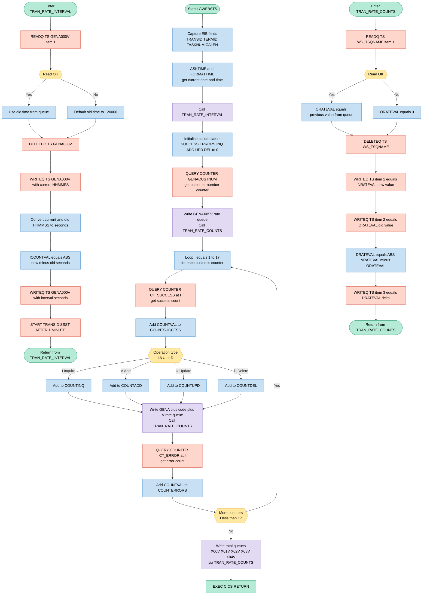

## Table of Contents

- [1. Purpose](#1-purpose)
- [2. Inputs](#2-inputs)
- [3. Outputs](#3-outputs)
- [4. Processing Logic](#4-processing-logic)
  - [4.1 Mermaid Flow Diagram](#41-mermaid-flow-diagram)
  - [4.2 Processing Logic Description](#42-processing-logic-description)
  - [4.3 Database Tables](#43-database-tables)
- [5. Paragraphs](#5-paragraphs)
- [6. Dependencies](#6-dependencies)
  - [6.1 CICS Runtime Services](#61-cics-runtime-services)
  - [6.2 CICS Named Counter Pool](#62-cics-named-counter-pool)
  - [6.3 CICS Temporary Storage Queues](#63-cics-temporary-storage-queues)
  - [6.4 CICS EIB Fields (Execution Interface Block)](#64-cics-eib-fields-execution-interface-block)
  - [6.5 CICS Transaction Definition](#65-cics-transaction-definition)
- [7. Constraints](#7-constraints)
  - [7.1 Data Format and Size Constraints](#71-data-format-and-size-constraints)
  - [7.2 Counter Table Dimension Constraints](#72-counter-table-dimension-constraints)
  - [7.3 Sequencing and Operational Order Constraints](#73-sequencing-and-operational-order-constraints)
  - [7.4 CICS Named Counter Constraints](#74-cics-named-counter-constraints)
  - [7.5 Interval Calculation Constraints](#75-interval-calculation-constraints)
- [8. Error Handling](#8-error-handling)
  - [8.1 CICS Command Exception Suppression via RESP Option](#81-cics-command-exception-suppression-via-resp-option)
  - [8.2 File and Queue I/O Error Handling](#82-file-and-queue-io-error-handling)
  - [8.3 Recovery and Fallback Mechanisms](#83-recovery-and-fallback-mechanisms)
  - [8.4 Asynchronous Transaction Rescheduling Resilience](#84-asynchronous-transaction-rescheduling-resilience)
- [9. Examples](#9-examples)
  - [9.1 Example 1: First run, no earlier queues](#91-example-1-first-run-no-earlier-queues)
  - [9.2 Example 2: Later run with counters and totals](#92-example-2-later-run-with-counters-and-totals)

## 1. Purpose

I have read and analyzed the program. I will write the final summary of the overall purpose in a single paragraph, ensuring I do not add a section heading, self-commentary, or introductory remarks, and starting directly with the description itself.

The program LGWEBST5 is a CICS-based statistics collector for the GenApp application designed to periodically query and aggregate performance metrics. It retrieves business transaction counters (covering customer, motor, endowment, house, and commercial policy operations) and their associated error counts from the named counter pool, categorizing them by operation types such as inquiries, additions, updates, and deletions. For each metric, the program maintains a historical comparison by calculating the rate of change (delta) over a elapsed time interval, writing the current, previous, and delta values to dedicated CICS Temporary Storage (TS) queues. Finally, it schedules itself to run recursively every minute under the transaction identifier SSST to continuously monitor the application's transaction volumes and overall operational health.

## 2. Inputs

- **Program parameters**
  - The program takes no explicit parameters. It is the main procedure (`Options(Main)`) and starts as a CICS transaction, with no linkage or COMMAREA data of its own.

- **CICS task context (EIB fields)**
  - `EIBTRNID`: the transaction ID of the running task. It is copied into `WS_TRANSID`.
  - `EIBTRMID`: the terminal ID. It is copied into `WS_TERMID`.
  - `EIBTASKN`: the task number. It is copied into `WS_TASKNUM`.
  - `EIBCALEN`: the length of the communication area passed in. It is copied into `WS_CALEN`.

- **System time**
  - The CICS clock, read with `ASKTIME` and `FORMATTIME`, supplies the current absolute time (`WS_ABSTIME`). The program formats it into the time (`WS_TIME`) and date (`WS_DATE`) fields.
  - The `HHMMSS` part of `WS_TIME` is used to work out the elapsed seconds since the previous run (`ICOUNTVAL`).

- **CICS named counter pool (GENA)**
  - Each counter is read with `EXEC CICS QUERY COUNTER` from pool `GENAPOOL`. The value comes back in `COUNTVAL`.
  - `GENACOUNT` (`GENACUSTNUM`) is the customer number counter. It feeds the `GENAX05V` rate queue.
  - `CT_SUCCESS` holds 17 success counters, named `GENA01<op><entity>00`. They cover customer, motor, endowment, house and commercial transactions.
    - Their values are summed into `COUNTSUCCESS`.
    - Each value is also classified by `CT_OPS` into `COUNTINQ`, `COUNTADD`, `COUNTUPD` or `COUNTDEL`.
  - `CT_ERROR` holds 17 error counters, named `GENA01<op><entity>99`. Their values are summed into `COUNTERRORS`.

- **Temporary storage queues (previous-run state)**
  - These queues are read to get values saved by the previous run.
  - Queue `GENA000V` is read at item 1. It holds the previous run time as `HHMMSS` (`WS_OLDV`).
    - If the read fails, as on the first run, the program defaults it to `120000`.
    - It is used to compute the interval `ICOUNTVAL`.
  - The rate queues are `GENA<code>V`, with codes `100`–`H00` from `CT_CODE`, plus `GENAX00V`–`GENAX05V`.
    - Item 1 of each queue is read into `WS_TSQDATA` and then `ORATEVAL`, the previous counter value used for the delta (`DRATEVAL`).
    - If the read fails, `ORATEVAL` is set to 0.

- **Static configuration and constants**
  - `TSQPRE` (`GENA`) is the TS queue name prefix.
  - `GENAPOOL` (`GENA`) is the named counter pool name.
  - `CT_CODE` holds the rate queue code for each success counter.
  - The transaction ID `SSST` is used when the program restarts itself after 1 minute.

## 3. Outputs

**CICS Temporary Storage (TS) Queue Writes — Rate/Interval Queues**

- **TS Queue `GENA000V`** (written in `TRAN_RATE_INTERVAL`)
  - First write: current HHMMSS time-of-day string (6 bytes) — records when this execution ran
  - Second write: elapsed seconds since the previous run (`WS_NEWV` / `ICOUNTVAL`, 6 bytes) — the computed interval delta used by downstream readers
- **TS Queue `GENAX05V`** (written via `TRAN_RATE_COUNTS` for customer-number counter `GENACUSTNUM`)
  - Item 1: `NRATEVAL` — current cumulative value of the customer-number counter
  - Item 2: `ORATEVAL` — previous cumulative value read from the queue before overwrite
  - Item 3: `DRATEVAL` — absolute difference (delta) between current and previous values
- **TS Queues `GENA100V` through `GENAH00V`** (one per success counter entry in `CT_SUCCESS`, written via `TRAN_RATE_COUNTS` for each of the 17 business-operation success counters)
  - Item 1: `NRATEVAL` — current cumulative value of the named success counter
  - Item 2: `ORATEVAL` — previous cumulative value
  - Item 3: `DRATEVAL` — absolute delta between current and previous
- **TS Queue `GENAX00V`** (total successes)
  - Items 1–3: current (`COUNTSUCCESS`), previous, and delta for the aggregate success total
- **TS Queue `GENAX01V`** (total inquiries)
  - Items 1–3: current (`COUNTINQ`), previous, and delta for aggregate inquiry count
- **TS Queue `GENAX02V`** (total adds)
  - Items 1–3: current (`COUNTADD`), previous, and delta for aggregate add count
- **TS Queue `GENAX03V`** (total updates)
  - Items 1–3: current (`COUNTUPD`), previous, and delta for aggregate update count
- **TS Queue `GENAX04V`** (total deletes)
  - Items 1–3: current (`COUNTDEL`), previous, and delta for aggregate delete count

**CICS Transaction Scheduling**

- **`EXEC CICS START TRANSID('SSST') AFTER MINUTES(1)`** — schedules the `SSST` transaction (this program's own transaction) to restart itself one minute after the current run, implementing a continuous polling loop

**CICS Named Counter Reads (inputs driving the outputs above)**

- **`COUNTVAL`** — receives the raw counter value from each `EXEC CICS QUERY COUNTER` call; its value feeds directly into `NRATEVAL`, `COUNTSUCCESS`, `COUNTERRORS`, `COUNTINQ`, `COUNTADD`, `COUNTUPD`, and `COUNTDEL`, all of which are subsequently written to TS queues
  - Counter `GENACUSTNUM` (pool `GENA`) — customer-number generation counter, written to `GENAX05V`
  - Counters `CT_SUCCESS(1..17)` — per-operation success counters, written to queues `GENA100V`–`GENAH00V` and rolled into `COUNTSUCCESS` / operation subtotals
  - Counters `CT_ERROR(1..17)` — per-operation error counters, accumulated into `COUNTERRORS` (used only in the accumulator; `COUNTERRORS` itself is not written to any TS queue in this program)

## 4. Processing Logic

### 4.1 Mermaid Flow Diagram

---

### 4.2 Processing Logic Description

#### 4.2.1 High-level Summary

`LGWEBST5` is a GenApp CICS statistics-collection program that runs as the **SSST** transaction. Each time it executes it reads every named counter in the GENA counter pool, aggregates the values by category, stores the current/previous/delta triplets in CICS temporary-storage (TS) queues, and then schedules itself to run again after one minute—creating a self-perpetuating monitoring loop.

---

#### 4.2.2 Execution Flow

**Step 1 — Housekeeping initialisation**  
The program captures CICS EIB fields (transaction ID, terminal ID, task number, COMMAREA length) into `WS_HEADER` for dump identification, then calls `EXEC CICS ASKTIME`/`FORMATTIME` to obtain the current absolute time, formatted date, and wall-clock time (`WS_TIME`, `WS_DATE`).

**Step 2 — Interval calculation (`TRAN_RATE_INTERVAL` procedure)**  
This internal procedure performs three jobs:

1. **Read the previous wall-clock time** from TS queue `GENA000V` (item 1, 6 bytes). If the queue does not exist (first run), a default of `'120000'` (midnight + 20 s) is used so that `ICOUNTVAL` is not zero.  
2. **Replace the queue** by deleting `GENA000V` then writing the *current* HHMMSS back as item 1, so the next run has a valid "old" time.  
3. **Compute the elapsed interval** in seconds: both the current and previous HHMMSS strings are decomposed into hours, minutes, and seconds and converted to total seconds; `ICOUNTVAL = ABS(new − old)`. The delta in seconds is then written as a second record into `GENA000V`.  
4. **Schedule the next run**: `EXEC CICS START TRANSID('SSST') AFTER MINUTES(1)` ensures the monitoring loop continues autonomously.

**Step 3 — Customer-number counter**  
The CICS named counter `GENACUSTNUM` (pool `GENA`) is queried. Its value drives a call to `TRAN_RATE_COUNTS` using TS queue `GENAX05V`, capturing its rate triplet.

**Step 4 — Transaction counter loop (17 iterations)**  
For each of the 17 business-operation counters (indices 1–17):

- **Success counter** (`CT_SUCCESS(I)`) is queried. The value is added to `COUNTSUCCESS`, and also added to one of `COUNTINQ`, `COUNTADD`, `COUNTUPD`, or `COUNTDEL` depending on the operation code character in `CT_OPS` at position `I` (`I`=Inquire, `A`=Add, `U`=Update, `D`=Delete).  
- **Rate queue** `GENA` + `CT_CODE(I)` + `V` (e.g. `GENA100V`, `GENA200V` … `GENAHV`) is updated by calling `TRAN_RATE_COUNTS`.  
- **Error counter** (`CT_ERROR(I)`) is queried and its value accumulated into `COUNTERRORS`.

The 17 counters cover: Customer inquire/add; Motor inquire/add/delete/update; Endowment inquire/add/delete/update; House inquire/add/delete/update; Commercial inquire/add/delete.

**Step 5 — Grand-total TS queues**  
Five aggregate totals are written to dedicated TS queues via `TRAN_RATE_COUNTS`:

| Queue | Content |
|-------|---------|
| `GENAX00V` | Total successful transactions |
| `GENAX01V` | Total inquiries |
| `GENAX02V` | Total adds |
| `GENAX03V` | Total updates |
| `GENAX04V` | Total deletes |

**Step 6 — Return**  
`EXEC CICS RETURN` ends the task. The next execution is already queued (Step 2, point 4).

---

#### 4.2.3 `TRAN_RATE_COUNTS` Procedure — Counter Rate Recording

This reusable procedure is called once per counter and manages the three-slot TS queue (`WS_TSQNAME`) that holds the historical triplet:

1. **Read item 1** (9 bytes) from the named queue. If successful, its value becomes `ORATEVAL` (old value); otherwise `ORATEVAL` defaults to `0` (first-run guard).  
2. **Delete** the entire queue to clear all existing items.  
3. **Write item 1** = `NRATEVAL` (current counter value).  
4. **Write item 2** = `ORATEVAL` (previous counter value).  
5. **Compute `DRATEVAL`** = `ABS(NRATEVAL − ORATEVAL)` (the per-cycle increment/delta).  
6. **Write item 3** = `DRATEVAL`.

Any downstream display program (e.g. a BMS statistics screen) reads these three items to show current count, previous count, and throughput delta.

---

#### 4.2.4 External Interactions

| Interaction | Details |
|---|---|
| **CICS Named Counters** | `QUERY COUNTER … POOL(GENA)` is used to non-destructively read 35 counters (1 customer-number + 17 success + 17 error). No counters are modified. |
| **CICS Temporary Storage** | 18 TS queues are managed (`GENA000V`, `GENAX00V`–`GENAX05V`, and `GENA100V`–`GENAHV`). Each stores a 9-byte current/old/delta triplet except `GENA000V`, which stores a 6-byte HHMMSS string plus a 6-byte interval-seconds value. |
| **CICS START** | `START TRANSID('SSST') AFTER MINUTES(1)` schedules the transaction's next invocation, implementing the self-scheduling loop. |

---

#### 4.2.5 Plain Language Summary

`LGWEBST5` acts as an automated CICS "health dashboard collector". Every minute it wakes up, reads activity counters that track how many insurance transactions (inquiries, additions, updates, deletions) have been processed since the application started, and saves a snapshot of each counter along with the previous snapshot and the difference between them. This lets a display screen show not just total counts but also live throughput (transactions per minute). After saving all statistics, the program schedules itself to run again one minute later, so the dashboard is always up to date without any manual intervention.

---

### 4.3 Database Tables

No Db2 SQL statements are present in `LGWEBST5`. All persistence is through CICS Temporary Storage queues and CICS Named Counters; there are no database tables to diagram.

## 5. Paragraphs

- **Main Procedure (LGWEBST5)**
  - Serves as the program entry point and top-level orchestrator for the GenApp statistics collection cycle.
  - Initialises the diagnostic header (`WS_HEADER`) with the eyecatcher `'LGWEBST5------WS'`, then captures the current CICS context fields: transaction ID (`EIBTRNID`), terminal ID (`EIBTRMID`), task number (`EIBTASKN`), and COMMAREA length (`EIBCALEN`).
  - Issues `EXEC CICS ASKTIME` to obtain the absolute clock value and `EXEC CICS FORMATTIME` to format it into date (`WS_DATE`) and time (`WS_TIME`) fields.
  - Calls the internal procedure `TRAN_RATE_INTERVAL` to compute the elapsed seconds since the last execution and schedule the next run.
  - Zeroes all six accumulator variables (`COUNTSUCCESS`, `COUNTERRORS`, `COUNTINQ`, `COUNTADD`, `COUNTUPD`, `COUNTDEL`).
  - Queries the customer-number named counter `GENACUSTNUM` from pool `GENA`, sets the TS queue name to `GENAX05V`, and calls `TRAN_RATE_COUNTS` to persist new/old/delta values.
  - Iterates (`DO I = 1 TO 17`) over the 17 success/error counter pairs defined in `CT_SUCCESS` and `CT_ERROR`:
    - Queries each success counter and accumulates the value into `COUNTSUCCESS`.
    - Uses a `SELECT` on the operation character in `CT_OPS` to route the count into the appropriate sub-accumulator (`COUNTINQ`, `COUNTADD`, `COUNTUPD`, or `COUNTDEL`).
    - Constructs the TS queue name from `CT_CODE(I)` and calls `TRAN_RATE_COUNTS` to record the per-counter rate data.
    - Queries the corresponding error counter and accumulates into `COUNTERRORS`.
  - After the loop, writes five aggregate totals (total successes, inquiries, adds, updates, deletes) to TS queues `GENAX00V`–`GENAX04V` by calling `TRAN_RATE_COUNTS` for each.
  - Terminates with `EXEC CICS RETURN`.

- **TRAN_RATE_INTERVAL**
  - Computes the elapsed seconds since the previous execution and schedules the next invocation of the statistics-collection transaction.
  - Reads TS queue `GENA000V` item 1 into `WS_OLDV` (the HHMMSS string written on the prior run). If the read fails (first run or queue absent), defaults `WS_OLDV` to `'120000'` (midnight baseline).
  - Deletes the existing `GENA000V` queue entry, then writes the current time string (`WS_HHMMSS`, extracted from the first six characters of `WS_TIME`) as the new item 1.
  - Converts both the current and previous HHMMSS strings to total-seconds integers (`NCOUNTVAL` and `OCOUNTVAL`) by splitting hours, minutes, and seconds and computing `HH×3600 + MM×60 + SS`.
  - Computes the absolute difference (`ICOUNTVAL = ABS(NCOUNTVAL - OCOUNTVAL)`) to obtain the interval length in seconds, stores it in `WS_NEWV`, and writes it as a second entry to `GENA000V`.
  - Issues `EXEC CICS START TRANSID('SSST') AFTER MINUTES(1)` to reschedule the statistics collector to run again one minute later.

- **TRAN_RATE_COUNTS**
  - Maintains a three-item TS queue for each monitored counter, holding the current value, the previous value, and their absolute difference (the transaction rate delta).
  - Reads item 1 from the queue named by `WS_TSQNAME` into `WS_TSQDATA`. If the read succeeds, the 9-character value is assigned to `ORATEVAL` (previous count); if the queue does not yet exist, `ORATEVAL` is set to zero — ensuring a clean first-run baseline rather than inheriting stale working storage.
  - Deletes the existing queue to clear all prior items.
  - Writes `NRATEVAL` (the newly queried counter value) as item 1, `ORATEVAL` as item 2, and the computed delta `DRATEVAL = ABS(NRATEVAL - ORATEVAL)` as item 3 — each as a 9-byte fixed-format numeric string.
  - Contains no looping or branching beyond the single conditional check on `DFHRESP(NORMAL)`.

## 6. Dependencies

### 6.1 CICS Runtime Services

- **EXEC CICS ASKTIME / FORMATTIME** — retrieves the current absolute time and formats it into date (`WS_DATE`) and time (`WS_TIME`) fields used to compute the interval since the last run
- **EXEC CICS QUERY COUNTER** — queries named counters in the `GENA` counter pool to obtain current transaction counts; invoked for:
  - `GENACUSTNUM` (customer number generation counter, pool `GENA`)
  - 17 success counters (`GENA01ICUS00` … `GENA01DCOM00`) in pool `GENA`
  - 17 error counters (`GENA01ICUS99` … `GENA01DCOM99`) in pool `GENA`
- **EXEC CICS START TRANSID('SSST')** — re-schedules itself to run again after one minute, making the program a self-restarting statistics collector; the transaction identifier `SSST` must be defined in the CICS CSD
- **EXEC CICS RETURN** — terminates the current CICS task cleanly after all counters have been sampled and all TS queues updated

### 6.2 CICS Named Counter Pool

- **Counter pool `GENA`** — the named counter pool that owns all counters queried by this program; must be defined and active in the CICS region before the program can run
- **Named counters** (all in pool `GENA`):
  - `GENACUSTNUM` — tracks the number of customer records generated
  - `GENA01IxxxNN` / `GENA01AxxxNN` / `GENA01DxxxNN` / `GENA01UxxxNN` series (success `..00` and error `..99` suffixes) covering customer, motor, endowment, house, and commercial policy operations

### 6.3 CICS Temporary Storage Queues

- **`GENA000V`** — interval timing queue; stores the previous run's HHMMSS value (item 1) and the computed elapsed-seconds delta (item 2); read, deleted, and rewritten on every execution
- **`GENAX05V`** — rate queue for the customer-number counter (`GENACUSTNUM`); holds three 9-byte items: new value, old value, and delta
- **`GENA<code>V` (17 queues, codes `100`–`H00`)** — one rate queue per success counter (e.g., `GENA100V`, `GENA200V`, … `GENAH00V`); each queue stores new, old, and delta values for the corresponding transaction counter
- **`GENAX00V` – `GENAX04V`** — rate queues for the five aggregate totals: total success, inquiries, adds, updates, and deletes respectively

### 6.4 CICS EIB Fields (Execution Interface Block)

- **`EIBTRNID`** — current transaction identifier; copied into `WS_TRANSID` for diagnostics
- **`EIBTRMID`** — current terminal identifier; copied into `WS_TERMID` for diagnostics
- **`EIBTASKN`** — current task number; copied into `WS_TASKNUM` for diagnostics
- **`EIBCALEN`** — COMMAREA length; copied into `WS_CALEN` for diagnostics
- **`DFHRESP(NORMAL)`** — CICS condition constant used to test whether each TS queue read succeeded or failed (determines whether a previous counter value exists)

### 6.5 CICS Transaction Definition

- **Transaction `SSST`** — the CICS transaction ID that maps to this program (`LGWEBST5`); must be defined in the CICS CSD so that the `EXEC CICS START TRANSID('SSST')` self-restart mechanism functions correctly

## 7. Constraints

### 7.1 Data Format and Size Constraints

- **Counter value numeric range** — `COUNTVAL`, `COUNTSUCCESS`, `COUNTERRORS`, `COUNTINQ`, `COUNTADD`, `COUNTUPD`, and `COUNTDEL` are all declared `FIXED BIN(31)`, limiting each to a signed 32-bit integer (maximum ~2.1 billion). Any CICS named counter whose lifetime total exceeds this boundary would cause arithmetic overflow during accumulation.
- **Rate value display width** — `NRATEVAL`, `ORATEVAL`, and `DRATEVAL` are declared `PIC '999999999'` (9 digits, maximum value 999,999,999). Assigning a counter value larger than 999,999,999 to any of these picture variables causes a loss of the high-order digits, silently truncating the stored or displayed rate.
- **Interval elapsed-seconds field** — `ICOUNTVAL` is declared `PIC '999999'` (6 digits, maximum 999,999 seconds). In practice the computed interval is always less than 86,400 seconds (one day), so this limit is never reached under normal operations.
- **TS queue data record length** — Rate queue records are written and read with a hard-coded length of exactly 9 bytes (matching `WS_TSQDATA CHAR(9)`). The interval queue uses a hard-coded length of 6 bytes (matching `WS_OLDV`/`WS_NEWV CHAR(6)`). Any read that returns a record shorter than the declared length will leave the remainder of the target field undefined; no length reconciliation logic exists.
- **TS queue name construction** — `WS_TSQNAME` is `CHAR(8)`, assembled as the 4-byte prefix `'GENA'` concatenated with a 3- or 4-character suffix (e.g., `CT_CODE(I)` is 3 chars, plus `'V'` gives 4; `'X05V'`, `'X00V'`–`'X04V'` are each 4 chars). The total is always exactly 8 characters; names that differ in construction would silently pick up or overwrite the wrong queue.
- **Time string extraction** — `WS_HHMMSS` is populated from `SUBSTR(WS_TIME,1,6)`, extracting the first 6 of the 8-character `WS_TIME` field returned by `FORMATTIME`. Hours, minutes, and seconds are then each extracted as 2-character substrings at fixed offsets (1, 3, 5). The program assumes `FORMATTIME TIME(...)` always returns `HHMMSSTH` format; any deviation would silently corrupt the interval calculation.

### 7.2 Counter Table Dimension Constraints

- **Fixed counter table size of 17** — `CT_SUCCESS`, `CT_ERROR`, `CT_CODE`, and the string `CT_OPS` are all statically sized or initialised to exactly 17 entries. The processing loop `DO I = 1 TO 17` is hard-coded to this bound. Adding or removing a business operation counter requires simultaneous update of all four tables and the loop bound, or array bounds violations and mismatched classifications will occur.
- **CT_OPS character-position alignment** — Each position in the 17-character string `CT_OPS` (`'IAIADUIADUIADUIAD'`) must correspond positionally to the same index in `CT_SUCCESS`. `SUBSTR(CT_OPS,I,1)` is used directly to classify the counter at position `I` as Inquire (`I`), Add (`A`), Update (`U`), or Delete (`D`). Any entry in `CT_OPS` that is not one of those four characters falls through the `SELECT` without matching any `WHEN` clause, silently dropping that counter's value from all operation-type accumulators.
- **CT_CODE queue suffix uniqueness** — The 3-character codes in `CT_CODE` (`'100'`–`'H00'`) must be unique across all 17 entries. Duplicate codes would cause `TRAN_RATE_COUNTS` to read the previous run's new-value record as the old-value for a different counter, silently corrupting the delta calculation.

### 7.3 Sequencing and Operational Order Constraints

- **`TRAN_RATE_INTERVAL` must execute before counter queries** — The call to `TRAN_RATE_INTERVAL` on line 94 is the first substantive action after header initialisation. It captures the current time, computes the elapsed interval, writes the interval queue, and schedules the next run via `EXEC CICS START TRANSID('SSST') AFTER MINUTES(1)`. This must precede all counter queries because the interval value is consumed by downstream display; it also ensures that the 1-minute restart timer is always set regardless of how many counters are queried.
- **Accumulator zeroing before the loop** — `COUNTSUCCESS`, `COUNTERRORS`, `COUNTINQ`, `COUNTADD`, `COUNTUPD`, and `COUNTDEL` are explicitly zeroed (lines 96–101) before the `DO I = 1 TO 17` loop begins. There is no default initialisation for these variables in their declarations, so skipping this step would leave them holding unpredictable values from prior stack content.
- **`TRAN_RATE_COUNTS` write sequence** — Inside `TRAN_RATE_COUNTS`, records are written to the TS queue in a strict three-item order: new value (item 1), old value (item 2), delta (item 3). The caller `DELETEQ` first destroys any existing queue, so item numbers are always 1, 2, 3 in sequence. Any consumer of the queue that reads by item number depends on this exact ordering being preserved.
- **Delete-before-write pattern** — Both `TRAN_RATE_INTERVAL` and `TRAN_RATE_COUNTS` issue `EXEC CICS DELETEQ TS` before rewriting the queue. This ensures the new write always creates item 1. Omitting the delete would append new items rather than replacing, breaking the fixed item-number protocol relied upon by reads.
- **`EXEC CICS RETURN` terminates processing** — The main-line code ends at line 157 with `EXEC CICS RETURN`. All counter queries, accumulation, and TS queue writes for totals (`X00V`–`X04V`) must complete before this point. No error condition causes an early return; the program always runs to completion regardless of individual `WS_RESP` values from counter queries or queue operations.

### 7.4 CICS Named Counter Constraints

- **Counter pool fixed as `'GENA'`** — `GENAPOOL` is a `STATIC` variable initialised to `'GENA'`. All 35 counter queries (`GENACOUNT` plus 17 success/17 error) use this single pool. If the pool is not defined in the CICS region, every `QUERY COUNTER` will return a non-NORMAL `WS_RESP`; however, the program does not test `WS_RESP` after counter queries, so `COUNTVAL` retains its previous value (initially 0) and processing silently continues with stale or zero data.
- **`GENACOUNT` counter name is fixed** — The customer-number counter is identified by `GENACOUNT CHAR(16) STATIC INIT('GENACUSTNUM')`. The trailing 5 characters of the 16-byte field are spaces; the counter name must be registered in the CICS pool with the exact name `GENACUSTNUM` padded to 16 characters, or the query will fail silently.
- **Counter response not validated for transaction counters** — `WS_RESP` is checked only in `TRAN_RATE_INTERVAL` (for the interval TS queue read) and in `TRAN_RATE_COUNTS` (for the rate TS queue read). `WS_RESP` after each `QUERY COUNTER` is captured but never tested. A missing counter therefore contributes a value of 0 to all accumulators without generating an error or diagnostic.

### 7.5 Interval Calculation Constraints

- **Absolute-value wrapping for midnight crossover** — The elapsed-seconds difference is computed as `ABS(NCOUNTVAL - OCOUNTVAL)`. Using absolute value means a midnight crossover (where `NCOUNTVAL` < `OCOUNTVAL`) produces a large positive number rather than the true elapsed seconds; for example, if the previous run was at 23:59:55 and the current is at 00:00:55, the result is 86,340 seconds rather than 60 seconds.
- **Default previous time on first run** — If the interval queue (`GENA000V`) cannot be read (e.g., first execution), `WS_OLDV` is set to the literal `'120000'` (12:00:00 noon). This means the first computed interval will be the absolute difference between noon and the actual first-run time, which may be a large number; no provision exists to suppress or flag this anomalous first-run interval value.
- **Restart interval is fixed at 1 minute** — `EXEC CICS START TRANSID('SSST') AFTER MINUTES(1)` hard-codes the reschedule delay. There is no configurable or computed delay; the interval cannot be changed without modifying the source code.

## 8. Error Handling

The error handling and fault tolerance mechanisms implemented within the program are organized into the following functional categories:

### 8.1 CICS Command Exception Suppression via RESP Option
- Direct Response Code Capture
  - All executable CICS commands (`QUERY COUNTER`, `READQ TS`, `DELETEQ TS`, `WRITEQ TS`, and `START TRANSID`) specify the `RESP(WS_RESP)` option.
  - This prevents CICS default condition handling from automatically raising abends or terminating the task when an error condition occurs during counter queries, TS queue I/O, or asynchronous transaction initiation.

### 8.2 File and Queue I/O Error Handling
- Temporary Storage Queue Read Validation
  - When retrieving the timestamp from the interval TS queue (`GENA000V`), the program tests the return code condition against a normal status (`DFHRESP(NORMAL)`).
  - When reading previous counter values in the transaction rate routine, the program performs an explicit check on the response code to distinguish between an existing queue item and a missing or unreadable queue.
- Unchecked TS Queue Operations
  - For queue deletions (`DELETEQ TS`) and subsequent writes (`WRITEQ TS`), the response code is captured in `WS_RESP` but not explicitly evaluated. If an error occurs during queue deletion (e.g., queue not found on initial run), the failure is silently absorbed and processing continues.

### 8.3 Recovery and Fallback Mechanisms
- Fallback Timestamp Initialization
  - If reading the timestamp TS queue fails (such as on the initial startup execution when the queue has not yet been created), the program triggers a fallback branch that initializes the previous timestamp variable to a default constant value (`120000`).
- Missing Counter Value Fallback
  - If a rate queue read fails because the queue does not exist (e.g., initial execution), the program branches to an alternate path that sets the previous rate value (`ORATEVAL`) to zero rather than leaving the field undefined or failing.
- Absolute Value Difference Safety
  - In interval time and rate change calculations, the program utilizes the `ABS` built-in function to calculate non-negative differences between new and old values, preventing negative deltas from corrupting fixed-format numeric display variables.

### 8.4 Asynchronous Transaction Rescheduling Resilience
- Non-blocking Transaction Restart
  - The `START` command that schedules the next execution interval under transaction ID `SSST` captures the execution status in `WS_RESP` without terminating execution if the start request encounters an issue. This ensures the program completes its current aggregation cycle and terminates normally via `EXEC CICS RETURN`.

## 9. Examples

### 9.1 Example 1: First run, no earlier queues

**Input**
- CICS time at the run: `10:15:30`.
- Queue `GENA000V` does not exist.
- Named counter `GENACUSTNUM` = 1500.
- Queue `GENAX05V` does not exist.

**Output**
- `GENA000V` is rewritten with item 1 = `101530` and item 2 = `006270`.
- `GENAX05V` is rewritten with three items:
  1. `000001500`
  2. `000000000`
  3. `000001500`
- Transaction `SSST` is scheduled to start again after 1 minute.

**Explanation**
- The `READQ` on `GENA000V` fails, so the previous time defaults to `120000`. That is 43200 seconds.
- The current time is 36930 seconds, so `ICOUNTVAL` = |36930 − 43200| = 6270, stored as `006270`.
- The `READQ` on `GENAX05V` also fails, so `ORATEVAL` = 0.
- The queue is then written as the new value, the old value, and the absolute difference.

### 9.2 Example 2: Later run with counters and totals

**Input**
- Previous `GENA000V` item 1 = `101530`.
- Current time: `10:16:30`.
- Success counters: `GENA01ICUS00` = 100, `GENA01ACUS00` = 20, `GENA01IMOT00` = 50, `GENA01AMOT00` = 10, `GENA01DMOT00` = 2, `GENA01UMOT00` = 5. All other success counters are 0.
- Error counters: `GENA01ICUS99` = 3, `GENA01AMOT99` = 1. All other error counters are 0.
- Previous `GENAX00V` item 1 = `000000170`.

**Output**
- `GENA000V` is rewritten with item 1 = `101630` and item 2 = `000060`.
- Accumulated totals: `COUNTSUCCESS` = 187, `COUNTINQ` = 150, `COUNTADD` = 30, `COUNTUPD` = 5, `COUNTDEL` = 2, `COUNTERRORS` = 4.
- `GENAX00V` is rewritten with three items:
  1. `000000187`
  2. `000000170`
  3. `000000017`
- Queue `GENA100V` holds customer-inquiry data: new `000000100`, then the old value and the difference.
- Queue `GENAX01V` receives the inquiry total 150, `GENAX02V` the add total 30, `GENAX03V` the update total 5 and `GENAX04V` the delete total 2.

**Explanation**
- The time difference is 60 seconds, so `ICOUNTVAL` = 60.
- For each of the 17 counters, the value is added to `COUNTSUCCESS`. It is also added to the inquiry, add, update or delete total, chosen by the matching letter in `CT_OPS` (`IAIADUIADUIADUIAD`).
  - Inquiry: 100 + 50 = 150.
  - Add: 20 + 10 = 30.
  - Update: 5.
  - Delete: 2.
- The error counters are only summed into `COUNTERRORS` (3 + 1 = 4). No rate queue is written for them.
- For `GENAX00V`, the new value is 187 and the old value is 170, so the difference is |187 − 170| = 17.
- The program ends with `EXEC CICS RETURN`, after scheduling `SSST` to run again in a minute.

---

Generated by IBM Bob Premium Package for Z
